# LP-based branch-and-bound

**Part 3 · Exact methods · Chapter 7** · [:material-file-pdf-box: Lecture notes, volume 2 (PDF)](../pdf/lecture-notes-2-exact-methods.pdf) · [:material-pencil: Exercises: Branch-and-bound](../exercises/bb.md) · [:material-gesture-tap: App: Branch-and-bound step by step](../lab/branch-and-bound-steps.md)

!!! nota "Prerequisites"

    - From the module <em>Linear Programming</em>, [Chapter 10 «Dual Simplex algorithm»](https://fabiofurini.github.io/linear-programming/duality/10-dual-simplex/): simplex dictionaries, dual feasible bases and dual pivoting operations. A short recap is given in this chapter.

    - From this module, the chapter «Integer linear programming»: ILP problems, feasible and optimal solutions, and the car example.

    - From this module, the chapter «Primal and dual bounds»: the LP relaxation, lower bounds from feasible solutions, upper bounds from the LP relaxation, and the optimality gap.

!!! chiave "Objectives"

    At the end of this chapter you will be able to:

    - explain how branching operations divide a ILP problem into smaller LP problems, and why no feasible solution is lost;

    - apply the three pruning criteria, and decide when the bound of a node can be rounded down;

    - execute an LP-based branch-and-bound algorithm by hand, re-optimizing every node with the dual simplex algorithm;

    - compute the lower bound, the upper bound and the optimality gap at every iteration;

    - compare different branching-variable and branching-node selection strategies on the same instance.

- This chapter defines the LP-based branch-and-bound algorithm for ILP problems in canonical maximization form with integer data, with its branching and bounding operations.

- The guiding instance is the car example, $\max \{ 3\,x_1 + 2\,x_2 : 10\,x_1 + 4\,x_2 \le 45,~ 4\,x_1 + 14\,x_2 \le 49,~ x_1, x_2 \in \Z_{\ge 0} \}$, whose LP relaxation has the fractional optimal solution $(\frac{7}{2},\frac{5}{2})$, with $z(\LP) = \frac{31}{2}$.

## 7.1 The idea in words and in a picture

- The <strong>LP-based branch-and-bound algorithm</strong> (<strong>B&amp;B algorithm</strong>, for short) is an exact method for ILP problems. It is called <strong>LP-based</strong> because it solves LP relaxations to guide the search for an optimal solution.

- In the optimal solution of the LP relaxation of the car example the variable $x_1$ takes a fractional value between $3$ and $4$. Every feasible solution of the ILP problem satisfies either $x_1 \le 3$ or $x_1 \ge 4$, so we can split the problem into two smaller LP problems, one for each side, and remove the strip in between, which contains no integer point:

    $$
    \rightsquigarrow~\textbf{branching operations}.
    $$

- Each new LP problem is solved. Its optimal value bounds from above the value of every solution in its region, so it tells us whether the region must be explored further or can be discarded:

    $$
    \rightsquigarrow~\textbf{bounding operations}.
    $$

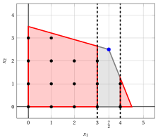{ .fig .ovale loading=lazy  }

<em>Branching on $x_1$ at the root of the car example: the two red regions are the feasible regions of the children ($x_1 \le 3$ and $x_1 \ge 4$); the gray strip $3 < x_1 < 4$ is cut off, and it contains no integer point.</em>

!!! chiave ""

    A branch-and-bound algorithm explores implicitly all the feasible solutions: it divides the feasible region into smaller regions (branching) and discards every region that cannot contain a better solution than the best one found so far (bounding).

## 7.2 Definitions and notation

### 7.2.1 ILP problems in canonical maximization form

- Given $n$ values $c_j \in \Z$, $m \cdot n$ values $a_{ij} \in \Z$ and $m$ values $b_i \in \Z$, an <strong>integer linear programming</strong> (ILP) problem in canonical maximization form, with $n$ <u>integer variables</u> and integer data, reads as follows:

!!! chiave ""

    

    \begin{align*}
    \max ~~ \sum_{j=1}^{n} c_j \, x_j & & \label{bb:MIP-obj} \tag{7.1a}\\[1ex]
    \text{subject to} \quad \sum_{j=1}^{n} a_{ij} \, x_j &\le b_i, & \forall i \in \{1, 2, \dots, m\},
    \label{bb:MIP-cons} \tag{7.1b}\\[1ex]
    x_j &\in \Z_{\ge 0}, & \forall j \in \{1, 2, \dots, n\}. \label{bb:MIP-int} \tag{7.1c}
    \end{align*}

- The car example is an ILP problem with $n = 2$ and $m = 2$.

- We denote by $z(\ILP)$ the optimal value of the problem [(7.1)](#eq-bb-MIP), and by $\tilde{\vet x}(\ILP)$ an optimal solution.

- The <strong>LP relaxation</strong> of the problem [(7.1)](#eq-bb-MIP), called the $\LP_1$ problem, is obtained by replacing the integrality constraints $\eqref{bb:MIP-int}$ with the non-negativity constraints $x_j \ge 0$, for all $j \in \{1, 2, \dots, n\}$.

### 7.2.2 Branch-and-bound tree, incumbent solution and lower bound

!!! chiave ""

    The <strong>branching operations</strong> generate a <strong>branch-and-bound tree</strong> containing LP problems. Each LP problem is obtained from the LP relaxation by adding specific <strong>branching constraints</strong>.

- The recursive structure of a B&amp;B algorithm induces the tree. Each <strong>branching node</strong> of the tree corresponds to an LP problem; the root is the $\LP_1$ problem.

!!! definizione "Definition 7.1: branching node index"

    For each branching node $k$, the associated LP problem is denoted by $\LP_k$. If $\LP_k$ has an optimal solution, it is denoted by $\tilde{\vet x}(\LP_k)$ and its optimal value by $z(\LP_k)$. The integer $k$ is called the <strong>branching node index</strong>: it identifies the node uniquely, and the nodes are numbered in the order in which their LP problems are solved.

- A B&amp;B algorithm keeps the best feasible solution of the problem [(7.1)](#eq-bb-MIP) found during the search. This solution is called the <strong>incumbent solution</strong> and is denoted by $\bar{\vet x}$; its value is a <strong>lower bound</strong> $\LB$ on $z(\ILP)$. Before any feasible solution is found we set $\LB = -\infty$.

- The lower bound and the incumbent solution are updated whenever a better feasible solution is found. At termination we have an <strong>algorithmic certificate</strong> that

    \begin{equation*}
    z(\ILP) = \LB \qquad \text{and} \qquad \tilde{\vet x}(\ILP) = \bar{\vet x}. \tag{7.2}
    \end{equation*}

### 7.2.3 Branching operations

- The most common branching operation is the <strong>binary branching</strong>: it acts on a single <strong>branching variable</strong> and produces two child branching nodes, one with an additional <strong>upper bound</strong> and one with an additional <strong>lower bound</strong> on the branching variable.

- More precisely, let $\tilde{\vet x}(\LP_k)$ be an optimal solution of the $\LP_k$ problem, and let $x_j$, with $j \in \{1, 2, \dots, p\}$, be an <u>integer variable</u> that takes a fractional value $\tilde x_j$. The binary branching on $x_j$ generates two child LP problems:

    1. the $\LP_k$ problem with the additional <strong>down-branching constraint</strong>

        \begin{equation*}
        \label{bb:down}
        x_j \le \left\lfloor \tilde x_j \right\rfloor ; \tag{7.3}
        \end{equation*}

    2. the $\LP_k$ problem with the additional <strong>up-branching constraint</strong>

        \begin{equation*}
        \label{bb:up}
        x_j \ge \left\lfloor \tilde x_j \right\rfloor + 1 . \tag{7.4}
        \end{equation*}

- The two child nodes are called the <strong>down-branching node</strong> and the <strong>up-branching node</strong>. In both of them $\tilde{\vet x}(\LP_k)$ is no longer feasible.

!!! chiave ""

    Every feasible solution of the ILP problem contained in the region of $\LP_k$ satisfies either $\eqref{bb:down}$ or $\eqref{bb:up}$, so it is contained in the region of one of the two children. <strong>This ensures the correctness of the B&amp;B algorithm</strong>.

### 7.2.4 Bounding operations and the bound of a node

- The value $z(\LP_k)$ is an upper bound on the value of every feasible solution of the ILP problem in the region of $\LP_k$. When all the values are integer, this bound can be rounded down.

!!! teorema "Observation 7.2: rounding the bound of a node"

    Since all the variables and all the costs are integer, every feasible solution in the region of $\LP_k$ has value at most $\lfloor z(\LP_k) \rfloor$.

??? dimostrazione "Proof"

    Since $c_j \in \Z$ for all $j$, the value $\sum_{j=1}^{n} c_j \, \bar x_j$ of a feasible solution $\bar{\vet x}$ is a sum of products of integers, hence an integer. Since it is at most $z(\LP_k)$, it is at most the largest integer not exceeding $z(\LP_k)$, that is, $\lfloor z(\LP_k) \rfloor$. □

- Accordingly, we call <strong>bound of the node</strong> $k$ the value

    \begin{equation*}
    \label{bb:ubk}
    \mathrm{UB}(\LP_k) =
    \begin{cases}
    \left\lfloor z(\LP_k) \right\rfloor & \text{if } p = n \text{ and } c_j \in \Z \text{ for all }
    j \in \{1, 2, \dots, n\},\\[1ex]
    z(\LP_k) & \text{otherwise.}
    \end{cases} \tag{7.5}
    \end{equation*}

- Given a branching node $k$, no branching operation is performed on it if one of the following <strong>pruning criteria</strong> applies. In these cases the node is said to be <strong>pruned</strong>.

    1. <strong>Pruning by infeasibility</strong>: the $\LP_k$ problem is infeasible, so its region contains no feasible solution of the ILP problem.

    2. <strong>Pruning by integrality</strong>: the integer variables have integer values in $\tilde{\vet x}(\LP_k)$, so $\tilde{\vet x}(\LP_k)$ is feasible for the ILP problem, and it is optimal in the region of $\LP_k$. If $z(\LP_k) > \LB$, the lower bound and the incumbent solution are updated.

    3. <strong>Pruning by bound</strong>: the bound of the node does not exceed the lower bound, $\mathrm{UB}(\LP_k) \le \LB$, so the region of $\LP_k$ contains no solution better than the incumbent one.

!!! chiave ""

    The criteria are checked in this order: infeasibility, integrality, bound. When both integrality and bound apply, the node is pruned by integrality.

### 7.2.5 The list of LP problems

- A branching node that is not pruned is inserted into a <strong>list</strong> $L$ of LP problems waiting for a branching operation.

- The order in which the LP problems are extracted from the list determines the <strong>branching-node selection strategy</strong>; the choice of the branching variable determines the <strong>branching-variable selection strategy</strong>. Both are discussed after the algorithm.

### 7.2.6 Upper bound and optimality gap

- If the list $L$ is not empty, every feasible solution better than the incumbent one lies in the region of some node of the list. Accordingly, the B&amp;B algorithm has the <strong>upper bound</strong>

    \begin{equation*}
    \label{bb:UB}
    z(\ILP) ~~\le~~ \UB = \max_{k \in L} \left\{ \mathrm{UB}(\LP_k) \right\}. \tag{7.6}
    \end{equation*}

    When the list is empty, the incumbent solution is optimal and $\UB = \LB$.

- The upper bound is computed after the solution of the root and updated at the end of every iteration. The algorithm does not need it, but it measures the progress through the <strong>optimality gap</strong>:

    \begin{equation*}
    \label{bb:gap}
    \text{optimality gap} = \frac{\UB - \LB}{|\LB|}, \qquad \text{for } \LB \ne 0 . \tag{7.7}
    \end{equation*}

### 7.2.7 Heuristic initialization

!!! chiave ""

    Before the B&amp;B algorithm, a <strong>heuristic algorithm</strong> can be run to find a good feasible solution. The lower bound $\LB$ and the incumbent solution $\bar{\vet x}$ are then initialized with this solution.

- A good initial lower bound allows the algorithm to prune nodes by bound earlier, and it can reduce the size of the branch-and-bound tree considerably.

- If the initial lower bound already satisfies $\mathrm{UB}(\LP_1) \le \LB$, the root is pruned by bound: the heuristic solution is optimal and no branching is needed.

## 7.3 The algorithm

### 7.3.1 Pseudocode

!!! algoritmo "Algorithm"

    - <strong>Input:</strong> An ILP problem in canonical maximization form with integer input data.

    - <strong>Output:</strong> An optimal solution to the ILP problem (if one exists) or a certificate of infeasibility/unboundedness.

    - **Step 0:** <strong>Initialization</strong>

        1. Relax the integrality constraints and solve the $\LP_1$ problem.

            - **1.** if ${\tilde{\vet x}}(\LP_1)$ is <strong>integer</strong>, then it is an optimal solution and $z(\LP_1)$ is the optimal value of the ILP problem.  <code>STOP</code>.

            - **2.** if the $\LP_1$ problem is <strong>infeasible</strong>, then the ILP problem is infeasible.  <code>STOP</code>.

            - **3.** if the $\LP_1$ problem is <strong>unbounded</strong>, then the ILP problem is either infeasible or unbounded.  <code>STOP</code>.

        2. Insert the $\LP_1$ problem into a <strong>list of LP problems for branching</strong> (denote $L$).  Set the <strong>lower bound</strong> $\LB \leftarrow -\infty$ (or the value of a heuristic solution), and set a branching node counter $c \leftarrow 1$.

    - **Step 1:** <strong>Optimality check</strong>

        1. if the list $L$ is empty and $\LB \neq -\infty$, then $\LB$ is the optimal value and the <strong>incumbent solution</strong> ${\bar{\vet x}}(\ILP)$ is an optimal solution to the ILP problem.  <code>STOP</code>.

        2. if the list $L$ is empty and $\LB = -\infty$, then the ILP problem is infeasible.  <code>STOP</code>.

    - **Step 2:** <strong>Branching-node selection strategy</strong>

        Select and remove an $\LP_k$ problem from the list $L$.

    - **Step 3:** <strong>Branching-variable selection strategy</strong>

        Select a variable $x_j$ with fractional value $\tilde{x}_j$ in ${\tilde{\vet x}}(\LP_k)$ and generate two new LP problems:

        1. the $\LP_{c+1}$ problem $\rightsquigarrow$ the $\LP_k$ problem with the additional <strong>down-branching constraint</strong>: $x_j \le \lfloor \tilde{x}_j \rfloor$

        2. the $\LP_{c+2}$ problem $\rightsquigarrow$ the $\LP_k$ problem with the additional <strong>up-branching constraint</strong>: $x_j \ge \lfloor \tilde{x}_j \rfloor + 1$

        Execute the <strong>Branching Node Solution Sub-Procedure</strong> for the $\LP_{c+1}$ problem and for the $\LP_{c+2}$ problem; the second one is skipped if, after the first, $\left\lfloor z(\LP_k) \right\rfloor \le \LB$. Increment the branching node counter $c \leftarrow c + 2$ and go to step 1.

- This is the pseudocode of the <strong>Branching Node Solution Sub-Procedure</strong>.

!!! algoritmo "Algorithm"

    - <strong>Input:</strong> An $\LP_k$ problem associated with a branching node.

    - **Step 1:** <strong>Bounding operations</strong>

        Solve the $\LP_k$ problem.

        1. if the $\LP_k$ problem is infeasible, then <code>STOP</code>.

        2. if $\left\lfloor z(\LP_k) \right\rfloor \le \LB$, then <code>STOP</code>.

        3. if ${\tilde{\vet x}}(\LP_k)$ is integer, then update the <strong>lower bound</strong> and the <strong>incumbent solution</strong>:

            $$
            \LB \leftarrow z(\LP_k)
            \quad \text{and} \quad
            {\bar{\vet x}}(\ILP) \leftarrow {\tilde{\vet x}}(\LP_k)
            $$

            Remove from the list $L$ all LP problems with $\left\lfloor z(\LP) \right\rfloor \le \LB$ and <code>STOP</code>.

    - **Step 2:** <strong>Insertion into the list</strong>

        Insert the $\LP_k$ problem into the list $L$ and  <code>STOP</code>.

- The LP problem with the down-branching constraint is called the <strong><em>down-branching node</em></strong>. The LP problem with the up-branching constraint is called the <strong><em>up-branching node</em></strong>. The order in which they are solved determines the order in which the LP problems enter the list $L$.

- The pseudocode does not say how the LP problems are solved: any method for LP problems can be used.

- If the <strong>dual simplex algorithm</strong> is used, each child is solved starting from the optimal dictionary of its parent: after adding the branching constraint this dictionary is still dual feasible, so in general a few pivot operations are enough (Section [7.4](#sez-bb-sec-dualsimplex)).

### 7.3.2 The skip rule and the numbering of the nodes

- The bound of a child never exceeds the bound of its parent, since the child has one more constraint. Accordingly, if after the solution of the first child we have $\mathrm{UB}(\LP_k) \le \LB$, the second child cannot contain a better solution, and it is <strong>not solved</strong>. This is the <strong>skip rule</strong>.

- A skipped child does not receive a node index: the nodes are numbered in the order in which their LP problems are solved, so the indices of the solved nodes are always $1, 2, \dots, c$.

- The order in which the two children are solved also determines the order in which they enter the list $L$. In these notes the down-branching node is solved first, unless otherwise stated.

### 7.3.3 Number of branching nodes

- A <strong>complete</strong> binary branch-and-bound tree with $n \ge 1$ levels has $2^{n-1}$ leaf branching nodes, and along every root-to-leaf path exactly $n-1$ branching constraints are imposed.

!!! teorema "Observation 7.3"

    The total number of branching nodes in a complete binary branch-and-bound tree with $n \ge 1$ levels is:

    \begin{equation*}
    \label{bb:NODES}
    \sum_{j=0}^{n-1} 2^{j} = 2^{n}-1 . \tag{7.8}
    \end{equation*}

??? dimostrazione "Proof"

    By induction on $n$.

    - <strong>Base case.</strong> For $n = 1$ the statement reads $\sum_{j=0}^{0} 2^{j} = 2^1 - 1$, that is, $1 = 1$, which is true.

    - <strong>Inductive step.</strong> Suppose that the statement holds for $n$; we prove it for $n+1$. We have:

        \begin{align*}
        \sum_{j=0}^{n} 2^j &= \sum_{j=0}^{n-1} 2^{j} + 2^n = 2^n - 1 + 2^n \quad
        \text{(by the inductive hypothesis)} \\[1ex]
        &= 2^{n+1} - 1,
        \end{align*}

        which is the statement for $n+1$.

    
□

- The total number of nodes is the sum of the first $n$ terms of a geometric progression with ratio $r = 2$:

    \begin{equation*}
    \label{bb:GEOM}
    \sum_{j=0}^{n-1} r^{j} =
    \begin{cases}
    \dfrac{r^{n}-1}{r-1} & \text{if } r \neq 1,\\[2ex]
    n & \text{otherwise.}
    \end{cases} \tag{7.9}
    \end{equation*}

- With $p$ binary variables the complete tree has $p + 1$ levels and $2^{p+1} - 1$ nodes: the pruning criteria are what makes the algorithm practical.

## 7.4 A short recap of the dual simplex algorithm { #sez-bb-sec-dualsimplex }

- A child differs from its parent by <u>one</u> constraint. Solving it from scratch would waste the work done for the parent: the B&amp;B algorithm starts instead from the <strong>optimal dictionary of the parent</strong> and re-optimizes it with the <strong>dual simplex algorithm</strong>.

- Let $x_j$ be the branching variable. It is basic in the optimal dictionary of $\LP_k$, since its value is fractional, and its row reads

    $$
    x_j = \bar b_j - \sum_{q \in \pazocal{N}} \bar a_{jq} \, x_q, \qquad \text{with } \bar b_j =
    \tilde x_j .
    $$

- At depth $d$ of the tree, the branching constraint receives the slack (or surplus) variable $x_s$, with $s = n + m + d$.

!!! teorema "Observation 7.4: the row of the branching constraint"

    Substituting the row of $x_j$, the branching constraints become new basic rows of the dictionary:

    \begin{align*}
    x_j \le \lfloor \tilde x_j \rfloor
    &\quad\Longrightarrow\quad
    x_s = \lfloor \tilde x_j \rfloor - x_j
    = \big( \lfloor \tilde x_j \rfloor - \tilde x_j \big) + \sum_{q \in \pazocal{N}} \bar a_{jq} \,
    x_q ,\\[1ex]
    x_j \ge \lfloor \tilde x_j \rfloor + 1
    &\quad\Longrightarrow\quad
    x_s = x_j - \lfloor \tilde x_j \rfloor - 1
    = \big( \tilde x_j - \lfloor \tilde x_j \rfloor - 1 \big) - \sum_{q \in \pazocal{N}} \bar a_{jq} \,
    x_q .
    \end{align*}

    In both cases the value of $x_s$ is negative, while the reduced costs do not change: the new dictionary is <strong>dual feasible</strong> but not primal feasible.

- This is exactly the starting point of the dual simplex algorithm. In these notes we use the same pivoting rules as in the module <em>Linear Programming</em>.

!!! nota ""

    <strong>Dual pivoting operation</strong> on a dictionary $x_i = \bar b_i - \sum_{j \in \pazocal{N}} \bar a_{ij} \, x_j$, for $i \in \pazocal{B}$, and $z = \bar z + \sum_{j \in \pazocal{N}} \bar c_j \, x_j$, with $\bar c_j \le 0$ for all $j \in \pazocal{N}$:

    - **a.** the <strong>pivot row</strong> is the basic variable with negative value having the smallest index:

        $$
        r = \min \left\{~ i \in \pazocal{B} : \bar b_i < 0 ~\right\};
        $$

    - **b.** if $\bar a_{rj} \ge 0$ for all $j \in \pazocal{N}$, the LP problem is <strong>infeasible</strong>;

    - **c.** otherwise the <strong>pivot column</strong> $x_p$ attains the minimum ratio (ties: smallest index)

        $$
        \frac{\bar c_p}{\bar a_{rp}} = s_m = \min \left\{~ \frac{\bar c_j}{\bar a_{rj}} : j \in
        \pazocal{N},~ \bar a_{rj} < 0 ~\right\};
        $$

    - **d.** after the pivoting operation the objective value is $\bar z + s_m \, \bar b_r \le \bar z$.

    The algorithm stops when all the basic variables are non-negative: the dictionary is then optimal.

- In a child node one or two dual pivoting operations are often enough, while the simplex algorithm from the slack basis would need several pivoting operations for every node.

## 7.5 Branching-variable selection strategies

- The choice of the branching variable has a large impact on the size of the branch-and-bound tree.

!!! chiave ""

    Ideally, the branching variable gives the largest decrease of the bounds of the children and leads quickly to feasible solutions. However, the time spent to choose it also counts: an expensive rule may slow down the whole algorithm.

- In all the strategies below, ties are broken by the <strong>smallest index</strong>.

### 7.5.1 Lexicographic

!!! chiave ""

    The <strong>lexicographic</strong> strategy selects the integer variable with a fractional value having the smallest (or the largest) index.

- It requires no computation, but it takes into account neither the decrease of the bounds nor the search for feasible solutions. It is the rule used in the exercises, because it makes the execution easy to reproduce.

### 7.5.2 Minimum and maximum infeasibility

!!! chiave ""

    The <strong>minimum</strong> (respectively, <strong>maximum</strong>) <strong>infeasibility</strong> strategy selects the variable whose fractional value is the closest to (respectively, the farthest from) an integer value.

- Given a branching node $k$, for each integer variable $x_j$ with a fractional value $\tilde x_j$ in $\tilde{\vet x}(\LP_k)$, the <strong>fractional value</strong> of the variable is

    \begin{equation*}
    f_j = \min \left\{ \tilde x_j - \lfloor \tilde x_j \rfloor,~ \lceil \tilde x_j \rceil - \tilde x_j
    \right\} . \tag{7.10}
    \end{equation*}

- Minimum infeasibility tries to reduce the number of fractional variables in the children, to reach feasible solutions faster.

- Maximum infeasibility removes first the variables that contribute more to the infeasibility of $\tilde{\vet x}(\LP_k)$. Neither rule looks at the bounds of the children.

!!! esempio "Example 7.1: fractional values"

    At the root node of the car example we have $\tilde x_1 = \dfrac{7}{2},~~\tilde x_2 = \dfrac{5}{2}$, and the fractional values are:

    $$
    f_1 = \min\left\{ \dfrac{7}{2} - 3,~ 4 - \dfrac{7}{2} \right\} = \dfrac{1}{2} \qquad f_2 = \min\left\{ \dfrac{5}{2} - 2,~ 3 - \dfrac{5}{2} \right\} = \dfrac{1}{2}
    $$

    The two values are equal: both minimum and maximum infeasibility have a tie, which is broken by the smallest index, so both strategies select $x_1$.

### 7.5.3 Strong branching

!!! chiave ""

    The <strong>strong branching</strong> strategy selects the variable that gives the largest decrease of the bounds of the children.

- Given a branching node $k$, for each integer variable $x_j$ with a fractional value, we solve the two children and compute the decreases of the optimal value

    $$
    \delta_k^d(x_j) = z(\LP_k) - z(\text{down-branching child}),
    \qquad
    \delta_k^u(x_j) = z(\LP_k) - z(\text{up-branching child}),
    $$

    where the decrease is $+\infty$ for an infeasible child.

- The branching variable is $x_s$, with

    \begin{equation*}
    s = \argmax \left\{ \min \left\{ \delta_k^d(x_j), \delta_k^u(x_j) \right\} :
    j \in \{1, 2, \dots, p\},~ \tilde x_j \text{ fractional} \right\} . \tag{7.11}
    \end{equation*}

    Both children of the selected variable have a large decrease, so both are more likely to be pruned by bound.

- Strong branching is expensive, since it solves two LP problems for every candidate variable. For this reason it is typically applied only at the top levels of the tree.

!!! esempio "Example 7.2: strong branching"

    At the root node of the car example we have $\tilde x_1 = \dfrac{7}{2},~~\tilde x_2 = \dfrac{5}{2}$ and $z(\LP_1) = \dfrac{31}{2}$. For each fractional variable we solve the two child LP problems (with the dual simplex algorithm, from the optimal dictionary of $\LP_1$):

    
<table>
    <tr>
    <th>Variable</th>
    <th>Down</th>
    <th>\(z\)</th>
    <th>\(\delta^d_1(x_j)\)</th>
    <th>Up</th>
    <th>\(z\)</th>
    <th>\(\delta^u_1(x_j)\)</th>
    <th>\(\min\{\delta^d_1, \delta^u_1\}\)</th>
    </tr>
    <tr>
    <td>\(x_1\)</td>
    <td>\(x_1 \le 3\)</td>
    <td>\(\dfrac{100}{7}\)</td>
    <td>\(\dfrac{17}{14}\)</td>
    <td>\(x_1 \ge 4\)</td>
    <td>\(\dfrac{29}{2}\)</td>
    <td>\(1\)</td>
    <td>\(1\)</td>
    </tr>
    <tr>
    <td>\(x_2\)</td>
    <td>\(x_2 \le 2\)</td>
    <td>\(\dfrac{151}{10}\)</td>
    <td>\(\dfrac{2}{5}\)</td>
    <td>\(x_2 \ge 3\)</td>
    <td>\(\dfrac{45}{4}\)</td>
    <td>\(\dfrac{17}{4}\)</td>
    <td>\(\dfrac{2}{5}\)</td>
    </tr>
    </table>

    The largest minimum decrease is $1$: strong branching selects $x_1$, the same variable chosen by the smallest-index rule.

### 7.5.4 Further strategies

- Solvers estimate the decreases $\delta^d_k$ and $\delta^u_k$ from the history of the search, without solving the children, by means of <strong>pseudocosts</strong>; the same estimates give a branching-node selection rule called <strong>best estimate</strong>. These strategies are a possible extension of this chapter.

## 7.6 Branching-node selection strategies

- The order in which the nodes of the list $L$ are processed is the <strong>branching-node selection strategy</strong>: it decides where the search goes next.

### 7.6.1 Best bound

!!! chiave ""

    The <strong>best-bound</strong> strategy selects the node of the list $L$ with the largest optimal value $z(\LP_k)$. Ties are broken by the smallest node index.

- The selected node gives the upper bound $\eqref{bb:UB}$: processing it is the only way to decrease $\UB$. The rule tends to explore few nodes, but the list can become long.

### 7.6.2 LIFO and FIFO

!!! chiave ""

    The <strong>Last-In-First-Out</strong> (LIFO) strategy processes the nodes in the reverse order of insertion into the list $L$. It is equivalent to a <strong>depth-first search</strong> (DFS).

- The list is implemented as a <strong>stack</strong>. The search goes deep into the tree, where the leaves often contain feasible solutions: the goal is to update the lower bound and the incumbent solution quickly. The list stays short.

!!! chiave ""

    The <strong>First-In-First-Out</strong> (FIFO) strategy processes the nodes in the order of insertion into the list $L$. It is equivalent to a <strong>breadth-first search</strong> (BFS).

- The list is implemented as a <strong>queue</strong>. The tree is explored level by level: this improves the upper bound, but usually it does not find good lower bounds quickly.

!!! esempio "Example 7.3: LIFO strategy"

    Order in which a complete binary branch-and-bound tree of $4$ levels is explored with the LIFO strategy (no node is pruned).

    1. If the down-branching node is solved first, we have:

        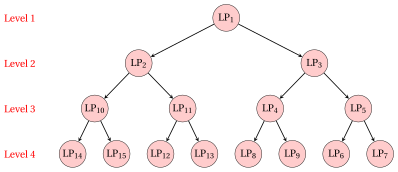{ .fig loading=lazy  }

    2. If the up-branching node is solved first, we have:

        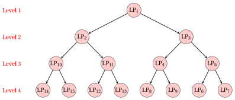{ .fig loading=lazy  }

!!! esempio "Example 7.4: FIFO strategy"

    Order in which a complete binary branch-and-bound tree of $4$ levels is explored with the FIFO strategy (no node is pruned).

    1. If the down-branching node is solved first, we have:

        { .fig loading=lazy  }

    2. If the up-branching node is solved first, we have:

        { .fig loading=lazy  }

## 7.7 Worked examples on the car example

- We now solve the car example with two executions of the B&amp;B algorithm, which differ only in the selection strategies. Since all the variables and all the costs are integer, the bound of a node is $\mathrm{UB}(\LP_k) = \lfloor z(\LP_k) \rfloor$.

- In the first execution every node is re-optimized with the dual simplex algorithm, and we report all the dictionaries. For each node a figure shows its feasible region.

- Before reading the solution, try to predict which variable is selected at the root, and which node is extracted at the second iteration.

!!! esempio "Example 7.5: execution A: smallest index and LIFO"

    We execute the B&amp;B algorithm on the car example with:

    1. the smallest-index rule (lexicographic) as branching-variable selection strategy;

    2. the LIFO rule as branching-node selection strategy;

    3. the down-branching node is solved first, then the up-branching node;

    4. the second child is not solved when the skip rule applies;

    5. the lower bound is initialized to $\LB = -\infty$ (no heuristic algorithm is executed).

    - <strong>Initialization</strong>

        The $\LP_1$ problem is the LP relaxation of the car example. The simplex algorithm with Bland's rule, starting from the basis of the slack variables, performs 2 pivoting operations ($x_1$ enters and $x_3$ leaves; $x_2$ enters and $x_4$ leaves) and ends with the optimal dictionary:

        \begin{equation*}
        \begin{cases}
        \begin{array}{rrrrrrr}
        {x_1} & {=} & {\dfrac{7}{2}} & {-} & {\dfrac{7}{62}}\, {x_3} & {+} & {\dfrac{1}{31}}\, {x_4} \\[2ex]
        {x_2} & {=} & {\dfrac{5}{2}} & {+} & {\dfrac{1}{31}}\, {x_3} & {-} & {\dfrac{5}{62}}\, {x_4} \\[2ex]
        {z} & {=} & {\dfrac{31}{2}} & {-} & {\dfrac{17}{62}}\, {x_3} & {-} & {\dfrac{2}{31}}\, {x_4}
        \end{array}
        \end{cases}
        \end{equation*}

        An optimal solution $\tilde{\vet x}(\LP_1)$ is:

        $$
        \tilde x_1 = \dfrac{7}{2},~~\tilde x_2 = \dfrac{5}{2}, \qquad z(\LP_1) = \dfrac{31}{2}.
        $$

        { .fig .ovale loading=lazy  }

        <em>Node $1$: the feasible region of $\LP_1$, the integer points, the optimal solution of $\LP_1$ (blue) and the objective line through it (dashed).</em>

        The solution is fractional and $\left\lfloor z(\LP_{1}) \right\rfloor = \left\lfloor \dfrac{31}{2} \right\rfloor = 15 > \LB = -\infty$: the $\LP_1$ problem is inserted in the list $L$.

        The list is $L = \{\LP_{1}\}$, and the upper bound is the largest bound of the nodes in the list:

        $$
        \underbrace{-\infty}_{\LB} ~~\le~~ z(\ILP) ~~\le~~ \underbrace{15}_{\UB} \qquad \left( \UB = \max_{k \in L} {\mathrm{UB}(\LP_k)} = 15 \right).
        $$

    - <strong>Iteration 1</strong>

        The list is $L = \{\LP_{1}\}$: the $\LP_{1}$ problem is extracted and removed from $L$.

        In $\tilde{\vet x}(\LP_{1})$ we have $\tilde x_1 = \tfrac{7}{2}$ and $\tilde x_2 = \tfrac{5}{2}$, both fractional; by the smallest-index rule the branching variable is $x_1$. The branching constraints are:

        $$
        x_1 \le \underbrace{\left\lfloor \dfrac{7}{2} \right\rfloor}_{= 3} \qquad \text{and} \qquad x_1 \ge \underbrace{\left\lfloor \dfrac{7}{2} \right\rfloor + 1}_{= 4}.
        $$

        1. <strong>Node $2$: the down-branching child ($x_1 \le 3$).</strong>

            The branching constraint $x_1 \le 3$ is written as $x_1 + x_5 = 3$, with the slack variable $x_5 \ge 0$. Using the row of $x_1$ in the optimal dictionary of $\LP_{1}$, we have:

            $$
            x_5 = 3 - x_1 = 3 - \left( \dfrac{7}{2} - \dfrac{7}{62} \, x_3 + \dfrac{1}{31} \, x_4 \right) = -\dfrac{1}{2} + \dfrac{7}{62} \, x_3 - \dfrac{1}{31} \, x_4.
            $$

            We add this row to the optimal dictionary of $\LP_{1}$. The reduced costs do not change, so the new dictionary is <strong>dual feasible</strong>; it is not primal feasible, since $\bar b_{5} = -\tfrac{1}{2} < 0$:

            \begin{equation*}
            \begin{cases}
            \begin{array}{rrrrrrr}
            {x_1} & {=} & {\dfrac{7}{2}} & {-} & {\dfrac{7}{62}}\, {x_3} & {+} & {\dfrac{1}{31}}\, {x_4} \\[2ex]
            {x_2} & {=} & {\dfrac{5}{2}} & {+} & {\dfrac{1}{31}}\, {x_3} & {-} & {\dfrac{5}{62}}\, {x_4} \\[2ex]
            {x_5} & {=} & {-\dfrac{1}{2}} & {+} & {\dfrac{7}{62}}\, {x_3} & {-} & {\dfrac{1}{31}}\, {x_4} \\[2ex]
            {z} & {=} & {\dfrac{31}{2}} & {-} & {\dfrac{17}{62}}\, {x_3} & {-} & {\dfrac{2}{31}}\, {x_4}
            \end{array}
            \end{cases}
            \end{equation*}

            <strong>Dual pivoting operation.</strong> The pivot row is $x_5$, the only basic variable with a negative value ($\bar b_{5} = -\tfrac{1}{2}$).

            The candidates for the pivot column are the non-basic variables with $\bar a_{5,j} < 0$:

            $$
            \frac{\bar c_{3}}{\bar a_{5,3}} = \frac{-\tfrac{17}{62}}{-\tfrac{7}{62}} = \dfrac{17}{7}
            $$

            The pivot column is $x_3$, with $s_m = \tfrac{17}{7}$, and the objective value becomes

            $$
            \bar z + s_m \, \bar b_{5} = \dfrac{31}{2} + \dfrac{17}{7} \cdot \left( -\dfrac{1}{2} \right) = \dfrac{100}{7}.
            $$

            After the pivoting operation we obtain the following dictionary, which is primal and dual feasible, hence <strong>optimal</strong>:

            \begin{equation*}
            \begin{cases}
            \begin{array}{rrrrrrr}
            {x_1} & {=} & {3} &  &  & {-} & {x_5} \\[2ex]
            {x_2} & {=} & {\dfrac{37}{14}} & {-} & {\dfrac{1}{14}}\, {x_4} & {+} & {\dfrac{2}{7}}\, {x_5} \\[2ex]
            {x_3} & {=} & {\dfrac{31}{7}} & {+} & {\dfrac{2}{7}}\, {x_4} & {+} & {\dfrac{62}{7}}\, {x_5} \\[2ex]
            {z} & {=} & {\dfrac{100}{7}} & {-} & {\dfrac{1}{7}}\, {x_4} & {-} & {\dfrac{17}{7}}\, {x_5}
            \end{array}
            \end{cases}
            \end{equation*}

            An optimal solution $\tilde{\vet x}(\LP_{2})$ is:

            $$
            \tilde x_1 = 3,~~\tilde x_2 = \dfrac{37}{14}, \qquad z(\LP_{2}) = \dfrac{100}{7}.
            $$

            { .fig .ovale loading=lazy  }

            <em>Node $2$: the feasible region of $\LP_{2}$ (red) inside the region of its parent $\LP_{1}$ (gray), and the optimal solution of $\LP_{2}$ (blue) with the objective line through it (dashed).</em>

            The solution is <strong>fractional</strong> and

            $$
            \left\lfloor z(\LP_{2}) \right\rfloor = \left\lfloor \dfrac{100}{7} \right\rfloor = 14 > \LB = -\infty,
            $$

            so the $\LP_{2}$ problem is <strong>inserted in the list</strong> $L$.

        2. <strong>Node $3$: the up-branching child ($x_1 \ge 4$).</strong>

            The branching constraint $x_1 \ge 4$ is written as $x_1 - x_5 = 4$, with the surplus variable $x_5 \ge 0$. Using the row of $x_1$ in the optimal dictionary of $\LP_{1}$, we have:

            $$
            x_5 = x_1 - 4 = \left( \dfrac{7}{2} - \dfrac{7}{62} \, x_3 + \dfrac{1}{31} \, x_4 \right) - 4 = -\dfrac{1}{2} - \dfrac{7}{62} \, x_3 + \dfrac{1}{31} \, x_4.
            $$

            We add this row to the optimal dictionary of $\LP_{1}$. The reduced costs do not change, so the new dictionary is <strong>dual feasible</strong>; it is not primal feasible, since $\bar b_{5} = -\tfrac{1}{2} < 0$:

            \begin{equation*}
            \begin{cases}
            \begin{array}{rrrrrrr}
            {x_1} & {=} & {\dfrac{7}{2}} & {-} & {\dfrac{7}{62}}\, {x_3} & {+} & {\dfrac{1}{31}}\, {x_4} \\[2ex]
            {x_2} & {=} & {\dfrac{5}{2}} & {+} & {\dfrac{1}{31}}\, {x_3} & {-} & {\dfrac{5}{62}}\, {x_4} \\[2ex]
            {x_5} & {=} & {-\dfrac{1}{2}} & {-} & {\dfrac{7}{62}}\, {x_3} & {+} & {\dfrac{1}{31}}\, {x_4} \\[2ex]
            {z} & {=} & {\dfrac{31}{2}} & {-} & {\dfrac{17}{62}}\, {x_3} & {-} & {\dfrac{2}{31}}\, {x_4}
            \end{array}
            \end{cases}
            \end{equation*}

            <strong>Dual pivoting operation.</strong> The pivot row is $x_5$, the only basic variable with a negative value ($\bar b_{5} = -\tfrac{1}{2}$).

            The candidates for the pivot column are the non-basic variables with $\bar a_{5,j} < 0$:

            $$
            \frac{\bar c_{4}}{\bar a_{5,4}} = \frac{-\tfrac{2}{31}}{-\tfrac{1}{31}} = 2
            $$

            The pivot column is $x_4$, with $s_m = 2$, and the objective value becomes

            $$
            \bar z + s_m \, \bar b_{5} = \dfrac{31}{2} + 2 \cdot \left( -\dfrac{1}{2} \right) = \dfrac{29}{2}.
            $$

            After the pivoting operation we obtain the following dictionary, which is primal and dual feasible, hence <strong>optimal</strong>:

            \begin{equation*}
            \begin{cases}
            \begin{array}{rrrrrrr}
            {x_1} & {=} & {4} &  &  & {+} & {x_5} \\[2ex]
            {x_2} & {=} & {\dfrac{5}{4}} & {-} & {\dfrac{1}{4}}\, {x_3} & {-} & {\dfrac{5}{2}}\, {x_5} \\[2ex]
            {x_4} & {=} & {\dfrac{31}{2}} & {+} & {\dfrac{7}{2}}\, {x_3} & {+} & {31}\, {x_5} \\[2ex]
            {z} & {=} & {\dfrac{29}{2}} & {-} & {\dfrac{1}{2}}\, {x_3} & {-} & {2}\, {x_5}
            \end{array}
            \end{cases}
            \end{equation*}

            An optimal solution $\tilde{\vet x}(\LP_{3})$ is:

            $$
            \tilde x_1 = 4,~~\tilde x_2 = \dfrac{5}{4}, \qquad z(\LP_{3}) = \dfrac{29}{2}.
            $$

            { .fig .ovale loading=lazy  }

            <em>Node $3$: the feasible region of $\LP_{3}$ (red) inside the region of its parent $\LP_{1}$ (gray), and the optimal solution of $\LP_{3}$ (blue) with the objective line through it (dashed).</em>

            The solution is <strong>fractional</strong> and

            $$
            \left\lfloor z(\LP_{3}) \right\rfloor = \left\lfloor \dfrac{29}{2} \right\rfloor = 14 > \LB = -\infty,
            $$

            so the $\LP_{3}$ problem is <strong>inserted in the list</strong> $L$.

        The list is $L = \{\LP_{2},~\LP_{3}\}$, and the upper bound is the largest bound of the nodes in the list:

        $$
        \underbrace{-\infty}_{\LB} ~~\le~~ z(\ILP) ~~\le~~ \underbrace{14}_{\UB} \qquad \left( \UB = \max_{k \in L} {\mathrm{UB}(\LP_k)} = 14 \right).
        $$

        This is the portion of the branch-and-bound tree built in the first iteration, with the LP problems of the branching nodes:

        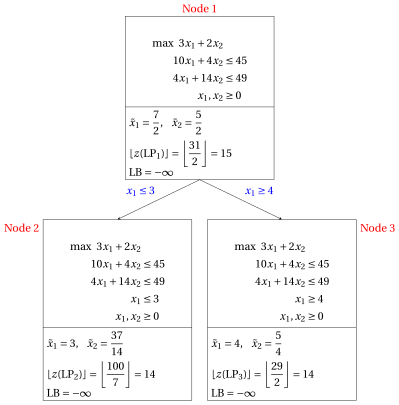{ .fig loading=lazy  }

    - <strong>Iteration 2</strong>

        The list is $L = \{\LP_{2},~\LP_{3}\}$; following the LIFO rule, $\LP_{3}$ (the last problem inserted) is extracted and removed from $L$.

        In $\tilde{\vet x}(\LP_{3})$ the only integer variable with a fractional value is $x_2$, which is the branching variable. The branching constraints are:

        $$
        x_2 \le \underbrace{\left\lfloor \dfrac{5}{4} \right\rfloor}_{= 1} \qquad \text{and} \qquad x_2 \ge \underbrace{\left\lfloor \dfrac{5}{4} \right\rfloor + 1}_{= 2}.
        $$

        1. <strong>Node $4$: the down-branching child ($x_2 \le 1$).</strong>

            The branching constraint $x_2 \le 1$ is written as $x_2 + x_6 = 1$, with the slack variable $x_6 \ge 0$. Using the row of $x_2$ in the optimal dictionary of $\LP_{3}$, we have:

            $$
            x_6 = 1 - x_2 = 1 - \left( \dfrac{5}{4} - \dfrac{1}{4} \, x_3 - \dfrac{5}{2} \, x_5 \right) = -\dfrac{1}{4} + \dfrac{1}{4} \, x_3 + \dfrac{5}{2} \, x_5.
            $$

            We add this row to the optimal dictionary of $\LP_{3}$. The reduced costs do not change, so the new dictionary is <strong>dual feasible</strong>; it is not primal feasible, since $\bar b_{6} = -\tfrac{1}{4} < 0$:

            \begin{equation*}
            \begin{cases}
            \begin{array}{rrrrrrr}
            {x_1} & {=} & {4} &  &  & {+} & {x_5} \\[2ex]
            {x_2} & {=} & {\dfrac{5}{4}} & {-} & {\dfrac{1}{4}}\, {x_3} & {-} & {\dfrac{5}{2}}\, {x_5} \\[2ex]
            {x_4} & {=} & {\dfrac{31}{2}} & {+} & {\dfrac{7}{2}}\, {x_3} & {+} & {31}\, {x_5} \\[2ex]
            {x_6} & {=} & {-\dfrac{1}{4}} & {+} & {\dfrac{1}{4}}\, {x_3} & {+} & {\dfrac{5}{2}}\, {x_5} \\[2ex]
            {z} & {=} & {\dfrac{29}{2}} & {-} & {\dfrac{1}{2}}\, {x_3} & {-} & {2}\, {x_5}
            \end{array}
            \end{cases}
            \end{equation*}

            <strong>Dual pivoting operation.</strong> The pivot row is $x_6$, the only basic variable with a negative value ($\bar b_{6} = -\tfrac{1}{4}$).

            The candidates for the pivot column are the non-basic variables with $\bar a_{6,j} < 0$:

            $$
            \frac{\bar c_{3}}{\bar a_{6,3}} = \frac{-\tfrac{1}{2}}{-\tfrac{1}{4}} = 2,~~\frac{\bar c_{5}}{\bar a_{6,5}} = \frac{-2}{-\tfrac{5}{2}} = \dfrac{4}{5}
            $$

            $$
            s_m = \min\left\{ 2, \dfrac{4}{5} \right\} = \dfrac{4}{5}.
            $$

            The pivot column is $x_5$, with $s_m = \tfrac{4}{5}$, and the objective value becomes

            $$
            \bar z + s_m \, \bar b_{6} = \dfrac{29}{2} + \dfrac{4}{5} \cdot \left( -\dfrac{1}{4} \right) = \dfrac{143}{10}.
            $$

            After the pivoting operation we obtain the following dictionary, which is primal and dual feasible, hence <strong>optimal</strong>:

            \begin{equation*}
            \begin{cases}
            \begin{array}{rrrrrrr}
            {x_1} & {=} & {\dfrac{41}{10}} & {-} & {\dfrac{1}{10}}\, {x_3} & {+} & {\dfrac{2}{5}}\, {x_6} \\[2ex]
            {x_2} & {=} & {1} &  &  & {-} & {x_6} \\[2ex]
            {x_4} & {=} & {\dfrac{93}{5}} & {+} & {\dfrac{2}{5}}\, {x_3} & {+} & {\dfrac{62}{5}}\, {x_6} \\[2ex]
            {x_5} & {=} & {\dfrac{1}{10}} & {-} & {\dfrac{1}{10}}\, {x_3} & {+} & {\dfrac{2}{5}}\, {x_6} \\[2ex]
            {z} & {=} & {\dfrac{143}{10}} & {-} & {\dfrac{3}{10}}\, {x_3} & {-} & {\dfrac{4}{5}}\, {x_6}
            \end{array}
            \end{cases}
            \end{equation*}

            An optimal solution $\tilde{\vet x}(\LP_{4})$ is:

            $$
            \tilde x_1 = \dfrac{41}{10},~~\tilde x_2 = 1, \qquad z(\LP_{4}) = \dfrac{143}{10}.
            $$

            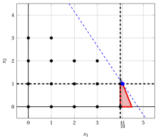{ .fig .ovale loading=lazy  }

            <em>Node $4$: the feasible region of $\LP_{4}$ (red) inside the region of its parent $\LP_{3}$ (gray), and the optimal solution of $\LP_{4}$ (blue) with the objective line through it (dashed).</em>

            The solution is <strong>fractional</strong> and

            $$
            \left\lfloor z(\LP_{4}) \right\rfloor = \left\lfloor \dfrac{143}{10} \right\rfloor = 14 > \LB = -\infty,
            $$

            so the $\LP_{4}$ problem is <strong>inserted in the list</strong> $L$.

        2. <strong>Node $5$: the up-branching child ($x_2 \ge 2$).</strong>

            The branching constraint $x_2 \ge 2$ is written as $x_2 - x_6 = 2$, with the surplus variable $x_6 \ge 0$. Using the row of $x_2$ in the optimal dictionary of $\LP_{3}$, we have:

            $$
            x_6 = x_2 - 2 = \left( \dfrac{5}{4} - \dfrac{1}{4} \, x_3 - \dfrac{5}{2} \, x_5 \right) - 2 = -\dfrac{3}{4} - \dfrac{1}{4} \, x_3 - \dfrac{5}{2} \, x_5.
            $$

            We add this row to the optimal dictionary of $\LP_{3}$. The reduced costs do not change, so the new dictionary is <strong>dual feasible</strong>; it is not primal feasible, since $\bar b_{6} = -\tfrac{3}{4} < 0$:

            \begin{equation*}
            \begin{cases}
            \begin{array}{rrrrrrr}
            {x_1} & {=} & {4} &  &  & {+} & {x_5} \\[2ex]
            {x_2} & {=} & {\dfrac{5}{4}} & {-} & {\dfrac{1}{4}}\, {x_3} & {-} & {\dfrac{5}{2}}\, {x_5} \\[2ex]
            {x_4} & {=} & {\dfrac{31}{2}} & {+} & {\dfrac{7}{2}}\, {x_3} & {+} & {31}\, {x_5} \\[2ex]
            {x_6} & {=} & {-\dfrac{3}{4}} & {-} & {\dfrac{1}{4}}\, {x_3} & {-} & {\dfrac{5}{2}}\, {x_5} \\[2ex]
            {z} & {=} & {\dfrac{29}{2}} & {-} & {\dfrac{1}{2}}\, {x_3} & {-} & {2}\, {x_5}
            \end{array}
            \end{cases}
            \end{equation*}

            <strong>Dual pivoting operation.</strong> The pivot row is $x_6$, the only basic variable with a negative value ($\bar b_{6} = -\tfrac{3}{4}$).

            All the coefficients of the pivot row are non-negative ($\bar a_{6,3} = \tfrac{1}{4}$, $\bar a_{6,5} = \tfrac{5}{2}$), that is, the row reads

            $$
            x_6 = -\dfrac{3}{4} - \dfrac{1}{4} \, x_3 - \dfrac{5}{2} \, x_5 \le -\dfrac{3}{4} < 0
            $$

            for every non-negative value of the non-basic variables. By the dual simplex algorithm, the $\LP_{5}$ problem is <strong>infeasible</strong>.

            { .fig .ovale loading=lazy  }

            <em>Node $5$: the constraint $x_2 \ge 2$ leaves no point of the region of its parent $\LP_{3}$ (gray): $\LP_{5}$ is infeasible.</em>

            Accordingly, Node $5$ is <u>pruned by infeasibility</u>.

        The list is $L = \{\LP_{2},~\LP_{4}\}$, and the upper bound is the largest bound of the nodes in the list:

        $$
        \underbrace{-\infty}_{\LB} ~~\le~~ z(\ILP) ~~\le~~ \underbrace{14}_{\UB} \qquad \left( \UB = \max_{k \in L} {\mathrm{UB}(\LP_k)} = 14 \right).
        $$

        This is the portion of the branch-and-bound tree built in the second iteration, with the LP problems of the branching nodes:

        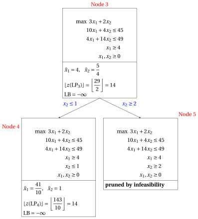{ .fig loading=lazy  }

    - <strong>Iteration 3</strong>

        The list is $L = \{\LP_{2},~\LP_{4}\}$; following the LIFO rule, $\LP_{4}$ (the last problem inserted) is extracted and removed from $L$.

        In $\tilde{\vet x}(\LP_{4})$ the only integer variable with a fractional value is $x_1$, which is the branching variable. The branching constraints are:

        $$
        x_1 \le \underbrace{\left\lfloor \dfrac{41}{10} \right\rfloor}_{= 4} \qquad \text{and} \qquad x_1 \ge \underbrace{\left\lfloor \dfrac{41}{10} \right\rfloor + 1}_{= 5}.
        $$

        1. <strong>Node $6$: the down-branching child ($x_1 \le 4$).</strong>

            The branching constraint $x_1 \le 4$ is written as $x_1 + x_7 = 4$, with the slack variable $x_7 \ge 0$. Using the row of $x_1$ in the optimal dictionary of $\LP_{4}$, we have:

            $$
            x_7 = 4 - x_1 = 4 - \left( \dfrac{41}{10} - \dfrac{1}{10} \, x_3 + \dfrac{2}{5} \, x_6 \right) = -\dfrac{1}{10} + \dfrac{1}{10} \, x_3 - \dfrac{2}{5} \, x_6.
            $$

            We add this row to the optimal dictionary of $\LP_{4}$. The reduced costs do not change, so the new dictionary is <strong>dual feasible</strong>; it is not primal feasible, since $\bar b_{7} = -\tfrac{1}{10} < 0$:

            \begin{equation*}
            \begin{cases}
            \begin{array}{rrrrrrr}
            {x_1} & {=} & {\dfrac{41}{10}} & {-} & {\dfrac{1}{10}}\, {x_3} & {+} & {\dfrac{2}{5}}\, {x_6} \\[2ex]
            {x_2} & {=} & {1} &  &  & {-} & {x_6} \\[2ex]
            {x_4} & {=} & {\dfrac{93}{5}} & {+} & {\dfrac{2}{5}}\, {x_3} & {+} & {\dfrac{62}{5}}\, {x_6} \\[2ex]
            {x_5} & {=} & {\dfrac{1}{10}} & {-} & {\dfrac{1}{10}}\, {x_3} & {+} & {\dfrac{2}{5}}\, {x_6} \\[2ex]
            {x_7} & {=} & {-\dfrac{1}{10}} & {+} & {\dfrac{1}{10}}\, {x_3} & {-} & {\dfrac{2}{5}}\, {x_6} \\[2ex]
            {z} & {=} & {\dfrac{143}{10}} & {-} & {\dfrac{3}{10}}\, {x_3} & {-} & {\dfrac{4}{5}}\, {x_6}
            \end{array}
            \end{cases}
            \end{equation*}

            <strong>Dual pivoting operation.</strong> The pivot row is $x_7$, the only basic variable with a negative value ($\bar b_{7} = -\tfrac{1}{10}$).

            The candidates for the pivot column are the non-basic variables with $\bar a_{7,j} < 0$:

            $$
            \frac{\bar c_{3}}{\bar a_{7,3}} = \frac{-\tfrac{3}{10}}{-\tfrac{1}{10}} = 3
            $$

            The pivot column is $x_3$, with $s_m = 3$, and the objective value becomes

            $$
            \bar z + s_m \, \bar b_{7} = \dfrac{143}{10} + 3 \cdot \left( -\dfrac{1}{10} \right) = 14.
            $$

            After the pivoting operation we obtain the following dictionary, which is primal and dual feasible, hence <strong>optimal</strong>:

            \begin{equation*}
            \begin{cases}
            \begin{array}{rrrrrrr}
            {x_1} & {=} & {4} &  &  & {-} & {x_7} \\[2ex]
            {x_2} & {=} & {1} & {-} & {x_6} &  &  \\[2ex]
            {x_3} & {=} & {1} & {+} & {4}\, {x_6} & {+} & {10}\, {x_7} \\[2ex]
            {x_4} & {=} & {19} & {+} & {14}\, {x_6} & {+} & {4}\, {x_7} \\[2ex]
            {x_5} & {=} & {0} &  &  & {-} & {x_7} \\[2ex]
            {z} & {=} & {14} & {-} & {2}\, {x_6} & {-} & {3}\, {x_7}
            \end{array}
            \end{cases}
            \end{equation*}

            An optimal solution $\tilde{\vet x}(\LP_{6})$ is:

            $$
            \tilde x_1 = 4,~~\tilde x_2 = 1, \qquad z(\LP_{6}) = 14.
            $$

            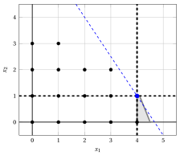{ .fig .ovale loading=lazy  }

            <em>Node $6$: the feasible region of $\LP_{6}$ (red) inside the region of its parent $\LP_{4}$ (gray), and the optimal solution of $\LP_{6}$ (blue) with the objective line through it (dashed).</em>

            The solution $\tilde{\vet x}(\LP_{6})$ is <strong>integer</strong>.

            Since $z(\LP_{6}) = 14 > \LB = -\infty$, the lower bound and the incumbent solution are updated:

            $$
            \LB \leftarrow 14, \qquad \bar{\vet x} \leftarrow (4, 1).
            $$

            Node $6$ is <u>pruned by integrality</u>.

            Moreover, $\LP_{2}$ is removed from the list $L$ (<u>pruned by bound</u>), since now

            $$
            \left\lfloor z(\LP_{2}) \right\rfloor = \left\lfloor \dfrac{100}{7} \right\rfloor = 14 \le \LB = 14.
            $$

        2. <strong>Skip rule.</strong> After Node $6$ the lower bound satisfies

            $$
            \left\lfloor z(\LP_{4}) \right\rfloor = \left\lfloor \dfrac{143}{10} \right\rfloor = 14 \le \LB = 14,
            $$

            so no solution in the region of $\LP_{4}$ can improve the incumbent solution: the up-branching child ($x_1 \ge 5$) is <strong>not solved</strong> and it does not receive a node index.

        The list is empty, so the upper bound is equal to the lower bound:

        $$
        \underbrace{14}_{\LB} ~~\le~~ z(\ILP) ~~\le~~ \underbrace{14}_{\UB} \qquad \left( \UB = \LB = 14 \right).
        $$

        This is the portion of the branch-and-bound tree built in the third iteration, with the LP problems of the branching nodes:

        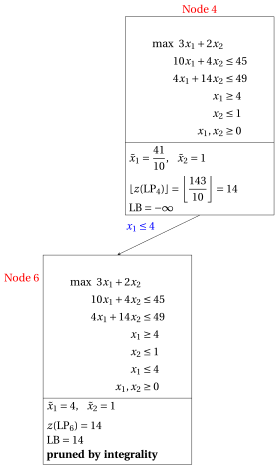{ .fig loading=lazy  }

    - <strong>Termination</strong>

        The list $L$ is empty: $\LB = \UB = 14$ and the incumbent solution is optimal:

        $$
        \tilde x_1 = 4,~~\tilde x_2 = 1, \qquad z(\ILP) = 14.
        $$

    This is the final branch-and-bound tree. For each branching node it shows the bound of the node, the lower bound $\LB$ when the node was solved (or removed from the list) and the pruning criterion.

    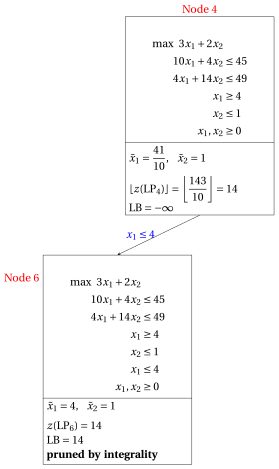{ .fig loading=lazy  }

    The same execution in a table:

    
<table>
    <tr>
    <th>Node</th>
    <th>Parent</th>
    <th>It.</th>
    <th>Branching</th>
    <th>\(\tilde{\vet x}(\LP_k)\)</th>
    <th>\(z(\LP_k)\)</th>
    <th>\(\LB\)</th>
    <th>Outcome</th>
    </tr>
    <tr>
    <td>1</td>
    <td>–</td>
    <td>0</td>
    <td>–</td>
    <td>\((\tfrac{7}{2}, \tfrac{5}{2})\)</td>
    <td>\(\tfrac{31}{2}\)</td>
    <td>\(-\infty\)</td>
    <td>branched on \(x_1\)</td>
    </tr>
    <tr>
    <td>2</td>
    <td>1</td>
    <td>1</td>
    <td>\(x_1 \le 3\)</td>
    <td>\((3, \tfrac{37}{14})\)</td>
    <td>\(\tfrac{100}{7}\)</td>
    <td>\(14\)</td>
    <td>pruned by bound (removed from \(L\))</td>
    </tr>
    <tr>
    <td>3</td>
    <td>1</td>
    <td>1</td>
    <td>\(x_1 \ge 4\)</td>
    <td>\((4, \tfrac{5}{4})\)</td>
    <td>\(\tfrac{29}{2}\)</td>
    <td>\(-\infty\)</td>
    <td>branched on \(x_2\)</td>
    </tr>
    <tr>
    <td>4</td>
    <td>3</td>
    <td>2</td>
    <td>\(x_2 \le 1\)</td>
    <td>\((\tfrac{41}{10}, 1)\)</td>
    <td>\(\tfrac{143}{10}\)</td>
    <td>\(-\infty\)</td>
    <td>branched on \(x_1\)</td>
    </tr>
    <tr>
    <td>5</td>
    <td>3</td>
    <td>2</td>
    <td>\(x_2 \ge 2\)</td>
    <td>–</td>
    <td>–</td>
    <td>\(-\infty\)</td>
    <td>pruned by infeasibility</td>
    </tr>
    <tr>
    <td>6</td>
    <td>4</td>
    <td>3</td>
    <td>\(x_1 \le 4\)</td>
    <td>\((4, 1)\)</td>
    <td>\(14\)</td>
    <td>\(14\)</td>
    <td>pruned by integrality</td>
    </tr>
    </table>

    { .fig .ovale loading=lazy  }

    <em>Execution A in the plane: the branching constraints (black, dashed) inside the regions of the parent nodes, and the optimal solutions of the solved nodes (violet), from $\LP_1$ (blue).</em>

!!! esempio "Example 7.6: execution B: largest index and best bound"

    We execute again the B&amp;B algorithm on the car example, now with:

    1. the largest-index rule (lexicographic) as branching-variable selection strategy;

    2. the best-bound rule as branching-node selection strategy (ties: smallest node index);

    3. the down-branching node is solved first, then the up-branching node;

    4. the second child is not solved when the skip rule applies;

    5. the lower bound is initialized to $\LB = -\infty$ (no heuristic algorithm is executed).

    Each child is re-optimized with the dual simplex algorithm from the optimal dictionary of its parent, exactly as in [Example 7.5](#box-9-ex-bb-runA); here we report only the results.

    - <strong>Initialization</strong>

        As before, $\tilde{\vet x}(\LP_1) = (\tfrac{7}{2}, \tfrac{5}{2})$ with $z(\LP_1) = \tfrac{31}{2}$, and $\LP_1$ is inserted in the list $L$.

        The list is $L = \{\LP_{1}\}$, and the upper bound is the largest bound of the nodes in the list:

        $$
        \underbrace{-\infty}_{\LB} ~~\le~~ z(\ILP) ~~\le~~ \underbrace{15}_{\UB} \qquad \left( \UB = \max_{k \in L} {\mathrm{UB}(\LP_k)} = 15 \right).
        $$

    - <strong>Iteration 1</strong>

        The list is $L = \{\LP_{1}\}$: the $\LP_{1}$ problem is extracted and removed from $L$.

        In $\tilde{\vet x}(\LP_{1})$ we have $\tilde x_1 = \tfrac{7}{2}$ and $\tilde x_2 = \tfrac{5}{2}$, both fractional; by the largest-index rule the branching variable is $x_2$. The branching constraints are:

        $$
        x_2 \le \underbrace{\left\lfloor \dfrac{5}{2} \right\rfloor}_{= 2} \qquad \text{and} \qquad x_2 \ge \underbrace{\left\lfloor \dfrac{5}{2} \right\rfloor + 1}_{= 3}.
        $$

        - Node $2$ ($x_2 \le 2$): $\tilde{\vet x}(\LP_{2}) = (\tfrac{37}{10}, 2)$ with $z(\LP_{2}) = \tfrac{151}{10}$. The solution is <strong>fractional</strong> and

            $$
            \left\lfloor z(\LP_{2}) \right\rfloor = \left\lfloor \dfrac{151}{10} \right\rfloor = 15 > \LB = -\infty,
            $$

            so the $\LP_{2}$ problem is <strong>inserted in the list</strong> $L$.

        - Node $3$ ($x_2 \ge 3$): $\tilde{\vet x}(\LP_{3}) = (\tfrac{7}{4}, 3)$ with $z(\LP_{3}) = \tfrac{45}{4}$. The solution is <strong>fractional</strong> and

            $$
            \left\lfloor z(\LP_{3}) \right\rfloor = \left\lfloor \dfrac{45}{4} \right\rfloor = 11 > \LB = -\infty,
            $$

            so the $\LP_{3}$ problem is <strong>inserted in the list</strong> $L$.

        The list is $L = \{\LP_{2},~\LP_{3}\}$, and the upper bound is the largest bound of the nodes in the list:

        $$
        \underbrace{-\infty}_{\LB} ~~\le~~ z(\ILP) ~~\le~~ \underbrace{15}_{\UB} \qquad \left( \UB = \max_{k \in L} {\mathrm{UB}(\LP_k)} = 15 \right).
        $$

    - <strong>Iteration 2</strong>

        The list is $L = \{\LP_{2},~\LP_{3}\}$; following the best-bound rule, $\LP_{2}$ is extracted and removed from $L$, since it has the largest optimal value:

        $$
        z(\LP_{2}) = \dfrac{151}{10},~~z(\LP_{3}) = \dfrac{45}{4}.
        $$

        In $\tilde{\vet x}(\LP_{2})$ the only integer variable with a fractional value is $x_1$, which is the branching variable. The branching constraints are:

        $$
        x_1 \le \underbrace{\left\lfloor \dfrac{37}{10} \right\rfloor}_{= 3} \qquad \text{and} \qquad x_1 \ge \underbrace{\left\lfloor \dfrac{37}{10} \right\rfloor + 1}_{= 4}.
        $$

        - Node $4$ ($x_1 \le 3$): $\tilde{\vet x}(\LP_{4}) = (3, 2)$ with $z(\LP_{4}) = 13$. The solution $\tilde{\vet x}(\LP_{4})$ is <strong>integer</strong>. Since $z(\LP_{4}) = 13 > \LB = -\infty$, the lower bound and the incumbent solution are updated:

            $$
            \LB \leftarrow 13, \qquad \bar{\vet x} \leftarrow (3, 2).
            $$

            Node $4$ is <u>pruned by integrality</u>. Moreover, $\LP_{3}$ is removed from the list $L$ (<u>pruned by bound</u>), since now

            $$
            \left\lfloor z(\LP_{3}) \right\rfloor = \left\lfloor \dfrac{45}{4} \right\rfloor = 11 \le \LB = 13.
            $$

        - Node $5$ ($x_1 \ge 4$): $\tilde{\vet x}(\LP_{5}) = (4, \tfrac{5}{4})$ with $z(\LP_{5}) = \tfrac{29}{2}$. The solution is <strong>fractional</strong> and

            $$
            \left\lfloor z(\LP_{5}) \right\rfloor = \left\lfloor \dfrac{29}{2} \right\rfloor = 14 > \LB = 13,
            $$

            so the $\LP_{5}$ problem is <strong>inserted in the list</strong> $L$.

        The list is $L = \{\LP_{5}\}$, and the upper bound is the largest bound of the nodes in the list:

        $$
        \underbrace{13}_{\LB} ~~\le~~ z(\ILP) ~~\le~~ \underbrace{14}_{\UB} \qquad \left( \UB = \max_{k \in L} {\mathrm{UB}(\LP_k)} = 14 \right).
        $$

    - <strong>Iteration 3</strong>

        The list is $L = \{\LP_{5}\}$: the $\LP_{5}$ problem is extracted and removed from $L$.

        In $\tilde{\vet x}(\LP_{5})$ the only integer variable with a fractional value is $x_2$, which is the branching variable. The branching constraints are:

        $$
        x_2 \le \underbrace{\left\lfloor \dfrac{5}{4} \right\rfloor}_{= 1} \qquad \text{and} \qquad x_2 \ge \underbrace{\left\lfloor \dfrac{5}{4} \right\rfloor + 1}_{= 2}.
        $$

        - Node $6$ ($x_2 \le 1$): $\tilde{\vet x}(\LP_{6}) = (\tfrac{41}{10}, 1)$ with $z(\LP_{6}) = \tfrac{143}{10}$. The solution is <strong>fractional</strong> and

            $$
            \left\lfloor z(\LP_{6}) \right\rfloor = \left\lfloor \dfrac{143}{10} \right\rfloor = 14 > \LB = 13,
            $$

            so the $\LP_{6}$ problem is <strong>inserted in the list</strong> $L$.

        - Node $7$ ($x_2 \ge 2$): the $\LP_{7}$ problem is infeasible: <u>pruned by infeasibility</u>.

        The list is $L = \{\LP_{6}\}$, and the upper bound is the largest bound of the nodes in the list:

        $$
        \underbrace{13}_{\LB} ~~\le~~ z(\ILP) ~~\le~~ \underbrace{14}_{\UB} \qquad \left( \UB = \max_{k \in L} {\mathrm{UB}(\LP_k)} = 14 \right).
        $$

    - <strong>Iteration 4</strong>

        The list is $L = \{\LP_{6}\}$: the $\LP_{6}$ problem is extracted and removed from $L$.

        In $\tilde{\vet x}(\LP_{6})$ the only integer variable with a fractional value is $x_1$, which is the branching variable. The branching constraints are:

        $$
        x_1 \le \underbrace{\left\lfloor \dfrac{41}{10} \right\rfloor}_{= 4} \qquad \text{and} \qquad x_1 \ge \underbrace{\left\lfloor \dfrac{41}{10} \right\rfloor + 1}_{= 5}.
        $$

        - Node $8$ ($x_1 \le 4$): $\tilde{\vet x}(\LP_{8}) = (4, 1)$ with $z(\LP_{8}) = 14$. The solution $\tilde{\vet x}(\LP_{8})$ is <strong>integer</strong>. Since $z(\LP_{8}) = 14 > \LB = 13$, the lower bound and the incumbent solution are updated:

            $$
            \LB \leftarrow 14, \qquad \bar{\vet x} \leftarrow (4, 1).
            $$

            Node $8$ is <u>pruned by integrality</u>.

        - <strong>Skip rule.</strong> After Node $8$ the lower bound satisfies

            $$
            \left\lfloor z(\LP_{6}) \right\rfloor = \left\lfloor \dfrac{143}{10} \right\rfloor = 14 \le \LB = 14,
            $$

            so no solution in the region of $\LP_{6}$ can improve the incumbent solution: the up-branching child ($x_1 \ge 5$) is <strong>not solved</strong> and it does not receive a node index.

        The list is empty, so the upper bound is equal to the lower bound:

        $$
        \underbrace{14}_{\LB} ~~\le~~ z(\ILP) ~~\le~~ \underbrace{14}_{\UB} \qquad \left( \UB = \LB = 14 \right).
        $$

    - <strong>Termination</strong>

        The list $L$ is empty: $\LB = \UB = 14$ and the incumbent solution is optimal:

        $$
        \tilde x_1 = 4,~~\tilde x_2 = 1, \qquad z(\ILP) = 14.
        $$

    This is the final branch-and-bound tree:

    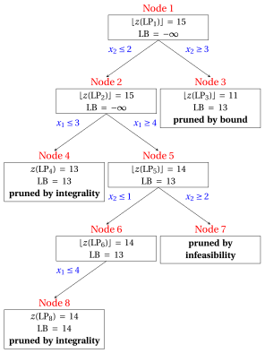{ .fig loading=lazy  }

    
<table>
    <tr>
    <th>Node</th>
    <th>Parent</th>
    <th>It.</th>
    <th>Branching</th>
    <th>\(\tilde{\vet x}(\LP_k)\)</th>
    <th>\(z(\LP_k)\)</th>
    <th>\(\LB\)</th>
    <th>Outcome</th>
    </tr>
    <tr>
    <td>1</td>
    <td>–</td>
    <td>0</td>
    <td>–</td>
    <td>\((\tfrac{7}{2}, \tfrac{5}{2})\)</td>
    <td>\(\tfrac{31}{2}\)</td>
    <td>\(-\infty\)</td>
    <td>branched on \(x_2\)</td>
    </tr>
    <tr>
    <td>2</td>
    <td>1</td>
    <td>1</td>
    <td>\(x_2 \le 2\)</td>
    <td>\((\tfrac{37}{10}, 2)\)</td>
    <td>\(\tfrac{151}{10}\)</td>
    <td>\(-\infty\)</td>
    <td>branched on \(x_1\)</td>
    </tr>
    <tr>
    <td>3</td>
    <td>1</td>
    <td>1</td>
    <td>\(x_2 \ge 3\)</td>
    <td>\((\tfrac{7}{4}, 3)\)</td>
    <td>\(\tfrac{45}{4}\)</td>
    <td>\(13\)</td>
    <td>pruned by bound (removed from \(L\))</td>
    </tr>
    <tr>
    <td>4</td>
    <td>2</td>
    <td>2</td>
    <td>\(x_1 \le 3\)</td>
    <td>\((3, 2)\)</td>
    <td>\(13\)</td>
    <td>\(13\)</td>
    <td>pruned by integrality</td>
    </tr>
    <tr>
    <td>5</td>
    <td>2</td>
    <td>2</td>
    <td>\(x_1 \ge 4\)</td>
    <td>\((4, \tfrac{5}{4})\)</td>
    <td>\(\tfrac{29}{2}\)</td>
    <td>\(13\)</td>
    <td>branched on \(x_2\)</td>
    </tr>
    <tr>
    <td>6</td>
    <td>5</td>
    <td>3</td>
    <td>\(x_2 \le 1\)</td>
    <td>\((\tfrac{41}{10}, 1)\)</td>
    <td>\(\tfrac{143}{10}\)</td>
    <td>\(13\)</td>
    <td>branched on \(x_1\)</td>
    </tr>
    <tr>
    <td>7</td>
    <td>5</td>
    <td>3</td>
    <td>\(x_2 \ge 2\)</td>
    <td>–</td>
    <td>–</td>
    <td>\(13\)</td>
    <td>pruned by infeasibility</td>
    </tr>
    <tr>
    <td>8</td>
    <td>6</td>
    <td>4</td>
    <td>\(x_1 \le 4\)</td>
    <td>\((4, 1)\)</td>
    <td>\(14\)</td>
    <td>\(14\)</td>
    <td>pruned by integrality</td>
    </tr>
    </table>

    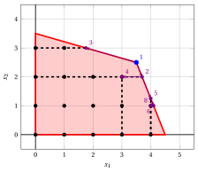{ .fig .ovale loading=lazy  }

    <em>Execution B in the plane: branching constraints and optimal solutions of the solved nodes.</em>

    - Execution A solves $6$ LP problems, execution B solves $8$. Both certify the same optimal solution $\tilde x_1 = 4, \tilde x_2 = 1$ of value $14$, which is unique.

    - Execution B finds a first incumbent solution of value $13$ earlier, but branching first on $x_2$ leads to a larger tree on this instance.

!!! esempio "Example 7.7: heuristic initialization"

    We execute the B&amp;B algorithm of [Example 7.5](#box-9-ex-bb-runA) (smallest index, LIFO), starting from a heuristic solution of the car example.

    - The one-variable heuristic of Chapter 1 fixes $x_1$ as large as possible and $x_2 = 0$: it gives $\bar{\vet x} = (4, 0)$ of value $12$. Starting execution A with $\LB = 12$, the algorithm solves $6$ LP problems, as many as without the heuristic: this lower bound is too weak to prune any node earlier.

    - The heuristic that fixes first $x_1$ and then $x_2$ as large as possible gives $\bar{\vet x} = (4, 1)$ of value $14$. Starting with $\LB = 14$, the root is not pruned, since $\lfloor z(\LP_1) \rfloor = 15 > 14$, but both children are pruned by bound and the algorithm stops after $3$ LP problems:

    
<table>
    <tr>
    <th>Node</th>
    <th>Parent</th>
    <th>It.</th>
    <th>Branching</th>
    <th>\(\tilde{\vet x}(\LP_k)\)</th>
    <th>\(z(\LP_k)\)</th>
    <th>\(\LB\)</th>
    <th>Outcome</th>
    </tr>
    <tr>
    <td>1</td>
    <td>–</td>
    <td>0</td>
    <td>–</td>
    <td>\((\tfrac{7}{2}, \tfrac{5}{2})\)</td>
    <td>\(\tfrac{31}{2}\)</td>
    <td>\(14\)</td>
    <td>branched on \(x_1\)</td>
    </tr>
    <tr>
    <td>2</td>
    <td>1</td>
    <td>1</td>
    <td>\(x_1 \le 3\)</td>
    <td>\((3, \tfrac{37}{14})\)</td>
    <td>\(\tfrac{100}{7}\)</td>
    <td>\(14\)</td>
    <td>pruned by bound</td>
    </tr>
    <tr>
    <td>3</td>
    <td>1</td>
    <td>1</td>
    <td>\(x_1 \ge 4\)</td>
    <td>\((4, \tfrac{5}{4})\)</td>
    <td>\(\tfrac{29}{2}\)</td>
    <td>\(14\)</td>
    <td>pruned by bound</td>
    </tr>
    </table>

    The incumbent solution given by the heuristic is optimal, and the branch-and-bound algorithm <strong>certifies</strong> its optimality.

## 7.8 Typical mistakes

!!! attenzione "Warning"

    - <strong>Rounding the LP solution.</strong> Rounding an optimal solution of the LP relaxation gives at best a feasible solution, in general not an optimal one. In the car example, rounding down $\tilde{\vet x}(\LP) = (\tfrac{7}{2}, \tfrac{5}{2})$ gives $(3, 2)$ of value $13$, while $z(\ILP) = 14$ at $(4, 1)$.

    - <strong>Branching on the wrong variable.</strong> The branching variable must be an integer variable with a fractional value: a variable with an integer value does not cut off $\tilde{\vet x}(\LP_k)$.

    - <strong>Taking the upper bound from the last node.</strong> The upper bound is the largest bound among the nodes of the list $L$, not the bound of the last node solved.

    - <strong>Pruning by bound only with a strict inequality.</strong> A node with $\mathrm{UB}(\LP_k) = \LB$ is pruned: its region can contain solutions as good as the incumbent one, but not better.

    - <strong>Numbering the skipped children.</strong> A child that is not solved does not receive a node index.

    - <strong>Solving every node from scratch.</strong> The answer is correct, but much slower: each child starts from the optimal dictionary of its parent, which is dual feasible.

## 7.9 Extensions

- The LP problems of the nodes can also be solved with the <strong>bounded-variable simplex algorithm</strong>, which handles the branching constraints as bounds on the variables instead of new constraints.

- In a <strong>mixed</strong> problem, where only some variables are integer, one branches only on the integer variables and the bound of a node is $z(\LP_k)$, without rounding.

## 7.10 In summary

!!! chiave "In summary"

    - A B&amp;B algorithm divides the feasible region with branching constraints on integer variables with fractional values, and it never loses a feasible solution.

    - Every node is pruned by infeasibility, by integrality or by bound, or it waits in the list; the bound of a node is $\lfloor z(\LP_k) \rfloor$ only if all the variables and costs are integer.

    - The lower bound comes from the incumbent solution, the upper bound from the nodes of the list; when the list is empty they coincide, and the incumbent solution is certified optimal.

    - Each child is re-optimized with the dual simplex algorithm from the dictionary of its parent.

    - The selection strategies and a good heuristic solution change the size of the tree, not the optimal value.

    <strong>Dashboard of the car example.</strong> The lower and upper bounds on $z(\ILP)$ found so far in this module:

    
<table>
    <tr>
    <th>Chapter</th>
    <th>Lower bound</th>
    <th>Upper bound</th>
    <th>From</th>
    </tr>
    <tr>
    <td>Primal and dual bounds</td>
    <td>\(14\)</td>
    <td>\(15\)</td>
    <td>heuristic solution \((4, 1)\), and \(\lfloor z(\LP) \rfloor\) with \(z(\LP) = \tfrac{31}{2}\)</td>
    </tr>
    <tr>
    <td>Cutting plane algorithm</td>
    <td>\(14\)</td>
    <td>\(14\)</td>
    <td>\(5\) Gomory fractional cuts</td>
    </tr>
    <tr>
    <td>This chapter, execution A</td>
    <td>\(14\)</td>
    <td>\(14\)</td>
    <td>\(6\) LP problems solved</td>
    </tr>
    <tr>
    <td>This chapter, execution B</td>
    <td>\(14\)</td>
    <td>\(14\)</td>
    <td>\(8\) LP problems solved</td>
    </tr>
    <tr>
    <td>This chapter, with \(\LB = 14\)</td>
    <td>\(14\)</td>
    <td>\(14\)</td>
    <td>\(3\) LP problems solved</td>
    </tr>
    </table>

    In the car example the algorithm closes the gap between $\LB = 13$ (rounded LP solution) and $\UB = 15$ (LP relaxation) by solving $6$ LP problems.

---

**Exercises on this chapter:** [:material-pencil: Branch-and-bound](../exercises/bb.md)

<!-- laboratorio-interattivo: sezione generata da interattivi.py -->

## Interactive lab { #interactive-lab }

The ideas of the chapter, hands on: move the sliders and drag the points.
Each app also opens full page in the [interactive lab](../lab/index.md): [Branch-and-bound step by step](../lab/branch-and-bound-steps.md).

