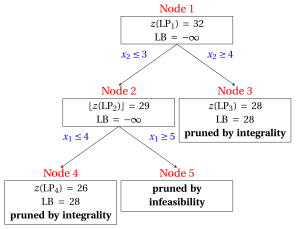
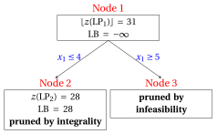

# Branch-and-cut

**Part 3 · Exact methods · Chapter 8** · [:material-file-pdf-box: Lecture notes, volume 2 (PDF)](../pdf/lecture-notes-2-exact-methods.pdf) · [:material-pencil: Exercises: Branch-and-cut](../exercises/branch-and-cut.md)

!!! nota "Prerequisites"

    - From this module, the chapters «Valid inequalities» and «Cover inequalities»: valid inequalities, and the separation of a violated inequality of a family.

    - From this module, the chapter «Cutting plane algorithm»: Gomory fractional cuts, and the re-optimization of the LP problem with the dual simplex algorithm after the insertion of a cut.

    - From this module, the chapter «LP-based branch-and-bound»: the list of LP problems, the pruning criteria, and the branching-variable and branching-node selection strategies.

!!! chiave "Objectives"

    At the end of this chapter you will be able to:

    - explain how cutting planes and branching operations complement each other;

    - distinguish global and local valid inequalities, and say where a cut can be used;

    - describe cut-and-branch and branch-and-cut algorithms, and the role of the cut pool;

    - execute a cut-and-branch algorithm with Gomory cuts by hand on a small ILP problem and compare the size of the tree with and without cuts;

    - generate a local cut at a branching node and re-optimize with the dual simplex algorithm.

## 8.1 Branch-and-cut algorithms

!!! definizione "Definition 8.1: branch-and-cut algorithm"

    Given an ILP problem in canonical maximization form with integer input data, a <strong>branch-and-cut algorithm</strong> is a branch-and-bound algorithm in which the LP problems of the branching nodes are strengthened with cutting planes before branching.

- A <strong>cutting plane algorithm</strong> moves the LP relaxation towards the convex hull of the integer solutions, but Gomory fractional cuts lose effectiveness after the first iterations (<strong>tailing off</strong>).

- A <strong>branch-and-bound algorithm</strong> partitions the feasible region into smaller LP problems, but started from a weak LP relaxation it needs a large tree.

!!! chiave ""

    Cuts decrease the bounds of the nodes, so more nodes are pruned by bound; branching guarantees termination when the cuts are no longer effective.

- All modern MIP solvers are based on branch-and-cut algorithms (see the chapter «What a MIP solver does»).

## 8.2 Global and local valid inequalities

- In a branch-and-bound algorithm, the $\LP_k$ problem of a branching node $k$ is the LP relaxation with the branching constraints of the path from the root to node $k$.

- We denote by $F$ the set of integer feasible solutions of the ILP problem, and by $F_k \subseteq F$ the set of those that satisfy the branching constraints of node $k$. At the root node $F_1 = F$.

!!! definizione "Definition 8.2: global and local valid inequalities"

    A linear inequality $\vet\alpha\T\vet x \le \beta$ is called:

    1. a <strong>globally valid inequality</strong> (or <strong>global cut</strong>) if it is satisfied by all the solutions in $F$;

    2. a <strong>locally valid inequality</strong> for the branching node $k$ (or <strong>local cut</strong>) if it is satisfied by all the solutions in $F_k$.

- Since $F_k \subseteq F$, every global cut is also a local cut of every node. The converse is false: a local cut can remove integer feasible solutions that belong to other branches of the tree.

- A local cut of node $k$ is valid for all the nodes of the subtree rooted at $k$, and it must <u>not</u> be used outside this subtree.

!!! chiave ""

    A cut derived only from the original constraints (and from other global cuts) is <strong>global</strong>. A cut whose derivation uses a branching constraint is, in general, only <strong>local</strong>.

- A Gomory fractional cut generated at the root node is global: it is derived from the original constraints alone, and so is an inequality of a family (such as the cover inequalities of a constraint with positive coefficients) separated from them. A Gomory fractional cut generated by a row that contains the slack variable of a branching constraint with a non-zero coefficient is treated as local.

## 8.3 Cut-and-branch and branch-and-cut

!!! definizione "Definition 8.3: cut-and-branch algorithm"

    A <strong>cut-and-branch algorithm</strong> executes a cutting plane algorithm at the root node for a limited number of <strong>rounds of cuts</strong>, adds the cuts found to the ILP problem, and then executes a branch-and-bound algorithm on the strengthened problem. No cuts are generated at the other nodes.

- All the root cuts are global: at the root node no branching constraint exists.

- In a <strong>branch-and-cut algorithm</strong> cuts are generated also at the other nodes (at all of them, or at some of them, for example every ten levels of the tree). The cuts can be global or local.

- At each node, the generation of cuts stops when the solution of the $\LP_k$ problem is integer or the node can be pruned; when no violated cut is found; when a maximum number of rounds is reached; or when the decrease of $z(\LP_k)$ in the last rounds is small (tailing off).

### 8.3.1 The cut pool

- Cuts are stored in a data structure called the <strong>cut pool</strong>. Before calling the (more expensive) cut-generation procedures, the algorithm checks whether a cut of the pool is violated by $\tilde{\vet x}(\LP_k)$.

- Global cuts are stored in a <strong>global pool</strong>, usable at every node. Local cuts are stored with their node and are inherited only by its descendants.

- Each cut adds a constraint to the LP problems. Cuts that stay inactive for many iterations are removed from the LP problem and kept only in the pool.

### 8.3.2 High-level pseudocode

- The branch-and-cut algorithm has the pseudocode of the branch-and-bound algorithm (same branching operations, same pruning criteria, same list $L$): only the <strong>Branching Node Solution Sub-Procedure</strong> changes.

!!! algoritmo "Algorithm"

    - <strong>Input:</strong> An $\LP_k$ problem associated with a branching node, the cut pool, and a maximum number $R$ of rounds of cuts.

    - **Step 1:** <strong>Bounding operations</strong>

        Solve the $\LP_k$ problem.

        1. if the $\LP_k$ problem is infeasible, then <code>STOP</code>.

        2. if $\left\lfloor z(\LP_k) \right\rfloor \le \LB$, then <code>STOP</code>.

        3. if ${\tilde{\vet x}}(\LP_k)$ is integer, then update the <strong>lower bound</strong> and the <strong>incumbent solution</strong>, remove from the list $L$ all LP problems with $\left\lfloor z(\LP) \right\rfloor \le \LB$ and <code>STOP</code>.

    - **Step 2:** <strong>Cut generation</strong>

        If $R$ rounds of cuts have been executed at node $k$, go to Step 3. Otherwise:

        1. look in the cut pool for cuts violated by ${\tilde{\vet x}}(\LP_k)$; if none is found, generate new violated cuts and store them in the pool (global cuts in the global pool, local cuts with node $k$);

        2. if no violated cut exists, go to Step 3. Otherwise add the cuts to the $\LP_k$ problem, re-optimize it and go to Step 1.

    - **Step 3:** <strong>Insertion into the list</strong>

        Insert the $\LP_k$ problem (with its cuts) into the list $L$ and <code>STOP</code>.

- With $R = 0$ at every node except the root we obtain a cut-and-branch algorithm; with $R = 0$ at every node we obtain the branch-and-bound algorithm.

- The pseudocode does not say how the cuts are generated or how the LP problem is re-optimized. After the insertion of a cut the dictionary is dual feasible, so the <strong>dual simplex algorithm</strong> starts from the optimal dictionary of the previous problem, as after a branching constraint.

## 8.4 Worked example: cut-and-branch with Gomory cuts { #sez-sec-bc-example }

- We use the problem $P10$ of the catalogue of MIP problems: maximize $5x_1+2x_2$ subject to $-x_1+3x_2\le 12$, $x_1+2x_2\le 12$, $3x_1-2x_2\le 8$, $x_1,x_2\in\Z_{\ge 0}$. Its unique optimal solution is $\tilde{\vet x}(\ILP) = (4,4)$, with $z(\ILP) = 28$.

- The cuts are the Gomory fractional cuts of the chapter on the cutting plane algorithm, with the same rule: the row with the largest fractional right-hand side, and the smallest index in case of a tie.

- Since the data are integer, the bound of a node is $\lfloor z(\LP_k) \rfloor$. All the executions use the same rules: the smallest-index rule as branching-variable selection strategy, the LIFO rule as branching-node selection strategy, the down-branching node solved first, and $\LB = -\infty$ at the start.

!!! esempio "Example 8.1: branch-and-bound without cuts"

    The $\LP_1$ problem is the LP relaxation of $P10$. An optimal solution is $\tilde{\vet x}(\LP_1) = (5,\tfrac{7}{2})$, with $z(\LP_1) = 32$ and $\UB = 32$. The branch-and-bound algorithm solves $5$ LP problems:

    { .fig loading=lazy  }

    
<table>
    <tr>
    <th>Node</th>
    <th>Parent</th>
    <th>Branching</th>
    <th>\(\tilde{\vet x}(\LP_k)\)</th>
    <th>\(z(\LP_k)\)</th>
    <th>\(\LB\)</th>
    <th>Outcome</th>
    </tr>
    <tr>
    <td>1</td>
    <td>–</td>
    <td>–</td>
    <td>\((5, \tfrac{7}{2})\)</td>
    <td>\(32\)</td>
    <td>\(-\infty\)</td>
    <td>branching on \(x_2\)</td>
    </tr>
    <tr>
    <td>2</td>
    <td>1</td>
    <td>\(x_2 \le 3\)</td>
    <td>\((\tfrac{14}{3}, 3)\)</td>
    <td>\(\tfrac{88}{3}\)</td>
    <td>\(-\infty\)</td>
    <td>branching on \(x_1\)</td>
    </tr>
    <tr>
    <td>3</td>
    <td>1</td>
    <td>\(x_2 \ge 4\)</td>
    <td>\((4, 4)\)</td>
    <td>\(28\)</td>
    <td>\(28\)</td>
    <td>pruned by integrality</td>
    </tr>
    <tr>
    <td>4</td>
    <td>2</td>
    <td>\(x_1 \le 4\)</td>
    <td>\((4, 3)\)</td>
    <td>\(26\)</td>
    <td>\(28\)</td>
    <td>pruned by integrality</td>
    </tr>
    <tr>
    <td>5</td>
    <td>2</td>
    <td>\(x_1 \ge 5\)</td>
    <td>–</td>
    <td>–</td>
    <td>\(28\)</td>
    <td>pruned by infeasibility</td>
    </tr>
    </table>

!!! esempio "Example 8.2: cut-and-branch with one Gomory cut"

    - <strong>Root: cut generation.</strong> The two rows of the optimal dictionary of $\LP_1$ with a fractional right-hand side, the rows of $x_2$ and of $x_3$, have the same right-hand side $\frac{1}{2}$; we use the row of $x_2$, whose index is smaller. With the slack variables $x_4 = 12 - x_1 - 2x_2$ and $x_5 = 8 - 3x_1 + 2x_2$ the cut is

        $$
        \tfrac{3}{8}\,x_4 + \tfrac{7}{8}\,x_5 \ge \tfrac{1}{2}
        \qquad\Longleftrightarrow\qquad
        3\,x_1 - x_2 \le 11 .
        $$

        It is a global cut, and it cuts off $\tilde{\vet x}(\LP_1)$: $3 \cdot 5 - \frac{7}{2} = \frac{23}{2} > 11$.

    - <strong>Root: re-optimization.</strong> We add the cut to the $\LP_1$ problem and we re-optimize it with the dual simplex algorithm. An optimal solution is

        $$
        \tilde{\vet x}(\LP_1) = (\tfrac{34}{7},\tfrac{25}{7}), \qquad z(\LP_1) = \tfrac{220}{7}, \qquad \UB = 31 .
        $$

    - <strong>Branch-and-bound.</strong> The branch-and-bound algorithm now starts from this $\LP_1$ problem. Every node inherits the cut. It solves $3$ LP problems instead of $5$:

    { .fig loading=lazy  }

    
<table>
    <tr>
    <th>Node</th>
    <th>Parent</th>
    <th>Branching</th>
    <th>\(\tilde{\vet x}(\LP_k)\)</th>
    <th>\(z(\LP_k)\)</th>
    <th>\(\LB\)</th>
    <th>Outcome</th>
    </tr>
    <tr>
    <td>1</td>
    <td>–</td>
    <td>–</td>
    <td>\((\tfrac{34}{7}, \tfrac{25}{7})\)</td>
    <td>\(\tfrac{220}{7}\)</td>
    <td>\(-\infty\)</td>
    <td>branching on \(x_1\)</td>
    </tr>
    <tr>
    <td>2</td>
    <td>1</td>
    <td>\(x_1 \le 4\)</td>
    <td>\((4, 4)\)</td>
    <td>\(28\)</td>
    <td>\(28\)</td>
    <td>pruned by integrality</td>
    </tr>
    <tr>
    <td>3</td>
    <td>1</td>
    <td>\(x_1 \ge 5\)</td>
    <td>–</td>
    <td>–</td>
    <td>\(28\)</td>
    <td>pruned by infeasibility</td>
    </tr>
    </table>

- One Gomory cut reduces the number of LP problems from $5$ to $3$. The cut does not find the optimal solution: it moves the optimal solution of the root LP problem, so that the algorithm branches on $x_1$ and the node $x_1 \le 4$ gives the optimal solution at once.

- A second round of cuts, in the same cut-and-branch algorithm, gives an integer solution at the root. The row of $x_1$ has the largest right-hand side $\frac{6}{7}$; with the slack variable $x_6 = 11 - 3x_1 + x_2$ of the first cut the new cut is

    $$
    \tfrac{1}{7}\,x_4 + \tfrac{2}{7}\,x_6 \ge \tfrac{6}{7}
    \qquad\Longleftrightarrow\qquad
    x_1 \le 4 .
    $$

- The optimal solution of the new $\LP_1$ problem is $(4,4)$, with $z(\LP_1) = 28$. The node is pruned by integrality, and the algorithm stops with $\LB = \UB = 28$ after solving one LP problem.

<table>
<tr>
<th>Cuts added at the root</th>
<th>\(z(\LP_1)\)</th>
<th>\(\UB\) at the root</th>
<th>LP problems solved</th>
</tr>
<tr>
<td>none (branch-and-bound)</td>
<td>\(32\)</td>
<td>\(32\)</td>
<td>\(5\)</td>
</tr>
<tr>
<td>\(3 \, x_1 - x_2 \le 11\)</td>
<td>\(\tfrac{220}{7}\)</td>
<td>\(31\)</td>
<td>\(3\)</td>
</tr>
<tr>
<td>\(3 \, x_1 - x_2 \le 11\) and \(x_1 \le 4\)</td>
<td>\(28\)</td>
<td>\(28\)</td>
<td>\(1\)</td>
</tr>
</table>

- The stronger the cuts, the smaller the tree, until it reduces to the root node.

- This is not the rule. The table below reports the same algorithm on the problem $P2$ of the catalogue (maximize $x_1+3x_2$ subject to $-4x_1+10x_2\le 35$, $3x_1+x_2\le 12$, $x_1,x_2\in\Z_{\ge 0}$, with $z(\ILP) = 14$) for an increasing number of rounds of Gomory cuts.

<table>
<tr>
<th>Rounds</th>
<th>Last cut added</th>
<th>\(z(\LP_1)\)</th>
<th>\(\UB\) at the root</th>
<th>LP problems solved</th>
</tr>
<tr>
<td>\(0\)</td>
<td>–</td>
<td>\(16\)</td>
<td>\(16\)</td>
<td>\(4\)</td>
</tr>
<tr>
<td>\(1\)</td>
<td>\(-3 \, x_1 + 10 \, x_2 \le 37\)</td>
<td>\(\tfrac{524}{33}\)</td>
<td>\(15\)</td>
<td>\(4\)</td>
</tr>
<tr>
<td>\(2\)</td>
<td>\(x_1 + 3 \, x_2 \le 15\)</td>
<td>\(15\)</td>
<td>\(15\)</td>
<td>\(4\)</td>
</tr>
<tr>
<td>\(3\)</td>
<td>\(-x_1 + 5 \, x_2 \le 19\)</td>
<td>\(15\)</td>
<td>\(15\)</td>
<td>\(4\)</td>
</tr>
<tr>
<td>\(4\)</td>
<td>\(x_2 \le 4\)</td>
<td>\(\tfrac{44}{3}\)</td>
<td>\(14\)</td>
<td>\(2\)</td>
</tr>
<tr>
<td>\(5\)</td>
<td>\(x_1 + x_2 \le 6\)</td>
<td>\(14\)</td>
<td>\(14\)</td>
<td>\(1\)</td>
</tr>
</table>

- The first three cuts decrease $z(\LP_1)$ from $16$ to $15$ but the tree has always $4$ nodes; $5$ rounds are needed to reach the root node. The upper bound improves slowly, as in the <strong>tailing off</strong> of the cutting plane algorithm.

- A cut-and-branch algorithm must decide when to stop cutting and start branching: the cost of each round is paid at every node of the tree.

## 8.5 Local cuts: an example

- We use the car example ($x_1$ sports cars and $x_2$ family cars): maximize $3x_1+2x_2$ subject to $10x_1+4x_2\le 45$, $4x_1+14x_2\le 49$, $x_1,x_2\in\Z_{\ge 0}$. In the branch-and-bound algorithm without cuts, node $3$ is the up-branching child of the root, with the branching constraint $x_1 \ge 4$ and the slack variable $x_5 = x_1 - 4$.

- The optimal dictionary of the $\LP_3$ problem, with $\tilde{\vet x}(\LP_3) = (4,\tfrac{5}{4})$ and $z(\LP_3) = \tfrac{29}{2}$, is:

\begin{equation*}
\begin{cases}
\begin{array}{rrrrrrr}
{x_1} & {=} & {4} &  &  & {+} & {x_5} \\[2ex]
{x_2} & {=} & {\dfrac{5}{4}} & {-} & {\dfrac{1}{4}}\, {x_3} & {-} & {\dfrac{5}{2}}\, {x_5} \\[2ex]
{x_4} & {=} & {\dfrac{31}{2}} & {+} & {\dfrac{7}{2}}\, {x_3} & {+} & {31}\, {x_5} \\[2ex]
{z} & {=} & {\dfrac{29}{2}} & {-} & {\dfrac{1}{2}}\, {x_3} & {-} & {2}\, {x_5}
\end{array}
\end{cases}
\end{equation*}

!!! esempio "Example 8.3: a local cut at node 3"

    - <strong>A simple local cut.</strong> From $10\,x_1 + 4\,x_2 \le 45$ and the branching constraint $x_1 \ge 4$ we have

        $$
        4\,x_2 \le 45 - 10\,x_1 \le 45 - 10 \cdot 4 = 5
        \quad\Longrightarrow\quad
        x_2 \le \tfrac{5}{4}
        \quad\Longrightarrow\quad
        x_2 \le 1 .
        $$

    - The inequality $x_2 \le 1$ is valid for all the solutions in $F_3$, but it is <strong>not globally valid</strong>: the integer feasible solution $(3,2)$, of value $13$, violates it. It is a local cut of node $3$.

    - We add it to the $\LP_3$ problem, with the slack variable $x_6 = 1 - x_2$, and we re-optimize.

    - The cut is inserted with the slack variable $x_6 \ge 0$. The new row is

        $$
        x_6 = -\dfrac{1}{4} + \dfrac{1}{4} \, x_3 + \dfrac{5}{2} \, x_5.
        $$

    - The dictionary below is <strong>dual feasible</strong> but not primal feasible, since $\bar b_{6} = -\dfrac{1}{4} < 0$:

    \begin{equation*}
    \begin{cases}
    \begin{array}{rrrrrrr}
    {x_1} & {=} & {4} &  &  & {+} & {x_5} \\[2ex]
    {x_2} & {=} & {\dfrac{5}{4}} & {-} & {\dfrac{1}{4}}\, {x_3} & {-} & {\dfrac{5}{2}}\, {x_5} \\[2ex]
    {x_4} & {=} & {\dfrac{31}{2}} & {+} & {\dfrac{7}{2}}\, {x_3} & {+} & {31}\, {x_5} \\[2ex]
    {x_6} & {=} & {-\dfrac{1}{4}} & {+} & {\dfrac{1}{4}}\, {x_3} & {+} & {\dfrac{5}{2}}\, {x_5} \\[2ex]
    {z} & {=} & {\dfrac{29}{2}} & {-} & {\dfrac{1}{2}}\, {x_3} & {-} & {2}\, {x_5}
    \end{array}
    \end{cases}
    \end{equation*}

    - <strong>Dual pivoting operation.</strong> The pivot row is $x_6$, the only basic variable with a negative value. The ratios of the non-basic variables with $\bar a_{6j} < 0$ are

        $$
        \frac{\bar c_{3}}{\bar a_{6,3}} = \frac{-\tfrac{1}{2}}{-\tfrac{1}{4}} = 2,\qquad \frac{\bar c_{5}}{\bar a_{6,5}} = \frac{-2}{-\tfrac{5}{2}} = \dfrac{4}{5}.
        $$

    - The pivot column is $x_5$, with $s_m = \dfrac{4}{5}$, and the objective value becomes $\bar z + s_m \, \bar b_{6} = \dfrac{29}{2} + \dfrac{4}{5} \cdot \left(-\dfrac{1}{4}\right) = \dfrac{143}{10}$. The new dictionary is primal and dual feasible, hence optimal:

    \begin{equation*}
    \begin{cases}
    \begin{array}{rrrrrrr}
    {x_1} & {=} & {\dfrac{41}{10}} & {-} & {\dfrac{1}{10}}\, {x_3} & {+} & {\dfrac{2}{5}}\, {x_6} \\[2ex]
    {x_2} & {=} & {1} &  &  & {-} & {x_6} \\[2ex]
    {x_4} & {=} & {\dfrac{93}{5}} & {+} & {\dfrac{2}{5}}\, {x_3} & {+} & {\dfrac{62}{5}}\, {x_6} \\[2ex]
    {x_5} & {=} & {\dfrac{1}{10}} & {-} & {\dfrac{1}{10}}\, {x_3} & {+} & {\dfrac{2}{5}}\, {x_6} \\[2ex]
    {z} & {=} & {\dfrac{143}{10}} & {-} & {\dfrac{3}{10}}\, {x_3} & {-} & {\dfrac{4}{5}}\, {x_6}
    \end{array}
    \end{cases}
    \end{equation*}

    - The solution $\tilde{\vet x}(\LP_3) = (\tfrac{41}{10},1)$, with value $\tfrac{143}{10}$, is the same that the down-branching child of node $3$ gives: here the local cut works as a branching constraint, without creating a new node.

!!! esempio "Example 8.4: a Gomory fractional cut at node 3"

    - The row of $x_2$ of the dictionary of node $3$ gives the Gomory fractional cut

    $$
    \dfrac{1}{4} \, x_3 + \dfrac{1}{2} \, x_5 \ge \dfrac{1}{4}
    $$

    - It contains the slack variable $x_5$ of the branching constraint $x_1 \ge 4$, so its derivation uses this constraint and the algorithm treats it as a <strong>local cut</strong>.

    - In the space of the original variables ($x_3 = 45 - 10\,x_1 - 4\,x_2$, $x_5 = x_1 - 4$, multiplied by $4$) it reads $2\,x_1 + x_2 \le 9$. Enumerating the $16$ integer feasible solutions we see that this inequality is valid for all of them.

    - The algorithm cannot make this check at a node, so it keeps the cut local.

## 8.6 Practical aspects

### 8.6.1 Cut selection

- At each round many violated cuts can be available; adding all of them makes the LP problems large and slow to re-optimize. A branch-and-cut algorithm selects a subset.

- The <strong>efficacy</strong> of a cut $\vet\alpha\T\vet x \le \beta$ at the fractional solution $\tilde{\vet x}(\LP_k)$ is the Euclidean distance of $\tilde{\vet x}(\LP_k)$ from the hyperplane $\vet\alpha\T\vet x = \beta$:

    $$
    \text{efficacy} = \frac{\vet\alpha\T\,\tilde{\vet x}(\LP_k) - \beta}{\|\vet\alpha\|_2}.
    $$

- Unlike the violation $\vet\alpha\T\tilde{\vet x}(\LP_k) - \beta$, the efficacy does not change if the cut is multiplied by a positive constant. Selection rules combine efficacy with a measure of the <strong>parallelism</strong> of the cuts.

- For example, at $\tilde{\vet x}(\LP_1) = (5,\tfrac{7}{2})$ of $P10$ the cut $3x_1 - x_2 \le 11$ has violation $\frac{1}{2}$ and efficacy $\frac{1}{2\sqrt{10}} \approx 0.158$, while the same cut multiplied by $2$, $6x_1 - 2x_2 \le 22$, has violation $1$ and the same efficacy $\frac{1}{\sqrt{40}} \approx 0.158$.

### 8.6.2 Which cuts

- Any family of valid inequalities with a separation procedure can be used: Gomory fractional cuts (for ILP problems with integer data), cover inequalities for the constraints $\sum_j a_j x_j \le b$ with positive coefficients of a MIP problem with binary variables, and families that exploit the structure of a given model.

- Gomory fractional cuts come from the rows of the optimal dictionary, so they are always available. In floating-point arithmetic their coefficients are affected by rounding errors, and solvers discard the cuts with very large or very small coefficients.

### 8.6.3 Upper bound and gap

- As in the branch-and-bound algorithm, if the list $L$ is not empty we have

    $$
    z(\ILP) ~~\le~~ \UB ~=~ \max_{k \in L} \left\{~ \mathrm{UB}(\LP_k) ~\right\},
    $$

    where $z(\LP_k)$ is now the optimal value of the $\LP_k$ problem <u>after</u> the cuts.

- Cuts decrease the values $z(\LP_k)$ and, accordingly, the upper bound $\UB$ and the optimality gap $\frac{\UB - \LB}{|\LB|}$.

## 8.7 Typical mistakes

!!! attenzione "Warning"

    - <strong>Using a local cut outside its subtree.</strong> A cut derived with a branching constraint of node $k$ is valid only in the subtree of node $k$: in another branch it can remove an optimal solution.

    - <strong>Treating a cut as global without a proof.</strong> A Gomory fractional cut generated at a node can be global by chance ([Example 8.4](#box-7-ex-bc-local-gomory)); the algorithm keeps it local unless its derivation does not use branching constraints.

    - <strong>Adding every violated cut.</strong> Too many cuts make the LP problems slow; a few effective cuts per round are better, and inactive cuts are removed.

    - <strong>Believing that every cut reduces the tree.</strong> On $P2$ the first three Gomory cuts leave the tree at $4$ nodes (table of Section [8.4](#sez-sec-bc-example)); the quality of the cuts matters.

    - <strong>Choosing the cut with the largest efficacy as the strongest.</strong> Efficacy is measured at the current point only: a dominated cut can have a larger efficacy at that point.

    - <strong>Forgetting that cuts decrease the bound, not the optimal value.</strong> The optimal value $z(\ILP)$ never changes: only $z(\LP_k)$ and the upper bound do.

## 8.8 In summary

!!! chiave "In summary"

    - A branch-and-cut algorithm strengthens the LP problem of every node with cuts before branching.

    - A global cut is valid for all the integer solutions; a local cut only for those of a subtree, and it is stored with its node.

    - A cut-and-branch algorithm generates cuts only at the root; the cuts are then global.

    - After a cut, the LP problem is re-optimized with the dual simplex algorithm from the previous dictionary.

    - Cuts reduce the size of the tree, but only effective cuts do: on $P10$, one Gomory cut reduces the tree from $5$ to $3$ LP problems, and two cuts to $1$.

    <strong>Dashboard of $P10$.</strong> The lower and upper bounds on $z(\ILP) = 28$ found in this chapter:

    
<table>
    <tr>
    <th>Stage</th>
    <th>Lower bound</th>
    <th>Upper bound</th>
    <th>From</th>
    </tr>
    <tr>
    <td>LP relaxation of \(P10\)</td>
    <td>—</td>
    <td>\(32\)</td>
    <td>\(z(\LP) = 32\), \(\tilde{\vet x}(\LP) = (5,\tfrac{7}{2})\)</td>
    </tr>
    <tr>
    <td>Branch-and-bound</td>
    <td>\(28\)</td>
    <td>\(28\)</td>
    <td>\(5\) LP problems solved</td>
    </tr>
    <tr>
    <td>After the first Gomory cut</td>
    <td>—</td>
    <td>\(31\)</td>
    <td>\(z(\LP_1) = \tfrac{220}{7}\)</td>
    </tr>
    <tr>
    <td>Cut-and-branch with one cut</td>
    <td>\(28\)</td>
    <td>\(28\)</td>
    <td>\(3\) LP problems solved</td>
    </tr>
    <tr>
    <td>After the second Gomory cut</td>
    <td>\(28\)</td>
    <td>\(28\)</td>
    <td>\(\tilde{\vet x}(\LP_1) = (4,4)\) is integer, \(1\) LP problem solved</td>
    </tr>
    </table>

How MIP solvers combine these ideas is the topic of the chapter «MIP solvers».

---

**Exercises on this chapter:** [:material-pencil: Branch-and-cut](../exercises/branch-and-cut.md)
