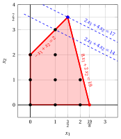
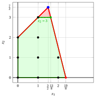
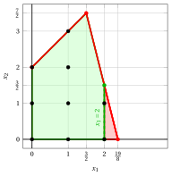
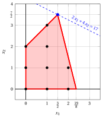
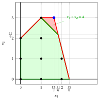
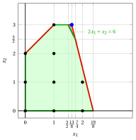

# The cutting plane algorithm with Gomory fractional cuts

**Part 3 · Exact methods · Chapter 6** · [:material-file-pdf-box: Lecture notes, volume 2 (PDF)](../pdf/lecture-notes-2-exact-methods.pdf) · [:material-pencil: Exercises: Cutting planes](../exercises/gomory.md) · [:material-gesture-tap: App: Gomory cuts on the plane](../lab/gomory-cuts.md)

!!! nota "Prerequisites"

    - From the module <em>Linear Programming</em>, [Chapter 10 «Dual Simplex algorithm»](https://fabiofurini.github.io/linear-programming/duality/10-dual-simplex/): simplex dictionaries, dual feasible bases and dual pivoting operations. A short recap is given in this chapter.

    - From this module, the chapters «Integer linear programming» and «Primal and dual bounds»: ILP problems, the LP relaxation, and the upper bound given by the LP relaxation.

    - From this module, the chapter «Valid inequalities»: valid inequalities and cuts that remove fractional points.

!!! chiave "Objectives"

    At the end of this chapter you will be able to:

    - generate a Gomory fractional cut from a row of a simplex dictionary, and prove that it is valid and that it cuts off the current basic solution;

    - insert a cut into the dictionary and re-optimize with the dual simplex algorithm;

    - execute a cutting plane algorithm by hand, with the largest right-hand side selection strategy and its tie-breaking rules;

    - compute the upper bound at every iteration, and explain why the algorithm may need many cuts;

    - explain why these cuts are valid only for ILP problems with integer data.

## 6.1 Gomory fractional cuts

!!! definizione "Definition 6.1: cutting plane"

    Given an ILP problem and a fractional optimal solution $\tilde{\vet x}(\LP)$ of its LP relaxation, a <strong>cutting plane</strong> (or <strong>cut</strong>) is a valid inequality for the ILP problem that cuts off $\tilde{\vet x}(\LP)$.

!!! chiave ""

    Gomory fractional cuts are valid inequalities that cut off fractional basic feasible solutions of the LP relaxation of an ILP problem without excluding any integer feasible solution.

- <strong>We consider ILP problems in canonical maximization form with integer input data</strong>. For these problems, the slack variables introduced in the standard-form LP relaxation also take integer values in every integer feasible solution of the ILP problem.

- Gomory fractional cuts are valid <u>only</u> if all the variables, slack variables included, are integer. For MIP problems with continuous variables they can cut off feasible solutions, and a different family of cuts is needed.

- We recall that a simplex dictionary of the LP relaxation in standard form reads as follows

    $$
    \begin{cases}
    \displaystyle
    x_i=\bar b_i-\sum_{j\in\pazocal N}\bar a_{ij}x_j,
    \qquad \forall i\in\pazocal B,\\[4ex]
    \displaystyle
    z=\bar z+\sum_{j\in\pazocal N}\bar c_jx_j.
    \end{cases}
    $$

    where $\pazocal{B}$ is the set of indices of the basic variables and $\pazocal{N}$ is the set of indices of the non-basic variables. If $\bar{b}_i \ge 0$ for every $i \in \pazocal{B}$, then the dictionary is associated with the following feasible basic solution:

    $$
    x_i = \bar{b}_i, \quad \forall i \in \pazocal{B},
    \qquad
    x_j = 0, \quad \forall j \in \pazocal{N}.
    $$

    If, in addition, at least one $\bar{b}_i$ is fractional, then this basic feasible solution is fractional.

- Gomory fractional cuts are obtained from the rows of a simplex dictionary associated with a fractional feasible basic solution of the LP relaxation in standard form of an ILP problem.

    

    !!! definizione "Definition 6.2: Gomory fractional cut"

        Given a row $i \in \pazocal{B}$ of a simplex dictionary associated with a feasible basic solution such that $\bar{b}_i$ is fractional, the linear inequality

        \begin{equation*}
        \sum_{j \in \pazocal{N}}
        \left(
        \bar{a}_{ij}
        -
        \left\lfloor \bar{a}_{ij}\right\rfloor
        \right)x_j
        \ge
        \bar{b}_i - \left\lfloor \bar{b}_i \right\rfloor
        \label{GFC} \tag{6.1}
        \end{equation*}

        is called the <strong>Gomory fractional cut</strong> generated by row $i$.

- We will prove that any Gomory fractional cut does not cut off any integer feasible solution of the ILP problem and that it cuts off the fractional feasible basic solution.

!!! esempio "Example 6.1: ILP in canonical form, LP relaxation in standard form and dictionaries"

    Consider the following ILP problem in canonical maximization form with $2$ integer variables and $2$ linear constraints (called Example 1):

    $$
    \begin{array}{rrrrrrrrrrrrrr}
    {\max} & 2 \, {x_1} & {+} & 4 \, {x_2} \\[2ex]
    & {-} \, {x_1} & {+} & \, {x_2} & {\le} & {2} \\[2ex]
    & {8} \, {x_1} & {+} & {2} \, {x_2} & {\le} & {19} \\[2ex]
    & {x_1,} &  & {x_2} & { \in} & {\Z_{\ge 0} }
    \end{array}
    $$

    The LP relaxation in standard form with $4$ non-negative variables (2 slack variables) and $2$ linear constraints reads as follows:

    $$
    \begin{array}{rrrrrrrrrr}
    {\max} & 2 \, {x_1} & {+} & 4 \, {x_2} &  &  &  &  &  &  \\[2ex]
    & {-} \, {x_1} & {+} & \, {x_2} & {+} & {x_3} &  &  & {=} & {2} \\[2ex]
    & {8} \, {x_1} & {+} & {2} \, {x_2} &  &  & {+} & {x_4} & {=} & {19} \\[2ex]
    & {x_1,} &  & {x_2,} &  & {x_3,} &  & {x_4} & {\ge} & {0 }
    \end{array}
    $$

    As an example let us consider the following simplex dictionary associated with a fractional basic feasible solution of the LP relaxation in standard form of the ILP problem:

    \begin{equation*}
    \begin{cases}
    \begin{array}{rrrrrrrrrrrrr}
    {x_1=\frac{3}{2}} & {+} & {\frac{1}{5}} \, {x_3} & {-} & {\frac{1}{10}}\, {x_4} \\[2ex]
    {x_2=\frac{7}{2}} & {-} & {\frac{4}{5}}\, {x_3} & {-} & {\frac{1}{10}}\, {x_4} \\[2ex]
    {z= 17} & {-} & {\frac{14}{5}} \, {x_3} & {-} & {\frac{3}{5}} \, {x_4}
    \end{array}
    \end{cases}
    \quad
    \text{where}
    \quad
    \bar{\mat A}=
    \begin{pmatrix}
    -\frac{1}{5} & \frac{1}{10} \\[2ex]
    \frac{4}{5} & \frac{1}{10} \\
    \end{pmatrix}
    \quad
    \bar{\vet b}=
    \begin{pmatrix}
    \frac{3}{2} \\[2ex]
    \frac{7}{2} \\
    \end{pmatrix}
    \end{equation*}

    and $\pazocal{B}=\{1,2\}$ and $\pazocal{N}=\{3,4\}$. The associated fractional basic feasible solution is:

    $$
    \bar x_1=\dfrac{3}{2},~~
    \bar x_2=\dfrac{7}{2},~~~~
    \bar x_3=0,~~
    \bar x_4=0
    ~~~\text{of value   } \bar z = 17
    $$

!!! esempio "Example 6.2: Gomory fractional cuts"

    Let us consider again the ILP problem of Example 1 in canonical maximization form with $2$ integer variables and $2$ linear constraints:

    $$
    \begin{array}{rrrrrrrrrrrrr}
    {\max} & 2 \, {x_1} & {+} & 4 \, {x_2} \\[2ex]
    & {-} \, {x_1} & {+} & \, {x_2} & {\le} & {2} \\[2ex]
    & {8} \, {x_1} & {+} & {2} \, {x_2} & {\le} & {19} \\[2ex]
    & {x_1,} &  & {x_2} & { \in} & {\Z_{\ge 0} }
    \end{array}
    $$

    and its LP relaxation in canonical form with $2$ non-negative variables and $2$ linear constraints:

    $$
    \begin{array}{rrrrrrrrrrrrr}
    {\max} & 2 \, {x_1} & {+} & 4 \, {x_2} \\[2ex]
    & {-} \, {x_1} & {+} & \, {x_2} & {\le} & {2} \\[2ex]
    & {8} \, {x_1} & {+} & {2} \, {x_2} & {\le} & {19} \\[2ex]
    & {x_1,} &  & {x_2} & { \ge} & {0}
    \end{array}
    $$

    { .fig .ovale loading=lazy style="width:44%" }

    An optimal solution $\tilde{\vet x}(\ILP)$ of the ILP problem is

    $$
    \tilde{x}_1=1,~~\tilde{x}_2=3
    $$

    The optimal value is $z(\ILP) = 14$.  An optimal solution $\tilde{\vet x}(\LP)$ of the LP relaxation is

    $$
    \tilde{x}_1=\frac{3}{2},~~\tilde{x}_2=\frac{7}{2}
    $$

    The optimal value is $z(\LP) = 17$.

    Let us consider the following simplex dictionary associated with a fractional basic feasible solution of the LP relaxation in standard form of the ILP problem of Example 1:

    \begin{equation*}
    \begin{cases}
    \begin{array}{rrrrrrrrrrrrr}
    {x_1=\frac{3}{2}} & {+} & {\frac{1}{5}} \, {x_3} & {-} & {\frac{1}{10}}\, {x_4} \\[2ex]
    {x_2=\frac{7}{2}} & {-} & {\frac{4}{5}}\, {x_3} & {-} & {\frac{1}{10}}\, {x_4} \\[2ex]
    {z= 17} & {-} & {\frac{14}{5}} \, {x_3} & {-} & {\frac{3}{5}} \, {x_4}
    \end{array}
    \end{cases}
    \quad
    \text{where}
    \quad
    \bar{\mat A}=
    \begin{pmatrix}
    -\frac{1}{5} & \frac{1}{10} \\[2ex]
    \frac{4}{5} & \frac{1}{10} \\
    \end{pmatrix}
    \quad
    \bar{\vet b}=
    \begin{pmatrix}
    \frac{3}{2} \\[2ex]
    \frac{7}{2} \\
    \end{pmatrix}
    \end{equation*}

    - The Gomory fractional cut generated by the first row is:

        \begin{align*}
        \underbrace{\left(-\frac{1}{5} - \left\lfloor -\frac{1}{5} \right\rfloor \right)}_{-\frac{1}{5}-(-1)=\frac{4}{5}} \; x_3 + \underbrace{\left(\frac{1}{10} - \left\lfloor \frac{1}{10} \right\rfloor \right)}_{\frac{1}{10}-0=\frac{1}{10}} \; x_4
        \ge \underbrace{\left(\frac{3}{2} - \left\lfloor \frac{3}{2} \right\rfloor \right)}_{\frac{3}{2} -1=\frac{1}{2}}
        \end{align*}

        \begin{align*}
        \frac{4}{5}\;x_3 + \frac{1}{10}\;x_4 \ge \frac{1}{2}
        \quad \Rightarrow \quad
        8\;x_3 + x_4 \ge 5
        \end{align*}

        From the standard form of the LP relaxation, we have:

        $$
        x_3= 2 + x_1 -x_2 \text{    and    }
        x_4= 19 - 8 \;x_1 - 2\;x_2
        $$

        Substituting in the Gomory fractional cut, we can express it in terms of the original variables of the ILP problem:

        $$
        8\; (2 + x_1 -x_2) + (19 - 8 \:x_1 - 2\:x_2) \ge 5
        \quad \Rightarrow \quad
        x_2 \le 3
        $$

    - The Gomory fractional cut generated by the second row is:

        \begin{align*}
        \underbrace{\left(\frac{4}{5} - \left\lfloor \frac{4}{5} \right\rfloor \right)}_{\frac{4}{5}-0=\frac{4}{5}} \; x_3 + \underbrace{\left(\frac{1}{10} - \left\lfloor \frac{1}{10} \right\rfloor \right)}_{\frac{1}{10}-0=\frac{1}{10}} \; x_4
        \ge \underbrace{\left(\frac{7}{2} - \left\lfloor \frac{7}{2} \right\rfloor \right)}_{\frac{7}{2} -3=\frac{1}{2}}
        \end{align*}

        \begin{align*}
        \frac{4}{5}\;x_3 + \frac{1}{10}\;x_4 \ge \frac{1}{2}
        \quad \Rightarrow \quad
        8\;x_3 + x_4 \ge 5
        \end{align*}

        This Gomory fractional cut is the same as the one generated from the first row.

    Effect of the Gomory fractional cut on the feasible region of the LP relaxation in canonical form.

    { .fig .ovale loading=lazy style="width:59%" }

!!! chiave ""

    A Gomory fractional cut can also be generated by the objective-function row of the simplex dictionary.

- Consider the objective-function row of a simplex dictionary:

    $$
    z=\bar z+\sum_{j \in \pazocal{N}}\bar c_j x_j
    $$

    This row can be rewritten in the same form as the other dictionary rows:

    $$
    z=\bar z-\sum_{j \in \pazocal{N}}(-\bar c_j)x_j
    $$

    The Gomory fractional cut generated by the objective-function row is

    \begin{equation*}
    \sum_{j \in \pazocal{N}}
    \left(
    -\bar c_j
    -
    \left\lfloor -\bar c_j \right\rfloor
    \right)x_j
    \ge
    \bar z - \left\lfloor \bar z \right\rfloor
    \label{GFC_OBJ} \tag{6.2}
    \end{equation*}

!!! esempio "Example 6.3: Gomory fractional cuts"

    Let us consider the following simplex dictionary associated with a fractional basic feasible solution of the LP relaxation in standard form of the ILP problem of Example 1:

    \begin{equation*}
    \begin{cases}
    \begin{array}{rrrrrrrrrrrrr}
    {x_1=\dfrac{19}{8}} & {-} & {\dfrac{1}{4}} \, {x_2} & {-} & {\dfrac{1}{8}}\, {x_4} \\[2ex]
    {x_3=\dfrac{35}{8}} & {-} & {\dfrac{5}{4}}\, {x_2} & {-} & {\dfrac{1}{8}}\, {x_4} \\[2ex]
    {z =\dfrac{19}{4}} & {+} & {\dfrac{7}{2}} \, {x_2} & {-} & {\dfrac{1}{4}} \, {x_4}
    \end{array}
    \end{cases}
    \quad
    \text{where}
    \quad
    \bar{\mat A}=
    \begin{pmatrix}
    \frac{1}{4} & \frac{1}{8} \\[2ex]
    \frac{5}{4} & \frac{1}{8} \\
    \end{pmatrix}
    \quad
    \bar{\vet b}=
    \begin{pmatrix}
    \frac{19}{8} \\[2ex]
    \frac{35}{8} \\
    \end{pmatrix}
    \end{equation*}

    - This dictionary is not optimal ($\bar c_2 = \frac{7}{2} > 0$): a Gomory fractional cut can be generated from any dictionary with a fractional basic solution, optimal or not. In the figure the basic solution $(\frac{19}{8},0)$ is a vertex of the feasible region, not the optimum of the LP relaxation.

    - The Gomory fractional cut generated by the first row is:

        \begin{align*}
        \underbrace{\left(\frac{1}{4} - \left\lfloor \frac{1}{4} \right\rfloor \right)}_{\frac{1}{4}-0=\frac{1}{4}} \; x_2 + \underbrace{\left(\frac{1}{8} - \left\lfloor \frac{1}{8} \right\rfloor \right)}_{\frac{1}{8}-0=\frac{1}{8}} \; x_4
        \ge \underbrace{\left(\frac{19}{8} - \left\lfloor \frac{19}{8} \right\rfloor \right)}_{\frac{19}{8} -2=\frac{3}{8}}
        \end{align*}

        \begin{align*}
        \frac{1}{4}\;x_2 + \frac{1}{8}\;x_4 \ge \frac{3}{8}
        \quad \Rightarrow \quad
        2\;x_2 + x_4 \ge 3
        \end{align*}

        From the standard form of the LP relaxation, we have:

        $$
        x_4= 19 - 8 \;x_1 - 2\;x_2
        $$

        Substituting in the Gomory fractional cut, we can express it in terms of the original variables of the ILP problem:

        $$
        2\;x_2 + (19 - 8 \:x_1 - 2\:x_2) \ge 3
        \quad \Rightarrow \quad
        x_1 \le 2
        $$

    - The Gomory fractional cut generated by the second row is:

        \begin{align*}
        \underbrace{\left(\frac{5}{4} - \left\lfloor \frac{5}{4} \right\rfloor \right)}_{\frac{5}{4}-1=\frac{1}{4}} \; x_2 + \underbrace{\left(\frac{1}{8} - \left\lfloor \frac{1}{8} \right\rfloor \right)}_{\frac{1}{8}-0=\frac{1}{8}} \; x_4
        \ge \underbrace{\left(\frac{35}{8} - \left\lfloor \frac{35}{8} \right\rfloor \right)}_{\frac{35}{8} -4=\frac{3}{8}}
        \end{align*}

        \begin{align*}
        \frac{1}{4}\;x_2 + \frac{1}{8}\;x_4 \ge \frac{3}{8}
        \quad \Rightarrow \quad
        2\;x_2 + x_4 \ge 3
        \end{align*}

        This Gomory fractional cut is the same as the one generated from the first row.

    - The Gomory fractional cut generated by the objective-function row is:

        \begin{align*}
        \underbrace{\left(-\frac{7}{2} - \left\lfloor -\frac{7}{2} \right\rfloor \right)}_{-\frac{7}{2}-(-4)=\frac{1}{2}} \; x_2 + \underbrace{\left(\frac{1}{4} - \left\lfloor \frac{1}{4} \right\rfloor \right)}_{\frac{1}{4}-0=\frac{1}{4}} \; x_4
        \ge \underbrace{\left(\frac{19}{4} - \left\lfloor \frac{19}{4} \right\rfloor \right)}_{\frac{19}{4} -4=\frac{3}{4}}
        \end{align*}

        \begin{align*}
        \frac{1}{2}\;x_2 + \frac{1}{4}\;x_4 \ge \frac{3}{4}
        \quad \Rightarrow \quad
        2\;x_2 + x_4 \ge 3
        \end{align*}

        This Gomory fractional cut is the same as the one generated from the first row.

    Effect of the Gomory fractional cut on the feasible region of the LP relaxation in canonical form.

    { .fig .ovale loading=lazy style="width:59%" }

### 6.1.1 Validity of the Gomory fractional cuts

!!! teorema "Observation 6.3"

    Any Gomory fractional cut cuts off the fractional basic feasible solution associated with the simplex dictionary from which it is generated.

!!! nota ""

    ??? dimostrazione "Proof"

        In the basic feasible solution associated with the dictionary, all non-basic variables are equal to zero:

        $$
        x_j = 0, \quad \forall j \in \pazocal{N}.
        $$

        Now consider the row $i \in \pazocal{B}$ from which the Gomory fractional cut is generated. By definition, $\bar{b}_i$ is fractional. The corresponding Gomory fractional cut is

        $$
        \sum_{j \in \pazocal{N}}
        \left(
        \bar{a}_{ij}
        -
        \left\lfloor \bar{a}_{ij} \right\rfloor
        \right)x_j
        \ge
        \bar{b}_i - \left\lfloor \bar{b}_i \right\rfloor .
        $$

        At the basic feasible solution, the left-hand side is equal to zero, since $x_j=0$ for all $j \in \pazocal{N}$. On the other hand,

        $$
        \bar{b}_i - \left\lfloor \bar{b}_i \right\rfloor > 0,
        $$

        because $\bar{b}_i$ is fractional. Hence, at the current basic feasible solution, the cut becomes

        $$
        0
        \not\ge
        \bar{b}_i - \left\lfloor \bar{b}_i \right\rfloor .
        $$

        Therefore, the Gomory fractional cut cuts off the basic feasible solution associated with the dictionary from which it is generated. □

!!! teorema "Observation 6.4"

    Every integer feasible solution of the ILP problem satisfies every Gomory fractional cut generated from the rows of a simplex dictionary.

!!! nota ""

    ??? dimostrazione "Proof"

        Let us consider a Gomory fractional cut generated from the following row $i \in \pazocal{B}$ of a simplex dictionary:

        \begin{equation*}
        \tag{A}
        x_i
        =
        \bar{b}_i
        -
        \sum_{j \in \pazocal{N}}
        \bar{a}_{ij}x_j .
        \end{equation*}

        We prove that any integer feasible solution of the ILP problem satisfying this row also satisfies the corresponding Gomory fractional cut. 

        Since $x_j \ge 0$ for all $j \in \pazocal{N}$ and $\left\lfloor \bar{a}_{ij} \right\rfloor \le \bar{a}_{ij},$ from (A) we obtain

        $$
        x_i
        \le
        \bar{b}_i
        -
        \sum_{j \in \pazocal{N}}
        \left\lfloor \bar{a}_{ij} \right\rfloor x_j .
        $$

        Equivalently,

        $$
        x_i
        +
        \sum_{j \in \pazocal{N}}
        \left\lfloor \bar{a}_{ij} \right\rfloor x_j
        \le
        \bar{b}_i .
        $$

        The left-hand side is integer, because the solution is integer, the variables appearing in the row are integer-valued, and the coefficients $\left\lfloor \bar{a}_{ij} \right\rfloor$ are integer. Hence,

        $$
        x_i
        +
        \sum_{j \in \pazocal{N}}
        \left\lfloor \bar{a}_{ij} \right\rfloor x_j
        \le
        \left\lfloor \bar{b}_i \right\rfloor .
        $$

        Using (A), we substitute

        $$
        x_i
        =
        \bar{b}_i
        -
        \sum_{j \in \pazocal{N}}
        \bar{a}_{ij}x_j
        $$

        into the previous inequality and get

        $$
        \bar{b}_i
        -
        \sum_{j \in \pazocal{N}}
        \bar{a}_{ij}x_j
        +
        \sum_{j \in \pazocal{N}}
        \left\lfloor \bar{a}_{ij} \right\rfloor x_j
        \le
        \left\lfloor \bar{b}_i \right\rfloor .
        $$

        Rearranging terms gives

        $$
        \sum_{j \in \pazocal{N}}
        \left(
        \bar{a}_{ij}
        -
        \left\lfloor \bar{a}_{ij} \right\rfloor
        \right)x_j
        \ge
        \bar{b}_i - \left\lfloor \bar{b}_i \right\rfloor .
        $$

        This is exactly the Gomory fractional cut generated from row $i$. Therefore, the integer feasible solution satisfies this cut.

        Since both the integer feasible solution and the Gomory fractional cut were chosen arbitrarily, every integer feasible solution of the ILP problem satisfies every Gomory fractional cut generated from the rows of the dictionary. □

- The same reasoning applies to the Gomory fractional cut generated from the objective-function row. Indeed, the objective-function row can be written as

    $$
    z
    =
    \bar z
    +
    \sum_{j \in \pazocal{N}}\bar c_j x_j
    =
    \bar z
    -
    \sum_{j \in \pazocal{N}}(-\bar c_j)x_j .
    $$

    If $\bar z$ is fractional, the corresponding Gomory fractional cut is

    $$
    \sum_{j \in \pazocal{N}}
    \left(
    -\bar c_j
    -
    \left\lfloor -\bar c_j \right\rfloor
    \right)x_j
    \ge
    \bar z - \left\lfloor \bar z \right\rfloor .
    $$

- This cut cuts off the current basic feasible solution: at that solution, all non-basic variables are equal to zero, and therefore the left-hand side is zero, while

    $$
    \bar z - \left\lfloor \bar z \right\rfloor > 0.
    $$

- The cut is valid for every integer feasible solution of the ILP problem. Indeed, if the original objective function has integer coefficients, then $z$ is integer-valued at every integer feasible solution. Moreover,

    $$
    z
    +
    \sum_{j \in \pazocal{N}}
    \left\lfloor -\bar c_j \right\rfloor x_j
    \le
    \bar z .
    $$

    Since the left-hand side is integer, it follows that

    $$
    z
    +
    \sum_{j \in \pazocal{N}}
    \left\lfloor -\bar c_j \right\rfloor x_j
    \le
    \left\lfloor \bar z \right\rfloor .
    $$

    Substituting

    $$
    z
    =
    \bar z
    +
    \sum_{j \in \pazocal{N}}\bar c_j x_j
    $$

    and rearranging terms gives exactly

    $$
    \sum_{j \in \pazocal{N}}
    \left(
    -\bar c_j
    -
    \left\lfloor -\bar c_j \right\rfloor
    \right)x_j
    \ge
    \bar z - \left\lfloor \bar z \right\rfloor .
    $$

### 6.1.2 Inclusion of Gomory fractional cuts into the simplex dictionary

- A Gomory fractional cut is obtained from a row of the current simplex dictionary. In general, both its coefficients and its right-hand side are fractional.

- To insert the cut into the simplex dictionary we proceed in three steps:

    1. substituting the definitions of the slack variables, we rewrite the cut in the original variables as an inequality $\sum_{j=1}^{n} a_j x_j \le b$ with integer $a_j$ and $b$;

    2. we make it <strong>primitive</strong>: we divide it by the greatest common divisor $g$ of $a_1, \dots, a_n$ and we round down the right-hand side,

        $$
        \sum_{j=1}^{n} \frac{a_j}{g} \, x_j \le \left\lfloor \frac{b}{g} \right\rfloor ;
        $$

    3. only then we add the non-negative slack variable $s = \lfloor b/g \rfloor - \sum_{j=1}^{n} (a_j/g) \, x_j$, and we substitute the current rows of the dictionary to obtain the row of $s$.

- The rounding is valid: the left-hand side is integer for every integer $\vet x$. The slack variable $s$ is integer in every integer feasible solution of the ILP problem.

!!! chiave ""

    First the cut is made primitive, then its slack variable is added. A surplus variable added directly to the fractional cut corresponds to the inequality before rounding, which is weaker when $g$ does not divide $b$.

!!! esempio "Example 6.4: Gomory fractional cut"

    Consider the ILP problem of Example 1.

    - The first Gomory fractional cut in the space of the original variables is the following inequality, already primitive ($g = 1$):

        \begin{align*}
        x_2 \le 3.
        \end{align*}

        Adding a non-negative slack variable gives

        \begin{align*}
        x_2+x_5=3,
        \qquad x_5\ge 0.
        \end{align*}

        From the current simplex dictionary we have

        \begin{align*}
        x_2
        =
        \frac{7}{2}
        -
        \frac{4}{5}\;x_3
        -
        \frac{1}{10}\;x_4.
        \end{align*}

        Substituting and solving for the new variable $x_5$, the corresponding dictionary row is

        \begin{align*}
        x_5
        =
        -\frac{1}{2}
        +
        \frac{4}{5}\;x_3
        +
        \frac{1}{10}\;x_4.
        \end{align*}

    - The second Gomory fractional cut in the space of the original variables is the following inequality, already primitive ($g = 1$):

        \begin{align*}
        x_1 \le 2.
        \end{align*}

        Adding a non-negative slack variable gives

        \begin{align*}
        x_1+x_5=2,
        \qquad x_5\ge 0.
        \end{align*}

        From the current simplex dictionary we have

        \begin{align*}
        x_1
        =
        \frac{19}{8}
        -
        \frac{1}{4}\;x_2
        -
        \frac{1}{8}\;x_4.
        \end{align*}

        Substituting and solving for the new variable $x_5$, the corresponding dictionary row is

        \begin{align*}
        x_5
        =
        -\frac{3}{8}
        +
        \frac{1}{4}\;x_2
        +
        \frac{1}{8}\;x_4.
        \end{align*}

- In Example 1 the coefficients have no common divisor and nothing is rounded. In the car example of the last sections the second cut in the original variables is $6\,x_1 + 14\,x_2 \le 55$: with $g = 2$ the primitive inequality is $3\,x_1 + 7\,x_2 \le \lfloor 55/2 \rfloor = 27$, and its slack variable is $27 - 3\,x_1 - 7\,x_2$.

## 6.2 A cutting-plane algorithm based on Gomory fractional cuts

!!! definizione "Definition 6.5: cutting plane algorithm based on Gomory fractional cuts"

    A <strong>cutting plane algorithm based on Gomory fractional cuts</strong> is an exact method for solving ILP problems based on the repeated solution of LP relaxations. Starting from the LP relaxation of the ILP problem, the algorithm progressively adds Gomory fractional cuts with the goal of removing fractional LP optimal solutions while preserving all integer feasible solutions:

    $$
    \rightsquigarrow~\textbf{cut generation operations}
    $$

    After each cut generation step, the new tighter LP relaxation is solved again:

    $$
    \rightsquigarrow~\textbf{LP re-optimization operations}
    $$

- The algorithm iterates between cut generation and LP re-optimization until an optimal integer solution is found, if one exists.

- We consider ILP problems in <strong>canonical maximization form with integer input data</strong>.

### 6.2.1 Cut generation operations

- The <strong>cut generation operations</strong> generate a sequence of increasingly tighter LP relaxations:

    $$
    \LP_1,\ \LP_2,\ \LP_3,\dots
    $$

    Each LP problem is obtained from the previous one by adding one or more <strong><em>Gomory fractional cuts</em></strong>.

- When $k=1$ we have the first LP problem, denoted by $\LP_1$, which is the LP relaxation of the original ILP problem. For $k\ge 2$, the $\LP_k$ problem is obtained from $\LP_{k-1}$ by adding the Gomory fractional cuts generated at iteration $k-1$.

!!! chiave ""

    For each iteration $k$, if the $\LP_k$ problem has an optimal solution, its optimal value is denoted by $z(\LP_k)$, and an optimal solution is denoted by $\tilde{\vet x}(\LP_k).$

- At each iteration, the current LP relaxation contains all feasible integer solutions of the original ILP problem. Accordingly we have the following upper bound $\UB$ on the optimal value of the ILP problem:

    $$
    z(\ILP) ~~\le~~  \underbrace{\left \lfloor z(\LP_k) \right \rfloor}_{\UB}
    $$

    When a Gomory fractional cut is added, the feasible region of the LP relaxation becomes smaller or remains unchanged.

- The algorithm may remove points that are feasible for the LP relaxation, but it does not remove any feasible integer solution of the original ILP problem. In this sense, each new cut tightens the current LP relaxation without excluding any feasible integer solution of the original ILP problem.

### 6.2.2 High-level pseudocode

!!! algoritmo "Algorithm"

    - <strong>Input:</strong> An ILP problem in canonical maximization form with integer input data.

    - <strong>Output:</strong> An optimal solution to the ILP problem (if one exists) or a certificate of infeasibility/unboundedness.

    - **Step 0:** <strong>Initialization</strong>

        Relax the integrality constraints and solve the $\LP_1$ problem. Set the iteration counter $k \leftarrow 1$.

        - **1.** if $\tilde{\vet x}(\LP_1)$ is <strong>integer</strong>, then it is an optimal solution and $z(\LP_1)$ is the optimal value of the ILP problem. <code>STOP</code>.

        - **2.** if the $\LP_1$ problem is <strong>infeasible</strong>, then the ILP problem is infeasible. <code>STOP</code>.

        - **3.** if the $\LP_1$ problem is <strong>unbounded</strong>, then the ILP problem is either infeasible or unbounded. <code>STOP</code>.

    - **Step 1:** <strong>Cut generation</strong>

        1. Select one or more rows $i \in \pazocal{B}$ of the optimal simplex dictionary of the $\LP_k$ problem with fractional $\bar{b}_i$ and generate the associated <strong>Gomory fractional cut(s):</strong>

            $$
            \sum_{j \in \pazocal{N}}
            \left(
            \bar{a}_{ij}
            -
            \left\lfloor \bar{a}_{ij} \right\rfloor
            \right)x_j
            \ge
            \bar{b}_i
            -
            \left\lfloor \bar{b}_i \right\rfloor .
            $$

        2. Rewrite each cut in the original variables in primitive form, add its slack variable, and add it to the $\LP_k$ problem: this gives the new LP relaxation $\LP_{k+1}$. Update the iteration counter $k \leftarrow k+1.$

    - **Step 2:** <strong>Optimality check</strong>

        1. Solve the $\LP_k$ problem.

        2. If the $\LP_k$ problem is <strong>infeasible</strong>, then the ILP problem is infeasible. <code>STOP</code>.

        3. Let $\tilde{\vet x}(\LP_k)$ be an optimal solution of the $\LP_k$ problem, and let $z(\LP_k)$ be its optimal value.  If $\tilde{\vet x}(\LP_k)$ is <strong>integer</strong>, then it is an optimal solution of the ILP problem and $z(\LP_k)$ is the optimal value of the ILP problem. <code>STOP</code>. Otherwise, go to Step 1.

- During the cut generation step, one can generate more than one Gomory fractional cut: by selecting more than one row of the optimal simplex dictionary with fractional $\bar{b}_i$, or the objective-function row.

- The pseudocode does not say how the LP problems are re-optimized after the insertion of the cuts: the next section explains the use of the dual simplex algorithm.

### 6.2.3 Re-optimization with the dual simplex algorithm

- A new cut differs from the previous $\LP_k$ problem by <u>one</u> constraint, so we do not solve the new problem from scratch: we start from the <strong>optimal dictionary</strong> of the $\LP_k$ problem and we re-optimize it with the <strong>dual simplex algorithm</strong>.

- The cut gives a new row with the slack variable $x_s$ of the primitive inequality in the basis. Its value in the current basic solution is negative, since the cut removes this solution. The reduced costs do not change.

!!! chiave ""

    After the insertion of a cut the dictionary is <strong>dual feasible</strong> but not primal feasible: this is exactly the starting point of the dual simplex algorithm.

!!! nota ""

    <strong>Dual pivoting operation</strong> on a dictionary $x_i = \bar b_i - \sum_{j \in \pazocal{N}} \bar a_{ij} \, x_j$, for $i \in \pazocal{B}$, and $z = \bar z + \sum_{j \in \pazocal{N}} \bar c_j \, x_j$, with $\bar c_j \le 0$ for all $j \in \pazocal{N}$:

    - **a.** the <strong>pivot row</strong> is the basic variable with negative value having the smallest index:

        $$
        r = \min \left\{~ i \in \pazocal{B} : \bar b_i < 0 ~\right\};
        $$

    - **b.** if $\bar a_{rj} \ge 0$ for all $j \in \pazocal{N}$, the LP problem is <strong>infeasible</strong>;

    - **c.** otherwise the <strong>pivot column</strong> $x_p$ attains the minimum ratio (ties: smallest index)

        $$
        \frac{\bar c_p}{\bar a_{rp}} = s_m = \min \left\{~ \frac{\bar c_j}{\bar a_{rj}} : j \in
        \pazocal{N},~ \bar a_{rj} < 0 ~\right\};
        $$

    - **d.** after the pivoting operation the objective value is $\bar z + s_m \, \bar b_r \le \bar z$.

    The algorithm stops when all the basic variables are non-negative: the dictionary is then optimal.

- If the new $\LP_{k+1}$ problem is infeasible, the dual simplex algorithm detects it in step b, and the ILP problem is infeasible. Usually one or two pivoting operations are enough.

!!! esempio "Example 6.5: cutting plane algorithm"

    We now describe the execution of the cutting-plane algorithm for the ILP problem of Example 1 using:

    1. one Gomory fractional cut at each iteration;

    2. the largest right-hand side as the cut selection strategy, with the tie-breaking rules of the section on cut selection (smallest index of the basic variable, objective-function row last);

    3. every $\LP_k$ problem is re-optimized with the dual simplex algorithm.

    <strong>Initialization</strong>

    For the $\LP_1$ problem in canonical form, we have:

    $$
    \begin{array}{rrrrrrrrrrrrr}
    {\max} & 2 \, {x_1} & {+} & 4 \, {x_2} \\[2ex]
    & {-} \, {x_1} & {+} & \, {x_2} & {\le} & {2} \\[2ex]
    & {8} \, {x_1} & {+} & {2} \, {x_2} & {\le} & {19} \\[2ex]
    & {x_1,} &  & {x_2} & { \ge} & {0}
    \end{array}
    $$

    An optimal solution $\tilde{\vet x}(\LP_1)$ is:

    $$
    \tilde{x}_1=\frac{3}{2},~~\tilde{x}_2=\frac{7}{2}
    $$

    The optimal value is:

    $$
    z(~\LP_1~)  = 17
    $$

    { .fig .ovale loading=lazy style="width:56%" }

    The optimal solution $\tilde{\vet x}(\LP_1)$ is <strong>fractional</strong> and the $\LP_1$ problem is <strong>feasible</strong>.

    We have the upper bound on the optimal value of the ILP problem:

    $$
    z(\ILP) ~~\le~~  17
    $$

    <strong>Iteration 1</strong>

    - **a)** <strong>Cut generation phase</strong> 

        We consider the following simplex dictionary associated with a fractional basic feasible solution of the $\LP_1$ problem in standard form:

        \begin{equation*}
        \begin{cases}
        \begin{array}{rrrrrrrrrrrrr}
        {x_1=\dfrac{3}{2}} & {+} & {\dfrac{1}{5}} \, {x_3} & {-} & {\dfrac{1}{10}}\, {x_4} \\[2ex]
        {x_2=\dfrac{7}{2}} & {-} & {\dfrac{4}{5}}\, {x_3} & {-} & {\dfrac{1}{10}}\, {x_4} \\[2ex]
        {z= 17} & {-} & {\dfrac{14}{5}} \, {x_3} & {-} & {\dfrac{3}{5}} \, {x_4}
        \end{array}
        \end{cases}
        \quad
        \text{where}
        \quad
        \bar{\mat A}=
        \begin{pmatrix}
        -\frac{1}{5} & \frac{1}{10} \\[1.5ex]
        \frac{4}{5} & \frac{1}{10}
        \end{pmatrix}
        \quad
        \bar{\vet b}=
        \begin{pmatrix}
        \frac{3}{2} \\[1.5ex]
        \frac{7}{2}
        \end{pmatrix}
        \end{equation*}

        - The Gomory fractional cut generated by the first row is:

            \begin{align*}
            \underbrace{\left(-\frac{1}{5} - \left\lfloor -\frac{1}{5} \right\rfloor \right)}_{-\frac{1}{5}-(-1)=\frac{4}{5}} \; x_3
            + \underbrace{\left(\frac{1}{10} - \left\lfloor \frac{1}{10} \right\rfloor \right)}_{\frac{1}{10}-0=\frac{1}{10}} \; x_4
            \ge
            \underbrace{\left(\frac{3}{2} - \left\lfloor \frac{3}{2} \right\rfloor \right)}_{\frac{3}{2}-1=\frac{1}{2}}
            \end{align*}

            $$
            \frac{4}{5}\;x_3 + \frac{1}{10}\;x_4 \ge \frac{1}{2}
            \quad \Rightarrow \quad
            8\;x_3 + x_4 \ge 5
            $$

            From the standard form of the $\LP_1$ problem, we have:

            $$
            x_3= 2 + x_1 -x_2 \text{    and    }
            x_4= 19 - 8 \;x_1 - 2\;x_2
            $$

            Substituting in the Gomory fractional cut, we can express it in terms of the original variables of the ILP problem:

            $$
            8\; (2 + x_1 -x_2) + (19 - 8 \:x_1 - 2\:x_2) \ge 5
            \quad \Rightarrow \quad
            x_2 \le 3
            $$

    Effect of the Gomory fractional cut generated by the first row on the feasible region of the $\LP_1$ problem in canonical form:

    { .fig .ovale loading=lazy style="width:56%" }

    - The Gomory fractional cut generated by the second row is:

        \begin{align*}
        \underbrace{\left(\frac{4}{5} - \left\lfloor \frac{4}{5} \right\rfloor \right)}_{\frac{4}{5}-0=\frac{4}{5}} \; x_3
        + \underbrace{\left(\frac{1}{10} - \left\lfloor \frac{1}{10} \right\rfloor \right)}_{\frac{1}{10}-0=\frac{1}{10}} \; x_4
        \ge
        \underbrace{\left(\frac{7}{2} - \left\lfloor \frac{7}{2} \right\rfloor \right)}_{\frac{7}{2}-3=\frac{1}{2}}
        \end{align*}

        \begin{align*}
        \frac{4}{5}\;x_3 + \frac{1}{10}\;x_4 \ge \frac{1}{2}
        \quad \Rightarrow \quad
        8\;x_3 + x_4 \ge 5
        \end{align*}

        This Gomory fractional cut is the same as the one generated from the first row.

    The two cuts are equal and have the largest right-hand side, $\frac{1}{2}$. We select the one generated by the row of $x_1$ (smallest index) and we create the $\LP_2$ problem by adding it to the $\LP_1$ problem.

    - **b)** <strong>LP re-optimization phase</strong>

        For the $\LP_2$ problem in canonical form, we have:

        $$
        \begin{array}{rrrrrrrrrrrrr}
        {\max} & {2}\, {x_1} & {+} & {4}\, {x_2} \\[2ex]
        & {-}\, {x_1} & {+} & {x_2} & {\le} & {2} \\[2ex]
        & {8}\, {x_1} & {+} & {2}\, {x_2} & {\le} & {19} \\[2ex]
        &  &  & {x_2} & {\le} & {3} \\[2ex]
        & {x_1,} &  & {x_2} & {\ge} & {0}
        \end{array}
        $$

        - In the original variables the cut is $x_2 \le 3$, already primitive (its coefficients have no common divisor).

        - The slack variable $x_5 = 3 - x_2 \ge 0$ of the primitive inequality is added. Substituting the current rows of the dictionary, the new row is

            $$
            x_5 = -\dfrac{1}{2} + \dfrac{4}{5} \, x_3 + \dfrac{1}{10} \, x_4.
            $$

        - The dictionary below is <strong>dual feasible</strong> (the reduced costs do not change) but not primal feasible, since $\bar b_{5} = -\dfrac{1}{2} < 0$:

        \begin{equation*}
        \begin{cases}
        \begin{array}{rrrrrrr}
        {x_1} & {=} & {\dfrac{3}{2}} & {+} & {\dfrac{1}{5}}\, {x_3} & {-} & {\dfrac{1}{10}}\, {x_4} \\[2ex]
        {x_2} & {=} & {\dfrac{7}{2}} & {-} & {\dfrac{4}{5}}\, {x_3} & {-} & {\dfrac{1}{10}}\, {x_4} \\[2ex]
        {x_5} & {=} & {-\dfrac{1}{2}} & {+} & {\dfrac{4}{5}}\, {x_3} & {+} & {\dfrac{1}{10}}\, {x_4} \\[2ex]
        {z} & {=} & {17} & {-} & {\dfrac{14}{5}}\, {x_3} & {-} & {\dfrac{3}{5}}\, {x_4}
        \end{array}
        \end{cases}
        \end{equation*}

        - <strong>Dual pivoting operation.</strong> The pivot row is $x_5$, the only basic variable with a negative value. The ratios $\bar c_j / \bar a_{5j}$ of the non-basic variables with $\bar a_{5j} < 0$ are

            $$
            \frac{\bar c_{3}}{\bar a_{5,3}} = \frac{-\tfrac{14}{5}}{-\tfrac{4}{5}} = \dfrac{7}{2},\qquad \frac{\bar c_{4}}{\bar a_{5,4}} = \frac{-\tfrac{3}{5}}{-\tfrac{1}{10}} = 6.
            $$

        - The pivot column is $x_3$, with $s_m = \dfrac{7}{2}$, and the objective value becomes $\bar z + s_m \, \bar b_{5} = 17 + \dfrac{7}{2} \cdot \left(-\dfrac{1}{2}\right) = \dfrac{61}{4}$. The new dictionary is primal and dual feasible, hence optimal:

        \begin{equation*}
        \begin{cases}
        \begin{array}{rrrrrrr}
        {x_1} & {=} & {\dfrac{13}{8}} & {-} & {\dfrac{1}{8}}\, {x_4} & {+} & {\dfrac{1}{4}}\, {x_5} \\[2ex]
        {x_2} & {=} & {3} &  &  & {-} & {x_5} \\[2ex]
        {x_3} & {=} & {\dfrac{5}{8}} & {-} & {\dfrac{1}{8}}\, {x_4} & {+} & {\dfrac{5}{4}}\, {x_5} \\[2ex]
        {z} & {=} & {\dfrac{61}{4}} & {-} & {\dfrac{1}{4}}\, {x_4} & {-} & {\dfrac{7}{2}}\, {x_5}
        \end{array}
        \end{cases}
        \end{equation*}

        An optimal solution $\tilde{\vet x}(\LP_2)$ is:

        $$
        \tilde{x}_1=\frac{13}{8},~~\tilde{x}_2=3
        $$

        The optimal value is:

        $$
        z(~\LP_2~)=\frac{61}{4}
        $$

        { .fig .ovale loading=lazy style="width:56%" }

        We have the upper bound on the optimal value of the ILP problem:

        $$
        z(\ILP) ~~\le~~   \underbrace{\left \lfloor  \frac{61}{4} \right \rfloor}_{=15}
        $$

    <strong>Iteration 2</strong>

    - **a)** <strong>Cut generation phase</strong> 

        We have the following simplex dictionary associated with a fractional basic feasible solution of the $\LP_2$ problem in standard form:

        \begin{equation*}
        \begin{cases}
        \begin{array}{rrrrrrrrrrrrr}
        {x_1} & {=} & {\dfrac{13}{8}} & {-} & {\dfrac{1}{8}} \, {x_4} & {+} & {\dfrac{1}{4}}\, {x_5} \\[1.5ex]
        {x_2} & {=} & {3} &  &  & {-} & {x_5} \\[1.5ex]
        {x_3} & {=} & {\dfrac{5}{8}} & {-} & {\dfrac{1}{8}}\, {x_4} & {+} & {\dfrac{5}{4}}\, {x_5} \\[1.5ex]
        {z} & {=} & { \dfrac{61}{4}} & {-} & {\dfrac{1}{4}} \, {x_4} & {-} & {\dfrac{7}{2}} \, {x_5}
        \end{array}
        \end{cases}
        \quad
        \text{where}
        \quad
        \bar{\mat A}=
        \begin{pmatrix}
        \frac{1}{8} & -\frac{1}{4} \\[1.5ex]
        0 & 1 \\[1.5ex]
        \frac{1}{8} & -\frac{5}{4}
        \end{pmatrix}
        \quad
        \bar{\vet b}=
        \begin{pmatrix}
        \frac{13}{8} \\[1.5ex]
        3 \\[1.5ex]
        \frac{5}{8}
        \end{pmatrix}
        \end{equation*}

    - The Gomory fractional cut generated by the first row is:

        \begin{align*}
        \underbrace{\left(\frac{1}{8} - \left\lfloor \frac{1}{8} \right\rfloor \right)}_{\frac{1}{8}-0=\frac{1}{8}} \; x_4
        + \underbrace{\left(-\frac{1}{4} - \left\lfloor -\frac{1}{4} \right\rfloor \right)}_{-\frac{1}{4}-(-1)=\frac{3}{4}} \; x_5
        \ge
        \underbrace{\left(\frac{13}{8} - \left\lfloor \frac{13}{8} \right\rfloor \right)}_{\frac{13}{8}-1=\frac{5}{8}}
        \end{align*}

        \begin{align*}
        \frac{1}{8}\;x_4 + \frac{3}{4}\;x_5 \ge \frac{5}{8}
        \quad \Rightarrow \quad
        x_4 + 6\;x_5 \ge 5
        \end{align*}

        From the standard form of the $\LP_2$ problem, we have:

        $$
        x_4=19-8x_1-2x_2
        \qquad \text{and} \qquad
        x_5=3-x_2 .
        $$

        Substituting in the Gomory fractional cut, we can express it in terms of the original variables of the ILP problem:

        $$
        (19-8x_1-2x_2)+6(3-x_2)\ge 5
        \quad \Rightarrow \quad
        x_1+x_2\le 4 .
        $$

    Effect of the Gomory fractional cut generated by the first row on the feasible region of the $\LP_2$ problem in canonical form:

    { .fig .ovale loading=lazy style="width:56%" }

    - The Gomory fractional cut generated by the third row is:

        \begin{align*}
        \underbrace{\left(\frac{1}{8} - \left\lfloor \frac{1}{8} \right\rfloor \right)}_{\frac{1}{8}-0=\frac{1}{8}} \; x_4
        + \underbrace{\left(-\frac{5}{4} - \left\lfloor -\frac{5}{4} \right\rfloor \right)}_{-\frac{5}{4}-(-2)=\frac{3}{4}} \; x_5
        \ge
        \underbrace{\left(\frac{5}{8} - \left\lfloor \frac{5}{8} \right\rfloor \right)}_{\frac{5}{8}-0=\frac{5}{8}}
        \end{align*}

        \begin{align*}
        \frac{1}{8}\;x_4 + \frac{3}{4}\;x_5 \ge \frac{5}{8}
        \quad \Rightarrow \quad
        x_4 + 6\;x_5 \ge 5
        \end{align*}

        This Gomory fractional cut is the same as the one generated from the first row.

    - The Gomory fractional cut generated by the objective-function row is:

        \begin{align*}
        \underbrace{\left(\frac{1}{4} - \left\lfloor \frac{1}{4} \right\rfloor \right)}_{\frac{1}{4}-0=\frac{1}{4}} \; x_4
        + \underbrace{\left(\frac{7}{2} - \left\lfloor \frac{7}{2} \right\rfloor \right)}_{\frac{7}{2}-3=\frac{1}{2}} \; x_5
        \ge
        \underbrace{\left(\frac{61}{4} - \left\lfloor \frac{61}{4} \right\rfloor \right)}_{\frac{61}{4}-15=\frac{1}{4}}
        \end{align*}

        \begin{align*}
        \frac{1}{4}\;x_4 + \frac{1}{2}\;x_5 \ge \frac{1}{4}
        \quad \Rightarrow \quad
        x_4 + 2\;x_5 \ge 1
        \end{align*}

        From the standard form of the $\LP_2$ problem, we have:

        $$
        x_4=19-8x_1-2x_2
        \qquad \text{and} \qquad
        x_5=3-x_2 .
        $$

        Substituting in the Gomory fractional cut, we can express it in terms of the original variables of the ILP problem:

        $$
        (19-8x_1-2x_2)+2(3-x_2)\ge 1
        \quad \Rightarrow \quad
        2x_1+x_2\le 6 .
        $$

    Effect of the Gomory fractional cut generated by the objective-function row on the feasible region of the $\LP_2$ problem in canonical form:

    { .fig .ovale loading=lazy style="width:56%" }

    The cuts of the rows of $x_1$ and $x_3$ are equal and have the largest right-hand side, $\frac{5}{8}$ (the objective-function row gives $\frac{1}{4}$). We select the one generated by the row of $x_1$ (smallest index) and we create the $\LP_3$ problem by adding it to the $\LP_2$ problem.

    - **b)** <strong>LP re-optimization phase</strong>

        For the $\LP_3$ problem in canonical form, we have:

        $$
        \begin{array}{rrrrrrrrrrrrr}
        {\max} & {2}\, {x_1} & {+} & {4}\, {x_2} \\[1.5ex]
        & {-}\, {x_1} & {+} & {x_2} & {\le} & {2} \\[1.5ex]
        & {8}\, {x_1} & {+} & {2}\, {x_2} & {\le} & {19} \\[1.5ex]
        &  &  & {x_2} & {\le} & {3} \\[1.5ex]
        & {x_1} & {+} & {x_2} & {\le} & {4} \\[1.5ex]
        & {x_1,} &  & {x_2} & {\ge} & {0}
        \end{array}
        $$

        - In the original variables the cut is $x_1 + x_2 \le 4$, already primitive (its coefficients have no common divisor).

        - The slack variable $x_6 = 4 - \left(x_1 + x_2\right) \ge 0$ of the primitive inequality is added. Substituting the current rows of the dictionary, the new row is

            $$
            x_6 = -\dfrac{5}{8} + \dfrac{1}{8} \, x_4 + \dfrac{3}{4} \, x_5.
            $$

        - The dictionary below is <strong>dual feasible</strong> (the reduced costs do not change) but not primal feasible, since $\bar b_{6} = -\dfrac{5}{8} < 0$:

        \begin{equation*}
        \begin{cases}
        \begin{array}{rrrrrrr}
        {x_1} & {=} & {\dfrac{13}{8}} & {-} & {\dfrac{1}{8}}\, {x_4} & {+} & {\dfrac{1}{4}}\, {x_5} \\[2ex]
        {x_2} & {=} & {3} &  &  & {-} & {x_5} \\[2ex]
        {x_3} & {=} & {\dfrac{5}{8}} & {-} & {\dfrac{1}{8}}\, {x_4} & {+} & {\dfrac{5}{4}}\, {x_5} \\[2ex]
        {x_6} & {=} & {-\dfrac{5}{8}} & {+} & {\dfrac{1}{8}}\, {x_4} & {+} & {\dfrac{3}{4}}\, {x_5} \\[2ex]
        {z} & {=} & {\dfrac{61}{4}} & {-} & {\dfrac{1}{4}}\, {x_4} & {-} & {\dfrac{7}{2}}\, {x_5}
        \end{array}
        \end{cases}
        \end{equation*}

        - <strong>Dual pivoting operation.</strong> The pivot row is $x_6$, the only basic variable with a negative value. The ratios $\bar c_j / \bar a_{6j}$ of the non-basic variables with $\bar a_{6j} < 0$ are

            $$
            \frac{\bar c_{4}}{\bar a_{6,4}} = \frac{-\tfrac{1}{4}}{-\tfrac{1}{8}} = 2,\qquad \frac{\bar c_{5}}{\bar a_{6,5}} = \frac{-\tfrac{7}{2}}{-\tfrac{3}{4}} = \dfrac{14}{3}.
            $$

        - The pivot column is $x_4$, with $s_m = 2$, and the objective value becomes $\bar z + s_m \, \bar b_{6} = \dfrac{61}{4} + 2 \cdot \left(-\dfrac{5}{8}\right) = 14$. The new dictionary is primal and dual feasible, hence optimal:

        \begin{equation*}
        \begin{cases}
        \begin{array}{rrrrrrr}
        {x_1} & {=} & {1} & {+} & {x_5} & {-} & {x_6} \\[2ex]
        {x_2} & {=} & {3} & {-} & {x_5} &  &  \\[2ex]
        {x_3} & {=} & {0} & {+} & {2}\, {x_5} & {-} & {x_6} \\[2ex]
        {x_4} & {=} & {5} & {-} & {6}\, {x_5} & {+} & {8}\, {x_6} \\[2ex]
        {z} & {=} & {14} & {-} & {2}\, {x_5} & {-} & {2}\, {x_6}
        \end{array}
        \end{cases}
        \end{equation*}

        An optimal solution $\tilde{\vet x}(\LP_3)$ is:

        $$
        \tilde{x}_1=1,~~\tilde{x}_2=3
        $$

        The optimal value is:

        $$
        z(~\LP_3~)=14
        $$

        { .fig .ovale loading=lazy style="width:56%" }

    The optimal solution $\tilde{\vet x}(\LP_3)$ is <strong>integer</strong>. Accordingly, an optimal solution $\tilde{\vet x}(\ILP)$ is:

    $$
    \tilde{x}_1=1,~~\tilde{x}_2=3
    $$

    The optimal value $z(\ILP)$ is $14$.

### 6.2.4 Cut selection strategies

- During the cut generation phase, several Gomory fractional cuts can be generated and added to the LP relaxation. The <strong>cut selection strategy</strong> decides which ones.

!!! chiave ""

    The <strong>largest right-hand side cut selection strategy</strong> selects the Gomory fractional cut whose fractional right-hand side is maximal among all the candidate cuts.

- The candidate cuts are generated by the rows $i \in \pazocal{B}$ of the dictionary with fractional $\bar{b}_i$; the right-hand side of the cut of row $i$ is

    $$
    \bar{b}_i - \left\lfloor \bar{b}_i \right\rfloor .
    $$

- If the objective value $\bar{z}$ is fractional, the objective-function row is also a candidate, with right-hand side $\bar{z} - \left\lfloor \bar{z} \right\rfloor$.

- <strong>Ties.</strong> Cuts with the same right-hand side can be different, so the choice must be fixed to make the execution reproducible: we select the row of the basic variable with the <u>smallest index</u>, and the objective-function row is considered <u>last</u>.

### 6.2.5 Heuristic initialization

!!! chiave ""

    Before executing a cutting-plane algorithm, a <strong>heuristic algorithm</strong> can be run with the goal of finding a high-quality feasible solution to the ILP problem. This heuristic solution provides an initial lower bound $\LB$ on the optimal value of the ILP problem.

- At each iteration, the optimal value of the current LP relaxation provides an <strong>upper bound</strong>

    $$
    \UB = \left \lfloor z(\LP_k) \right \rfloor
    $$

    on the optimal value of the ILP problem. As valid cuts are added, this upper bound is progressively improved.

- The availability of a feasible integer solution allows one to monitor the gap between the upper and lower bounds:

    $$
    \frac{\UB - \LB}{|\LB|}
    $$

    The cutting-plane algorithm can be stopped when this gap is zero, then the heuristic solution is proven to be optimal.

### 6.2.6 Additional remarks

- The finite termination of a cutting plane algorithm with Gomory fractional cuts is guaranteed only with precise rules (a lexicographic dual simplex algorithm and a suitable choice of the rows). With arbitrary rules the algorithm may require a very large number of iterations.

- Gomory fractional cuts are usually very effective in the first iterations, but their effectiveness decreases as the algorithm progresses (<strong>tailing off</strong>); the next section shows an example.

- For this reason, Gomory fractional cuts are often used to strengthen the LP relaxations solved at the nodes of a branch-and-bound tree: the resulting method is a <strong>branch-and-cut algorithm</strong>.

## 6.3 The car example

- The car example is solved by the cutting plane algorithm with the same rules as in Example 1: one cut per iteration, largest right-hand side, ties by the smallest index of the basic variable and objective-function row last.

- The table reports, for every cut, the inequality in the original variables before rounding (when $g > 1$) and in primitive form, the solution and the value of the next LP problem, and the upper bound $\UB = \lfloor z(\LP_{k+1}) \rfloor$.

<table>
<tr>
<th>Cut</th>
<th>Before rounding</th>
<th>Primitive cut</th>
<th>\(\tilde{\vet x}(\LP_{k+1})\)</th>
<th>\(z(\LP_{k+1})\)</th>
<th>\(\UB\)</th>
</tr>
<tr>
<td>1</td>
<td>—</td>
<td>\(5\,x_1 + 14\,x_2 \le 52\)</td>
<td>\((\tfrac{211}{60}, \tfrac{59}{24})\)</td>
<td>\(\tfrac{232}{15}\)</td>
<td>\(15\)</td>
</tr>
<tr>
<td>2</td>
<td>\(6\,x_1 + 14\,x_2 \le 55\)</td>
<td>\(3\,x_1 + 7\,x_2 \le 27\)</td>
<td>\((\tfrac{207}{58}, \tfrac{135}{58})\)</td>
<td>\(\tfrac{891}{58}\)</td>
<td>\(15\)</td>
</tr>
<tr>
<td>3</td>
<td>—</td>
<td>\(4\,x_1 + 7\,x_2 \le 30\)</td>
<td>\((\tfrac{65}{18}, \tfrac{20}{9})\)</td>
<td>\(\tfrac{275}{18}\)</td>
<td>\(15\)</td>
</tr>
<tr>
<td>4</td>
<td>\(7\,x_1 + 7\,x_2 \le 40\)</td>
<td>\(x_1 + x_2 \le 5\)</td>
<td>\((\tfrac{25}{6}, \tfrac{5}{6})\)</td>
<td>\(\tfrac{85}{6}\)</td>
<td>\(14\)</td>
</tr>
<tr>
<td>5</td>
<td>—</td>
<td>\(9\,x_1 + 4\,x_2 \le 40\)</td>
<td>\((4, 1)\)</td>
<td>\(14\)</td>
<td>\(14\)</td>
</tr>
</table>

- The algorithm needs $5$ cuts. The upper bound stays at $15$ for the first $3$ cuts, and the integer solution is found only at the last cut.

- In cuts 2 and 4 the coefficients have a common divisor: the primitive cut is stronger than the inequality before rounding.

- The optimal solution is $\tilde{\vet x} = (4, 1)$, with value $z(\ILP) = 14$.

## 6.4 Typical mistakes

!!! attenzione "Warning"

    - <strong>Using the cut for problems with continuous variables.</strong> The fractional cut is valid only if all the variables and the data are integer: with a continuous variable it may remove feasible solutions.

    - <strong>Taking the floor of a coefficient or of a right-hand side.</strong> The cut uses the fractional parts: $\bar a_{ij} - \lfloor \bar a_{ij} \rfloor$ is always in $[0,1)$, also for a negative $\bar a_{ij}$.

    - <strong>Forgetting the objective-function row.</strong> It is a candidate cut if $\bar z$ is fractional; with the largest right-hand side strategy it can be the selected one.

    - <strong>Adding the surplus variable before making the cut primitive.</strong> The cut in the original variables must first be divided by the greatest common divisor of its coefficients, with the right-hand side rounded down; only then is its slack variable added. Otherwise the cut is weaker.

    - <strong>Choosing among equal right-hand sides without a rule.</strong> Different choices give different executions; use the smallest index of the basic variable, and the objective-function row last.

    - <strong>Solving every $\LP_k$ problem from scratch.</strong> The answer is the same, but much slower: the dictionary with the new row is dual feasible, and the dual simplex algorithm starts from it.

    - <strong>Stopping when the upper bound stops improving.</strong> The algorithm stops only when the solution of the $\LP_k$ problem is integer.

## 6.5 In summary

!!! chiave "In summary"

    - A Gomory fractional cut is generated from a row of the dictionary with fractional $\bar b_i$; it cuts off the current basic solution and no integer feasible solution of the ILP problem.

    - The cut is valid only for ILP problems with integer data, where slack and surplus variables are integer.

    - After each cut the LP problem is re-optimized with the dual simplex algorithm, starting from the dictionary of the previous problem.

    - The upper bound is $\lfloor z(\LP_k) \rfloor$; the algorithm ends when the LP solution is integer.

    - Each cut is rewritten in the original variables, made primitive (divided by the greatest common divisor of its coefficients, right-hand side rounded down), and only then its slack variable is added.

    - Cuts work well at the beginning and then lose effectiveness: on the car example $5$ cuts are needed.

    <strong>Dashboard of the car example.</strong> The lower and upper bounds on $z(\ILP)$ found so far in this module:

    
<table>
    <tr>
    <th>Chapter</th>
    <th>Lower bound</th>
    <th>Upper bound</th>
    <th>From</th>
    </tr>
    <tr>
    <td>Primal and dual bounds</td>
    <td>\(14\)</td>
    <td>\(15\)</td>
    <td>heuristic solution \((4, 1)\), and \(\lfloor z(\LP) \rfloor\) with \(z(\LP) = \tfrac{31}{2}\)</td>
    </tr>
    <tr>
    <td>This chapter</td>
    <td>\(14\)</td>
    <td>\(14\)</td>
    <td>\(5\) Gomory fractional cuts</td>
    </tr>
    </table>

---

**Exercises on this chapter:** [:material-pencil: Cutting planes](../exercises/gomory.md)

<!-- laboratorio-interattivo: sezione generata da interattivi.py -->

## Interactive lab { #interactive-lab }

The ideas of the chapter, hands on: move the sliders and drag the points.
Each app also opens full page in the [interactive lab](../lab/index.md): [Gomory cuts on the plane](../lab/gomory-cuts.md).

