# Exercises · LP-based branch-and-bound

**Exercises · Chapter 7** · each solution opens with a click · [:material-book-open-variant: Chapter 7](../exact-methods/bb.md) · [:material-file-pdf-box: Exercises, volume 2 (PDF)](../pdf/exercises-2-exact-methods.pdf)

## Branch-and-bound algorithm

!!! esercizio "Exercise 7.1: Branch-and-bound algorithm (P1)"

    !!! nota ""

        Consider the following ILP problem in canonical maximization form with $n=2$ integer variables and $m=1$ constraint:

        $$
        \begin{array}{rrrrrrr}
        {\max} & {x_1} & {+} & {8}\, {x_2} \\[2ex]
        & {3}\, {x_1} & {+} & {6}\, {x_2} & {\le} & {16} \\[2ex]
        & {x_1,} &  & {x_2} & {\in} & {\Z_{\ge 0}}
        \end{array}
        $$

        and an optimal simplex dictionary of its LP relaxation in standard form:

        \begin{equation*}
        \begin{cases}
        \begin{array}{rrrrrrr}
        {x_2} & {=} & {\dfrac{8}{3}} & {-} & {\dfrac{1}{2}}\, {x_1} & {-} & {\dfrac{1}{6}}\, {x_3} \\[2ex]
        {z} & {=} & {\dfrac{64}{3}} & {-} & {3}\, {x_1} & {-} & {\dfrac{4}{3}}\, {x_3}
        \end{array}
        \end{cases}
        \end{equation*}

    **Questions**

    1. Execute the branch-and-bound algorithm using:

        1. the smallest-index rule as branching-variable selection strategy;

        2. the LIFO rule as branching-node selection strategy;

        3. solve first the down-branching node and then the up-branching node;

        4. set the lower bound $\LB$ to $-\infty$ (no heuristic algorithm is executed).

        Solve the LP problems of the branching nodes using the dual simplex algorithm. In the dual simplex algorithm, the leaving variable is the basic variable with negative value and smallest index, and ties in the ratio test are broken by the smallest index. Show graphically the optimal solution of the LP problems associated with the branching nodes.

    2. Determine and comment the branch-and-bound tree, showing the reason why each branching node is pruned.

??? soluzione "Solution"

    1. Execution of the branch-and-bound algorithm to solve the $\ILP$ problem.

        - <strong>Initialization</strong>

            Let us consider the $\LP_{1}$ problem in standard form:

            $$
            \begin{array}{rrrrrrrrr}
            {\max} & {x_1} & {+} & {8}\, {x_2} &  &  \\[2ex]
            & {3}\, {x_1} & {+} & {6}\, {x_2} & {+} & {x_3} & {=} & {16} \\[2ex]
            & {x_1,} &  & {x_2,} &  & {x_3} & {\ge} & {0}
            \end{array}
            $$

            and its optimal simplex dictionary:

            \begin{equation*}
            \begin{cases}
            \begin{array}{rrrrrrr}
            {x_2} & {=} & {\dfrac{8}{3}} & {-} & {\dfrac{1}{2}}\, {x_1} & {-} & {\dfrac{1}{6}}\, {x_3} \\[2ex]
            {z} & {=} & {\dfrac{64}{3}} & {-} & {3}\, {x_1} & {-} & {\dfrac{4}{3}}\, {x_3}
            \end{array}
            \end{cases}
            \end{equation*}

            { .fig .ovale loading=lazy  }

            <em>Node 1: feasible region of $\LP_{1}$ (red), feasible points of the ILP problem (black) and optimal solution of $\LP_{1}$ (blue) with the objective function line through it.</em>

            An optimal solution ${\tilde{\boldsymbol x}}(\LP_{1})$ is:

            $$
            \tilde{x}_1=0,~~\tilde{x}_2=\dfrac{8}{3}
            $$

            the optimal value is:

            $$
            z(\LP_{1}) = \dfrac{64}{3}
            $$

            The optimal solution ${\tilde{\boldsymbol x}}(\LP_{1})$ is <strong>fractional</strong> and the $\LP_{1}$ problem is <strong>feasible</strong>, so the $\LP_{1}$ problem is inserted in the problem list $L$ and the lower bound $\LB$ is set to $-\infty$.

            Due to the current lower bound $\LB$ and upper bound $\UB$, we have:

            $$
            -\infty ~~\le~~ z(\ILP) ~~\le~~ \underbrace{\left\lfloor \dfrac{64}{3} \right\rfloor}_{=21}
            $$

        - <strong>Iteration 1</strong>

            The $\LP_{1}$ problem is extracted and deleted from the problem list $L$.

            The branching variable is $x_{2}$. The branching constraints are:

            $$
            x_2 \le \underbrace{\left\lfloor \dfrac{8}{3} \right\rfloor}_{ = 2} \mathrm{~~~and~~~} x_2 \ge \underbrace{\left\lfloor \dfrac{8}{3} \right\rfloor +1}_{= 3}
            $$

            Two $\LP_{2}$ and $\LP_{3}$ problems are created with these branching constraints.

            1. Solution of the $\LP_{2}$ problem

                Let us consider the $\LP_{2}$ problem in standard form:

                $$
                \begin{array}{rrrrrrrrrrr}
                {\max} & {x_1} & {+} & {8}\, {x_2} &  &  &  &  \\[2ex]
                & {3}\, {x_1} & {+} & {6}\, {x_2} & {+} & {x_3} &  &  & {=} & {16} \\[2ex]
                &  &  & {x_2} &  &  & {+} & {x_4} & {=} & {2} \\[2ex]
                & {x_1,} &  & {x_2,} &  & {x_3,} &  & {x_4} & {\ge} & {0}
                \end{array}
                $$

                For the branching constraint we have:

                $$
                x_2 + x_4 = 2 \quad \quad \Rightarrow \quad x_4 = 2 - x_2
                $$

                Using the equations of the optimal simplex dictionary we can express this branching constraint as a function of the non-basic variables. Substituting, we get

                $$
                x_4 = 2 - \left(\dfrac{8}{3} - \dfrac{1}{2} \; x_1 - \dfrac{1}{6} \; x_3 \right)
                \quad \quad \Rightarrow \quad
                x_4 = -\dfrac{2}{3} + \dfrac{1}{2} \, x_1 + \dfrac{1}{6} \, x_3
                $$

                We then add this equation to the previous optimal simplex dictionary and we obtain the following simplex dictionary:

                \begin{equation*}
                \begin{cases}
                \begin{array}{rrrrrrr}
                {x_2} & {=} & {\dfrac{8}{3}} & {-} & {\dfrac{1}{2}}\, {x_1} & {-} & {\dfrac{1}{6}}\, {x_3} \\[2ex]
                {x_4} & {=} & {-\dfrac{2}{3}} & {+} & {\dfrac{1}{2}}\, {x_1} & {+} & {\dfrac{1}{6}}\, {x_3} \\[2ex]
                {z} & {=} & {\dfrac{64}{3}} & {-} & {3}\, {x_1} & {-} & {\dfrac{4}{3}}\, {x_3}
                \end{array}
                \end{cases}
                \end{equation*}

                where $\pazocal{B}=\{2,4\}$ and $\pazocal{N}=\{1,3\}$ and

                - the basic primal non-feasible solution is:

                    $$
                    \bar x_2=\dfrac{8}{3},~~
                    \bar x_4=-\dfrac{2}{3},~~~~~~
                    \bar x_1=0,~~
                    \bar x_3=0~~
                    \mathrm{~~of~value~~~} \dfrac{64}{3}
                    $$

                - the basic dual feasible solution is:

                    $$
                    \bar \pi_2=0,~~
                    \bar \pi_4=0,~~~~~~
                    \bar \pi_1=3,~~
                    \bar \pi_3=\dfrac{4}{3}~~
                    \mathrm{~~of~value~~~} \dfrac{64}{3}
                    $$

                If we increase the value of $\pi_{4}$, we can get a better dual solution. We have:

                $$
                \begin{cases}
                \pi_1 &= 3 - \dfrac{1}{2}\,\pi_4 \\[2ex]
                \pi_3 &= \dfrac{4}{3} - \dfrac{1}{6}\,\pi_4
                \end{cases}
                \qquad
                \qquad
                \begin{cases}
                \underbrace{ 3 - \dfrac{1}{2}\,\pi_4 \ge 0}_{\pi_1 \ge 0} \\[2ex]
                \underbrace{ \dfrac{4}{3} - \dfrac{1}{6}\,\pi_4 \ge 0}_{\pi_3 \ge 0}
                \end{cases}
                \qquad
                \qquad
                \begin{cases}
                \pi_4 &\le 6 \\[2ex]
                \pi_4 &\le 8
                \end{cases}
                $$

                By increasing the value of $\pi_{4}$ to $\min \left\{6, 8\right\}=6$, the value of $\pi_{1}$ decreases to $0$. Then we have that:

                - $\pi_{4}$ becomes a dual basic variable and accordingly $x_{4}$ becomes a primal non-basic variable.

                - $\pi_{1}$ becomes a dual non-basic variable and accordingly $x_{1}$ becomes a primal basic variable.

                We have:

                $$
                x_4 = -\dfrac{2}{3} + \dfrac{1}{2} \, x_1 + \dfrac{1}{6} \, x_3
                \quad \Rightarrow \quad
                x_1 = \dfrac{4}{3} - \dfrac{1}{3} \, x_3 + 2 \, x_4
                $$

                Substituting into the other equations of the primal simplex dictionary, we get:

                $$
                x_2
                = \dfrac{8}{3} - \dfrac{1}{2} \left( \dfrac{4}{3} - \dfrac{1}{3} \, x_3 + 2 \, x_4 \right) - \dfrac{1}{6} \; x_3
                = 2 - x_4
                $$

                $$
                z
                = \dfrac{64}{3} - 3 \left( \dfrac{4}{3} - \dfrac{1}{3} \, x_3 + 2 \, x_4 \right) - \dfrac{4}{3} \; x_3
                = \dfrac{52}{3} - \dfrac{1}{3} \, x_3 - 6 \, x_4
                $$

                Accordingly, we now have the following updated primal simplex dictionary:

                \begin{equation*}
                \begin{cases}
                \begin{array}{rrrrrrr}
                {x_1} & {=} & {\dfrac{4}{3}} & {-} & {\dfrac{1}{3}}\, {x_3} & {+} & {2}\, {x_4} \\[2ex]
                {x_2} & {=} & {2} &  &  & {-} & {x_4} \\[2ex]
                {z} & {=} & {\dfrac{52}{3}} & {-} & {\dfrac{1}{3}}\, {x_3} & {-} & {6}\, {x_4}
                \end{array}
                \end{cases}
                \end{equation*}

                where $\pazocal{B}=\{1,2\}$ and $\pazocal{N}=\{3,4\}$ and

                - the basic primal optimal solution is:

                    $$
                    \tilde x_1=\dfrac{4}{3},~~
                    \tilde x_2=2,~~~~~~
                    \tilde x_3=0,~~
                    \tilde x_4=0~~
                    \mathrm{~~of~value~~~} \dfrac{52}{3}
                    $$

                - the basic dual optimal solution is:

                    $$
                    \tilde \pi_1=0,~~
                    \tilde \pi_2=0,~~~~~~
                    \tilde \pi_3=\dfrac{1}{3},~~
                    \tilde \pi_4=6~~
                    \mathrm{~~of~value~~~} \dfrac{52}{3}
                    $$

                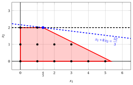{ .fig .ovale loading=lazy  }

                <em>Node 2: feasible region of $\LP_{2}$ (red), with the branching constraint $x_2 \le 2$ (dashed), and its optimal solution (blue).</em>

                An optimal solution ${\tilde{\boldsymbol x}}(\LP_{2})$ is:

                $$
                \tilde{x}_1=\dfrac{4}{3},~~\tilde{x}_2=2
                $$

                the optimal value is:

                $$
                z(\LP_{2}) = \dfrac{52}{3}
                $$

                The $\LP_{2}$ problem is <strong>feasible</strong> and we have

                $$
                \left\lfloor z(\LP_{2}) \right\rfloor > \LB
                \qquad \text{since} \qquad
                \underbrace{\left\lfloor \dfrac{52}{3} \right\rfloor}_{=17} > -\infty
                $$

                The optimal solution ${\tilde{\boldsymbol x}}(\LP_{2})$ is <strong>fractional</strong>, accordingly, the $\LP_{2}$ problem is <strong>inserted in the problem list</strong> $L$.

            2. Solution of the $\LP_{3}$ problem

                Let us consider the $\LP_{3}$ problem in standard form:

                $$
                \begin{array}{rrrrrrrrrrr}
                {\max} & {x_1} & {+} & {8}\, {x_2} &  &  &  &  \\[2ex]
                & {3}\, {x_1} & {+} & {6}\, {x_2} & {+} & {x_3} &  &  & {=} & {16} \\[2ex]
                &  &  & {x_2} &  &  & {-} & {x_4} & {=} & {3} \\[2ex]
                & {x_1,} &  & {x_2,} &  & {x_3,} &  & {x_4} & {\ge} & {0}
                \end{array}
                $$

                For the branching constraint we have:

                $$
                x_2 - x_4 = 3 \quad \quad \Rightarrow \quad x_4 = -3 + x_2
                $$

                Using the equations of the optimal simplex dictionary we can express this branching constraint as a function of the non-basic variables. Substituting, we get

                $$
                x_4 = -3 + \left(\dfrac{8}{3} - \dfrac{1}{2} \; x_1 - \dfrac{1}{6} \; x_3 \right)
                \quad \quad \Rightarrow \quad
                x_4 = -\dfrac{1}{3} - \dfrac{1}{2} \, x_1 - \dfrac{1}{6} \, x_3
                $$

                We then add this equation to the previous optimal simplex dictionary and we obtain the following simplex dictionary:

                \begin{equation*}
                \begin{cases}
                \begin{array}{rrrrrrr}
                {x_2} & {=} & {\dfrac{8}{3}} & {-} & {\dfrac{1}{2}}\, {x_1} & {-} & {\dfrac{1}{6}}\, {x_3} \\[2ex]
                {x_4} & {=} & {-\dfrac{1}{3}} & {-} & {\dfrac{1}{2}}\, {x_1} & {-} & {\dfrac{1}{6}}\, {x_3} \\[2ex]
                {z} & {=} & {\dfrac{64}{3}} & {-} & {3}\, {x_1} & {-} & {\dfrac{4}{3}}\, {x_3}
                \end{array}
                \end{cases}
                \end{equation*}

                where $\pazocal{B}=\{2,4\}$ and $\pazocal{N}=\{1,3\}$ and

                - the basic primal non-feasible solution is:

                    $$
                    \bar x_2=\dfrac{8}{3},~~
                    \bar x_4=-\dfrac{1}{3},~~~~~~
                    \bar x_1=0,~~
                    \bar x_3=0~~
                    \mathrm{~~of~value~~~} \dfrac{64}{3}
                    $$

                - the basic dual feasible solution is:

                    $$
                    \bar \pi_2=0,~~
                    \bar \pi_4=0,~~~~~~
                    \bar \pi_1=3,~~
                    \bar \pi_3=\dfrac{4}{3}~~
                    \mathrm{~~of~value~~~} \dfrac{64}{3}
                    $$

                If we increase the value of $\pi_{4}$, we can get a better dual solution. We have:

                $$
                \begin{cases}
                \pi_1 &= 3 + \dfrac{1}{2}\,\pi_4 \\[2ex]
                \pi_3 &= \dfrac{4}{3} + \dfrac{1}{6}\,\pi_4
                \end{cases}
                \qquad
                \qquad
                \begin{cases}
                \underbrace{ 3 + \dfrac{1}{2}\,\pi_4 \ge 0}_{\pi_1 \ge 0} \\[2ex]
                \underbrace{ \dfrac{4}{3} + \dfrac{1}{6}\,\pi_4 \ge 0}_{\pi_3 \ge 0}
                \end{cases}
                \qquad
                \qquad
                \begin{cases}
                \pi_4 &\ge -6 \\[2ex]
                \pi_4 &\ge -8
                \end{cases}
                $$

                Accordingly, we can increase the value of $\pi_{4}$ without violating dual feasibility, which implies that the dual problem is <strong>unbounded</strong>. As a result, the primal problem $\LP_{3}$ is <strong>infeasible</strong>, and the corresponding branching node is <u>pruned by infeasibility</u>.

            At the end of the first iteration, branching on $x_{2}$ from Node 1 has generated the down-branching node, Node 2, and the up-branching node, Node 3. Node 2 is inserted in the list $L$, while Node 3 is pruned by infeasibility. The corresponding branch-and-bound tree is:

            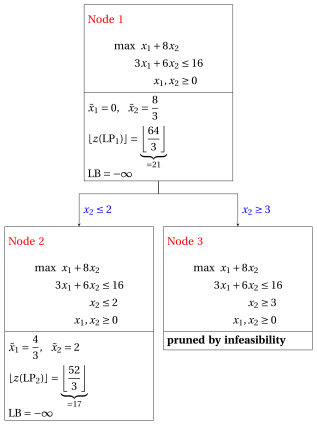{ .fig loading=lazy  }

            Due to the current lower bound $\LB$ and upper bound $\UB$, we have:

            $$
            -\infty ~~\le~~ z(\ILP) ~~\le~~ \underbrace{\left\lfloor \dfrac{52}{3} \right\rfloor}_{=17}
            $$

        - <strong>Iteration 2</strong>

            The $\LP_{2}$ problem is extracted and deleted from the problem list $L$.

            The branching variable is $x_{1}$. The branching constraints are:

            $$
            x_1 \le \underbrace{\left\lfloor \dfrac{4}{3} \right\rfloor}_{ = 1} \mathrm{~~~and~~~} x_1 \ge \underbrace{\left\lfloor \dfrac{4}{3} \right\rfloor +1}_{= 2}
            $$

            The $\LP_{4}$ problem is created with the first branching constraint (the second child is solved only if needed).

            1. Solution of the $\LP_{4}$ problem

                Let us consider the $\LP_{4}$ problem in standard form:

                $$
                \begin{array}{rrrrrrrrrrrrr}
                {\max} & {x_1} & {+} & {8}\, {x_2} &  &  &  &  &  &  \\[2ex]
                & {3}\, {x_1} & {+} & {6}\, {x_2} & {+} & {x_3} &  &  &  &  & {=} & {16} \\[2ex]
                &  &  & {x_2} &  &  & {+} & {x_4} &  &  & {=} & {2} \\[2ex]
                & {x_1} &  &  &  &  &  &  & {+} & {x_5} & {=} & {1} \\[2ex]
                & {x_1,} &  & {x_2,} &  & {x_3,} &  & {x_4,} &  & {x_5} & {\ge} & {0}
                \end{array}
                $$

                For the branching constraint we have:

                $$
                x_1 + x_5 = 1 \quad \quad \Rightarrow \quad x_5 = 1 - x_1
                $$

                Using the equations of the optimal simplex dictionary we can express this branching constraint as a function of the non-basic variables. Substituting, we get

                $$
                x_5 = 1 - \left(\dfrac{4}{3} - \dfrac{1}{3} \; x_3 + 2 \; x_4 \right)
                \quad \quad \Rightarrow \quad
                x_5 = -\dfrac{1}{3} + \dfrac{1}{3} \, x_3 - 2 \, x_4
                $$

                We then add this equation to the previous optimal simplex dictionary and we obtain the following simplex dictionary:

                \begin{equation*}
                \begin{cases}
                \begin{array}{rrrrrrr}
                {x_1} & {=} & {\dfrac{4}{3}} & {-} & {\dfrac{1}{3}}\, {x_3} & {+} & {2}\, {x_4} \\[2ex]
                {x_2} & {=} & {2} &  &  & {-} & {x_4} \\[2ex]
                {x_5} & {=} & {-\dfrac{1}{3}} & {+} & {\dfrac{1}{3}}\, {x_3} & {-} & {2}\, {x_4} \\[2ex]
                {z} & {=} & {\dfrac{52}{3}} & {-} & {\dfrac{1}{3}}\, {x_3} & {-} & {6}\, {x_4}
                \end{array}
                \end{cases}
                \end{equation*}

                where $\pazocal{B}=\{1,2,5\}$ and $\pazocal{N}=\{3,4\}$ and

                - the basic primal non-feasible solution is:

                    $$
                    \bar x_1=\dfrac{4}{3},~~
                    \bar x_2=2,~~
                    \bar x_5=-\dfrac{1}{3},~~~~~~
                    \bar x_3=0,~~
                    \bar x_4=0~~
                    \mathrm{~~of~value~~~} \dfrac{52}{3}
                    $$

                - the basic dual feasible solution is:

                    $$
                    \bar \pi_1=0,~~
                    \bar \pi_2=0,~~
                    \bar \pi_5=0,~~~~~~
                    \bar \pi_3=\dfrac{1}{3},~~
                    \bar \pi_4=6~~
                    \mathrm{~~of~value~~~} \dfrac{52}{3}
                    $$

                If we increase the value of $\pi_{5}$, we can get a better dual solution. We have:

                $$
                \begin{cases}
                \pi_3 &= \dfrac{1}{3} - \dfrac{1}{3}\,\pi_5 \\[2ex]
                \pi_4 &= 6 + 2\,\pi_5
                \end{cases}
                \qquad
                \qquad
                \begin{cases}
                \underbrace{ \dfrac{1}{3} - \dfrac{1}{3}\,\pi_5 \ge 0}_{\pi_3 \ge 0} \\[2ex]
                \underbrace{ 6 + 2\,\pi_5 \ge 0}_{\pi_4 \ge 0}
                \end{cases}
                \qquad
                \qquad
                \begin{cases}
                \pi_5 &\le 1 \\[2ex]
                \pi_5 &\ge -3
                \end{cases}
                $$

                By increasing the value of $\pi_{5}$ to $1$, the value of $\pi_{3}$ decreases to $0$. Then we have that:

                - $\pi_{5}$ becomes a dual basic variable and accordingly $x_{5}$ becomes a primal non-basic variable.

                - $\pi_{3}$ becomes a dual non-basic variable and accordingly $x_{3}$ becomes a primal basic variable.

                We have:

                $$
                x_5 = -\dfrac{1}{3} + \dfrac{1}{3} \, x_3 - 2 \, x_4
                \quad \Rightarrow \quad
                x_3 = 1 + 6 \, x_4 + 3 \, x_5
                $$

                Substituting into the other equations of the primal simplex dictionary, we get:

                $$
                x_1
                = \dfrac{4}{3} - \dfrac{1}{3} \left( 1 + 6 \, x_4 + 3 \, x_5 \right) + 2 \; x_4
                = 1 - x_5
                $$

                $$
                z
                = \dfrac{52}{3} - \dfrac{1}{3} \left( 1 + 6 \, x_4 + 3 \, x_5 \right) - 6 \; x_4
                = 17 - 8 \, x_4 - x_5
                $$

                Accordingly, we now have the following updated primal simplex dictionary:

                \begin{equation*}
                \begin{cases}
                \begin{array}{rrrrrrr}
                {x_1} & {=} & {1} &  &  & {-} & {x_5} \\[2ex]
                {x_2} & {=} & {2} & {-} & {x_4} &  &  \\[2ex]
                {x_3} & {=} & {1} & {+} & {6}\, {x_4} & {+} & {3}\, {x_5} \\[2ex]
                {z} & {=} & {17} & {-} & {8}\, {x_4} & {-} & {x_5}
                \end{array}
                \end{cases}
                \end{equation*}

                where $\pazocal{B}=\{1,2,3\}$ and $\pazocal{N}=\{4,5\}$ and

                - the basic primal optimal solution is:

                    $$
                    \tilde x_1=1,~~
                    \tilde x_2=2,~~
                    \tilde x_3=1,~~~~~~
                    \tilde x_4=0,~~
                    \tilde x_5=0~~
                    \mathrm{~~of~value~~~} 17
                    $$

                - the basic dual optimal solution is:

                    $$
                    \tilde \pi_1=0,~~
                    \tilde \pi_2=0,~~
                    \tilde \pi_3=0,~~~~~~
                    \tilde \pi_4=8,~~
                    \tilde \pi_5=1~~
                    \mathrm{~~of~value~~~} 17
                    $$

                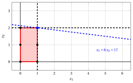{ .fig .ovale loading=lazy  }

                <em>Node 4: feasible region of $\LP_{4}$ (red), with the branching constraint $x_1 \le 1$ (dashed), and its optimal solution (blue).</em>

                An optimal solution ${\tilde{\boldsymbol x}}(\LP_{4})$ is:

                $$
                \tilde{x}_1=1,~~\tilde{x}_2=2
                $$

                the optimal value is:

                $$
                z(\LP_{4}) = 17
                $$

                The $\LP_{4}$ problem is <strong>feasible</strong> and we have

                $$
                \left\lfloor z(\LP_{4}) \right\rfloor > \LB
                \qquad \text{since} \qquad
                17 > -\infty
                $$

                The optimal solution ${\tilde{\boldsymbol x}}(\LP_{4})$ is <strong>integer</strong>, accordingly, the lower bound $\LB$ becomes $17$ and the incumbent solution ${\bar{\boldsymbol x}}(\ILP)$ becomes $\bar{x}_1=1,\bar{x}_2=2$.

                Accordingly, the branching node is <u>pruned by integrality</u>.

            At the end of the second iteration, branching on $x_{1}$ from Node 2 has generated the down-branching node, Node 4. This node is pruned by integrality. The up-branching node is not solved, since after Node 4 the lower bound satisfies

            $$
            \left\lfloor z(\LP_{2}) \right\rfloor \le \LB.
            $$

            This is the portion of the branch-and-bound tree showing the LP problems of the branching nodes that are solved:

            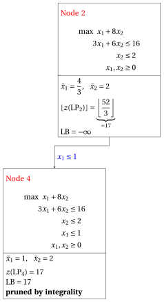{ .fig loading=lazy  }

            Due to the current lower bound $\LB$ and upper bound $\UB$, we have:

            $$
            17 ~~\le~~ z(\ILP) ~~\le~~ 17
            $$

        - <strong>Termination</strong>

            Since the list $L$ is empty, the lower bound $\LB$ is equal to the upper bound $\UB$ and the $\ILP$ problem is solved to optimality.

            The optimal value is $z(\ILP)=17$ (the value of the lower bound $\LB$) and an optimal solution ${\tilde{\boldsymbol x}}(\ILP)$ is $\tilde x_1=1,\tilde x_2=2$ (the incumbent solution ${\bar{\boldsymbol x}}(\ILP)$).

    2. The final branch-and-bound tree is:

        { .fig loading=lazy  }

        The reasons why the branching nodes are pruned are the following.

        - Node 1 has a fractional optimal solution with $\lfloor z(\LP_{1})\rfloor = 21$: it is branched on $x_2$.

        - Node 2 has a fractional optimal solution with $\lfloor z(\LP_{2})\rfloor = 17$: it is branched on $x_1$.

        - The up-branching node of Node 2 is not solved, and it is not drawn, since $\lfloor z(\LP_{2})\rfloor = 17$ $\le \LB = 17$ after its first child.

        - Node 3 is pruned by infeasibility: the $\LP_{3}$ problem has no feasible solution.

        - Node 4 is pruned by integrality: $\tilde{\boldsymbol x}(\LP_{4}) = (1, 2)$ is integer, with value $17$, which becomes the incumbent solution.

        The optimal value is $z(\ILP) = 17$ and the branch-and-bound algorithm returns the optimal solution $\tilde{\boldsymbol x}(\ILP) = (1, 2)$.

!!! esercizio "Exercise 7.2: Branch-and-bound algorithm (P2)"

    !!! nota ""

        Consider the following ILP problem in canonical maximization form with $n=2$ integer variables and $m=2$ constraints:

        $$
        \begin{array}{rrrrrrr}
        {\max} & {x_1} & {+} & {3}\, {x_2} \\[2ex]
        & {-}{4}\, {x_1} & {+} & {10}\, {x_2} & {\le} & {35} \\[2ex]
        & {3}\, {x_1} & {+} & {x_2} & {\le} & {12} \\[2ex]
        & {x_1,} &  & {x_2} & {\in} & {\Z_{\ge 0}}
        \end{array}
        $$

        and an optimal simplex dictionary of its LP relaxation in standard form:

        \begin{equation*}
        \begin{cases}
        \begin{array}{rrrrrrr}
        {x_1} & {=} & {\dfrac{5}{2}} & {+} & {\dfrac{1}{34}}\, {x_3} & {-} & {\dfrac{5}{17}}\, {x_4} \\[2ex]
        {x_2} & {=} & {\dfrac{9}{2}} & {-} & {\dfrac{3}{34}}\, {x_3} & {-} & {\dfrac{2}{17}}\, {x_4} \\[2ex]
        {z} & {=} & {16} & {-} & {\dfrac{4}{17}}\, {x_3} & {-} & {\dfrac{11}{17}}\, {x_4}
        \end{array}
        \end{cases}
        \end{equation*}

    **Questions**

    1. Execute the branch-and-bound algorithm using:

        1. the smallest-index rule as branching-variable selection strategy;

        2. the FIFO rule as branching-node selection strategy;

        3. solve first the down-branching node and then the up-branching node;

        4. set the lower bound $\LB$ to $-\infty$ (no heuristic algorithm is executed).

        Solve the LP problems of the branching nodes using the dual simplex algorithm. In the dual simplex algorithm, the leaving variable is the basic variable with negative value and smallest index, and ties in the ratio test are broken by the smallest index. Show graphically the optimal solution of the LP problems associated with the branching nodes.

    2. Determine and comment the branch-and-bound tree, showing the reason why each branching node is pruned.

??? soluzione "Solution"

    1. Execution of the branch-and-bound algorithm to solve the $\ILP$ problem.

        - <strong>Initialization</strong>

            Let us consider the $\LP_{1}$ problem in standard form:

            $$
            \begin{array}{rrrrrrrrrrr}
            {\max} & {x_1} & {+} & {3}\, {x_2} &  &  &  &  \\[2ex]
            & {-}{4}\, {x_1} & {+} & {10}\, {x_2} & {+} & {x_3} &  &  & {=} & {35} \\[2ex]
            & {3}\, {x_1} & {+} & {x_2} &  &  & {+} & {x_4} & {=} & {12} \\[2ex]
            & {x_1,} &  & {x_2,} &  & {x_3,} &  & {x_4} & {\ge} & {0}
            \end{array}
            $$

            and its optimal simplex dictionary:

            \begin{equation*}
            \begin{cases}
            \begin{array}{rrrrrrr}
            {x_1} & {=} & {\dfrac{5}{2}} & {+} & {\dfrac{1}{34}}\, {x_3} & {-} & {\dfrac{5}{17}}\, {x_4} \\[2ex]
            {x_2} & {=} & {\dfrac{9}{2}} & {-} & {\dfrac{3}{34}}\, {x_3} & {-} & {\dfrac{2}{17}}\, {x_4} \\[2ex]
            {z} & {=} & {16} & {-} & {\dfrac{4}{17}}\, {x_3} & {-} & {\dfrac{11}{17}}\, {x_4}
            \end{array}
            \end{cases}
            \end{equation*}

            { .fig .ovale loading=lazy  }

            <em>Node 1: feasible region of $\LP_{1}$ (red), feasible points of the ILP problem (black) and optimal solution of $\LP_{1}$ (blue) with the objective function line through it.</em>

            An optimal solution ${\tilde{\boldsymbol x}}(\LP_{1})$ is:

            $$
            \tilde{x}_1=\dfrac{5}{2},~~\tilde{x}_2=\dfrac{9}{2}
            $$

            the optimal value is:

            $$
            z(\LP_{1}) = 16
            $$

            The optimal solution ${\tilde{\boldsymbol x}}(\LP_{1})$ is <strong>fractional</strong> and the $\LP_{1}$ problem is <strong>feasible</strong>, so the $\LP_{1}$ problem is inserted in the problem list $L$ and the lower bound $\LB$ is set to $-\infty$.

            Due to the current lower bound $\LB$ and upper bound $\UB$, we have:

            $$
            -\infty ~~\le~~ z(\ILP) ~~\le~~ 16
            $$

        - <strong>Iteration 1</strong>

            The $\LP_{1}$ problem is extracted and deleted from the problem list $L$.

            The branching variable is $x_{1}$. The branching constraints are:

            $$
            x_1 \le \underbrace{\left\lfloor \dfrac{5}{2} \right\rfloor}_{ = 2} \mathrm{~~~and~~~} x_1 \ge \underbrace{\left\lfloor \dfrac{5}{2} \right\rfloor +1}_{= 3}
            $$

            Two $\LP_{2}$ and $\LP_{3}$ problems are created with these branching constraints.

            1. Solution of the $\LP_{2}$ problem

                Let us consider the $\LP_{2}$ problem in standard form:

                $$
                \begin{array}{rrrrrrrrrrrrr}
                {\max} & {x_1} & {+} & {3}\, {x_2} &  &  &  &  &  &  \\[2ex]
                & {-}{4}\, {x_1} & {+} & {10}\, {x_2} & {+} & {x_3} &  &  &  &  & {=} & {35} \\[2ex]
                & {3}\, {x_1} & {+} & {x_2} &  &  & {+} & {x_4} &  &  & {=} & {12} \\[2ex]
                & {x_1} &  &  &  &  &  &  & {+} & {x_5} & {=} & {2} \\[2ex]
                & {x_1,} &  & {x_2,} &  & {x_3,} &  & {x_4,} &  & {x_5} & {\ge} & {0}
                \end{array}
                $$

                For the branching constraint we have:

                $$
                x_1 + x_5 = 2 \quad \quad \Rightarrow \quad x_5 = 2 - x_1
                $$

                Using the equations of the optimal simplex dictionary we can express this branching constraint as a function of the non-basic variables. Substituting, we get

                $$
                x_5 = 2 - \left(\dfrac{5}{2} + \dfrac{1}{34} \; x_3 - \dfrac{5}{17} \; x_4 \right)
                \quad \quad \Rightarrow \quad
                x_5 = -\dfrac{1}{2} - \dfrac{1}{34} \, x_3 + \dfrac{5}{17} \, x_4
                $$

                We then add this equation to the previous optimal simplex dictionary and we obtain the following simplex dictionary:

                \begin{equation*}
                \begin{cases}
                \begin{array}{rrrrrrr}
                {x_1} & {=} & {\dfrac{5}{2}} & {+} & {\dfrac{1}{34}}\, {x_3} & {-} & {\dfrac{5}{17}}\, {x_4} \\[2ex]
                {x_2} & {=} & {\dfrac{9}{2}} & {-} & {\dfrac{3}{34}}\, {x_3} & {-} & {\dfrac{2}{17}}\, {x_4} \\[2ex]
                {x_5} & {=} & {-\dfrac{1}{2}} & {-} & {\dfrac{1}{34}}\, {x_3} & {+} & {\dfrac{5}{17}}\, {x_4} \\[2ex]
                {z} & {=} & {16} & {-} & {\dfrac{4}{17}}\, {x_3} & {-} & {\dfrac{11}{17}}\, {x_4}
                \end{array}
                \end{cases}
                \end{equation*}

                where $\pazocal{B}=\{1,2,5\}$ and $\pazocal{N}=\{3,4\}$ and

                - the basic primal non-feasible solution is:

                    $$
                    \bar x_1=\dfrac{5}{2},~~
                    \bar x_2=\dfrac{9}{2},~~
                    \bar x_5=-\dfrac{1}{2},~~~~~~
                    \bar x_3=0,~~
                    \bar x_4=0~~
                    \mathrm{~~of~value~~~} 16
                    $$

                - the basic dual feasible solution is:

                    $$
                    \bar \pi_1=0,~~
                    \bar \pi_2=0,~~
                    \bar \pi_5=0,~~~~~~
                    \bar \pi_3=\dfrac{4}{17},~~
                    \bar \pi_4=\dfrac{11}{17}~~
                    \mathrm{~~of~value~~~} 16
                    $$

                If we increase the value of $\pi_{5}$, we can get a better dual solution. We have:

                $$
                \begin{cases}
                \pi_3 &= \dfrac{4}{17} + \dfrac{1}{34}\,\pi_5 \\[2ex]
                \pi_4 &= \dfrac{11}{17} - \dfrac{5}{17}\,\pi_5
                \end{cases}
                \qquad
                \qquad
                \begin{cases}
                \underbrace{ \dfrac{4}{17} + \dfrac{1}{34}\,\pi_5 \ge 0}_{\pi_3 \ge 0} \\[2ex]
                \underbrace{ \dfrac{11}{17} - \dfrac{5}{17}\,\pi_5 \ge 0}_{\pi_4 \ge 0}
                \end{cases}
                \qquad
                \qquad
                \begin{cases}
                \pi_5 &\ge -8 \\[2ex]
                \pi_5 &\le \dfrac{11}{5}
                \end{cases}
                $$

                By increasing the value of $\pi_{5}$ to $\dfrac{11}{5}$, the value of $\pi_{4}$ decreases to $0$. Then we have that:

                - $\pi_{5}$ becomes a dual basic variable and accordingly $x_{5}$ becomes a primal non-basic variable.

                - $\pi_{4}$ becomes a dual non-basic variable and accordingly $x_{4}$ becomes a primal basic variable.

                We have:

                $$
                x_5 = -\dfrac{1}{2} - \dfrac{1}{34} \, x_3 + \dfrac{5}{17} \, x_4
                \quad \Rightarrow \quad
                x_4 = \dfrac{17}{10} + \dfrac{1}{10} \, x_3 + \dfrac{17}{5} \, x_5
                $$

                Substituting into the other equations of the primal simplex dictionary, we get:

                $$
                x_1
                = \dfrac{5}{2} + \dfrac{1}{34} \; x_3 - \dfrac{5}{17} \left( \dfrac{17}{10} + \dfrac{1}{10} \, x_3 + \dfrac{17}{5} \, x_5 \right)
                = 2 - x_5
                $$

                $$
                x_2
                = \dfrac{9}{2} - \dfrac{3}{34} \; x_3 - \dfrac{2}{17} \left( \dfrac{17}{10} + \dfrac{1}{10} \, x_3 + \dfrac{17}{5} \, x_5 \right)
                = \dfrac{43}{10} - \dfrac{1}{10} \, x_3 - \dfrac{2}{5} \, x_5
                $$

                $$
                z
                = 16 - \dfrac{4}{17} \; x_3 - \dfrac{11}{17} \left( \dfrac{17}{10} + \dfrac{1}{10} \, x_3 + \dfrac{17}{5} \, x_5 \right)
                = \dfrac{149}{10} - \dfrac{3}{10} \, x_3 - \dfrac{11}{5} \, x_5
                $$

                Accordingly, we now have the following updated primal simplex dictionary:

                \begin{equation*}
                \begin{cases}
                \begin{array}{rrrrrrr}
                {x_1} & {=} & {2} &  &  & {-} & {x_5} \\[2ex]
                {x_2} & {=} & {\dfrac{43}{10}} & {-} & {\dfrac{1}{10}}\, {x_3} & {-} & {\dfrac{2}{5}}\, {x_5} \\[2ex]
                {x_4} & {=} & {\dfrac{17}{10}} & {+} & {\dfrac{1}{10}}\, {x_3} & {+} & {\dfrac{17}{5}}\, {x_5} \\[2ex]
                {z} & {=} & {\dfrac{149}{10}} & {-} & {\dfrac{3}{10}}\, {x_3} & {-} & {\dfrac{11}{5}}\, {x_5}
                \end{array}
                \end{cases}
                \end{equation*}

                where $\pazocal{B}=\{1,2,4\}$ and $\pazocal{N}=\{3,5\}$ and

                - the basic primal optimal solution is:

                    $$
                    \tilde x_1=2,~~
                    \tilde x_2=\dfrac{43}{10},~~
                    \tilde x_4=\dfrac{17}{10},~~~~~~
                    \tilde x_3=0,~~
                    \tilde x_5=0~~
                    \mathrm{~~of~value~~~} \dfrac{149}{10}
                    $$

                - the basic dual optimal solution is:

                    $$
                    \tilde \pi_1=0,~~
                    \tilde \pi_2=0,~~
                    \tilde \pi_4=0,~~~~~~
                    \tilde \pi_3=\dfrac{3}{10},~~
                    \tilde \pi_5=\dfrac{11}{5}~~
                    \mathrm{~~of~value~~~} \dfrac{149}{10}
                    $$

                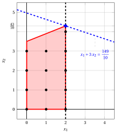{ .fig .ovale loading=lazy  }

                <em>Node 2: feasible region of $\LP_{2}$ (red), with the branching constraint $x_1 \le 2$ (dashed), and its optimal solution (blue).</em>

                An optimal solution ${\tilde{\boldsymbol x}}(\LP_{2})$ is:

                $$
                \tilde{x}_1=2,~~\tilde{x}_2=\dfrac{43}{10}
                $$

                the optimal value is:

                $$
                z(\LP_{2}) = \dfrac{149}{10}
                $$

                The $\LP_{2}$ problem is <strong>feasible</strong> and we have

                $$
                \left\lfloor z(\LP_{2}) \right\rfloor > \LB
                \qquad \text{since} \qquad
                \underbrace{\left\lfloor \dfrac{149}{10} \right\rfloor}_{=14} > -\infty
                $$

                The optimal solution ${\tilde{\boldsymbol x}}(\LP_{2})$ is <strong>fractional</strong>, accordingly, the $\LP_{2}$ problem is <strong>inserted in the problem list</strong> $L$.

            2. Solution of the $\LP_{3}$ problem

                Let us consider the $\LP_{3}$ problem in standard form:

                $$
                \begin{array}{rrrrrrrrrrrrr}
                {\max} & {x_1} & {+} & {3}\, {x_2} &  &  &  &  &  &  \\[2ex]
                & {-}{4}\, {x_1} & {+} & {10}\, {x_2} & {+} & {x_3} &  &  &  &  & {=} & {35} \\[2ex]
                & {3}\, {x_1} & {+} & {x_2} &  &  & {+} & {x_4} &  &  & {=} & {12} \\[2ex]
                & {x_1} &  &  &  &  &  &  & {-} & {x_5} & {=} & {3} \\[2ex]
                & {x_1,} &  & {x_2,} &  & {x_3,} &  & {x_4,} &  & {x_5} & {\ge} & {0}
                \end{array}
                $$

                For the branching constraint we have:

                $$
                x_1 - x_5 = 3 \quad \quad \Rightarrow \quad x_5 = -3 + x_1
                $$

                Using the equations of the optimal simplex dictionary we can express this branching constraint as a function of the non-basic variables. Substituting, we get

                $$
                x_5 = -3 + \left(\dfrac{5}{2} + \dfrac{1}{34} \; x_3 - \dfrac{5}{17} \; x_4 \right)
                \quad \quad \Rightarrow \quad
                x_5 = -\dfrac{1}{2} + \dfrac{1}{34} \, x_3 - \dfrac{5}{17} \, x_4
                $$

                We then add this equation to the previous optimal simplex dictionary and we obtain the following simplex dictionary:

                \begin{equation*}
                \begin{cases}
                \begin{array}{rrrrrrr}
                {x_1} & {=} & {\dfrac{5}{2}} & {+} & {\dfrac{1}{34}}\, {x_3} & {-} & {\dfrac{5}{17}}\, {x_4} \\[2ex]
                {x_2} & {=} & {\dfrac{9}{2}} & {-} & {\dfrac{3}{34}}\, {x_3} & {-} & {\dfrac{2}{17}}\, {x_4} \\[2ex]
                {x_5} & {=} & {-\dfrac{1}{2}} & {+} & {\dfrac{1}{34}}\, {x_3} & {-} & {\dfrac{5}{17}}\, {x_4} \\[2ex]
                {z} & {=} & {16} & {-} & {\dfrac{4}{17}}\, {x_3} & {-} & {\dfrac{11}{17}}\, {x_4}
                \end{array}
                \end{cases}
                \end{equation*}

                where $\pazocal{B}=\{1,2,5\}$ and $\pazocal{N}=\{3,4\}$ and

                - the basic primal non-feasible solution is:

                    $$
                    \bar x_1=\dfrac{5}{2},~~
                    \bar x_2=\dfrac{9}{2},~~
                    \bar x_5=-\dfrac{1}{2},~~~~~~
                    \bar x_3=0,~~
                    \bar x_4=0~~
                    \mathrm{~~of~value~~~} 16
                    $$

                - the basic dual feasible solution is:

                    $$
                    \bar \pi_1=0,~~
                    \bar \pi_2=0,~~
                    \bar \pi_5=0,~~~~~~
                    \bar \pi_3=\dfrac{4}{17},~~
                    \bar \pi_4=\dfrac{11}{17}~~
                    \mathrm{~~of~value~~~} 16
                    $$

                If we increase the value of $\pi_{5}$, we can get a better dual solution. We have:

                $$
                \begin{cases}
                \pi_3 &= \dfrac{4}{17} - \dfrac{1}{34}\,\pi_5 \\[2ex]
                \pi_4 &= \dfrac{11}{17} + \dfrac{5}{17}\,\pi_5
                \end{cases}
                \qquad
                \qquad
                \begin{cases}
                \underbrace{ \dfrac{4}{17} - \dfrac{1}{34}\,\pi_5 \ge 0}_{\pi_3 \ge 0} \\[2ex]
                \underbrace{ \dfrac{11}{17} + \dfrac{5}{17}\,\pi_5 \ge 0}_{\pi_4 \ge 0}
                \end{cases}
                \qquad
                \qquad
                \begin{cases}
                \pi_5 &\le 8 \\[2ex]
                \pi_5 &\ge -\dfrac{11}{5}
                \end{cases}
                $$

                By increasing the value of $\pi_{5}$ to $8$, the value of $\pi_{3}$ decreases to $0$. Then we have that:

                - $\pi_{5}$ becomes a dual basic variable and accordingly $x_{5}$ becomes a primal non-basic variable.

                - $\pi_{3}$ becomes a dual non-basic variable and accordingly $x_{3}$ becomes a primal basic variable.

                We have:

                $$
                x_5 = -\dfrac{1}{2} + \dfrac{1}{34} \, x_3 - \dfrac{5}{17} \, x_4
                \quad \Rightarrow \quad
                x_3 = 17 + 10 \, x_4 + 34 \, x_5
                $$

                Substituting into the other equations of the primal simplex dictionary, we get:

                $$
                x_1
                = \dfrac{5}{2} + \dfrac{1}{34} \left( 17 + 10 \, x_4 + 34 \, x_5 \right) - \dfrac{5}{17} \; x_4
                = 3 + x_5
                $$

                $$
                x_2
                = \dfrac{9}{2} - \dfrac{3}{34} \left( 17 + 10 \, x_4 + 34 \, x_5 \right) - \dfrac{2}{17} \; x_4
                = 3 - x_4 - 3 \, x_5
                $$

                $$
                z
                = 16 - \dfrac{4}{17} \left( 17 + 10 \, x_4 + 34 \, x_5 \right) - \dfrac{11}{17} \; x_4
                = 12 - 3 \, x_4 - 8 \, x_5
                $$

                Accordingly, we now have the following updated primal simplex dictionary:

                \begin{equation*}
                \begin{cases}
                \begin{array}{rrrrrrr}
                {x_1} & {=} & {3} &  &  & {+} & {x_5} \\[2ex]
                {x_2} & {=} & {3} & {-} & {x_4} & {-} & {3}\, {x_5} \\[2ex]
                {x_3} & {=} & {17} & {+} & {10}\, {x_4} & {+} & {34}\, {x_5} \\[2ex]
                {z} & {=} & {12} & {-} & {3}\, {x_4} & {-} & {8}\, {x_5}
                \end{array}
                \end{cases}
                \end{equation*}

                where $\pazocal{B}=\{1,2,3\}$ and $\pazocal{N}=\{4,5\}$ and

                - the basic primal optimal solution is:

                    $$
                    \tilde x_1=3,~~
                    \tilde x_2=3,~~
                    \tilde x_3=17,~~~~~~
                    \tilde x_4=0,~~
                    \tilde x_5=0~~
                    \mathrm{~~of~value~~~} 12
                    $$

                - the basic dual optimal solution is:

                    $$
                    \tilde \pi_1=0,~~
                    \tilde \pi_2=0,~~
                    \tilde \pi_3=0,~~~~~~
                    \tilde \pi_4=3,~~
                    \tilde \pi_5=8~~
                    \mathrm{~~of~value~~~} 12
                    $$

                { .fig .ovale loading=lazy  }

                <em>Node 3: feasible region of $\LP_{3}$ (red), with the branching constraint $x_1 \ge 3$ (dashed), and its optimal solution (blue).</em>

                An optimal solution ${\tilde{\boldsymbol x}}(\LP_{3})$ is:

                $$
                \tilde{x}_1=3,~~\tilde{x}_2=3
                $$

                the optimal value is:

                $$
                z(\LP_{3}) = 12
                $$

                The $\LP_{3}$ problem is <strong>feasible</strong> and we have

                $$
                \left\lfloor z(\LP_{3}) \right\rfloor > \LB
                \qquad \text{since} \qquad
                12 > -\infty
                $$

                The optimal solution ${\tilde{\boldsymbol x}}(\LP_{3})$ is <strong>integer</strong>, accordingly, the lower bound $\LB$ becomes $12$ and the incumbent solution ${\bar{\boldsymbol x}}(\ILP)$ becomes $\bar{x}_1=3,\bar{x}_2=3$.

                Accordingly, the branching node is <u>pruned by integrality</u>.

            At the end of the first iteration, branching on $x_{1}$ from Node 1 has generated the down-branching node, Node 2, and the up-branching node, Node 3. Node 2 is inserted in the list $L$, while Node 3 is pruned by integrality. The corresponding branch-and-bound tree is:

            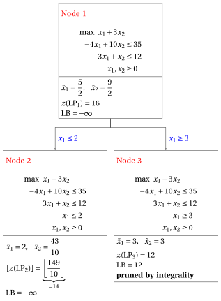{ .fig loading=lazy  }

            Due to the current lower bound $\LB$ and upper bound $\UB$, we have:

            $$
            12 ~~\le~~ z(\ILP) ~~\le~~ \underbrace{\left\lfloor \dfrac{149}{10} \right\rfloor}_{=14}
            $$

        - <strong>Iteration 2</strong>

            The $\LP_{2}$ problem is extracted and deleted from the problem list $L$.

            The branching variable is $x_{2}$. The branching constraints are:

            $$
            x_2 \le \underbrace{\left\lfloor \dfrac{43}{10} \right\rfloor}_{ = 4} \mathrm{~~~and~~~} x_2 \ge \underbrace{\left\lfloor \dfrac{43}{10} \right\rfloor +1}_{= 5}
            $$

            The $\LP_{4}$ problem is created with the first branching constraint (the second child is solved only if needed).

            1. Solution of the $\LP_{4}$ problem

                Let us consider the $\LP_{4}$ problem in standard form:

                $$
                \begin{array}{rrrrrrrrrrrrrrr}
                {\max} & {x_1} & {+} & {3}\, {x_2} &  &  &  &  &  &  &  &  \\[2ex]
                & {-}{4}\, {x_1} & {+} & {10}\, {x_2} & {+} & {x_3} &  &  &  &  &  &  & {=} & {35} \\[2ex]
                & {3}\, {x_1} & {+} & {x_2} &  &  & {+} & {x_4} &  &  &  &  & {=} & {12} \\[2ex]
                & {x_1} &  &  &  &  &  &  & {+} & {x_5} &  &  & {=} & {2} \\[2ex]
                &  &  & {x_2} &  &  &  &  &  &  & {+} & {x_6} & {=} & {4} \\[2ex]
                & {x_1,} &  & {x_2,} &  & {x_3,} &  & {x_4,} &  & {x_5,} &  & {x_6} & {\ge} & {0}
                \end{array}
                $$

                For the branching constraint we have:

                $$
                x_2 + x_6 = 4 \quad \quad \Rightarrow \quad x_6 = 4 - x_2
                $$

                Using the equations of the optimal simplex dictionary we can express this branching constraint as a function of the non-basic variables. Substituting, we get

                $$
                x_6 = 4 - \left(\dfrac{43}{10} - \dfrac{1}{10} \; x_3 - \dfrac{2}{5} \; x_5 \right)
                \quad \quad \Rightarrow \quad
                x_6 = -\dfrac{3}{10} + \dfrac{1}{10} \, x_3 + \dfrac{2}{5} \, x_5
                $$

                We then add this equation to the previous optimal simplex dictionary and we obtain the following simplex dictionary:

                \begin{equation*}
                \begin{cases}
                \begin{array}{rrrrrrr}
                {x_1} & {=} & {2} &  &  & {-} & {x_5} \\[2ex]
                {x_2} & {=} & {\dfrac{43}{10}} & {-} & {\dfrac{1}{10}}\, {x_3} & {-} & {\dfrac{2}{5}}\, {x_5} \\[2ex]
                {x_4} & {=} & {\dfrac{17}{10}} & {+} & {\dfrac{1}{10}}\, {x_3} & {+} & {\dfrac{17}{5}}\, {x_5} \\[2ex]
                {x_6} & {=} & {-\dfrac{3}{10}} & {+} & {\dfrac{1}{10}}\, {x_3} & {+} & {\dfrac{2}{5}}\, {x_5} \\[2ex]
                {z} & {=} & {\dfrac{149}{10}} & {-} & {\dfrac{3}{10}}\, {x_3} & {-} & {\dfrac{11}{5}}\, {x_5}
                \end{array}
                \end{cases}
                \end{equation*}

                where $\pazocal{B}=\{1,2,4,6\}$ and $\pazocal{N}=\{3,5\}$ and

                - the basic primal non-feasible solution is:

                    $$
                    \bar x_1=2,~~
                    \bar x_2=\dfrac{43}{10},~~
                    \bar x_4=\dfrac{17}{10},~~
                    \bar x_6=-\dfrac{3}{10},~~~~~~
                    \bar x_3=0,~~
                    \bar x_5=0~~
                    \mathrm{~~of~value~~~} \dfrac{149}{10}
                    $$

                - the basic dual feasible solution is:

                    $$
                    \bar \pi_1=0,~~
                    \bar \pi_2=0,~~
                    \bar \pi_4=0,~~
                    \bar \pi_6=0,~~~~~~
                    \bar \pi_3=\dfrac{3}{10},~~
                    \bar \pi_5=\dfrac{11}{5}~~
                    \mathrm{~~of~value~~~} \dfrac{149}{10}
                    $$

                If we increase the value of $\pi_{6}$, we can get a better dual solution. We have:

                $$
                \begin{cases}
                \pi_3 &= \dfrac{3}{10} - \dfrac{1}{10}\,\pi_6 \\[2ex]
                \pi_5 &= \dfrac{11}{5} - \dfrac{2}{5}\,\pi_6
                \end{cases}
                \qquad
                \qquad
                \begin{cases}
                \underbrace{ \dfrac{3}{10} - \dfrac{1}{10}\,\pi_6 \ge 0}_{\pi_3 \ge 0} \\[2ex]
                \underbrace{ \dfrac{11}{5} - \dfrac{2}{5}\,\pi_6 \ge 0}_{\pi_5 \ge 0}
                \end{cases}
                \qquad
                \qquad
                \begin{cases}
                \pi_6 &\le 3 \\[2ex]
                \pi_6 &\le \dfrac{11}{2}
                \end{cases}
                $$

                By increasing the value of $\pi_{6}$ to $\min \left\{3, \dfrac{11}{2}\right\}=3$, the value of $\pi_{3}$ decreases to $0$. Then we have that:

                - $\pi_{6}$ becomes a dual basic variable and accordingly $x_{6}$ becomes a primal non-basic variable.

                - $\pi_{3}$ becomes a dual non-basic variable and accordingly $x_{3}$ becomes a primal basic variable.

                We have:

                $$
                x_6 = -\dfrac{3}{10} + \dfrac{1}{10} \, x_3 + \dfrac{2}{5} \, x_5
                \quad \Rightarrow \quad
                x_3 = 3 - 4 \, x_5 + 10 \, x_6
                $$

                Substituting into the other equations of the primal simplex dictionary, we get:

                $$
                x_2
                = \dfrac{43}{10} - \dfrac{1}{10} \left( 3 - 4 \, x_5 + 10 \, x_6 \right) - \dfrac{2}{5} \; x_5
                = 4 - x_6
                $$

                $$
                x_4
                = \dfrac{17}{10} + \dfrac{1}{10} \left( 3 - 4 \, x_5 + 10 \, x_6 \right) + \dfrac{17}{5} \; x_5
                = 2 + 3 \, x_5 + x_6
                $$

                $$
                z
                = \dfrac{149}{10} - \dfrac{3}{10} \left( 3 - 4 \, x_5 + 10 \, x_6 \right) - \dfrac{11}{5} \; x_5
                = 14 - x_5 - 3 \, x_6
                $$

                Accordingly, we now have the following updated primal simplex dictionary:

                \begin{equation*}
                \begin{cases}
                \begin{array}{rrrrrrr}
                {x_1} & {=} & {2} & {-} & {x_5} &  &  \\[2ex]
                {x_2} & {=} & {4} &  &  & {-} & {x_6} \\[2ex]
                {x_3} & {=} & {3} & {-} & {4}\, {x_5} & {+} & {10}\, {x_6} \\[2ex]
                {x_4} & {=} & {2} & {+} & {3}\, {x_5} & {+} & {x_6} \\[2ex]
                {z} & {=} & {14} & {-} & {x_5} & {-} & {3}\, {x_6}
                \end{array}
                \end{cases}
                \end{equation*}

                where $\pazocal{B}=\{1,2,3,4\}$ and $\pazocal{N}=\{5,6\}$ and

                - the basic primal optimal solution is:

                    $$
                    \tilde x_1=2,~~
                    \tilde x_2=4,~~
                    \tilde x_3=3,~~
                    \tilde x_4=2,~~~~~~
                    \tilde x_5=0,~~
                    \tilde x_6=0~~
                    \mathrm{~~of~value~~~} 14
                    $$

                - the basic dual optimal solution is:

                    $$
                    \tilde \pi_1=0,~~
                    \tilde \pi_2=0,~~
                    \tilde \pi_3=0,~~
                    \tilde \pi_4=0,~~~~~~
                    \tilde \pi_5=1,~~
                    \tilde \pi_6=3~~
                    \mathrm{~~of~value~~~} 14
                    $$

                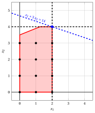{ .fig .ovale loading=lazy  }

                <em>Node 4: feasible region of $\LP_{4}$ (red), with the branching constraint $x_2 \le 4$ (dashed), and its optimal solution (blue).</em>

                An optimal solution ${\tilde{\boldsymbol x}}(\LP_{4})$ is:

                $$
                \tilde{x}_1=2,~~\tilde{x}_2=4
                $$

                the optimal value is:

                $$
                z(\LP_{4}) = 14
                $$

                The $\LP_{4}$ problem is <strong>feasible</strong> and we have

                $$
                \left\lfloor z(\LP_{4}) \right\rfloor > \LB
                \qquad \text{since} \qquad
                14 > 12
                $$

                The optimal solution ${\tilde{\boldsymbol x}}(\LP_{4})$ is <strong>integer</strong>, accordingly, the lower bound $\LB$ becomes $14$ and the incumbent solution ${\bar{\boldsymbol x}}(\ILP)$ becomes $\bar{x}_1=2,\bar{x}_2=4$.

                Accordingly, the branching node is <u>pruned by integrality</u>.

            At the end of the second iteration, branching on $x_{2}$ from Node 2 has generated the down-branching node, Node 4. This node is pruned by integrality. The up-branching node is not solved, since after Node 4 the lower bound satisfies

            $$
            \left\lfloor z(\LP_{2}) \right\rfloor \le \LB.
            $$

            This is the portion of the branch-and-bound tree showing the LP problems of the branching nodes that are solved:

            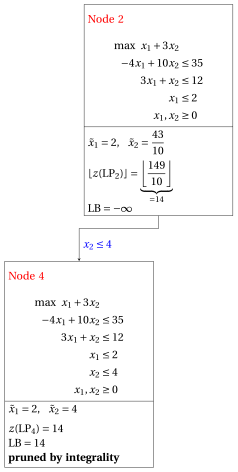{ .fig loading=lazy  }

            Due to the current lower bound $\LB$ and upper bound $\UB$, we have:

            $$
            14 ~~\le~~ z(\ILP) ~~\le~~ 14
            $$

        - <strong>Termination</strong>

            Since the list $L$ is empty, the lower bound $\LB$ is equal to the upper bound $\UB$ and the $\ILP$ problem is solved to optimality.

            The optimal value is $z(\ILP)=14$ (the value of the lower bound $\LB$) and an optimal solution ${\tilde{\boldsymbol x}}(\ILP)$ is $\tilde x_1=2,\tilde x_2=4$ (the incumbent solution ${\bar{\boldsymbol x}}(\ILP)$).

    2. The final branch-and-bound tree is:

        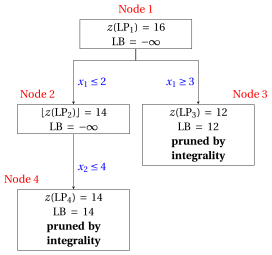{ .fig loading=lazy  }

        The reasons why the branching nodes are pruned are the following.

        - Node 1 has a fractional optimal solution with $z(\LP_{1}) = 16$: it is branched on $x_1$.

        - Node 2 has a fractional optimal solution with $\lfloor z(\LP_{2})\rfloor = 14$: it is branched on $x_2$.

        - The up-branching node of Node 2 is not solved, and it is not drawn, since $\lfloor z(\LP_{2})\rfloor = 14$ $\le \LB = 14$ after its first child.

        - Node 3 is pruned by integrality: $\tilde{\boldsymbol x}(\LP_{3}) = (3, 3)$ is integer, with value $12$, which becomes the incumbent solution.

        - Node 4 is pruned by integrality: $\tilde{\boldsymbol x}(\LP_{4}) = (2, 4)$ is integer, with value $14$, which becomes the incumbent solution.

        The optimal value is $z(\ILP) = 14$ and the branch-and-bound algorithm returns the optimal solution $\tilde{\boldsymbol x}(\ILP) = (2, 4)$.

!!! esercizio "Exercise 7.3: Branch-and-bound algorithm (P3)"

    !!! nota ""

        Consider the following ILP problem in canonical maximization form with $n=2$ integer variables and $m=2$ constraints:

        $$
        \begin{array}{rrrrrrr}
        {\max} & {2}\, {x_1} & {+} & {4}\, {x_2} \\[2ex]
        & {-}{x_1} & {+} & {x_2} & {\le} & {2} \\[2ex]
        & {8}\, {x_1} & {+} & {2}\, {x_2} & {\le} & {19} \\[2ex]
        & {x_1,} &  & {x_2} & {\in} & {\Z_{\ge 0}}
        \end{array}
        $$

        and an optimal simplex dictionary of its LP relaxation in standard form:

        \begin{equation*}
        \begin{cases}
        \begin{array}{rrrrrrr}
        {x_1} & {=} & {\dfrac{3}{2}} & {+} & {\dfrac{1}{5}}\, {x_3} & {-} & {\dfrac{1}{10}}\, {x_4} \\[2ex]
        {x_2} & {=} & {\dfrac{7}{2}} & {-} & {\dfrac{4}{5}}\, {x_3} & {-} & {\dfrac{1}{10}}\, {x_4} \\[2ex]
        {z} & {=} & {17} & {-} & {\dfrac{14}{5}}\, {x_3} & {-} & {\dfrac{3}{5}}\, {x_4}
        \end{array}
        \end{cases}
        \end{equation*}

    **Questions**

    1. Execute the branch-and-bound algorithm using:

        1. the largest-index rule as branching-variable selection strategy;

        2. the LIFO rule as branching-node selection strategy;

        3. solve first the down-branching node and then the up-branching node;

        4. set the lower bound $\LB$ to $-\infty$ (no heuristic algorithm is executed).

        Solve the LP problems of the branching nodes using the dual simplex algorithm. In the dual simplex algorithm, the leaving variable is the basic variable with negative value and smallest index, and ties in the ratio test are broken by the smallest index. Show graphically the optimal solution of the LP problems associated with the branching nodes.

    2. Determine and comment the branch-and-bound tree, showing the reason why each branching node is pruned.

??? soluzione "Solution"

    1. Execution of the branch-and-bound algorithm to solve the $\ILP$ problem.

        - <strong>Initialization</strong>

            Let us consider the $\LP_{1}$ problem in standard form:

            $$
            \begin{array}{rrrrrrrrrrr}
            {\max} & {2}\, {x_1} & {+} & {4}\, {x_2} &  &  &  &  \\[2ex]
            & {-}{x_1} & {+} & {x_2} & {+} & {x_3} &  &  & {=} & {2} \\[2ex]
            & {8}\, {x_1} & {+} & {2}\, {x_2} &  &  & {+} & {x_4} & {=} & {19} \\[2ex]
            & {x_1,} &  & {x_2,} &  & {x_3,} &  & {x_4} & {\ge} & {0}
            \end{array}
            $$

            and its optimal simplex dictionary:

            \begin{equation*}
            \begin{cases}
            \begin{array}{rrrrrrr}
            {x_1} & {=} & {\dfrac{3}{2}} & {+} & {\dfrac{1}{5}}\, {x_3} & {-} & {\dfrac{1}{10}}\, {x_4} \\[2ex]
            {x_2} & {=} & {\dfrac{7}{2}} & {-} & {\dfrac{4}{5}}\, {x_3} & {-} & {\dfrac{1}{10}}\, {x_4} \\[2ex]
            {z} & {=} & {17} & {-} & {\dfrac{14}{5}}\, {x_3} & {-} & {\dfrac{3}{5}}\, {x_4}
            \end{array}
            \end{cases}
            \end{equation*}

            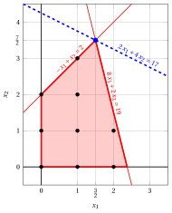{ .fig .ovale loading=lazy  }

            <em>Node 1: feasible region of $\LP_{1}$ (red), feasible points of the ILP problem (black) and optimal solution of $\LP_{1}$ (blue) with the objective function line through it.</em>

            An optimal solution ${\tilde{\boldsymbol x}}(\LP_{1})$ is:

            $$
            \tilde{x}_1=\dfrac{3}{2},~~\tilde{x}_2=\dfrac{7}{2}
            $$

            the optimal value is:

            $$
            z(\LP_{1}) = 17
            $$

            The optimal solution ${\tilde{\boldsymbol x}}(\LP_{1})$ is <strong>fractional</strong> and the $\LP_{1}$ problem is <strong>feasible</strong>, so the $\LP_{1}$ problem is inserted in the problem list $L$ and the lower bound $\LB$ is set to $-\infty$.

            Due to the current lower bound $\LB$ and upper bound $\UB$, we have:

            $$
            -\infty ~~\le~~ z(\ILP) ~~\le~~ 17
            $$

        - <strong>Iteration 1</strong>

            The $\LP_{1}$ problem is extracted and deleted from the problem list $L$.

            The branching variable is $x_{2}$. The branching constraints are:

            $$
            x_2 \le \underbrace{\left\lfloor \dfrac{7}{2} \right\rfloor}_{ = 3} \mathrm{~~~and~~~} x_2 \ge \underbrace{\left\lfloor \dfrac{7}{2} \right\rfloor +1}_{= 4}
            $$

            Two $\LP_{2}$ and $\LP_{3}$ problems are created with these branching constraints.

            1. Solution of the $\LP_{2}$ problem

                Let us consider the $\LP_{2}$ problem in standard form:

                $$
                \begin{array}{rrrrrrrrrrrrr}
                {\max} & {2}\, {x_1} & {+} & {4}\, {x_2} &  &  &  &  &  &  \\[2ex]
                & {-}{x_1} & {+} & {x_2} & {+} & {x_3} &  &  &  &  & {=} & {2} \\[2ex]
                & {8}\, {x_1} & {+} & {2}\, {x_2} &  &  & {+} & {x_4} &  &  & {=} & {19} \\[2ex]
                &  &  & {x_2} &  &  &  &  & {+} & {x_5} & {=} & {3} \\[2ex]
                & {x_1,} &  & {x_2,} &  & {x_3,} &  & {x_4,} &  & {x_5} & {\ge} & {0}
                \end{array}
                $$

                For the branching constraint we have:

                $$
                x_2 + x_5 = 3 \quad \quad \Rightarrow \quad x_5 = 3 - x_2
                $$

                Using the equations of the optimal simplex dictionary we can express this branching constraint as a function of the non-basic variables. Substituting, we get

                $$
                x_5 = 3 - \left(\dfrac{7}{2} - \dfrac{4}{5} \; x_3 - \dfrac{1}{10} \; x_4 \right)
                \quad \quad \Rightarrow \quad
                x_5 = -\dfrac{1}{2} + \dfrac{4}{5} \, x_3 + \dfrac{1}{10} \, x_4
                $$

                We then add this equation to the previous optimal simplex dictionary and we obtain the following simplex dictionary:

                \begin{equation*}
                \begin{cases}
                \begin{array}{rrrrrrr}
                {x_1} & {=} & {\dfrac{3}{2}} & {+} & {\dfrac{1}{5}}\, {x_3} & {-} & {\dfrac{1}{10}}\, {x_4} \\[2ex]
                {x_2} & {=} & {\dfrac{7}{2}} & {-} & {\dfrac{4}{5}}\, {x_3} & {-} & {\dfrac{1}{10}}\, {x_4} \\[2ex]
                {x_5} & {=} & {-\dfrac{1}{2}} & {+} & {\dfrac{4}{5}}\, {x_3} & {+} & {\dfrac{1}{10}}\, {x_4} \\[2ex]
                {z} & {=} & {17} & {-} & {\dfrac{14}{5}}\, {x_3} & {-} & {\dfrac{3}{5}}\, {x_4}
                \end{array}
                \end{cases}
                \end{equation*}

                where $\pazocal{B}=\{1,2,5\}$ and $\pazocal{N}=\{3,4\}$ and

                - the basic primal non-feasible solution is:

                    $$
                    \bar x_1=\dfrac{3}{2},~~
                    \bar x_2=\dfrac{7}{2},~~
                    \bar x_5=-\dfrac{1}{2},~~~~~~
                    \bar x_3=0,~~
                    \bar x_4=0~~
                    \mathrm{~~of~value~~~} 17
                    $$

                - the basic dual feasible solution is:

                    $$
                    \bar \pi_1=0,~~
                    \bar \pi_2=0,~~
                    \bar \pi_5=0,~~~~~~
                    \bar \pi_3=\dfrac{14}{5},~~
                    \bar \pi_4=\dfrac{3}{5}~~
                    \mathrm{~~of~value~~~} 17
                    $$

                If we increase the value of $\pi_{5}$, we can get a better dual solution. We have:

                $$
                \begin{cases}
                \pi_3 &= \dfrac{14}{5} - \dfrac{4}{5}\,\pi_5 \\[2ex]
                \pi_4 &= \dfrac{3}{5} - \dfrac{1}{10}\,\pi_5
                \end{cases}
                \qquad
                \qquad
                \begin{cases}
                \underbrace{ \dfrac{14}{5} - \dfrac{4}{5}\,\pi_5 \ge 0}_{\pi_3 \ge 0} \\[2ex]
                \underbrace{ \dfrac{3}{5} - \dfrac{1}{10}\,\pi_5 \ge 0}_{\pi_4 \ge 0}
                \end{cases}
                \qquad
                \qquad
                \begin{cases}
                \pi_5 &\le \dfrac{7}{2} \\[2ex]
                \pi_5 &\le 6
                \end{cases}
                $$

                By increasing the value of $\pi_{5}$ to $\min \left\{\dfrac{7}{2}, 6\right\}=\dfrac{7}{2}$, the value of $\pi_{3}$ decreases to $0$. Then we have that:

                - $\pi_{5}$ becomes a dual basic variable and accordingly $x_{5}$ becomes a primal non-basic variable.

                - $\pi_{3}$ becomes a dual non-basic variable and accordingly $x_{3}$ becomes a primal basic variable.

                We have:

                $$
                x_5 = -\dfrac{1}{2} + \dfrac{4}{5} \, x_3 + \dfrac{1}{10} \, x_4
                \quad \Rightarrow \quad
                x_3 = \dfrac{5}{8} - \dfrac{1}{8} \, x_4 + \dfrac{5}{4} \, x_5
                $$

                Substituting into the other equations of the primal simplex dictionary, we get:

                $$
                x_1
                = \dfrac{3}{2} + \dfrac{1}{5} \left( \dfrac{5}{8} - \dfrac{1}{8} \, x_4 + \dfrac{5}{4} \, x_5 \right) - \dfrac{1}{10} \; x_4
                = \dfrac{13}{8} - \dfrac{1}{8} \, x_4 + \dfrac{1}{4} \, x_5
                $$

                $$
                x_2
                = \dfrac{7}{2} - \dfrac{4}{5} \left( \dfrac{5}{8} - \dfrac{1}{8} \, x_4 + \dfrac{5}{4} \, x_5 \right) - \dfrac{1}{10} \; x_4
                = 3 - x_5
                $$

                $$
                z
                = 17 - \dfrac{14}{5} \left( \dfrac{5}{8} - \dfrac{1}{8} \, x_4 + \dfrac{5}{4} \, x_5 \right) - \dfrac{3}{5} \; x_4
                = \dfrac{61}{4} - \dfrac{1}{4} \, x_4 - \dfrac{7}{2} \, x_5
                $$

                Accordingly, we now have the following updated primal simplex dictionary:

                \begin{equation*}
                \begin{cases}
                \begin{array}{rrrrrrr}
                {x_1} & {=} & {\dfrac{13}{8}} & {-} & {\dfrac{1}{8}}\, {x_4} & {+} & {\dfrac{1}{4}}\, {x_5} \\[2ex]
                {x_2} & {=} & {3} &  &  & {-} & {x_5} \\[2ex]
                {x_3} & {=} & {\dfrac{5}{8}} & {-} & {\dfrac{1}{8}}\, {x_4} & {+} & {\dfrac{5}{4}}\, {x_5} \\[2ex]
                {z} & {=} & {\dfrac{61}{4}} & {-} & {\dfrac{1}{4}}\, {x_4} & {-} & {\dfrac{7}{2}}\, {x_5}
                \end{array}
                \end{cases}
                \end{equation*}

                where $\pazocal{B}=\{1,2,3\}$ and $\pazocal{N}=\{4,5\}$ and

                - the basic primal optimal solution is:

                    $$
                    \tilde x_1=\dfrac{13}{8},~~
                    \tilde x_2=3,~~
                    \tilde x_3=\dfrac{5}{8},~~~~~~
                    \tilde x_4=0,~~
                    \tilde x_5=0~~
                    \mathrm{~~of~value~~~} \dfrac{61}{4}
                    $$

                - the basic dual optimal solution is:

                    $$
                    \tilde \pi_1=0,~~
                    \tilde \pi_2=0,~~
                    \tilde \pi_3=0,~~~~~~
                    \tilde \pi_4=\dfrac{1}{4},~~
                    \tilde \pi_5=\dfrac{7}{2}~~
                    \mathrm{~~of~value~~~} \dfrac{61}{4}
                    $$

                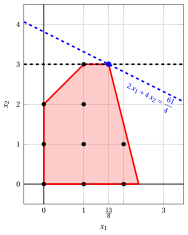{ .fig .ovale loading=lazy  }

                <em>Node 2: feasible region of $\LP_{2}$ (red), with the branching constraint $x_2 \le 3$ (dashed), and its optimal solution (blue).</em>

                An optimal solution ${\tilde{\boldsymbol x}}(\LP_{2})$ is:

                $$
                \tilde{x}_1=\dfrac{13}{8},~~\tilde{x}_2=3
                $$

                the optimal value is:

                $$
                z(\LP_{2}) = \dfrac{61}{4}
                $$

                The $\LP_{2}$ problem is <strong>feasible</strong> and we have

                $$
                \left\lfloor z(\LP_{2}) \right\rfloor > \LB
                \qquad \text{since} \qquad
                \underbrace{\left\lfloor \dfrac{61}{4} \right\rfloor}_{=15} > -\infty
                $$

                The optimal solution ${\tilde{\boldsymbol x}}(\LP_{2})$ is <strong>fractional</strong>, accordingly, the $\LP_{2}$ problem is <strong>inserted in the problem list</strong> $L$.

            2. Solution of the $\LP_{3}$ problem

                Let us consider the $\LP_{3}$ problem in standard form:

                $$
                \begin{array}{rrrrrrrrrrrrr}
                {\max} & {2}\, {x_1} & {+} & {4}\, {x_2} &  &  &  &  &  &  \\[2ex]
                & {-}{x_1} & {+} & {x_2} & {+} & {x_3} &  &  &  &  & {=} & {2} \\[2ex]
                & {8}\, {x_1} & {+} & {2}\, {x_2} &  &  & {+} & {x_4} &  &  & {=} & {19} \\[2ex]
                &  &  & {x_2} &  &  &  &  & {-} & {x_5} & {=} & {4} \\[2ex]
                & {x_1,} &  & {x_2,} &  & {x_3,} &  & {x_4,} &  & {x_5} & {\ge} & {0}
                \end{array}
                $$

                For the branching constraint we have:

                $$
                x_2 - x_5 = 4 \quad \quad \Rightarrow \quad x_5 = -4 + x_2
                $$

                Using the equations of the optimal simplex dictionary we can express this branching constraint as a function of the non-basic variables. Substituting, we get

                $$
                x_5 = -4 + \left(\dfrac{7}{2} - \dfrac{4}{5} \; x_3 - \dfrac{1}{10} \; x_4 \right)
                \quad \quad \Rightarrow \quad
                x_5 = -\dfrac{1}{2} - \dfrac{4}{5} \, x_3 - \dfrac{1}{10} \, x_4
                $$

                We then add this equation to the previous optimal simplex dictionary and we obtain the following simplex dictionary:

                \begin{equation*}
                \begin{cases}
                \begin{array}{rrrrrrr}
                {x_1} & {=} & {\dfrac{3}{2}} & {+} & {\dfrac{1}{5}}\, {x_3} & {-} & {\dfrac{1}{10}}\, {x_4} \\[2ex]
                {x_2} & {=} & {\dfrac{7}{2}} & {-} & {\dfrac{4}{5}}\, {x_3} & {-} & {\dfrac{1}{10}}\, {x_4} \\[2ex]
                {x_5} & {=} & {-\dfrac{1}{2}} & {-} & {\dfrac{4}{5}}\, {x_3} & {-} & {\dfrac{1}{10}}\, {x_4} \\[2ex]
                {z} & {=} & {17} & {-} & {\dfrac{14}{5}}\, {x_3} & {-} & {\dfrac{3}{5}}\, {x_4}
                \end{array}
                \end{cases}
                \end{equation*}

                where $\pazocal{B}=\{1,2,5\}$ and $\pazocal{N}=\{3,4\}$ and

                - the basic primal non-feasible solution is:

                    $$
                    \bar x_1=\dfrac{3}{2},~~
                    \bar x_2=\dfrac{7}{2},~~
                    \bar x_5=-\dfrac{1}{2},~~~~~~
                    \bar x_3=0,~~
                    \bar x_4=0~~
                    \mathrm{~~of~value~~~} 17
                    $$

                - the basic dual feasible solution is:

                    $$
                    \bar \pi_1=0,~~
                    \bar \pi_2=0,~~
                    \bar \pi_5=0,~~~~~~
                    \bar \pi_3=\dfrac{14}{5},~~
                    \bar \pi_4=\dfrac{3}{5}~~
                    \mathrm{~~of~value~~~} 17
                    $$

                If we increase the value of $\pi_{5}$, we can get a better dual solution. We have:

                $$
                \begin{cases}
                \pi_3 &= \dfrac{14}{5} + \dfrac{4}{5}\,\pi_5 \\[2ex]
                \pi_4 &= \dfrac{3}{5} + \dfrac{1}{10}\,\pi_5
                \end{cases}
                \qquad
                \qquad
                \begin{cases}
                \underbrace{ \dfrac{14}{5} + \dfrac{4}{5}\,\pi_5 \ge 0}_{\pi_3 \ge 0} \\[2ex]
                \underbrace{ \dfrac{3}{5} + \dfrac{1}{10}\,\pi_5 \ge 0}_{\pi_4 \ge 0}
                \end{cases}
                \qquad
                \qquad
                \begin{cases}
                \pi_5 &\ge -\dfrac{7}{2} \\[2ex]
                \pi_5 &\ge -6
                \end{cases}
                $$

                Accordingly, we can increase the value of $\pi_{5}$ without violating dual feasibility, which implies that the dual problem is <strong>unbounded</strong>. As a result, the primal problem $\LP_{3}$ is <strong>infeasible</strong>, and the corresponding branching node is <u>pruned by infeasibility</u>.

            At the end of the first iteration, branching on $x_{2}$ from Node 1 has generated the down-branching node, Node 2, and the up-branching node, Node 3. Node 2 is inserted in the list $L$, while Node 3 is pruned by infeasibility. The corresponding branch-and-bound tree is:

            { .fig loading=lazy  }

            Due to the current lower bound $\LB$ and upper bound $\UB$, we have:

            $$
            -\infty ~~\le~~ z(\ILP) ~~\le~~ \underbrace{\left\lfloor \dfrac{61}{4} \right\rfloor}_{=15}
            $$

        - <strong>Iteration 2</strong>

            The $\LP_{2}$ problem is extracted and deleted from the problem list $L$.

            The branching variable is $x_{1}$. The branching constraints are:

            $$
            x_1 \le \underbrace{\left\lfloor \dfrac{13}{8} \right\rfloor}_{ = 1} \mathrm{~~~and~~~} x_1 \ge \underbrace{\left\lfloor \dfrac{13}{8} \right\rfloor +1}_{= 2}
            $$

            Two $\LP_{4}$ and $\LP_{5}$ problems are created with these branching constraints.

            1. Solution of the $\LP_{4}$ problem

                Let us consider the $\LP_{4}$ problem in standard form:

                $$
                \begin{array}{rrrrrrrrrrrrrrr}
                {\max} & {2}\, {x_1} & {+} & {4}\, {x_2} &  &  &  &  &  &  &  &  \\[2ex]
                & {-}{x_1} & {+} & {x_2} & {+} & {x_3} &  &  &  &  &  &  & {=} & {2} \\[2ex]
                & {8}\, {x_1} & {+} & {2}\, {x_2} &  &  & {+} & {x_4} &  &  &  &  & {=} & {19} \\[2ex]
                &  &  & {x_2} &  &  &  &  & {+} & {x_5} &  &  & {=} & {3} \\[2ex]
                & {x_1} &  &  &  &  &  &  &  &  & {+} & {x_6} & {=} & {1} \\[2ex]
                & {x_1,} &  & {x_2,} &  & {x_3,} &  & {x_4,} &  & {x_5,} &  & {x_6} & {\ge} & {0}
                \end{array}
                $$

                For the branching constraint we have:

                $$
                x_1 + x_6 = 1 \quad \quad \Rightarrow \quad x_6 = 1 - x_1
                $$

                Using the equations of the optimal simplex dictionary we can express this branching constraint as a function of the non-basic variables. Substituting, we get

                $$
                x_6 = 1 - \left(\dfrac{13}{8} - \dfrac{1}{8} \; x_4 + \dfrac{1}{4} \; x_5 \right)
                \quad \quad \Rightarrow \quad
                x_6 = -\dfrac{5}{8} + \dfrac{1}{8} \, x_4 - \dfrac{1}{4} \, x_5
                $$

                We then add this equation to the previous optimal simplex dictionary and we obtain the following simplex dictionary:

                \begin{equation*}
                \begin{cases}
                \begin{array}{rrrrrrr}
                {x_1} & {=} & {\dfrac{13}{8}} & {-} & {\dfrac{1}{8}}\, {x_4} & {+} & {\dfrac{1}{4}}\, {x_5} \\[2ex]
                {x_2} & {=} & {3} &  &  & {-} & {x_5} \\[2ex]
                {x_3} & {=} & {\dfrac{5}{8}} & {-} & {\dfrac{1}{8}}\, {x_4} & {+} & {\dfrac{5}{4}}\, {x_5} \\[2ex]
                {x_6} & {=} & {-\dfrac{5}{8}} & {+} & {\dfrac{1}{8}}\, {x_4} & {-} & {\dfrac{1}{4}}\, {x_5} \\[2ex]
                {z} & {=} & {\dfrac{61}{4}} & {-} & {\dfrac{1}{4}}\, {x_4} & {-} & {\dfrac{7}{2}}\, {x_5}
                \end{array}
                \end{cases}
                \end{equation*}

                where $\pazocal{B}=\{1,2,3,6\}$ and $\pazocal{N}=\{4,5\}$ and

                - the basic primal non-feasible solution is:

                    $$
                    \bar x_1=\dfrac{13}{8},~~
                    \bar x_2=3,~~
                    \bar x_3=\dfrac{5}{8},~~
                    \bar x_6=-\dfrac{5}{8},~~~~~~
                    \bar x_4=0,~~
                    \bar x_5=0~~
                    \mathrm{~~of~value~~~} \dfrac{61}{4}
                    $$

                - the basic dual feasible solution is:

                    $$
                    \bar \pi_1=0,~~
                    \bar \pi_2=0,~~
                    \bar \pi_3=0,~~
                    \bar \pi_6=0,~~~~~~
                    \bar \pi_4=\dfrac{1}{4},~~
                    \bar \pi_5=\dfrac{7}{2}~~
                    \mathrm{~~of~value~~~} \dfrac{61}{4}
                    $$

                If we increase the value of $\pi_{6}$, we can get a better dual solution. We have:

                $$
                \begin{cases}
                \pi_4 &= \dfrac{1}{4} - \dfrac{1}{8}\,\pi_6 \\[2ex]
                \pi_5 &= \dfrac{7}{2} + \dfrac{1}{4}\,\pi_6
                \end{cases}
                \qquad
                \qquad
                \begin{cases}
                \underbrace{ \dfrac{1}{4} - \dfrac{1}{8}\,\pi_6 \ge 0}_{\pi_4 \ge 0} \\[2ex]
                \underbrace{ \dfrac{7}{2} + \dfrac{1}{4}\,\pi_6 \ge 0}_{\pi_5 \ge 0}
                \end{cases}
                \qquad
                \qquad
                \begin{cases}
                \pi_6 &\le 2 \\[2ex]
                \pi_6 &\ge -14
                \end{cases}
                $$

                By increasing the value of $\pi_{6}$ to $2$, the value of $\pi_{4}$ decreases to $0$. Then we have that:

                - $\pi_{6}$ becomes a dual basic variable and accordingly $x_{6}$ becomes a primal non-basic variable.

                - $\pi_{4}$ becomes a dual non-basic variable and accordingly $x_{4}$ becomes a primal basic variable.

                We have:

                $$
                x_6 = -\dfrac{5}{8} + \dfrac{1}{8} \, x_4 - \dfrac{1}{4} \, x_5
                \quad \Rightarrow \quad
                x_4 = 5 + 2 \, x_5 + 8 \, x_6
                $$

                Substituting into the other equations of the primal simplex dictionary, we get:

                $$
                x_1
                = \dfrac{13}{8} - \dfrac{1}{8} \left( 5 + 2 \, x_5 + 8 \, x_6 \right) + \dfrac{1}{4} \; x_5
                = 1 - x_6
                $$

                $$
                x_3
                = \dfrac{5}{8} - \dfrac{1}{8} \left( 5 + 2 \, x_5 + 8 \, x_6 \right) + \dfrac{5}{4} \; x_5
                = 0 + x_5 - x_6
                $$

                $$
                z
                = \dfrac{61}{4} - \dfrac{1}{4} \left( 5 + 2 \, x_5 + 8 \, x_6 \right) - \dfrac{7}{2} \; x_5
                = 14 - 4 \, x_5 - 2 \, x_6
                $$

                Accordingly, we now have the following updated primal simplex dictionary:

                \begin{equation*}
                \begin{cases}
                \begin{array}{rrrrrrr}
                {x_1} & {=} & {1} &  &  & {-} & {x_6} \\[2ex]
                {x_2} & {=} & {3} & {-} & {x_5} &  &  \\[2ex]
                {x_3} & {=} & {0} & {+} & {x_5} & {-} & {x_6} \\[2ex]
                {x_4} & {=} & {5} & {+} & {2}\, {x_5} & {+} & {8}\, {x_6} \\[2ex]
                {z} & {=} & {14} & {-} & {4}\, {x_5} & {-} & {2}\, {x_6}
                \end{array}
                \end{cases}
                \end{equation*}

                where $\pazocal{B}=\{1,2,3,4\}$ and $\pazocal{N}=\{5,6\}$ and

                - the basic primal optimal solution is:

                    $$
                    \tilde x_1=1,~~
                    \tilde x_2=3,~~
                    \tilde x_3=0,~~
                    \tilde x_4=5,~~~~~~
                    \tilde x_5=0,~~
                    \tilde x_6=0~~
                    \mathrm{~~of~value~~~} 14
                    $$

                - the basic dual optimal solution is:

                    $$
                    \tilde \pi_1=0,~~
                    \tilde \pi_2=0,~~
                    \tilde \pi_3=0,~~
                    \tilde \pi_4=0,~~~~~~
                    \tilde \pi_5=4,~~
                    \tilde \pi_6=2~~
                    \mathrm{~~of~value~~~} 14
                    $$

                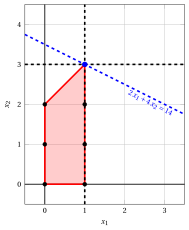{ .fig .ovale loading=lazy  }

                <em>Node 4: feasible region of $\LP_{4}$ (red), with the branching constraint $x_1 \le 1$ (dashed), and its optimal solution (blue).</em>

                An optimal solution ${\tilde{\boldsymbol x}}(\LP_{4})$ is:

                $$
                \tilde{x}_1=1,~~\tilde{x}_2=3
                $$

                the optimal value is:

                $$
                z(\LP_{4}) = 14
                $$

                The $\LP_{4}$ problem is <strong>feasible</strong> and we have

                $$
                \left\lfloor z(\LP_{4}) \right\rfloor > \LB
                \qquad \text{since} \qquad
                14 > -\infty
                $$

                The optimal solution ${\tilde{\boldsymbol x}}(\LP_{4})$ is <strong>integer</strong>, accordingly, the lower bound $\LB$ becomes $14$ and the incumbent solution ${\bar{\boldsymbol x}}(\ILP)$ becomes $\bar{x}_1=1,\bar{x}_2=3$.

                Accordingly, the branching node is <u>pruned by integrality</u>.

            2. Solution of the $\LP_{5}$ problem

                Let us consider the $\LP_{5}$ problem in standard form:

                $$
                \begin{array}{rrrrrrrrrrrrrrr}
                {\max} & {2}\, {x_1} & {+} & {4}\, {x_2} &  &  &  &  &  &  &  &  \\[2ex]
                & {-}{x_1} & {+} & {x_2} & {+} & {x_3} &  &  &  &  &  &  & {=} & {2} \\[2ex]
                & {8}\, {x_1} & {+} & {2}\, {x_2} &  &  & {+} & {x_4} &  &  &  &  & {=} & {19} \\[2ex]
                &  &  & {x_2} &  &  &  &  & {+} & {x_5} &  &  & {=} & {3} \\[2ex]
                & {x_1} &  &  &  &  &  &  &  &  & {-} & {x_6} & {=} & {2} \\[2ex]
                & {x_1,} &  & {x_2,} &  & {x_3,} &  & {x_4,} &  & {x_5,} &  & {x_6} & {\ge} & {0}
                \end{array}
                $$

                For the branching constraint we have:

                $$
                x_1 - x_6 = 2 \quad \quad \Rightarrow \quad x_6 = -2 + x_1
                $$

                Using the equations of the optimal simplex dictionary we can express this branching constraint as a function of the non-basic variables. Substituting, we get

                $$
                x_6 = -2 + \left(\dfrac{13}{8} - \dfrac{1}{8} \; x_4 + \dfrac{1}{4} \; x_5 \right)
                \quad \quad \Rightarrow \quad
                x_6 = -\dfrac{3}{8} - \dfrac{1}{8} \, x_4 + \dfrac{1}{4} \, x_5
                $$

                We then add this equation to the previous optimal simplex dictionary and we obtain the following simplex dictionary:

                \begin{equation*}
                \begin{cases}
                \begin{array}{rrrrrrr}
                {x_1} & {=} & {\dfrac{13}{8}} & {-} & {\dfrac{1}{8}}\, {x_4} & {+} & {\dfrac{1}{4}}\, {x_5} \\[2ex]
                {x_2} & {=} & {3} &  &  & {-} & {x_5} \\[2ex]
                {x_3} & {=} & {\dfrac{5}{8}} & {-} & {\dfrac{1}{8}}\, {x_4} & {+} & {\dfrac{5}{4}}\, {x_5} \\[2ex]
                {x_6} & {=} & {-\dfrac{3}{8}} & {-} & {\dfrac{1}{8}}\, {x_4} & {+} & {\dfrac{1}{4}}\, {x_5} \\[2ex]
                {z} & {=} & {\dfrac{61}{4}} & {-} & {\dfrac{1}{4}}\, {x_4} & {-} & {\dfrac{7}{2}}\, {x_5}
                \end{array}
                \end{cases}
                \end{equation*}

                where $\pazocal{B}=\{1,2,3,6\}$ and $\pazocal{N}=\{4,5\}$ and

                - the basic primal non-feasible solution is:

                    $$
                    \bar x_1=\dfrac{13}{8},~~
                    \bar x_2=3,~~
                    \bar x_3=\dfrac{5}{8},~~
                    \bar x_6=-\dfrac{3}{8},~~~~~~
                    \bar x_4=0,~~
                    \bar x_5=0~~
                    \mathrm{~~of~value~~~} \dfrac{61}{4}
                    $$

                - the basic dual feasible solution is:

                    $$
                    \bar \pi_1=0,~~
                    \bar \pi_2=0,~~
                    \bar \pi_3=0,~~
                    \bar \pi_6=0,~~~~~~
                    \bar \pi_4=\dfrac{1}{4},~~
                    \bar \pi_5=\dfrac{7}{2}~~
                    \mathrm{~~of~value~~~} \dfrac{61}{4}
                    $$

                If we increase the value of $\pi_{6}$, we can get a better dual solution. We have:

                $$
                \begin{cases}
                \pi_4 &= \dfrac{1}{4} + \dfrac{1}{8}\,\pi_6 \\[2ex]
                \pi_5 &= \dfrac{7}{2} - \dfrac{1}{4}\,\pi_6
                \end{cases}
                \qquad
                \qquad
                \begin{cases}
                \underbrace{ \dfrac{1}{4} + \dfrac{1}{8}\,\pi_6 \ge 0}_{\pi_4 \ge 0} \\[2ex]
                \underbrace{ \dfrac{7}{2} - \dfrac{1}{4}\,\pi_6 \ge 0}_{\pi_5 \ge 0}
                \end{cases}
                \qquad
                \qquad
                \begin{cases}
                \pi_6 &\ge -2 \\[2ex]
                \pi_6 &\le 14
                \end{cases}
                $$

                By increasing the value of $\pi_{6}$ to $14$, the value of $\pi_{5}$ decreases to $0$. Then we have that:

                - $\pi_{6}$ becomes a dual basic variable and accordingly $x_{6}$ becomes a primal non-basic variable.

                - $\pi_{5}$ becomes a dual non-basic variable and accordingly $x_{5}$ becomes a primal basic variable.

                We have:

                $$
                x_6 = -\dfrac{3}{8} - \dfrac{1}{8} \, x_4 + \dfrac{1}{4} \, x_5
                \quad \Rightarrow \quad
                x_5 = \dfrac{3}{2} + \dfrac{1}{2} \, x_4 + 4 \, x_6
                $$

                Substituting into the other equations of the primal simplex dictionary, we get:

                $$
                x_1
                = \dfrac{13}{8} - \dfrac{1}{8} \; x_4 + \dfrac{1}{4} \left( \dfrac{3}{2} + \dfrac{1}{2} \, x_4 + 4 \, x_6 \right)
                = 2 + x_6
                $$

                $$
                x_2
                = 3 - \left( \dfrac{3}{2} + \dfrac{1}{2} \, x_4 + 4 \, x_6 \right)
                = \dfrac{3}{2} - \dfrac{1}{2} \, x_4 - 4 \, x_6
                $$

                $$
                x_3
                = \dfrac{5}{8} - \dfrac{1}{8} \; x_4 + \dfrac{5}{4} \left( \dfrac{3}{2} + \dfrac{1}{2} \, x_4 + 4 \, x_6 \right)
                = \dfrac{5}{2} + \dfrac{1}{2} \, x_4 + 5 \, x_6
                $$

                $$
                z
                = \dfrac{61}{4} - \dfrac{1}{4} \; x_4 - \dfrac{7}{2} \left( \dfrac{3}{2} + \dfrac{1}{2} \, x_4 + 4 \, x_6 \right)
                = 10 - 2 \, x_4 - 14 \, x_6
                $$

                Accordingly, we now have the following updated primal simplex dictionary:

                \begin{equation*}
                \begin{cases}
                \begin{array}{rrrrrrr}
                {x_1} & {=} & {2} &  &  & {+} & {x_6} \\[2ex]
                {x_2} & {=} & {\dfrac{3}{2}} & {-} & {\dfrac{1}{2}}\, {x_4} & {-} & {4}\, {x_6} \\[2ex]
                {x_3} & {=} & {\dfrac{5}{2}} & {+} & {\dfrac{1}{2}}\, {x_4} & {+} & {5}\, {x_6} \\[2ex]
                {x_5} & {=} & {\dfrac{3}{2}} & {+} & {\dfrac{1}{2}}\, {x_4} & {+} & {4}\, {x_6} \\[2ex]
                {z} & {=} & {10} & {-} & {2}\, {x_4} & {-} & {14}\, {x_6}
                \end{array}
                \end{cases}
                \end{equation*}

                where $\pazocal{B}=\{1,2,3,5\}$ and $\pazocal{N}=\{4,6\}$ and

                - the basic primal optimal solution is:

                    $$
                    \tilde x_1=2,~~
                    \tilde x_2=\dfrac{3}{2},~~
                    \tilde x_3=\dfrac{5}{2},~~
                    \tilde x_5=\dfrac{3}{2},~~~~~~
                    \tilde x_4=0,~~
                    \tilde x_6=0~~
                    \mathrm{~~of~value~~~} 10
                    $$

                - the basic dual optimal solution is:

                    $$
                    \tilde \pi_1=0,~~
                    \tilde \pi_2=0,~~
                    \tilde \pi_3=0,~~
                    \tilde \pi_5=0,~~~~~~
                    \tilde \pi_4=2,~~
                    \tilde \pi_6=14~~
                    \mathrm{~~of~value~~~} 10
                    $$

                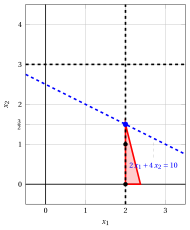{ .fig .ovale loading=lazy  }

                <em>Node 5: feasible region of $\LP_{5}$ (red), with the branching constraint $x_1 \ge 2$ (dashed), and its optimal solution (blue).</em>

                An optimal solution ${\tilde{\boldsymbol x}}(\LP_{5})$ is:

                $$
                \tilde{x}_1=2,~~\tilde{x}_2=\dfrac{3}{2}
                $$

                the optimal value is:

                $$
                z(\LP_{5}) = 10
                $$

                The $\LP_{5}$ problem is <strong>feasible</strong> and we have

                $$
                \left\lfloor z(\LP_{5}) \right\rfloor \le \LB
                \qquad \text{since} \qquad
                10 \le 14
                $$

                Accordingly, the branching node is <u>pruned by bound</u>.

            At the end of the second iteration, branching on $x_{1}$ from Node 2 has generated the down-branching node, Node 4, and the up-branching node, Node 5. Node 4 is pruned by integrality, while Node 5 is pruned by bound. The corresponding branch-and-bound tree is:

            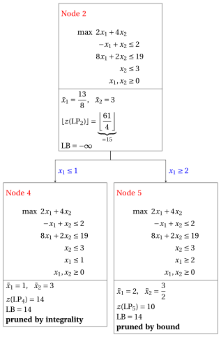{ .fig loading=lazy  }

            Due to the current lower bound $\LB$ and upper bound $\UB$, we have:

            $$
            14 ~~\le~~ z(\ILP) ~~\le~~ 14
            $$

        - <strong>Termination</strong>

            Since the list $L$ is empty, the lower bound $\LB$ is equal to the upper bound $\UB$ and the $\ILP$ problem is solved to optimality.

            The optimal value is $z(\ILP)=14$ (the value of the lower bound $\LB$) and an optimal solution ${\tilde{\boldsymbol x}}(\ILP)$ is $\tilde x_1=1,\tilde x_2=3$ (the incumbent solution ${\bar{\boldsymbol x}}(\ILP)$).

    2. The final branch-and-bound tree is:

        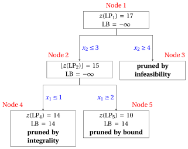{ .fig loading=lazy  }

        The reasons why the branching nodes are pruned are the following.

        - Node 1 has a fractional optimal solution with $z(\LP_{1}) = 17$: it is branched on $x_2$.

        - Node 2 has a fractional optimal solution with $\lfloor z(\LP_{2})\rfloor = 15$: it is branched on $x_1$.

        - Node 3 is pruned by infeasibility: the $\LP_{3}$ problem has no feasible solution.

        - Node 4 is pruned by integrality: $\tilde{\boldsymbol x}(\LP_{4}) = (1, 3)$ is integer, with value $14$, which becomes the incumbent solution.

        - Node 5 is pruned by bound: $z(\LP_{5}) = 10$ $\le \LB = 14$.

        The optimal value is $z(\ILP) = 14$ and the branch-and-bound algorithm returns the optimal solution $\tilde{\boldsymbol x}(\ILP) = (1, 3)$.

!!! esercizio "Exercise 7.4: Branch-and-bound algorithm (P4)"

    !!! nota ""

        Consider the following ILP problem in canonical maximization form with $n=2$ integer variables and $m=2$ constraints:

        $$
        \begin{array}{rrrrrrr}
        {\max} & {5}\, {x_1} & {+} & {3}\, {x_2} \\[2ex]
        & {2}\, {x_1} & {+} & {x_2} & {\le} & {14} \\[2ex]
        & {x_1} & {+} & {8}\, {x_2} & {\le} & {32} \\[2ex]
        & {x_1,} &  & {x_2} & {\in} & {\Z_{\ge 0}}
        \end{array}
        $$

        and an optimal simplex dictionary of its LP relaxation in standard form:

        \begin{equation*}
        \begin{cases}
        \begin{array}{rrrrrrr}
        {x_1} & {=} & {\dfrac{16}{3}} & {-} & {\dfrac{8}{15}}\, {x_3} & {+} & {\dfrac{1}{15}}\, {x_4} \\[2ex]
        {x_2} & {=} & {\dfrac{10}{3}} & {+} & {\dfrac{1}{15}}\, {x_3} & {-} & {\dfrac{2}{15}}\, {x_4} \\[2ex]
        {z} & {=} & {\dfrac{110}{3}} & {-} & {\dfrac{37}{15}}\, {x_3} & {-} & {\dfrac{1}{15}}\, {x_4}
        \end{array}
        \end{cases}
        \end{equation*}

    **Questions**

    1. Execute the branch-and-bound algorithm using:

        1. the largest-index rule as branching-variable selection strategy;

        2. the LIFO rule as branching-node selection strategy;

        3. solve first the down-branching node and then the up-branching node;

        4. set the lower bound $\LB$ to $-\infty$ (no heuristic algorithm is executed).

        Solve the LP problems of the branching nodes using the dual simplex algorithm. In the dual simplex algorithm, the leaving variable is the basic variable with negative value and smallest index, and ties in the ratio test are broken by the smallest index. Show graphically the optimal solution of the LP problems associated with the branching nodes.

    2. Determine and comment the branch-and-bound tree, showing the reason why each branching node is pruned.

??? soluzione "Solution"

    1. Execution of the branch-and-bound algorithm to solve the $\ILP$ problem.

        - <strong>Initialization</strong>

            Let us consider the $\LP_{1}$ problem in standard form:

            $$
            \begin{array}{rrrrrrrrrrr}
            {\max} & {5}\, {x_1} & {+} & {3}\, {x_2} &  &  &  &  \\[2ex]
            & {2}\, {x_1} & {+} & {x_2} & {+} & {x_3} &  &  & {=} & {14} \\[2ex]
            & {x_1} & {+} & {8}\, {x_2} &  &  & {+} & {x_4} & {=} & {32} \\[2ex]
            & {x_1,} &  & {x_2,} &  & {x_3,} &  & {x_4} & {\ge} & {0}
            \end{array}
            $$

            and its optimal simplex dictionary:

            \begin{equation*}
            \begin{cases}
            \begin{array}{rrrrrrr}
            {x_1} & {=} & {\dfrac{16}{3}} & {-} & {\dfrac{8}{15}}\, {x_3} & {+} & {\dfrac{1}{15}}\, {x_4} \\[2ex]
            {x_2} & {=} & {\dfrac{10}{3}} & {+} & {\dfrac{1}{15}}\, {x_3} & {-} & {\dfrac{2}{15}}\, {x_4} \\[2ex]
            {z} & {=} & {\dfrac{110}{3}} & {-} & {\dfrac{37}{15}}\, {x_3} & {-} & {\dfrac{1}{15}}\, {x_4}
            \end{array}
            \end{cases}
            \end{equation*}

            { .fig .ovale loading=lazy  }

            <em>Node 1: feasible region of $\LP_{1}$ (red), feasible points of the ILP problem (black) and optimal solution of $\LP_{1}$ (blue) with the objective function line through it.</em>

            An optimal solution ${\tilde{\boldsymbol x}}(\LP_{1})$ is:

            $$
            \tilde{x}_1=\dfrac{16}{3},~~\tilde{x}_2=\dfrac{10}{3}
            $$

            the optimal value is:

            $$
            z(\LP_{1}) = \dfrac{110}{3}
            $$

            The optimal solution ${\tilde{\boldsymbol x}}(\LP_{1})$ is <strong>fractional</strong> and the $\LP_{1}$ problem is <strong>feasible</strong>, so the $\LP_{1}$ problem is inserted in the problem list $L$ and the lower bound $\LB$ is set to $-\infty$.

            Due to the current lower bound $\LB$ and upper bound $\UB$, we have:

            $$
            -\infty ~~\le~~ z(\ILP) ~~\le~~ \underbrace{\left\lfloor \dfrac{110}{3} \right\rfloor}_{=36}
            $$

        - <strong>Iteration 1</strong>

            The $\LP_{1}$ problem is extracted and deleted from the problem list $L$.

            The branching variable is $x_{2}$. The branching constraints are:

            $$
            x_2 \le \underbrace{\left\lfloor \dfrac{10}{3} \right\rfloor}_{ = 3} \mathrm{~~~and~~~} x_2 \ge \underbrace{\left\lfloor \dfrac{10}{3} \right\rfloor +1}_{= 4}
            $$

            Two $\LP_{2}$ and $\LP_{3}$ problems are created with these branching constraints.

            1. Solution of the $\LP_{2}$ problem

                Let us consider the $\LP_{2}$ problem in standard form:

                $$
                \begin{array}{rrrrrrrrrrrrr}
                {\max} & {5}\, {x_1} & {+} & {3}\, {x_2} &  &  &  &  &  &  \\[2ex]
                & {2}\, {x_1} & {+} & {x_2} & {+} & {x_3} &  &  &  &  & {=} & {14} \\[2ex]
                & {x_1} & {+} & {8}\, {x_2} &  &  & {+} & {x_4} &  &  & {=} & {32} \\[2ex]
                &  &  & {x_2} &  &  &  &  & {+} & {x_5} & {=} & {3} \\[2ex]
                & {x_1,} &  & {x_2,} &  & {x_3,} &  & {x_4,} &  & {x_5} & {\ge} & {0}
                \end{array}
                $$

                For the branching constraint we have:

                $$
                x_2 + x_5 = 3 \quad \quad \Rightarrow \quad x_5 = 3 - x_2
                $$

                Using the equations of the optimal simplex dictionary we can express this branching constraint as a function of the non-basic variables. Substituting, we get

                $$
                x_5 = 3 - \left(\dfrac{10}{3} + \dfrac{1}{15} \; x_3 - \dfrac{2}{15} \; x_4 \right)
                \quad \quad \Rightarrow \quad
                x_5 = -\dfrac{1}{3} - \dfrac{1}{15} \, x_3 + \dfrac{2}{15} \, x_4
                $$

                We then add this equation to the previous optimal simplex dictionary and we obtain the following simplex dictionary:

                \begin{equation*}
                \begin{cases}
                \begin{array}{rrrrrrr}
                {x_1} & {=} & {\dfrac{16}{3}} & {-} & {\dfrac{8}{15}}\, {x_3} & {+} & {\dfrac{1}{15}}\, {x_4} \\[2ex]
                {x_2} & {=} & {\dfrac{10}{3}} & {+} & {\dfrac{1}{15}}\, {x_3} & {-} & {\dfrac{2}{15}}\, {x_4} \\[2ex]
                {x_5} & {=} & {-\dfrac{1}{3}} & {-} & {\dfrac{1}{15}}\, {x_3} & {+} & {\dfrac{2}{15}}\, {x_4} \\[2ex]
                {z} & {=} & {\dfrac{110}{3}} & {-} & {\dfrac{37}{15}}\, {x_3} & {-} & {\dfrac{1}{15}}\, {x_4}
                \end{array}
                \end{cases}
                \end{equation*}

                where $\pazocal{B}=\{1,2,5\}$ and $\pazocal{N}=\{3,4\}$ and

                - the basic primal non-feasible solution is:

                    $$
                    \bar x_1=\dfrac{16}{3},~~
                    \bar x_2=\dfrac{10}{3},~~
                    \bar x_5=-\dfrac{1}{3},~~~~~~
                    \bar x_3=0,~~
                    \bar x_4=0~~
                    \mathrm{~~of~value~~~} \dfrac{110}{3}
                    $$

                - the basic dual feasible solution is:

                    $$
                    \bar \pi_1=0,~~
                    \bar \pi_2=0,~~
                    \bar \pi_5=0,~~~~~~
                    \bar \pi_3=\dfrac{37}{15},~~
                    \bar \pi_4=\dfrac{1}{15}~~
                    \mathrm{~~of~value~~~} \dfrac{110}{3}
                    $$

                If we increase the value of $\pi_{5}$, we can get a better dual solution. We have:

                $$
                \begin{cases}
                \pi_3 &= \dfrac{37}{15} + \dfrac{1}{15}\,\pi_5 \\[2ex]
                \pi_4 &= \dfrac{1}{15} - \dfrac{2}{15}\,\pi_5
                \end{cases}
                \qquad
                \qquad
                \begin{cases}
                \underbrace{ \dfrac{37}{15} + \dfrac{1}{15}\,\pi_5 \ge 0}_{\pi_3 \ge 0} \\[2ex]
                \underbrace{ \dfrac{1}{15} - \dfrac{2}{15}\,\pi_5 \ge 0}_{\pi_4 \ge 0}
                \end{cases}
                \qquad
                \qquad
                \begin{cases}
                \pi_5 &\ge -37 \\[2ex]
                \pi_5 &\le \dfrac{1}{2}
                \end{cases}
                $$

                By increasing the value of $\pi_{5}$ to $\dfrac{1}{2}$, the value of $\pi_{4}$ decreases to $0$. Then we have that:

                - $\pi_{5}$ becomes a dual basic variable and accordingly $x_{5}$ becomes a primal non-basic variable.

                - $\pi_{4}$ becomes a dual non-basic variable and accordingly $x_{4}$ becomes a primal basic variable.

                We have:

                $$
                x_5 = -\dfrac{1}{3} - \dfrac{1}{15} \, x_3 + \dfrac{2}{15} \, x_4
                \quad \Rightarrow \quad
                x_4 = \dfrac{5}{2} + \dfrac{1}{2} \, x_3 + \dfrac{15}{2} \, x_5
                $$

                Substituting into the other equations of the primal simplex dictionary, we get:

                $$
                x_1
                = \dfrac{16}{3} - \dfrac{8}{15} \; x_3 + \dfrac{1}{15} \left( \dfrac{5}{2} + \dfrac{1}{2} \, x_3 + \dfrac{15}{2} \, x_5 \right)
                = \dfrac{11}{2} - \dfrac{1}{2} \, x_3 + \dfrac{1}{2} \, x_5
                $$

                $$
                x_2
                = \dfrac{10}{3} + \dfrac{1}{15} \; x_3 - \dfrac{2}{15} \left( \dfrac{5}{2} + \dfrac{1}{2} \, x_3 + \dfrac{15}{2} \, x_5 \right)
                = 3 - x_5
                $$

                $$
                z
                = \dfrac{110}{3} - \dfrac{37}{15} \; x_3 - \dfrac{1}{15} \left( \dfrac{5}{2} + \dfrac{1}{2} \, x_3 + \dfrac{15}{2} \, x_5 \right)
                = \dfrac{73}{2} - \dfrac{5}{2} \, x_3 - \dfrac{1}{2} \, x_5
                $$

                Accordingly, we now have the following updated primal simplex dictionary:

                \begin{equation*}
                \begin{cases}
                \begin{array}{rrrrrrr}
                {x_1} & {=} & {\dfrac{11}{2}} & {-} & {\dfrac{1}{2}}\, {x_3} & {+} & {\dfrac{1}{2}}\, {x_5} \\[2ex]
                {x_2} & {=} & {3} &  &  & {-} & {x_5} \\[2ex]
                {x_4} & {=} & {\dfrac{5}{2}} & {+} & {\dfrac{1}{2}}\, {x_3} & {+} & {\dfrac{15}{2}}\, {x_5} \\[2ex]
                {z} & {=} & {\dfrac{73}{2}} & {-} & {\dfrac{5}{2}}\, {x_3} & {-} & {\dfrac{1}{2}}\, {x_5}
                \end{array}
                \end{cases}
                \end{equation*}

                where $\pazocal{B}=\{1,2,4\}$ and $\pazocal{N}=\{3,5\}$ and

                - the basic primal optimal solution is:

                    $$
                    \tilde x_1=\dfrac{11}{2},~~
                    \tilde x_2=3,~~
                    \tilde x_4=\dfrac{5}{2},~~~~~~
                    \tilde x_3=0,~~
                    \tilde x_5=0~~
                    \mathrm{~~of~value~~~} \dfrac{73}{2}
                    $$

                - the basic dual optimal solution is:

                    $$
                    \tilde \pi_1=0,~~
                    \tilde \pi_2=0,~~
                    \tilde \pi_4=0,~~~~~~
                    \tilde \pi_3=\dfrac{5}{2},~~
                    \tilde \pi_5=\dfrac{1}{2}~~
                    \mathrm{~~of~value~~~} \dfrac{73}{2}
                    $$

                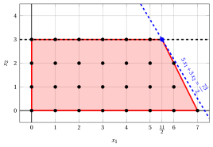{ .fig .ovale loading=lazy  }

                <em>Node 2: feasible region of $\LP_{2}$ (red), with the branching constraint $x_2 \le 3$ (dashed), and its optimal solution (blue).</em>

                An optimal solution ${\tilde{\boldsymbol x}}(\LP_{2})$ is:

                $$
                \tilde{x}_1=\dfrac{11}{2},~~\tilde{x}_2=3
                $$

                the optimal value is:

                $$
                z(\LP_{2}) = \dfrac{73}{2}
                $$

                The $\LP_{2}$ problem is <strong>feasible</strong> and we have

                $$
                \left\lfloor z(\LP_{2}) \right\rfloor > \LB
                \qquad \text{since} \qquad
                \underbrace{\left\lfloor \dfrac{73}{2} \right\rfloor}_{=36} > -\infty
                $$

                The optimal solution ${\tilde{\boldsymbol x}}(\LP_{2})$ is <strong>fractional</strong>, accordingly, the $\LP_{2}$ problem is <strong>inserted in the problem list</strong> $L$.

            2. Solution of the $\LP_{3}$ problem

                Let us consider the $\LP_{3}$ problem in standard form:

                $$
                \begin{array}{rrrrrrrrrrrrr}
                {\max} & {5}\, {x_1} & {+} & {3}\, {x_2} &  &  &  &  &  &  \\[2ex]
                & {2}\, {x_1} & {+} & {x_2} & {+} & {x_3} &  &  &  &  & {=} & {14} \\[2ex]
                & {x_1} & {+} & {8}\, {x_2} &  &  & {+} & {x_4} &  &  & {=} & {32} \\[2ex]
                &  &  & {x_2} &  &  &  &  & {-} & {x_5} & {=} & {4} \\[2ex]
                & {x_1,} &  & {x_2,} &  & {x_3,} &  & {x_4,} &  & {x_5} & {\ge} & {0}
                \end{array}
                $$

                For the branching constraint we have:

                $$
                x_2 - x_5 = 4 \quad \quad \Rightarrow \quad x_5 = -4 + x_2
                $$

                Using the equations of the optimal simplex dictionary we can express this branching constraint as a function of the non-basic variables. Substituting, we get

                $$
                x_5 = -4 + \left(\dfrac{10}{3} + \dfrac{1}{15} \; x_3 - \dfrac{2}{15} \; x_4 \right)
                \quad \quad \Rightarrow \quad
                x_5 = -\dfrac{2}{3} + \dfrac{1}{15} \, x_3 - \dfrac{2}{15} \, x_4
                $$

                We then add this equation to the previous optimal simplex dictionary and we obtain the following simplex dictionary:

                \begin{equation*}
                \begin{cases}
                \begin{array}{rrrrrrr}
                {x_1} & {=} & {\dfrac{16}{3}} & {-} & {\dfrac{8}{15}}\, {x_3} & {+} & {\dfrac{1}{15}}\, {x_4} \\[2ex]
                {x_2} & {=} & {\dfrac{10}{3}} & {+} & {\dfrac{1}{15}}\, {x_3} & {-} & {\dfrac{2}{15}}\, {x_4} \\[2ex]
                {x_5} & {=} & {-\dfrac{2}{3}} & {+} & {\dfrac{1}{15}}\, {x_3} & {-} & {\dfrac{2}{15}}\, {x_4} \\[2ex]
                {z} & {=} & {\dfrac{110}{3}} & {-} & {\dfrac{37}{15}}\, {x_3} & {-} & {\dfrac{1}{15}}\, {x_4}
                \end{array}
                \end{cases}
                \end{equation*}

                where $\pazocal{B}=\{1,2,5\}$ and $\pazocal{N}=\{3,4\}$ and

                - the basic primal non-feasible solution is:

                    $$
                    \bar x_1=\dfrac{16}{3},~~
                    \bar x_2=\dfrac{10}{3},~~
                    \bar x_5=-\dfrac{2}{3},~~~~~~
                    \bar x_3=0,~~
                    \bar x_4=0~~
                    \mathrm{~~of~value~~~} \dfrac{110}{3}
                    $$

                - the basic dual feasible solution is:

                    $$
                    \bar \pi_1=0,~~
                    \bar \pi_2=0,~~
                    \bar \pi_5=0,~~~~~~
                    \bar \pi_3=\dfrac{37}{15},~~
                    \bar \pi_4=\dfrac{1}{15}~~
                    \mathrm{~~of~value~~~} \dfrac{110}{3}
                    $$

                If we increase the value of $\pi_{5}$, we can get a better dual solution. We have:

                $$
                \begin{cases}
                \pi_3 &= \dfrac{37}{15} - \dfrac{1}{15}\,\pi_5 \\[2ex]
                \pi_4 &= \dfrac{1}{15} + \dfrac{2}{15}\,\pi_5
                \end{cases}
                \qquad
                \qquad
                \begin{cases}
                \underbrace{ \dfrac{37}{15} - \dfrac{1}{15}\,\pi_5 \ge 0}_{\pi_3 \ge 0} \\[2ex]
                \underbrace{ \dfrac{1}{15} + \dfrac{2}{15}\,\pi_5 \ge 0}_{\pi_4 \ge 0}
                \end{cases}
                \qquad
                \qquad
                \begin{cases}
                \pi_5 &\le 37 \\[2ex]
                \pi_5 &\ge -\dfrac{1}{2}
                \end{cases}
                $$

                By increasing the value of $\pi_{5}$ to $37$, the value of $\pi_{3}$ decreases to $0$. Then we have that:

                - $\pi_{5}$ becomes a dual basic variable and accordingly $x_{5}$ becomes a primal non-basic variable.

                - $\pi_{3}$ becomes a dual non-basic variable and accordingly $x_{3}$ becomes a primal basic variable.

                We have:

                $$
                x_5 = -\dfrac{2}{3} + \dfrac{1}{15} \, x_3 - \dfrac{2}{15} \, x_4
                \quad \Rightarrow \quad
                x_3 = 10 + 2 \, x_4 + 15 \, x_5
                $$

                Substituting into the other equations of the primal simplex dictionary, we get:

                $$
                x_1
                = \dfrac{16}{3} - \dfrac{8}{15} \left( 10 + 2 \, x_4 + 15 \, x_5 \right) + \dfrac{1}{15} \; x_4
                = 0 - x_4 - 8 \, x_5
                $$

                $$
                x_2
                = \dfrac{10}{3} + \dfrac{1}{15} \left( 10 + 2 \, x_4 + 15 \, x_5 \right) - \dfrac{2}{15} \; x_4
                = 4 + x_5
                $$

                $$
                z
                = \dfrac{110}{3} - \dfrac{37}{15} \left( 10 + 2 \, x_4 + 15 \, x_5 \right) - \dfrac{1}{15} \; x_4
                = 12 - 5 \, x_4 - 37 \, x_5
                $$

                Accordingly, we now have the following updated primal simplex dictionary:

                \begin{equation*}
                \begin{cases}
                \begin{array}{rrrrrrr}
                {x_1} & {=} & {0} & {-} & {x_4} & {-} & {8}\, {x_5} \\[2ex]
                {x_2} & {=} & {4} &  &  & {+} & {x_5} \\[2ex]
                {x_3} & {=} & {10} & {+} & {2}\, {x_4} & {+} & {15}\, {x_5} \\[2ex]
                {z} & {=} & {12} & {-} & {5}\, {x_4} & {-} & {37}\, {x_5}
                \end{array}
                \end{cases}
                \end{equation*}

                where $\pazocal{B}=\{1,2,3\}$ and $\pazocal{N}=\{4,5\}$ and

                - the basic primal optimal solution is:

                    $$
                    \tilde x_1=0,~~
                    \tilde x_2=4,~~
                    \tilde x_3=10,~~~~~~
                    \tilde x_4=0,~~
                    \tilde x_5=0~~
                    \mathrm{~~of~value~~~} 12
                    $$

                - the basic dual optimal solution is:

                    $$
                    \tilde \pi_1=0,~~
                    \tilde \pi_2=0,~~
                    \tilde \pi_3=0,~~~~~~
                    \tilde \pi_4=5,~~
                    \tilde \pi_5=37~~
                    \mathrm{~~of~value~~~} 12
                    $$

                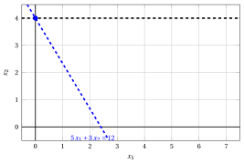{ .fig .ovale loading=lazy  }

                <em>Node 3: feasible region of $\LP_{3}$ (red), with the branching constraint $x_2 \ge 4$ (dashed), and its optimal solution (blue).</em>

                An optimal solution ${\tilde{\boldsymbol x}}(\LP_{3})$ is:

                $$
                \tilde{x}_1=0,~~\tilde{x}_2=4
                $$

                the optimal value is:

                $$
                z(\LP_{3}) = 12
                $$

                The $\LP_{3}$ problem is <strong>feasible</strong> and we have

                $$
                \left\lfloor z(\LP_{3}) \right\rfloor > \LB
                \qquad \text{since} \qquad
                12 > -\infty
                $$

                The optimal solution ${\tilde{\boldsymbol x}}(\LP_{3})$ is <strong>integer</strong>, accordingly, the lower bound $\LB$ becomes $12$ and the incumbent solution ${\bar{\boldsymbol x}}(\ILP)$ becomes $\bar{x}_1=0,\bar{x}_2=4$.

                Accordingly, the branching node is <u>pruned by integrality</u>.

            At the end of the first iteration, branching on $x_{2}$ from Node 1 has generated the down-branching node, Node 2, and the up-branching node, Node 3. Node 2 is inserted in the list $L$, while Node 3 is pruned by integrality. The corresponding branch-and-bound tree is:

            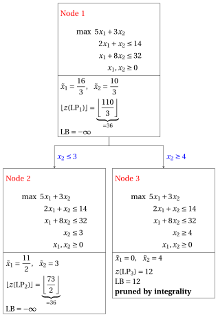{ .fig loading=lazy  }

            Due to the current lower bound $\LB$ and upper bound $\UB$, we have:

            $$
            12 ~~\le~~ z(\ILP) ~~\le~~ \underbrace{\left\lfloor \dfrac{73}{2} \right\rfloor}_{=36}
            $$

        - <strong>Iteration 2</strong>

            The $\LP_{2}$ problem is extracted and deleted from the problem list $L$.

            The branching variable is $x_{1}$. The branching constraints are:

            $$
            x_1 \le \underbrace{\left\lfloor \dfrac{11}{2} \right\rfloor}_{ = 5} \mathrm{~~~and~~~} x_1 \ge \underbrace{\left\lfloor \dfrac{11}{2} \right\rfloor +1}_{= 6}
            $$

            Two $\LP_{4}$ and $\LP_{5}$ problems are created with these branching constraints.

            1. Solution of the $\LP_{4}$ problem

                Let us consider the $\LP_{4}$ problem in standard form:

                $$
                \begin{array}{rrrrrrrrrrrrrrr}
                {\max} & {5}\, {x_1} & {+} & {3}\, {x_2} &  &  &  &  &  &  &  &  \\[2ex]
                & {2}\, {x_1} & {+} & {x_2} & {+} & {x_3} &  &  &  &  &  &  & {=} & {14} \\[2ex]
                & {x_1} & {+} & {8}\, {x_2} &  &  & {+} & {x_4} &  &  &  &  & {=} & {32} \\[2ex]
                &  &  & {x_2} &  &  &  &  & {+} & {x_5} &  &  & {=} & {3} \\[2ex]
                & {x_1} &  &  &  &  &  &  &  &  & {+} & {x_6} & {=} & {5} \\[2ex]
                & {x_1,} &  & {x_2,} &  & {x_3,} &  & {x_4,} &  & {x_5,} &  & {x_6} & {\ge} & {0}
                \end{array}
                $$

                For the branching constraint we have:

                $$
                x_1 + x_6 = 5 \quad \quad \Rightarrow \quad x_6 = 5 - x_1
                $$

                Using the equations of the optimal simplex dictionary we can express this branching constraint as a function of the non-basic variables. Substituting, we get

                $$
                x_6 = 5 - \left(\dfrac{11}{2} - \dfrac{1}{2} \; x_3 + \dfrac{1}{2} \; x_5 \right)
                \quad \quad \Rightarrow \quad
                x_6 = -\dfrac{1}{2} + \dfrac{1}{2} \, x_3 - \dfrac{1}{2} \, x_5
                $$

                We then add this equation to the previous optimal simplex dictionary and we obtain the following simplex dictionary:

                \begin{equation*}
                \begin{cases}
                \begin{array}{rrrrrrr}
                {x_1} & {=} & {\dfrac{11}{2}} & {-} & {\dfrac{1}{2}}\, {x_3} & {+} & {\dfrac{1}{2}}\, {x_5} \\[2ex]
                {x_2} & {=} & {3} &  &  & {-} & {x_5} \\[2ex]
                {x_4} & {=} & {\dfrac{5}{2}} & {+} & {\dfrac{1}{2}}\, {x_3} & {+} & {\dfrac{15}{2}}\, {x_5} \\[2ex]
                {x_6} & {=} & {-\dfrac{1}{2}} & {+} & {\dfrac{1}{2}}\, {x_3} & {-} & {\dfrac{1}{2}}\, {x_5} \\[2ex]
                {z} & {=} & {\dfrac{73}{2}} & {-} & {\dfrac{5}{2}}\, {x_3} & {-} & {\dfrac{1}{2}}\, {x_5}
                \end{array}
                \end{cases}
                \end{equation*}

                where $\pazocal{B}=\{1,2,4,6\}$ and $\pazocal{N}=\{3,5\}$ and

                - the basic primal non-feasible solution is:

                    $$
                    \bar x_1=\dfrac{11}{2},~~
                    \bar x_2=3,~~
                    \bar x_4=\dfrac{5}{2},~~
                    \bar x_6=-\dfrac{1}{2},~~~~~~
                    \bar x_3=0,~~
                    \bar x_5=0~~
                    \mathrm{~~of~value~~~} \dfrac{73}{2}
                    $$

                - the basic dual feasible solution is:

                    $$
                    \bar \pi_1=0,~~
                    \bar \pi_2=0,~~
                    \bar \pi_4=0,~~
                    \bar \pi_6=0,~~~~~~
                    \bar \pi_3=\dfrac{5}{2},~~
                    \bar \pi_5=\dfrac{1}{2}~~
                    \mathrm{~~of~value~~~} \dfrac{73}{2}
                    $$

                If we increase the value of $\pi_{6}$, we can get a better dual solution. We have:

                $$
                \begin{cases}
                \pi_3 &= \dfrac{5}{2} - \dfrac{1}{2}\,\pi_6 \\[2ex]
                \pi_5 &= \dfrac{1}{2} + \dfrac{1}{2}\,\pi_6
                \end{cases}
                \qquad
                \qquad
                \begin{cases}
                \underbrace{ \dfrac{5}{2} - \dfrac{1}{2}\,\pi_6 \ge 0}_{\pi_3 \ge 0} \\[2ex]
                \underbrace{ \dfrac{1}{2} + \dfrac{1}{2}\,\pi_6 \ge 0}_{\pi_5 \ge 0}
                \end{cases}
                \qquad
                \qquad
                \begin{cases}
                \pi_6 &\le 5 \\[2ex]
                \pi_6 &\ge -1
                \end{cases}
                $$

                By increasing the value of $\pi_{6}$ to $5$, the value of $\pi_{3}$ decreases to $0$. Then we have that:

                - $\pi_{6}$ becomes a dual basic variable and accordingly $x_{6}$ becomes a primal non-basic variable.

                - $\pi_{3}$ becomes a dual non-basic variable and accordingly $x_{3}$ becomes a primal basic variable.

                We have:

                $$
                x_6 = -\dfrac{1}{2} + \dfrac{1}{2} \, x_3 - \dfrac{1}{2} \, x_5
                \quad \Rightarrow \quad
                x_3 = 1 + x_5 + 2 \, x_6
                $$

                Substituting into the other equations of the primal simplex dictionary, we get:

                $$
                x_1
                = \dfrac{11}{2} - \dfrac{1}{2} \left( 1 + x_5 + 2 \, x_6 \right) + \dfrac{1}{2} \; x_5
                = 5 - x_6
                $$

                $$
                x_4
                = \dfrac{5}{2} + \dfrac{1}{2} \left( 1 + x_5 + 2 \, x_6 \right) + \dfrac{15}{2} \; x_5
                = 3 + 8 \, x_5 + x_6
                $$

                $$
                z
                = \dfrac{73}{2} - \dfrac{5}{2} \left( 1 + x_5 + 2 \, x_6 \right) - \dfrac{1}{2} \; x_5
                = 34 - 3 \, x_5 - 5 \, x_6
                $$

                Accordingly, we now have the following updated primal simplex dictionary:

                \begin{equation*}
                \begin{cases}
                \begin{array}{rrrrrrr}
                {x_1} & {=} & {5} &  &  & {-} & {x_6} \\[2ex]
                {x_2} & {=} & {3} & {-} & {x_5} &  &  \\[2ex]
                {x_3} & {=} & {1} & {+} & {x_5} & {+} & {2}\, {x_6} \\[2ex]
                {x_4} & {=} & {3} & {+} & {8}\, {x_5} & {+} & {x_6} \\[2ex]
                {z} & {=} & {34} & {-} & {3}\, {x_5} & {-} & {5}\, {x_6}
                \end{array}
                \end{cases}
                \end{equation*}

                where $\pazocal{B}=\{1,2,3,4\}$ and $\pazocal{N}=\{5,6\}$ and

                - the basic primal optimal solution is:

                    $$
                    \tilde x_1=5,~~
                    \tilde x_2=3,~~
                    \tilde x_3=1,~~
                    \tilde x_4=3,~~~~~~
                    \tilde x_5=0,~~
                    \tilde x_6=0~~
                    \mathrm{~~of~value~~~} 34
                    $$

                - the basic dual optimal solution is:

                    $$
                    \tilde \pi_1=0,~~
                    \tilde \pi_2=0,~~
                    \tilde \pi_3=0,~~
                    \tilde \pi_4=0,~~~~~~
                    \tilde \pi_5=3,~~
                    \tilde \pi_6=5~~
                    \mathrm{~~of~value~~~} 34
                    $$

                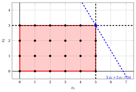{ .fig .ovale loading=lazy  }

                <em>Node 4: feasible region of $\LP_{4}$ (red), with the branching constraint $x_1 \le 5$ (dashed), and its optimal solution (blue).</em>

                An optimal solution ${\tilde{\boldsymbol x}}(\LP_{4})$ is:

                $$
                \tilde{x}_1=5,~~\tilde{x}_2=3
                $$

                the optimal value is:

                $$
                z(\LP_{4}) = 34
                $$

                The $\LP_{4}$ problem is <strong>feasible</strong> and we have

                $$
                \left\lfloor z(\LP_{4}) \right\rfloor > \LB
                \qquad \text{since} \qquad
                34 > 12
                $$

                The optimal solution ${\tilde{\boldsymbol x}}(\LP_{4})$ is <strong>integer</strong>, accordingly, the lower bound $\LB$ becomes $34$ and the incumbent solution ${\bar{\boldsymbol x}}(\ILP)$ becomes $\bar{x}_1=5,\bar{x}_2=3$.

                Accordingly, the branching node is <u>pruned by integrality</u>.

            2. Solution of the $\LP_{5}$ problem

                Let us consider the $\LP_{5}$ problem in standard form:

                $$
                \begin{array}{rrrrrrrrrrrrrrr}
                {\max} & {5}\, {x_1} & {+} & {3}\, {x_2} &  &  &  &  &  &  &  &  \\[2ex]
                & {2}\, {x_1} & {+} & {x_2} & {+} & {x_3} &  &  &  &  &  &  & {=} & {14} \\[2ex]
                & {x_1} & {+} & {8}\, {x_2} &  &  & {+} & {x_4} &  &  &  &  & {=} & {32} \\[2ex]
                &  &  & {x_2} &  &  &  &  & {+} & {x_5} &  &  & {=} & {3} \\[2ex]
                & {x_1} &  &  &  &  &  &  &  &  & {-} & {x_6} & {=} & {6} \\[2ex]
                & {x_1,} &  & {x_2,} &  & {x_3,} &  & {x_4,} &  & {x_5,} &  & {x_6} & {\ge} & {0}
                \end{array}
                $$

                For the branching constraint we have:

                $$
                x_1 - x_6 = 6 \quad \quad \Rightarrow \quad x_6 = -6 + x_1
                $$

                Using the equations of the optimal simplex dictionary we can express this branching constraint as a function of the non-basic variables. Substituting, we get

                $$
                x_6 = -6 + \left(\dfrac{11}{2} - \dfrac{1}{2} \; x_3 + \dfrac{1}{2} \; x_5 \right)
                \quad \quad \Rightarrow \quad
                x_6 = -\dfrac{1}{2} - \dfrac{1}{2} \, x_3 + \dfrac{1}{2} \, x_5
                $$

                We then add this equation to the previous optimal simplex dictionary and we obtain the following simplex dictionary:

                \begin{equation*}
                \begin{cases}
                \begin{array}{rrrrrrr}
                {x_1} & {=} & {\dfrac{11}{2}} & {-} & {\dfrac{1}{2}}\, {x_3} & {+} & {\dfrac{1}{2}}\, {x_5} \\[2ex]
                {x_2} & {=} & {3} &  &  & {-} & {x_5} \\[2ex]
                {x_4} & {=} & {\dfrac{5}{2}} & {+} & {\dfrac{1}{2}}\, {x_3} & {+} & {\dfrac{15}{2}}\, {x_5} \\[2ex]
                {x_6} & {=} & {-\dfrac{1}{2}} & {-} & {\dfrac{1}{2}}\, {x_3} & {+} & {\dfrac{1}{2}}\, {x_5} \\[2ex]
                {z} & {=} & {\dfrac{73}{2}} & {-} & {\dfrac{5}{2}}\, {x_3} & {-} & {\dfrac{1}{2}}\, {x_5}
                \end{array}
                \end{cases}
                \end{equation*}

                where $\pazocal{B}=\{1,2,4,6\}$ and $\pazocal{N}=\{3,5\}$ and

                - the basic primal non-feasible solution is:

                    $$
                    \bar x_1=\dfrac{11}{2},~~
                    \bar x_2=3,~~
                    \bar x_4=\dfrac{5}{2},~~
                    \bar x_6=-\dfrac{1}{2},~~~~~~
                    \bar x_3=0,~~
                    \bar x_5=0~~
                    \mathrm{~~of~value~~~} \dfrac{73}{2}
                    $$

                - the basic dual feasible solution is:

                    $$
                    \bar \pi_1=0,~~
                    \bar \pi_2=0,~~
                    \bar \pi_4=0,~~
                    \bar \pi_6=0,~~~~~~
                    \bar \pi_3=\dfrac{5}{2},~~
                    \bar \pi_5=\dfrac{1}{2}~~
                    \mathrm{~~of~value~~~} \dfrac{73}{2}
                    $$

                If we increase the value of $\pi_{6}$, we can get a better dual solution. We have:

                $$
                \begin{cases}
                \pi_3 &= \dfrac{5}{2} + \dfrac{1}{2}\,\pi_6 \\[2ex]
                \pi_5 &= \dfrac{1}{2} - \dfrac{1}{2}\,\pi_6
                \end{cases}
                \qquad
                \qquad
                \begin{cases}
                \underbrace{ \dfrac{5}{2} + \dfrac{1}{2}\,\pi_6 \ge 0}_{\pi_3 \ge 0} \\[2ex]
                \underbrace{ \dfrac{1}{2} - \dfrac{1}{2}\,\pi_6 \ge 0}_{\pi_5 \ge 0}
                \end{cases}
                \qquad
                \qquad
                \begin{cases}
                \pi_6 &\ge -5 \\[2ex]
                \pi_6 &\le 1
                \end{cases}
                $$

                By increasing the value of $\pi_{6}$ to $1$, the value of $\pi_{5}$ decreases to $0$. Then we have that:

                - $\pi_{6}$ becomes a dual basic variable and accordingly $x_{6}$ becomes a primal non-basic variable.

                - $\pi_{5}$ becomes a dual non-basic variable and accordingly $x_{5}$ becomes a primal basic variable.

                We have:

                $$
                x_6 = -\dfrac{1}{2} - \dfrac{1}{2} \, x_3 + \dfrac{1}{2} \, x_5
                \quad \Rightarrow \quad
                x_5 = 1 + x_3 + 2 \, x_6
                $$

                Substituting into the other equations of the primal simplex dictionary, we get:

                $$
                x_1
                = \dfrac{11}{2} - \dfrac{1}{2} \; x_3 + \dfrac{1}{2} \left( 1 + x_3 + 2 \, x_6 \right)
                = 6 + x_6
                $$

                $$
                x_2
                = 3 - \left( 1 + x_3 + 2 \, x_6 \right)
                = 2 - x_3 - 2 \, x_6
                $$

                $$
                x_4
                = \dfrac{5}{2} + \dfrac{1}{2} \; x_3 + \dfrac{15}{2} \left( 1 + x_3 + 2 \, x_6 \right)
                = 10 + 8 \, x_3 + 15 \, x_6
                $$

                $$
                z
                = \dfrac{73}{2} - \dfrac{5}{2} \; x_3 - \dfrac{1}{2} \left( 1 + x_3 + 2 \, x_6 \right)
                = 36 - 3 \, x_3 - x_6
                $$

                Accordingly, we now have the following updated primal simplex dictionary:

                \begin{equation*}
                \begin{cases}
                \begin{array}{rrrrrrr}
                {x_1} & {=} & {6} &  &  & {+} & {x_6} \\[2ex]
                {x_2} & {=} & {2} & {-} & {x_3} & {-} & {2}\, {x_6} \\[2ex]
                {x_4} & {=} & {10} & {+} & {8}\, {x_3} & {+} & {15}\, {x_6} \\[2ex]
                {x_5} & {=} & {1} & {+} & {x_3} & {+} & {2}\, {x_6} \\[2ex]
                {z} & {=} & {36} & {-} & {3}\, {x_3} & {-} & {x_6}
                \end{array}
                \end{cases}
                \end{equation*}

                where $\pazocal{B}=\{1,2,4,5\}$ and $\pazocal{N}=\{3,6\}$ and

                - the basic primal optimal solution is:

                    $$
                    \tilde x_1=6,~~
                    \tilde x_2=2,~~
                    \tilde x_4=10,~~
                    \tilde x_5=1,~~~~~~
                    \tilde x_3=0,~~
                    \tilde x_6=0~~
                    \mathrm{~~of~value~~~} 36
                    $$

                - the basic dual optimal solution is:

                    $$
                    \tilde \pi_1=0,~~
                    \tilde \pi_2=0,~~
                    \tilde \pi_4=0,~~
                    \tilde \pi_5=0,~~~~~~
                    \tilde \pi_3=3,~~
                    \tilde \pi_6=1~~
                    \mathrm{~~of~value~~~} 36
                    $$

                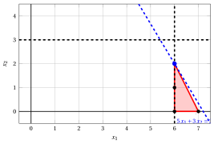{ .fig .ovale loading=lazy  }

                <em>Node 5: feasible region of $\LP_{5}$ (red), with the branching constraint $x_1 \ge 6$ (dashed), and its optimal solution (blue).</em>

                An optimal solution ${\tilde{\boldsymbol x}}(\LP_{5})$ is:

                $$
                \tilde{x}_1=6,~~\tilde{x}_2=2
                $$

                the optimal value is:

                $$
                z(\LP_{5}) = 36
                $$

                The $\LP_{5}$ problem is <strong>feasible</strong> and we have

                $$
                \left\lfloor z(\LP_{5}) \right\rfloor > \LB
                \qquad \text{since} \qquad
                36 > 34
                $$

                The optimal solution ${\tilde{\boldsymbol x}}(\LP_{5})$ is <strong>integer</strong>, accordingly, the lower bound $\LB$ becomes $36$ and the incumbent solution ${\bar{\boldsymbol x}}(\ILP)$ becomes $\bar{x}_1=6,\bar{x}_2=2$.

                Accordingly, the branching node is <u>pruned by integrality</u>.

            At the end of the second iteration, branching on $x_{1}$ from Node 2 has generated the down-branching node, Node 4, and the up-branching node, Node 5. Both nodes are pruned by integrality. The corresponding branch-and-bound tree is:

            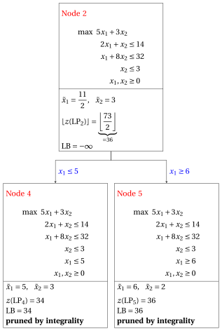{ .fig loading=lazy  }

            Due to the current lower bound $\LB$ and upper bound $\UB$, we have:

            $$
            36 ~~\le~~ z(\ILP) ~~\le~~ 36
            $$

        - <strong>Termination</strong>

            Since the list $L$ is empty, the lower bound $\LB$ is equal to the upper bound $\UB$ and the $\ILP$ problem is solved to optimality.

            The optimal value is $z(\ILP)=36$ (the value of the lower bound $\LB$) and an optimal solution ${\tilde{\boldsymbol x}}(\ILP)$ is $\tilde x_1=6,\tilde x_2=2$ (the incumbent solution ${\bar{\boldsymbol x}}(\ILP)$).

    2. The final branch-and-bound tree is:

        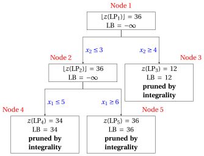{ .fig loading=lazy  }

        The reasons why the branching nodes are pruned are the following.

        - Node 1 has a fractional optimal solution with $\lfloor z(\LP_{1})\rfloor = 36$: it is branched on $x_2$.

        - Node 2 has a fractional optimal solution with $\lfloor z(\LP_{2})\rfloor = 36$: it is branched on $x_1$.

        - Node 3 is pruned by integrality: $\tilde{\boldsymbol x}(\LP_{3}) = (0, 4)$ is integer, with value $12$, which becomes the incumbent solution.

        - Node 4 is pruned by integrality: $\tilde{\boldsymbol x}(\LP_{4}) = (5, 3)$ is integer, with value $34$, which becomes the incumbent solution.

        - Node 5 is pruned by integrality: $\tilde{\boldsymbol x}(\LP_{5}) = (6, 2)$ is integer, with value $36$, which becomes the incumbent solution.

        The optimal value is $z(\ILP) = 36$ and the branch-and-bound algorithm returns the optimal solution $\tilde{\boldsymbol x}(\ILP) = (6, 2)$.

!!! esercizio "Exercise 7.5: Branch-and-bound algorithm (P5)"

    !!! nota ""

        Consider the following ILP problem in canonical maximization form with $n=2$ integer variables and $m=2$ constraints:

        $$
        \begin{array}{rrrrrrr}
        {\max} & {2}\, {x_1} & {+} & {3}\, {x_2} \\[2ex]
        & {6}\, {x_1} & {+} & {21}\, {x_2} & {\le} & {77} \\[2ex]
        & {8}\, {x_1} & {+} & {3}\, {x_2} & {\le} & {36} \\[2ex]
        & {x_1,} &  & {x_2} & {\in} & {\Z_{\ge 0}}
        \end{array}
        $$

        and an optimal simplex dictionary of its LP relaxation in standard form:

        \begin{equation*}
        \begin{cases}
        \begin{array}{rrrrrrr}
        {x_1} & {=} & {\dfrac{7}{2}} & {+} & {\dfrac{1}{50}}\, {x_3} & {-} & {\dfrac{7}{50}}\, {x_4} \\[2ex]
        {x_2} & {=} & {\dfrac{8}{3}} & {-} & {\dfrac{4}{75}}\, {x_3} & {+} & {\dfrac{1}{25}}\, {x_4} \\[2ex]
        {z} & {=} & {15} & {-} & {\dfrac{3}{25}}\, {x_3} & {-} & {\dfrac{4}{25}}\, {x_4}
        \end{array}
        \end{cases}
        \end{equation*}

    **Questions**

    1. Execute the branch-and-bound algorithm using:

        1. the smallest-index rule as branching-variable selection strategy;

        2. the LIFO rule as branching-node selection strategy;

        3. solve first the down-branching node and then the up-branching node;

        4. set the lower bound $\LB$ to $-\infty$ (no heuristic algorithm is executed).

        Solve the LP problems of the branching nodes using the dual simplex algorithm. In the dual simplex algorithm, the leaving variable is the basic variable with negative value and smallest index, and ties in the ratio test are broken by the smallest index. Show graphically the optimal solution of the LP problems associated with the branching nodes.

    2. Determine and comment the branch-and-bound tree, showing the reason why each branching node is pruned.

??? soluzione "Solution"

    1. Execution of the branch-and-bound algorithm to solve the $\ILP$ problem.

        - <strong>Initialization</strong>

            Let us consider the $\LP_{1}$ problem in standard form:

            $$
            \begin{array}{rrrrrrrrrrr}
            {\max} & {2}\, {x_1} & {+} & {3}\, {x_2} &  &  &  &  \\[2ex]
            & {6}\, {x_1} & {+} & {21}\, {x_2} & {+} & {x_3} &  &  & {=} & {77} \\[2ex]
            & {8}\, {x_1} & {+} & {3}\, {x_2} &  &  & {+} & {x_4} & {=} & {36} \\[2ex]
            & {x_1,} &  & {x_2,} &  & {x_3,} &  & {x_4} & {\ge} & {0}
            \end{array}
            $$

            and its optimal simplex dictionary:

            \begin{equation*}
            \begin{cases}
            \begin{array}{rrrrrrr}
            {x_1} & {=} & {\dfrac{7}{2}} & {+} & {\dfrac{1}{50}}\, {x_3} & {-} & {\dfrac{7}{50}}\, {x_4} \\[2ex]
            {x_2} & {=} & {\dfrac{8}{3}} & {-} & {\dfrac{4}{75}}\, {x_3} & {+} & {\dfrac{1}{25}}\, {x_4} \\[2ex]
            {z} & {=} & {15} & {-} & {\dfrac{3}{25}}\, {x_3} & {-} & {\dfrac{4}{25}}\, {x_4}
            \end{array}
            \end{cases}
            \end{equation*}

            { .fig .ovale loading=lazy  }

            <em>Node 1: feasible region of $\LP_{1}$ (red), feasible points of the ILP problem (black) and optimal solution of $\LP_{1}$ (blue) with the objective function line through it.</em>

            An optimal solution ${\tilde{\boldsymbol x}}(\LP_{1})$ is:

            $$
            \tilde{x}_1=\dfrac{7}{2},~~\tilde{x}_2=\dfrac{8}{3}
            $$

            the optimal value is:

            $$
            z(\LP_{1}) = 15
            $$

            The optimal solution ${\tilde{\boldsymbol x}}(\LP_{1})$ is <strong>fractional</strong> and the $\LP_{1}$ problem is <strong>feasible</strong>, so the $\LP_{1}$ problem is inserted in the problem list $L$ and the lower bound $\LB$ is set to $-\infty$.

            Due to the current lower bound $\LB$ and upper bound $\UB$, we have:

            $$
            -\infty ~~\le~~ z(\ILP) ~~\le~~ 15
            $$

        - <strong>Iteration 1</strong>

            The $\LP_{1}$ problem is extracted and deleted from the problem list $L$.

            The branching variable is $x_{1}$. The branching constraints are:

            $$
            x_1 \le \underbrace{\left\lfloor \dfrac{7}{2} \right\rfloor}_{ = 3} \mathrm{~~~and~~~} x_1 \ge \underbrace{\left\lfloor \dfrac{7}{2} \right\rfloor +1}_{= 4}
            $$

            Two $\LP_{2}$ and $\LP_{3}$ problems are created with these branching constraints.

            1. Solution of the $\LP_{2}$ problem

                Let us consider the $\LP_{2}$ problem in standard form:

                $$
                \begin{array}{rrrrrrrrrrrrr}
                {\max} & {2}\, {x_1} & {+} & {3}\, {x_2} &  &  &  &  &  &  \\[2ex]
                & {6}\, {x_1} & {+} & {21}\, {x_2} & {+} & {x_3} &  &  &  &  & {=} & {77} \\[2ex]
                & {8}\, {x_1} & {+} & {3}\, {x_2} &  &  & {+} & {x_4} &  &  & {=} & {36} \\[2ex]
                & {x_1} &  &  &  &  &  &  & {+} & {x_5} & {=} & {3} \\[2ex]
                & {x_1,} &  & {x_2,} &  & {x_3,} &  & {x_4,} &  & {x_5} & {\ge} & {0}
                \end{array}
                $$

                For the branching constraint we have:

                $$
                x_1 + x_5 = 3 \quad \quad \Rightarrow \quad x_5 = 3 - x_1
                $$

                Using the equations of the optimal simplex dictionary we can express this branching constraint as a function of the non-basic variables. Substituting, we get

                $$
                x_5 = 3 - \left(\dfrac{7}{2} + \dfrac{1}{50} \; x_3 - \dfrac{7}{50} \; x_4 \right)
                \quad \quad \Rightarrow \quad
                x_5 = -\dfrac{1}{2} - \dfrac{1}{50} \, x_3 + \dfrac{7}{50} \, x_4
                $$

                We then add this equation to the previous optimal simplex dictionary and we obtain the following simplex dictionary:

                \begin{equation*}
                \begin{cases}
                \begin{array}{rrrrrrr}
                {x_1} & {=} & {\dfrac{7}{2}} & {+} & {\dfrac{1}{50}}\, {x_3} & {-} & {\dfrac{7}{50}}\, {x_4} \\[2ex]
                {x_2} & {=} & {\dfrac{8}{3}} & {-} & {\dfrac{4}{75}}\, {x_3} & {+} & {\dfrac{1}{25}}\, {x_4} \\[2ex]
                {x_5} & {=} & {-\dfrac{1}{2}} & {-} & {\dfrac{1}{50}}\, {x_3} & {+} & {\dfrac{7}{50}}\, {x_4} \\[2ex]
                {z} & {=} & {15} & {-} & {\dfrac{3}{25}}\, {x_3} & {-} & {\dfrac{4}{25}}\, {x_4}
                \end{array}
                \end{cases}
                \end{equation*}

                where $\pazocal{B}=\{1,2,5\}$ and $\pazocal{N}=\{3,4\}$ and

                - the basic primal non-feasible solution is:

                    $$
                    \bar x_1=\dfrac{7}{2},~~
                    \bar x_2=\dfrac{8}{3},~~
                    \bar x_5=-\dfrac{1}{2},~~~~~~
                    \bar x_3=0,~~
                    \bar x_4=0~~
                    \mathrm{~~of~value~~~} 15
                    $$

                - the basic dual feasible solution is:

                    $$
                    \bar \pi_1=0,~~
                    \bar \pi_2=0,~~
                    \bar \pi_5=0,~~~~~~
                    \bar \pi_3=\dfrac{3}{25},~~
                    \bar \pi_4=\dfrac{4}{25}~~
                    \mathrm{~~of~value~~~} 15
                    $$

                If we increase the value of $\pi_{5}$, we can get a better dual solution. We have:

                $$
                \begin{cases}
                \pi_3 &= \dfrac{3}{25} + \dfrac{1}{50}\,\pi_5 \\[2ex]
                \pi_4 &= \dfrac{4}{25} - \dfrac{7}{50}\,\pi_5
                \end{cases}
                \qquad
                \qquad
                \begin{cases}
                \underbrace{ \dfrac{3}{25} + \dfrac{1}{50}\,\pi_5 \ge 0}_{\pi_3 \ge 0} \\[2ex]
                \underbrace{ \dfrac{4}{25} - \dfrac{7}{50}\,\pi_5 \ge 0}_{\pi_4 \ge 0}
                \end{cases}
                \qquad
                \qquad
                \begin{cases}
                \pi_5 &\ge -6 \\[2ex]
                \pi_5 &\le \dfrac{8}{7}
                \end{cases}
                $$

                By increasing the value of $\pi_{5}$ to $\dfrac{8}{7}$, the value of $\pi_{4}$ decreases to $0$. Then we have that:

                - $\pi_{5}$ becomes a dual basic variable and accordingly $x_{5}$ becomes a primal non-basic variable.

                - $\pi_{4}$ becomes a dual non-basic variable and accordingly $x_{4}$ becomes a primal basic variable.

                We have:

                $$
                x_5 = -\dfrac{1}{2} - \dfrac{1}{50} \, x_3 + \dfrac{7}{50} \, x_4
                \quad \Rightarrow \quad
                x_4 = \dfrac{25}{7} + \dfrac{1}{7} \, x_3 + \dfrac{50}{7} \, x_5
                $$

                Substituting into the other equations of the primal simplex dictionary, we get:

                $$
                x_1
                = \dfrac{7}{2} + \dfrac{1}{50} \; x_3 - \dfrac{7}{50} \left( \dfrac{25}{7} + \dfrac{1}{7} \, x_3 + \dfrac{50}{7} \, x_5 \right)
                = 3 - x_5
                $$

                $$
                x_2
                = \dfrac{8}{3} - \dfrac{4}{75} \; x_3 + \dfrac{1}{25} \left( \dfrac{25}{7} + \dfrac{1}{7} \, x_3 + \dfrac{50}{7} \, x_5 \right)
                = \dfrac{59}{21} - \dfrac{1}{21} \, x_3 + \dfrac{2}{7} \, x_5
                $$

                $$
                z
                = 15 - \dfrac{3}{25} \; x_3 - \dfrac{4}{25} \left( \dfrac{25}{7} + \dfrac{1}{7} \, x_3 + \dfrac{50}{7} \, x_5 \right)
                = \dfrac{101}{7} - \dfrac{1}{7} \, x_3 - \dfrac{8}{7} \, x_5
                $$

                Accordingly, we now have the following updated primal simplex dictionary:

                \begin{equation*}
                \begin{cases}
                \begin{array}{rrrrrrr}
                {x_1} & {=} & {3} &  &  & {-} & {x_5} \\[2ex]
                {x_2} & {=} & {\dfrac{59}{21}} & {-} & {\dfrac{1}{21}}\, {x_3} & {+} & {\dfrac{2}{7}}\, {x_5} \\[2ex]
                {x_4} & {=} & {\dfrac{25}{7}} & {+} & {\dfrac{1}{7}}\, {x_3} & {+} & {\dfrac{50}{7}}\, {x_5} \\[2ex]
                {z} & {=} & {\dfrac{101}{7}} & {-} & {\dfrac{1}{7}}\, {x_3} & {-} & {\dfrac{8}{7}}\, {x_5}
                \end{array}
                \end{cases}
                \end{equation*}

                where $\pazocal{B}=\{1,2,4\}$ and $\pazocal{N}=\{3,5\}$ and

                - the basic primal optimal solution is:

                    $$
                    \tilde x_1=3,~~
                    \tilde x_2=\dfrac{59}{21},~~
                    \tilde x_4=\dfrac{25}{7},~~~~~~
                    \tilde x_3=0,~~
                    \tilde x_5=0~~
                    \mathrm{~~of~value~~~} \dfrac{101}{7}
                    $$

                - the basic dual optimal solution is:

                    $$
                    \tilde \pi_1=0,~~
                    \tilde \pi_2=0,~~
                    \tilde \pi_4=0,~~~~~~
                    \tilde \pi_3=\dfrac{1}{7},~~
                    \tilde \pi_5=\dfrac{8}{7}~~
                    \mathrm{~~of~value~~~} \dfrac{101}{7}
                    $$

                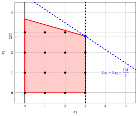{ .fig .ovale loading=lazy  }

                <em>Node 2: feasible region of $\LP_{2}$ (red), with the branching constraint $x_1 \le 3$ (dashed), and its optimal solution (blue).</em>

                An optimal solution ${\tilde{\boldsymbol x}}(\LP_{2})$ is:

                $$
                \tilde{x}_1=3,~~\tilde{x}_2=\dfrac{59}{21}
                $$

                the optimal value is:

                $$
                z(\LP_{2}) = \dfrac{101}{7}
                $$

                The $\LP_{2}$ problem is <strong>feasible</strong> and we have

                $$
                \left\lfloor z(\LP_{2}) \right\rfloor > \LB
                \qquad \text{since} \qquad
                \underbrace{\left\lfloor \dfrac{101}{7} \right\rfloor}_{=14} > -\infty
                $$

                The optimal solution ${\tilde{\boldsymbol x}}(\LP_{2})$ is <strong>fractional</strong>, accordingly, the $\LP_{2}$ problem is <strong>inserted in the problem list</strong> $L$.

            2. Solution of the $\LP_{3}$ problem

                Let us consider the $\LP_{3}$ problem in standard form:

                $$
                \begin{array}{rrrrrrrrrrrrr}
                {\max} & {2}\, {x_1} & {+} & {3}\, {x_2} &  &  &  &  &  &  \\[2ex]
                & {6}\, {x_1} & {+} & {21}\, {x_2} & {+} & {x_3} &  &  &  &  & {=} & {77} \\[2ex]
                & {8}\, {x_1} & {+} & {3}\, {x_2} &  &  & {+} & {x_4} &  &  & {=} & {36} \\[2ex]
                & {x_1} &  &  &  &  &  &  & {-} & {x_5} & {=} & {4} \\[2ex]
                & {x_1,} &  & {x_2,} &  & {x_3,} &  & {x_4,} &  & {x_5} & {\ge} & {0}
                \end{array}
                $$

                For the branching constraint we have:

                $$
                x_1 - x_5 = 4 \quad \quad \Rightarrow \quad x_5 = -4 + x_1
                $$

                Using the equations of the optimal simplex dictionary we can express this branching constraint as a function of the non-basic variables. Substituting, we get

                $$
                x_5 = -4 + \left(\dfrac{7}{2} + \dfrac{1}{50} \; x_3 - \dfrac{7}{50} \; x_4 \right)
                \quad \quad \Rightarrow \quad
                x_5 = -\dfrac{1}{2} + \dfrac{1}{50} \, x_3 - \dfrac{7}{50} \, x_4
                $$

                We then add this equation to the previous optimal simplex dictionary and we obtain the following simplex dictionary:

                \begin{equation*}
                \begin{cases}
                \begin{array}{rrrrrrr}
                {x_1} & {=} & {\dfrac{7}{2}} & {+} & {\dfrac{1}{50}}\, {x_3} & {-} & {\dfrac{7}{50}}\, {x_4} \\[2ex]
                {x_2} & {=} & {\dfrac{8}{3}} & {-} & {\dfrac{4}{75}}\, {x_3} & {+} & {\dfrac{1}{25}}\, {x_4} \\[2ex]
                {x_5} & {=} & {-\dfrac{1}{2}} & {+} & {\dfrac{1}{50}}\, {x_3} & {-} & {\dfrac{7}{50}}\, {x_4} \\[2ex]
                {z} & {=} & {15} & {-} & {\dfrac{3}{25}}\, {x_3} & {-} & {\dfrac{4}{25}}\, {x_4}
                \end{array}
                \end{cases}
                \end{equation*}

                where $\pazocal{B}=\{1,2,5\}$ and $\pazocal{N}=\{3,4\}$ and

                - the basic primal non-feasible solution is:

                    $$
                    \bar x_1=\dfrac{7}{2},~~
                    \bar x_2=\dfrac{8}{3},~~
                    \bar x_5=-\dfrac{1}{2},~~~~~~
                    \bar x_3=0,~~
                    \bar x_4=0~~
                    \mathrm{~~of~value~~~} 15
                    $$

                - the basic dual feasible solution is:

                    $$
                    \bar \pi_1=0,~~
                    \bar \pi_2=0,~~
                    \bar \pi_5=0,~~~~~~
                    \bar \pi_3=\dfrac{3}{25},~~
                    \bar \pi_4=\dfrac{4}{25}~~
                    \mathrm{~~of~value~~~} 15
                    $$

                If we increase the value of $\pi_{5}$, we can get a better dual solution. We have:

                $$
                \begin{cases}
                \pi_3 &= \dfrac{3}{25} - \dfrac{1}{50}\,\pi_5 \\[2ex]
                \pi_4 &= \dfrac{4}{25} + \dfrac{7}{50}\,\pi_5
                \end{cases}
                \qquad
                \qquad
                \begin{cases}
                \underbrace{ \dfrac{3}{25} - \dfrac{1}{50}\,\pi_5 \ge 0}_{\pi_3 \ge 0} \\[2ex]
                \underbrace{ \dfrac{4}{25} + \dfrac{7}{50}\,\pi_5 \ge 0}_{\pi_4 \ge 0}
                \end{cases}
                \qquad
                \qquad
                \begin{cases}
                \pi_5 &\le 6 \\[2ex]
                \pi_5 &\ge -\dfrac{8}{7}
                \end{cases}
                $$

                By increasing the value of $\pi_{5}$ to $6$, the value of $\pi_{3}$ decreases to $0$. Then we have that:

                - $\pi_{5}$ becomes a dual basic variable and accordingly $x_{5}$ becomes a primal non-basic variable.

                - $\pi_{3}$ becomes a dual non-basic variable and accordingly $x_{3}$ becomes a primal basic variable.

                We have:

                $$
                x_5 = -\dfrac{1}{2} + \dfrac{1}{50} \, x_3 - \dfrac{7}{50} \, x_4
                \quad \Rightarrow \quad
                x_3 = 25 + 7 \, x_4 + 50 \, x_5
                $$

                Substituting into the other equations of the primal simplex dictionary, we get:

                $$
                x_1
                = \dfrac{7}{2} + \dfrac{1}{50} \left( 25 + 7 \, x_4 + 50 \, x_5 \right) - \dfrac{7}{50} \; x_4
                = 4 + x_5
                $$

                $$
                x_2
                = \dfrac{8}{3} - \dfrac{4}{75} \left( 25 + 7 \, x_4 + 50 \, x_5 \right) + \dfrac{1}{25} \; x_4
                = \dfrac{4}{3} - \dfrac{1}{3} \, x_4 - \dfrac{8}{3} \, x_5
                $$

                $$
                z
                = 15 - \dfrac{3}{25} \left( 25 + 7 \, x_4 + 50 \, x_5 \right) - \dfrac{4}{25} \; x_4
                = 12 - x_4 - 6 \, x_5
                $$

                Accordingly, we now have the following updated primal simplex dictionary:

                \begin{equation*}
                \begin{cases}
                \begin{array}{rrrrrrr}
                {x_1} & {=} & {4} &  &  & {+} & {x_5} \\[2ex]
                {x_2} & {=} & {\dfrac{4}{3}} & {-} & {\dfrac{1}{3}}\, {x_4} & {-} & {\dfrac{8}{3}}\, {x_5} \\[2ex]
                {x_3} & {=} & {25} & {+} & {7}\, {x_4} & {+} & {50}\, {x_5} \\[2ex]
                {z} & {=} & {12} & {-} & {x_4} & {-} & {6}\, {x_5}
                \end{array}
                \end{cases}
                \end{equation*}

                where $\pazocal{B}=\{1,2,3\}$ and $\pazocal{N}=\{4,5\}$ and

                - the basic primal optimal solution is:

                    $$
                    \tilde x_1=4,~~
                    \tilde x_2=\dfrac{4}{3},~~
                    \tilde x_3=25,~~~~~~
                    \tilde x_4=0,~~
                    \tilde x_5=0~~
                    \mathrm{~~of~value~~~} 12
                    $$

                - the basic dual optimal solution is:

                    $$
                    \tilde \pi_1=0,~~
                    \tilde \pi_2=0,~~
                    \tilde \pi_3=0,~~~~~~
                    \tilde \pi_4=1,~~
                    \tilde \pi_5=6~~
                    \mathrm{~~of~value~~~} 12
                    $$

                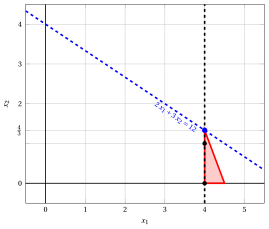{ .fig .ovale loading=lazy  }

                <em>Node 3: feasible region of $\LP_{3}$ (red), with the branching constraint $x_1 \ge 4$ (dashed), and its optimal solution (blue).</em>

                An optimal solution ${\tilde{\boldsymbol x}}(\LP_{3})$ is:

                $$
                \tilde{x}_1=4,~~\tilde{x}_2=\dfrac{4}{3}
                $$

                the optimal value is:

                $$
                z(\LP_{3}) = 12
                $$

                The $\LP_{3}$ problem is <strong>feasible</strong> and we have

                $$
                \left\lfloor z(\LP_{3}) \right\rfloor > \LB
                \qquad \text{since} \qquad
                12 > -\infty
                $$

                The optimal solution ${\tilde{\boldsymbol x}}(\LP_{3})$ is <strong>fractional</strong>, accordingly, the $\LP_{3}$ problem is <strong>inserted in the problem list</strong> $L$.

            At the end of the first iteration, branching on $x_{1}$ from Node 1 has generated the down-branching node, Node 2, and the up-branching node, Node 3. Both nodes are inserted in the list $L$. The corresponding branch-and-bound tree is:

            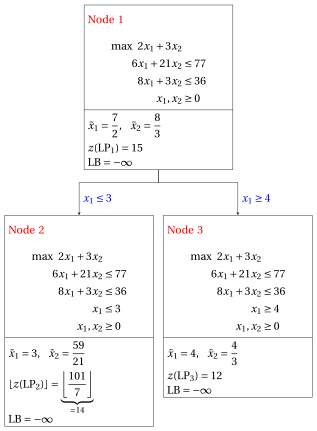{ .fig loading=lazy  }

            Due to the current lower bound $\LB$ and upper bound $\UB$, we have:

            $$
            -\infty ~~\le~~ z(\ILP) ~~\le~~ \underbrace{\left\lfloor \dfrac{101}{7} \right\rfloor}_{=14}
            $$

        - <strong>Iteration 2</strong>

            The $\LP_{3}$ problem is extracted and deleted from the problem list $L$.

            The branching variable is $x_{2}$. The branching constraints are:

            $$
            x_2 \le \underbrace{\left\lfloor \dfrac{4}{3} \right\rfloor}_{ = 1} \mathrm{~~~and~~~} x_2 \ge \underbrace{\left\lfloor \dfrac{4}{3} \right\rfloor +1}_{= 2}
            $$

            Two $\LP_{4}$ and $\LP_{5}$ problems are created with these branching constraints.

            1. Solution of the $\LP_{4}$ problem

                Let us consider the $\LP_{4}$ problem in standard form:

                $$
                \begin{array}{rrrrrrrrrrrrrrr}
                {\max} & {2}\, {x_1} & {+} & {3}\, {x_2} &  &  &  &  &  &  &  &  \\[2ex]
                & {6}\, {x_1} & {+} & {21}\, {x_2} & {+} & {x_3} &  &  &  &  &  &  & {=} & {77} \\[2ex]
                & {8}\, {x_1} & {+} & {3}\, {x_2} &  &  & {+} & {x_4} &  &  &  &  & {=} & {36} \\[2ex]
                & {x_1} &  &  &  &  &  &  & {-} & {x_5} &  &  & {=} & {4} \\[2ex]
                &  &  & {x_2} &  &  &  &  &  &  & {+} & {x_6} & {=} & {1} \\[2ex]
                & {x_1,} &  & {x_2,} &  & {x_3,} &  & {x_4,} &  & {x_5,} &  & {x_6} & {\ge} & {0}
                \end{array}
                $$

                For the branching constraint we have:

                $$
                x_2 + x_6 = 1 \quad \quad \Rightarrow \quad x_6 = 1 - x_2
                $$

                Using the equations of the optimal simplex dictionary we can express this branching constraint as a function of the non-basic variables. Substituting, we get

                $$
                x_6 = 1 - \left(\dfrac{4}{3} - \dfrac{1}{3} \; x_4 - \dfrac{8}{3} \; x_5 \right)
                \quad \quad \Rightarrow \quad
                x_6 = -\dfrac{1}{3} + \dfrac{1}{3} \, x_4 + \dfrac{8}{3} \, x_5
                $$

                We then add this equation to the previous optimal simplex dictionary and we obtain the following simplex dictionary:

                \begin{equation*}
                \begin{cases}
                \begin{array}{rrrrrrr}
                {x_1} & {=} & {4} &  &  & {+} & {x_5} \\[2ex]
                {x_2} & {=} & {\dfrac{4}{3}} & {-} & {\dfrac{1}{3}}\, {x_4} & {-} & {\dfrac{8}{3}}\, {x_5} \\[2ex]
                {x_3} & {=} & {25} & {+} & {7}\, {x_4} & {+} & {50}\, {x_5} \\[2ex]
                {x_6} & {=} & {-\dfrac{1}{3}} & {+} & {\dfrac{1}{3}}\, {x_4} & {+} & {\dfrac{8}{3}}\, {x_5} \\[2ex]
                {z} & {=} & {12} & {-} & {x_4} & {-} & {6}\, {x_5}
                \end{array}
                \end{cases}
                \end{equation*}

                where $\pazocal{B}=\{1,2,3,6\}$ and $\pazocal{N}=\{4,5\}$ and

                - the basic primal non-feasible solution is:

                    $$
                    \bar x_1=4,~~
                    \bar x_2=\dfrac{4}{3},~~
                    \bar x_3=25,~~
                    \bar x_6=-\dfrac{1}{3},~~~~~~
                    \bar x_4=0,~~
                    \bar x_5=0~~
                    \mathrm{~~of~value~~~} 12
                    $$

                - the basic dual feasible solution is:

                    $$
                    \bar \pi_1=0,~~
                    \bar \pi_2=0,~~
                    \bar \pi_3=0,~~
                    \bar \pi_6=0,~~~~~~
                    \bar \pi_4=1,~~
                    \bar \pi_5=6~~
                    \mathrm{~~of~value~~~} 12
                    $$

                If we increase the value of $\pi_{6}$, we can get a better dual solution. We have:

                $$
                \begin{cases}
                \pi_4 &= 1 - \dfrac{1}{3}\,\pi_6 \\[2ex]
                \pi_5 &= 6 - \dfrac{8}{3}\,\pi_6
                \end{cases}
                \qquad
                \qquad
                \begin{cases}
                \underbrace{ 1 - \dfrac{1}{3}\,\pi_6 \ge 0}_{\pi_4 \ge 0} \\[2ex]
                \underbrace{ 6 - \dfrac{8}{3}\,\pi_6 \ge 0}_{\pi_5 \ge 0}
                \end{cases}
                \qquad
                \qquad
                \begin{cases}
                \pi_6 &\le 3 \\[2ex]
                \pi_6 &\le \dfrac{9}{4}
                \end{cases}
                $$

                By increasing the value of $\pi_{6}$ to $\min \left\{3, \dfrac{9}{4}\right\}=\dfrac{9}{4}$, the value of $\pi_{5}$ decreases to $0$. Then we have that:

                - $\pi_{6}$ becomes a dual basic variable and accordingly $x_{6}$ becomes a primal non-basic variable.

                - $\pi_{5}$ becomes a dual non-basic variable and accordingly $x_{5}$ becomes a primal basic variable.

                We have:

                $$
                x_6 = -\dfrac{1}{3} + \dfrac{1}{3} \, x_4 + \dfrac{8}{3} \, x_5
                \quad \Rightarrow \quad
                x_5 = \dfrac{1}{8} - \dfrac{1}{8} \, x_4 + \dfrac{3}{8} \, x_6
                $$

                Substituting into the other equations of the primal simplex dictionary, we get:

                $$
                x_1
                = 4 + \left( \dfrac{1}{8} - \dfrac{1}{8} \, x_4 + \dfrac{3}{8} \, x_6 \right)
                = \dfrac{33}{8} - \dfrac{1}{8} \, x_4 + \dfrac{3}{8} \, x_6
                $$

                $$
                x_2
                = \dfrac{4}{3} - \dfrac{1}{3} \; x_4 - \dfrac{8}{3} \left( \dfrac{1}{8} - \dfrac{1}{8} \, x_4 + \dfrac{3}{8} \, x_6 \right)
                = 1 - x_6
                $$

                $$
                x_3
                = 25 + 7 \; x_4 + 50 \left( \dfrac{1}{8} - \dfrac{1}{8} \, x_4 + \dfrac{3}{8} \, x_6 \right)
                = \dfrac{125}{4} + \dfrac{3}{4} \, x_4 + \dfrac{75}{4} \, x_6
                $$

                $$
                z
                = 12 - x_4 - 6 \left( \dfrac{1}{8} - \dfrac{1}{8} \, x_4 + \dfrac{3}{8} \, x_6 \right)
                = \dfrac{45}{4} - \dfrac{1}{4} \, x_4 - \dfrac{9}{4} \, x_6
                $$

                Accordingly, we now have the following updated primal simplex dictionary:

                \begin{equation*}
                \begin{cases}
                \begin{array}{rrrrrrr}
                {x_1} & {=} & {\dfrac{33}{8}} & {-} & {\dfrac{1}{8}}\, {x_4} & {+} & {\dfrac{3}{8}}\, {x_6} \\[2ex]
                {x_2} & {=} & {1} &  &  & {-} & {x_6} \\[2ex]
                {x_3} & {=} & {\dfrac{125}{4}} & {+} & {\dfrac{3}{4}}\, {x_4} & {+} & {\dfrac{75}{4}}\, {x_6} \\[2ex]
                {x_5} & {=} & {\dfrac{1}{8}} & {-} & {\dfrac{1}{8}}\, {x_4} & {+} & {\dfrac{3}{8}}\, {x_6} \\[2ex]
                {z} & {=} & {\dfrac{45}{4}} & {-} & {\dfrac{1}{4}}\, {x_4} & {-} & {\dfrac{9}{4}}\, {x_6}
                \end{array}
                \end{cases}
                \end{equation*}

                where $\pazocal{B}=\{1,2,3,5\}$ and $\pazocal{N}=\{4,6\}$ and

                - the basic primal optimal solution is:

                    $$
                    \tilde x_1=\dfrac{33}{8},~~
                    \tilde x_2=1,~~
                    \tilde x_3=\dfrac{125}{4},~~
                    \tilde x_5=\dfrac{1}{8},~~~~~~
                    \tilde x_4=0,~~
                    \tilde x_6=0~~
                    \mathrm{~~of~value~~~} \dfrac{45}{4}
                    $$

                - the basic dual optimal solution is:

                    $$
                    \tilde \pi_1=0,~~
                    \tilde \pi_2=0,~~
                    \tilde \pi_3=0,~~
                    \tilde \pi_5=0,~~~~~~
                    \tilde \pi_4=\dfrac{1}{4},~~
                    \tilde \pi_6=\dfrac{9}{4}~~
                    \mathrm{~~of~value~~~} \dfrac{45}{4}
                    $$

                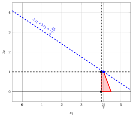{ .fig .ovale loading=lazy  }

                <em>Node 4: feasible region of $\LP_{4}$ (red), with the branching constraint $x_2 \le 1$ (dashed), and its optimal solution (blue).</em>

                An optimal solution ${\tilde{\boldsymbol x}}(\LP_{4})$ is:

                $$
                \tilde{x}_1=\dfrac{33}{8},~~\tilde{x}_2=1
                $$

                the optimal value is:

                $$
                z(\LP_{4}) = \dfrac{45}{4}
                $$

                The $\LP_{4}$ problem is <strong>feasible</strong> and we have

                $$
                \left\lfloor z(\LP_{4}) \right\rfloor > \LB
                \qquad \text{since} \qquad
                \underbrace{\left\lfloor \dfrac{45}{4} \right\rfloor}_{=11} > -\infty
                $$

                The optimal solution ${\tilde{\boldsymbol x}}(\LP_{4})$ is <strong>fractional</strong>, accordingly, the $\LP_{4}$ problem is <strong>inserted in the problem list</strong> $L$.

            2. Solution of the $\LP_{5}$ problem

                Let us consider the $\LP_{5}$ problem in standard form:

                $$
                \begin{array}{rrrrrrrrrrrrrrr}
                {\max} & {2}\, {x_1} & {+} & {3}\, {x_2} &  &  &  &  &  &  &  &  \\[2ex]
                & {6}\, {x_1} & {+} & {21}\, {x_2} & {+} & {x_3} &  &  &  &  &  &  & {=} & {77} \\[2ex]
                & {8}\, {x_1} & {+} & {3}\, {x_2} &  &  & {+} & {x_4} &  &  &  &  & {=} & {36} \\[2ex]
                & {x_1} &  &  &  &  &  &  & {-} & {x_5} &  &  & {=} & {4} \\[2ex]
                &  &  & {x_2} &  &  &  &  &  &  & {-} & {x_6} & {=} & {2} \\[2ex]
                & {x_1,} &  & {x_2,} &  & {x_3,} &  & {x_4,} &  & {x_5,} &  & {x_6} & {\ge} & {0}
                \end{array}
                $$

                For the branching constraint we have:

                $$
                x_2 - x_6 = 2 \quad \quad \Rightarrow \quad x_6 = -2 + x_2
                $$

                Using the equations of the optimal simplex dictionary we can express this branching constraint as a function of the non-basic variables. Substituting, we get

                $$
                x_6 = -2 + \left(\dfrac{4}{3} - \dfrac{1}{3} \; x_4 - \dfrac{8}{3} \; x_5 \right)
                \quad \quad \Rightarrow \quad
                x_6 = -\dfrac{2}{3} - \dfrac{1}{3} \, x_4 - \dfrac{8}{3} \, x_5
                $$

                We then add this equation to the previous optimal simplex dictionary and we obtain the following simplex dictionary:

                \begin{equation*}
                \begin{cases}
                \begin{array}{rrrrrrr}
                {x_1} & {=} & {4} &  &  & {+} & {x_5} \\[2ex]
                {x_2} & {=} & {\dfrac{4}{3}} & {-} & {\dfrac{1}{3}}\, {x_4} & {-} & {\dfrac{8}{3}}\, {x_5} \\[2ex]
                {x_3} & {=} & {25} & {+} & {7}\, {x_4} & {+} & {50}\, {x_5} \\[2ex]
                {x_6} & {=} & {-\dfrac{2}{3}} & {-} & {\dfrac{1}{3}}\, {x_4} & {-} & {\dfrac{8}{3}}\, {x_5} \\[2ex]
                {z} & {=} & {12} & {-} & {x_4} & {-} & {6}\, {x_5}
                \end{array}
                \end{cases}
                \end{equation*}

                where $\pazocal{B}=\{1,2,3,6\}$ and $\pazocal{N}=\{4,5\}$ and

                - the basic primal non-feasible solution is:

                    $$
                    \bar x_1=4,~~
                    \bar x_2=\dfrac{4}{3},~~
                    \bar x_3=25,~~
                    \bar x_6=-\dfrac{2}{3},~~~~~~
                    \bar x_4=0,~~
                    \bar x_5=0~~
                    \mathrm{~~of~value~~~} 12
                    $$

                - the basic dual feasible solution is:

                    $$
                    \bar \pi_1=0,~~
                    \bar \pi_2=0,~~
                    \bar \pi_3=0,~~
                    \bar \pi_6=0,~~~~~~
                    \bar \pi_4=1,~~
                    \bar \pi_5=6~~
                    \mathrm{~~of~value~~~} 12
                    $$

                If we increase the value of $\pi_{6}$, we can get a better dual solution. We have:

                $$
                \begin{cases}
                \pi_4 &= 1 + \dfrac{1}{3}\,\pi_6 \\[2ex]
                \pi_5 &= 6 + \dfrac{8}{3}\,\pi_6
                \end{cases}
                \qquad
                \qquad
                \begin{cases}
                \underbrace{ 1 + \dfrac{1}{3}\,\pi_6 \ge 0}_{\pi_4 \ge 0} \\[2ex]
                \underbrace{ 6 + \dfrac{8}{3}\,\pi_6 \ge 0}_{\pi_5 \ge 0}
                \end{cases}
                \qquad
                \qquad
                \begin{cases}
                \pi_6 &\ge -3 \\[2ex]
                \pi_6 &\ge -\dfrac{9}{4}
                \end{cases}
                $$

                Accordingly, we can increase the value of $\pi_{6}$ without violating dual feasibility, which implies that the dual problem is <strong>unbounded</strong>. As a result, the primal problem $\LP_{5}$ is <strong>infeasible</strong>, and the corresponding branching node is <u>pruned by infeasibility</u>.

            At the end of the second iteration, branching on $x_{2}$ from Node 3 has generated the down-branching node, Node 4, and the up-branching node, Node 5. Node 4 is inserted in the list $L$, while Node 5 is pruned by infeasibility. The corresponding branch-and-bound tree is:

            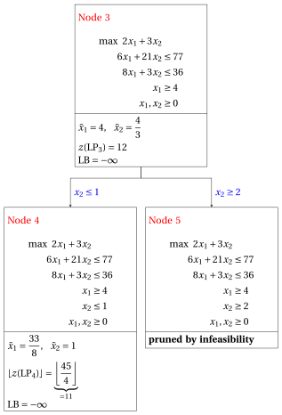{ .fig loading=lazy  }

            Due to the current lower bound $\LB$ and upper bound $\UB$, we have:

            $$
            -\infty ~~\le~~ z(\ILP) ~~\le~~ \underbrace{\left\lfloor \dfrac{101}{7} \right\rfloor}_{=14}
            $$

        - <strong>Iteration 3</strong>

            The $\LP_{4}$ problem is extracted and deleted from the problem list $L$.

            The branching variable is $x_{1}$. The branching constraints are:

            $$
            x_1 \le \underbrace{\left\lfloor \dfrac{33}{8} \right\rfloor}_{ = 4} \mathrm{~~~and~~~} x_1 \ge \underbrace{\left\lfloor \dfrac{33}{8} \right\rfloor +1}_{= 5}
            $$

            The $\LP_{6}$ problem is created with the first branching constraint (the second child is solved only if needed).

            1. Solution of the $\LP_{6}$ problem

                Let us consider the $\LP_{6}$ problem in standard form:

                $$
                \begin{array}{rrrrrrrrrrrrrrrrr}
                {\max} & {2}\, {x_1} & {+} & {3}\, {x_2} &  &  &  &  &  &  &  &  &  &  \\[2ex]
                & {6}\, {x_1} & {+} & {21}\, {x_2} & {+} & {x_3} &  &  &  &  &  &  &  &  & {=} & {77} \\[2ex]
                & {8}\, {x_1} & {+} & {3}\, {x_2} &  &  & {+} & {x_4} &  &  &  &  &  &  & {=} & {36} \\[2ex]
                & {x_1} &  &  &  &  &  &  & {-} & {x_5} &  &  &  &  & {=} & {4} \\[2ex]
                &  &  & {x_2} &  &  &  &  &  &  & {+} & {x_6} &  &  & {=} & {1} \\[2ex]
                & {x_1} &  &  &  &  &  &  &  &  &  &  & {+} & {x_7} & {=} & {4} \\[2ex]
                & {x_1,} &  & {x_2,} &  & {x_3,} &  & {x_4,} &  & {x_5,} &  & {x_6,} &  & {x_7} & {\ge} & {0}
                \end{array}
                $$

                For the branching constraint we have:

                $$
                x_1 + x_7 = 4 \quad \quad \Rightarrow \quad x_7 = 4 - x_1
                $$

                Using the equations of the optimal simplex dictionary we can express this branching constraint as a function of the non-basic variables. Substituting, we get

                $$
                x_7 = 4 - \left(\dfrac{33}{8} - \dfrac{1}{8} \; x_4 + \dfrac{3}{8} \; x_6 \right)
                \quad \quad \Rightarrow \quad
                x_7 = -\dfrac{1}{8} + \dfrac{1}{8} \, x_4 - \dfrac{3}{8} \, x_6
                $$

                We then add this equation to the previous optimal simplex dictionary and we obtain the following simplex dictionary:

                \begin{equation*}
                \begin{cases}
                \begin{array}{rrrrrrr}
                {x_1} & {=} & {\dfrac{33}{8}} & {-} & {\dfrac{1}{8}}\, {x_4} & {+} & {\dfrac{3}{8}}\, {x_6} \\[2ex]
                {x_2} & {=} & {1} &  &  & {-} & {x_6} \\[2ex]
                {x_3} & {=} & {\dfrac{125}{4}} & {+} & {\dfrac{3}{4}}\, {x_4} & {+} & {\dfrac{75}{4}}\, {x_6} \\[2ex]
                {x_5} & {=} & {\dfrac{1}{8}} & {-} & {\dfrac{1}{8}}\, {x_4} & {+} & {\dfrac{3}{8}}\, {x_6} \\[2ex]
                {x_7} & {=} & {-\dfrac{1}{8}} & {+} & {\dfrac{1}{8}}\, {x_4} & {-} & {\dfrac{3}{8}}\, {x_6} \\[2ex]
                {z} & {=} & {\dfrac{45}{4}} & {-} & {\dfrac{1}{4}}\, {x_4} & {-} & {\dfrac{9}{4}}\, {x_6}
                \end{array}
                \end{cases}
                \end{equation*}

                where $\pazocal{B}=\{1,2,3,5,7\}$ and $\pazocal{N}=\{4,6\}$ and

                - the basic primal non-feasible solution is:

                    $$
                    \begin{gathered}
                    \bar x_1=\dfrac{33}{8},~~
                    \bar x_2=1,~~
                    \bar x_3=\dfrac{125}{4},~~
                    \bar x_5=\dfrac{1}{8},~~
                    \bar x_7=-\dfrac{1}{8},\\
                    \bar x_4=0,~~
                    \bar x_6=0~~
                    \mathrm{~~of~value~~~} \dfrac{45}{4}
                    \end{gathered}
                    $$

                - the basic dual feasible solution is:

                    $$
                    \begin{gathered}
                    \bar \pi_1=0,~~
                    \bar \pi_2=0,~~
                    \bar \pi_3=0,~~
                    \bar \pi_5=0,~~
                    \bar \pi_7=0,\\
                    \bar \pi_4=\dfrac{1}{4},~~
                    \bar \pi_6=\dfrac{9}{4}~~
                    \mathrm{~~of~value~~~} \dfrac{45}{4}
                    \end{gathered}
                    $$

                If we increase the value of $\pi_{7}$, we can get a better dual solution. We have:

                $$
                \begin{cases}
                \pi_4 &= \dfrac{1}{4} - \dfrac{1}{8}\,\pi_7 \\[2ex]
                \pi_6 &= \dfrac{9}{4} + \dfrac{3}{8}\,\pi_7
                \end{cases}
                \qquad
                \qquad
                \begin{cases}
                \underbrace{ \dfrac{1}{4} - \dfrac{1}{8}\,\pi_7 \ge 0}_{\pi_4 \ge 0} \\[2ex]
                \underbrace{ \dfrac{9}{4} + \dfrac{3}{8}\,\pi_7 \ge 0}_{\pi_6 \ge 0}
                \end{cases}
                \qquad
                \qquad
                \begin{cases}
                \pi_7 &\le 2 \\[2ex]
                \pi_7 &\ge -6
                \end{cases}
                $$

                By increasing the value of $\pi_{7}$ to $2$, the value of $\pi_{4}$ decreases to $0$. Then we have that:

                - $\pi_{7}$ becomes a dual basic variable and accordingly $x_{7}$ becomes a primal non-basic variable.

                - $\pi_{4}$ becomes a dual non-basic variable and accordingly $x_{4}$ becomes a primal basic variable.

                We have:

                $$
                x_7 = -\dfrac{1}{8} + \dfrac{1}{8} \, x_4 - \dfrac{3}{8} \, x_6
                \quad \Rightarrow \quad
                x_4 = 1 + 3 \, x_6 + 8 \, x_7
                $$

                Substituting into the other equations of the primal simplex dictionary, we get:

                $$
                x_1
                = \dfrac{33}{8} - \dfrac{1}{8} \left( 1 + 3 \, x_6 + 8 \, x_7 \right) + \dfrac{3}{8} \; x_6
                = 4 - x_7
                $$

                $$
                x_3
                = \dfrac{125}{4} + \dfrac{3}{4} \left( 1 + 3 \, x_6 + 8 \, x_7 \right) + \dfrac{75}{4} \; x_6
                = 32 + 21 \, x_6 + 6 \, x_7
                $$

                $$
                x_5
                = \dfrac{1}{8} - \dfrac{1}{8} \left( 1 + 3 \, x_6 + 8 \, x_7 \right) + \dfrac{3}{8} \; x_6
                = 0 - x_7
                $$

                $$
                z
                = \dfrac{45}{4} - \dfrac{1}{4} \left( 1 + 3 \, x_6 + 8 \, x_7 \right) - \dfrac{9}{4} \; x_6
                = 11 - 3 \, x_6 - 2 \, x_7
                $$

                Accordingly, we now have the following updated primal simplex dictionary:

                \begin{equation*}
                \begin{cases}
                \begin{array}{rrrrrrr}
                {x_1} & {=} & {4} &  &  & {-} & {x_7} \\[2ex]
                {x_2} & {=} & {1} & {-} & {x_6} &  &  \\[2ex]
                {x_3} & {=} & {32} & {+} & {21}\, {x_6} & {+} & {6}\, {x_7} \\[2ex]
                {x_4} & {=} & {1} & {+} & {3}\, {x_6} & {+} & {8}\, {x_7} \\[2ex]
                {x_5} & {=} & {0} &  &  & {-} & {x_7} \\[2ex]
                {z} & {=} & {11} & {-} & {3}\, {x_6} & {-} & {2}\, {x_7}
                \end{array}
                \end{cases}
                \end{equation*}

                where $\pazocal{B}=\{1,2,3,4,5\}$ and $\pazocal{N}=\{6,7\}$ and

                - the basic primal optimal solution is:

                    $$
                    \begin{gathered}
                    \tilde x_1=4,~~
                    \tilde x_2=1,~~
                    \tilde x_3=32,~~
                    \tilde x_4=1,~~
                    \tilde x_5=0,\\
                    \tilde x_6=0,~~
                    \tilde x_7=0~~
                    \mathrm{~~of~value~~~} 11
                    \end{gathered}
                    $$

                - the basic dual optimal solution is:

                    $$
                    \begin{gathered}
                    \tilde \pi_1=0,~~
                    \tilde \pi_2=0,~~
                    \tilde \pi_3=0,~~
                    \tilde \pi_4=0,~~
                    \tilde \pi_5=0,\\
                    \tilde \pi_6=3,~~
                    \tilde \pi_7=2~~
                    \mathrm{~~of~value~~~} 11
                    \end{gathered}
                    $$

                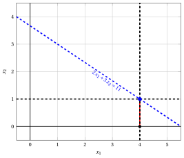{ .fig .ovale loading=lazy  }

                <em>Node 6: feasible region of $\LP_{6}$ (red), with the branching constraint $x_1 \le 4$ (dashed), and its optimal solution (blue).</em>

                An optimal solution ${\tilde{\boldsymbol x}}(\LP_{6})$ is:

                $$
                \tilde{x}_1=4,~~\tilde{x}_2=1
                $$

                the optimal value is:

                $$
                z(\LP_{6}) = 11
                $$

                The $\LP_{6}$ problem is <strong>feasible</strong> and we have

                $$
                \left\lfloor z(\LP_{6}) \right\rfloor > \LB
                \qquad \text{since} \qquad
                11 > -\infty
                $$

                The optimal solution ${\tilde{\boldsymbol x}}(\LP_{6})$ is <strong>integer</strong>, accordingly, the lower bound $\LB$ becomes $11$ and the incumbent solution ${\bar{\boldsymbol x}}(\ILP)$ becomes $\bar{x}_1=4,\bar{x}_2=1$.

                Accordingly, the branching node is <u>pruned by integrality</u>.

            At the end of the third iteration, branching on $x_{1}$ from Node 4 has generated the down-branching node, Node 6. This node is pruned by integrality. The up-branching node is not solved, since after Node 6 the lower bound satisfies

            $$
            \left\lfloor z(\LP_{4}) \right\rfloor \le \LB.
            $$

            This is the portion of the branch-and-bound tree showing the LP problems of the branching nodes that are solved:

            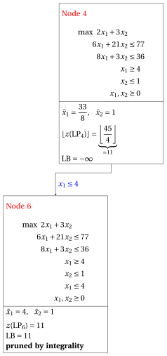{ .fig loading=lazy  }

            Due to the current lower bound $\LB$ and upper bound $\UB$, we have:

            $$
            11 ~~\le~~ z(\ILP) ~~\le~~ \underbrace{\left\lfloor \dfrac{101}{7} \right\rfloor}_{=14}
            $$

        - <strong>Iteration 4</strong>

            The $\LP_{2}$ problem is extracted and deleted from the problem list $L$.

            The branching variable is $x_{2}$. The branching constraints are:

            $$
            x_2 \le \underbrace{\left\lfloor \dfrac{59}{21} \right\rfloor}_{ = 2} \mathrm{~~~and~~~} x_2 \ge \underbrace{\left\lfloor \dfrac{59}{21} \right\rfloor +1}_{= 3}
            $$

            Two $\LP_{7}$ and $\LP_{8}$ problems are created with these branching constraints.

            1. Solution of the $\LP_{7}$ problem

                Let us consider the $\LP_{7}$ problem in standard form:

                $$
                \begin{array}{rrrrrrrrrrrrrrr}
                {\max} & {2}\, {x_1} & {+} & {3}\, {x_2} &  &  &  &  &  &  &  &  \\[2ex]
                & {6}\, {x_1} & {+} & {21}\, {x_2} & {+} & {x_3} &  &  &  &  &  &  & {=} & {77} \\[2ex]
                & {8}\, {x_1} & {+} & {3}\, {x_2} &  &  & {+} & {x_4} &  &  &  &  & {=} & {36} \\[2ex]
                & {x_1} &  &  &  &  &  &  & {+} & {x_5} &  &  & {=} & {3} \\[2ex]
                &  &  & {x_2} &  &  &  &  &  &  & {+} & {x_6} & {=} & {2} \\[2ex]
                & {x_1,} &  & {x_2,} &  & {x_3,} &  & {x_4,} &  & {x_5,} &  & {x_6} & {\ge} & {0}
                \end{array}
                $$

                For the branching constraint we have:

                $$
                x_2 + x_6 = 2 \quad \quad \Rightarrow \quad x_6 = 2 - x_2
                $$

                Using the equations of the optimal simplex dictionary we can express this branching constraint as a function of the non-basic variables. Substituting, we get

                $$
                x_6 = 2 - \left(\dfrac{59}{21} - \dfrac{1}{21} \; x_3 + \dfrac{2}{7} \; x_5 \right)
                \quad \quad \Rightarrow \quad
                x_6 = -\dfrac{17}{21} + \dfrac{1}{21} \, x_3 - \dfrac{2}{7} \, x_5
                $$

                We then add this equation to the previous optimal simplex dictionary and we obtain the following simplex dictionary:

                \begin{equation*}
                \begin{cases}
                \begin{array}{rrrrrrr}
                {x_1} & {=} & {3} &  &  & {-} & {x_5} \\[2ex]
                {x_2} & {=} & {\dfrac{59}{21}} & {-} & {\dfrac{1}{21}}\, {x_3} & {+} & {\dfrac{2}{7}}\, {x_5} \\[2ex]
                {x_4} & {=} & {\dfrac{25}{7}} & {+} & {\dfrac{1}{7}}\, {x_3} & {+} & {\dfrac{50}{7}}\, {x_5} \\[2ex]
                {x_6} & {=} & {-\dfrac{17}{21}} & {+} & {\dfrac{1}{21}}\, {x_3} & {-} & {\dfrac{2}{7}}\, {x_5} \\[2ex]
                {z} & {=} & {\dfrac{101}{7}} & {-} & {\dfrac{1}{7}}\, {x_3} & {-} & {\dfrac{8}{7}}\, {x_5}
                \end{array}
                \end{cases}
                \end{equation*}

                where $\pazocal{B}=\{1,2,4,6\}$ and $\pazocal{N}=\{3,5\}$ and

                - the basic primal non-feasible solution is:

                    $$
                    \bar x_1=3,~~
                    \bar x_2=\dfrac{59}{21},~~
                    \bar x_4=\dfrac{25}{7},~~
                    \bar x_6=-\dfrac{17}{21},~~~~~~
                    \bar x_3=0,~~
                    \bar x_5=0~~
                    \mathrm{~~of~value~~~} \dfrac{101}{7}
                    $$

                - the basic dual feasible solution is:

                    $$
                    \bar \pi_1=0,~~
                    \bar \pi_2=0,~~
                    \bar \pi_4=0,~~
                    \bar \pi_6=0,~~~~~~
                    \bar \pi_3=\dfrac{1}{7},~~
                    \bar \pi_5=\dfrac{8}{7}~~
                    \mathrm{~~of~value~~~} \dfrac{101}{7}
                    $$

                If we increase the value of $\pi_{6}$, we can get a better dual solution. We have:

                $$
                \begin{cases}
                \pi_3 &= \dfrac{1}{7} - \dfrac{1}{21}\,\pi_6 \\[2ex]
                \pi_5 &= \dfrac{8}{7} + \dfrac{2}{7}\,\pi_6
                \end{cases}
                \qquad
                \qquad
                \begin{cases}
                \underbrace{ \dfrac{1}{7} - \dfrac{1}{21}\,\pi_6 \ge 0}_{\pi_3 \ge 0} \\[2ex]
                \underbrace{ \dfrac{8}{7} + \dfrac{2}{7}\,\pi_6 \ge 0}_{\pi_5 \ge 0}
                \end{cases}
                \qquad
                \qquad
                \begin{cases}
                \pi_6 &\le 3 \\[2ex]
                \pi_6 &\ge -4
                \end{cases}
                $$

                By increasing the value of $\pi_{6}$ to $3$, the value of $\pi_{3}$ decreases to $0$. Then we have that:

                - $\pi_{6}$ becomes a dual basic variable and accordingly $x_{6}$ becomes a primal non-basic variable.

                - $\pi_{3}$ becomes a dual non-basic variable and accordingly $x_{3}$ becomes a primal basic variable.

                We have:

                $$
                x_6 = -\dfrac{17}{21} + \dfrac{1}{21} \, x_3 - \dfrac{2}{7} \, x_5
                \quad \Rightarrow \quad
                x_3 = 17 + 6 \, x_5 + 21 \, x_6
                $$

                Substituting into the other equations of the primal simplex dictionary, we get:

                $$
                x_2
                = \dfrac{59}{21} - \dfrac{1}{21} \left( 17 + 6 \, x_5 + 21 \, x_6 \right) + \dfrac{2}{7} \; x_5
                = 2 - x_6
                $$

                $$
                x_4
                = \dfrac{25}{7} + \dfrac{1}{7} \left( 17 + 6 \, x_5 + 21 \, x_6 \right) + \dfrac{50}{7} \; x_5
                = 6 + 8 \, x_5 + 3 \, x_6
                $$

                $$
                z
                = \dfrac{101}{7} - \dfrac{1}{7} \left( 17 + 6 \, x_5 + 21 \, x_6 \right) - \dfrac{8}{7} \; x_5
                = 12 - 2 \, x_5 - 3 \, x_6
                $$

                Accordingly, we now have the following updated primal simplex dictionary:

                \begin{equation*}
                \begin{cases}
                \begin{array}{rrrrrrr}
                {x_1} & {=} & {3} & {-} & {x_5} &  &  \\[2ex]
                {x_2} & {=} & {2} &  &  & {-} & {x_6} \\[2ex]
                {x_3} & {=} & {17} & {+} & {6}\, {x_5} & {+} & {21}\, {x_6} \\[2ex]
                {x_4} & {=} & {6} & {+} & {8}\, {x_5} & {+} & {3}\, {x_6} \\[2ex]
                {z} & {=} & {12} & {-} & {2}\, {x_5} & {-} & {3}\, {x_6}
                \end{array}
                \end{cases}
                \end{equation*}

                where $\pazocal{B}=\{1,2,3,4\}$ and $\pazocal{N}=\{5,6\}$ and

                - the basic primal optimal solution is:

                    $$
                    \tilde x_1=3,~~
                    \tilde x_2=2,~~
                    \tilde x_3=17,~~
                    \tilde x_4=6,~~~~~~
                    \tilde x_5=0,~~
                    \tilde x_6=0~~
                    \mathrm{~~of~value~~~} 12
                    $$

                - the basic dual optimal solution is:

                    $$
                    \tilde \pi_1=0,~~
                    \tilde \pi_2=0,~~
                    \tilde \pi_3=0,~~
                    \tilde \pi_4=0,~~~~~~
                    \tilde \pi_5=2,~~
                    \tilde \pi_6=3~~
                    \mathrm{~~of~value~~~} 12
                    $$

                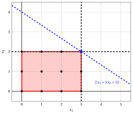{ .fig .ovale loading=lazy  }

                <em>Node 7: feasible region of $\LP_{7}$ (red), with the branching constraint $x_2 \le 2$ (dashed), and its optimal solution (blue).</em>

                An optimal solution ${\tilde{\boldsymbol x}}(\LP_{7})$ is:

                $$
                \tilde{x}_1=3,~~\tilde{x}_2=2
                $$

                the optimal value is:

                $$
                z(\LP_{7}) = 12
                $$

                The $\LP_{7}$ problem is <strong>feasible</strong> and we have

                $$
                \left\lfloor z(\LP_{7}) \right\rfloor > \LB
                \qquad \text{since} \qquad
                12 > 11
                $$

                The optimal solution ${\tilde{\boldsymbol x}}(\LP_{7})$ is <strong>integer</strong>, accordingly, the lower bound $\LB$ becomes $12$ and the incumbent solution ${\bar{\boldsymbol x}}(\ILP)$ becomes $\bar{x}_1=3,\bar{x}_2=2$.

                Accordingly, the branching node is <u>pruned by integrality</u>.

            2. Solution of the $\LP_{8}$ problem

                Let us consider the $\LP_{8}$ problem in standard form:

                $$
                \begin{array}{rrrrrrrrrrrrrrr}
                {\max} & {2}\, {x_1} & {+} & {3}\, {x_2} &  &  &  &  &  &  &  &  \\[2ex]
                & {6}\, {x_1} & {+} & {21}\, {x_2} & {+} & {x_3} &  &  &  &  &  &  & {=} & {77} \\[2ex]
                & {8}\, {x_1} & {+} & {3}\, {x_2} &  &  & {+} & {x_4} &  &  &  &  & {=} & {36} \\[2ex]
                & {x_1} &  &  &  &  &  &  & {+} & {x_5} &  &  & {=} & {3} \\[2ex]
                &  &  & {x_2} &  &  &  &  &  &  & {-} & {x_6} & {=} & {3} \\[2ex]
                & {x_1,} &  & {x_2,} &  & {x_3,} &  & {x_4,} &  & {x_5,} &  & {x_6} & {\ge} & {0}
                \end{array}
                $$

                For the branching constraint we have:

                $$
                x_2 - x_6 = 3 \quad \quad \Rightarrow \quad x_6 = -3 + x_2
                $$

                Using the equations of the optimal simplex dictionary we can express this branching constraint as a function of the non-basic variables. Substituting, we get

                $$
                x_6 = -3 + \left(\dfrac{59}{21} - \dfrac{1}{21} \; x_3 + \dfrac{2}{7} \; x_5 \right)
                \quad \quad \Rightarrow \quad
                x_6 = -\dfrac{4}{21} - \dfrac{1}{21} \, x_3 + \dfrac{2}{7} \, x_5
                $$

                We then add this equation to the previous optimal simplex dictionary and we obtain the following simplex dictionary:

                \begin{equation*}
                \begin{cases}
                \begin{array}{rrrrrrr}
                {x_1} & {=} & {3} &  &  & {-} & {x_5} \\[2ex]
                {x_2} & {=} & {\dfrac{59}{21}} & {-} & {\dfrac{1}{21}}\, {x_3} & {+} & {\dfrac{2}{7}}\, {x_5} \\[2ex]
                {x_4} & {=} & {\dfrac{25}{7}} & {+} & {\dfrac{1}{7}}\, {x_3} & {+} & {\dfrac{50}{7}}\, {x_5} \\[2ex]
                {x_6} & {=} & {-\dfrac{4}{21}} & {-} & {\dfrac{1}{21}}\, {x_3} & {+} & {\dfrac{2}{7}}\, {x_5} \\[2ex]
                {z} & {=} & {\dfrac{101}{7}} & {-} & {\dfrac{1}{7}}\, {x_3} & {-} & {\dfrac{8}{7}}\, {x_5}
                \end{array}
                \end{cases}
                \end{equation*}

                where $\pazocal{B}=\{1,2,4,6\}$ and $\pazocal{N}=\{3,5\}$ and

                - the basic primal non-feasible solution is:

                    $$
                    \bar x_1=3,~~
                    \bar x_2=\dfrac{59}{21},~~
                    \bar x_4=\dfrac{25}{7},~~
                    \bar x_6=-\dfrac{4}{21},~~~~~~
                    \bar x_3=0,~~
                    \bar x_5=0~~
                    \mathrm{~~of~value~~~} \dfrac{101}{7}
                    $$

                - the basic dual feasible solution is:

                    $$
                    \bar \pi_1=0,~~
                    \bar \pi_2=0,~~
                    \bar \pi_4=0,~~
                    \bar \pi_6=0,~~~~~~
                    \bar \pi_3=\dfrac{1}{7},~~
                    \bar \pi_5=\dfrac{8}{7}~~
                    \mathrm{~~of~value~~~} \dfrac{101}{7}
                    $$

                If we increase the value of $\pi_{6}$, we can get a better dual solution. We have:

                $$
                \begin{cases}
                \pi_3 &= \dfrac{1}{7} + \dfrac{1}{21}\,\pi_6 \\[2ex]
                \pi_5 &= \dfrac{8}{7} - \dfrac{2}{7}\,\pi_6
                \end{cases}
                \qquad
                \qquad
                \begin{cases}
                \underbrace{ \dfrac{1}{7} + \dfrac{1}{21}\,\pi_6 \ge 0}_{\pi_3 \ge 0} \\[2ex]
                \underbrace{ \dfrac{8}{7} - \dfrac{2}{7}\,\pi_6 \ge 0}_{\pi_5 \ge 0}
                \end{cases}
                \qquad
                \qquad
                \begin{cases}
                \pi_6 &\ge -3 \\[2ex]
                \pi_6 &\le 4
                \end{cases}
                $$

                By increasing the value of $\pi_{6}$ to $4$, the value of $\pi_{5}$ decreases to $0$. Then we have that:

                - $\pi_{6}$ becomes a dual basic variable and accordingly $x_{6}$ becomes a primal non-basic variable.

                - $\pi_{5}$ becomes a dual non-basic variable and accordingly $x_{5}$ becomes a primal basic variable.

                We have:

                $$
                x_6 = -\dfrac{4}{21} - \dfrac{1}{21} \, x_3 + \dfrac{2}{7} \, x_5
                \quad \Rightarrow \quad
                x_5 = \dfrac{2}{3} + \dfrac{1}{6} \, x_3 + \dfrac{7}{2} \, x_6
                $$

                Substituting into the other equations of the primal simplex dictionary, we get:

                $$
                x_1
                = 3 - \left( \dfrac{2}{3} + \dfrac{1}{6} \, x_3 + \dfrac{7}{2} \, x_6 \right)
                = \dfrac{7}{3} - \dfrac{1}{6} \, x_3 - \dfrac{7}{2} \, x_6
                $$

                $$
                x_2
                = \dfrac{59}{21} - \dfrac{1}{21} \; x_3 + \dfrac{2}{7} \left( \dfrac{2}{3} + \dfrac{1}{6} \, x_3 + \dfrac{7}{2} \, x_6 \right)
                = 3 + x_6
                $$

                $$
                x_4
                = \dfrac{25}{7} + \dfrac{1}{7} \; x_3 + \dfrac{50}{7} \left( \dfrac{2}{3} + \dfrac{1}{6} \, x_3 + \dfrac{7}{2} \, x_6 \right)
                = \dfrac{25}{3} + \dfrac{4}{3} \, x_3 + 25 \, x_6
                $$

                $$
                z
                = \dfrac{101}{7} - \dfrac{1}{7} \; x_3 - \dfrac{8}{7} \left( \dfrac{2}{3} + \dfrac{1}{6} \, x_3 + \dfrac{7}{2} \, x_6 \right)
                = \dfrac{41}{3} - \dfrac{1}{3} \, x_3 - 4 \, x_6
                $$

                Accordingly, we now have the following updated primal simplex dictionary:

                \begin{equation*}
                \begin{cases}
                \begin{array}{rrrrrrr}
                {x_1} & {=} & {\dfrac{7}{3}} & {-} & {\dfrac{1}{6}}\, {x_3} & {-} & {\dfrac{7}{2}}\, {x_6} \\[2ex]
                {x_2} & {=} & {3} &  &  & {+} & {x_6} \\[2ex]
                {x_4} & {=} & {\dfrac{25}{3}} & {+} & {\dfrac{4}{3}}\, {x_3} & {+} & {25}\, {x_6} \\[2ex]
                {x_5} & {=} & {\dfrac{2}{3}} & {+} & {\dfrac{1}{6}}\, {x_3} & {+} & {\dfrac{7}{2}}\, {x_6} \\[2ex]
                {z} & {=} & {\dfrac{41}{3}} & {-} & {\dfrac{1}{3}}\, {x_3} & {-} & {4}\, {x_6}
                \end{array}
                \end{cases}
                \end{equation*}

                where $\pazocal{B}=\{1,2,4,5\}$ and $\pazocal{N}=\{3,6\}$ and

                - the basic primal optimal solution is:

                    $$
                    \tilde x_1=\dfrac{7}{3},~~
                    \tilde x_2=3,~~
                    \tilde x_4=\dfrac{25}{3},~~
                    \tilde x_5=\dfrac{2}{3},~~~~~~
                    \tilde x_3=0,~~
                    \tilde x_6=0~~
                    \mathrm{~~of~value~~~} \dfrac{41}{3}
                    $$

                - the basic dual optimal solution is:

                    $$
                    \tilde \pi_1=0,~~
                    \tilde \pi_2=0,~~
                    \tilde \pi_4=0,~~
                    \tilde \pi_5=0,~~~~~~
                    \tilde \pi_3=\dfrac{1}{3},~~
                    \tilde \pi_6=4~~
                    \mathrm{~~of~value~~~} \dfrac{41}{3}
                    $$

                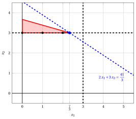{ .fig .ovale loading=lazy  }

                <em>Node 8: feasible region of $\LP_{8}$ (red), with the branching constraint $x_2 \ge 3$ (dashed), and its optimal solution (blue).</em>

                An optimal solution ${\tilde{\boldsymbol x}}(\LP_{8})$ is:

                $$
                \tilde{x}_1=\dfrac{7}{3},~~\tilde{x}_2=3
                $$

                the optimal value is:

                $$
                z(\LP_{8}) = \dfrac{41}{3}
                $$

                The $\LP_{8}$ problem is <strong>feasible</strong> and we have

                $$
                \left\lfloor z(\LP_{8}) \right\rfloor > \LB
                \qquad \text{since} \qquad
                \underbrace{\left\lfloor \dfrac{41}{3} \right\rfloor}_{=13} > 12
                $$

                The optimal solution ${\tilde{\boldsymbol x}}(\LP_{8})$ is <strong>fractional</strong>, accordingly, the $\LP_{8}$ problem is <strong>inserted in the problem list</strong> $L$.

            At the end of the fourth iteration, branching on $x_{2}$ from Node 2 has generated the down-branching node, Node 7, and the up-branching node, Node 8. Node 7 is pruned by integrality, while Node 8 is inserted in the list $L$. The corresponding branch-and-bound tree is:

            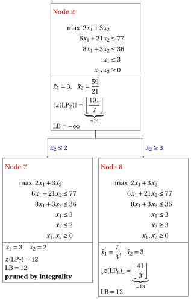{ .fig loading=lazy  }

            Due to the current lower bound $\LB$ and upper bound $\UB$, we have:

            $$
            12 ~~\le~~ z(\ILP) ~~\le~~ \underbrace{\left\lfloor \dfrac{41}{3} \right\rfloor}_{=13}
            $$

        - <strong>Iteration 5</strong>

            The $\LP_{8}$ problem is extracted and deleted from the problem list $L$.

            The branching variable is $x_{1}$. The branching constraints are:

            $$
            x_1 \le \underbrace{\left\lfloor \dfrac{7}{3} \right\rfloor}_{ = 2} \mathrm{~~~and~~~} x_1 \ge \underbrace{\left\lfloor \dfrac{7}{3} \right\rfloor +1}_{= 3}
            $$

            Two $\LP_{9}$ and $\LP_{10}$ problems are created with these branching constraints.

            1. Solution of the $\LP_{9}$ problem

                Let us consider the $\LP_{9}$ problem in standard form:

                $$
                \begin{array}{rrrrrrrrrrrrrrrrr}
                {\max} & {2}\, {x_1} & {+} & {3}\, {x_2} &  &  &  &  &  &  &  &  &  &  \\[2ex]
                & {6}\, {x_1} & {+} & {21}\, {x_2} & {+} & {x_3} &  &  &  &  &  &  &  &  & {=} & {77} \\[2ex]
                & {8}\, {x_1} & {+} & {3}\, {x_2} &  &  & {+} & {x_4} &  &  &  &  &  &  & {=} & {36} \\[2ex]
                & {x_1} &  &  &  &  &  &  & {+} & {x_5} &  &  &  &  & {=} & {3} \\[2ex]
                &  &  & {x_2} &  &  &  &  &  &  & {-} & {x_6} &  &  & {=} & {3} \\[2ex]
                & {x_1} &  &  &  &  &  &  &  &  &  &  & {+} & {x_7} & {=} & {2} \\[2ex]
                & {x_1,} &  & {x_2,} &  & {x_3,} &  & {x_4,} &  & {x_5,} &  & {x_6,} &  & {x_7} & {\ge} & {0}
                \end{array}
                $$

                For the branching constraint we have:

                $$
                x_1 + x_7 = 2 \quad \quad \Rightarrow \quad x_7 = 2 - x_1
                $$

                Using the equations of the optimal simplex dictionary we can express this branching constraint as a function of the non-basic variables. Substituting, we get

                $$
                x_7 = 2 - \left(\dfrac{7}{3} - \dfrac{1}{6} \; x_3 - \dfrac{7}{2} \; x_6 \right)
                \quad \quad \Rightarrow \quad
                x_7 = -\dfrac{1}{3} + \dfrac{1}{6} \, x_3 + \dfrac{7}{2} \, x_6
                $$

                We then add this equation to the previous optimal simplex dictionary and we obtain the following simplex dictionary:

                \begin{equation*}
                \begin{cases}
                \begin{array}{rrrrrrr}
                {x_1} & {=} & {\dfrac{7}{3}} & {-} & {\dfrac{1}{6}}\, {x_3} & {-} & {\dfrac{7}{2}}\, {x_6} \\[2ex]
                {x_2} & {=} & {3} &  &  & {+} & {x_6} \\[2ex]
                {x_4} & {=} & {\dfrac{25}{3}} & {+} & {\dfrac{4}{3}}\, {x_3} & {+} & {25}\, {x_6} \\[2ex]
                {x_5} & {=} & {\dfrac{2}{3}} & {+} & {\dfrac{1}{6}}\, {x_3} & {+} & {\dfrac{7}{2}}\, {x_6} \\[2ex]
                {x_7} & {=} & {-\dfrac{1}{3}} & {+} & {\dfrac{1}{6}}\, {x_3} & {+} & {\dfrac{7}{2}}\, {x_6} \\[2ex]
                {z} & {=} & {\dfrac{41}{3}} & {-} & {\dfrac{1}{3}}\, {x_3} & {-} & {4}\, {x_6}
                \end{array}
                \end{cases}
                \end{equation*}

                where $\pazocal{B}=\{1,2,4,5,7\}$ and $\pazocal{N}=\{3,6\}$ and

                - the basic primal non-feasible solution is:

                    $$
                    \begin{gathered}
                    \bar x_1=\dfrac{7}{3},~~
                    \bar x_2=3,~~
                    \bar x_4=\dfrac{25}{3},~~
                    \bar x_5=\dfrac{2}{3},~~
                    \bar x_7=-\dfrac{1}{3},\\
                    \bar x_3=0,~~
                    \bar x_6=0~~
                    \mathrm{~~of~value~~~} \dfrac{41}{3}
                    \end{gathered}
                    $$

                - the basic dual feasible solution is:

                    $$
                    \begin{gathered}
                    \bar \pi_1=0,~~
                    \bar \pi_2=0,~~
                    \bar \pi_4=0,~~
                    \bar \pi_5=0,~~
                    \bar \pi_7=0,\\
                    \bar \pi_3=\dfrac{1}{3},~~
                    \bar \pi_6=4~~
                    \mathrm{~~of~value~~~} \dfrac{41}{3}
                    \end{gathered}
                    $$

                If we increase the value of $\pi_{7}$, we can get a better dual solution. We have:

                $$
                \begin{cases}
                \pi_3 &= \dfrac{1}{3} - \dfrac{1}{6}\,\pi_7 \\[2ex]
                \pi_6 &= 4 - \dfrac{7}{2}\,\pi_7
                \end{cases}
                \qquad
                \qquad
                \begin{cases}
                \underbrace{ \dfrac{1}{3} - \dfrac{1}{6}\,\pi_7 \ge 0}_{\pi_3 \ge 0} \\[2ex]
                \underbrace{ 4 - \dfrac{7}{2}\,\pi_7 \ge 0}_{\pi_6 \ge 0}
                \end{cases}
                \qquad
                \qquad
                \begin{cases}
                \pi_7 &\le 2 \\[2ex]
                \pi_7 &\le \dfrac{8}{7}
                \end{cases}
                $$

                By increasing the value of $\pi_{7}$ to $\min \left\{2, \dfrac{8}{7}\right\}=\dfrac{8}{7}$, the value of $\pi_{6}$ decreases to $0$. Then we have that:

                - $\pi_{7}$ becomes a dual basic variable and accordingly $x_{7}$ becomes a primal non-basic variable.

                - $\pi_{6}$ becomes a dual non-basic variable and accordingly $x_{6}$ becomes a primal basic variable.

                We have:

                $$
                x_7 = -\dfrac{1}{3} + \dfrac{1}{6} \, x_3 + \dfrac{7}{2} \, x_6
                \quad \Rightarrow \quad
                x_6 = \dfrac{2}{21} - \dfrac{1}{21} \, x_3 + \dfrac{2}{7} \, x_7
                $$

                Substituting into the other equations of the primal simplex dictionary, we get:

                $$
                x_1
                = \dfrac{7}{3} - \dfrac{1}{6} \; x_3 - \dfrac{7}{2} \left( \dfrac{2}{21} - \dfrac{1}{21} \, x_3 + \dfrac{2}{7} \, x_7 \right)
                = 2 - x_7
                $$

                $$
                x_2
                = 3 + \left( \dfrac{2}{21} - \dfrac{1}{21} \, x_3 + \dfrac{2}{7} \, x_7 \right)
                = \dfrac{65}{21} - \dfrac{1}{21} \, x_3 + \dfrac{2}{7} \, x_7
                $$

                $$
                x_4
                = \dfrac{25}{3} + \dfrac{4}{3} \; x_3 + 25 \left( \dfrac{2}{21} - \dfrac{1}{21} \, x_3 + \dfrac{2}{7} \, x_7 \right)
                = \dfrac{75}{7} + \dfrac{1}{7} \, x_3 + \dfrac{50}{7} \, x_7
                $$

                $$
                x_5
                = \dfrac{2}{3} + \dfrac{1}{6} \; x_3 + \dfrac{7}{2} \left( \dfrac{2}{21} - \dfrac{1}{21} \, x_3 + \dfrac{2}{7} \, x_7 \right)
                = 1 + x_7
                $$

                $$
                z
                = \dfrac{41}{3} - \dfrac{1}{3} \; x_3 - 4 \left( \dfrac{2}{21} - \dfrac{1}{21} \, x_3 + \dfrac{2}{7} \, x_7 \right)
                = \dfrac{93}{7} - \dfrac{1}{7} \, x_3 - \dfrac{8}{7} \, x_7
                $$

                Accordingly, we now have the following updated primal simplex dictionary:

                \begin{equation*}
                \begin{cases}
                \begin{array}{rrrrrrr}
                {x_1} & {=} & {2} &  &  & {-} & {x_7} \\[2ex]
                {x_2} & {=} & {\dfrac{65}{21}} & {-} & {\dfrac{1}{21}}\, {x_3} & {+} & {\dfrac{2}{7}}\, {x_7} \\[2ex]
                {x_4} & {=} & {\dfrac{75}{7}} & {+} & {\dfrac{1}{7}}\, {x_3} & {+} & {\dfrac{50}{7}}\, {x_7} \\[2ex]
                {x_5} & {=} & {1} &  &  & {+} & {x_7} \\[2ex]
                {x_6} & {=} & {\dfrac{2}{21}} & {-} & {\dfrac{1}{21}}\, {x_3} & {+} & {\dfrac{2}{7}}\, {x_7} \\[2ex]
                {z} & {=} & {\dfrac{93}{7}} & {-} & {\dfrac{1}{7}}\, {x_3} & {-} & {\dfrac{8}{7}}\, {x_7}
                \end{array}
                \end{cases}
                \end{equation*}

                where $\pazocal{B}=\{1,2,4,5,6\}$ and $\pazocal{N}=\{3,7\}$ and

                - the basic primal optimal solution is:

                    $$
                    \begin{gathered}
                    \tilde x_1=2,~~
                    \tilde x_2=\dfrac{65}{21},~~
                    \tilde x_4=\dfrac{75}{7},~~
                    \tilde x_5=1,~~
                    \tilde x_6=\dfrac{2}{21},\\
                    \tilde x_3=0,~~
                    \tilde x_7=0~~
                    \mathrm{~~of~value~~~} \dfrac{93}{7}
                    \end{gathered}
                    $$

                - the basic dual optimal solution is:

                    $$
                    \begin{gathered}
                    \tilde \pi_1=0,~~
                    \tilde \pi_2=0,~~
                    \tilde \pi_4=0,~~
                    \tilde \pi_5=0,~~
                    \tilde \pi_6=0,\\
                    \tilde \pi_3=\dfrac{1}{7},~~
                    \tilde \pi_7=\dfrac{8}{7}~~
                    \mathrm{~~of~value~~~} \dfrac{93}{7}
                    \end{gathered}
                    $$

                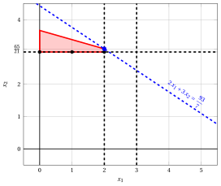{ .fig .ovale loading=lazy  }

                <em>Node 9: feasible region of $\LP_{9}$ (red), with the branching constraint $x_1 \le 2$ (dashed), and its optimal solution (blue).</em>

                An optimal solution ${\tilde{\boldsymbol x}}(\LP_{9})$ is:

                $$
                \tilde{x}_1=2,~~\tilde{x}_2=\dfrac{65}{21}
                $$

                the optimal value is:

                $$
                z(\LP_{9}) = \dfrac{93}{7}
                $$

                The $\LP_{9}$ problem is <strong>feasible</strong> and we have

                $$
                \left\lfloor z(\LP_{9}) \right\rfloor > \LB
                \qquad \text{since} \qquad
                \underbrace{\left\lfloor \dfrac{93}{7} \right\rfloor}_{=13} > 12
                $$

                The optimal solution ${\tilde{\boldsymbol x}}(\LP_{9})$ is <strong>fractional</strong>, accordingly, the $\LP_{9}$ problem is <strong>inserted in the problem list</strong> $L$.

            2. Solution of the $\LP_{10}$ problem

                Let us consider the $\LP_{10}$ problem in standard form:

                $$
                \begin{array}{rrrrrrrrrrrrrrrrr}
                {\max} & {2}\, {x_1} & {+} & {3}\, {x_2} &  &  &  &  &  &  &  &  &  &  \\[2ex]
                & {6}\, {x_1} & {+} & {21}\, {x_2} & {+} & {x_3} &  &  &  &  &  &  &  &  & {=} & {77} \\[2ex]
                & {8}\, {x_1} & {+} & {3}\, {x_2} &  &  & {+} & {x_4} &  &  &  &  &  &  & {=} & {36} \\[2ex]
                & {x_1} &  &  &  &  &  &  & {+} & {x_5} &  &  &  &  & {=} & {3} \\[2ex]
                &  &  & {x_2} &  &  &  &  &  &  & {-} & {x_6} &  &  & {=} & {3} \\[2ex]
                & {x_1} &  &  &  &  &  &  &  &  &  &  & {-} & {x_7} & {=} & {3} \\[2ex]
                & {x_1,} &  & {x_2,} &  & {x_3,} &  & {x_4,} &  & {x_5,} &  & {x_6,} &  & {x_7} & {\ge} & {0}
                \end{array}
                $$

                For the branching constraint we have:

                $$
                x_1 - x_7 = 3 \quad \quad \Rightarrow \quad x_7 = -3 + x_1
                $$

                Using the equations of the optimal simplex dictionary we can express this branching constraint as a function of the non-basic variables. Substituting, we get

                $$
                x_7 = -3 + \left(\dfrac{7}{3} - \dfrac{1}{6} \; x_3 - \dfrac{7}{2} \; x_6 \right)
                \quad \quad \Rightarrow \quad
                x_7 = -\dfrac{2}{3} - \dfrac{1}{6} \, x_3 - \dfrac{7}{2} \, x_6
                $$

                We then add this equation to the previous optimal simplex dictionary and we obtain the following simplex dictionary:

                \begin{equation*}
                \begin{cases}
                \begin{array}{rrrrrrr}
                {x_1} & {=} & {\dfrac{7}{3}} & {-} & {\dfrac{1}{6}}\, {x_3} & {-} & {\dfrac{7}{2}}\, {x_6} \\[2ex]
                {x_2} & {=} & {3} &  &  & {+} & {x_6} \\[2ex]
                {x_4} & {=} & {\dfrac{25}{3}} & {+} & {\dfrac{4}{3}}\, {x_3} & {+} & {25}\, {x_6} \\[2ex]
                {x_5} & {=} & {\dfrac{2}{3}} & {+} & {\dfrac{1}{6}}\, {x_3} & {+} & {\dfrac{7}{2}}\, {x_6} \\[2ex]
                {x_7} & {=} & {-\dfrac{2}{3}} & {-} & {\dfrac{1}{6}}\, {x_3} & {-} & {\dfrac{7}{2}}\, {x_6} \\[2ex]
                {z} & {=} & {\dfrac{41}{3}} & {-} & {\dfrac{1}{3}}\, {x_3} & {-} & {4}\, {x_6}
                \end{array}
                \end{cases}
                \end{equation*}

                where $\pazocal{B}=\{1,2,4,5,7\}$ and $\pazocal{N}=\{3,6\}$ and

                - the basic primal non-feasible solution is:

                    $$
                    \begin{gathered}
                    \bar x_1=\dfrac{7}{3},~~
                    \bar x_2=3,~~
                    \bar x_4=\dfrac{25}{3},~~
                    \bar x_5=\dfrac{2}{3},~~
                    \bar x_7=-\dfrac{2}{3},\\
                    \bar x_3=0,~~
                    \bar x_6=0~~
                    \mathrm{~~of~value~~~} \dfrac{41}{3}
                    \end{gathered}
                    $$

                - the basic dual feasible solution is:

                    $$
                    \begin{gathered}
                    \bar \pi_1=0,~~
                    \bar \pi_2=0,~~
                    \bar \pi_4=0,~~
                    \bar \pi_5=0,~~
                    \bar \pi_7=0,\\
                    \bar \pi_3=\dfrac{1}{3},~~
                    \bar \pi_6=4~~
                    \mathrm{~~of~value~~~} \dfrac{41}{3}
                    \end{gathered}
                    $$

                If we increase the value of $\pi_{7}$, we can get a better dual solution. We have:

                $$
                \begin{cases}
                \pi_3 &= \dfrac{1}{3} + \dfrac{1}{6}\,\pi_7 \\[2ex]
                \pi_6 &= 4 + \dfrac{7}{2}\,\pi_7
                \end{cases}
                \qquad
                \qquad
                \begin{cases}
                \underbrace{ \dfrac{1}{3} + \dfrac{1}{6}\,\pi_7 \ge 0}_{\pi_3 \ge 0} \\[2ex]
                \underbrace{ 4 + \dfrac{7}{2}\,\pi_7 \ge 0}_{\pi_6 \ge 0}
                \end{cases}
                \qquad
                \qquad
                \begin{cases}
                \pi_7 &\ge -2 \\[2ex]
                \pi_7 &\ge -\dfrac{8}{7}
                \end{cases}
                $$

                Accordingly, we can increase the value of $\pi_{7}$ without violating dual feasibility, which implies that the dual problem is <strong>unbounded</strong>. As a result, the primal problem $\LP_{10}$ is <strong>infeasible</strong>, and the corresponding branching node is <u>pruned by infeasibility</u>.

            At the end of the fifth iteration, branching on $x_{1}$ from Node 8 has generated the down-branching node, Node 9, and the up-branching node, Node 10. Node 9 is inserted in the list $L$, while Node 10 is pruned by infeasibility. The corresponding branch-and-bound tree is:

            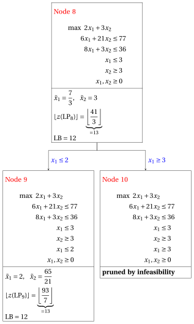{ .fig loading=lazy  }

            Due to the current lower bound $\LB$ and upper bound $\UB$, we have:

            $$
            12 ~~\le~~ z(\ILP) ~~\le~~ \underbrace{\left\lfloor \dfrac{93}{7} \right\rfloor}_{=13}
            $$

        - <strong>Iteration 6</strong>

            The $\LP_{9}$ problem is extracted and deleted from the problem list $L$.

            The branching variable is $x_{2}$. The branching constraints are:

            $$
            x_2 \le \underbrace{\left\lfloor \dfrac{65}{21} \right\rfloor}_{ = 3} \mathrm{~~~and~~~} x_2 \ge \underbrace{\left\lfloor \dfrac{65}{21} \right\rfloor +1}_{= 4}
            $$

            The $\LP_{11}$ problem is created with the first branching constraint (the second child is solved only if needed).

            1. Solution of the $\LP_{11}$ problem

                Let us consider the $\LP_{11}$ problem in standard form:

                $$
                \begin{array}{rrrrrrrrrrrrrrrrrrr}
                {\max} & {2}\, {x_1} & {+} & {3}\, {x_2} &  &  &  &  &  &  &  &  &  &  &  &  \\[2ex]
                & {6}\, {x_1} & {+} & {21}\, {x_2} & {+} & {x_3} &  &  &  &  &  &  &  &  &  &  & {=} & {77} \\[2ex]
                & {8}\, {x_1} & {+} & {3}\, {x_2} &  &  & {+} & {x_4} &  &  &  &  &  &  &  &  & {=} & {36} \\[2ex]
                & {x_1} &  &  &  &  &  &  & {+} & {x_5} &  &  &  &  &  &  & {=} & {3} \\[2ex]
                &  &  & {x_2} &  &  &  &  &  &  & {-} & {x_6} &  &  &  &  & {=} & {3} \\[2ex]
                & {x_1} &  &  &  &  &  &  &  &  &  &  & {+} & {x_7} &  &  & {=} & {2} \\[2ex]
                &  &  & {x_2} &  &  &  &  &  &  &  &  &  &  & {+} & {x_8} & {=} & {3} \\[2ex]
                & {x_1,} &  & {x_2,} &  & {x_3,} &  & {x_4,} &  & {x_5,} &  & {x_6,} &  & {x_7,} &  & {x_8} & {\ge} & {0}
                \end{array}
                $$

                For the branching constraint we have:

                $$
                x_2 + x_8 = 3 \quad \quad \Rightarrow \quad x_8 = 3 - x_2
                $$

                Using the equations of the optimal simplex dictionary we can express this branching constraint as a function of the non-basic variables. Substituting, we get

                $$
                x_8 = 3 - \left(\dfrac{65}{21} - \dfrac{1}{21} \; x_3 + \dfrac{2}{7} \; x_7 \right)
                \quad \quad \Rightarrow \quad
                x_8 = -\dfrac{2}{21} + \dfrac{1}{21} \, x_3 - \dfrac{2}{7} \, x_7
                $$

                We then add this equation to the previous optimal simplex dictionary and we obtain the following simplex dictionary:

                \begin{equation*}
                \begin{cases}
                \begin{array}{rrrrrrr}
                {x_1} & {=} & {2} &  &  & {-} & {x_7} \\[2ex]
                {x_2} & {=} & {\dfrac{65}{21}} & {-} & {\dfrac{1}{21}}\, {x_3} & {+} & {\dfrac{2}{7}}\, {x_7} \\[2ex]
                {x_4} & {=} & {\dfrac{75}{7}} & {+} & {\dfrac{1}{7}}\, {x_3} & {+} & {\dfrac{50}{7}}\, {x_7} \\[2ex]
                {x_5} & {=} & {1} &  &  & {+} & {x_7} \\[2ex]
                {x_6} & {=} & {\dfrac{2}{21}} & {-} & {\dfrac{1}{21}}\, {x_3} & {+} & {\dfrac{2}{7}}\, {x_7} \\[2ex]
                {x_8} & {=} & {-\dfrac{2}{21}} & {+} & {\dfrac{1}{21}}\, {x_3} & {-} & {\dfrac{2}{7}}\, {x_7} \\[2ex]
                {z} & {=} & {\dfrac{93}{7}} & {-} & {\dfrac{1}{7}}\, {x_3} & {-} & {\dfrac{8}{7}}\, {x_7}
                \end{array}
                \end{cases}
                \end{equation*}

                where $\pazocal{B}=\{1,2,4,5,6,8\}$ and $\pazocal{N}=\{3,7\}$ and

                - the basic primal non-feasible solution is:

                    $$
                    \begin{gathered}
                    \bar x_1=2,~~
                    \bar x_2=\dfrac{65}{21},~~
                    \bar x_4=\dfrac{75}{7},~~
                    \bar x_5=1,~~
                    \bar x_6=\dfrac{2}{21},~~
                    \bar x_8=-\dfrac{2}{21},\\
                    \bar x_3=0,~~
                    \bar x_7=0~~
                    \mathrm{~~of~value~~~} \dfrac{93}{7}
                    \end{gathered}
                    $$

                - the basic dual feasible solution is:

                    $$
                    \begin{gathered}
                    \bar \pi_1=0,~~
                    \bar \pi_2=0,~~
                    \bar \pi_4=0,~~
                    \bar \pi_5=0,~~
                    \bar \pi_6=0,~~
                    \bar \pi_8=0,\\
                    \bar \pi_3=\dfrac{1}{7},~~
                    \bar \pi_7=\dfrac{8}{7}~~
                    \mathrm{~~of~value~~~} \dfrac{93}{7}
                    \end{gathered}
                    $$

                If we increase the value of $\pi_{8}$, we can get a better dual solution. We have:

                $$
                \begin{cases}
                \pi_3 &= \dfrac{1}{7} - \dfrac{1}{21}\,\pi_8 \\[2ex]
                \pi_7 &= \dfrac{8}{7} + \dfrac{2}{7}\,\pi_8
                \end{cases}
                \qquad
                \qquad
                \begin{cases}
                \underbrace{ \dfrac{1}{7} - \dfrac{1}{21}\,\pi_8 \ge 0}_{\pi_3 \ge 0} \\[2ex]
                \underbrace{ \dfrac{8}{7} + \dfrac{2}{7}\,\pi_8 \ge 0}_{\pi_7 \ge 0}
                \end{cases}
                \qquad
                \qquad
                \begin{cases}
                \pi_8 &\le 3 \\[2ex]
                \pi_8 &\ge -4
                \end{cases}
                $$

                By increasing the value of $\pi_{8}$ to $3$, the value of $\pi_{3}$ decreases to $0$. Then we have that:

                - $\pi_{8}$ becomes a dual basic variable and accordingly $x_{8}$ becomes a primal non-basic variable.

                - $\pi_{3}$ becomes a dual non-basic variable and accordingly $x_{3}$ becomes a primal basic variable.

                We have:

                $$
                x_8 = -\dfrac{2}{21} + \dfrac{1}{21} \, x_3 - \dfrac{2}{7} \, x_7
                \quad \Rightarrow \quad
                x_3 = 2 + 6 \, x_7 + 21 \, x_8
                $$

                Substituting into the other equations of the primal simplex dictionary, we get:

                $$
                x_2
                = \dfrac{65}{21} - \dfrac{1}{21} \left( 2 + 6 \, x_7 + 21 \, x_8 \right) + \dfrac{2}{7} \; x_7
                = 3 - x_8
                $$

                $$
                x_4
                = \dfrac{75}{7} + \dfrac{1}{7} \left( 2 + 6 \, x_7 + 21 \, x_8 \right) + \dfrac{50}{7} \; x_7
                = 11 + 8 \, x_7 + 3 \, x_8
                $$

                $$
                x_6
                = \dfrac{2}{21} - \dfrac{1}{21} \left( 2 + 6 \, x_7 + 21 \, x_8 \right) + \dfrac{2}{7} \; x_7
                = 0 - x_8
                $$

                $$
                z
                = \dfrac{93}{7} - \dfrac{1}{7} \left( 2 + 6 \, x_7 + 21 \, x_8 \right) - \dfrac{8}{7} \; x_7
                = 13 - 2 \, x_7 - 3 \, x_8
                $$

                Accordingly, we now have the following updated primal simplex dictionary:

                \begin{equation*}
                \begin{cases}
                \begin{array}{rrrrrrr}
                {x_1} & {=} & {2} & {-} & {x_7} &  &  \\[2ex]
                {x_2} & {=} & {3} &  &  & {-} & {x_8} \\[2ex]
                {x_3} & {=} & {2} & {+} & {6}\, {x_7} & {+} & {21}\, {x_8} \\[2ex]
                {x_4} & {=} & {11} & {+} & {8}\, {x_7} & {+} & {3}\, {x_8} \\[2ex]
                {x_5} & {=} & {1} & {+} & {x_7} &  &  \\[2ex]
                {x_6} & {=} & {0} &  &  & {-} & {x_8} \\[2ex]
                {z} & {=} & {13} & {-} & {2}\, {x_7} & {-} & {3}\, {x_8}
                \end{array}
                \end{cases}
                \end{equation*}

                where $\pazocal{B}=\{1,2,3,4,5,6\}$ and $\pazocal{N}=\{7,8\}$ and

                - the basic primal optimal solution is:

                    $$
                    \begin{gathered}
                    \tilde x_1=2,~~
                    \tilde x_2=3,~~
                    \tilde x_3=2,~~
                    \tilde x_4=11,~~
                    \tilde x_5=1,~~
                    \tilde x_6=0,\\
                    \tilde x_7=0,~~
                    \tilde x_8=0~~
                    \mathrm{~~of~value~~~} 13
                    \end{gathered}
                    $$

                - the basic dual optimal solution is:

                    $$
                    \begin{gathered}
                    \tilde \pi_1=0,~~
                    \tilde \pi_2=0,~~
                    \tilde \pi_3=0,~~
                    \tilde \pi_4=0,~~
                    \tilde \pi_5=0,~~
                    \tilde \pi_6=0,\\
                    \tilde \pi_7=2,~~
                    \tilde \pi_8=3~~
                    \mathrm{~~of~value~~~} 13
                    \end{gathered}
                    $$

                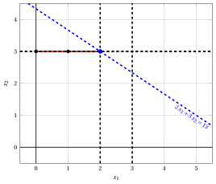{ .fig .ovale loading=lazy  }

                <em>Node 11: feasible region of $\LP_{11}$ (red), with the branching constraint $x_2 \le 3$ (dashed), and its optimal solution (blue).</em>

                An optimal solution ${\tilde{\boldsymbol x}}(\LP_{11})$ is:

                $$
                \tilde{x}_1=2,~~\tilde{x}_2=3
                $$

                the optimal value is:

                $$
                z(\LP_{11}) = 13
                $$

                The $\LP_{11}$ problem is <strong>feasible</strong> and we have

                $$
                \left\lfloor z(\LP_{11}) \right\rfloor > \LB
                \qquad \text{since} \qquad
                13 > 12
                $$

                The optimal solution ${\tilde{\boldsymbol x}}(\LP_{11})$ is <strong>integer</strong>, accordingly, the lower bound $\LB$ becomes $13$ and the incumbent solution ${\bar{\boldsymbol x}}(\ILP)$ becomes $\bar{x}_1=2,\bar{x}_2=3$.

                Accordingly, the branching node is <u>pruned by integrality</u>.

            At the end of the sixth iteration, branching on $x_{2}$ from Node 9 has generated the down-branching node, Node 11. This node is pruned by integrality. The up-branching node is not solved, since after Node 11 the lower bound satisfies

            $$
            \left\lfloor z(\LP_{9}) \right\rfloor \le \LB.
            $$

            This is the portion of the branch-and-bound tree showing the LP problems of the branching nodes that are solved:

            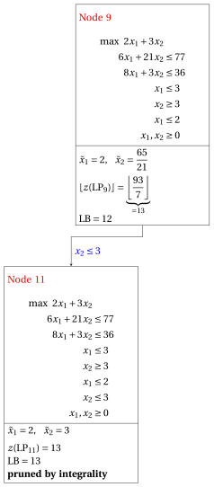{ .fig loading=lazy  }

            Due to the current lower bound $\LB$ and upper bound $\UB$, we have:

            $$
            13 ~~\le~~ z(\ILP) ~~\le~~ 13
            $$

        - <strong>Termination</strong>

            Since the list $L$ is empty, the lower bound $\LB$ is equal to the upper bound $\UB$ and the $\ILP$ problem is solved to optimality.

            The optimal value is $z(\ILP)=13$ (the value of the lower bound $\LB$) and an optimal solution ${\tilde{\boldsymbol x}}(\ILP)$ is $\tilde x_1=2,\tilde x_2=3$ (the incumbent solution ${\bar{\boldsymbol x}}(\ILP)$).

    2. The final branch-and-bound tree is:

        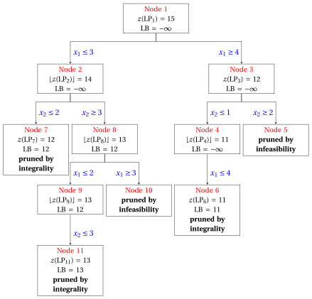{ .fig loading=lazy  }

        The reasons why the branching nodes are pruned are the following.

        - Node 1 has a fractional optimal solution with $z(\LP_{1}) = 15$: it is branched on $x_1$.

        - Node 2 has a fractional optimal solution with $\lfloor z(\LP_{2})\rfloor = 14$: it is branched on $x_2$.

        - Node 3 has a fractional optimal solution with $z(\LP_{3}) = 12$: it is branched on $x_2$.

        - Node 4 has a fractional optimal solution with $\lfloor z(\LP_{4})\rfloor = 11$: it is branched on $x_1$.

        - The up-branching node of Node 4 is not solved, and it is not drawn, since $\lfloor z(\LP_{4})\rfloor = 11$ $\le \LB = 11$ after its first child.

        - Node 5 is pruned by infeasibility: the $\LP_{5}$ problem has no feasible solution.

        - Node 6 is pruned by integrality: $\tilde{\boldsymbol x}(\LP_{6}) = (4, 1)$ is integer, with value $11$, which becomes the incumbent solution.

        - Node 7 is pruned by integrality: $\tilde{\boldsymbol x}(\LP_{7}) = (3, 2)$ is integer, with value $12$, which becomes the incumbent solution.

        - Node 8 has a fractional optimal solution with $\lfloor z(\LP_{8})\rfloor = 13$: it is branched on $x_1$.

        - Node 9 has a fractional optimal solution with $\lfloor z(\LP_{9})\rfloor = 13$: it is branched on $x_2$.

        - The up-branching node of Node 9 is not solved, and it is not drawn, since $\lfloor z(\LP_{9})\rfloor = 13$ $\le \LB = 13$ after its first child.

        - Node 10 is pruned by infeasibility: the $\LP_{10}$ problem has no feasible solution.

        - Node 11 is pruned by integrality: $\tilde{\boldsymbol x}(\LP_{11}) = (2, 3)$ is integer, with value $13$, which becomes the incumbent solution.

        The optimal value is $z(\ILP) = 13$ and the branch-and-bound algorithm returns the optimal solution $\tilde{\boldsymbol x}(\ILP) = (2, 3)$.

!!! esercizio "Exercise 7.6: Branch-and-bound algorithm (P6)"

    !!! nota ""

        Consider the following ILP problem in canonical maximization form with $n=2$ integer variables and $m=2$ constraints:

        $$
        \begin{array}{rrrrrrr}
        {\max} & {x_1} & {+} & {x_2} \\[2ex]
        & {4}\, {x_1} & {+} & {15}\, {x_2} & {\le} & {70} \\[2ex]
        & {12}\, {x_1} & {+} & {3}\, {x_2} & {\le} & {52} \\[2ex]
        & {x_1,} &  & {x_2} & {\in} & {\Z_{\ge 0}}
        \end{array}
        $$

        and an optimal simplex dictionary of its LP relaxation in standard form:

        \begin{equation*}
        \begin{cases}
        \begin{array}{rrrrrrr}
        {x_1} & {=} & {\dfrac{95}{28}} & {+} & {\dfrac{1}{56}}\, {x_3} & {-} & {\dfrac{5}{56}}\, {x_4} \\[2ex]
        {x_2} & {=} & {\dfrac{79}{21}} & {-} & {\dfrac{1}{14}}\, {x_3} & {+} & {\dfrac{1}{42}}\, {x_4} \\[2ex]
        {z} & {=} & {\dfrac{601}{84}} & {-} & {\dfrac{3}{56}}\, {x_3} & {-} & {\dfrac{11}{168}}\, {x_4}
        \end{array}
        \end{cases}
        \end{equation*}

    **Questions**

    1. Execute the branch-and-bound algorithm using:

        1. the smallest-index rule as branching-variable selection strategy;

        2. the LIFO rule as branching-node selection strategy;

        3. solve first the down-branching node and then the up-branching node;

        4. set the lower bound $\LB$ to $-\infty$ (no heuristic algorithm is executed).

        Solve the LP problems of the branching nodes using the dual simplex algorithm. In the dual simplex algorithm, the leaving variable is the basic variable with negative value and smallest index, and ties in the ratio test are broken by the smallest index. Show graphically the optimal solution of the LP problems associated with the branching nodes.

    2. Determine and comment the branch-and-bound tree, showing the reason why each branching node is pruned.

??? soluzione "Solution"

    1. Execution of the branch-and-bound algorithm to solve the $\ILP$ problem.

        - <strong>Initialization</strong>

            Let us consider the $\LP_{1}$ problem in standard form:

            $$
            \begin{array}{rrrrrrrrrrr}
            {\max} & {x_1} & {+} & {x_2} &  &  &  &  \\[2ex]
            & {4}\, {x_1} & {+} & {15}\, {x_2} & {+} & {x_3} &  &  & {=} & {70} \\[2ex]
            & {12}\, {x_1} & {+} & {3}\, {x_2} &  &  & {+} & {x_4} & {=} & {52} \\[2ex]
            & {x_1,} &  & {x_2,} &  & {x_3,} &  & {x_4} & {\ge} & {0}
            \end{array}
            $$

            and its optimal simplex dictionary:

            \begin{equation*}
            \begin{cases}
            \begin{array}{rrrrrrr}
            {x_1} & {=} & {\dfrac{95}{28}} & {+} & {\dfrac{1}{56}}\, {x_3} & {-} & {\dfrac{5}{56}}\, {x_4} \\[2ex]
            {x_2} & {=} & {\dfrac{79}{21}} & {-} & {\dfrac{1}{14}}\, {x_3} & {+} & {\dfrac{1}{42}}\, {x_4} \\[2ex]
            {z} & {=} & {\dfrac{601}{84}} & {-} & {\dfrac{3}{56}}\, {x_3} & {-} & {\dfrac{11}{168}}\, {x_4}
            \end{array}
            \end{cases}
            \end{equation*}

            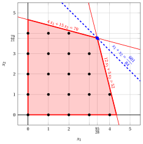{ .fig .ovale loading=lazy  }

            <em>Node 1: feasible region of $\LP_{1}$ (red), feasible points of the ILP problem (black) and optimal solution of $\LP_{1}$ (blue) with the objective function line through it.</em>

            An optimal solution ${\tilde{\boldsymbol x}}(\LP_{1})$ is:

            $$
            \tilde{x}_1=\dfrac{95}{28},~~\tilde{x}_2=\dfrac{79}{21}
            $$

            the optimal value is:

            $$
            z(\LP_{1}) = \dfrac{601}{84}
            $$

            The optimal solution ${\tilde{\boldsymbol x}}(\LP_{1})$ is <strong>fractional</strong> and the $\LP_{1}$ problem is <strong>feasible</strong>, so the $\LP_{1}$ problem is inserted in the problem list $L$ and the lower bound $\LB$ is set to $-\infty$.

            Due to the current lower bound $\LB$ and upper bound $\UB$, we have:

            $$
            -\infty ~~\le~~ z(\ILP) ~~\le~~ \underbrace{\left\lfloor \dfrac{601}{84} \right\rfloor}_{=7}
            $$

        - <strong>Iteration 1</strong>

            The $\LP_{1}$ problem is extracted and deleted from the problem list $L$.

            The branching variable is $x_{1}$. The branching constraints are:

            $$
            x_1 \le \underbrace{\left\lfloor \dfrac{95}{28} \right\rfloor}_{ = 3} \mathrm{~~~and~~~} x_1 \ge \underbrace{\left\lfloor \dfrac{95}{28} \right\rfloor +1}_{= 4}
            $$

            Two $\LP_{2}$ and $\LP_{3}$ problems are created with these branching constraints.

            1. Solution of the $\LP_{2}$ problem

                Let us consider the $\LP_{2}$ problem in standard form:

                $$
                \begin{array}{rrrrrrrrrrrrr}
                {\max} & {x_1} & {+} & {x_2} &  &  &  &  &  &  \\[2ex]
                & {4}\, {x_1} & {+} & {15}\, {x_2} & {+} & {x_3} &  &  &  &  & {=} & {70} \\[2ex]
                & {12}\, {x_1} & {+} & {3}\, {x_2} &  &  & {+} & {x_4} &  &  & {=} & {52} \\[2ex]
                & {x_1} &  &  &  &  &  &  & {+} & {x_5} & {=} & {3} \\[2ex]
                & {x_1,} &  & {x_2,} &  & {x_3,} &  & {x_4,} &  & {x_5} & {\ge} & {0}
                \end{array}
                $$

                For the branching constraint we have:

                $$
                x_1 + x_5 = 3 \quad \quad \Rightarrow \quad x_5 = 3 - x_1
                $$

                Using the equations of the optimal simplex dictionary we can express this branching constraint as a function of the non-basic variables. Substituting, we get

                $$
                x_5 = 3 - \left(\dfrac{95}{28} + \dfrac{1}{56} \; x_3 - \dfrac{5}{56} \; x_4 \right)
                \quad \quad \Rightarrow \quad
                x_5 = -\dfrac{11}{28} - \dfrac{1}{56} \, x_3 + \dfrac{5}{56} \, x_4
                $$

                We then add this equation to the previous optimal simplex dictionary and we obtain the following simplex dictionary:

                \begin{equation*}
                \begin{cases}
                \begin{array}{rrrrrrr}
                {x_1} & {=} & {\dfrac{95}{28}} & {+} & {\dfrac{1}{56}}\, {x_3} & {-} & {\dfrac{5}{56}}\, {x_4} \\[2ex]
                {x_2} & {=} & {\dfrac{79}{21}} & {-} & {\dfrac{1}{14}}\, {x_3} & {+} & {\dfrac{1}{42}}\, {x_4} \\[2ex]
                {x_5} & {=} & {-\dfrac{11}{28}} & {-} & {\dfrac{1}{56}}\, {x_3} & {+} & {\dfrac{5}{56}}\, {x_4} \\[2ex]
                {z} & {=} & {\dfrac{601}{84}} & {-} & {\dfrac{3}{56}}\, {x_3} & {-} & {\dfrac{11}{168}}\, {x_4}
                \end{array}
                \end{cases}
                \end{equation*}

                where $\pazocal{B}=\{1,2,5\}$ and $\pazocal{N}=\{3,4\}$ and

                - the basic primal non-feasible solution is:

                    $$
                    \bar x_1=\dfrac{95}{28},~~
                    \bar x_2=\dfrac{79}{21},~~
                    \bar x_5=-\dfrac{11}{28},~~~~~~
                    \bar x_3=0,~~
                    \bar x_4=0~~
                    \mathrm{~~of~value~~~} \dfrac{601}{84}
                    $$

                - the basic dual feasible solution is:

                    $$
                    \bar \pi_1=0,~~
                    \bar \pi_2=0,~~
                    \bar \pi_5=0,~~~~~~
                    \bar \pi_3=\dfrac{3}{56},~~
                    \bar \pi_4=\dfrac{11}{168}~~
                    \mathrm{~~of~value~~~} \dfrac{601}{84}
                    $$

                If we increase the value of $\pi_{5}$, we can get a better dual solution. We have:

                $$
                \begin{cases}
                \pi_3 &= \dfrac{3}{56} + \dfrac{1}{56}\,\pi_5 \\[2ex]
                \pi_4 &= \dfrac{11}{168} - \dfrac{5}{56}\,\pi_5
                \end{cases}
                \qquad
                \qquad
                \begin{cases}
                \underbrace{ \dfrac{3}{56} + \dfrac{1}{56}\,\pi_5 \ge 0}_{\pi_3 \ge 0} \\[2ex]
                \underbrace{ \dfrac{11}{168} - \dfrac{5}{56}\,\pi_5 \ge 0}_{\pi_4 \ge 0}
                \end{cases}
                \qquad
                \qquad
                \begin{cases}
                \pi_5 &\ge -3 \\[2ex]
                \pi_5 &\le \dfrac{11}{15}
                \end{cases}
                $$

                By increasing the value of $\pi_{5}$ to $\dfrac{11}{15}$, the value of $\pi_{4}$ decreases to $0$. Then we have that:

                - $\pi_{5}$ becomes a dual basic variable and accordingly $x_{5}$ becomes a primal non-basic variable.

                - $\pi_{4}$ becomes a dual non-basic variable and accordingly $x_{4}$ becomes a primal basic variable.

                We have:

                $$
                x_5 = -\dfrac{11}{28} - \dfrac{1}{56} \, x_3 + \dfrac{5}{56} \, x_4
                \quad \Rightarrow \quad
                x_4 = \dfrac{22}{5} + \dfrac{1}{5} \, x_3 + \dfrac{56}{5} \, x_5
                $$

                Substituting into the other equations of the primal simplex dictionary, we get:

                $$
                x_1
                = \dfrac{95}{28} + \dfrac{1}{56} \; x_3 - \dfrac{5}{56} \left( \dfrac{22}{5} + \dfrac{1}{5} \, x_3 + \dfrac{56}{5} \, x_5 \right)
                = 3 - x_5
                $$

                $$
                x_2
                = \dfrac{79}{21} - \dfrac{1}{14} \; x_3 + \dfrac{1}{42} \left( \dfrac{22}{5} + \dfrac{1}{5} \, x_3 + \dfrac{56}{5} \, x_5 \right)
                = \dfrac{58}{15} - \dfrac{1}{15} \, x_3 + \dfrac{4}{15} \, x_5
                $$

                $$
                z
                = \dfrac{601}{84} - \dfrac{3}{56} \; x_3 - \dfrac{11}{168} \left( \dfrac{22}{5} + \dfrac{1}{5} \, x_3 + \dfrac{56}{5} \, x_5 \right)
                = \dfrac{103}{15} - \dfrac{1}{15} \, x_3 - \dfrac{11}{15} \, x_5
                $$

                Accordingly, we now have the following updated primal simplex dictionary:

                \begin{equation*}
                \begin{cases}
                \begin{array}{rrrrrrr}
                {x_1} & {=} & {3} &  &  & {-} & {x_5} \\[2ex]
                {x_2} & {=} & {\dfrac{58}{15}} & {-} & {\dfrac{1}{15}}\, {x_3} & {+} & {\dfrac{4}{15}}\, {x_5} \\[2ex]
                {x_4} & {=} & {\dfrac{22}{5}} & {+} & {\dfrac{1}{5}}\, {x_3} & {+} & {\dfrac{56}{5}}\, {x_5} \\[2ex]
                {z} & {=} & {\dfrac{103}{15}} & {-} & {\dfrac{1}{15}}\, {x_3} & {-} & {\dfrac{11}{15}}\, {x_5}
                \end{array}
                \end{cases}
                \end{equation*}

                where $\pazocal{B}=\{1,2,4\}$ and $\pazocal{N}=\{3,5\}$ and

                - the basic primal optimal solution is:

                    $$
                    \tilde x_1=3,~~
                    \tilde x_2=\dfrac{58}{15},~~
                    \tilde x_4=\dfrac{22}{5},~~~~~~
                    \tilde x_3=0,~~
                    \tilde x_5=0~~
                    \mathrm{~~of~value~~~} \dfrac{103}{15}
                    $$

                - the basic dual optimal solution is:

                    $$
                    \tilde \pi_1=0,~~
                    \tilde \pi_2=0,~~
                    \tilde \pi_4=0,~~~~~~
                    \tilde \pi_3=\dfrac{1}{15},~~
                    \tilde \pi_5=\dfrac{11}{15}~~
                    \mathrm{~~of~value~~~} \dfrac{103}{15}
                    $$

                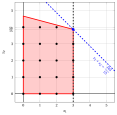{ .fig .ovale loading=lazy  }

                <em>Node 2: feasible region of $\LP_{2}$ (red), with the branching constraint $x_1 \le 3$ (dashed), and its optimal solution (blue).</em>

                An optimal solution ${\tilde{\boldsymbol x}}(\LP_{2})$ is:

                $$
                \tilde{x}_1=3,~~\tilde{x}_2=\dfrac{58}{15}
                $$

                the optimal value is:

                $$
                z(\LP_{2}) = \dfrac{103}{15}
                $$

                The $\LP_{2}$ problem is <strong>feasible</strong> and we have

                $$
                \left\lfloor z(\LP_{2}) \right\rfloor > \LB
                \qquad \text{since} \qquad
                \underbrace{\left\lfloor \dfrac{103}{15} \right\rfloor}_{=6} > -\infty
                $$

                The optimal solution ${\tilde{\boldsymbol x}}(\LP_{2})$ is <strong>fractional</strong>, accordingly, the $\LP_{2}$ problem is <strong>inserted in the problem list</strong> $L$.

            2. Solution of the $\LP_{3}$ problem

                Let us consider the $\LP_{3}$ problem in standard form:

                $$
                \begin{array}{rrrrrrrrrrrrr}
                {\max} & {x_1} & {+} & {x_2} &  &  &  &  &  &  \\[2ex]
                & {4}\, {x_1} & {+} & {15}\, {x_2} & {+} & {x_3} &  &  &  &  & {=} & {70} \\[2ex]
                & {12}\, {x_1} & {+} & {3}\, {x_2} &  &  & {+} & {x_4} &  &  & {=} & {52} \\[2ex]
                & {x_1} &  &  &  &  &  &  & {-} & {x_5} & {=} & {4} \\[2ex]
                & {x_1,} &  & {x_2,} &  & {x_3,} &  & {x_4,} &  & {x_5} & {\ge} & {0}
                \end{array}
                $$

                For the branching constraint we have:

                $$
                x_1 - x_5 = 4 \quad \quad \Rightarrow \quad x_5 = -4 + x_1
                $$

                Using the equations of the optimal simplex dictionary we can express this branching constraint as a function of the non-basic variables. Substituting, we get

                $$
                x_5 = -4 + \left(\dfrac{95}{28} + \dfrac{1}{56} \; x_3 - \dfrac{5}{56} \; x_4 \right)
                \quad \quad \Rightarrow \quad
                x_5 = -\dfrac{17}{28} + \dfrac{1}{56} \, x_3 - \dfrac{5}{56} \, x_4
                $$

                We then add this equation to the previous optimal simplex dictionary and we obtain the following simplex dictionary:

                \begin{equation*}
                \begin{cases}
                \begin{array}{rrrrrrr}
                {x_1} & {=} & {\dfrac{95}{28}} & {+} & {\dfrac{1}{56}}\, {x_3} & {-} & {\dfrac{5}{56}}\, {x_4} \\[2ex]
                {x_2} & {=} & {\dfrac{79}{21}} & {-} & {\dfrac{1}{14}}\, {x_3} & {+} & {\dfrac{1}{42}}\, {x_4} \\[2ex]
                {x_5} & {=} & {-\dfrac{17}{28}} & {+} & {\dfrac{1}{56}}\, {x_3} & {-} & {\dfrac{5}{56}}\, {x_4} \\[2ex]
                {z} & {=} & {\dfrac{601}{84}} & {-} & {\dfrac{3}{56}}\, {x_3} & {-} & {\dfrac{11}{168}}\, {x_4}
                \end{array}
                \end{cases}
                \end{equation*}

                where $\pazocal{B}=\{1,2,5\}$ and $\pazocal{N}=\{3,4\}$ and

                - the basic primal non-feasible solution is:

                    $$
                    \bar x_1=\dfrac{95}{28},~~
                    \bar x_2=\dfrac{79}{21},~~
                    \bar x_5=-\dfrac{17}{28},~~~~~~
                    \bar x_3=0,~~
                    \bar x_4=0~~
                    \mathrm{~~of~value~~~} \dfrac{601}{84}
                    $$

                - the basic dual feasible solution is:

                    $$
                    \bar \pi_1=0,~~
                    \bar \pi_2=0,~~
                    \bar \pi_5=0,~~~~~~
                    \bar \pi_3=\dfrac{3}{56},~~
                    \bar \pi_4=\dfrac{11}{168}~~
                    \mathrm{~~of~value~~~} \dfrac{601}{84}
                    $$

                If we increase the value of $\pi_{5}$, we can get a better dual solution. We have:

                $$
                \begin{cases}
                \pi_3 &= \dfrac{3}{56} - \dfrac{1}{56}\,\pi_5 \\[2ex]
                \pi_4 &= \dfrac{11}{168} + \dfrac{5}{56}\,\pi_5
                \end{cases}
                \qquad
                \qquad
                \begin{cases}
                \underbrace{ \dfrac{3}{56} - \dfrac{1}{56}\,\pi_5 \ge 0}_{\pi_3 \ge 0} \\[2ex]
                \underbrace{ \dfrac{11}{168} + \dfrac{5}{56}\,\pi_5 \ge 0}_{\pi_4 \ge 0}
                \end{cases}
                \qquad
                \qquad
                \begin{cases}
                \pi_5 &\le 3 \\[2ex]
                \pi_5 &\ge -\dfrac{11}{15}
                \end{cases}
                $$

                By increasing the value of $\pi_{5}$ to $3$, the value of $\pi_{3}$ decreases to $0$. Then we have that:

                - $\pi_{5}$ becomes a dual basic variable and accordingly $x_{5}$ becomes a primal non-basic variable.

                - $\pi_{3}$ becomes a dual non-basic variable and accordingly $x_{3}$ becomes a primal basic variable.

                We have:

                $$
                x_5 = -\dfrac{17}{28} + \dfrac{1}{56} \, x_3 - \dfrac{5}{56} \, x_4
                \quad \Rightarrow \quad
                x_3 = 34 + 5 \, x_4 + 56 \, x_5
                $$

                Substituting into the other equations of the primal simplex dictionary, we get:

                $$
                x_1
                = \dfrac{95}{28} + \dfrac{1}{56} \left( 34 + 5 \, x_4 + 56 \, x_5 \right) - \dfrac{5}{56} \; x_4
                = 4 + x_5
                $$

                $$
                x_2
                = \dfrac{79}{21} - \dfrac{1}{14} \left( 34 + 5 \, x_4 + 56 \, x_5 \right) + \dfrac{1}{42} \; x_4
                = \dfrac{4}{3} - \dfrac{1}{3} \, x_4 - 4 \, x_5
                $$

                $$
                z
                = \dfrac{601}{84} - \dfrac{3}{56} \left( 34 + 5 \, x_4 + 56 \, x_5 \right) - \dfrac{11}{168} \; x_4
                = \dfrac{16}{3} - \dfrac{1}{3} \, x_4 - 3 \, x_5
                $$

                Accordingly, we now have the following updated primal simplex dictionary:

                \begin{equation*}
                \begin{cases}
                \begin{array}{rrrrrrr}
                {x_1} & {=} & {4} &  &  & {+} & {x_5} \\[2ex]
                {x_2} & {=} & {\dfrac{4}{3}} & {-} & {\dfrac{1}{3}}\, {x_4} & {-} & {4}\, {x_5} \\[2ex]
                {x_3} & {=} & {34} & {+} & {5}\, {x_4} & {+} & {56}\, {x_5} \\[2ex]
                {z} & {=} & {\dfrac{16}{3}} & {-} & {\dfrac{1}{3}}\, {x_4} & {-} & {3}\, {x_5}
                \end{array}
                \end{cases}
                \end{equation*}

                where $\pazocal{B}=\{1,2,3\}$ and $\pazocal{N}=\{4,5\}$ and

                - the basic primal optimal solution is:

                    $$
                    \tilde x_1=4,~~
                    \tilde x_2=\dfrac{4}{3},~~
                    \tilde x_3=34,~~~~~~
                    \tilde x_4=0,~~
                    \tilde x_5=0~~
                    \mathrm{~~of~value~~~} \dfrac{16}{3}
                    $$

                - the basic dual optimal solution is:

                    $$
                    \tilde \pi_1=0,~~
                    \tilde \pi_2=0,~~
                    \tilde \pi_3=0,~~~~~~
                    \tilde \pi_4=\dfrac{1}{3},~~
                    \tilde \pi_5=3~~
                    \mathrm{~~of~value~~~} \dfrac{16}{3}
                    $$

                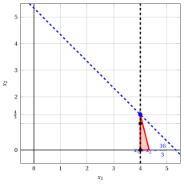{ .fig .ovale loading=lazy  }

                <em>Node 3: feasible region of $\LP_{3}$ (red), with the branching constraint $x_1 \ge 4$ (dashed), and its optimal solution (blue).</em>

                An optimal solution ${\tilde{\boldsymbol x}}(\LP_{3})$ is:

                $$
                \tilde{x}_1=4,~~\tilde{x}_2=\dfrac{4}{3}
                $$

                the optimal value is:

                $$
                z(\LP_{3}) = \dfrac{16}{3}
                $$

                The $\LP_{3}$ problem is <strong>feasible</strong> and we have

                $$
                \left\lfloor z(\LP_{3}) \right\rfloor > \LB
                \qquad \text{since} \qquad
                \underbrace{\left\lfloor \dfrac{16}{3} \right\rfloor}_{=5} > -\infty
                $$

                The optimal solution ${\tilde{\boldsymbol x}}(\LP_{3})$ is <strong>fractional</strong>, accordingly, the $\LP_{3}$ problem is <strong>inserted in the problem list</strong> $L$.

            At the end of the first iteration, branching on $x_{1}$ from Node 1 has generated the down-branching node, Node 2, and the up-branching node, Node 3. Both nodes are inserted in the list $L$. The corresponding branch-and-bound tree is:

            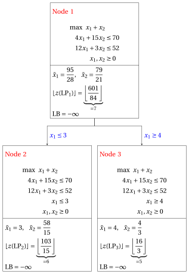{ .fig loading=lazy  }

            Due to the current lower bound $\LB$ and upper bound $\UB$, we have:

            $$
            -\infty ~~\le~~ z(\ILP) ~~\le~~ \underbrace{\left\lfloor \dfrac{103}{15} \right\rfloor}_{=6}
            $$

        - <strong>Iteration 2</strong>

            The $\LP_{3}$ problem is extracted and deleted from the problem list $L$.

            The branching variable is $x_{2}$. The branching constraints are:

            $$
            x_2 \le \underbrace{\left\lfloor \dfrac{4}{3} \right\rfloor}_{ = 1} \mathrm{~~~and~~~} x_2 \ge \underbrace{\left\lfloor \dfrac{4}{3} \right\rfloor +1}_{= 2}
            $$

            Two $\LP_{4}$ and $\LP_{5}$ problems are created with these branching constraints.

            1. Solution of the $\LP_{4}$ problem

                Let us consider the $\LP_{4}$ problem in standard form:

                $$
                \begin{array}{rrrrrrrrrrrrrrr}
                {\max} & {x_1} & {+} & {x_2} &  &  &  &  &  &  &  &  \\[2ex]
                & {4}\, {x_1} & {+} & {15}\, {x_2} & {+} & {x_3} &  &  &  &  &  &  & {=} & {70} \\[2ex]
                & {12}\, {x_1} & {+} & {3}\, {x_2} &  &  & {+} & {x_4} &  &  &  &  & {=} & {52} \\[2ex]
                & {x_1} &  &  &  &  &  &  & {-} & {x_5} &  &  & {=} & {4} \\[2ex]
                &  &  & {x_2} &  &  &  &  &  &  & {+} & {x_6} & {=} & {1} \\[2ex]
                & {x_1,} &  & {x_2,} &  & {x_3,} &  & {x_4,} &  & {x_5,} &  & {x_6} & {\ge} & {0}
                \end{array}
                $$

                For the branching constraint we have:

                $$
                x_2 + x_6 = 1 \quad \quad \Rightarrow \quad x_6 = 1 - x_2
                $$

                Using the equations of the optimal simplex dictionary we can express this branching constraint as a function of the non-basic variables. Substituting, we get

                $$
                x_6 = 1 - \left(\dfrac{4}{3} - \dfrac{1}{3} \; x_4 - 4 \; x_5 \right)
                \quad \quad \Rightarrow \quad
                x_6 = -\dfrac{1}{3} + \dfrac{1}{3} \, x_4 + 4 \, x_5
                $$

                We then add this equation to the previous optimal simplex dictionary and we obtain the following simplex dictionary:

                \begin{equation*}
                \begin{cases}
                \begin{array}{rrrrrrr}
                {x_1} & {=} & {4} &  &  & {+} & {x_5} \\[2ex]
                {x_2} & {=} & {\dfrac{4}{3}} & {-} & {\dfrac{1}{3}}\, {x_4} & {-} & {4}\, {x_5} \\[2ex]
                {x_3} & {=} & {34} & {+} & {5}\, {x_4} & {+} & {56}\, {x_5} \\[2ex]
                {x_6} & {=} & {-\dfrac{1}{3}} & {+} & {\dfrac{1}{3}}\, {x_4} & {+} & {4}\, {x_5} \\[2ex]
                {z} & {=} & {\dfrac{16}{3}} & {-} & {\dfrac{1}{3}}\, {x_4} & {-} & {3}\, {x_5}
                \end{array}
                \end{cases}
                \end{equation*}

                where $\pazocal{B}=\{1,2,3,6\}$ and $\pazocal{N}=\{4,5\}$ and

                - the basic primal non-feasible solution is:

                    $$
                    \bar x_1=4,~~
                    \bar x_2=\dfrac{4}{3},~~
                    \bar x_3=34,~~
                    \bar x_6=-\dfrac{1}{3},~~~~~~
                    \bar x_4=0,~~
                    \bar x_5=0~~
                    \mathrm{~~of~value~~~} \dfrac{16}{3}
                    $$

                - the basic dual feasible solution is:

                    $$
                    \bar \pi_1=0,~~
                    \bar \pi_2=0,~~
                    \bar \pi_3=0,~~
                    \bar \pi_6=0,~~~~~~
                    \bar \pi_4=\dfrac{1}{3},~~
                    \bar \pi_5=3~~
                    \mathrm{~~of~value~~~} \dfrac{16}{3}
                    $$

                If we increase the value of $\pi_{6}$, we can get a better dual solution. We have:

                $$
                \begin{cases}
                \pi_4 &= \dfrac{1}{3} - \dfrac{1}{3}\,\pi_6 \\[2ex]
                \pi_5 &= 3 - 4\,\pi_6
                \end{cases}
                \qquad
                \qquad
                \begin{cases}
                \underbrace{ \dfrac{1}{3} - \dfrac{1}{3}\,\pi_6 \ge 0}_{\pi_4 \ge 0} \\[2ex]
                \underbrace{ 3 - 4\,\pi_6 \ge 0}_{\pi_5 \ge 0}
                \end{cases}
                \qquad
                \qquad
                \begin{cases}
                \pi_6 &\le 1 \\[2ex]
                \pi_6 &\le \dfrac{3}{4}
                \end{cases}
                $$

                By increasing the value of $\pi_{6}$ to $\min \left\{1, \dfrac{3}{4}\right\}=\dfrac{3}{4}$, the value of $\pi_{5}$ decreases to $0$. Then we have that:

                - $\pi_{6}$ becomes a dual basic variable and accordingly $x_{6}$ becomes a primal non-basic variable.

                - $\pi_{5}$ becomes a dual non-basic variable and accordingly $x_{5}$ becomes a primal basic variable.

                We have:

                $$
                x_6 = -\dfrac{1}{3} + \dfrac{1}{3} \, x_4 + 4 \, x_5
                \quad \Rightarrow \quad
                x_5 = \dfrac{1}{12} - \dfrac{1}{12} \, x_4 + \dfrac{1}{4} \, x_6
                $$

                Substituting into the other equations of the primal simplex dictionary, we get:

                $$
                x_1
                = 4 + \left( \dfrac{1}{12} - \dfrac{1}{12} \, x_4 + \dfrac{1}{4} \, x_6 \right)
                = \dfrac{49}{12} - \dfrac{1}{12} \, x_4 + \dfrac{1}{4} \, x_6
                $$

                $$
                x_2
                = \dfrac{4}{3} - \dfrac{1}{3} \; x_4 - 4 \left( \dfrac{1}{12} - \dfrac{1}{12} \, x_4 + \dfrac{1}{4} \, x_6 \right)
                = 1 - x_6
                $$

                $$
                x_3
                = 34 + 5 \; x_4 + 56 \left( \dfrac{1}{12} - \dfrac{1}{12} \, x_4 + \dfrac{1}{4} \, x_6 \right)
                = \dfrac{116}{3} + \dfrac{1}{3} \, x_4 + 14 \, x_6
                $$

                $$
                z
                = \dfrac{16}{3} - \dfrac{1}{3} \; x_4 - 3 \left( \dfrac{1}{12} - \dfrac{1}{12} \, x_4 + \dfrac{1}{4} \, x_6 \right)
                = \dfrac{61}{12} - \dfrac{1}{12} \, x_4 - \dfrac{3}{4} \, x_6
                $$

                Accordingly, we now have the following updated primal simplex dictionary:

                \begin{equation*}
                \begin{cases}
                \begin{array}{rrrrrrr}
                {x_1} & {=} & {\dfrac{49}{12}} & {-} & {\dfrac{1}{12}}\, {x_4} & {+} & {\dfrac{1}{4}}\, {x_6} \\[2ex]
                {x_2} & {=} & {1} &  &  & {-} & {x_6} \\[2ex]
                {x_3} & {=} & {\dfrac{116}{3}} & {+} & {\dfrac{1}{3}}\, {x_4} & {+} & {14}\, {x_6} \\[2ex]
                {x_5} & {=} & {\dfrac{1}{12}} & {-} & {\dfrac{1}{12}}\, {x_4} & {+} & {\dfrac{1}{4}}\, {x_6} \\[2ex]
                {z} & {=} & {\dfrac{61}{12}} & {-} & {\dfrac{1}{12}}\, {x_4} & {-} & {\dfrac{3}{4}}\, {x_6}
                \end{array}
                \end{cases}
                \end{equation*}

                where $\pazocal{B}=\{1,2,3,5\}$ and $\pazocal{N}=\{4,6\}$ and

                - the basic primal optimal solution is:

                    $$
                    \tilde x_1=\dfrac{49}{12},~~
                    \tilde x_2=1,~~
                    \tilde x_3=\dfrac{116}{3},~~
                    \tilde x_5=\dfrac{1}{12},~~~~~~
                    \tilde x_4=0,~~
                    \tilde x_6=0~~
                    \mathrm{~~of~value~~~} \dfrac{61}{12}
                    $$

                - the basic dual optimal solution is:

                    $$
                    \tilde \pi_1=0,~~
                    \tilde \pi_2=0,~~
                    \tilde \pi_3=0,~~
                    \tilde \pi_5=0,~~~~~~
                    \tilde \pi_4=\dfrac{1}{12},~~
                    \tilde \pi_6=\dfrac{3}{4}~~
                    \mathrm{~~of~value~~~} \dfrac{61}{12}
                    $$

                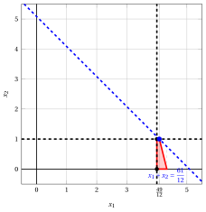{ .fig .ovale loading=lazy  }

                <em>Node 4: feasible region of $\LP_{4}$ (red), with the branching constraint $x_2 \le 1$ (dashed), and its optimal solution (blue).</em>

                An optimal solution ${\tilde{\boldsymbol x}}(\LP_{4})$ is:

                $$
                \tilde{x}_1=\dfrac{49}{12},~~\tilde{x}_2=1
                $$

                the optimal value is:

                $$
                z(\LP_{4}) = \dfrac{61}{12}
                $$

                The $\LP_{4}$ problem is <strong>feasible</strong> and we have

                $$
                \left\lfloor z(\LP_{4}) \right\rfloor > \LB
                \qquad \text{since} \qquad
                \underbrace{\left\lfloor \dfrac{61}{12} \right\rfloor}_{=5} > -\infty
                $$

                The optimal solution ${\tilde{\boldsymbol x}}(\LP_{4})$ is <strong>fractional</strong>, accordingly, the $\LP_{4}$ problem is <strong>inserted in the problem list</strong> $L$.

            2. Solution of the $\LP_{5}$ problem

                Let us consider the $\LP_{5}$ problem in standard form:

                $$
                \begin{array}{rrrrrrrrrrrrrrr}
                {\max} & {x_1} & {+} & {x_2} &  &  &  &  &  &  &  &  \\[2ex]
                & {4}\, {x_1} & {+} & {15}\, {x_2} & {+} & {x_3} &  &  &  &  &  &  & {=} & {70} \\[2ex]
                & {12}\, {x_1} & {+} & {3}\, {x_2} &  &  & {+} & {x_4} &  &  &  &  & {=} & {52} \\[2ex]
                & {x_1} &  &  &  &  &  &  & {-} & {x_5} &  &  & {=} & {4} \\[2ex]
                &  &  & {x_2} &  &  &  &  &  &  & {-} & {x_6} & {=} & {2} \\[2ex]
                & {x_1,} &  & {x_2,} &  & {x_3,} &  & {x_4,} &  & {x_5,} &  & {x_6} & {\ge} & {0}
                \end{array}
                $$

                For the branching constraint we have:

                $$
                x_2 - x_6 = 2 \quad \quad \Rightarrow \quad x_6 = -2 + x_2
                $$

                Using the equations of the optimal simplex dictionary we can express this branching constraint as a function of the non-basic variables. Substituting, we get

                $$
                x_6 = -2 + \left(\dfrac{4}{3} - \dfrac{1}{3} \; x_4 - 4 \; x_5 \right)
                \quad \quad \Rightarrow \quad
                x_6 = -\dfrac{2}{3} - \dfrac{1}{3} \, x_4 - 4 \, x_5
                $$

                We then add this equation to the previous optimal simplex dictionary and we obtain the following simplex dictionary:

                \begin{equation*}
                \begin{cases}
                \begin{array}{rrrrrrr}
                {x_1} & {=} & {4} &  &  & {+} & {x_5} \\[2ex]
                {x_2} & {=} & {\dfrac{4}{3}} & {-} & {\dfrac{1}{3}}\, {x_4} & {-} & {4}\, {x_5} \\[2ex]
                {x_3} & {=} & {34} & {+} & {5}\, {x_4} & {+} & {56}\, {x_5} \\[2ex]
                {x_6} & {=} & {-\dfrac{2}{3}} & {-} & {\dfrac{1}{3}}\, {x_4} & {-} & {4}\, {x_5} \\[2ex]
                {z} & {=} & {\dfrac{16}{3}} & {-} & {\dfrac{1}{3}}\, {x_4} & {-} & {3}\, {x_5}
                \end{array}
                \end{cases}
                \end{equation*}

                where $\pazocal{B}=\{1,2,3,6\}$ and $\pazocal{N}=\{4,5\}$ and

                - the basic primal non-feasible solution is:

                    $$
                    \bar x_1=4,~~
                    \bar x_2=\dfrac{4}{3},~~
                    \bar x_3=34,~~
                    \bar x_6=-\dfrac{2}{3},~~~~~~
                    \bar x_4=0,~~
                    \bar x_5=0~~
                    \mathrm{~~of~value~~~} \dfrac{16}{3}
                    $$

                - the basic dual feasible solution is:

                    $$
                    \bar \pi_1=0,~~
                    \bar \pi_2=0,~~
                    \bar \pi_3=0,~~
                    \bar \pi_6=0,~~~~~~
                    \bar \pi_4=\dfrac{1}{3},~~
                    \bar \pi_5=3~~
                    \mathrm{~~of~value~~~} \dfrac{16}{3}
                    $$

                If we increase the value of $\pi_{6}$, we can get a better dual solution. We have:

                $$
                \begin{cases}
                \pi_4 &= \dfrac{1}{3} + \dfrac{1}{3}\,\pi_6 \\[2ex]
                \pi_5 &= 3 + 4\,\pi_6
                \end{cases}
                \qquad
                \qquad
                \begin{cases}
                \underbrace{ \dfrac{1}{3} + \dfrac{1}{3}\,\pi_6 \ge 0}_{\pi_4 \ge 0} \\[2ex]
                \underbrace{ 3 + 4\,\pi_6 \ge 0}_{\pi_5 \ge 0}
                \end{cases}
                \qquad
                \qquad
                \begin{cases}
                \pi_6 &\ge -1 \\[2ex]
                \pi_6 &\ge -\dfrac{3}{4}
                \end{cases}
                $$

                Accordingly, we can increase the value of $\pi_{6}$ without violating dual feasibility, which implies that the dual problem is <strong>unbounded</strong>. As a result, the primal problem $\LP_{5}$ is <strong>infeasible</strong>, and the corresponding branching node is <u>pruned by infeasibility</u>.

            At the end of the second iteration, branching on $x_{2}$ from Node 3 has generated the down-branching node, Node 4, and the up-branching node, Node 5. Node 4 is inserted in the list $L$, while Node 5 is pruned by infeasibility. The corresponding branch-and-bound tree is:

            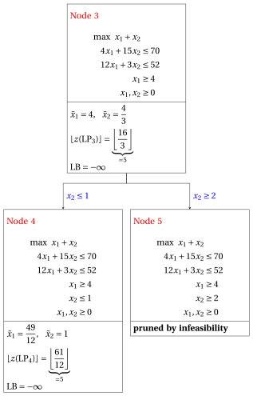{ .fig loading=lazy  }

            Due to the current lower bound $\LB$ and upper bound $\UB$, we have:

            $$
            -\infty ~~\le~~ z(\ILP) ~~\le~~ \underbrace{\left\lfloor \dfrac{103}{15} \right\rfloor}_{=6}
            $$

        - <strong>Iteration 3</strong>

            The $\LP_{4}$ problem is extracted and deleted from the problem list $L$.

            The branching variable is $x_{1}$. The branching constraints are:

            $$
            x_1 \le \underbrace{\left\lfloor \dfrac{49}{12} \right\rfloor}_{ = 4} \mathrm{~~~and~~~} x_1 \ge \underbrace{\left\lfloor \dfrac{49}{12} \right\rfloor +1}_{= 5}
            $$

            The $\LP_{6}$ problem is created with the first branching constraint (the second child is solved only if needed).

            1. Solution of the $\LP_{6}$ problem

                Let us consider the $\LP_{6}$ problem in standard form:

                $$
                \begin{array}{rrrrrrrrrrrrrrrrr}
                {\max} & {x_1} & {+} & {x_2} &  &  &  &  &  &  &  &  &  &  \\[2ex]
                & {4}\, {x_1} & {+} & {15}\, {x_2} & {+} & {x_3} &  &  &  &  &  &  &  &  & {=} & {70} \\[2ex]
                & {12}\, {x_1} & {+} & {3}\, {x_2} &  &  & {+} & {x_4} &  &  &  &  &  &  & {=} & {52} \\[2ex]
                & {x_1} &  &  &  &  &  &  & {-} & {x_5} &  &  &  &  & {=} & {4} \\[2ex]
                &  &  & {x_2} &  &  &  &  &  &  & {+} & {x_6} &  &  & {=} & {1} \\[2ex]
                & {x_1} &  &  &  &  &  &  &  &  &  &  & {+} & {x_7} & {=} & {4} \\[2ex]
                & {x_1,} &  & {x_2,} &  & {x_3,} &  & {x_4,} &  & {x_5,} &  & {x_6,} &  & {x_7} & {\ge} & {0}
                \end{array}
                $$

                For the branching constraint we have:

                $$
                x_1 + x_7 = 4 \quad \quad \Rightarrow \quad x_7 = 4 - x_1
                $$

                Using the equations of the optimal simplex dictionary we can express this branching constraint as a function of the non-basic variables. Substituting, we get

                $$
                x_7 = 4 - \left(\dfrac{49}{12} - \dfrac{1}{12} \; x_4 + \dfrac{1}{4} \; x_6 \right)
                \quad \quad \Rightarrow \quad
                x_7 = -\dfrac{1}{12} + \dfrac{1}{12} \, x_4 - \dfrac{1}{4} \, x_6
                $$

                We then add this equation to the previous optimal simplex dictionary and we obtain the following simplex dictionary:

                \begin{equation*}
                \begin{cases}
                \begin{array}{rrrrrrr}
                {x_1} & {=} & {\dfrac{49}{12}} & {-} & {\dfrac{1}{12}}\, {x_4} & {+} & {\dfrac{1}{4}}\, {x_6} \\[2ex]
                {x_2} & {=} & {1} &  &  & {-} & {x_6} \\[2ex]
                {x_3} & {=} & {\dfrac{116}{3}} & {+} & {\dfrac{1}{3}}\, {x_4} & {+} & {14}\, {x_6} \\[2ex]
                {x_5} & {=} & {\dfrac{1}{12}} & {-} & {\dfrac{1}{12}}\, {x_4} & {+} & {\dfrac{1}{4}}\, {x_6} \\[2ex]
                {x_7} & {=} & {-\dfrac{1}{12}} & {+} & {\dfrac{1}{12}}\, {x_4} & {-} & {\dfrac{1}{4}}\, {x_6} \\[2ex]
                {z} & {=} & {\dfrac{61}{12}} & {-} & {\dfrac{1}{12}}\, {x_4} & {-} & {\dfrac{3}{4}}\, {x_6}
                \end{array}
                \end{cases}
                \end{equation*}

                where $\pazocal{B}=\{1,2,3,5,7\}$ and $\pazocal{N}=\{4,6\}$ and

                - the basic primal non-feasible solution is:

                    $$
                    \begin{gathered}
                    \bar x_1=\dfrac{49}{12},~~
                    \bar x_2=1,~~
                    \bar x_3=\dfrac{116}{3},~~
                    \bar x_5=\dfrac{1}{12},~~
                    \bar x_7=-\dfrac{1}{12},\\
                    \bar x_4=0,~~
                    \bar x_6=0~~
                    \mathrm{~~of~value~~~} \dfrac{61}{12}
                    \end{gathered}
                    $$

                - the basic dual feasible solution is:

                    $$
                    \begin{gathered}
                    \bar \pi_1=0,~~
                    \bar \pi_2=0,~~
                    \bar \pi_3=0,~~
                    \bar \pi_5=0,~~
                    \bar \pi_7=0,\\
                    \bar \pi_4=\dfrac{1}{12},~~
                    \bar \pi_6=\dfrac{3}{4}~~
                    \mathrm{~~of~value~~~} \dfrac{61}{12}
                    \end{gathered}
                    $$

                If we increase the value of $\pi_{7}$, we can get a better dual solution. We have:

                $$
                \begin{cases}
                \pi_4 &= \dfrac{1}{12} - \dfrac{1}{12}\,\pi_7 \\[2ex]
                \pi_6 &= \dfrac{3}{4} + \dfrac{1}{4}\,\pi_7
                \end{cases}
                \qquad
                \qquad
                \begin{cases}
                \underbrace{ \dfrac{1}{12} - \dfrac{1}{12}\,\pi_7 \ge 0}_{\pi_4 \ge 0} \\[2ex]
                \underbrace{ \dfrac{3}{4} + \dfrac{1}{4}\,\pi_7 \ge 0}_{\pi_6 \ge 0}
                \end{cases}
                \qquad
                \qquad
                \begin{cases}
                \pi_7 &\le 1 \\[2ex]
                \pi_7 &\ge -3
                \end{cases}
                $$

                By increasing the value of $\pi_{7}$ to $1$, the value of $\pi_{4}$ decreases to $0$. Then we have that:

                - $\pi_{7}$ becomes a dual basic variable and accordingly $x_{7}$ becomes a primal non-basic variable.

                - $\pi_{4}$ becomes a dual non-basic variable and accordingly $x_{4}$ becomes a primal basic variable.

                We have:

                $$
                x_7 = -\dfrac{1}{12} + \dfrac{1}{12} \, x_4 - \dfrac{1}{4} \, x_6
                \quad \Rightarrow \quad
                x_4 = 1 + 3 \, x_6 + 12 \, x_7
                $$

                Substituting into the other equations of the primal simplex dictionary, we get:

                $$
                x_1
                = \dfrac{49}{12} - \dfrac{1}{12} \left( 1 + 3 \, x_6 + 12 \, x_7 \right) + \dfrac{1}{4} \; x_6
                = 4 - x_7
                $$

                $$
                x_3
                = \dfrac{116}{3} + \dfrac{1}{3} \left( 1 + 3 \, x_6 + 12 \, x_7 \right) + 14 \; x_6
                = 39 + 15 \, x_6 + 4 \, x_7
                $$

                $$
                x_5
                = \dfrac{1}{12} - \dfrac{1}{12} \left( 1 + 3 \, x_6 + 12 \, x_7 \right) + \dfrac{1}{4} \; x_6
                = 0 - x_7
                $$

                $$
                z
                = \dfrac{61}{12} - \dfrac{1}{12} \left( 1 + 3 \, x_6 + 12 \, x_7 \right) - \dfrac{3}{4} \; x_6
                = 5 - x_6 - x_7
                $$

                Accordingly, we now have the following updated primal simplex dictionary:

                \begin{equation*}
                \begin{cases}
                \begin{array}{rrrrrrr}
                {x_1} & {=} & {4} &  &  & {-} & {x_7} \\[2ex]
                {x_2} & {=} & {1} & {-} & {x_6} &  &  \\[2ex]
                {x_3} & {=} & {39} & {+} & {15}\, {x_6} & {+} & {4}\, {x_7} \\[2ex]
                {x_4} & {=} & {1} & {+} & {3}\, {x_6} & {+} & {12}\, {x_7} \\[2ex]
                {x_5} & {=} & {0} &  &  & {-} & {x_7} \\[2ex]
                {z} & {=} & {5} & {-} & {x_6} & {-} & {x_7}
                \end{array}
                \end{cases}
                \end{equation*}

                where $\pazocal{B}=\{1,2,3,4,5\}$ and $\pazocal{N}=\{6,7\}$ and

                - the basic primal optimal solution is:

                    $$
                    \begin{gathered}
                    \tilde x_1=4,~~
                    \tilde x_2=1,~~
                    \tilde x_3=39,~~
                    \tilde x_4=1,~~
                    \tilde x_5=0,\\
                    \tilde x_6=0,~~
                    \tilde x_7=0~~
                    \mathrm{~~of~value~~~} 5
                    \end{gathered}
                    $$

                - the basic dual optimal solution is:

                    $$
                    \begin{gathered}
                    \tilde \pi_1=0,~~
                    \tilde \pi_2=0,~~
                    \tilde \pi_3=0,~~
                    \tilde \pi_4=0,~~
                    \tilde \pi_5=0,\\
                    \tilde \pi_6=1,~~
                    \tilde \pi_7=1~~
                    \mathrm{~~of~value~~~} 5
                    \end{gathered}
                    $$

                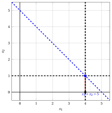{ .fig .ovale loading=lazy  }

                <em>Node 6: feasible region of $\LP_{6}$ (red), with the branching constraint $x_1 \le 4$ (dashed), and its optimal solution (blue).</em>

                An optimal solution ${\tilde{\boldsymbol x}}(\LP_{6})$ is:

                $$
                \tilde{x}_1=4,~~\tilde{x}_2=1
                $$

                the optimal value is:

                $$
                z(\LP_{6}) = 5
                $$

                The $\LP_{6}$ problem is <strong>feasible</strong> and we have

                $$
                \left\lfloor z(\LP_{6}) \right\rfloor > \LB
                \qquad \text{since} \qquad
                5 > -\infty
                $$

                The optimal solution ${\tilde{\boldsymbol x}}(\LP_{6})$ is <strong>integer</strong>, accordingly, the lower bound $\LB$ becomes $5$ and the incumbent solution ${\bar{\boldsymbol x}}(\ILP)$ becomes $\bar{x}_1=4,\bar{x}_2=1$.

                Accordingly, the branching node is <u>pruned by integrality</u>.

            At the end of the third iteration, branching on $x_{1}$ from Node 4 has generated the down-branching node, Node 6. This node is pruned by integrality. The up-branching node is not solved, since after Node 6 the lower bound satisfies

            $$
            \left\lfloor z(\LP_{4}) \right\rfloor \le \LB.
            $$

            This is the portion of the branch-and-bound tree showing the LP problems of the branching nodes that are solved:

            { .fig loading=lazy  }

            Due to the current lower bound $\LB$ and upper bound $\UB$, we have:

            $$
            5 ~~\le~~ z(\ILP) ~~\le~~ \underbrace{\left\lfloor \dfrac{103}{15} \right\rfloor}_{=6}
            $$

        - <strong>Iteration 4</strong>

            The $\LP_{2}$ problem is extracted and deleted from the problem list $L$.

            The branching variable is $x_{2}$. The branching constraints are:

            $$
            x_2 \le \underbrace{\left\lfloor \dfrac{58}{15} \right\rfloor}_{ = 3} \mathrm{~~~and~~~} x_2 \ge \underbrace{\left\lfloor \dfrac{58}{15} \right\rfloor +1}_{= 4}
            $$

            The $\LP_{7}$ problem is created with the first branching constraint (the second child is solved only if needed).

            1. Solution of the $\LP_{7}$ problem

                Let us consider the $\LP_{7}$ problem in standard form:

                $$
                \begin{array}{rrrrrrrrrrrrrrr}
                {\max} & {x_1} & {+} & {x_2} &  &  &  &  &  &  &  &  \\[2ex]
                & {4}\, {x_1} & {+} & {15}\, {x_2} & {+} & {x_3} &  &  &  &  &  &  & {=} & {70} \\[2ex]
                & {12}\, {x_1} & {+} & {3}\, {x_2} &  &  & {+} & {x_4} &  &  &  &  & {=} & {52} \\[2ex]
                & {x_1} &  &  &  &  &  &  & {+} & {x_5} &  &  & {=} & {3} \\[2ex]
                &  &  & {x_2} &  &  &  &  &  &  & {+} & {x_6} & {=} & {3} \\[2ex]
                & {x_1,} &  & {x_2,} &  & {x_3,} &  & {x_4,} &  & {x_5,} &  & {x_6} & {\ge} & {0}
                \end{array}
                $$

                For the branching constraint we have:

                $$
                x_2 + x_6 = 3 \quad \quad \Rightarrow \quad x_6 = 3 - x_2
                $$

                Using the equations of the optimal simplex dictionary we can express this branching constraint as a function of the non-basic variables. Substituting, we get

                $$
                x_6 = 3 - \left(\dfrac{58}{15} - \dfrac{1}{15} \; x_3 + \dfrac{4}{15} \; x_5 \right)
                \quad \quad \Rightarrow \quad
                x_6 = -\dfrac{13}{15} + \dfrac{1}{15} \, x_3 - \dfrac{4}{15} \, x_5
                $$

                We then add this equation to the previous optimal simplex dictionary and we obtain the following simplex dictionary:

                \begin{equation*}
                \begin{cases}
                \begin{array}{rrrrrrr}
                {x_1} & {=} & {3} &  &  & {-} & {x_5} \\[2ex]
                {x_2} & {=} & {\dfrac{58}{15}} & {-} & {\dfrac{1}{15}}\, {x_3} & {+} & {\dfrac{4}{15}}\, {x_5} \\[2ex]
                {x_4} & {=} & {\dfrac{22}{5}} & {+} & {\dfrac{1}{5}}\, {x_3} & {+} & {\dfrac{56}{5}}\, {x_5} \\[2ex]
                {x_6} & {=} & {-\dfrac{13}{15}} & {+} & {\dfrac{1}{15}}\, {x_3} & {-} & {\dfrac{4}{15}}\, {x_5} \\[2ex]
                {z} & {=} & {\dfrac{103}{15}} & {-} & {\dfrac{1}{15}}\, {x_3} & {-} & {\dfrac{11}{15}}\, {x_5}
                \end{array}
                \end{cases}
                \end{equation*}

                where $\pazocal{B}=\{1,2,4,6\}$ and $\pazocal{N}=\{3,5\}$ and

                - the basic primal non-feasible solution is:

                    $$
                    \bar x_1=3,~~
                    \bar x_2=\dfrac{58}{15},~~
                    \bar x_4=\dfrac{22}{5},~~
                    \bar x_6=-\dfrac{13}{15},~~~~~~
                    \bar x_3=0,~~
                    \bar x_5=0~~
                    \mathrm{~~of~value~~~} \dfrac{103}{15}
                    $$

                - the basic dual feasible solution is:

                    $$
                    \bar \pi_1=0,~~
                    \bar \pi_2=0,~~
                    \bar \pi_4=0,~~
                    \bar \pi_6=0,~~~~~~
                    \bar \pi_3=\dfrac{1}{15},~~
                    \bar \pi_5=\dfrac{11}{15}~~
                    \mathrm{~~of~value~~~} \dfrac{103}{15}
                    $$

                If we increase the value of $\pi_{6}$, we can get a better dual solution. We have:

                $$
                \begin{cases}
                \pi_3 &= \dfrac{1}{15} - \dfrac{1}{15}\,\pi_6 \\[2ex]
                \pi_5 &= \dfrac{11}{15} + \dfrac{4}{15}\,\pi_6
                \end{cases}
                \qquad
                \qquad
                \begin{cases}
                \underbrace{ \dfrac{1}{15} - \dfrac{1}{15}\,\pi_6 \ge 0}_{\pi_3 \ge 0} \\[2ex]
                \underbrace{ \dfrac{11}{15} + \dfrac{4}{15}\,\pi_6 \ge 0}_{\pi_5 \ge 0}
                \end{cases}
                \qquad
                \qquad
                \begin{cases}
                \pi_6 &\le 1 \\[2ex]
                \pi_6 &\ge -\dfrac{11}{4}
                \end{cases}
                $$

                By increasing the value of $\pi_{6}$ to $1$, the value of $\pi_{3}$ decreases to $0$. Then we have that:

                - $\pi_{6}$ becomes a dual basic variable and accordingly $x_{6}$ becomes a primal non-basic variable.

                - $\pi_{3}$ becomes a dual non-basic variable and accordingly $x_{3}$ becomes a primal basic variable.

                We have:

                $$
                x_6 = -\dfrac{13}{15} + \dfrac{1}{15} \, x_3 - \dfrac{4}{15} \, x_5
                \quad \Rightarrow \quad
                x_3 = 13 + 4 \, x_5 + 15 \, x_6
                $$

                Substituting into the other equations of the primal simplex dictionary, we get:

                $$
                x_2
                = \dfrac{58}{15} - \dfrac{1}{15} \left( 13 + 4 \, x_5 + 15 \, x_6 \right) + \dfrac{4}{15} \; x_5
                = 3 - x_6
                $$

                $$
                x_4
                = \dfrac{22}{5} + \dfrac{1}{5} \left( 13 + 4 \, x_5 + 15 \, x_6 \right) + \dfrac{56}{5} \; x_5
                = 7 + 12 \, x_5 + 3 \, x_6
                $$

                $$
                z
                = \dfrac{103}{15} - \dfrac{1}{15} \left( 13 + 4 \, x_5 + 15 \, x_6 \right) - \dfrac{11}{15} \; x_5
                = 6 - x_5 - x_6
                $$

                Accordingly, we now have the following updated primal simplex dictionary:

                \begin{equation*}
                \begin{cases}
                \begin{array}{rrrrrrr}
                {x_1} & {=} & {3} & {-} & {x_5} &  &  \\[2ex]
                {x_2} & {=} & {3} &  &  & {-} & {x_6} \\[2ex]
                {x_3} & {=} & {13} & {+} & {4}\, {x_5} & {+} & {15}\, {x_6} \\[2ex]
                {x_4} & {=} & {7} & {+} & {12}\, {x_5} & {+} & {3}\, {x_6} \\[2ex]
                {z} & {=} & {6} & {-} & {x_5} & {-} & {x_6}
                \end{array}
                \end{cases}
                \end{equation*}

                where $\pazocal{B}=\{1,2,3,4\}$ and $\pazocal{N}=\{5,6\}$ and

                - the basic primal optimal solution is:

                    $$
                    \tilde x_1=3,~~
                    \tilde x_2=3,~~
                    \tilde x_3=13,~~
                    \tilde x_4=7,~~~~~~
                    \tilde x_5=0,~~
                    \tilde x_6=0~~
                    \mathrm{~~of~value~~~} 6
                    $$

                - the basic dual optimal solution is:

                    $$
                    \tilde \pi_1=0,~~
                    \tilde \pi_2=0,~~
                    \tilde \pi_3=0,~~
                    \tilde \pi_4=0,~~~~~~
                    \tilde \pi_5=1,~~
                    \tilde \pi_6=1~~
                    \mathrm{~~of~value~~~} 6
                    $$

                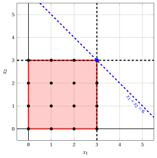{ .fig .ovale loading=lazy  }

                <em>Node 7: feasible region of $\LP_{7}$ (red), with the branching constraint $x_2 \le 3$ (dashed), and its optimal solution (blue).</em>

                An optimal solution ${\tilde{\boldsymbol x}}(\LP_{7})$ is:

                $$
                \tilde{x}_1=3,~~\tilde{x}_2=3
                $$

                the optimal value is:

                $$
                z(\LP_{7}) = 6
                $$

                The $\LP_{7}$ problem is <strong>feasible</strong> and we have

                $$
                \left\lfloor z(\LP_{7}) \right\rfloor > \LB
                \qquad \text{since} \qquad
                6 > 5
                $$

                The optimal solution ${\tilde{\boldsymbol x}}(\LP_{7})$ is <strong>integer</strong>, accordingly, the lower bound $\LB$ becomes $6$ and the incumbent solution ${\bar{\boldsymbol x}}(\ILP)$ becomes $\bar{x}_1=3,\bar{x}_2=3$.

                Accordingly, the branching node is <u>pruned by integrality</u>.

            At the end of the fourth iteration, branching on $x_{2}$ from Node 2 has generated the down-branching node, Node 7. This node is pruned by integrality. The up-branching node is not solved, since after Node 7 the lower bound satisfies

            $$
            \left\lfloor z(\LP_{2}) \right\rfloor \le \LB.
            $$

            This is the portion of the branch-and-bound tree showing the LP problems of the branching nodes that are solved:

            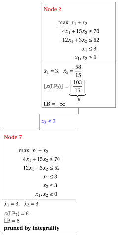{ .fig loading=lazy  }

            Due to the current lower bound $\LB$ and upper bound $\UB$, we have:

            $$
            6 ~~\le~~ z(\ILP) ~~\le~~ 6
            $$

        - <strong>Termination</strong>

            Since the list $L$ is empty, the lower bound $\LB$ is equal to the upper bound $\UB$ and the $\ILP$ problem is solved to optimality.

            The optimal value is $z(\ILP)=6$ (the value of the lower bound $\LB$) and an optimal solution ${\tilde{\boldsymbol x}}(\ILP)$ is $\tilde x_1=3,\tilde x_2=3$ (the incumbent solution ${\bar{\boldsymbol x}}(\ILP)$).

    2. The final branch-and-bound tree is:

        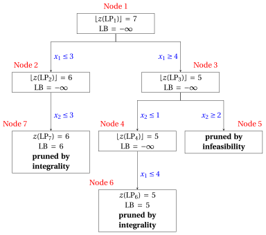{ .fig loading=lazy  }

        The reasons why the branching nodes are pruned are the following.

        - Node 1 has a fractional optimal solution with $\lfloor z(\LP_{1})\rfloor = 7$: it is branched on $x_1$.

        - Node 2 has a fractional optimal solution with $\lfloor z(\LP_{2})\rfloor = 6$: it is branched on $x_2$.

        - The up-branching node of Node 2 is not solved, and it is not drawn, since $\lfloor z(\LP_{2})\rfloor = 6$ $\le \LB = 6$ after its first child.

        - Node 3 has a fractional optimal solution with $\lfloor z(\LP_{3})\rfloor = 5$: it is branched on $x_2$.

        - Node 4 has a fractional optimal solution with $\lfloor z(\LP_{4})\rfloor = 5$: it is branched on $x_1$.

        - The up-branching node of Node 4 is not solved, and it is not drawn, since $\lfloor z(\LP_{4})\rfloor = 5$ $\le \LB = 5$ after its first child.

        - Node 5 is pruned by infeasibility: the $\LP_{5}$ problem has no feasible solution.

        - Node 6 is pruned by integrality: $\tilde{\boldsymbol x}(\LP_{6}) = (4, 1)$ is integer, with value $5$, which becomes the incumbent solution.

        - Node 7 is pruned by integrality: $\tilde{\boldsymbol x}(\LP_{7}) = (3, 3)$ is integer, with value $6$, which becomes the incumbent solution.

        The optimal value is $z(\ILP) = 6$ and the branch-and-bound algorithm returns the optimal solution $\tilde{\boldsymbol x}(\ILP) = (3, 3)$. The optimal solution is <strong>not unique</strong>: also $(2, 4)$ has value $6$. With the rules stated in the question, the algorithm finds $(3, 3)$.

!!! esercizio "Exercise 7.7: Branch-and-bound algorithm (P7)"

    !!! nota ""

        Consider the following ILP problem in canonical maximization form with $n=2$ integer variables and $m=2$ constraints:

        $$
        \begin{array}{rrrrrrr}
        {\max} & {3}\, {x_1} & {+} & {x_2} \\[2ex]
        & {x_1} & {+} & {4}\, {x_2} & {\le} & {12} \\[2ex]
        & {2}\, {x_1} & {+} & {x_2} & {\le} & {5} \\[2ex]
        & {x_1,} &  & {x_2} & {\in} & {\Z_{\ge 0}}
        \end{array}
        $$

        and an optimal simplex dictionary of its LP relaxation in standard form:

        \begin{equation*}
        \begin{cases}
        \begin{array}{rrrrrrr}
        {x_1} & {=} & {\dfrac{5}{2}} & {-} & {\dfrac{1}{2}}\, {x_2} & {-} & {\dfrac{1}{2}}\, {x_4} \\[2ex]
        {x_3} & {=} & {\dfrac{19}{2}} & {-} & {\dfrac{7}{2}}\, {x_2} & {+} & {\dfrac{1}{2}}\, {x_4} \\[2ex]
        {z} & {=} & {\dfrac{15}{2}} & {-} & {\dfrac{1}{2}}\, {x_2} & {-} & {\dfrac{3}{2}}\, {x_4}
        \end{array}
        \end{cases}
        \end{equation*}

    **Questions**

    1. Execute the branch-and-bound algorithm using:

        1. the smallest-index rule as branching-variable selection strategy;

        2. the FIFO rule as branching-node selection strategy;

        3. solve first the down-branching node and then the up-branching node;

        4. set the lower bound $\LB$ to $-\infty$ (no heuristic algorithm is executed).

        Solve the LP problems of the branching nodes using the dual simplex algorithm. In the dual simplex algorithm, the leaving variable is the basic variable with negative value and smallest index, and ties in the ratio test are broken by the smallest index. Show graphically the optimal solution of the LP problems associated with the branching nodes.

    2. Determine and comment the branch-and-bound tree, showing the reason why each branching node is pruned.

??? soluzione "Solution"

    1. Execution of the branch-and-bound algorithm to solve the $\ILP$ problem.

        - <strong>Initialization</strong>

            Let us consider the $\LP_{1}$ problem in standard form:

            $$
            \begin{array}{rrrrrrrrrrr}
            {\max} & {3}\, {x_1} & {+} & {x_2} &  &  &  &  \\[2ex]
            & {x_1} & {+} & {4}\, {x_2} & {+} & {x_3} &  &  & {=} & {12} \\[2ex]
            & {2}\, {x_1} & {+} & {x_2} &  &  & {+} & {x_4} & {=} & {5} \\[2ex]
            & {x_1,} &  & {x_2,} &  & {x_3,} &  & {x_4} & {\ge} & {0}
            \end{array}
            $$

            and its optimal simplex dictionary:

            \begin{equation*}
            \begin{cases}
            \begin{array}{rrrrrrr}
            {x_1} & {=} & {\dfrac{5}{2}} & {-} & {\dfrac{1}{2}}\, {x_2} & {-} & {\dfrac{1}{2}}\, {x_4} \\[2ex]
            {x_3} & {=} & {\dfrac{19}{2}} & {-} & {\dfrac{7}{2}}\, {x_2} & {+} & {\dfrac{1}{2}}\, {x_4} \\[2ex]
            {z} & {=} & {\dfrac{15}{2}} & {-} & {\dfrac{1}{2}}\, {x_2} & {-} & {\dfrac{3}{2}}\, {x_4}
            \end{array}
            \end{cases}
            \end{equation*}

            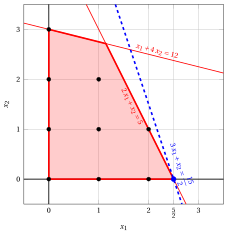{ .fig .ovale loading=lazy  }

            <em>Node 1: feasible region of $\LP_{1}$ (red), feasible points of the ILP problem (black) and optimal solution of $\LP_{1}$ (blue) with the objective function line through it.</em>

            An optimal solution ${\tilde{\boldsymbol x}}(\LP_{1})$ is:

            $$
            \tilde{x}_1=\dfrac{5}{2},~~\tilde{x}_2=0
            $$

            the optimal value is:

            $$
            z(\LP_{1}) = \dfrac{15}{2}
            $$

            The optimal solution ${\tilde{\boldsymbol x}}(\LP_{1})$ is <strong>fractional</strong> and the $\LP_{1}$ problem is <strong>feasible</strong>, so the $\LP_{1}$ problem is inserted in the problem list $L$ and the lower bound $\LB$ is set to $-\infty$.

            Due to the current lower bound $\LB$ and upper bound $\UB$, we have:

            $$
            -\infty ~~\le~~ z(\ILP) ~~\le~~ \underbrace{\left\lfloor \dfrac{15}{2} \right\rfloor}_{=7}
            $$

        - <strong>Iteration 1</strong>

            The $\LP_{1}$ problem is extracted and deleted from the problem list $L$.

            The branching variable is $x_{1}$. The branching constraints are:

            $$
            x_1 \le \underbrace{\left\lfloor \dfrac{5}{2} \right\rfloor}_{ = 2} \mathrm{~~~and~~~} x_1 \ge \underbrace{\left\lfloor \dfrac{5}{2} \right\rfloor +1}_{= 3}
            $$

            The $\LP_{2}$ problem is created with the first branching constraint (the second child is solved only if needed).

            1. Solution of the $\LP_{2}$ problem

                Let us consider the $\LP_{2}$ problem in standard form:

                $$
                \begin{array}{rrrrrrrrrrrrr}
                {\max} & {3}\, {x_1} & {+} & {x_2} &  &  &  &  &  &  \\[2ex]
                & {x_1} & {+} & {4}\, {x_2} & {+} & {x_3} &  &  &  &  & {=} & {12} \\[2ex]
                & {2}\, {x_1} & {+} & {x_2} &  &  & {+} & {x_4} &  &  & {=} & {5} \\[2ex]
                & {x_1} &  &  &  &  &  &  & {+} & {x_5} & {=} & {2} \\[2ex]
                & {x_1,} &  & {x_2,} &  & {x_3,} &  & {x_4,} &  & {x_5} & {\ge} & {0}
                \end{array}
                $$

                For the branching constraint we have:

                $$
                x_1 + x_5 = 2 \quad \quad \Rightarrow \quad x_5 = 2 - x_1
                $$

                Using the equations of the optimal simplex dictionary we can express this branching constraint as a function of the non-basic variables. Substituting, we get

                $$
                x_5 = 2 - \left(\dfrac{5}{2} - \dfrac{1}{2} \; x_2 - \dfrac{1}{2} \; x_4 \right)
                \quad \quad \Rightarrow \quad
                x_5 = -\dfrac{1}{2} + \dfrac{1}{2} \, x_2 + \dfrac{1}{2} \, x_4
                $$

                We then add this equation to the previous optimal simplex dictionary and we obtain the following simplex dictionary:

                \begin{equation*}
                \begin{cases}
                \begin{array}{rrrrrrr}
                {x_1} & {=} & {\dfrac{5}{2}} & {-} & {\dfrac{1}{2}}\, {x_2} & {-} & {\dfrac{1}{2}}\, {x_4} \\[2ex]
                {x_3} & {=} & {\dfrac{19}{2}} & {-} & {\dfrac{7}{2}}\, {x_2} & {+} & {\dfrac{1}{2}}\, {x_4} \\[2ex]
                {x_5} & {=} & {-\dfrac{1}{2}} & {+} & {\dfrac{1}{2}}\, {x_2} & {+} & {\dfrac{1}{2}}\, {x_4} \\[2ex]
                {z} & {=} & {\dfrac{15}{2}} & {-} & {\dfrac{1}{2}}\, {x_2} & {-} & {\dfrac{3}{2}}\, {x_4}
                \end{array}
                \end{cases}
                \end{equation*}

                where $\pazocal{B}=\{1,3,5\}$ and $\pazocal{N}=\{2,4\}$ and

                - the basic primal non-feasible solution is:

                    $$
                    \bar x_1=\dfrac{5}{2},~~
                    \bar x_3=\dfrac{19}{2},~~
                    \bar x_5=-\dfrac{1}{2},~~~~~~
                    \bar x_2=0,~~
                    \bar x_4=0~~
                    \mathrm{~~of~value~~~} \dfrac{15}{2}
                    $$

                - the basic dual feasible solution is:

                    $$
                    \bar \pi_1=0,~~
                    \bar \pi_3=0,~~
                    \bar \pi_5=0,~~~~~~
                    \bar \pi_2=\dfrac{1}{2},~~
                    \bar \pi_4=\dfrac{3}{2}~~
                    \mathrm{~~of~value~~~} \dfrac{15}{2}
                    $$

                If we increase the value of $\pi_{5}$, we can get a better dual solution. We have:

                $$
                \begin{cases}
                \pi_2 &= \dfrac{1}{2} - \dfrac{1}{2}\,\pi_5 \\[2ex]
                \pi_4 &= \dfrac{3}{2} - \dfrac{1}{2}\,\pi_5
                \end{cases}
                \qquad
                \qquad
                \begin{cases}
                \underbrace{ \dfrac{1}{2} - \dfrac{1}{2}\,\pi_5 \ge 0}_{\pi_2 \ge 0} \\[2ex]
                \underbrace{ \dfrac{3}{2} - \dfrac{1}{2}\,\pi_5 \ge 0}_{\pi_4 \ge 0}
                \end{cases}
                \qquad
                \qquad
                \begin{cases}
                \pi_5 &\le 1 \\[2ex]
                \pi_5 &\le 3
                \end{cases}
                $$

                By increasing the value of $\pi_{5}$ to $\min \left\{1, 3\right\}=1$, the value of $\pi_{2}$ decreases to $0$. Then we have that:

                - $\pi_{5}$ becomes a dual basic variable and accordingly $x_{5}$ becomes a primal non-basic variable.

                - $\pi_{2}$ becomes a dual non-basic variable and accordingly $x_{2}$ becomes a primal basic variable.

                We have:

                $$
                x_5 = -\dfrac{1}{2} + \dfrac{1}{2} \, x_2 + \dfrac{1}{2} \, x_4
                \quad \Rightarrow \quad
                x_2 = 1 - x_4 + 2 \, x_5
                $$

                Substituting into the other equations of the primal simplex dictionary, we get:

                $$
                x_1
                = \dfrac{5}{2} - \dfrac{1}{2} \left( 1 - x_4 + 2 \, x_5 \right) - \dfrac{1}{2} \; x_4
                = 2 - x_5
                $$

                $$
                x_3
                = \dfrac{19}{2} - \dfrac{7}{2} \left( 1 - x_4 + 2 \, x_5 \right) + \dfrac{1}{2} \; x_4
                = 6 + 4 \, x_4 - 7 \, x_5
                $$

                $$
                z
                = \dfrac{15}{2} - \dfrac{1}{2} \left( 1 - x_4 + 2 \, x_5 \right) - \dfrac{3}{2} \; x_4
                = 7 - x_4 - x_5
                $$

                Accordingly, we now have the following updated primal simplex dictionary:

                \begin{equation*}
                \begin{cases}
                \begin{array}{rrrrrrr}
                {x_1} & {=} & {2} &  &  & {-} & {x_5} \\[2ex]
                {x_2} & {=} & {1} & {-} & {x_4} & {+} & {2}\, {x_5} \\[2ex]
                {x_3} & {=} & {6} & {+} & {4}\, {x_4} & {-} & {7}\, {x_5} \\[2ex]
                {z} & {=} & {7} & {-} & {x_4} & {-} & {x_5}
                \end{array}
                \end{cases}
                \end{equation*}

                where $\pazocal{B}=\{1,2,3\}$ and $\pazocal{N}=\{4,5\}$ and

                - the basic primal optimal solution is:

                    $$
                    \tilde x_1=2,~~
                    \tilde x_2=1,~~
                    \tilde x_3=6,~~~~~~
                    \tilde x_4=0,~~
                    \tilde x_5=0~~
                    \mathrm{~~of~value~~~} 7
                    $$

                - the basic dual optimal solution is:

                    $$
                    \tilde \pi_1=0,~~
                    \tilde \pi_2=0,~~
                    \tilde \pi_3=0,~~~~~~
                    \tilde \pi_4=1,~~
                    \tilde \pi_5=1~~
                    \mathrm{~~of~value~~~} 7
                    $$

                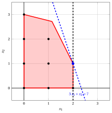{ .fig .ovale loading=lazy  }

                <em>Node 2: feasible region of $\LP_{2}$ (red), with the branching constraint $x_1 \le 2$ (dashed), and its optimal solution (blue).</em>

                An optimal solution ${\tilde{\boldsymbol x}}(\LP_{2})$ is:

                $$
                \tilde{x}_1=2,~~\tilde{x}_2=1
                $$

                the optimal value is:

                $$
                z(\LP_{2}) = 7
                $$

                The $\LP_{2}$ problem is <strong>feasible</strong> and we have

                $$
                \left\lfloor z(\LP_{2}) \right\rfloor > \LB
                \qquad \text{since} \qquad
                7 > -\infty
                $$

                The optimal solution ${\tilde{\boldsymbol x}}(\LP_{2})$ is <strong>integer</strong>, accordingly, the lower bound $\LB$ becomes $7$ and the incumbent solution ${\bar{\boldsymbol x}}(\ILP)$ becomes $\bar{x}_1=2,\bar{x}_2=1$.

                Accordingly, the branching node is <u>pruned by integrality</u>.

            At the end of the first iteration, branching on $x_{1}$ from Node 1 has generated the down-branching node, Node 2. This node is pruned by integrality. The up-branching node is not solved, since after Node 2 the lower bound satisfies

            $$
            \left\lfloor z(\LP_{1}) \right\rfloor \le \LB.
            $$

            This is the portion of the branch-and-bound tree showing the LP problems of the branching nodes that are solved:

            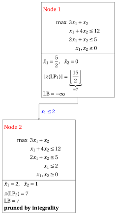{ .fig loading=lazy  }

            Due to the current lower bound $\LB$ and upper bound $\UB$, we have:

            $$
            7 ~~\le~~ z(\ILP) ~~\le~~ 7
            $$

        - <strong>Termination</strong>

            Since the list $L$ is empty, the lower bound $\LB$ is equal to the upper bound $\UB$ and the $\ILP$ problem is solved to optimality.

            The optimal value is $z(\ILP)=7$ (the value of the lower bound $\LB$) and an optimal solution ${\tilde{\boldsymbol x}}(\ILP)$ is $\tilde x_1=2,\tilde x_2=1$ (the incumbent solution ${\bar{\boldsymbol x}}(\ILP)$).

    2. The final branch-and-bound tree is:

        { .fig loading=lazy  }

        The reasons why the branching nodes are pruned are the following.

        - Node 1 has a fractional optimal solution with $\lfloor z(\LP_{1})\rfloor = 7$: it is branched on $x_1$.

        - The up-branching node of Node 1 is not solved, and it is not drawn, since $\lfloor z(\LP_{1})\rfloor = 7$ $\le \LB = 7$ after its first child.

        - Node 2 is pruned by integrality: $\tilde{\boldsymbol x}(\LP_{2}) = (2, 1)$ is integer, with value $7$, which becomes the incumbent solution.

        The optimal value is $z(\ILP) = 7$ and the branch-and-bound algorithm returns the optimal solution $\tilde{\boldsymbol x}(\ILP) = (2, 1)$.

!!! esercizio "Exercise 7.8: Branch-and-bound algorithm (P9)"

    !!! nota ""

        Consider the following ILP problem in canonical maximization form with $n=2$ integer variables and $m=2$ constraints:

        $$
        \begin{array}{rrrrrrr}
        {\max} & {2}\, {x_1} & {+} & {x_2} \\[2ex]
        & {-}{x_1} & {+} & {x_2} & {\le} & {1} \\[2ex]
        & {6}\, {x_1} & {+} & {4}\, {x_2} & {\le} & {39} \\[2ex]
        & {x_1,} &  & {x_2} & {\in} & {\Z_{\ge 0}}
        \end{array}
        $$

        and an optimal simplex dictionary of its LP relaxation in standard form:

        \begin{equation*}
        \begin{cases}
        \begin{array}{rrrrrrr}
        {x_1} & {=} & {\dfrac{13}{2}} & {-} & {\dfrac{2}{3}}\, {x_2} & {-} & {\dfrac{1}{6}}\, {x_4} \\[2ex]
        {x_3} & {=} & {\dfrac{15}{2}} & {-} & {\dfrac{5}{3}}\, {x_2} & {-} & {\dfrac{1}{6}}\, {x_4} \\[2ex]
        {z} & {=} & {13} & {-} & {\dfrac{1}{3}}\, {x_2} & {-} & {\dfrac{1}{3}}\, {x_4}
        \end{array}
        \end{cases}
        \end{equation*}

    **Questions**

    1. Execute the branch-and-bound algorithm using:

        1. the smallest-index rule as branching-variable selection strategy;

        2. the LIFO rule as branching-node selection strategy;

        3. solve first the down-branching node and then the up-branching node;

        4. set the lower bound $\LB$ to $-\infty$ (no heuristic algorithm is executed).

        Solve the LP problems of the branching nodes using the dual simplex algorithm. In the dual simplex algorithm, the leaving variable is the basic variable with negative value and smallest index, and ties in the ratio test are broken by the smallest index. Show graphically the optimal solution of the LP problems associated with the branching nodes.

    2. Determine and comment the branch-and-bound tree, showing the reason why each branching node is pruned.

??? soluzione "Solution"

    1. Execution of the branch-and-bound algorithm to solve the $\ILP$ problem.

        - <strong>Initialization</strong>

            Let us consider the $\LP_{1}$ problem in standard form:

            $$
            \begin{array}{rrrrrrrrrrr}
            {\max} & {2}\, {x_1} & {+} & {x_2} &  &  &  &  \\[2ex]
            & {-}{x_1} & {+} & {x_2} & {+} & {x_3} &  &  & {=} & {1} \\[2ex]
            & {6}\, {x_1} & {+} & {4}\, {x_2} &  &  & {+} & {x_4} & {=} & {39} \\[2ex]
            & {x_1,} &  & {x_2,} &  & {x_3,} &  & {x_4} & {\ge} & {0}
            \end{array}
            $$

            and its optimal simplex dictionary:

            \begin{equation*}
            \begin{cases}
            \begin{array}{rrrrrrr}
            {x_1} & {=} & {\dfrac{13}{2}} & {-} & {\dfrac{2}{3}}\, {x_2} & {-} & {\dfrac{1}{6}}\, {x_4} \\[2ex]
            {x_3} & {=} & {\dfrac{15}{2}} & {-} & {\dfrac{5}{3}}\, {x_2} & {-} & {\dfrac{1}{6}}\, {x_4} \\[2ex]
            {z} & {=} & {13} & {-} & {\dfrac{1}{3}}\, {x_2} & {-} & {\dfrac{1}{3}}\, {x_4}
            \end{array}
            \end{cases}
            \end{equation*}

            { .fig .ovale loading=lazy  }

            <em>Node 1: feasible region of $\LP_{1}$ (red), feasible points of the ILP problem (black) and optimal solution of $\LP_{1}$ (blue) with the objective function line through it.</em>

            An optimal solution ${\tilde{\boldsymbol x}}(\LP_{1})$ is:

            $$
            \tilde{x}_1=\dfrac{13}{2},~~\tilde{x}_2=0
            $$

            the optimal value is:

            $$
            z(\LP_{1}) = 13
            $$

            The optimal solution ${\tilde{\boldsymbol x}}(\LP_{1})$ is <strong>fractional</strong> and the $\LP_{1}$ problem is <strong>feasible</strong>, so the $\LP_{1}$ problem is inserted in the problem list $L$ and the lower bound $\LB$ is set to $-\infty$.

            Due to the current lower bound $\LB$ and upper bound $\UB$, we have:

            $$
            -\infty ~~\le~~ z(\ILP) ~~\le~~ 13
            $$

        - <strong>Iteration 1</strong>

            The $\LP_{1}$ problem is extracted and deleted from the problem list $L$.

            The branching variable is $x_{1}$. The branching constraints are:

            $$
            x_1 \le \underbrace{\left\lfloor \dfrac{13}{2} \right\rfloor}_{ = 6} \mathrm{~~~and~~~} x_1 \ge \underbrace{\left\lfloor \dfrac{13}{2} \right\rfloor +1}_{= 7}
            $$

            Two $\LP_{2}$ and $\LP_{3}$ problems are created with these branching constraints.

            1. Solution of the $\LP_{2}$ problem

                Let us consider the $\LP_{2}$ problem in standard form:

                $$
                \begin{array}{rrrrrrrrrrrrr}
                {\max} & {2}\, {x_1} & {+} & {x_2} &  &  &  &  &  &  \\[2ex]
                & {-}{x_1} & {+} & {x_2} & {+} & {x_3} &  &  &  &  & {=} & {1} \\[2ex]
                & {6}\, {x_1} & {+} & {4}\, {x_2} &  &  & {+} & {x_4} &  &  & {=} & {39} \\[2ex]
                & {x_1} &  &  &  &  &  &  & {+} & {x_5} & {=} & {6} \\[2ex]
                & {x_1,} &  & {x_2,} &  & {x_3,} &  & {x_4,} &  & {x_5} & {\ge} & {0}
                \end{array}
                $$

                For the branching constraint we have:

                $$
                x_1 + x_5 = 6 \quad \quad \Rightarrow \quad x_5 = 6 - x_1
                $$

                Using the equations of the optimal simplex dictionary we can express this branching constraint as a function of the non-basic variables. Substituting, we get

                $$
                x_5 = 6 - \left(\dfrac{13}{2} - \dfrac{2}{3} \; x_2 - \dfrac{1}{6} \; x_4 \right)
                \quad \quad \Rightarrow \quad
                x_5 = -\dfrac{1}{2} + \dfrac{2}{3} \, x_2 + \dfrac{1}{6} \, x_4
                $$

                We then add this equation to the previous optimal simplex dictionary and we obtain the following simplex dictionary:

                \begin{equation*}
                \begin{cases}
                \begin{array}{rrrrrrr}
                {x_1} & {=} & {\dfrac{13}{2}} & {-} & {\dfrac{2}{3}}\, {x_2} & {-} & {\dfrac{1}{6}}\, {x_4} \\[2ex]
                {x_3} & {=} & {\dfrac{15}{2}} & {-} & {\dfrac{5}{3}}\, {x_2} & {-} & {\dfrac{1}{6}}\, {x_4} \\[2ex]
                {x_5} & {=} & {-\dfrac{1}{2}} & {+} & {\dfrac{2}{3}}\, {x_2} & {+} & {\dfrac{1}{6}}\, {x_4} \\[2ex]
                {z} & {=} & {13} & {-} & {\dfrac{1}{3}}\, {x_2} & {-} & {\dfrac{1}{3}}\, {x_4}
                \end{array}
                \end{cases}
                \end{equation*}

                where $\pazocal{B}=\{1,3,5\}$ and $\pazocal{N}=\{2,4\}$ and

                - the basic primal non-feasible solution is:

                    $$
                    \bar x_1=\dfrac{13}{2},~~
                    \bar x_3=\dfrac{15}{2},~~
                    \bar x_5=-\dfrac{1}{2},~~~~~~
                    \bar x_2=0,~~
                    \bar x_4=0~~
                    \mathrm{~~of~value~~~} 13
                    $$

                - the basic dual feasible solution is:

                    $$
                    \bar \pi_1=0,~~
                    \bar \pi_3=0,~~
                    \bar \pi_5=0,~~~~~~
                    \bar \pi_2=\dfrac{1}{3},~~
                    \bar \pi_4=\dfrac{1}{3}~~
                    \mathrm{~~of~value~~~} 13
                    $$

                If we increase the value of $\pi_{5}$, we can get a better dual solution. We have:

                $$
                \begin{cases}
                \pi_2 &= \dfrac{1}{3} - \dfrac{2}{3}\,\pi_5 \\[2ex]
                \pi_4 &= \dfrac{1}{3} - \dfrac{1}{6}\,\pi_5
                \end{cases}
                \qquad
                \qquad
                \begin{cases}
                \underbrace{ \dfrac{1}{3} - \dfrac{2}{3}\,\pi_5 \ge 0}_{\pi_2 \ge 0} \\[2ex]
                \underbrace{ \dfrac{1}{3} - \dfrac{1}{6}\,\pi_5 \ge 0}_{\pi_4 \ge 0}
                \end{cases}
                \qquad
                \qquad
                \begin{cases}
                \pi_5 &\le \dfrac{1}{2} \\[2ex]
                \pi_5 &\le 2
                \end{cases}
                $$

                By increasing the value of $\pi_{5}$ to $\min \left\{\dfrac{1}{2}, 2\right\}=\dfrac{1}{2}$, the value of $\pi_{2}$ decreases to $0$. Then we have that:

                - $\pi_{5}$ becomes a dual basic variable and accordingly $x_{5}$ becomes a primal non-basic variable.

                - $\pi_{2}$ becomes a dual non-basic variable and accordingly $x_{2}$ becomes a primal basic variable.

                We have:

                $$
                x_5 = -\dfrac{1}{2} + \dfrac{2}{3} \, x_2 + \dfrac{1}{6} \, x_4
                \quad \Rightarrow \quad
                x_2 = \dfrac{3}{4} - \dfrac{1}{4} \, x_4 + \dfrac{3}{2} \, x_5
                $$

                Substituting into the other equations of the primal simplex dictionary, we get:

                $$
                x_1
                = \dfrac{13}{2} - \dfrac{2}{3} \left( \dfrac{3}{4} - \dfrac{1}{4} \, x_4 + \dfrac{3}{2} \, x_5 \right) - \dfrac{1}{6} \; x_4
                = 6 - x_5
                $$

                $$
                x_3
                = \dfrac{15}{2} - \dfrac{5}{3} \left( \dfrac{3}{4} - \dfrac{1}{4} \, x_4 + \dfrac{3}{2} \, x_5 \right) - \dfrac{1}{6} \; x_4
                = \dfrac{25}{4} + \dfrac{1}{4} \, x_4 - \dfrac{5}{2} \, x_5
                $$

                $$
                z
                = 13 - \dfrac{1}{3} \left( \dfrac{3}{4} - \dfrac{1}{4} \, x_4 + \dfrac{3}{2} \, x_5 \right) - \dfrac{1}{3} \; x_4
                = \dfrac{51}{4} - \dfrac{1}{4} \, x_4 - \dfrac{1}{2} \, x_5
                $$

                Accordingly, we now have the following updated primal simplex dictionary:

                \begin{equation*}
                \begin{cases}
                \begin{array}{rrrrrrr}
                {x_1} & {=} & {6} &  &  & {-} & {x_5} \\[2ex]
                {x_2} & {=} & {\dfrac{3}{4}} & {-} & {\dfrac{1}{4}}\, {x_4} & {+} & {\dfrac{3}{2}}\, {x_5} \\[2ex]
                {x_3} & {=} & {\dfrac{25}{4}} & {+} & {\dfrac{1}{4}}\, {x_4} & {-} & {\dfrac{5}{2}}\, {x_5} \\[2ex]
                {z} & {=} & {\dfrac{51}{4}} & {-} & {\dfrac{1}{4}}\, {x_4} & {-} & {\dfrac{1}{2}}\, {x_5}
                \end{array}
                \end{cases}
                \end{equation*}

                where $\pazocal{B}=\{1,2,3\}$ and $\pazocal{N}=\{4,5\}$ and

                - the basic primal optimal solution is:

                    $$
                    \tilde x_1=6,~~
                    \tilde x_2=\dfrac{3}{4},~~
                    \tilde x_3=\dfrac{25}{4},~~~~~~
                    \tilde x_4=0,~~
                    \tilde x_5=0~~
                    \mathrm{~~of~value~~~} \dfrac{51}{4}
                    $$

                - the basic dual optimal solution is:

                    $$
                    \tilde \pi_1=0,~~
                    \tilde \pi_2=0,~~
                    \tilde \pi_3=0,~~~~~~
                    \tilde \pi_4=\dfrac{1}{4},~~
                    \tilde \pi_5=\dfrac{1}{2}~~
                    \mathrm{~~of~value~~~} \dfrac{51}{4}
                    $$

                { .fig .ovale loading=lazy  }

                <em>Node 2: feasible region of $\LP_{2}$ (red), with the branching constraint $x_1 \le 6$ (dashed), and its optimal solution (blue).</em>

                An optimal solution ${\tilde{\boldsymbol x}}(\LP_{2})$ is:

                $$
                \tilde{x}_1=6,~~\tilde{x}_2=\dfrac{3}{4}
                $$

                the optimal value is:

                $$
                z(\LP_{2}) = \dfrac{51}{4}
                $$

                The $\LP_{2}$ problem is <strong>feasible</strong> and we have

                $$
                \left\lfloor z(\LP_{2}) \right\rfloor > \LB
                \qquad \text{since} \qquad
                \underbrace{\left\lfloor \dfrac{51}{4} \right\rfloor}_{=12} > -\infty
                $$

                The optimal solution ${\tilde{\boldsymbol x}}(\LP_{2})$ is <strong>fractional</strong>, accordingly, the $\LP_{2}$ problem is <strong>inserted in the problem list</strong> $L$.

            2. Solution of the $\LP_{3}$ problem

                Let us consider the $\LP_{3}$ problem in standard form:

                $$
                \begin{array}{rrrrrrrrrrrrr}
                {\max} & {2}\, {x_1} & {+} & {x_2} &  &  &  &  &  &  \\[2ex]
                & {-}{x_1} & {+} & {x_2} & {+} & {x_3} &  &  &  &  & {=} & {1} \\[2ex]
                & {6}\, {x_1} & {+} & {4}\, {x_2} &  &  & {+} & {x_4} &  &  & {=} & {39} \\[2ex]
                & {x_1} &  &  &  &  &  &  & {-} & {x_5} & {=} & {7} \\[2ex]
                & {x_1,} &  & {x_2,} &  & {x_3,} &  & {x_4,} &  & {x_5} & {\ge} & {0}
                \end{array}
                $$

                For the branching constraint we have:

                $$
                x_1 - x_5 = 7 \quad \quad \Rightarrow \quad x_5 = -7 + x_1
                $$

                Using the equations of the optimal simplex dictionary we can express this branching constraint as a function of the non-basic variables. Substituting, we get

                $$
                x_5 = -7 + \left(\dfrac{13}{2} - \dfrac{2}{3} \; x_2 - \dfrac{1}{6} \; x_4 \right)
                \quad \quad \Rightarrow \quad
                x_5 = -\dfrac{1}{2} - \dfrac{2}{3} \, x_2 - \dfrac{1}{6} \, x_4
                $$

                We then add this equation to the previous optimal simplex dictionary and we obtain the following simplex dictionary:

                \begin{equation*}
                \begin{cases}
                \begin{array}{rrrrrrr}
                {x_1} & {=} & {\dfrac{13}{2}} & {-} & {\dfrac{2}{3}}\, {x_2} & {-} & {\dfrac{1}{6}}\, {x_4} \\[2ex]
                {x_3} & {=} & {\dfrac{15}{2}} & {-} & {\dfrac{5}{3}}\, {x_2} & {-} & {\dfrac{1}{6}}\, {x_4} \\[2ex]
                {x_5} & {=} & {-\dfrac{1}{2}} & {-} & {\dfrac{2}{3}}\, {x_2} & {-} & {\dfrac{1}{6}}\, {x_4} \\[2ex]
                {z} & {=} & {13} & {-} & {\dfrac{1}{3}}\, {x_2} & {-} & {\dfrac{1}{3}}\, {x_4}
                \end{array}
                \end{cases}
                \end{equation*}

                where $\pazocal{B}=\{1,3,5\}$ and $\pazocal{N}=\{2,4\}$ and

                - the basic primal non-feasible solution is:

                    $$
                    \bar x_1=\dfrac{13}{2},~~
                    \bar x_3=\dfrac{15}{2},~~
                    \bar x_5=-\dfrac{1}{2},~~~~~~
                    \bar x_2=0,~~
                    \bar x_4=0~~
                    \mathrm{~~of~value~~~} 13
                    $$

                - the basic dual feasible solution is:

                    $$
                    \bar \pi_1=0,~~
                    \bar \pi_3=0,~~
                    \bar \pi_5=0,~~~~~~
                    \bar \pi_2=\dfrac{1}{3},~~
                    \bar \pi_4=\dfrac{1}{3}~~
                    \mathrm{~~of~value~~~} 13
                    $$

                If we increase the value of $\pi_{5}$, we can get a better dual solution. We have:

                $$
                \begin{cases}
                \pi_2 &= \dfrac{1}{3} + \dfrac{2}{3}\,\pi_5 \\[2ex]
                \pi_4 &= \dfrac{1}{3} + \dfrac{1}{6}\,\pi_5
                \end{cases}
                \qquad
                \qquad
                \begin{cases}
                \underbrace{ \dfrac{1}{3} + \dfrac{2}{3}\,\pi_5 \ge 0}_{\pi_2 \ge 0} \\[2ex]
                \underbrace{ \dfrac{1}{3} + \dfrac{1}{6}\,\pi_5 \ge 0}_{\pi_4 \ge 0}
                \end{cases}
                \qquad
                \qquad
                \begin{cases}
                \pi_5 &\ge -\dfrac{1}{2} \\[2ex]
                \pi_5 &\ge -2
                \end{cases}
                $$

                Accordingly, we can increase the value of $\pi_{5}$ without violating dual feasibility, which implies that the dual problem is <strong>unbounded</strong>. As a result, the primal problem $\LP_{3}$ is <strong>infeasible</strong>, and the corresponding branching node is <u>pruned by infeasibility</u>.

            At the end of the first iteration, branching on $x_{1}$ from Node 1 has generated the down-branching node, Node 2, and the up-branching node, Node 3. Node 2 is inserted in the list $L$, while Node 3 is pruned by infeasibility. The corresponding branch-and-bound tree is:

            { .fig loading=lazy  }

            Due to the current lower bound $\LB$ and upper bound $\UB$, we have:

            $$
            -\infty ~~\le~~ z(\ILP) ~~\le~~ \underbrace{\left\lfloor \dfrac{51}{4} \right\rfloor}_{=12}
            $$

        - <strong>Iteration 2</strong>

            The $\LP_{2}$ problem is extracted and deleted from the problem list $L$.

            The branching variable is $x_{2}$. The branching constraints are:

            $$
            x_2 \le \underbrace{\left\lfloor \dfrac{3}{4} \right\rfloor}_{ = 0} \mathrm{~~~and~~~} x_2 \ge \underbrace{\left\lfloor \dfrac{3}{4} \right\rfloor +1}_{= 1}
            $$

            The $\LP_{4}$ problem is created with the first branching constraint (the second child is solved only if needed).

            1. Solution of the $\LP_{4}$ problem

                Let us consider the $\LP_{4}$ problem in standard form:

                $$
                \begin{array}{rrrrrrrrrrrrrrr}
                {\max} & {2}\, {x_1} & {+} & {x_2} &  &  &  &  &  &  &  &  \\[2ex]
                & {-}{x_1} & {+} & {x_2} & {+} & {x_3} &  &  &  &  &  &  & {=} & {1} \\[2ex]
                & {6}\, {x_1} & {+} & {4}\, {x_2} &  &  & {+} & {x_4} &  &  &  &  & {=} & {39} \\[2ex]
                & {x_1} &  &  &  &  &  &  & {+} & {x_5} &  &  & {=} & {6} \\[2ex]
                &  &  & {x_2} &  &  &  &  &  &  & {+} & {x_6} & {=} & {0} \\[2ex]
                & {x_1,} &  & {x_2,} &  & {x_3,} &  & {x_4,} &  & {x_5,} &  & {x_6} & {\ge} & {0}
                \end{array}
                $$

                For the branching constraint we have:

                $$
                x_2 + x_6 = 0 \quad \quad \Rightarrow \quad x_6 = 0 - x_2
                $$

                Using the equations of the optimal simplex dictionary we can express this branching constraint as a function of the non-basic variables. Substituting, we get

                $$
                x_6 = 0 - \left(\dfrac{3}{4} - \dfrac{1}{4} \; x_4 + \dfrac{3}{2} \; x_5 \right)
                \quad \quad \Rightarrow \quad
                x_6 = -\dfrac{3}{4} + \dfrac{1}{4} \, x_4 - \dfrac{3}{2} \, x_5
                $$

                We then add this equation to the previous optimal simplex dictionary and we obtain the following simplex dictionary:

                \begin{equation*}
                \begin{cases}
                \begin{array}{rrrrrrr}
                {x_1} & {=} & {6} &  &  & {-} & {x_5} \\[2ex]
                {x_2} & {=} & {\dfrac{3}{4}} & {-} & {\dfrac{1}{4}}\, {x_4} & {+} & {\dfrac{3}{2}}\, {x_5} \\[2ex]
                {x_3} & {=} & {\dfrac{25}{4}} & {+} & {\dfrac{1}{4}}\, {x_4} & {-} & {\dfrac{5}{2}}\, {x_5} \\[2ex]
                {x_6} & {=} & {-\dfrac{3}{4}} & {+} & {\dfrac{1}{4}}\, {x_4} & {-} & {\dfrac{3}{2}}\, {x_5} \\[2ex]
                {z} & {=} & {\dfrac{51}{4}} & {-} & {\dfrac{1}{4}}\, {x_4} & {-} & {\dfrac{1}{2}}\, {x_5}
                \end{array}
                \end{cases}
                \end{equation*}

                where $\pazocal{B}=\{1,2,3,6\}$ and $\pazocal{N}=\{4,5\}$ and

                - the basic primal non-feasible solution is:

                    $$
                    \bar x_1=6,~~
                    \bar x_2=\dfrac{3}{4},~~
                    \bar x_3=\dfrac{25}{4},~~
                    \bar x_6=-\dfrac{3}{4},~~~~~~
                    \bar x_4=0,~~
                    \bar x_5=0~~
                    \mathrm{~~of~value~~~} \dfrac{51}{4}
                    $$

                - the basic dual feasible solution is:

                    $$
                    \bar \pi_1=0,~~
                    \bar \pi_2=0,~~
                    \bar \pi_3=0,~~
                    \bar \pi_6=0,~~~~~~
                    \bar \pi_4=\dfrac{1}{4},~~
                    \bar \pi_5=\dfrac{1}{2}~~
                    \mathrm{~~of~value~~~} \dfrac{51}{4}
                    $$

                If we increase the value of $\pi_{6}$, we can get a better dual solution. We have:

                $$
                \begin{cases}
                \pi_4 &= \dfrac{1}{4} - \dfrac{1}{4}\,\pi_6 \\[2ex]
                \pi_5 &= \dfrac{1}{2} + \dfrac{3}{2}\,\pi_6
                \end{cases}
                \qquad
                \qquad
                \begin{cases}
                \underbrace{ \dfrac{1}{4} - \dfrac{1}{4}\,\pi_6 \ge 0}_{\pi_4 \ge 0} \\[2ex]
                \underbrace{ \dfrac{1}{2} + \dfrac{3}{2}\,\pi_6 \ge 0}_{\pi_5 \ge 0}
                \end{cases}
                \qquad
                \qquad
                \begin{cases}
                \pi_6 &\le 1 \\[2ex]
                \pi_6 &\ge -\dfrac{1}{3}
                \end{cases}
                $$

                By increasing the value of $\pi_{6}$ to $1$, the value of $\pi_{4}$ decreases to $0$. Then we have that:

                - $\pi_{6}$ becomes a dual basic variable and accordingly $x_{6}$ becomes a primal non-basic variable.

                - $\pi_{4}$ becomes a dual non-basic variable and accordingly $x_{4}$ becomes a primal basic variable.

                We have:

                $$
                x_6 = -\dfrac{3}{4} + \dfrac{1}{4} \, x_4 - \dfrac{3}{2} \, x_5
                \quad \Rightarrow \quad
                x_4 = 3 + 6 \, x_5 + 4 \, x_6
                $$

                Substituting into the other equations of the primal simplex dictionary, we get:

                $$
                x_2
                = \dfrac{3}{4} - \dfrac{1}{4} \left( 3 + 6 \, x_5 + 4 \, x_6 \right) + \dfrac{3}{2} \; x_5
                = 0 - x_6
                $$

                $$
                x_3
                = \dfrac{25}{4} + \dfrac{1}{4} \left( 3 + 6 \, x_5 + 4 \, x_6 \right) - \dfrac{5}{2} \; x_5
                = 7 - x_5 + x_6
                $$

                $$
                z
                = \dfrac{51}{4} - \dfrac{1}{4} \left( 3 + 6 \, x_5 + 4 \, x_6 \right) - \dfrac{1}{2} \; x_5
                = 12 - 2 \, x_5 - x_6
                $$

                Accordingly, we now have the following updated primal simplex dictionary:

                \begin{equation*}
                \begin{cases}
                \begin{array}{rrrrrrr}
                {x_1} & {=} & {6} & {-} & {x_5} &  &  \\[2ex]
                {x_2} & {=} & {0} &  &  & {-} & {x_6} \\[2ex]
                {x_3} & {=} & {7} & {-} & {x_5} & {+} & {x_6} \\[2ex]
                {x_4} & {=} & {3} & {+} & {6}\, {x_5} & {+} & {4}\, {x_6} \\[2ex]
                {z} & {=} & {12} & {-} & {2}\, {x_5} & {-} & {x_6}
                \end{array}
                \end{cases}
                \end{equation*}

                where $\pazocal{B}=\{1,2,3,4\}$ and $\pazocal{N}=\{5,6\}$ and

                - the basic primal optimal solution is:

                    $$
                    \tilde x_1=6,~~
                    \tilde x_2=0,~~
                    \tilde x_3=7,~~
                    \tilde x_4=3,~~~~~~
                    \tilde x_5=0,~~
                    \tilde x_6=0~~
                    \mathrm{~~of~value~~~} 12
                    $$

                - the basic dual optimal solution is:

                    $$
                    \tilde \pi_1=0,~~
                    \tilde \pi_2=0,~~
                    \tilde \pi_3=0,~~
                    \tilde \pi_4=0,~~~~~~
                    \tilde \pi_5=2,~~
                    \tilde \pi_6=1~~
                    \mathrm{~~of~value~~~} 12
                    $$

                { .fig .ovale loading=lazy  }

                <em>Node 4: feasible region of $\LP_{4}$ (red), with the branching constraint $x_2 \le 0$ (dashed), and its optimal solution (blue).</em>

                An optimal solution ${\tilde{\boldsymbol x}}(\LP_{4})$ is:

                $$
                \tilde{x}_1=6,~~\tilde{x}_2=0
                $$

                the optimal value is:

                $$
                z(\LP_{4}) = 12
                $$

                The $\LP_{4}$ problem is <strong>feasible</strong> and we have

                $$
                \left\lfloor z(\LP_{4}) \right\rfloor > \LB
                \qquad \text{since} \qquad
                12 > -\infty
                $$

                The optimal solution ${\tilde{\boldsymbol x}}(\LP_{4})$ is <strong>integer</strong>, accordingly, the lower bound $\LB$ becomes $12$ and the incumbent solution ${\bar{\boldsymbol x}}(\ILP)$ becomes $\bar{x}_1=6,\bar{x}_2=0$.

                Accordingly, the branching node is <u>pruned by integrality</u>.

            At the end of the second iteration, branching on $x_{2}$ from Node 2 has generated the down-branching node, Node 4. This node is pruned by integrality. The up-branching node is not solved, since after Node 4 the lower bound satisfies

            $$
            \left\lfloor z(\LP_{2}) \right\rfloor \le \LB.
            $$

            This is the portion of the branch-and-bound tree showing the LP problems of the branching nodes that are solved:

            { .fig loading=lazy  }

            Due to the current lower bound $\LB$ and upper bound $\UB$, we have:

            $$
            12 ~~\le~~ z(\ILP) ~~\le~~ 12
            $$

        - <strong>Termination</strong>

            Since the list $L$ is empty, the lower bound $\LB$ is equal to the upper bound $\UB$ and the $\ILP$ problem is solved to optimality.

            The optimal value is $z(\ILP)=12$ (the value of the lower bound $\LB$) and an optimal solution ${\tilde{\boldsymbol x}}(\ILP)$ is $\tilde x_1=6,\tilde x_2=0$ (the incumbent solution ${\bar{\boldsymbol x}}(\ILP)$).

    2. The final branch-and-bound tree is:

        { .fig loading=lazy  }

        The reasons why the branching nodes are pruned are the following.

        - Node 1 has a fractional optimal solution with $z(\LP_{1}) = 13$: it is branched on $x_1$.

        - Node 2 has a fractional optimal solution with $\lfloor z(\LP_{2})\rfloor = 12$: it is branched on $x_2$.

        - The up-branching node of Node 2 is not solved, and it is not drawn, since $\lfloor z(\LP_{2})\rfloor = 12$ $\le \LB = 12$ after its first child.

        - Node 3 is pruned by infeasibility: the $\LP_{3}$ problem has no feasible solution.

        - Node 4 is pruned by integrality: $\tilde{\boldsymbol x}(\LP_{4}) = (6, 0)$ is integer, with value $12$, which becomes the incumbent solution.

        The optimal value is $z(\ILP) = 12$ and the branch-and-bound algorithm returns the optimal solution $\tilde{\boldsymbol x}(\ILP) = (6, 0)$. The optimal solution is <strong>not unique</strong>: also $(5, 2)$ has value $12$. With the rules stated in the question, the algorithm finds $(6, 0)$.

!!! esercizio "Exercise 7.9: Branch-and-bound algorithm (P10)"

    !!! nota ""

        Consider the following ILP problem in canonical maximization form with $n=2$ integer variables and $m=3$ constraints:

        $$
        \begin{array}{rrrrrrr}
        {\max} & {5}\, {x_1} & {+} & {2}\, {x_2} \\[2ex]
        & {-}{x_1} & {+} & {3}\, {x_2} & {\le} & {12} \\[2ex]
        & {x_1} & {+} & {2}\, {x_2} & {\le} & {12} \\[2ex]
        & {3}\, {x_1} & {-} & {2}\, {x_2} & {\le} & {8} \\[2ex]
        & {x_1,} &  & {x_2} & {\in} & {\Z_{\ge 0}}
        \end{array}
        $$

        and an optimal simplex dictionary of its LP relaxation in standard form:

        \begin{equation*}
        \begin{cases}
        \begin{array}{rrrrrrr}
        {x_1} & {=} & {5} & {-} & {\dfrac{1}{4}}\, {x_4} & {-} & {\dfrac{1}{4}}\, {x_5} \\[2ex]
        {x_2} & {=} & {\dfrac{7}{2}} & {-} & {\dfrac{3}{8}}\, {x_4} & {+} & {\dfrac{1}{8}}\, {x_5} \\[2ex]
        {x_3} & {=} & {\dfrac{13}{2}} & {+} & {\dfrac{7}{8}}\, {x_4} & {-} & {\dfrac{5}{8}}\, {x_5} \\[2ex]
        {z} & {=} & {32} & {-} & {2}\, {x_4} & {-} & {x_5}
        \end{array}
        \end{cases}
        \end{equation*}

    **Questions**

    1. Execute the branch-and-bound algorithm using:

        1. the largest-index rule as branching-variable selection strategy;

        2. the FIFO rule as branching-node selection strategy;

        3. solve first the down-branching node and then the up-branching node;

        4. set the lower bound $\LB$ to $-\infty$ (no heuristic algorithm is executed).

        Solve the LP problems of the branching nodes using the dual simplex algorithm. In the dual simplex algorithm, the leaving variable is the basic variable with negative value and smallest index, and ties in the ratio test are broken by the smallest index. Show graphically the optimal solution of the LP problems associated with the branching nodes.

    2. Determine and comment the branch-and-bound tree, showing the reason why each branching node is pruned.

??? soluzione "Solution"

    1. Execution of the branch-and-bound algorithm to solve the $\ILP$ problem.

        - <strong>Initialization</strong>

            Let us consider the $\LP_{1}$ problem in standard form:

            $$
            \begin{array}{rrrrrrrrrrrrr}
            {\max} & {5}\, {x_1} & {+} & {2}\, {x_2} &  &  &  &  &  &  \\[2ex]
            & {-}{x_1} & {+} & {3}\, {x_2} & {+} & {x_3} &  &  &  &  & {=} & {12} \\[2ex]
            & {x_1} & {+} & {2}\, {x_2} &  &  & {+} & {x_4} &  &  & {=} & {12} \\[2ex]
            & {3}\, {x_1} & {-} & {2}\, {x_2} &  &  &  &  & {+} & {x_5} & {=} & {8} \\[2ex]
            & {x_1,} &  & {x_2,} &  & {x_3,} &  & {x_4,} &  & {x_5} & {\ge} & {0}
            \end{array}
            $$

            and its optimal simplex dictionary:

            \begin{equation*}
            \begin{cases}
            \begin{array}{rrrrrrr}
            {x_1} & {=} & {5} & {-} & {\dfrac{1}{4}}\, {x_4} & {-} & {\dfrac{1}{4}}\, {x_5} \\[2ex]
            {x_2} & {=} & {\dfrac{7}{2}} & {-} & {\dfrac{3}{8}}\, {x_4} & {+} & {\dfrac{1}{8}}\, {x_5} \\[2ex]
            {x_3} & {=} & {\dfrac{13}{2}} & {+} & {\dfrac{7}{8}}\, {x_4} & {-} & {\dfrac{5}{8}}\, {x_5} \\[2ex]
            {z} & {=} & {32} & {-} & {2}\, {x_4} & {-} & {x_5}
            \end{array}
            \end{cases}
            \end{equation*}

            { .fig .ovale loading=lazy  }

            <em>Node 1: feasible region of $\LP_{1}$ (red), feasible points of the ILP problem (black) and optimal solution of $\LP_{1}$ (blue) with the objective function line through it.</em>

            An optimal solution ${\tilde{\boldsymbol x}}(\LP_{1})$ is:

            $$
            \tilde{x}_1=5,~~\tilde{x}_2=\dfrac{7}{2}
            $$

            the optimal value is:

            $$
            z(\LP_{1}) = 32
            $$

            The optimal solution ${\tilde{\boldsymbol x}}(\LP_{1})$ is <strong>fractional</strong> and the $\LP_{1}$ problem is <strong>feasible</strong>, so the $\LP_{1}$ problem is inserted in the problem list $L$ and the lower bound $\LB$ is set to $-\infty$.

            Due to the current lower bound $\LB$ and upper bound $\UB$, we have:

            $$
            -\infty ~~\le~~ z(\ILP) ~~\le~~ 32
            $$

        - <strong>Iteration 1</strong>

            The $\LP_{1}$ problem is extracted and deleted from the problem list $L$.

            The branching variable is $x_{2}$. The branching constraints are:

            $$
            x_2 \le \underbrace{\left\lfloor \dfrac{7}{2} \right\rfloor}_{ = 3} \mathrm{~~~and~~~} x_2 \ge \underbrace{\left\lfloor \dfrac{7}{2} \right\rfloor +1}_{= 4}
            $$

            Two $\LP_{2}$ and $\LP_{3}$ problems are created with these branching constraints.

            1. Solution of the $\LP_{2}$ problem

                Let us consider the $\LP_{2}$ problem in standard form:

                $$
                \begin{array}{rrrrrrrrrrrrrrr}
                {\max} & {5}\, {x_1} & {+} & {2}\, {x_2} &  &  &  &  &  &  &  &  \\[2ex]
                & {-}{x_1} & {+} & {3}\, {x_2} & {+} & {x_3} &  &  &  &  &  &  & {=} & {12} \\[2ex]
                & {x_1} & {+} & {2}\, {x_2} &  &  & {+} & {x_4} &  &  &  &  & {=} & {12} \\[2ex]
                & {3}\, {x_1} & {-} & {2}\, {x_2} &  &  &  &  & {+} & {x_5} &  &  & {=} & {8} \\[2ex]
                &  &  & {x_2} &  &  &  &  &  &  & {+} & {x_6} & {=} & {3} \\[2ex]
                & {x_1,} &  & {x_2,} &  & {x_3,} &  & {x_4,} &  & {x_5,} &  & {x_6} & {\ge} & {0}
                \end{array}
                $$

                For the branching constraint we have:

                $$
                x_2 + x_6 = 3 \quad \quad \Rightarrow \quad x_6 = 3 - x_2
                $$

                Using the equations of the optimal simplex dictionary we can express this branching constraint as a function of the non-basic variables. Substituting, we get

                $$
                x_6 = 3 - \left(\dfrac{7}{2} - \dfrac{3}{8} \; x_4 + \dfrac{1}{8} \; x_5 \right)
                \quad \quad \Rightarrow \quad
                x_6 = -\dfrac{1}{2} + \dfrac{3}{8} \, x_4 - \dfrac{1}{8} \, x_5
                $$

                We then add this equation to the previous optimal simplex dictionary and we obtain the following simplex dictionary:

                \begin{equation*}
                \begin{cases}
                \begin{array}{rrrrrrr}
                {x_1} & {=} & {5} & {-} & {\dfrac{1}{4}}\, {x_4} & {-} & {\dfrac{1}{4}}\, {x_5} \\[2ex]
                {x_2} & {=} & {\dfrac{7}{2}} & {-} & {\dfrac{3}{8}}\, {x_4} & {+} & {\dfrac{1}{8}}\, {x_5} \\[2ex]
                {x_3} & {=} & {\dfrac{13}{2}} & {+} & {\dfrac{7}{8}}\, {x_4} & {-} & {\dfrac{5}{8}}\, {x_5} \\[2ex]
                {x_6} & {=} & {-\dfrac{1}{2}} & {+} & {\dfrac{3}{8}}\, {x_4} & {-} & {\dfrac{1}{8}}\, {x_5} \\[2ex]
                {z} & {=} & {32} & {-} & {2}\, {x_4} & {-} & {x_5}
                \end{array}
                \end{cases}
                \end{equation*}

                where $\pazocal{B}=\{1,2,3,6\}$ and $\pazocal{N}=\{4,5\}$ and

                - the basic primal non-feasible solution is:

                    $$
                    \bar x_1=5,~~
                    \bar x_2=\dfrac{7}{2},~~
                    \bar x_3=\dfrac{13}{2},~~
                    \bar x_6=-\dfrac{1}{2},~~~~~~
                    \bar x_4=0,~~
                    \bar x_5=0~~
                    \mathrm{~~of~value~~~} 32
                    $$

                - the basic dual feasible solution is:

                    $$
                    \bar \pi_1=0,~~
                    \bar \pi_2=0,~~
                    \bar \pi_3=0,~~
                    \bar \pi_6=0,~~~~~~
                    \bar \pi_4=2,~~
                    \bar \pi_5=1~~
                    \mathrm{~~of~value~~~} 32
                    $$

                If we increase the value of $\pi_{6}$, we can get a better dual solution. We have:

                $$
                \begin{cases}
                \pi_4 &= 2 - \dfrac{3}{8}\,\pi_6 \\[2ex]
                \pi_5 &= 1 + \dfrac{1}{8}\,\pi_6
                \end{cases}
                \qquad
                \qquad
                \begin{cases}
                \underbrace{ 2 - \dfrac{3}{8}\,\pi_6 \ge 0}_{\pi_4 \ge 0} \\[2ex]
                \underbrace{ 1 + \dfrac{1}{8}\,\pi_6 \ge 0}_{\pi_5 \ge 0}
                \end{cases}
                \qquad
                \qquad
                \begin{cases}
                \pi_6 &\le \dfrac{16}{3} \\[2ex]
                \pi_6 &\ge -8
                \end{cases}
                $$

                By increasing the value of $\pi_{6}$ to $\dfrac{16}{3}$, the value of $\pi_{4}$ decreases to $0$. Then we have that:

                - $\pi_{6}$ becomes a dual basic variable and accordingly $x_{6}$ becomes a primal non-basic variable.

                - $\pi_{4}$ becomes a dual non-basic variable and accordingly $x_{4}$ becomes a primal basic variable.

                We have:

                $$
                x_6 = -\dfrac{1}{2} + \dfrac{3}{8} \, x_4 - \dfrac{1}{8} \, x_5
                \quad \Rightarrow \quad
                x_4 = \dfrac{4}{3} + \dfrac{1}{3} \, x_5 + \dfrac{8}{3} \, x_6
                $$

                Substituting into the other equations of the primal simplex dictionary, we get:

                $$
                x_1
                = 5 - \dfrac{1}{4} \left( \dfrac{4}{3} + \dfrac{1}{3} \, x_5 + \dfrac{8}{3} \, x_6 \right) - \dfrac{1}{4} \; x_5
                = \dfrac{14}{3} - \dfrac{1}{3} \, x_5 - \dfrac{2}{3} \, x_6
                $$

                $$
                x_2
                = \dfrac{7}{2} - \dfrac{3}{8} \left( \dfrac{4}{3} + \dfrac{1}{3} \, x_5 + \dfrac{8}{3} \, x_6 \right) + \dfrac{1}{8} \; x_5
                = 3 - x_6
                $$

                $$
                x_3
                = \dfrac{13}{2} + \dfrac{7}{8} \left( \dfrac{4}{3} + \dfrac{1}{3} \, x_5 + \dfrac{8}{3} \, x_6 \right) - \dfrac{5}{8} \; x_5
                = \dfrac{23}{3} - \dfrac{1}{3} \, x_5 + \dfrac{7}{3} \, x_6
                $$

                $$
                z
                = 32 - 2 \left( \dfrac{4}{3} + \dfrac{1}{3} \, x_5 + \dfrac{8}{3} \, x_6 \right) - x_5
                = \dfrac{88}{3} - \dfrac{5}{3} \, x_5 - \dfrac{16}{3} \, x_6
                $$

                Accordingly, we now have the following updated primal simplex dictionary:

                \begin{equation*}
                \begin{cases}
                \begin{array}{rrrrrrr}
                {x_1} & {=} & {\dfrac{14}{3}} & {-} & {\dfrac{1}{3}}\, {x_5} & {-} & {\dfrac{2}{3}}\, {x_6} \\[2ex]
                {x_2} & {=} & {3} &  &  & {-} & {x_6} \\[2ex]
                {x_3} & {=} & {\dfrac{23}{3}} & {-} & {\dfrac{1}{3}}\, {x_5} & {+} & {\dfrac{7}{3}}\, {x_6} \\[2ex]
                {x_4} & {=} & {\dfrac{4}{3}} & {+} & {\dfrac{1}{3}}\, {x_5} & {+} & {\dfrac{8}{3}}\, {x_6} \\[2ex]
                {z} & {=} & {\dfrac{88}{3}} & {-} & {\dfrac{5}{3}}\, {x_5} & {-} & {\dfrac{16}{3}}\, {x_6}
                \end{array}
                \end{cases}
                \end{equation*}

                where $\pazocal{B}=\{1,2,3,4\}$ and $\pazocal{N}=\{5,6\}$ and

                - the basic primal optimal solution is:

                    $$
                    \tilde x_1=\dfrac{14}{3},~~
                    \tilde x_2=3,~~
                    \tilde x_3=\dfrac{23}{3},~~
                    \tilde x_4=\dfrac{4}{3},~~~~~~
                    \tilde x_5=0,~~
                    \tilde x_6=0~~
                    \mathrm{~~of~value~~~} \dfrac{88}{3}
                    $$

                - the basic dual optimal solution is:

                    $$
                    \tilde \pi_1=0,~~
                    \tilde \pi_2=0,~~
                    \tilde \pi_3=0,~~
                    \tilde \pi_4=0,~~~~~~
                    \tilde \pi_5=\dfrac{5}{3},~~
                    \tilde \pi_6=\dfrac{16}{3}~~
                    \mathrm{~~of~value~~~} \dfrac{88}{3}
                    $$

                { .fig .ovale loading=lazy  }

                <em>Node 2: feasible region of $\LP_{2}$ (red), with the branching constraint $x_2 \le 3$ (dashed), and its optimal solution (blue).</em>

                An optimal solution ${\tilde{\boldsymbol x}}(\LP_{2})$ is:

                $$
                \tilde{x}_1=\dfrac{14}{3},~~\tilde{x}_2=3
                $$

                the optimal value is:

                $$
                z(\LP_{2}) = \dfrac{88}{3}
                $$

                The $\LP_{2}$ problem is <strong>feasible</strong> and we have

                $$
                \left\lfloor z(\LP_{2}) \right\rfloor > \LB
                \qquad \text{since} \qquad
                \underbrace{\left\lfloor \dfrac{88}{3} \right\rfloor}_{=29} > -\infty
                $$

                The optimal solution ${\tilde{\boldsymbol x}}(\LP_{2})$ is <strong>fractional</strong>, accordingly, the $\LP_{2}$ problem is <strong>inserted in the problem list</strong> $L$.

            2. Solution of the $\LP_{3}$ problem

                Let us consider the $\LP_{3}$ problem in standard form:

                $$
                \begin{array}{rrrrrrrrrrrrrrr}
                {\max} & {5}\, {x_1} & {+} & {2}\, {x_2} &  &  &  &  &  &  &  &  \\[2ex]
                & {-}{x_1} & {+} & {3}\, {x_2} & {+} & {x_3} &  &  &  &  &  &  & {=} & {12} \\[2ex]
                & {x_1} & {+} & {2}\, {x_2} &  &  & {+} & {x_4} &  &  &  &  & {=} & {12} \\[2ex]
                & {3}\, {x_1} & {-} & {2}\, {x_2} &  &  &  &  & {+} & {x_5} &  &  & {=} & {8} \\[2ex]
                &  &  & {x_2} &  &  &  &  &  &  & {-} & {x_6} & {=} & {4} \\[2ex]
                & {x_1,} &  & {x_2,} &  & {x_3,} &  & {x_4,} &  & {x_5,} &  & {x_6} & {\ge} & {0}
                \end{array}
                $$

                For the branching constraint we have:

                $$
                x_2 - x_6 = 4 \quad \quad \Rightarrow \quad x_6 = -4 + x_2
                $$

                Using the equations of the optimal simplex dictionary we can express this branching constraint as a function of the non-basic variables. Substituting, we get

                $$
                x_6 = -4 + \left(\dfrac{7}{2} - \dfrac{3}{8} \; x_4 + \dfrac{1}{8} \; x_5 \right)
                \quad \quad \Rightarrow \quad
                x_6 = -\dfrac{1}{2} - \dfrac{3}{8} \, x_4 + \dfrac{1}{8} \, x_5
                $$

                We then add this equation to the previous optimal simplex dictionary and we obtain the following simplex dictionary:

                \begin{equation*}
                \begin{cases}
                \begin{array}{rrrrrrr}
                {x_1} & {=} & {5} & {-} & {\dfrac{1}{4}}\, {x_4} & {-} & {\dfrac{1}{4}}\, {x_5} \\[2ex]
                {x_2} & {=} & {\dfrac{7}{2}} & {-} & {\dfrac{3}{8}}\, {x_4} & {+} & {\dfrac{1}{8}}\, {x_5} \\[2ex]
                {x_3} & {=} & {\dfrac{13}{2}} & {+} & {\dfrac{7}{8}}\, {x_4} & {-} & {\dfrac{5}{8}}\, {x_5} \\[2ex]
                {x_6} & {=} & {-\dfrac{1}{2}} & {-} & {\dfrac{3}{8}}\, {x_4} & {+} & {\dfrac{1}{8}}\, {x_5} \\[2ex]
                {z} & {=} & {32} & {-} & {2}\, {x_4} & {-} & {x_5}
                \end{array}
                \end{cases}
                \end{equation*}

                where $\pazocal{B}=\{1,2,3,6\}$ and $\pazocal{N}=\{4,5\}$ and

                - the basic primal non-feasible solution is:

                    $$
                    \bar x_1=5,~~
                    \bar x_2=\dfrac{7}{2},~~
                    \bar x_3=\dfrac{13}{2},~~
                    \bar x_6=-\dfrac{1}{2},~~~~~~
                    \bar x_4=0,~~
                    \bar x_5=0~~
                    \mathrm{~~of~value~~~} 32
                    $$

                - the basic dual feasible solution is:

                    $$
                    \bar \pi_1=0,~~
                    \bar \pi_2=0,~~
                    \bar \pi_3=0,~~
                    \bar \pi_6=0,~~~~~~
                    \bar \pi_4=2,~~
                    \bar \pi_5=1~~
                    \mathrm{~~of~value~~~} 32
                    $$

                If we increase the value of $\pi_{6}$, we can get a better dual solution. We have:

                $$
                \begin{cases}
                \pi_4 &= 2 + \dfrac{3}{8}\,\pi_6 \\[2ex]
                \pi_5 &= 1 - \dfrac{1}{8}\,\pi_6
                \end{cases}
                \qquad
                \qquad
                \begin{cases}
                \underbrace{ 2 + \dfrac{3}{8}\,\pi_6 \ge 0}_{\pi_4 \ge 0} \\[2ex]
                \underbrace{ 1 - \dfrac{1}{8}\,\pi_6 \ge 0}_{\pi_5 \ge 0}
                \end{cases}
                \qquad
                \qquad
                \begin{cases}
                \pi_6 &\ge -\dfrac{16}{3} \\[2ex]
                \pi_6 &\le 8
                \end{cases}
                $$

                By increasing the value of $\pi_{6}$ to $8$, the value of $\pi_{5}$ decreases to $0$. Then we have that:

                - $\pi_{6}$ becomes a dual basic variable and accordingly $x_{6}$ becomes a primal non-basic variable.

                - $\pi_{5}$ becomes a dual non-basic variable and accordingly $x_{5}$ becomes a primal basic variable.

                We have:

                $$
                x_6 = -\dfrac{1}{2} - \dfrac{3}{8} \, x_4 + \dfrac{1}{8} \, x_5
                \quad \Rightarrow \quad
                x_5 = 4 + 3 \, x_4 + 8 \, x_6
                $$

                Substituting into the other equations of the primal simplex dictionary, we get:

                $$
                x_1
                = 5 - \dfrac{1}{4} \; x_4 - \dfrac{1}{4} \left( 4 + 3 \, x_4 + 8 \, x_6 \right)
                = 4 - x_4 - 2 \, x_6
                $$

                $$
                x_2
                = \dfrac{7}{2} - \dfrac{3}{8} \; x_4 + \dfrac{1}{8} \left( 4 + 3 \, x_4 + 8 \, x_6 \right)
                = 4 + x_6
                $$

                $$
                x_3
                = \dfrac{13}{2} + \dfrac{7}{8} \; x_4 - \dfrac{5}{8} \left( 4 + 3 \, x_4 + 8 \, x_6 \right)
                = 4 - x_4 - 5 \, x_6
                $$

                $$
                z
                = 32 - 2 \; x_4 - \left( 4 + 3 \, x_4 + 8 \, x_6 \right)
                = 28 - 5 \, x_4 - 8 \, x_6
                $$

                Accordingly, we now have the following updated primal simplex dictionary:

                \begin{equation*}
                \begin{cases}
                \begin{array}{rrrrrrr}
                {x_1} & {=} & {4} & {-} & {x_4} & {-} & {2}\, {x_6} \\[2ex]
                {x_2} & {=} & {4} &  &  & {+} & {x_6} \\[2ex]
                {x_3} & {=} & {4} & {-} & {x_4} & {-} & {5}\, {x_6} \\[2ex]
                {x_5} & {=} & {4} & {+} & {3}\, {x_4} & {+} & {8}\, {x_6} \\[2ex]
                {z} & {=} & {28} & {-} & {5}\, {x_4} & {-} & {8}\, {x_6}
                \end{array}
                \end{cases}
                \end{equation*}

                where $\pazocal{B}=\{1,2,3,5\}$ and $\pazocal{N}=\{4,6\}$ and

                - the basic primal optimal solution is:

                    $$
                    \tilde x_1=4,~~
                    \tilde x_2=4,~~
                    \tilde x_3=4,~~
                    \tilde x_5=4,~~~~~~
                    \tilde x_4=0,~~
                    \tilde x_6=0~~
                    \mathrm{~~of~value~~~} 28
                    $$

                - the basic dual optimal solution is:

                    $$
                    \tilde \pi_1=0,~~
                    \tilde \pi_2=0,~~
                    \tilde \pi_3=0,~~
                    \tilde \pi_5=0,~~~~~~
                    \tilde \pi_4=5,~~
                    \tilde \pi_6=8~~
                    \mathrm{~~of~value~~~} 28
                    $$

                { .fig .ovale loading=lazy  }

                <em>Node 3: feasible region of $\LP_{3}$ (red), with the branching constraint $x_2 \ge 4$ (dashed), and its optimal solution (blue).</em>

                An optimal solution ${\tilde{\boldsymbol x}}(\LP_{3})$ is:

                $$
                \tilde{x}_1=4,~~\tilde{x}_2=4
                $$

                the optimal value is:

                $$
                z(\LP_{3}) = 28
                $$

                The $\LP_{3}$ problem is <strong>feasible</strong> and we have

                $$
                \left\lfloor z(\LP_{3}) \right\rfloor > \LB
                \qquad \text{since} \qquad
                28 > -\infty
                $$

                The optimal solution ${\tilde{\boldsymbol x}}(\LP_{3})$ is <strong>integer</strong>, accordingly, the lower bound $\LB$ becomes $28$ and the incumbent solution ${\bar{\boldsymbol x}}(\ILP)$ becomes $\bar{x}_1=4,\bar{x}_2=4$.

                Accordingly, the branching node is <u>pruned by integrality</u>.

            At the end of the first iteration, branching on $x_{2}$ from Node 1 has generated the down-branching node, Node 2, and the up-branching node, Node 3. Node 2 is inserted in the list $L$, while Node 3 is pruned by integrality. The corresponding branch-and-bound tree is:

            { .fig loading=lazy  }

            Due to the current lower bound $\LB$ and upper bound $\UB$, we have:

            $$
            28 ~~\le~~ z(\ILP) ~~\le~~ \underbrace{\left\lfloor \dfrac{88}{3} \right\rfloor}_{=29}
            $$

        - <strong>Iteration 2</strong>

            The $\LP_{2}$ problem is extracted and deleted from the problem list $L$.

            The branching variable is $x_{1}$. The branching constraints are:

            $$
            x_1 \le \underbrace{\left\lfloor \dfrac{14}{3} \right\rfloor}_{ = 4} \mathrm{~~~and~~~} x_1 \ge \underbrace{\left\lfloor \dfrac{14}{3} \right\rfloor +1}_{= 5}
            $$

            Two $\LP_{4}$ and $\LP_{5}$ problems are created with these branching constraints.

            1. Solution of the $\LP_{4}$ problem

                Let us consider the $\LP_{4}$ problem in standard form:

                $$
                \begin{array}{rrrrrrrrrrrrrrrrr}
                {\max} & {5}\, {x_1} & {+} & {2}\, {x_2} &  &  &  &  &  &  &  &  &  &  \\[2ex]
                & {-}{x_1} & {+} & {3}\, {x_2} & {+} & {x_3} &  &  &  &  &  &  &  &  & {=} & {12} \\[2ex]
                & {x_1} & {+} & {2}\, {x_2} &  &  & {+} & {x_4} &  &  &  &  &  &  & {=} & {12} \\[2ex]
                & {3}\, {x_1} & {-} & {2}\, {x_2} &  &  &  &  & {+} & {x_5} &  &  &  &  & {=} & {8} \\[2ex]
                &  &  & {x_2} &  &  &  &  &  &  & {+} & {x_6} &  &  & {=} & {3} \\[2ex]
                & {x_1} &  &  &  &  &  &  &  &  &  &  & {+} & {x_7} & {=} & {4} \\[2ex]
                & {x_1,} &  & {x_2,} &  & {x_3,} &  & {x_4,} &  & {x_5,} &  & {x_6,} &  & {x_7} & {\ge} & {0}
                \end{array}
                $$

                For the branching constraint we have:

                $$
                x_1 + x_7 = 4 \quad \quad \Rightarrow \quad x_7 = 4 - x_1
                $$

                Using the equations of the optimal simplex dictionary we can express this branching constraint as a function of the non-basic variables. Substituting, we get

                $$
                x_7 = 4 - \left(\dfrac{14}{3} - \dfrac{1}{3} \; x_5 - \dfrac{2}{3} \; x_6 \right)
                \quad \quad \Rightarrow \quad
                x_7 = -\dfrac{2}{3} + \dfrac{1}{3} \, x_5 + \dfrac{2}{3} \, x_6
                $$

                We then add this equation to the previous optimal simplex dictionary and we obtain the following simplex dictionary:

                \begin{equation*}
                \begin{cases}
                \begin{array}{rrrrrrr}
                {x_1} & {=} & {\dfrac{14}{3}} & {-} & {\dfrac{1}{3}}\, {x_5} & {-} & {\dfrac{2}{3}}\, {x_6} \\[2ex]
                {x_2} & {=} & {3} &  &  & {-} & {x_6} \\[2ex]
                {x_3} & {=} & {\dfrac{23}{3}} & {-} & {\dfrac{1}{3}}\, {x_5} & {+} & {\dfrac{7}{3}}\, {x_6} \\[2ex]
                {x_4} & {=} & {\dfrac{4}{3}} & {+} & {\dfrac{1}{3}}\, {x_5} & {+} & {\dfrac{8}{3}}\, {x_6} \\[2ex]
                {x_7} & {=} & {-\dfrac{2}{3}} & {+} & {\dfrac{1}{3}}\, {x_5} & {+} & {\dfrac{2}{3}}\, {x_6} \\[2ex]
                {z} & {=} & {\dfrac{88}{3}} & {-} & {\dfrac{5}{3}}\, {x_5} & {-} & {\dfrac{16}{3}}\, {x_6}
                \end{array}
                \end{cases}
                \end{equation*}

                where $\pazocal{B}=\{1,2,3,4,7\}$ and $\pazocal{N}=\{5,6\}$ and

                - the basic primal non-feasible solution is:

                    $$
                    \begin{gathered}
                    \bar x_1=\dfrac{14}{3},~~
                    \bar x_2=3,~~
                    \bar x_3=\dfrac{23}{3},~~
                    \bar x_4=\dfrac{4}{3},~~
                    \bar x_7=-\dfrac{2}{3},\\
                    \bar x_5=0,~~
                    \bar x_6=0~~
                    \mathrm{~~of~value~~~} \dfrac{88}{3}
                    \end{gathered}
                    $$

                - the basic dual feasible solution is:

                    $$
                    \begin{gathered}
                    \bar \pi_1=0,~~
                    \bar \pi_2=0,~~
                    \bar \pi_3=0,~~
                    \bar \pi_4=0,~~
                    \bar \pi_7=0,\\
                    \bar \pi_5=\dfrac{5}{3},~~
                    \bar \pi_6=\dfrac{16}{3}~~
                    \mathrm{~~of~value~~~} \dfrac{88}{3}
                    \end{gathered}
                    $$

                If we increase the value of $\pi_{7}$, we can get a better dual solution. We have:

                $$
                \begin{cases}
                \pi_5 &= \dfrac{5}{3} - \dfrac{1}{3}\,\pi_7 \\[2ex]
                \pi_6 &= \dfrac{16}{3} - \dfrac{2}{3}\,\pi_7
                \end{cases}
                \qquad
                \qquad
                \begin{cases}
                \underbrace{ \dfrac{5}{3} - \dfrac{1}{3}\,\pi_7 \ge 0}_{\pi_5 \ge 0} \\[2ex]
                \underbrace{ \dfrac{16}{3} - \dfrac{2}{3}\,\pi_7 \ge 0}_{\pi_6 \ge 0}
                \end{cases}
                \qquad
                \qquad
                \begin{cases}
                \pi_7 &\le 5 \\[2ex]
                \pi_7 &\le 8
                \end{cases}
                $$

                By increasing the value of $\pi_{7}$ to $\min \left\{5, 8\right\}=5$, the value of $\pi_{5}$ decreases to $0$. Then we have that:

                - $\pi_{7}$ becomes a dual basic variable and accordingly $x_{7}$ becomes a primal non-basic variable.

                - $\pi_{5}$ becomes a dual non-basic variable and accordingly $x_{5}$ becomes a primal basic variable.

                We have:

                $$
                x_7 = -\dfrac{2}{3} + \dfrac{1}{3} \, x_5 + \dfrac{2}{3} \, x_6
                \quad \Rightarrow \quad
                x_5 = 2 - 2 \, x_6 + 3 \, x_7
                $$

                Substituting into the other equations of the primal simplex dictionary, we get:

                $$
                x_1
                = \dfrac{14}{3} - \dfrac{1}{3} \left( 2 - 2 \, x_6 + 3 \, x_7 \right) - \dfrac{2}{3} \; x_6
                = 4 - x_7
                $$

                $$
                x_3
                = \dfrac{23}{3} - \dfrac{1}{3} \left( 2 - 2 \, x_6 + 3 \, x_7 \right) + \dfrac{7}{3} \; x_6
                = 7 + 3 \, x_6 - x_7
                $$

                $$
                x_4
                = \dfrac{4}{3} + \dfrac{1}{3} \left( 2 - 2 \, x_6 + 3 \, x_7 \right) + \dfrac{8}{3} \; x_6
                = 2 + 2 \, x_6 + x_7
                $$

                $$
                z
                = \dfrac{88}{3} - \dfrac{5}{3} \left( 2 - 2 \, x_6 + 3 \, x_7 \right) - \dfrac{16}{3} \; x_6
                = 26 - 2 \, x_6 - 5 \, x_7
                $$

                Accordingly, we now have the following updated primal simplex dictionary:

                \begin{equation*}
                \begin{cases}
                \begin{array}{rrrrrrr}
                {x_1} & {=} & {4} &  &  & {-} & {x_7} \\[2ex]
                {x_2} & {=} & {3} & {-} & {x_6} &  &  \\[2ex]
                {x_3} & {=} & {7} & {+} & {3}\, {x_6} & {-} & {x_7} \\[2ex]
                {x_4} & {=} & {2} & {+} & {2}\, {x_6} & {+} & {x_7} \\[2ex]
                {x_5} & {=} & {2} & {-} & {2}\, {x_6} & {+} & {3}\, {x_7} \\[2ex]
                {z} & {=} & {26} & {-} & {2}\, {x_6} & {-} & {5}\, {x_7}
                \end{array}
                \end{cases}
                \end{equation*}

                where $\pazocal{B}=\{1,2,3,4,5\}$ and $\pazocal{N}=\{6,7\}$ and

                - the basic primal optimal solution is:

                    $$
                    \begin{gathered}
                    \tilde x_1=4,~~
                    \tilde x_2=3,~~
                    \tilde x_3=7,~~
                    \tilde x_4=2,~~
                    \tilde x_5=2,\\
                    \tilde x_6=0,~~
                    \tilde x_7=0~~
                    \mathrm{~~of~value~~~} 26
                    \end{gathered}
                    $$

                - the basic dual optimal solution is:

                    $$
                    \begin{gathered}
                    \tilde \pi_1=0,~~
                    \tilde \pi_2=0,~~
                    \tilde \pi_3=0,~~
                    \tilde \pi_4=0,~~
                    \tilde \pi_5=0,\\
                    \tilde \pi_6=2,~~
                    \tilde \pi_7=5~~
                    \mathrm{~~of~value~~~} 26
                    \end{gathered}
                    $$

                { .fig .ovale loading=lazy  }

                <em>Node 4: feasible region of $\LP_{4}$ (red), with the branching constraint $x_1 \le 4$ (dashed), and its optimal solution (blue).</em>

                An optimal solution ${\tilde{\boldsymbol x}}(\LP_{4})$ is:

                $$
                \tilde{x}_1=4,~~\tilde{x}_2=3
                $$

                the optimal value is:

                $$
                z(\LP_{4}) = 26
                $$

                The $\LP_{4}$ problem is <strong>feasible</strong> and we have

                $$
                \left\lfloor z(\LP_{4}) \right\rfloor \le \LB
                \qquad \text{since} \qquad
                26 \le 28
                $$

                The optimal solution ${\tilde{\boldsymbol x}}(\LP_{4})$ is <strong>integer</strong>, but its value does not improve the lower bound $\LB$, which remains $28$.

                Accordingly, the branching node is <u>pruned by integrality</u>.

            2. Solution of the $\LP_{5}$ problem

                Let us consider the $\LP_{5}$ problem in standard form:

                $$
                \begin{array}{rrrrrrrrrrrrrrrrr}
                {\max} & {5}\, {x_1} & {+} & {2}\, {x_2} &  &  &  &  &  &  &  &  &  &  \\[2ex]
                & {-}{x_1} & {+} & {3}\, {x_2} & {+} & {x_3} &  &  &  &  &  &  &  &  & {=} & {12} \\[2ex]
                & {x_1} & {+} & {2}\, {x_2} &  &  & {+} & {x_4} &  &  &  &  &  &  & {=} & {12} \\[2ex]
                & {3}\, {x_1} & {-} & {2}\, {x_2} &  &  &  &  & {+} & {x_5} &  &  &  &  & {=} & {8} \\[2ex]
                &  &  & {x_2} &  &  &  &  &  &  & {+} & {x_6} &  &  & {=} & {3} \\[2ex]
                & {x_1} &  &  &  &  &  &  &  &  &  &  & {-} & {x_7} & {=} & {5} \\[2ex]
                & {x_1,} &  & {x_2,} &  & {x_3,} &  & {x_4,} &  & {x_5,} &  & {x_6,} &  & {x_7} & {\ge} & {0}
                \end{array}
                $$

                For the branching constraint we have:

                $$
                x_1 - x_7 = 5 \quad \quad \Rightarrow \quad x_7 = -5 + x_1
                $$

                Using the equations of the optimal simplex dictionary we can express this branching constraint as a function of the non-basic variables. Substituting, we get

                $$
                x_7 = -5 + \left(\dfrac{14}{3} - \dfrac{1}{3} \; x_5 - \dfrac{2}{3} \; x_6 \right)
                \quad \quad \Rightarrow \quad
                x_7 = -\dfrac{1}{3} - \dfrac{1}{3} \, x_5 - \dfrac{2}{3} \, x_6
                $$

                We then add this equation to the previous optimal simplex dictionary and we obtain the following simplex dictionary:

                \begin{equation*}
                \begin{cases}
                \begin{array}{rrrrrrr}
                {x_1} & {=} & {\dfrac{14}{3}} & {-} & {\dfrac{1}{3}}\, {x_5} & {-} & {\dfrac{2}{3}}\, {x_6} \\[2ex]
                {x_2} & {=} & {3} &  &  & {-} & {x_6} \\[2ex]
                {x_3} & {=} & {\dfrac{23}{3}} & {-} & {\dfrac{1}{3}}\, {x_5} & {+} & {\dfrac{7}{3}}\, {x_6} \\[2ex]
                {x_4} & {=} & {\dfrac{4}{3}} & {+} & {\dfrac{1}{3}}\, {x_5} & {+} & {\dfrac{8}{3}}\, {x_6} \\[2ex]
                {x_7} & {=} & {-\dfrac{1}{3}} & {-} & {\dfrac{1}{3}}\, {x_5} & {-} & {\dfrac{2}{3}}\, {x_6} \\[2ex]
                {z} & {=} & {\dfrac{88}{3}} & {-} & {\dfrac{5}{3}}\, {x_5} & {-} & {\dfrac{16}{3}}\, {x_6}
                \end{array}
                \end{cases}
                \end{equation*}

                where $\pazocal{B}=\{1,2,3,4,7\}$ and $\pazocal{N}=\{5,6\}$ and

                - the basic primal non-feasible solution is:

                    $$
                    \begin{gathered}
                    \bar x_1=\dfrac{14}{3},~~
                    \bar x_2=3,~~
                    \bar x_3=\dfrac{23}{3},~~
                    \bar x_4=\dfrac{4}{3},~~
                    \bar x_7=-\dfrac{1}{3},\\
                    \bar x_5=0,~~
                    \bar x_6=0~~
                    \mathrm{~~of~value~~~} \dfrac{88}{3}
                    \end{gathered}
                    $$

                - the basic dual feasible solution is:

                    $$
                    \begin{gathered}
                    \bar \pi_1=0,~~
                    \bar \pi_2=0,~~
                    \bar \pi_3=0,~~
                    \bar \pi_4=0,~~
                    \bar \pi_7=0,\\
                    \bar \pi_5=\dfrac{5}{3},~~
                    \bar \pi_6=\dfrac{16}{3}~~
                    \mathrm{~~of~value~~~} \dfrac{88}{3}
                    \end{gathered}
                    $$

                If we increase the value of $\pi_{7}$, we can get a better dual solution. We have:

                $$
                \begin{cases}
                \pi_5 &= \dfrac{5}{3} + \dfrac{1}{3}\,\pi_7 \\[2ex]
                \pi_6 &= \dfrac{16}{3} + \dfrac{2}{3}\,\pi_7
                \end{cases}
                \qquad
                \qquad
                \begin{cases}
                \underbrace{ \dfrac{5}{3} + \dfrac{1}{3}\,\pi_7 \ge 0}_{\pi_5 \ge 0} \\[2ex]
                \underbrace{ \dfrac{16}{3} + \dfrac{2}{3}\,\pi_7 \ge 0}_{\pi_6 \ge 0}
                \end{cases}
                \qquad
                \qquad
                \begin{cases}
                \pi_7 &\ge -5 \\[2ex]
                \pi_7 &\ge -8
                \end{cases}
                $$

                Accordingly, we can increase the value of $\pi_{7}$ without violating dual feasibility, which implies that the dual problem is <strong>unbounded</strong>. As a result, the primal problem $\LP_{5}$ is <strong>infeasible</strong>, and the corresponding branching node is <u>pruned by infeasibility</u>.

            At the end of the second iteration, branching on $x_{1}$ from Node 2 has generated the down-branching node, Node 4, and the up-branching node, Node 5. Node 4 is pruned by integrality, while Node 5 is pruned by infeasibility. The corresponding branch-and-bound tree is:

            { .fig loading=lazy  }

            Due to the current lower bound $\LB$ and upper bound $\UB$, we have:

            $$
            28 ~~\le~~ z(\ILP) ~~\le~~ 28
            $$

        - <strong>Termination</strong>

            Since the list $L$ is empty, the lower bound $\LB$ is equal to the upper bound $\UB$ and the $\ILP$ problem is solved to optimality.

            The optimal value is $z(\ILP)=28$ (the value of the lower bound $\LB$) and an optimal solution ${\tilde{\boldsymbol x}}(\ILP)$ is $\tilde x_1=4,\tilde x_2=4$ (the incumbent solution ${\bar{\boldsymbol x}}(\ILP)$).

    2. The final branch-and-bound tree is:

        { .fig loading=lazy  }

        The reasons why the branching nodes are pruned are the following.

        - Node 1 has a fractional optimal solution with $z(\LP_{1}) = 32$: it is branched on $x_2$.

        - Node 2 has a fractional optimal solution with $\lfloor z(\LP_{2})\rfloor = 29$: it is branched on $x_1$.

        - Node 3 is pruned by integrality: $\tilde{\boldsymbol x}(\LP_{3}) = (4, 4)$ is integer, with value $28$, which becomes the incumbent solution.

        - Node 4 is pruned by integrality: $\tilde{\boldsymbol x}(\LP_{4}) = (4, 3)$ is integer, with value $26$, which does not improve the lower bound $\LB = 28$.

        - Node 5 is pruned by infeasibility: the $\LP_{5}$ problem has no feasible solution.

        The optimal value is $z(\ILP) = 28$ and the branch-and-bound algorithm returns the optimal solution $\tilde{\boldsymbol x}(\ILP) = (4, 4)$.

!!! esercizio "Exercise 7.10: Branch-and-bound algorithm (P21)"

    !!! nota ""

        Consider the following ILP problem in canonical maximization form with $n=2$ integer variables and $m=3$ constraints:

        $$
        \begin{array}{rrrrrrr}
        {\max} & {x_1} & {+} & {2}\, {x_2} \\[2ex]
        & {-}{x_1} & {-} & {x_2} & {\le} & {-2} \\[2ex]
        & {4}\, {x_1} & {-} & {2}\, {x_2} & {\le} & {7} \\[2ex]
        & {x_1} & {+} & {5}\, {x_2} & {\le} & {21} \\[2ex]
        & {x_1,} &  & {x_2} & {\in} & {\Z_{\ge 0}}
        \end{array}
        $$

        and an optimal simplex dictionary of its LP relaxation in standard form:

        \begin{equation*}
        \begin{cases}
        \begin{array}{rrrrrrr}
        {x_1} & {=} & {\dfrac{7}{2}} & {-} & {\dfrac{5}{22}}\, {x_4} & {-} & {\dfrac{1}{11}}\, {x_5} \\[2ex]
        {x_2} & {=} & {\dfrac{7}{2}} & {+} & {\dfrac{1}{22}}\, {x_4} & {-} & {\dfrac{2}{11}}\, {x_5} \\[2ex]
        {x_3} & {=} & {5} & {-} & {\dfrac{2}{11}}\, {x_4} & {-} & {\dfrac{3}{11}}\, {x_5} \\[2ex]
        {z} & {=} & {\dfrac{21}{2}} & {-} & {\dfrac{3}{22}}\, {x_4} & {-} & {\dfrac{5}{11}}\, {x_5}
        \end{array}
        \end{cases}
        \end{equation*}

    **Questions**

    1. Execute the branch-and-bound algorithm using:

        1. the largest-index rule as branching-variable selection strategy;

        2. the LIFO rule as branching-node selection strategy;

        3. solve first the down-branching node and then the up-branching node;

        4. set the lower bound $\LB$ to $-\infty$ (no heuristic algorithm is executed).

        Solve the LP problems of the branching nodes using the dual simplex algorithm. In the dual simplex algorithm, the leaving variable is the basic variable with negative value and smallest index, and ties in the ratio test are broken by the smallest index. Show graphically the optimal solution of the LP problems associated with the branching nodes.

    2. Determine and comment the branch-and-bound tree, showing the reason why each branching node is pruned.

    3. Re-execute the branch-and-bound algorithm, changing only the branching-variable selection strategy: use the smallest-index rule. Determine and comment the corresponding branch-and-bound tree.

??? soluzione "Solution"

    1. Execution of the branch-and-bound algorithm to solve the $\ILP$ problem.

        - <strong>Initialization</strong>

            Let us consider the $\LP_{1}$ problem in standard form:

            $$
            \begin{array}{rrrrrrrrrrrrr}
            {\max} & {x_1} & {+} & {2}\, {x_2} &  &  &  &  &  &  \\[2ex]
            & {-}{x_1} & {-} & {x_2} & {+} & {x_3} &  &  &  &  & {=} & {-2} \\[2ex]
            & {4}\, {x_1} & {-} & {2}\, {x_2} &  &  & {+} & {x_4} &  &  & {=} & {7} \\[2ex]
            & {x_1} & {+} & {5}\, {x_2} &  &  &  &  & {+} & {x_5} & {=} & {21} \\[2ex]
            & {x_1,} &  & {x_2,} &  & {x_3,} &  & {x_4,} &  & {x_5} & {\ge} & {0}
            \end{array}
            $$

            and its optimal simplex dictionary:

            \begin{equation*}
            \begin{cases}
            \begin{array}{rrrrrrr}
            {x_1} & {=} & {\dfrac{7}{2}} & {-} & {\dfrac{5}{22}}\, {x_4} & {-} & {\dfrac{1}{11}}\, {x_5} \\[2ex]
            {x_2} & {=} & {\dfrac{7}{2}} & {+} & {\dfrac{1}{22}}\, {x_4} & {-} & {\dfrac{2}{11}}\, {x_5} \\[2ex]
            {x_3} & {=} & {5} & {-} & {\dfrac{2}{11}}\, {x_4} & {-} & {\dfrac{3}{11}}\, {x_5} \\[2ex]
            {z} & {=} & {\dfrac{21}{2}} & {-} & {\dfrac{3}{22}}\, {x_4} & {-} & {\dfrac{5}{11}}\, {x_5}
            \end{array}
            \end{cases}
            \end{equation*}

            { .fig .ovale loading=lazy  }

            <em>Node 1: feasible region of $\LP_{1}$ (red), feasible points of the ILP problem (black) and optimal solution of $\LP_{1}$ (blue) with the objective function line through it.</em>

            An optimal solution ${\tilde{\boldsymbol x}}(\LP_{1})$ is:

            $$
            \tilde{x}_1=\dfrac{7}{2},~~\tilde{x}_2=\dfrac{7}{2}
            $$

            the optimal value is:

            $$
            z(\LP_{1}) = \dfrac{21}{2}
            $$

            The optimal solution ${\tilde{\boldsymbol x}}(\LP_{1})$ is <strong>fractional</strong> and the $\LP_{1}$ problem is <strong>feasible</strong>, so the $\LP_{1}$ problem is inserted in the problem list $L$ and the lower bound $\LB$ is set to $-\infty$.

            Due to the current lower bound $\LB$ and upper bound $\UB$, we have:

            $$
            -\infty ~~\le~~ z(\ILP) ~~\le~~ \underbrace{\left\lfloor \dfrac{21}{2} \right\rfloor}_{=10}
            $$

        - <strong>Iteration 1</strong>

            The $\LP_{1}$ problem is extracted and deleted from the problem list $L$.

            The branching variable is $x_{2}$. The branching constraints are:

            $$
            x_2 \le \underbrace{\left\lfloor \dfrac{7}{2} \right\rfloor}_{ = 3} \mathrm{~~~and~~~} x_2 \ge \underbrace{\left\lfloor \dfrac{7}{2} \right\rfloor +1}_{= 4}
            $$

            Two $\LP_{2}$ and $\LP_{3}$ problems are created with these branching constraints.

            1. Solution of the $\LP_{2}$ problem

                Let us consider the $\LP_{2}$ problem in standard form:

                $$
                \begin{array}{rrrrrrrrrrrrrrr}
                {\max} & {x_1} & {+} & {2}\, {x_2} &  &  &  &  &  &  &  &  \\[2ex]
                & {-}{x_1} & {-} & {x_2} & {+} & {x_3} &  &  &  &  &  &  & {=} & {-2} \\[2ex]
                & {4}\, {x_1} & {-} & {2}\, {x_2} &  &  & {+} & {x_4} &  &  &  &  & {=} & {7} \\[2ex]
                & {x_1} & {+} & {5}\, {x_2} &  &  &  &  & {+} & {x_5} &  &  & {=} & {21} \\[2ex]
                &  &  & {x_2} &  &  &  &  &  &  & {+} & {x_6} & {=} & {3} \\[2ex]
                & {x_1,} &  & {x_2,} &  & {x_3,} &  & {x_4,} &  & {x_5,} &  & {x_6} & {\ge} & {0}
                \end{array}
                $$

                For the branching constraint we have:

                $$
                x_2 + x_6 = 3 \quad \quad \Rightarrow \quad x_6 = 3 - x_2
                $$

                Using the equations of the optimal simplex dictionary we can express this branching constraint as a function of the non-basic variables. Substituting, we get

                $$
                x_6 = 3 - \left(\dfrac{7}{2} + \dfrac{1}{22} \; x_4 - \dfrac{2}{11} \; x_5 \right)
                \quad \quad \Rightarrow \quad
                x_6 = -\dfrac{1}{2} - \dfrac{1}{22} \, x_4 + \dfrac{2}{11} \, x_5
                $$

                We then add this equation to the previous optimal simplex dictionary and we obtain the following simplex dictionary:

                \begin{equation*}
                \begin{cases}
                \begin{array}{rrrrrrr}
                {x_1} & {=} & {\dfrac{7}{2}} & {-} & {\dfrac{5}{22}}\, {x_4} & {-} & {\dfrac{1}{11}}\, {x_5} \\[2ex]
                {x_2} & {=} & {\dfrac{7}{2}} & {+} & {\dfrac{1}{22}}\, {x_4} & {-} & {\dfrac{2}{11}}\, {x_5} \\[2ex]
                {x_3} & {=} & {5} & {-} & {\dfrac{2}{11}}\, {x_4} & {-} & {\dfrac{3}{11}}\, {x_5} \\[2ex]
                {x_6} & {=} & {-\dfrac{1}{2}} & {-} & {\dfrac{1}{22}}\, {x_4} & {+} & {\dfrac{2}{11}}\, {x_5} \\[2ex]
                {z} & {=} & {\dfrac{21}{2}} & {-} & {\dfrac{3}{22}}\, {x_4} & {-} & {\dfrac{5}{11}}\, {x_5}
                \end{array}
                \end{cases}
                \end{equation*}

                where $\pazocal{B}=\{1,2,3,6\}$ and $\pazocal{N}=\{4,5\}$ and

                - the basic primal non-feasible solution is:

                    $$
                    \bar x_1=\dfrac{7}{2},~~
                    \bar x_2=\dfrac{7}{2},~~
                    \bar x_3=5,~~
                    \bar x_6=-\dfrac{1}{2},~~~~~~
                    \bar x_4=0,~~
                    \bar x_5=0~~
                    \mathrm{~~of~value~~~} \dfrac{21}{2}
                    $$

                - the basic dual feasible solution is:

                    $$
                    \bar \pi_1=0,~~
                    \bar \pi_2=0,~~
                    \bar \pi_3=0,~~
                    \bar \pi_6=0,~~~~~~
                    \bar \pi_4=\dfrac{3}{22},~~
                    \bar \pi_5=\dfrac{5}{11}~~
                    \mathrm{~~of~value~~~} \dfrac{21}{2}
                    $$

                If we increase the value of $\pi_{6}$, we can get a better dual solution. We have:

                $$
                \begin{cases}
                \pi_4 &= \dfrac{3}{22} + \dfrac{1}{22}\,\pi_6 \\[2ex]
                \pi_5 &= \dfrac{5}{11} - \dfrac{2}{11}\,\pi_6
                \end{cases}
                \qquad
                \qquad
                \begin{cases}
                \underbrace{ \dfrac{3}{22} + \dfrac{1}{22}\,\pi_6 \ge 0}_{\pi_4 \ge 0} \\[2ex]
                \underbrace{ \dfrac{5}{11} - \dfrac{2}{11}\,\pi_6 \ge 0}_{\pi_5 \ge 0}
                \end{cases}
                \qquad
                \qquad
                \begin{cases}
                \pi_6 &\ge -3 \\[2ex]
                \pi_6 &\le \dfrac{5}{2}
                \end{cases}
                $$

                By increasing the value of $\pi_{6}$ to $\dfrac{5}{2}$, the value of $\pi_{5}$ decreases to $0$. Then we have that:

                - $\pi_{6}$ becomes a dual basic variable and accordingly $x_{6}$ becomes a primal non-basic variable.

                - $\pi_{5}$ becomes a dual non-basic variable and accordingly $x_{5}$ becomes a primal basic variable.

                We have:

                $$
                x_6 = -\dfrac{1}{2} - \dfrac{1}{22} \, x_4 + \dfrac{2}{11} \, x_5
                \quad \Rightarrow \quad
                x_5 = \dfrac{11}{4} + \dfrac{1}{4} \, x_4 + \dfrac{11}{2} \, x_6
                $$

                Substituting into the other equations of the primal simplex dictionary, we get:

                $$
                x_1
                = \dfrac{7}{2} - \dfrac{5}{22} \; x_4 - \dfrac{1}{11} \left( \dfrac{11}{4} + \dfrac{1}{4} \, x_4 + \dfrac{11}{2} \, x_6 \right)
                = \dfrac{13}{4} - \dfrac{1}{4} \, x_4 - \dfrac{1}{2} \, x_6
                $$

                $$
                x_2
                = \dfrac{7}{2} + \dfrac{1}{22} \; x_4 - \dfrac{2}{11} \left( \dfrac{11}{4} + \dfrac{1}{4} \, x_4 + \dfrac{11}{2} \, x_6 \right)
                = 3 - x_6
                $$

                $$
                x_3
                = 5 - \dfrac{2}{11} \; x_4 - \dfrac{3}{11} \left( \dfrac{11}{4} + \dfrac{1}{4} \, x_4 + \dfrac{11}{2} \, x_6 \right)
                = \dfrac{17}{4} - \dfrac{1}{4} \, x_4 - \dfrac{3}{2} \, x_6
                $$

                $$
                z
                = \dfrac{21}{2} - \dfrac{3}{22} \; x_4 - \dfrac{5}{11} \left( \dfrac{11}{4} + \dfrac{1}{4} \, x_4 + \dfrac{11}{2} \, x_6 \right)
                = \dfrac{37}{4} - \dfrac{1}{4} \, x_4 - \dfrac{5}{2} \, x_6
                $$

                Accordingly, we now have the following updated primal simplex dictionary:

                \begin{equation*}
                \begin{cases}
                \begin{array}{rrrrrrr}
                {x_1} & {=} & {\dfrac{13}{4}} & {-} & {\dfrac{1}{4}}\, {x_4} & {-} & {\dfrac{1}{2}}\, {x_6} \\[2ex]
                {x_2} & {=} & {3} &  &  & {-} & {x_6} \\[2ex]
                {x_3} & {=} & {\dfrac{17}{4}} & {-} & {\dfrac{1}{4}}\, {x_4} & {-} & {\dfrac{3}{2}}\, {x_6} \\[2ex]
                {x_5} & {=} & {\dfrac{11}{4}} & {+} & {\dfrac{1}{4}}\, {x_4} & {+} & {\dfrac{11}{2}}\, {x_6} \\[2ex]
                {z} & {=} & {\dfrac{37}{4}} & {-} & {\dfrac{1}{4}}\, {x_4} & {-} & {\dfrac{5}{2}}\, {x_6}
                \end{array}
                \end{cases}
                \end{equation*}

                where $\pazocal{B}=\{1,2,3,5\}$ and $\pazocal{N}=\{4,6\}$ and

                - the basic primal optimal solution is:

                    $$
                    \tilde x_1=\dfrac{13}{4},~~
                    \tilde x_2=3,~~
                    \tilde x_3=\dfrac{17}{4},~~
                    \tilde x_5=\dfrac{11}{4},~~~~~~
                    \tilde x_4=0,~~
                    \tilde x_6=0~~
                    \mathrm{~~of~value~~~} \dfrac{37}{4}
                    $$

                - the basic dual optimal solution is:

                    $$
                    \tilde \pi_1=0,~~
                    \tilde \pi_2=0,~~
                    \tilde \pi_3=0,~~
                    \tilde \pi_5=0,~~~~~~
                    \tilde \pi_4=\dfrac{1}{4},~~
                    \tilde \pi_6=\dfrac{5}{2}~~
                    \mathrm{~~of~value~~~} \dfrac{37}{4}
                    $$

                { .fig .ovale loading=lazy  }

                <em>Node 2: feasible region of $\LP_{2}$ (red), with the branching constraint $x_2 \le 3$ (dashed), and its optimal solution (blue).</em>

                An optimal solution ${\tilde{\boldsymbol x}}(\LP_{2})$ is:

                $$
                \tilde{x}_1=\dfrac{13}{4},~~\tilde{x}_2=3
                $$

                the optimal value is:

                $$
                z(\LP_{2}) = \dfrac{37}{4}
                $$

                The $\LP_{2}$ problem is <strong>feasible</strong> and we have

                $$
                \left\lfloor z(\LP_{2}) \right\rfloor > \LB
                \qquad \text{since} \qquad
                \underbrace{\left\lfloor \dfrac{37}{4} \right\rfloor}_{=9} > -\infty
                $$

                The optimal solution ${\tilde{\boldsymbol x}}(\LP_{2})$ is <strong>fractional</strong>, accordingly, the $\LP_{2}$ problem is <strong>inserted in the problem list</strong> $L$.

            2. Solution of the $\LP_{3}$ problem

                Let us consider the $\LP_{3}$ problem in standard form:

                $$
                \begin{array}{rrrrrrrrrrrrrrr}
                {\max} & {x_1} & {+} & {2}\, {x_2} &  &  &  &  &  &  &  &  \\[2ex]
                & {-}{x_1} & {-} & {x_2} & {+} & {x_3} &  &  &  &  &  &  & {=} & {-2} \\[2ex]
                & {4}\, {x_1} & {-} & {2}\, {x_2} &  &  & {+} & {x_4} &  &  &  &  & {=} & {7} \\[2ex]
                & {x_1} & {+} & {5}\, {x_2} &  &  &  &  & {+} & {x_5} &  &  & {=} & {21} \\[2ex]
                &  &  & {x_2} &  &  &  &  &  &  & {-} & {x_6} & {=} & {4} \\[2ex]
                & {x_1,} &  & {x_2,} &  & {x_3,} &  & {x_4,} &  & {x_5,} &  & {x_6} & {\ge} & {0}
                \end{array}
                $$

                For the branching constraint we have:

                $$
                x_2 - x_6 = 4 \quad \quad \Rightarrow \quad x_6 = -4 + x_2
                $$

                Using the equations of the optimal simplex dictionary we can express this branching constraint as a function of the non-basic variables. Substituting, we get

                $$
                x_6 = -4 + \left(\dfrac{7}{2} + \dfrac{1}{22} \; x_4 - \dfrac{2}{11} \; x_5 \right)
                \quad \quad \Rightarrow \quad
                x_6 = -\dfrac{1}{2} + \dfrac{1}{22} \, x_4 - \dfrac{2}{11} \, x_5
                $$

                We then add this equation to the previous optimal simplex dictionary and we obtain the following simplex dictionary:

                \begin{equation*}
                \begin{cases}
                \begin{array}{rrrrrrr}
                {x_1} & {=} & {\dfrac{7}{2}} & {-} & {\dfrac{5}{22}}\, {x_4} & {-} & {\dfrac{1}{11}}\, {x_5} \\[2ex]
                {x_2} & {=} & {\dfrac{7}{2}} & {+} & {\dfrac{1}{22}}\, {x_4} & {-} & {\dfrac{2}{11}}\, {x_5} \\[2ex]
                {x_3} & {=} & {5} & {-} & {\dfrac{2}{11}}\, {x_4} & {-} & {\dfrac{3}{11}}\, {x_5} \\[2ex]
                {x_6} & {=} & {-\dfrac{1}{2}} & {+} & {\dfrac{1}{22}}\, {x_4} & {-} & {\dfrac{2}{11}}\, {x_5} \\[2ex]
                {z} & {=} & {\dfrac{21}{2}} & {-} & {\dfrac{3}{22}}\, {x_4} & {-} & {\dfrac{5}{11}}\, {x_5}
                \end{array}
                \end{cases}
                \end{equation*}

                where $\pazocal{B}=\{1,2,3,6\}$ and $\pazocal{N}=\{4,5\}$ and

                - the basic primal non-feasible solution is:

                    $$
                    \bar x_1=\dfrac{7}{2},~~
                    \bar x_2=\dfrac{7}{2},~~
                    \bar x_3=5,~~
                    \bar x_6=-\dfrac{1}{2},~~~~~~
                    \bar x_4=0,~~
                    \bar x_5=0~~
                    \mathrm{~~of~value~~~} \dfrac{21}{2}
                    $$

                - the basic dual feasible solution is:

                    $$
                    \bar \pi_1=0,~~
                    \bar \pi_2=0,~~
                    \bar \pi_3=0,~~
                    \bar \pi_6=0,~~~~~~
                    \bar \pi_4=\dfrac{3}{22},~~
                    \bar \pi_5=\dfrac{5}{11}~~
                    \mathrm{~~of~value~~~} \dfrac{21}{2}
                    $$

                If we increase the value of $\pi_{6}$, we can get a better dual solution. We have:

                $$
                \begin{cases}
                \pi_4 &= \dfrac{3}{22} - \dfrac{1}{22}\,\pi_6 \\[2ex]
                \pi_5 &= \dfrac{5}{11} + \dfrac{2}{11}\,\pi_6
                \end{cases}
                \qquad
                \qquad
                \begin{cases}
                \underbrace{ \dfrac{3}{22} - \dfrac{1}{22}\,\pi_6 \ge 0}_{\pi_4 \ge 0} \\[2ex]
                \underbrace{ \dfrac{5}{11} + \dfrac{2}{11}\,\pi_6 \ge 0}_{\pi_5 \ge 0}
                \end{cases}
                \qquad
                \qquad
                \begin{cases}
                \pi_6 &\le 3 \\[2ex]
                \pi_6 &\ge -\dfrac{5}{2}
                \end{cases}
                $$

                By increasing the value of $\pi_{6}$ to $3$, the value of $\pi_{4}$ decreases to $0$. Then we have that:

                - $\pi_{6}$ becomes a dual basic variable and accordingly $x_{6}$ becomes a primal non-basic variable.

                - $\pi_{4}$ becomes a dual non-basic variable and accordingly $x_{4}$ becomes a primal basic variable.

                We have:

                $$
                x_6 = -\dfrac{1}{2} + \dfrac{1}{22} \, x_4 - \dfrac{2}{11} \, x_5
                \quad \Rightarrow \quad
                x_4 = 11 + 4 \, x_5 + 22 \, x_6
                $$

                Substituting into the other equations of the primal simplex dictionary, we get:

                $$
                x_1
                = \dfrac{7}{2} - \dfrac{5}{22} \left( 11 + 4 \, x_5 + 22 \, x_6 \right) - \dfrac{1}{11} \; x_5
                = 1 - x_5 - 5 \, x_6
                $$

                $$
                x_2
                = \dfrac{7}{2} + \dfrac{1}{22} \left( 11 + 4 \, x_5 + 22 \, x_6 \right) - \dfrac{2}{11} \; x_5
                = 4 + x_6
                $$

                $$
                x_3
                = 5 - \dfrac{2}{11} \left( 11 + 4 \, x_5 + 22 \, x_6 \right) - \dfrac{3}{11} \; x_5
                = 3 - x_5 - 4 \, x_6
                $$

                $$
                z
                = \dfrac{21}{2} - \dfrac{3}{22} \left( 11 + 4 \, x_5 + 22 \, x_6 \right) - \dfrac{5}{11} \; x_5
                = 9 - x_5 - 3 \, x_6
                $$

                Accordingly, we now have the following updated primal simplex dictionary:

                \begin{equation*}
                \begin{cases}
                \begin{array}{rrrrrrr}
                {x_1} & {=} & {1} & {-} & {x_5} & {-} & {5}\, {x_6} \\[2ex]
                {x_2} & {=} & {4} &  &  & {+} & {x_6} \\[2ex]
                {x_3} & {=} & {3} & {-} & {x_5} & {-} & {4}\, {x_6} \\[2ex]
                {x_4} & {=} & {11} & {+} & {4}\, {x_5} & {+} & {22}\, {x_6} \\[2ex]
                {z} & {=} & {9} & {-} & {x_5} & {-} & {3}\, {x_6}
                \end{array}
                \end{cases}
                \end{equation*}

                where $\pazocal{B}=\{1,2,3,4\}$ and $\pazocal{N}=\{5,6\}$ and

                - the basic primal optimal solution is:

                    $$
                    \tilde x_1=1,~~
                    \tilde x_2=4,~~
                    \tilde x_3=3,~~
                    \tilde x_4=11,~~~~~~
                    \tilde x_5=0,~~
                    \tilde x_6=0~~
                    \mathrm{~~of~value~~~} 9
                    $$

                - the basic dual optimal solution is:

                    $$
                    \tilde \pi_1=0,~~
                    \tilde \pi_2=0,~~
                    \tilde \pi_3=0,~~
                    \tilde \pi_4=0,~~~~~~
                    \tilde \pi_5=1,~~
                    \tilde \pi_6=3~~
                    \mathrm{~~of~value~~~} 9
                    $$

                { .fig .ovale loading=lazy  }

                <em>Node 3: feasible region of $\LP_{3}$ (red), with the branching constraint $x_2 \ge 4$ (dashed), and its optimal solution (blue).</em>

                An optimal solution ${\tilde{\boldsymbol x}}(\LP_{3})$ is:

                $$
                \tilde{x}_1=1,~~\tilde{x}_2=4
                $$

                the optimal value is:

                $$
                z(\LP_{3}) = 9
                $$

                The $\LP_{3}$ problem is <strong>feasible</strong> and we have

                $$
                \left\lfloor z(\LP_{3}) \right\rfloor > \LB
                \qquad \text{since} \qquad
                9 > -\infty
                $$

                The optimal solution ${\tilde{\boldsymbol x}}(\LP_{3})$ is <strong>integer</strong>, accordingly, the lower bound $\LB$ becomes $9$ and the incumbent solution ${\bar{\boldsymbol x}}(\ILP)$ becomes $\bar{x}_1=1,\bar{x}_2=4$.

                Accordingly, the branching node is <u>pruned by integrality</u>.

                Node 2 is removed from the problem list $L$ (<u>pruned by bound</u>), since now

                $$
                \left\lfloor z(\LP_{2}) \right\rfloor = 9 \le \LB = 9
                $$

            At the end of the first iteration, branching on $x_{2}$ from Node 1 has generated the down-branching node, Node 2, and the up-branching node, Node 3. Node 2 is inserted in the list $L$, while Node 3 is pruned by integrality. Node 2 is then removed from the problem list $L$ (pruned by bound). The corresponding branch-and-bound tree is:

            { .fig loading=lazy  }

            Due to the current lower bound $\LB$ and upper bound $\UB$, we have:

            $$
            9 ~~\le~~ z(\ILP) ~~\le~~ 9
            $$

        - <strong>Termination</strong>

            Since the list $L$ is empty, the lower bound $\LB$ is equal to the upper bound $\UB$ and the $\ILP$ problem is solved to optimality.

            The optimal value is $z(\ILP)=9$ (the value of the lower bound $\LB$) and an optimal solution ${\tilde{\boldsymbol x}}(\ILP)$ is $\tilde x_1=1,\tilde x_2=4$ (the incumbent solution ${\bar{\boldsymbol x}}(\ILP)$).

    2. The final branch-and-bound tree is:

        { .fig loading=lazy  }

        The reasons why the branching nodes are pruned are the following.

        - Node 1 has a fractional optimal solution with $\lfloor z(\LP_{1})\rfloor = 10$: it is branched on $x_2$.

        - Node 2 is pruned by bound: after an improvement of the lower bound it is removed from the list, since $\lfloor z(\LP_{2})\rfloor = 9$ $\le \LB = 9$.

        - Node 3 is pruned by integrality: $\tilde{\boldsymbol x}(\LP_{3}) = (1, 4)$ is integer, with value $9$, which becomes the incumbent solution.

        The optimal value is $z(\ILP) = 9$ and the branch-and-bound algorithm returns the optimal solution $\tilde{\boldsymbol x}(\ILP) = (1, 4)$. The optimal solution is <strong>not unique</strong>: also $(3, 3)$ has value $9$. With the rules stated in the question, the algorithm finds $(1, 4)$.

    3. Execution of the branch-and-bound algorithm with the smallest-index rule as branching-variable selection strategy.

        - <strong>Initialization</strong>

            Let us consider the $\LP_{1}$ problem in standard form:

            $$
            \begin{array}{rrrrrrrrrrrrr}
            {\max} & {x_1} & {+} & {2}\, {x_2} &  &  &  &  &  &  \\[2ex]
            & {-}{x_1} & {-} & {x_2} & {+} & {x_3} &  &  &  &  & {=} & {-2} \\[2ex]
            & {4}\, {x_1} & {-} & {2}\, {x_2} &  &  & {+} & {x_4} &  &  & {=} & {7} \\[2ex]
            & {x_1} & {+} & {5}\, {x_2} &  &  &  &  & {+} & {x_5} & {=} & {21} \\[2ex]
            & {x_1,} &  & {x_2,} &  & {x_3,} &  & {x_4,} &  & {x_5} & {\ge} & {0}
            \end{array}
            $$

            and its optimal simplex dictionary:

            \begin{equation*}
            \begin{cases}
            \begin{array}{rrrrrrr}
            {x_1} & {=} & {\dfrac{7}{2}} & {-} & {\dfrac{5}{22}}\, {x_4} & {-} & {\dfrac{1}{11}}\, {x_5} \\[2ex]
            {x_2} & {=} & {\dfrac{7}{2}} & {+} & {\dfrac{1}{22}}\, {x_4} & {-} & {\dfrac{2}{11}}\, {x_5} \\[2ex]
            {x_3} & {=} & {5} & {-} & {\dfrac{2}{11}}\, {x_4} & {-} & {\dfrac{3}{11}}\, {x_5} \\[2ex]
            {z} & {=} & {\dfrac{21}{2}} & {-} & {\dfrac{3}{22}}\, {x_4} & {-} & {\dfrac{5}{11}}\, {x_5}
            \end{array}
            \end{cases}
            \end{equation*}

            { .fig .ovale loading=lazy  }

            <em>Node 1: feasible region of $\LP_{1}$ (red), feasible points of the ILP problem (black) and optimal solution of $\LP_{1}$ (blue) with the objective function line through it.</em>

            An optimal solution ${\tilde{\boldsymbol x}}(\LP_{1})$ is:

            $$
            \tilde{x}_1=\dfrac{7}{2},~~\tilde{x}_2=\dfrac{7}{2}
            $$

            the optimal value is:

            $$
            z(\LP_{1}) = \dfrac{21}{2}
            $$

            The optimal solution ${\tilde{\boldsymbol x}}(\LP_{1})$ is <strong>fractional</strong> and the $\LP_{1}$ problem is <strong>feasible</strong>, so the $\LP_{1}$ problem is inserted in the problem list $L$ and the lower bound $\LB$ is set to $-\infty$.

            Due to the current lower bound $\LB$ and upper bound $\UB$, we have:

            $$
            -\infty ~~\le~~ z(\ILP) ~~\le~~ \underbrace{\left\lfloor \dfrac{21}{2} \right\rfloor}_{=10}
            $$

        - <strong>Iteration 1</strong>

            The $\LP_{1}$ problem is extracted and deleted from the problem list $L$.

            The branching variable is $x_{1}$. The branching constraints are:

            $$
            x_1 \le \underbrace{\left\lfloor \dfrac{7}{2} \right\rfloor}_{ = 3} \mathrm{~~~and~~~} x_1 \ge \underbrace{\left\lfloor \dfrac{7}{2} \right\rfloor +1}_{= 4}
            $$

            Two $\LP_{2}$ and $\LP_{3}$ problems are created with these branching constraints.

            1. Solution of the $\LP_{2}$ problem

                Let us consider the $\LP_{2}$ problem in standard form:

                $$
                \begin{array}{rrrrrrrrrrrrrrr}
                {\max} & {x_1} & {+} & {2}\, {x_2} &  &  &  &  &  &  &  &  \\[2ex]
                & {-}{x_1} & {-} & {x_2} & {+} & {x_3} &  &  &  &  &  &  & {=} & {-2} \\[2ex]
                & {4}\, {x_1} & {-} & {2}\, {x_2} &  &  & {+} & {x_4} &  &  &  &  & {=} & {7} \\[2ex]
                & {x_1} & {+} & {5}\, {x_2} &  &  &  &  & {+} & {x_5} &  &  & {=} & {21} \\[2ex]
                & {x_1} &  &  &  &  &  &  &  &  & {+} & {x_6} & {=} & {3} \\[2ex]
                & {x_1,} &  & {x_2,} &  & {x_3,} &  & {x_4,} &  & {x_5,} &  & {x_6} & {\ge} & {0}
                \end{array}
                $$

                For the branching constraint we have:

                $$
                x_1 + x_6 = 3 \quad \quad \Rightarrow \quad x_6 = 3 - x_1
                $$

                Using the equations of the optimal simplex dictionary we can express this branching constraint as a function of the non-basic variables. Substituting, we get

                $$
                x_6 = 3 - \left(\dfrac{7}{2} - \dfrac{5}{22} \; x_4 - \dfrac{1}{11} \; x_5 \right)
                \quad \quad \Rightarrow \quad
                x_6 = -\dfrac{1}{2} + \dfrac{5}{22} \, x_4 + \dfrac{1}{11} \, x_5
                $$

                We then add this equation to the previous optimal simplex dictionary and we obtain the following simplex dictionary:

                \begin{equation*}
                \begin{cases}
                \begin{array}{rrrrrrr}
                {x_1} & {=} & {\dfrac{7}{2}} & {-} & {\dfrac{5}{22}}\, {x_4} & {-} & {\dfrac{1}{11}}\, {x_5} \\[2ex]
                {x_2} & {=} & {\dfrac{7}{2}} & {+} & {\dfrac{1}{22}}\, {x_4} & {-} & {\dfrac{2}{11}}\, {x_5} \\[2ex]
                {x_3} & {=} & {5} & {-} & {\dfrac{2}{11}}\, {x_4} & {-} & {\dfrac{3}{11}}\, {x_5} \\[2ex]
                {x_6} & {=} & {-\dfrac{1}{2}} & {+} & {\dfrac{5}{22}}\, {x_4} & {+} & {\dfrac{1}{11}}\, {x_5} \\[2ex]
                {z} & {=} & {\dfrac{21}{2}} & {-} & {\dfrac{3}{22}}\, {x_4} & {-} & {\dfrac{5}{11}}\, {x_5}
                \end{array}
                \end{cases}
                \end{equation*}

                where $\pazocal{B}=\{1,2,3,6\}$ and $\pazocal{N}=\{4,5\}$ and

                - the basic primal non-feasible solution is:

                    $$
                    \bar x_1=\dfrac{7}{2},~~
                    \bar x_2=\dfrac{7}{2},~~
                    \bar x_3=5,~~
                    \bar x_6=-\dfrac{1}{2},~~~~~~
                    \bar x_4=0,~~
                    \bar x_5=0~~
                    \mathrm{~~of~value~~~} \dfrac{21}{2}
                    $$

                - the basic dual feasible solution is:

                    $$
                    \bar \pi_1=0,~~
                    \bar \pi_2=0,~~
                    \bar \pi_3=0,~~
                    \bar \pi_6=0,~~~~~~
                    \bar \pi_4=\dfrac{3}{22},~~
                    \bar \pi_5=\dfrac{5}{11}~~
                    \mathrm{~~of~value~~~} \dfrac{21}{2}
                    $$

                If we increase the value of $\pi_{6}$, we can get a better dual solution. We have:

                $$
                \begin{cases}
                \pi_4 &= \dfrac{3}{22} - \dfrac{5}{22}\,\pi_6 \\[2ex]
                \pi_5 &= \dfrac{5}{11} - \dfrac{1}{11}\,\pi_6
                \end{cases}
                \qquad
                \qquad
                \begin{cases}
                \underbrace{ \dfrac{3}{22} - \dfrac{5}{22}\,\pi_6 \ge 0}_{\pi_4 \ge 0} \\[2ex]
                \underbrace{ \dfrac{5}{11} - \dfrac{1}{11}\,\pi_6 \ge 0}_{\pi_5 \ge 0}
                \end{cases}
                \qquad
                \qquad
                \begin{cases}
                \pi_6 &\le \dfrac{3}{5} \\[2ex]
                \pi_6 &\le 5
                \end{cases}
                $$

                By increasing the value of $\pi_{6}$ to $\min \left\{\dfrac{3}{5}, 5\right\}=\dfrac{3}{5}$, the value of $\pi_{4}$ decreases to $0$. Then we have that:

                - $\pi_{6}$ becomes a dual basic variable and accordingly $x_{6}$ becomes a primal non-basic variable.

                - $\pi_{4}$ becomes a dual non-basic variable and accordingly $x_{4}$ becomes a primal basic variable.

                We have:

                $$
                x_6 = -\dfrac{1}{2} + \dfrac{5}{22} \, x_4 + \dfrac{1}{11} \, x_5
                \quad \Rightarrow \quad
                x_4 = \dfrac{11}{5} - \dfrac{2}{5} \, x_5 + \dfrac{22}{5} \, x_6
                $$

                Substituting into the other equations of the primal simplex dictionary, we get:

                $$
                x_1
                = \dfrac{7}{2} - \dfrac{5}{22} \left( \dfrac{11}{5} - \dfrac{2}{5} \, x_5 + \dfrac{22}{5} \, x_6 \right) - \dfrac{1}{11} \; x_5
                = 3 - x_6
                $$

                $$
                x_2
                = \dfrac{7}{2} + \dfrac{1}{22} \left( \dfrac{11}{5} - \dfrac{2}{5} \, x_5 + \dfrac{22}{5} \, x_6 \right) - \dfrac{2}{11} \; x_5
                = \dfrac{18}{5} - \dfrac{1}{5} \, x_5 + \dfrac{1}{5} \, x_6
                $$

                $$
                x_3
                = 5 - \dfrac{2}{11} \left( \dfrac{11}{5} - \dfrac{2}{5} \, x_5 + \dfrac{22}{5} \, x_6 \right) - \dfrac{3}{11} \; x_5
                = \dfrac{23}{5} - \dfrac{1}{5} \, x_5 - \dfrac{4}{5} \, x_6
                $$

                $$
                z
                = \dfrac{21}{2} - \dfrac{3}{22} \left( \dfrac{11}{5} - \dfrac{2}{5} \, x_5 + \dfrac{22}{5} \, x_6 \right) - \dfrac{5}{11} \; x_5
                = \dfrac{51}{5} - \dfrac{2}{5} \, x_5 - \dfrac{3}{5} \, x_6
                $$

                Accordingly, we now have the following updated primal simplex dictionary:

                \begin{equation*}
                \begin{cases}
                \begin{array}{rrrrrrr}
                {x_1} & {=} & {3} &  &  & {-} & {x_6} \\[2ex]
                {x_2} & {=} & {\dfrac{18}{5}} & {-} & {\dfrac{1}{5}}\, {x_5} & {+} & {\dfrac{1}{5}}\, {x_6} \\[2ex]
                {x_3} & {=} & {\dfrac{23}{5}} & {-} & {\dfrac{1}{5}}\, {x_5} & {-} & {\dfrac{4}{5}}\, {x_6} \\[2ex]
                {x_4} & {=} & {\dfrac{11}{5}} & {-} & {\dfrac{2}{5}}\, {x_5} & {+} & {\dfrac{22}{5}}\, {x_6} \\[2ex]
                {z} & {=} & {\dfrac{51}{5}} & {-} & {\dfrac{2}{5}}\, {x_5} & {-} & {\dfrac{3}{5}}\, {x_6}
                \end{array}
                \end{cases}
                \end{equation*}

                where $\pazocal{B}=\{1,2,3,4\}$ and $\pazocal{N}=\{5,6\}$ and

                - the basic primal optimal solution is:

                    $$
                    \tilde x_1=3,~~
                    \tilde x_2=\dfrac{18}{5},~~
                    \tilde x_3=\dfrac{23}{5},~~
                    \tilde x_4=\dfrac{11}{5},~~~~~~
                    \tilde x_5=0,~~
                    \tilde x_6=0~~
                    \mathrm{~~of~value~~~} \dfrac{51}{5}
                    $$

                - the basic dual optimal solution is:

                    $$
                    \tilde \pi_1=0,~~
                    \tilde \pi_2=0,~~
                    \tilde \pi_3=0,~~
                    \tilde \pi_4=0,~~~~~~
                    \tilde \pi_5=\dfrac{2}{5},~~
                    \tilde \pi_6=\dfrac{3}{5}~~
                    \mathrm{~~of~value~~~} \dfrac{51}{5}
                    $$

                { .fig .ovale loading=lazy  }

                <em>Node 2: feasible region of $\LP_{2}$ (red), with the branching constraint $x_1 \le 3$ (dashed), and its optimal solution (blue).</em>

                An optimal solution ${\tilde{\boldsymbol x}}(\LP_{2})$ is:

                $$
                \tilde{x}_1=3,~~\tilde{x}_2=\dfrac{18}{5}
                $$

                the optimal value is:

                $$
                z(\LP_{2}) = \dfrac{51}{5}
                $$

                The $\LP_{2}$ problem is <strong>feasible</strong> and we have

                $$
                \left\lfloor z(\LP_{2}) \right\rfloor > \LB
                \qquad \text{since} \qquad
                \underbrace{\left\lfloor \dfrac{51}{5} \right\rfloor}_{=10} > -\infty
                $$

                The optimal solution ${\tilde{\boldsymbol x}}(\LP_{2})$ is <strong>fractional</strong>, accordingly, the $\LP_{2}$ problem is <strong>inserted in the problem list</strong> $L$.

            2. Solution of the $\LP_{3}$ problem

                Let us consider the $\LP_{3}$ problem in standard form:

                $$
                \begin{array}{rrrrrrrrrrrrrrr}
                {\max} & {x_1} & {+} & {2}\, {x_2} &  &  &  &  &  &  &  &  \\[2ex]
                & {-}{x_1} & {-} & {x_2} & {+} & {x_3} &  &  &  &  &  &  & {=} & {-2} \\[2ex]
                & {4}\, {x_1} & {-} & {2}\, {x_2} &  &  & {+} & {x_4} &  &  &  &  & {=} & {7} \\[2ex]
                & {x_1} & {+} & {5}\, {x_2} &  &  &  &  & {+} & {x_5} &  &  & {=} & {21} \\[2ex]
                & {x_1} &  &  &  &  &  &  &  &  & {-} & {x_6} & {=} & {4} \\[2ex]
                & {x_1,} &  & {x_2,} &  & {x_3,} &  & {x_4,} &  & {x_5,} &  & {x_6} & {\ge} & {0}
                \end{array}
                $$

                For the branching constraint we have:

                $$
                x_1 - x_6 = 4 \quad \quad \Rightarrow \quad x_6 = -4 + x_1
                $$

                Using the equations of the optimal simplex dictionary we can express this branching constraint as a function of the non-basic variables. Substituting, we get

                $$
                x_6 = -4 + \left(\dfrac{7}{2} - \dfrac{5}{22} \; x_4 - \dfrac{1}{11} \; x_5 \right)
                \quad \quad \Rightarrow \quad
                x_6 = -\dfrac{1}{2} - \dfrac{5}{22} \, x_4 - \dfrac{1}{11} \, x_5
                $$

                We then add this equation to the previous optimal simplex dictionary and we obtain the following simplex dictionary:

                \begin{equation*}
                \begin{cases}
                \begin{array}{rrrrrrr}
                {x_1} & {=} & {\dfrac{7}{2}} & {-} & {\dfrac{5}{22}}\, {x_4} & {-} & {\dfrac{1}{11}}\, {x_5} \\[2ex]
                {x_2} & {=} & {\dfrac{7}{2}} & {+} & {\dfrac{1}{22}}\, {x_4} & {-} & {\dfrac{2}{11}}\, {x_5} \\[2ex]
                {x_3} & {=} & {5} & {-} & {\dfrac{2}{11}}\, {x_4} & {-} & {\dfrac{3}{11}}\, {x_5} \\[2ex]
                {x_6} & {=} & {-\dfrac{1}{2}} & {-} & {\dfrac{5}{22}}\, {x_4} & {-} & {\dfrac{1}{11}}\, {x_5} \\[2ex]
                {z} & {=} & {\dfrac{21}{2}} & {-} & {\dfrac{3}{22}}\, {x_4} & {-} & {\dfrac{5}{11}}\, {x_5}
                \end{array}
                \end{cases}
                \end{equation*}

                where $\pazocal{B}=\{1,2,3,6\}$ and $\pazocal{N}=\{4,5\}$ and

                - the basic primal non-feasible solution is:

                    $$
                    \bar x_1=\dfrac{7}{2},~~
                    \bar x_2=\dfrac{7}{2},~~
                    \bar x_3=5,~~
                    \bar x_6=-\dfrac{1}{2},~~~~~~
                    \bar x_4=0,~~
                    \bar x_5=0~~
                    \mathrm{~~of~value~~~} \dfrac{21}{2}
                    $$

                - the basic dual feasible solution is:

                    $$
                    \bar \pi_1=0,~~
                    \bar \pi_2=0,~~
                    \bar \pi_3=0,~~
                    \bar \pi_6=0,~~~~~~
                    \bar \pi_4=\dfrac{3}{22},~~
                    \bar \pi_5=\dfrac{5}{11}~~
                    \mathrm{~~of~value~~~} \dfrac{21}{2}
                    $$

                If we increase the value of $\pi_{6}$, we can get a better dual solution. We have:

                $$
                \begin{cases}
                \pi_4 &= \dfrac{3}{22} + \dfrac{5}{22}\,\pi_6 \\[2ex]
                \pi_5 &= \dfrac{5}{11} + \dfrac{1}{11}\,\pi_6
                \end{cases}
                \qquad
                \qquad
                \begin{cases}
                \underbrace{ \dfrac{3}{22} + \dfrac{5}{22}\,\pi_6 \ge 0}_{\pi_4 \ge 0} \\[2ex]
                \underbrace{ \dfrac{5}{11} + \dfrac{1}{11}\,\pi_6 \ge 0}_{\pi_5 \ge 0}
                \end{cases}
                \qquad
                \qquad
                \begin{cases}
                \pi_6 &\ge -\dfrac{3}{5} \\[2ex]
                \pi_6 &\ge -5
                \end{cases}
                $$

                Accordingly, we can increase the value of $\pi_{6}$ without violating dual feasibility, which implies that the dual problem is <strong>unbounded</strong>. As a result, the primal problem $\LP_{3}$ is <strong>infeasible</strong>, and the corresponding branching node is <u>pruned by infeasibility</u>.

            At the end of the first iteration, branching on $x_{1}$ from Node 1 has generated the down-branching node, Node 2, and the up-branching node, Node 3. Node 2 is inserted in the list $L$, while Node 3 is pruned by infeasibility. The corresponding branch-and-bound tree is:

            { .fig loading=lazy  }

            Due to the current lower bound $\LB$ and upper bound $\UB$, we have:

            $$
            -\infty ~~\le~~ z(\ILP) ~~\le~~ \underbrace{\left\lfloor \dfrac{51}{5} \right\rfloor}_{=10}
            $$

        - <strong>Iteration 2</strong>

            The $\LP_{2}$ problem is extracted and deleted from the problem list $L$.

            The branching variable is $x_{2}$. The branching constraints are:

            $$
            x_2 \le \underbrace{\left\lfloor \dfrac{18}{5} \right\rfloor}_{ = 3} \mathrm{~~~and~~~} x_2 \ge \underbrace{\left\lfloor \dfrac{18}{5} \right\rfloor +1}_{= 4}
            $$

            Two $\LP_{4}$ and $\LP_{5}$ problems are created with these branching constraints.

            1. Solution of the $\LP_{4}$ problem

                Let us consider the $\LP_{4}$ problem in standard form:

                $$
                \begin{array}{rrrrrrrrrrrrrrrrr}
                {\max} & {x_1} & {+} & {2}\, {x_2} &  &  &  &  &  &  &  &  &  &  \\[2ex]
                & {-}{x_1} & {-} & {x_2} & {+} & {x_3} &  &  &  &  &  &  &  &  & {=} & {-2} \\[2ex]
                & {4}\, {x_1} & {-} & {2}\, {x_2} &  &  & {+} & {x_4} &  &  &  &  &  &  & {=} & {7} \\[2ex]
                & {x_1} & {+} & {5}\, {x_2} &  &  &  &  & {+} & {x_5} &  &  &  &  & {=} & {21} \\[2ex]
                & {x_1} &  &  &  &  &  &  &  &  & {+} & {x_6} &  &  & {=} & {3} \\[2ex]
                &  &  & {x_2} &  &  &  &  &  &  &  &  & {+} & {x_7} & {=} & {3} \\[2ex]
                & {x_1,} &  & {x_2,} &  & {x_3,} &  & {x_4,} &  & {x_5,} &  & {x_6,} &  & {x_7} & {\ge} & {0}
                \end{array}
                $$

                For the branching constraint we have:

                $$
                x_2 + x_7 = 3 \quad \quad \Rightarrow \quad x_7 = 3 - x_2
                $$

                Using the equations of the optimal simplex dictionary we can express this branching constraint as a function of the non-basic variables. Substituting, we get

                $$
                x_7 = 3 - \left(\dfrac{18}{5} - \dfrac{1}{5} \; x_5 + \dfrac{1}{5} \; x_6 \right)
                \quad \quad \Rightarrow \quad
                x_7 = -\dfrac{3}{5} + \dfrac{1}{5} \, x_5 - \dfrac{1}{5} \, x_6
                $$

                We then add this equation to the previous optimal simplex dictionary and we obtain the following simplex dictionary:

                \begin{equation*}
                \begin{cases}
                \begin{array}{rrrrrrr}
                {x_1} & {=} & {3} &  &  & {-} & {x_6} \\[2ex]
                {x_2} & {=} & {\dfrac{18}{5}} & {-} & {\dfrac{1}{5}}\, {x_5} & {+} & {\dfrac{1}{5}}\, {x_6} \\[2ex]
                {x_3} & {=} & {\dfrac{23}{5}} & {-} & {\dfrac{1}{5}}\, {x_5} & {-} & {\dfrac{4}{5}}\, {x_6} \\[2ex]
                {x_4} & {=} & {\dfrac{11}{5}} & {-} & {\dfrac{2}{5}}\, {x_5} & {+} & {\dfrac{22}{5}}\, {x_6} \\[2ex]
                {x_7} & {=} & {-\dfrac{3}{5}} & {+} & {\dfrac{1}{5}}\, {x_5} & {-} & {\dfrac{1}{5}}\, {x_6} \\[2ex]
                {z} & {=} & {\dfrac{51}{5}} & {-} & {\dfrac{2}{5}}\, {x_5} & {-} & {\dfrac{3}{5}}\, {x_6}
                \end{array}
                \end{cases}
                \end{equation*}

                where $\pazocal{B}=\{1,2,3,4,7\}$ and $\pazocal{N}=\{5,6\}$ and

                - the basic primal non-feasible solution is:

                    $$
                    \begin{gathered}
                    \bar x_1=3,~~
                    \bar x_2=\dfrac{18}{5},~~
                    \bar x_3=\dfrac{23}{5},~~
                    \bar x_4=\dfrac{11}{5},~~
                    \bar x_7=-\dfrac{3}{5},\\
                    \bar x_5=0,~~
                    \bar x_6=0~~
                    \mathrm{~~of~value~~~} \dfrac{51}{5}
                    \end{gathered}
                    $$

                - the basic dual feasible solution is:

                    $$
                    \begin{gathered}
                    \bar \pi_1=0,~~
                    \bar \pi_2=0,~~
                    \bar \pi_3=0,~~
                    \bar \pi_4=0,~~
                    \bar \pi_7=0,\\
                    \bar \pi_5=\dfrac{2}{5},~~
                    \bar \pi_6=\dfrac{3}{5}~~
                    \mathrm{~~of~value~~~} \dfrac{51}{5}
                    \end{gathered}
                    $$

                If we increase the value of $\pi_{7}$, we can get a better dual solution. We have:

                $$
                \begin{cases}
                \pi_5 &= \dfrac{2}{5} - \dfrac{1}{5}\,\pi_7 \\[2ex]
                \pi_6 &= \dfrac{3}{5} + \dfrac{1}{5}\,\pi_7
                \end{cases}
                \qquad
                \qquad
                \begin{cases}
                \underbrace{ \dfrac{2}{5} - \dfrac{1}{5}\,\pi_7 \ge 0}_{\pi_5 \ge 0} \\[2ex]
                \underbrace{ \dfrac{3}{5} + \dfrac{1}{5}\,\pi_7 \ge 0}_{\pi_6 \ge 0}
                \end{cases}
                \qquad
                \qquad
                \begin{cases}
                \pi_7 &\le 2 \\[2ex]
                \pi_7 &\ge -3
                \end{cases}
                $$

                By increasing the value of $\pi_{7}$ to $2$, the value of $\pi_{5}$ decreases to $0$. Then we have that:

                - $\pi_{7}$ becomes a dual basic variable and accordingly $x_{7}$ becomes a primal non-basic variable.

                - $\pi_{5}$ becomes a dual non-basic variable and accordingly $x_{5}$ becomes a primal basic variable.

                We have:

                $$
                x_7 = -\dfrac{3}{5} + \dfrac{1}{5} \, x_5 - \dfrac{1}{5} \, x_6
                \quad \Rightarrow \quad
                x_5 = 3 + x_6 + 5 \, x_7
                $$

                Substituting into the other equations of the primal simplex dictionary, we get:

                $$
                x_2
                = \dfrac{18}{5} - \dfrac{1}{5} \left( 3 + x_6 + 5 \, x_7 \right) + \dfrac{1}{5} \; x_6
                = 3 - x_7
                $$

                $$
                x_3
                = \dfrac{23}{5} - \dfrac{1}{5} \left( 3 + x_6 + 5 \, x_7 \right) - \dfrac{4}{5} \; x_6
                = 4 - x_6 - x_7
                $$

                $$
                x_4
                = \dfrac{11}{5} - \dfrac{2}{5} \left( 3 + x_6 + 5 \, x_7 \right) + \dfrac{22}{5} \; x_6
                = 1 + 4 \, x_6 - 2 \, x_7
                $$

                $$
                z
                = \dfrac{51}{5} - \dfrac{2}{5} \left( 3 + x_6 + 5 \, x_7 \right) - \dfrac{3}{5} \; x_6
                = 9 - x_6 - 2 \, x_7
                $$

                Accordingly, we now have the following updated primal simplex dictionary:

                \begin{equation*}
                \begin{cases}
                \begin{array}{rrrrrrr}
                {x_1} & {=} & {3} & {-} & {x_6} &  &  \\[2ex]
                {x_2} & {=} & {3} &  &  & {-} & {x_7} \\[2ex]
                {x_3} & {=} & {4} & {-} & {x_6} & {-} & {x_7} \\[2ex]
                {x_4} & {=} & {1} & {+} & {4}\, {x_6} & {-} & {2}\, {x_7} \\[2ex]
                {x_5} & {=} & {3} & {+} & {x_6} & {+} & {5}\, {x_7} \\[2ex]
                {z} & {=} & {9} & {-} & {x_6} & {-} & {2}\, {x_7}
                \end{array}
                \end{cases}
                \end{equation*}

                where $\pazocal{B}=\{1,2,3,4,5\}$ and $\pazocal{N}=\{6,7\}$ and

                - the basic primal optimal solution is:

                    $$
                    \begin{gathered}
                    \tilde x_1=3,~~
                    \tilde x_2=3,~~
                    \tilde x_3=4,~~
                    \tilde x_4=1,~~
                    \tilde x_5=3,\\
                    \tilde x_6=0,~~
                    \tilde x_7=0~~
                    \mathrm{~~of~value~~~} 9
                    \end{gathered}
                    $$

                - the basic dual optimal solution is:

                    $$
                    \begin{gathered}
                    \tilde \pi_1=0,~~
                    \tilde \pi_2=0,~~
                    \tilde \pi_3=0,~~
                    \tilde \pi_4=0,~~
                    \tilde \pi_5=0,\\
                    \tilde \pi_6=1,~~
                    \tilde \pi_7=2~~
                    \mathrm{~~of~value~~~} 9
                    \end{gathered}
                    $$

                { .fig .ovale loading=lazy  }

                <em>Node 4: feasible region of $\LP_{4}$ (red), with the branching constraint $x_2 \le 3$ (dashed), and its optimal solution (blue).</em>

                An optimal solution ${\tilde{\boldsymbol x}}(\LP_{4})$ is:

                $$
                \tilde{x}_1=3,~~\tilde{x}_2=3
                $$

                the optimal value is:

                $$
                z(\LP_{4}) = 9
                $$

                The $\LP_{4}$ problem is <strong>feasible</strong> and we have

                $$
                \left\lfloor z(\LP_{4}) \right\rfloor > \LB
                \qquad \text{since} \qquad
                9 > -\infty
                $$

                The optimal solution ${\tilde{\boldsymbol x}}(\LP_{4})$ is <strong>integer</strong>, accordingly, the lower bound $\LB$ becomes $9$ and the incumbent solution ${\bar{\boldsymbol x}}(\ILP)$ becomes $\bar{x}_1=3,\bar{x}_2=3$.

                Accordingly, the branching node is <u>pruned by integrality</u>.

            2. Solution of the $\LP_{5}$ problem

                Let us consider the $\LP_{5}$ problem in standard form:

                $$
                \begin{array}{rrrrrrrrrrrrrrrrr}
                {\max} & {x_1} & {+} & {2}\, {x_2} &  &  &  &  &  &  &  &  &  &  \\[2ex]
                & {-}{x_1} & {-} & {x_2} & {+} & {x_3} &  &  &  &  &  &  &  &  & {=} & {-2} \\[2ex]
                & {4}\, {x_1} & {-} & {2}\, {x_2} &  &  & {+} & {x_4} &  &  &  &  &  &  & {=} & {7} \\[2ex]
                & {x_1} & {+} & {5}\, {x_2} &  &  &  &  & {+} & {x_5} &  &  &  &  & {=} & {21} \\[2ex]
                & {x_1} &  &  &  &  &  &  &  &  & {+} & {x_6} &  &  & {=} & {3} \\[2ex]
                &  &  & {x_2} &  &  &  &  &  &  &  &  & {-} & {x_7} & {=} & {4} \\[2ex]
                & {x_1,} &  & {x_2,} &  & {x_3,} &  & {x_4,} &  & {x_5,} &  & {x_6,} &  & {x_7} & {\ge} & {0}
                \end{array}
                $$

                For the branching constraint we have:

                $$
                x_2 - x_7 = 4 \quad \quad \Rightarrow \quad x_7 = -4 + x_2
                $$

                Using the equations of the optimal simplex dictionary we can express this branching constraint as a function of the non-basic variables. Substituting, we get

                $$
                x_7 = -4 + \left(\dfrac{18}{5} - \dfrac{1}{5} \; x_5 + \dfrac{1}{5} \; x_6 \right)
                \quad \quad \Rightarrow \quad
                x_7 = -\dfrac{2}{5} - \dfrac{1}{5} \, x_5 + \dfrac{1}{5} \, x_6
                $$

                We then add this equation to the previous optimal simplex dictionary and we obtain the following simplex dictionary:

                \begin{equation*}
                \begin{cases}
                \begin{array}{rrrrrrr}
                {x_1} & {=} & {3} &  &  & {-} & {x_6} \\[2ex]
                {x_2} & {=} & {\dfrac{18}{5}} & {-} & {\dfrac{1}{5}}\, {x_5} & {+} & {\dfrac{1}{5}}\, {x_6} \\[2ex]
                {x_3} & {=} & {\dfrac{23}{5}} & {-} & {\dfrac{1}{5}}\, {x_5} & {-} & {\dfrac{4}{5}}\, {x_6} \\[2ex]
                {x_4} & {=} & {\dfrac{11}{5}} & {-} & {\dfrac{2}{5}}\, {x_5} & {+} & {\dfrac{22}{5}}\, {x_6} \\[2ex]
                {x_7} & {=} & {-\dfrac{2}{5}} & {-} & {\dfrac{1}{5}}\, {x_5} & {+} & {\dfrac{1}{5}}\, {x_6} \\[2ex]
                {z} & {=} & {\dfrac{51}{5}} & {-} & {\dfrac{2}{5}}\, {x_5} & {-} & {\dfrac{3}{5}}\, {x_6}
                \end{array}
                \end{cases}
                \end{equation*}

                where $\pazocal{B}=\{1,2,3,4,7\}$ and $\pazocal{N}=\{5,6\}$ and

                - the basic primal non-feasible solution is:

                    $$
                    \begin{gathered}
                    \bar x_1=3,~~
                    \bar x_2=\dfrac{18}{5},~~
                    \bar x_3=\dfrac{23}{5},~~
                    \bar x_4=\dfrac{11}{5},~~
                    \bar x_7=-\dfrac{2}{5},\\
                    \bar x_5=0,~~
                    \bar x_6=0~~
                    \mathrm{~~of~value~~~} \dfrac{51}{5}
                    \end{gathered}
                    $$

                - the basic dual feasible solution is:

                    $$
                    \begin{gathered}
                    \bar \pi_1=0,~~
                    \bar \pi_2=0,~~
                    \bar \pi_3=0,~~
                    \bar \pi_4=0,~~
                    \bar \pi_7=0,\\
                    \bar \pi_5=\dfrac{2}{5},~~
                    \bar \pi_6=\dfrac{3}{5}~~
                    \mathrm{~~of~value~~~} \dfrac{51}{5}
                    \end{gathered}
                    $$

                If we increase the value of $\pi_{7}$, we can get a better dual solution. We have:

                $$
                \begin{cases}
                \pi_5 &= \dfrac{2}{5} + \dfrac{1}{5}\,\pi_7 \\[2ex]
                \pi_6 &= \dfrac{3}{5} - \dfrac{1}{5}\,\pi_7
                \end{cases}
                \qquad
                \qquad
                \begin{cases}
                \underbrace{ \dfrac{2}{5} + \dfrac{1}{5}\,\pi_7 \ge 0}_{\pi_5 \ge 0} \\[2ex]
                \underbrace{ \dfrac{3}{5} - \dfrac{1}{5}\,\pi_7 \ge 0}_{\pi_6 \ge 0}
                \end{cases}
                \qquad
                \qquad
                \begin{cases}
                \pi_7 &\ge -2 \\[2ex]
                \pi_7 &\le 3
                \end{cases}
                $$

                By increasing the value of $\pi_{7}$ to $3$, the value of $\pi_{6}$ decreases to $0$. Then we have that:

                - $\pi_{7}$ becomes a dual basic variable and accordingly $x_{7}$ becomes a primal non-basic variable.

                - $\pi_{6}$ becomes a dual non-basic variable and accordingly $x_{6}$ becomes a primal basic variable.

                We have:

                $$
                x_7 = -\dfrac{2}{5} - \dfrac{1}{5} \, x_5 + \dfrac{1}{5} \, x_6
                \quad \Rightarrow \quad
                x_6 = 2 + x_5 + 5 \, x_7
                $$

                Substituting into the other equations of the primal simplex dictionary, we get:

                $$
                x_1
                = 3 - \left( 2 + x_5 + 5 \, x_7 \right)
                = 1 - x_5 - 5 \, x_7
                $$

                $$
                x_2
                = \dfrac{18}{5} - \dfrac{1}{5} \; x_5 + \dfrac{1}{5} \left( 2 + x_5 + 5 \, x_7 \right)
                = 4 + x_7
                $$

                $$
                x_3
                = \dfrac{23}{5} - \dfrac{1}{5} \; x_5 - \dfrac{4}{5} \left( 2 + x_5 + 5 \, x_7 \right)
                = 3 - x_5 - 4 \, x_7
                $$

                $$
                x_4
                = \dfrac{11}{5} - \dfrac{2}{5} \; x_5 + \dfrac{22}{5} \left( 2 + x_5 + 5 \, x_7 \right)
                = 11 + 4 \, x_5 + 22 \, x_7
                $$

                $$
                z
                = \dfrac{51}{5} - \dfrac{2}{5} \; x_5 - \dfrac{3}{5} \left( 2 + x_5 + 5 \, x_7 \right)
                = 9 - x_5 - 3 \, x_7
                $$

                Accordingly, we now have the following updated primal simplex dictionary:

                \begin{equation*}
                \begin{cases}
                \begin{array}{rrrrrrr}
                {x_1} & {=} & {1} & {-} & {x_5} & {-} & {5}\, {x_7} \\[2ex]
                {x_2} & {=} & {4} &  &  & {+} & {x_7} \\[2ex]
                {x_3} & {=} & {3} & {-} & {x_5} & {-} & {4}\, {x_7} \\[2ex]
                {x_4} & {=} & {11} & {+} & {4}\, {x_5} & {+} & {22}\, {x_7} \\[2ex]
                {x_6} & {=} & {2} & {+} & {x_5} & {+} & {5}\, {x_7} \\[2ex]
                {z} & {=} & {9} & {-} & {x_5} & {-} & {3}\, {x_7}
                \end{array}
                \end{cases}
                \end{equation*}

                where $\pazocal{B}=\{1,2,3,4,6\}$ and $\pazocal{N}=\{5,7\}$ and

                - the basic primal optimal solution is:

                    $$
                    \begin{gathered}
                    \tilde x_1=1,~~
                    \tilde x_2=4,~~
                    \tilde x_3=3,~~
                    \tilde x_4=11,~~
                    \tilde x_6=2,\\
                    \tilde x_5=0,~~
                    \tilde x_7=0~~
                    \mathrm{~~of~value~~~} 9
                    \end{gathered}
                    $$

                - the basic dual optimal solution is:

                    $$
                    \begin{gathered}
                    \tilde \pi_1=0,~~
                    \tilde \pi_2=0,~~
                    \tilde \pi_3=0,~~
                    \tilde \pi_4=0,~~
                    \tilde \pi_6=0,\\
                    \tilde \pi_5=1,~~
                    \tilde \pi_7=3~~
                    \mathrm{~~of~value~~~} 9
                    \end{gathered}
                    $$

                { .fig .ovale loading=lazy  }

                <em>Node 5: feasible region of $\LP_{5}$ (red), with the branching constraint $x_2 \ge 4$ (dashed), and its optimal solution (blue).</em>

                An optimal solution ${\tilde{\boldsymbol x}}(\LP_{5})$ is:

                $$
                \tilde{x}_1=1,~~\tilde{x}_2=4
                $$

                the optimal value is:

                $$
                z(\LP_{5}) = 9
                $$

                The $\LP_{5}$ problem is <strong>feasible</strong> and we have

                $$
                \left\lfloor z(\LP_{5}) \right\rfloor \le \LB
                \qquad \text{since} \qquad
                9 \le 9
                $$

                The optimal solution ${\tilde{\boldsymbol x}}(\LP_{5})$ is <strong>integer</strong>, but its value does not improve the lower bound $\LB$, which remains $9$.

                Accordingly, the branching node is <u>pruned by integrality</u>.

            At the end of the second iteration, branching on $x_{2}$ from Node 2 has generated the down-branching node, Node 4, and the up-branching node, Node 5. Both nodes are pruned by integrality. The corresponding branch-and-bound tree is:

            { .fig loading=lazy  }

            Due to the current lower bound $\LB$ and upper bound $\UB$, we have:

            $$
            9 ~~\le~~ z(\ILP) ~~\le~~ 9
            $$

        - <strong>Termination</strong>

            Since the list $L$ is empty, the lower bound $\LB$ is equal to the upper bound $\UB$ and the $\ILP$ problem is solved to optimality.

            The optimal value is $z(\ILP)=9$ (the value of the lower bound $\LB$) and an optimal solution ${\tilde{\boldsymbol x}}(\ILP)$ is $\tilde x_1=3,\tilde x_2=3$ (the incumbent solution ${\bar{\boldsymbol x}}(\ILP)$).

        The final branch-and-bound tree of this second execution is:

        { .fig loading=lazy  }

        The reasons why the branching nodes are pruned are the following.

        - Node 1 has a fractional optimal solution with $\lfloor z(\LP_{1})\rfloor = 10$: it is branched on $x_1$.

        - Node 2 has a fractional optimal solution with $\lfloor z(\LP_{2})\rfloor = 10$: it is branched on $x_2$.

        - Node 3 is pruned by infeasibility: the $\LP_{3}$ problem has no feasible solution.

        - Node 4 is pruned by integrality: $\tilde{\boldsymbol x}(\LP_{4}) = (3, 3)$ is integer, with value $9$, which becomes the incumbent solution.

        - Node 5 is pruned by integrality: $\tilde{\boldsymbol x}(\LP_{5}) = (1, 4)$ is integer, with value $9$, which does not improve the lower bound $\LB = 9$.

        The optimal value is $z(\ILP) = 9$ and the branch-and-bound algorithm returns the optimal solution $\tilde{\boldsymbol x}(\ILP) = (3, 3)$. The optimal solution is <strong>not unique</strong>: also $(1, 4)$ has value $9$. With the rules stated in the question, the algorithm finds $(3, 3)$.

        The two executions return two different optimal solutions, $(1, 4)$ and $(3, 3)$, with the same optimal value $9$.

!!! esercizio "Exercise 7.11: Branch-and-bound algorithm (P23)"

    !!! nota ""

        Consider the following ILP problem in canonical maximization form with $n=2$ integer variables and $m=3$ constraints:

        $$
        \begin{array}{rrrrrrr}
        {\max} & {x_1} & {+} & {4}\, {x_2} \\[2ex]
        & {3}\, {x_1} & {+} & {8}\, {x_2} & {\le} & {24} \\[2ex]
        & {-}{x_1} &  &  & {\le} & {-1} \\[2ex]
        &  &  & {-}{x_2} & {\le} & {-1} \\[2ex]
        & {x_1,} &  & {x_2} & {\in} & {\Z_{\ge 0}}
        \end{array}
        $$

        The constraints $x_1\ge 1$ and $x_2\ge 1$ are written in canonical form as $-x_1\le -1$ and $-x_2\le -1$.

        and an optimal simplex dictionary of its LP relaxation in standard form:

        \begin{equation*}
        \begin{cases}
        \begin{array}{rrrrrrr}
        {x_1} & {=} & {1} &  &  & {+} & {x_4} \\[2ex]
        {x_2} & {=} & {\dfrac{21}{8}} & {-} & {\dfrac{1}{8}}\, {x_3} & {-} & {\dfrac{3}{8}}\, {x_4} \\[2ex]
        {x_5} & {=} & {\dfrac{13}{8}} & {-} & {\dfrac{1}{8}}\, {x_3} & {-} & {\dfrac{3}{8}}\, {x_4} \\[2ex]
        {z} & {=} & {\dfrac{23}{2}} & {-} & {\dfrac{1}{2}}\, {x_3} & {-} & {\dfrac{1}{2}}\, {x_4}
        \end{array}
        \end{cases}
        \end{equation*}

    **Questions**

    1. Execute the branch-and-bound algorithm using:

        1. the smallest-index rule as branching-variable selection strategy;

        2. the LIFO rule as branching-node selection strategy;

        3. solve first the down-branching node and then the up-branching node;

        4. set the lower bound $\LB$ to $-\infty$ (no heuristic algorithm is executed).

        Solve the LP problems of the branching nodes using the dual simplex algorithm. In the dual simplex algorithm, the leaving variable is the basic variable with negative value and smallest index, and ties in the ratio test are broken by the smallest index. Show graphically the optimal solution of the LP problems associated with the branching nodes.

    2. Determine and comment the branch-and-bound tree, showing the reason why each branching node is pruned.

??? soluzione "Solution"

    1. Execution of the branch-and-bound algorithm to solve the $\ILP$ problem.

        - <strong>Initialization</strong>

            Let us consider the $\LP_{1}$ problem in standard form:

            $$
            \begin{array}{rrrrrrrrrrrrr}
            {\max} & {x_1} & {+} & {4}\, {x_2} &  &  &  &  &  &  \\[2ex]
            & {3}\, {x_1} & {+} & {8}\, {x_2} & {+} & {x_3} &  &  &  &  & {=} & {24} \\[2ex]
            & {-}{x_1} &  &  &  &  & {+} & {x_4} &  &  & {=} & {-1} \\[2ex]
            &  &  & {-}{x_2} &  &  &  &  & {+} & {x_5} & {=} & {-1} \\[2ex]
            & {x_1,} &  & {x_2,} &  & {x_3,} &  & {x_4,} &  & {x_5} & {\ge} & {0}
            \end{array}
            $$

            and its optimal simplex dictionary:

            \begin{equation*}
            \begin{cases}
            \begin{array}{rrrrrrr}
            {x_1} & {=} & {1} &  &  & {+} & {x_4} \\[2ex]
            {x_2} & {=} & {\dfrac{21}{8}} & {-} & {\dfrac{1}{8}}\, {x_3} & {-} & {\dfrac{3}{8}}\, {x_4} \\[2ex]
            {x_5} & {=} & {\dfrac{13}{8}} & {-} & {\dfrac{1}{8}}\, {x_3} & {-} & {\dfrac{3}{8}}\, {x_4} \\[2ex]
            {z} & {=} & {\dfrac{23}{2}} & {-} & {\dfrac{1}{2}}\, {x_3} & {-} & {\dfrac{1}{2}}\, {x_4}
            \end{array}
            \end{cases}
            \end{equation*}

            { .fig .ovale loading=lazy  }

            <em>Node 1: feasible region of $\LP_{1}$ (red), feasible points of the ILP problem (black) and optimal solution of $\LP_{1}$ (blue) with the objective function line through it.</em>

            An optimal solution ${\tilde{\boldsymbol x}}(\LP_{1})$ is:

            $$
            \tilde{x}_1=1,~~\tilde{x}_2=\dfrac{21}{8}
            $$

            the optimal value is:

            $$
            z(\LP_{1}) = \dfrac{23}{2}
            $$

            The optimal solution ${\tilde{\boldsymbol x}}(\LP_{1})$ is <strong>fractional</strong> and the $\LP_{1}$ problem is <strong>feasible</strong>, so the $\LP_{1}$ problem is inserted in the problem list $L$ and the lower bound $\LB$ is set to $-\infty$.

            Due to the current lower bound $\LB$ and upper bound $\UB$, we have:

            $$
            -\infty ~~\le~~ z(\ILP) ~~\le~~ \underbrace{\left\lfloor \dfrac{23}{2} \right\rfloor}_{=11}
            $$

        - <strong>Iteration 1</strong>

            The $\LP_{1}$ problem is extracted and deleted from the problem list $L$.

            The branching variable is $x_{2}$. The branching constraints are:

            $$
            x_2 \le \underbrace{\left\lfloor \dfrac{21}{8} \right\rfloor}_{ = 2} \mathrm{~~~and~~~} x_2 \ge \underbrace{\left\lfloor \dfrac{21}{8} \right\rfloor +1}_{= 3}
            $$

            Two $\LP_{2}$ and $\LP_{3}$ problems are created with these branching constraints.

            1. Solution of the $\LP_{2}$ problem

                Let us consider the $\LP_{2}$ problem in standard form:

                $$
                \begin{array}{rrrrrrrrrrrrrrr}
                {\max} & {x_1} & {+} & {4}\, {x_2} &  &  &  &  &  &  &  &  \\[2ex]
                & {3}\, {x_1} & {+} & {8}\, {x_2} & {+} & {x_3} &  &  &  &  &  &  & {=} & {24} \\[2ex]
                & {-}{x_1} &  &  &  &  & {+} & {x_4} &  &  &  &  & {=} & {-1} \\[2ex]
                &  &  & {-}{x_2} &  &  &  &  & {+} & {x_5} &  &  & {=} & {-1} \\[2ex]
                &  &  & {x_2} &  &  &  &  &  &  & {+} & {x_6} & {=} & {2} \\[2ex]
                & {x_1,} &  & {x_2,} &  & {x_3,} &  & {x_4,} &  & {x_5,} &  & {x_6} & {\ge} & {0}
                \end{array}
                $$

                For the branching constraint we have:

                $$
                x_2 + x_6 = 2 \quad \quad \Rightarrow \quad x_6 = 2 - x_2
                $$

                Using the equations of the optimal simplex dictionary we can express this branching constraint as a function of the non-basic variables. Substituting, we get

                $$
                x_6 = 2 - \left(\dfrac{21}{8} - \dfrac{1}{8} \; x_3 - \dfrac{3}{8} \; x_4 \right)
                \quad \quad \Rightarrow \quad
                x_6 = -\dfrac{5}{8} + \dfrac{1}{8} \, x_3 + \dfrac{3}{8} \, x_4
                $$

                We then add this equation to the previous optimal simplex dictionary and we obtain the following simplex dictionary:

                \begin{equation*}
                \begin{cases}
                \begin{array}{rrrrrrr}
                {x_1} & {=} & {1} &  &  & {+} & {x_4} \\[2ex]
                {x_2} & {=} & {\dfrac{21}{8}} & {-} & {\dfrac{1}{8}}\, {x_3} & {-} & {\dfrac{3}{8}}\, {x_4} \\[2ex]
                {x_5} & {=} & {\dfrac{13}{8}} & {-} & {\dfrac{1}{8}}\, {x_3} & {-} & {\dfrac{3}{8}}\, {x_4} \\[2ex]
                {x_6} & {=} & {-\dfrac{5}{8}} & {+} & {\dfrac{1}{8}}\, {x_3} & {+} & {\dfrac{3}{8}}\, {x_4} \\[2ex]
                {z} & {=} & {\dfrac{23}{2}} & {-} & {\dfrac{1}{2}}\, {x_3} & {-} & {\dfrac{1}{2}}\, {x_4}
                \end{array}
                \end{cases}
                \end{equation*}

                where $\pazocal{B}=\{1,2,5,6\}$ and $\pazocal{N}=\{3,4\}$ and

                - the basic primal non-feasible solution is:

                    $$
                    \bar x_1=1,~~
                    \bar x_2=\dfrac{21}{8},~~
                    \bar x_5=\dfrac{13}{8},~~
                    \bar x_6=-\dfrac{5}{8},~~~~~~
                    \bar x_3=0,~~
                    \bar x_4=0~~
                    \mathrm{~~of~value~~~} \dfrac{23}{2}
                    $$

                - the basic dual feasible solution is:

                    $$
                    \bar \pi_1=0,~~
                    \bar \pi_2=0,~~
                    \bar \pi_5=0,~~
                    \bar \pi_6=0,~~~~~~
                    \bar \pi_3=\dfrac{1}{2},~~
                    \bar \pi_4=\dfrac{1}{2}~~
                    \mathrm{~~of~value~~~} \dfrac{23}{2}
                    $$

                If we increase the value of $\pi_{6}$, we can get a better dual solution. We have:

                $$
                \begin{cases}
                \pi_3 &= \dfrac{1}{2} - \dfrac{1}{8}\,\pi_6 \\[2ex]
                \pi_4 &= \dfrac{1}{2} - \dfrac{3}{8}\,\pi_6
                \end{cases}
                \qquad
                \qquad
                \begin{cases}
                \underbrace{ \dfrac{1}{2} - \dfrac{1}{8}\,\pi_6 \ge 0}_{\pi_3 \ge 0} \\[2ex]
                \underbrace{ \dfrac{1}{2} - \dfrac{3}{8}\,\pi_6 \ge 0}_{\pi_4 \ge 0}
                \end{cases}
                \qquad
                \qquad
                \begin{cases}
                \pi_6 &\le 4 \\[2ex]
                \pi_6 &\le \dfrac{4}{3}
                \end{cases}
                $$

                By increasing the value of $\pi_{6}$ to $\min \left\{4, \dfrac{4}{3}\right\}=\dfrac{4}{3}$, the value of $\pi_{4}$ decreases to $0$. Then we have that:

                - $\pi_{6}$ becomes a dual basic variable and accordingly $x_{6}$ becomes a primal non-basic variable.

                - $\pi_{4}$ becomes a dual non-basic variable and accordingly $x_{4}$ becomes a primal basic variable.

                We have:

                $$
                x_6 = -\dfrac{5}{8} + \dfrac{1}{8} \, x_3 + \dfrac{3}{8} \, x_4
                \quad \Rightarrow \quad
                x_4 = \dfrac{5}{3} - \dfrac{1}{3} \, x_3 + \dfrac{8}{3} \, x_6
                $$

                Substituting into the other equations of the primal simplex dictionary, we get:

                $$
                x_1
                = 1 + \left( \dfrac{5}{3} - \dfrac{1}{3} \, x_3 + \dfrac{8}{3} \, x_6 \right)
                = \dfrac{8}{3} - \dfrac{1}{3} \, x_3 + \dfrac{8}{3} \, x_6
                $$

                $$
                x_2
                = \dfrac{21}{8} - \dfrac{1}{8} \; x_3 - \dfrac{3}{8} \left( \dfrac{5}{3} - \dfrac{1}{3} \, x_3 + \dfrac{8}{3} \, x_6 \right)
                = 2 - x_6
                $$

                $$
                x_5
                = \dfrac{13}{8} - \dfrac{1}{8} \; x_3 - \dfrac{3}{8} \left( \dfrac{5}{3} - \dfrac{1}{3} \, x_3 + \dfrac{8}{3} \, x_6 \right)
                = 1 - x_6
                $$

                $$
                z
                = \dfrac{23}{2} - \dfrac{1}{2} \; x_3 - \dfrac{1}{2} \left( \dfrac{5}{3} - \dfrac{1}{3} \, x_3 + \dfrac{8}{3} \, x_6 \right)
                = \dfrac{32}{3} - \dfrac{1}{3} \, x_3 - \dfrac{4}{3} \, x_6
                $$

                Accordingly, we now have the following updated primal simplex dictionary:

                \begin{equation*}
                \begin{cases}
                \begin{array}{rrrrrrr}
                {x_1} & {=} & {\dfrac{8}{3}} & {-} & {\dfrac{1}{3}}\, {x_3} & {+} & {\dfrac{8}{3}}\, {x_6} \\[2ex]
                {x_2} & {=} & {2} &  &  & {-} & {x_6} \\[2ex]
                {x_4} & {=} & {\dfrac{5}{3}} & {-} & {\dfrac{1}{3}}\, {x_3} & {+} & {\dfrac{8}{3}}\, {x_6} \\[2ex]
                {x_5} & {=} & {1} &  &  & {-} & {x_6} \\[2ex]
                {z} & {=} & {\dfrac{32}{3}} & {-} & {\dfrac{1}{3}}\, {x_3} & {-} & {\dfrac{4}{3}}\, {x_6}
                \end{array}
                \end{cases}
                \end{equation*}

                where $\pazocal{B}=\{1,2,4,5\}$ and $\pazocal{N}=\{3,6\}$ and

                - the basic primal optimal solution is:

                    $$
                    \tilde x_1=\dfrac{8}{3},~~
                    \tilde x_2=2,~~
                    \tilde x_4=\dfrac{5}{3},~~
                    \tilde x_5=1,~~~~~~
                    \tilde x_3=0,~~
                    \tilde x_6=0~~
                    \mathrm{~~of~value~~~} \dfrac{32}{3}
                    $$

                - the basic dual optimal solution is:

                    $$
                    \tilde \pi_1=0,~~
                    \tilde \pi_2=0,~~
                    \tilde \pi_4=0,~~
                    \tilde \pi_5=0,~~~~~~
                    \tilde \pi_3=\dfrac{1}{3},~~
                    \tilde \pi_6=\dfrac{4}{3}~~
                    \mathrm{~~of~value~~~} \dfrac{32}{3}
                    $$

                { .fig .ovale loading=lazy  }

                <em>Node 2: feasible region of $\LP_{2}$ (red), with the branching constraint $x_2 \le 2$ (dashed), and its optimal solution (blue).</em>

                An optimal solution ${\tilde{\boldsymbol x}}(\LP_{2})$ is:

                $$
                \tilde{x}_1=\dfrac{8}{3},~~\tilde{x}_2=2
                $$

                the optimal value is:

                $$
                z(\LP_{2}) = \dfrac{32}{3}
                $$

                The $\LP_{2}$ problem is <strong>feasible</strong> and we have

                $$
                \left\lfloor z(\LP_{2}) \right\rfloor > \LB
                \qquad \text{since} \qquad
                \underbrace{\left\lfloor \dfrac{32}{3} \right\rfloor}_{=10} > -\infty
                $$

                The optimal solution ${\tilde{\boldsymbol x}}(\LP_{2})$ is <strong>fractional</strong>, accordingly, the $\LP_{2}$ problem is <strong>inserted in the problem list</strong> $L$.

            2. Solution of the $\LP_{3}$ problem

                Let us consider the $\LP_{3}$ problem in standard form:

                $$
                \begin{array}{rrrrrrrrrrrrrrr}
                {\max} & {x_1} & {+} & {4}\, {x_2} &  &  &  &  &  &  &  &  \\[2ex]
                & {3}\, {x_1} & {+} & {8}\, {x_2} & {+} & {x_3} &  &  &  &  &  &  & {=} & {24} \\[2ex]
                & {-}{x_1} &  &  &  &  & {+} & {x_4} &  &  &  &  & {=} & {-1} \\[2ex]
                &  &  & {-}{x_2} &  &  &  &  & {+} & {x_5} &  &  & {=} & {-1} \\[2ex]
                &  &  & {x_2} &  &  &  &  &  &  & {-} & {x_6} & {=} & {3} \\[2ex]
                & {x_1,} &  & {x_2,} &  & {x_3,} &  & {x_4,} &  & {x_5,} &  & {x_6} & {\ge} & {0}
                \end{array}
                $$

                For the branching constraint we have:

                $$
                x_2 - x_6 = 3 \quad \quad \Rightarrow \quad x_6 = -3 + x_2
                $$

                Using the equations of the optimal simplex dictionary we can express this branching constraint as a function of the non-basic variables. Substituting, we get

                $$
                x_6 = -3 + \left(\dfrac{21}{8} - \dfrac{1}{8} \; x_3 - \dfrac{3}{8} \; x_4 \right)
                \quad \quad \Rightarrow \quad
                x_6 = -\dfrac{3}{8} - \dfrac{1}{8} \, x_3 - \dfrac{3}{8} \, x_4
                $$

                We then add this equation to the previous optimal simplex dictionary and we obtain the following simplex dictionary:

                \begin{equation*}
                \begin{cases}
                \begin{array}{rrrrrrr}
                {x_1} & {=} & {1} &  &  & {+} & {x_4} \\[2ex]
                {x_2} & {=} & {\dfrac{21}{8}} & {-} & {\dfrac{1}{8}}\, {x_3} & {-} & {\dfrac{3}{8}}\, {x_4} \\[2ex]
                {x_5} & {=} & {\dfrac{13}{8}} & {-} & {\dfrac{1}{8}}\, {x_3} & {-} & {\dfrac{3}{8}}\, {x_4} \\[2ex]
                {x_6} & {=} & {-\dfrac{3}{8}} & {-} & {\dfrac{1}{8}}\, {x_3} & {-} & {\dfrac{3}{8}}\, {x_4} \\[2ex]
                {z} & {=} & {\dfrac{23}{2}} & {-} & {\dfrac{1}{2}}\, {x_3} & {-} & {\dfrac{1}{2}}\, {x_4}
                \end{array}
                \end{cases}
                \end{equation*}

                where $\pazocal{B}=\{1,2,5,6\}$ and $\pazocal{N}=\{3,4\}$ and

                - the basic primal non-feasible solution is:

                    $$
                    \bar x_1=1,~~
                    \bar x_2=\dfrac{21}{8},~~
                    \bar x_5=\dfrac{13}{8},~~
                    \bar x_6=-\dfrac{3}{8},~~~~~~
                    \bar x_3=0,~~
                    \bar x_4=0~~
                    \mathrm{~~of~value~~~} \dfrac{23}{2}
                    $$

                - the basic dual feasible solution is:

                    $$
                    \bar \pi_1=0,~~
                    \bar \pi_2=0,~~
                    \bar \pi_5=0,~~
                    \bar \pi_6=0,~~~~~~
                    \bar \pi_3=\dfrac{1}{2},~~
                    \bar \pi_4=\dfrac{1}{2}~~
                    \mathrm{~~of~value~~~} \dfrac{23}{2}
                    $$

                If we increase the value of $\pi_{6}$, we can get a better dual solution. We have:

                $$
                \begin{cases}
                \pi_3 &= \dfrac{1}{2} + \dfrac{1}{8}\,\pi_6 \\[2ex]
                \pi_4 &= \dfrac{1}{2} + \dfrac{3}{8}\,\pi_6
                \end{cases}
                \qquad
                \qquad
                \begin{cases}
                \underbrace{ \dfrac{1}{2} + \dfrac{1}{8}\,\pi_6 \ge 0}_{\pi_3 \ge 0} \\[2ex]
                \underbrace{ \dfrac{1}{2} + \dfrac{3}{8}\,\pi_6 \ge 0}_{\pi_4 \ge 0}
                \end{cases}
                \qquad
                \qquad
                \begin{cases}
                \pi_6 &\ge -4 \\[2ex]
                \pi_6 &\ge -\dfrac{4}{3}
                \end{cases}
                $$

                Accordingly, we can increase the value of $\pi_{6}$ without violating dual feasibility, which implies that the dual problem is <strong>unbounded</strong>. As a result, the primal problem $\LP_{3}$ is <strong>infeasible</strong>, and the corresponding branching node is <u>pruned by infeasibility</u>.

            At the end of the first iteration, branching on $x_{2}$ from Node 1 has generated the down-branching node, Node 2, and the up-branching node, Node 3. Node 2 is inserted in the list $L$, while Node 3 is pruned by infeasibility. The corresponding branch-and-bound tree is:

            { .fig loading=lazy  }

            Due to the current lower bound $\LB$ and upper bound $\UB$, we have:

            $$
            -\infty ~~\le~~ z(\ILP) ~~\le~~ \underbrace{\left\lfloor \dfrac{32}{3} \right\rfloor}_{=10}
            $$

        - <strong>Iteration 2</strong>

            The $\LP_{2}$ problem is extracted and deleted from the problem list $L$.

            The branching variable is $x_{1}$. The branching constraints are:

            $$
            x_1 \le \underbrace{\left\lfloor \dfrac{8}{3} \right\rfloor}_{ = 2} \mathrm{~~~and~~~} x_1 \ge \underbrace{\left\lfloor \dfrac{8}{3} \right\rfloor +1}_{= 3}
            $$

            The $\LP_{4}$ problem is created with the first branching constraint (the second child is solved only if needed).

            1. Solution of the $\LP_{4}$ problem

                Let us consider the $\LP_{4}$ problem in standard form:

                $$
                \begin{array}{rrrrrrrrrrrrrrrrr}
                {\max} & {x_1} & {+} & {4}\, {x_2} &  &  &  &  &  &  &  &  &  &  \\[2ex]
                & {3}\, {x_1} & {+} & {8}\, {x_2} & {+} & {x_3} &  &  &  &  &  &  &  &  & {=} & {24} \\[2ex]
                & {-}{x_1} &  &  &  &  & {+} & {x_4} &  &  &  &  &  &  & {=} & {-1} \\[2ex]
                &  &  & {-}{x_2} &  &  &  &  & {+} & {x_5} &  &  &  &  & {=} & {-1} \\[2ex]
                &  &  & {x_2} &  &  &  &  &  &  & {+} & {x_6} &  &  & {=} & {2} \\[2ex]
                & {x_1} &  &  &  &  &  &  &  &  &  &  & {+} & {x_7} & {=} & {2} \\[2ex]
                & {x_1,} &  & {x_2,} &  & {x_3,} &  & {x_4,} &  & {x_5,} &  & {x_6,} &  & {x_7} & {\ge} & {0}
                \end{array}
                $$

                For the branching constraint we have:

                $$
                x_1 + x_7 = 2 \quad \quad \Rightarrow \quad x_7 = 2 - x_1
                $$

                Using the equations of the optimal simplex dictionary we can express this branching constraint as a function of the non-basic variables. Substituting, we get

                $$
                x_7 = 2 - \left(\dfrac{8}{3} - \dfrac{1}{3} \; x_3 + \dfrac{8}{3} \; x_6 \right)
                \quad \quad \Rightarrow \quad
                x_7 = -\dfrac{2}{3} + \dfrac{1}{3} \, x_3 - \dfrac{8}{3} \, x_6
                $$

                We then add this equation to the previous optimal simplex dictionary and we obtain the following simplex dictionary:

                \begin{equation*}
                \begin{cases}
                \begin{array}{rrrrrrr}
                {x_1} & {=} & {\dfrac{8}{3}} & {-} & {\dfrac{1}{3}}\, {x_3} & {+} & {\dfrac{8}{3}}\, {x_6} \\[2ex]
                {x_2} & {=} & {2} &  &  & {-} & {x_6} \\[2ex]
                {x_4} & {=} & {\dfrac{5}{3}} & {-} & {\dfrac{1}{3}}\, {x_3} & {+} & {\dfrac{8}{3}}\, {x_6} \\[2ex]
                {x_5} & {=} & {1} &  &  & {-} & {x_6} \\[2ex]
                {x_7} & {=} & {-\dfrac{2}{3}} & {+} & {\dfrac{1}{3}}\, {x_3} & {-} & {\dfrac{8}{3}}\, {x_6} \\[2ex]
                {z} & {=} & {\dfrac{32}{3}} & {-} & {\dfrac{1}{3}}\, {x_3} & {-} & {\dfrac{4}{3}}\, {x_6}
                \end{array}
                \end{cases}
                \end{equation*}

                where $\pazocal{B}=\{1,2,4,5,7\}$ and $\pazocal{N}=\{3,6\}$ and

                - the basic primal non-feasible solution is:

                    $$
                    \begin{gathered}
                    \bar x_1=\dfrac{8}{3},~~
                    \bar x_2=2,~~
                    \bar x_4=\dfrac{5}{3},~~
                    \bar x_5=1,~~
                    \bar x_7=-\dfrac{2}{3},\\
                    \bar x_3=0,~~
                    \bar x_6=0~~
                    \mathrm{~~of~value~~~} \dfrac{32}{3}
                    \end{gathered}
                    $$

                - the basic dual feasible solution is:

                    $$
                    \begin{gathered}
                    \bar \pi_1=0,~~
                    \bar \pi_2=0,~~
                    \bar \pi_4=0,~~
                    \bar \pi_5=0,~~
                    \bar \pi_7=0,\\
                    \bar \pi_3=\dfrac{1}{3},~~
                    \bar \pi_6=\dfrac{4}{3}~~
                    \mathrm{~~of~value~~~} \dfrac{32}{3}
                    \end{gathered}
                    $$

                If we increase the value of $\pi_{7}$, we can get a better dual solution. We have:

                $$
                \begin{cases}
                \pi_3 &= \dfrac{1}{3} - \dfrac{1}{3}\,\pi_7 \\[2ex]
                \pi_6 &= \dfrac{4}{3} + \dfrac{8}{3}\,\pi_7
                \end{cases}
                \qquad
                \qquad
                \begin{cases}
                \underbrace{ \dfrac{1}{3} - \dfrac{1}{3}\,\pi_7 \ge 0}_{\pi_3 \ge 0} \\[2ex]
                \underbrace{ \dfrac{4}{3} + \dfrac{8}{3}\,\pi_7 \ge 0}_{\pi_6 \ge 0}
                \end{cases}
                \qquad
                \qquad
                \begin{cases}
                \pi_7 &\le 1 \\[2ex]
                \pi_7 &\ge -\dfrac{1}{2}
                \end{cases}
                $$

                By increasing the value of $\pi_{7}$ to $1$, the value of $\pi_{3}$ decreases to $0$. Then we have that:

                - $\pi_{7}$ becomes a dual basic variable and accordingly $x_{7}$ becomes a primal non-basic variable.

                - $\pi_{3}$ becomes a dual non-basic variable and accordingly $x_{3}$ becomes a primal basic variable.

                We have:

                $$
                x_7 = -\dfrac{2}{3} + \dfrac{1}{3} \, x_3 - \dfrac{8}{3} \, x_6
                \quad \Rightarrow \quad
                x_3 = 2 + 8 \, x_6 + 3 \, x_7
                $$

                Substituting into the other equations of the primal simplex dictionary, we get:

                $$
                x_1
                = \dfrac{8}{3} - \dfrac{1}{3} \left( 2 + 8 \, x_6 + 3 \, x_7 \right) + \dfrac{8}{3} \; x_6
                = 2 - x_7
                $$

                $$
                x_4
                = \dfrac{5}{3} - \dfrac{1}{3} \left( 2 + 8 \, x_6 + 3 \, x_7 \right) + \dfrac{8}{3} \; x_6
                = 1 - x_7
                $$

                $$
                z
                = \dfrac{32}{3} - \dfrac{1}{3} \left( 2 + 8 \, x_6 + 3 \, x_7 \right) - \dfrac{4}{3} \; x_6
                = 10 - 4 \, x_6 - x_7
                $$

                Accordingly, we now have the following updated primal simplex dictionary:

                \begin{equation*}
                \begin{cases}
                \begin{array}{rrrrrrr}
                {x_1} & {=} & {2} &  &  & {-} & {x_7} \\[2ex]
                {x_2} & {=} & {2} & {-} & {x_6} &  &  \\[2ex]
                {x_3} & {=} & {2} & {+} & {8}\, {x_6} & {+} & {3}\, {x_7} \\[2ex]
                {x_4} & {=} & {1} &  &  & {-} & {x_7} \\[2ex]
                {x_5} & {=} & {1} & {-} & {x_6} &  &  \\[2ex]
                {z} & {=} & {10} & {-} & {4}\, {x_6} & {-} & {x_7}
                \end{array}
                \end{cases}
                \end{equation*}

                where $\pazocal{B}=\{1,2,3,4,5\}$ and $\pazocal{N}=\{6,7\}$ and

                - the basic primal optimal solution is:

                    $$
                    \begin{gathered}
                    \tilde x_1=2,~~
                    \tilde x_2=2,~~
                    \tilde x_3=2,~~
                    \tilde x_4=1,~~
                    \tilde x_5=1,\\
                    \tilde x_6=0,~~
                    \tilde x_7=0~~
                    \mathrm{~~of~value~~~} 10
                    \end{gathered}
                    $$

                - the basic dual optimal solution is:

                    $$
                    \begin{gathered}
                    \tilde \pi_1=0,~~
                    \tilde \pi_2=0,~~
                    \tilde \pi_3=0,~~
                    \tilde \pi_4=0,~~
                    \tilde \pi_5=0,\\
                    \tilde \pi_6=4,~~
                    \tilde \pi_7=1~~
                    \mathrm{~~of~value~~~} 10
                    \end{gathered}
                    $$

                { .fig .ovale loading=lazy  }

                <em>Node 4: feasible region of $\LP_{4}$ (red), with the branching constraint $x_1 \le 2$ (dashed), and its optimal solution (blue).</em>

                An optimal solution ${\tilde{\boldsymbol x}}(\LP_{4})$ is:

                $$
                \tilde{x}_1=2,~~\tilde{x}_2=2
                $$

                the optimal value is:

                $$
                z(\LP_{4}) = 10
                $$

                The $\LP_{4}$ problem is <strong>feasible</strong> and we have

                $$
                \left\lfloor z(\LP_{4}) \right\rfloor > \LB
                \qquad \text{since} \qquad
                10 > -\infty
                $$

                The optimal solution ${\tilde{\boldsymbol x}}(\LP_{4})$ is <strong>integer</strong>, accordingly, the lower bound $\LB$ becomes $10$ and the incumbent solution ${\bar{\boldsymbol x}}(\ILP)$ becomes $\bar{x}_1=2,\bar{x}_2=2$.

                Accordingly, the branching node is <u>pruned by integrality</u>.

            At the end of the second iteration, branching on $x_{1}$ from Node 2 has generated the down-branching node, Node 4. This node is pruned by integrality. The up-branching node is not solved, since after Node 4 the lower bound satisfies

            $$
            \left\lfloor z(\LP_{2}) \right\rfloor \le \LB.
            $$

            This is the portion of the branch-and-bound tree showing the LP problems of the branching nodes that are solved:

            { .fig loading=lazy  }

            Due to the current lower bound $\LB$ and upper bound $\UB$, we have:

            $$
            10 ~~\le~~ z(\ILP) ~~\le~~ 10
            $$

        - <strong>Termination</strong>

            Since the list $L$ is empty, the lower bound $\LB$ is equal to the upper bound $\UB$ and the $\ILP$ problem is solved to optimality.

            The optimal value is $z(\ILP)=10$ (the value of the lower bound $\LB$) and an optimal solution ${\tilde{\boldsymbol x}}(\ILP)$ is $\tilde x_1=2,\tilde x_2=2$ (the incumbent solution ${\bar{\boldsymbol x}}(\ILP)$).

    2. The final branch-and-bound tree is:

        { .fig loading=lazy  }

        The reasons why the branching nodes are pruned are the following.

        - Node 1 has a fractional optimal solution with $\lfloor z(\LP_{1})\rfloor = 11$: it is branched on $x_2$.

        - Node 2 has a fractional optimal solution with $\lfloor z(\LP_{2})\rfloor = 10$: it is branched on $x_1$.

        - The up-branching node of Node 2 is not solved, and it is not drawn, since $\lfloor z(\LP_{2})\rfloor = 10$ $\le \LB = 10$ after its first child.

        - Node 3 is pruned by infeasibility: the $\LP_{3}$ problem has no feasible solution.

        - Node 4 is pruned by integrality: $\tilde{\boldsymbol x}(\LP_{4}) = (2, 2)$ is integer, with value $10$, which becomes the incumbent solution.

        The optimal value is $z(\ILP) = 10$ and the branch-and-bound algorithm returns the optimal solution $\tilde{\boldsymbol x}(\ILP) = (2, 2)$.

!!! esercizio "Exercise 7.12: Branch-and-bound algorithm (P24)"

    !!! nota ""

        Consider the following ILP problem in canonical maximization form with $n=2$ integer variables and $m=4$ constraints:

        $$
        \begin{array}{rrrrrrr}
        {\max} & {4}\, {x_1} & {+} & {3}\, {x_2} \\[2ex]
        & {7}\, {x_1} & {+} & {3}\, {x_2} & {\le} & {24} \\[2ex]
        & {-}{x_1} & {+} & {x_2} & {\le} & {3} \\[2ex]
        & {-}{x_1} &  &  & {\le} & {-1} \\[2ex]
        &  &  & {-}{x_2} & {\le} & {-2} \\[2ex]
        & {x_1,} &  & {x_2} & {\in} & {\Z_{\ge 0}}
        \end{array}
        $$

        The constraints $x_1\ge 1$ and $x_2\ge 2$ are written in canonical form as $-x_1\le -1$ and $-x_2\le -2$.

        and an optimal simplex dictionary of its LP relaxation in standard form:

        \begin{equation*}
        \begin{cases}
        \begin{array}{rrrrrrr}
        {x_1} & {=} & {\dfrac{3}{2}} & {-} & {\dfrac{1}{10}}\, {x_3} & {+} & {\dfrac{3}{10}}\, {x_4} \\[2ex]
        {x_2} & {=} & {\dfrac{9}{2}} & {-} & {\dfrac{1}{10}}\, {x_3} & {-} & {\dfrac{7}{10}}\, {x_4} \\[2ex]
        {x_5} & {=} & {\dfrac{1}{2}} & {-} & {\dfrac{1}{10}}\, {x_3} & {+} & {\dfrac{3}{10}}\, {x_4} \\[2ex]
        {x_6} & {=} & {\dfrac{5}{2}} & {-} & {\dfrac{1}{10}}\, {x_3} & {-} & {\dfrac{7}{10}}\, {x_4} \\[2ex]
        {z} & {=} & {\dfrac{39}{2}} & {-} & {\dfrac{7}{10}}\, {x_3} & {-} & {\dfrac{9}{10}}\, {x_4}
        \end{array}
        \end{cases}
        \end{equation*}

    **Questions**

    1. Execute the branch-and-bound algorithm using:

        1. the largest-index rule as branching-variable selection strategy;

        2. the LIFO rule as branching-node selection strategy;

        3. solve first the down-branching node and then the up-branching node;

        4. set the lower bound $\LB$ to $-\infty$ (no heuristic algorithm is executed).

        Solve the LP problems of the branching nodes using the dual simplex algorithm. In the dual simplex algorithm, the leaving variable is the basic variable with negative value and smallest index, and ties in the ratio test are broken by the smallest index. Show graphically the optimal solution of the LP problems associated with the branching nodes.

    2. Determine and comment the branch-and-bound tree, showing the reason why each branching node is pruned.

??? soluzione "Solution"

    1. Execution of the branch-and-bound algorithm to solve the $\ILP$ problem.

        - <strong>Initialization</strong>

            Let us consider the $\LP_{1}$ problem in standard form:

            $$
            \begin{array}{rrrrrrrrrrrrrrr}
            {\max} & {4}\, {x_1} & {+} & {3}\, {x_2} &  &  &  &  &  &  &  &  \\[2ex]
            & {7}\, {x_1} & {+} & {3}\, {x_2} & {+} & {x_3} &  &  &  &  &  &  & {=} & {24} \\[2ex]
            & {-}{x_1} & {+} & {x_2} &  &  & {+} & {x_4} &  &  &  &  & {=} & {3} \\[2ex]
            & {-}{x_1} &  &  &  &  &  &  & {+} & {x_5} &  &  & {=} & {-1} \\[2ex]
            &  &  & {-}{x_2} &  &  &  &  &  &  & {+} & {x_6} & {=} & {-2} \\[2ex]
            & {x_1,} &  & {x_2,} &  & {x_3,} &  & {x_4,} &  & {x_5,} &  & {x_6} & {\ge} & {0}
            \end{array}
            $$

            and its optimal simplex dictionary:

            \begin{equation*}
            \begin{cases}
            \begin{array}{rrrrrrr}
            {x_1} & {=} & {\dfrac{3}{2}} & {-} & {\dfrac{1}{10}}\, {x_3} & {+} & {\dfrac{3}{10}}\, {x_4} \\[2ex]
            {x_2} & {=} & {\dfrac{9}{2}} & {-} & {\dfrac{1}{10}}\, {x_3} & {-} & {\dfrac{7}{10}}\, {x_4} \\[2ex]
            {x_5} & {=} & {\dfrac{1}{2}} & {-} & {\dfrac{1}{10}}\, {x_3} & {+} & {\dfrac{3}{10}}\, {x_4} \\[2ex]
            {x_6} & {=} & {\dfrac{5}{2}} & {-} & {\dfrac{1}{10}}\, {x_3} & {-} & {\dfrac{7}{10}}\, {x_4} \\[2ex]
            {z} & {=} & {\dfrac{39}{2}} & {-} & {\dfrac{7}{10}}\, {x_3} & {-} & {\dfrac{9}{10}}\, {x_4}
            \end{array}
            \end{cases}
            \end{equation*}

            { .fig .ovale loading=lazy  }

            <em>Node 1: feasible region of $\LP_{1}$ (red), feasible points of the ILP problem (black) and optimal solution of $\LP_{1}$ (blue) with the objective function line through it.</em>

            An optimal solution ${\tilde{\boldsymbol x}}(\LP_{1})$ is:

            $$
            \tilde{x}_1=\dfrac{3}{2},~~\tilde{x}_2=\dfrac{9}{2}
            $$

            the optimal value is:

            $$
            z(\LP_{1}) = \dfrac{39}{2}
            $$

            The optimal solution ${\tilde{\boldsymbol x}}(\LP_{1})$ is <strong>fractional</strong> and the $\LP_{1}$ problem is <strong>feasible</strong>, so the $\LP_{1}$ problem is inserted in the problem list $L$ and the lower bound $\LB$ is set to $-\infty$.

            Due to the current lower bound $\LB$ and upper bound $\UB$, we have:

            $$
            -\infty ~~\le~~ z(\ILP) ~~\le~~ \underbrace{\left\lfloor \dfrac{39}{2} \right\rfloor}_{=19}
            $$

        - <strong>Iteration 1</strong>

            The $\LP_{1}$ problem is extracted and deleted from the problem list $L$.

            The branching variable is $x_{2}$. The branching constraints are:

            $$
            x_2 \le \underbrace{\left\lfloor \dfrac{9}{2} \right\rfloor}_{ = 4} \mathrm{~~~and~~~} x_2 \ge \underbrace{\left\lfloor \dfrac{9}{2} \right\rfloor +1}_{= 5}
            $$

            Two $\LP_{2}$ and $\LP_{3}$ problems are created with these branching constraints.

            1. Solution of the $\LP_{2}$ problem

                Let us consider the $\LP_{2}$ problem in standard form:

                $$
                \begin{array}{rrrrrrrrrrrrrrrrr}
                {\max} & {4}\, {x_1} & {+} & {3}\, {x_2} &  &  &  &  &  &  &  &  &  &  \\[2ex]
                & {7}\, {x_1} & {+} & {3}\, {x_2} & {+} & {x_3} &  &  &  &  &  &  &  &  & {=} & {24} \\[2ex]
                & {-}{x_1} & {+} & {x_2} &  &  & {+} & {x_4} &  &  &  &  &  &  & {=} & {3} \\[2ex]
                & {-}{x_1} &  &  &  &  &  &  & {+} & {x_5} &  &  &  &  & {=} & {-1} \\[2ex]
                &  &  & {-}{x_2} &  &  &  &  &  &  & {+} & {x_6} &  &  & {=} & {-2} \\[2ex]
                &  &  & {x_2} &  &  &  &  &  &  &  &  & {+} & {x_7} & {=} & {4} \\[2ex]
                & {x_1,} &  & {x_2,} &  & {x_3,} &  & {x_4,} &  & {x_5,} &  & {x_6,} &  & {x_7} & {\ge} & {0}
                \end{array}
                $$

                For the branching constraint we have:

                $$
                x_2 + x_7 = 4 \quad \quad \Rightarrow \quad x_7 = 4 - x_2
                $$

                Using the equations of the optimal simplex dictionary we can express this branching constraint as a function of the non-basic variables. Substituting, we get

                $$
                x_7 = 4 - \left(\dfrac{9}{2} - \dfrac{1}{10} \; x_3 - \dfrac{7}{10} \; x_4 \right)
                \quad \quad \Rightarrow \quad
                x_7 = -\dfrac{1}{2} + \dfrac{1}{10} \, x_3 + \dfrac{7}{10} \, x_4
                $$

                We then add this equation to the previous optimal simplex dictionary and we obtain the following simplex dictionary:

                \begin{equation*}
                \begin{cases}
                \begin{array}{rrrrrrr}
                {x_1} & {=} & {\dfrac{3}{2}} & {-} & {\dfrac{1}{10}}\, {x_3} & {+} & {\dfrac{3}{10}}\, {x_4} \\[2ex]
                {x_2} & {=} & {\dfrac{9}{2}} & {-} & {\dfrac{1}{10}}\, {x_3} & {-} & {\dfrac{7}{10}}\, {x_4} \\[2ex]
                {x_5} & {=} & {\dfrac{1}{2}} & {-} & {\dfrac{1}{10}}\, {x_3} & {+} & {\dfrac{3}{10}}\, {x_4} \\[2ex]
                {x_6} & {=} & {\dfrac{5}{2}} & {-} & {\dfrac{1}{10}}\, {x_3} & {-} & {\dfrac{7}{10}}\, {x_4} \\[2ex]
                {x_7} & {=} & {-\dfrac{1}{2}} & {+} & {\dfrac{1}{10}}\, {x_3} & {+} & {\dfrac{7}{10}}\, {x_4} \\[2ex]
                {z} & {=} & {\dfrac{39}{2}} & {-} & {\dfrac{7}{10}}\, {x_3} & {-} & {\dfrac{9}{10}}\, {x_4}
                \end{array}
                \end{cases}
                \end{equation*}

                where $\pazocal{B}=\{1,2,5,6,7\}$ and $\pazocal{N}=\{3,4\}$ and

                - the basic primal non-feasible solution is:

                    $$
                    \begin{gathered}
                    \bar x_1=\dfrac{3}{2},~~
                    \bar x_2=\dfrac{9}{2},~~
                    \bar x_5=\dfrac{1}{2},~~
                    \bar x_6=\dfrac{5}{2},~~
                    \bar x_7=-\dfrac{1}{2},\\
                    \bar x_3=0,~~
                    \bar x_4=0~~
                    \mathrm{~~of~value~~~} \dfrac{39}{2}
                    \end{gathered}
                    $$

                - the basic dual feasible solution is:

                    $$
                    \begin{gathered}
                    \bar \pi_1=0,~~
                    \bar \pi_2=0,~~
                    \bar \pi_5=0,~~
                    \bar \pi_6=0,~~
                    \bar \pi_7=0,\\
                    \bar \pi_3=\dfrac{7}{10},~~
                    \bar \pi_4=\dfrac{9}{10}~~
                    \mathrm{~~of~value~~~} \dfrac{39}{2}
                    \end{gathered}
                    $$

                If we increase the value of $\pi_{7}$, we can get a better dual solution. We have:

                $$
                \begin{cases}
                \pi_3 &= \dfrac{7}{10} - \dfrac{1}{10}\,\pi_7 \\[2ex]
                \pi_4 &= \dfrac{9}{10} - \dfrac{7}{10}\,\pi_7
                \end{cases}
                \qquad
                \qquad
                \begin{cases}
                \underbrace{ \dfrac{7}{10} - \dfrac{1}{10}\,\pi_7 \ge 0}_{\pi_3 \ge 0} \\[2ex]
                \underbrace{ \dfrac{9}{10} - \dfrac{7}{10}\,\pi_7 \ge 0}_{\pi_4 \ge 0}
                \end{cases}
                \qquad
                \qquad
                \begin{cases}
                \pi_7 &\le 7 \\[2ex]
                \pi_7 &\le \dfrac{9}{7}
                \end{cases}
                $$

                By increasing the value of $\pi_{7}$ to $\min \left\{7, \dfrac{9}{7}\right\}=\dfrac{9}{7}$, the value of $\pi_{4}$ decreases to $0$. Then we have that:

                - $\pi_{7}$ becomes a dual basic variable and accordingly $x_{7}$ becomes a primal non-basic variable.

                - $\pi_{4}$ becomes a dual non-basic variable and accordingly $x_{4}$ becomes a primal basic variable.

                We have:

                $$
                x_7 = -\dfrac{1}{2} + \dfrac{1}{10} \, x_3 + \dfrac{7}{10} \, x_4
                \quad \Rightarrow \quad
                x_4 = \dfrac{5}{7} - \dfrac{1}{7} \, x_3 + \dfrac{10}{7} \, x_7
                $$

                Substituting into the other equations of the primal simplex dictionary, we get:

                $$
                x_1
                = \dfrac{3}{2} - \dfrac{1}{10} \; x_3 + \dfrac{3}{10} \left( \dfrac{5}{7} - \dfrac{1}{7} \, x_3 + \dfrac{10}{7} \, x_7 \right)
                = \dfrac{12}{7} - \dfrac{1}{7} \, x_3 + \dfrac{3}{7} \, x_7
                $$

                $$
                x_2
                = \dfrac{9}{2} - \dfrac{1}{10} \; x_3 - \dfrac{7}{10} \left( \dfrac{5}{7} - \dfrac{1}{7} \, x_3 + \dfrac{10}{7} \, x_7 \right)
                = 4 - x_7
                $$

                $$
                x_5
                = \dfrac{1}{2} - \dfrac{1}{10} \; x_3 + \dfrac{3}{10} \left( \dfrac{5}{7} - \dfrac{1}{7} \, x_3 + \dfrac{10}{7} \, x_7 \right)
                = \dfrac{5}{7} - \dfrac{1}{7} \, x_3 + \dfrac{3}{7} \, x_7
                $$

                $$
                x_6
                = \dfrac{5}{2} - \dfrac{1}{10} \; x_3 - \dfrac{7}{10} \left( \dfrac{5}{7} - \dfrac{1}{7} \, x_3 + \dfrac{10}{7} \, x_7 \right)
                = 2 - x_7
                $$

                $$
                z
                = \dfrac{39}{2} - \dfrac{7}{10} \; x_3 - \dfrac{9}{10} \left( \dfrac{5}{7} - \dfrac{1}{7} \, x_3 + \dfrac{10}{7} \, x_7 \right)
                = \dfrac{132}{7} - \dfrac{4}{7} \, x_3 - \dfrac{9}{7} \, x_7
                $$

                Accordingly, we now have the following updated primal simplex dictionary:

                \begin{equation*}
                \begin{cases}
                \begin{array}{rrrrrrr}
                {x_1} & {=} & {\dfrac{12}{7}} & {-} & {\dfrac{1}{7}}\, {x_3} & {+} & {\dfrac{3}{7}}\, {x_7} \\[2ex]
                {x_2} & {=} & {4} &  &  & {-} & {x_7} \\[2ex]
                {x_4} & {=} & {\dfrac{5}{7}} & {-} & {\dfrac{1}{7}}\, {x_3} & {+} & {\dfrac{10}{7}}\, {x_7} \\[2ex]
                {x_5} & {=} & {\dfrac{5}{7}} & {-} & {\dfrac{1}{7}}\, {x_3} & {+} & {\dfrac{3}{7}}\, {x_7} \\[2ex]
                {x_6} & {=} & {2} &  &  & {-} & {x_7} \\[2ex]
                {z} & {=} & {\dfrac{132}{7}} & {-} & {\dfrac{4}{7}}\, {x_3} & {-} & {\dfrac{9}{7}}\, {x_7}
                \end{array}
                \end{cases}
                \end{equation*}

                where $\pazocal{B}=\{1,2,4,5,6\}$ and $\pazocal{N}=\{3,7\}$ and

                - the basic primal optimal solution is:

                    $$
                    \begin{gathered}
                    \tilde x_1=\dfrac{12}{7},~~
                    \tilde x_2=4,~~
                    \tilde x_4=\dfrac{5}{7},~~
                    \tilde x_5=\dfrac{5}{7},~~
                    \tilde x_6=2,\\
                    \tilde x_3=0,~~
                    \tilde x_7=0~~
                    \mathrm{~~of~value~~~} \dfrac{132}{7}
                    \end{gathered}
                    $$

                - the basic dual optimal solution is:

                    $$
                    \begin{gathered}
                    \tilde \pi_1=0,~~
                    \tilde \pi_2=0,~~
                    \tilde \pi_4=0,~~
                    \tilde \pi_5=0,~~
                    \tilde \pi_6=0,\\
                    \tilde \pi_3=\dfrac{4}{7},~~
                    \tilde \pi_7=\dfrac{9}{7}~~
                    \mathrm{~~of~value~~~} \dfrac{132}{7}
                    \end{gathered}
                    $$

                { .fig .ovale loading=lazy  }

                <em>Node 2: feasible region of $\LP_{2}$ (red), with the branching constraint $x_2 \le 4$ (dashed), and its optimal solution (blue).</em>

                An optimal solution ${\tilde{\boldsymbol x}}(\LP_{2})$ is:

                $$
                \tilde{x}_1=\dfrac{12}{7},~~\tilde{x}_2=4
                $$

                the optimal value is:

                $$
                z(\LP_{2}) = \dfrac{132}{7}
                $$

                The $\LP_{2}$ problem is <strong>feasible</strong> and we have

                $$
                \left\lfloor z(\LP_{2}) \right\rfloor > \LB
                \qquad \text{since} \qquad
                \underbrace{\left\lfloor \dfrac{132}{7} \right\rfloor}_{=18} > -\infty
                $$

                The optimal solution ${\tilde{\boldsymbol x}}(\LP_{2})$ is <strong>fractional</strong>, accordingly, the $\LP_{2}$ problem is <strong>inserted in the problem list</strong> $L$.

            2. Solution of the $\LP_{3}$ problem

                Let us consider the $\LP_{3}$ problem in standard form:

                $$
                \begin{array}{rrrrrrrrrrrrrrrrr}
                {\max} & {4}\, {x_1} & {+} & {3}\, {x_2} &  &  &  &  &  &  &  &  &  &  \\[2ex]
                & {7}\, {x_1} & {+} & {3}\, {x_2} & {+} & {x_3} &  &  &  &  &  &  &  &  & {=} & {24} \\[2ex]
                & {-}{x_1} & {+} & {x_2} &  &  & {+} & {x_4} &  &  &  &  &  &  & {=} & {3} \\[2ex]
                & {-}{x_1} &  &  &  &  &  &  & {+} & {x_5} &  &  &  &  & {=} & {-1} \\[2ex]
                &  &  & {-}{x_2} &  &  &  &  &  &  & {+} & {x_6} &  &  & {=} & {-2} \\[2ex]
                &  &  & {x_2} &  &  &  &  &  &  &  &  & {-} & {x_7} & {=} & {5} \\[2ex]
                & {x_1,} &  & {x_2,} &  & {x_3,} &  & {x_4,} &  & {x_5,} &  & {x_6,} &  & {x_7} & {\ge} & {0}
                \end{array}
                $$

                For the branching constraint we have:

                $$
                x_2 - x_7 = 5 \quad \quad \Rightarrow \quad x_7 = -5 + x_2
                $$

                Using the equations of the optimal simplex dictionary we can express this branching constraint as a function of the non-basic variables. Substituting, we get

                $$
                x_7 = -5 + \left(\dfrac{9}{2} - \dfrac{1}{10} \; x_3 - \dfrac{7}{10} \; x_4 \right)
                \quad \quad \Rightarrow \quad
                x_7 = -\dfrac{1}{2} - \dfrac{1}{10} \, x_3 - \dfrac{7}{10} \, x_4
                $$

                We then add this equation to the previous optimal simplex dictionary and we obtain the following simplex dictionary:

                \begin{equation*}
                \begin{cases}
                \begin{array}{rrrrrrr}
                {x_1} & {=} & {\dfrac{3}{2}} & {-} & {\dfrac{1}{10}}\, {x_3} & {+} & {\dfrac{3}{10}}\, {x_4} \\[2ex]
                {x_2} & {=} & {\dfrac{9}{2}} & {-} & {\dfrac{1}{10}}\, {x_3} & {-} & {\dfrac{7}{10}}\, {x_4} \\[2ex]
                {x_5} & {=} & {\dfrac{1}{2}} & {-} & {\dfrac{1}{10}}\, {x_3} & {+} & {\dfrac{3}{10}}\, {x_4} \\[2ex]
                {x_6} & {=} & {\dfrac{5}{2}} & {-} & {\dfrac{1}{10}}\, {x_3} & {-} & {\dfrac{7}{10}}\, {x_4} \\[2ex]
                {x_7} & {=} & {-\dfrac{1}{2}} & {-} & {\dfrac{1}{10}}\, {x_3} & {-} & {\dfrac{7}{10}}\, {x_4} \\[2ex]
                {z} & {=} & {\dfrac{39}{2}} & {-} & {\dfrac{7}{10}}\, {x_3} & {-} & {\dfrac{9}{10}}\, {x_4}
                \end{array}
                \end{cases}
                \end{equation*}

                where $\pazocal{B}=\{1,2,5,6,7\}$ and $\pazocal{N}=\{3,4\}$ and

                - the basic primal non-feasible solution is:

                    $$
                    \begin{gathered}
                    \bar x_1=\dfrac{3}{2},~~
                    \bar x_2=\dfrac{9}{2},~~
                    \bar x_5=\dfrac{1}{2},~~
                    \bar x_6=\dfrac{5}{2},~~
                    \bar x_7=-\dfrac{1}{2},\\
                    \bar x_3=0,~~
                    \bar x_4=0~~
                    \mathrm{~~of~value~~~} \dfrac{39}{2}
                    \end{gathered}
                    $$

                - the basic dual feasible solution is:

                    $$
                    \begin{gathered}
                    \bar \pi_1=0,~~
                    \bar \pi_2=0,~~
                    \bar \pi_5=0,~~
                    \bar \pi_6=0,~~
                    \bar \pi_7=0,\\
                    \bar \pi_3=\dfrac{7}{10},~~
                    \bar \pi_4=\dfrac{9}{10}~~
                    \mathrm{~~of~value~~~} \dfrac{39}{2}
                    \end{gathered}
                    $$

                If we increase the value of $\pi_{7}$, we can get a better dual solution. We have:

                $$
                \begin{cases}
                \pi_3 &= \dfrac{7}{10} + \dfrac{1}{10}\,\pi_7 \\[2ex]
                \pi_4 &= \dfrac{9}{10} + \dfrac{7}{10}\,\pi_7
                \end{cases}
                \qquad
                \qquad
                \begin{cases}
                \underbrace{ \dfrac{7}{10} + \dfrac{1}{10}\,\pi_7 \ge 0}_{\pi_3 \ge 0} \\[2ex]
                \underbrace{ \dfrac{9}{10} + \dfrac{7}{10}\,\pi_7 \ge 0}_{\pi_4 \ge 0}
                \end{cases}
                \qquad
                \qquad
                \begin{cases}
                \pi_7 &\ge -7 \\[2ex]
                \pi_7 &\ge -\dfrac{9}{7}
                \end{cases}
                $$

                Accordingly, we can increase the value of $\pi_{7}$ without violating dual feasibility, which implies that the dual problem is <strong>unbounded</strong>. As a result, the primal problem $\LP_{3}$ is <strong>infeasible</strong>, and the corresponding branching node is <u>pruned by infeasibility</u>.

            At the end of the first iteration, branching on $x_{2}$ from Node 1 has generated the down-branching node, Node 2, and the up-branching node, Node 3. Node 2 is inserted in the list $L$, while Node 3 is pruned by infeasibility. The corresponding branch-and-bound tree is:

            { .fig loading=lazy  }

            Due to the current lower bound $\LB$ and upper bound $\UB$, we have:

            $$
            -\infty ~~\le~~ z(\ILP) ~~\le~~ \underbrace{\left\lfloor \dfrac{132}{7} \right\rfloor}_{=18}
            $$

        - <strong>Iteration 2</strong>

            The $\LP_{2}$ problem is extracted and deleted from the problem list $L$.

            The branching variable is $x_{1}$. The branching constraints are:

            $$
            x_1 \le \underbrace{\left\lfloor \dfrac{12}{7} \right\rfloor}_{ = 1} \mathrm{~~~and~~~} x_1 \ge \underbrace{\left\lfloor \dfrac{12}{7} \right\rfloor +1}_{= 2}
            $$

            Two $\LP_{4}$ and $\LP_{5}$ problems are created with these branching constraints.

            1. Solution of the $\LP_{4}$ problem

                Let us consider the $\LP_{4}$ problem in standard form:

                $$
                \begin{array}{rrrrrrrrrrrrrrrrrrr}
                {\max} & {4}\, {x_1} & {+} & {3}\, {x_2} &  &  &  &  &  &  &  &  &  &  &  &  \\[2ex]
                & {7}\, {x_1} & {+} & {3}\, {x_2} & {+} & {x_3} &  &  &  &  &  &  &  &  &  &  & {=} & {24} \\[2ex]
                & {-}{x_1} & {+} & {x_2} &  &  & {+} & {x_4} &  &  &  &  &  &  &  &  & {=} & {3} \\[2ex]
                & {-}{x_1} &  &  &  &  &  &  & {+} & {x_5} &  &  &  &  &  &  & {=} & {-1} \\[2ex]
                &  &  & {-}{x_2} &  &  &  &  &  &  & {+} & {x_6} &  &  &  &  & {=} & {-2} \\[2ex]
                &  &  & {x_2} &  &  &  &  &  &  &  &  & {+} & {x_7} &  &  & {=} & {4} \\[2ex]
                & {x_1} &  &  &  &  &  &  &  &  &  &  &  &  & {+} & {x_8} & {=} & {1} \\[2ex]
                & {x_1,} &  & {x_2,} &  & {x_3,} &  & {x_4,} &  & {x_5,} &  & {x_6,} &  & {x_7,} &  & {x_8} & {\ge} & {0}
                \end{array}
                $$

                For the branching constraint we have:

                $$
                x_1 + x_8 = 1 \quad \quad \Rightarrow \quad x_8 = 1 - x_1
                $$

                Using the equations of the optimal simplex dictionary we can express this branching constraint as a function of the non-basic variables. Substituting, we get

                $$
                x_8 = 1 - \left(\dfrac{12}{7} - \dfrac{1}{7} \; x_3 + \dfrac{3}{7} \; x_7 \right)
                \quad \quad \Rightarrow \quad
                x_8 = -\dfrac{5}{7} + \dfrac{1}{7} \, x_3 - \dfrac{3}{7} \, x_7
                $$

                We then add this equation to the previous optimal simplex dictionary and we obtain the following simplex dictionary:

                \begin{equation*}
                \begin{cases}
                \begin{array}{rrrrrrr}
                {x_1} & {=} & {\dfrac{12}{7}} & {-} & {\dfrac{1}{7}}\, {x_3} & {+} & {\dfrac{3}{7}}\, {x_7} \\[2ex]
                {x_2} & {=} & {4} &  &  & {-} & {x_7} \\[2ex]
                {x_4} & {=} & {\dfrac{5}{7}} & {-} & {\dfrac{1}{7}}\, {x_3} & {+} & {\dfrac{10}{7}}\, {x_7} \\[2ex]
                {x_5} & {=} & {\dfrac{5}{7}} & {-} & {\dfrac{1}{7}}\, {x_3} & {+} & {\dfrac{3}{7}}\, {x_7} \\[2ex]
                {x_6} & {=} & {2} &  &  & {-} & {x_7} \\[2ex]
                {x_8} & {=} & {-\dfrac{5}{7}} & {+} & {\dfrac{1}{7}}\, {x_3} & {-} & {\dfrac{3}{7}}\, {x_7} \\[2ex]
                {z} & {=} & {\dfrac{132}{7}} & {-} & {\dfrac{4}{7}}\, {x_3} & {-} & {\dfrac{9}{7}}\, {x_7}
                \end{array}
                \end{cases}
                \end{equation*}

                where $\pazocal{B}=\{1,2,4,5,6,8\}$ and $\pazocal{N}=\{3,7\}$ and

                - the basic primal non-feasible solution is:

                    $$
                    \begin{gathered}
                    \bar x_1=\dfrac{12}{7},~~
                    \bar x_2=4,~~
                    \bar x_4=\dfrac{5}{7},~~
                    \bar x_5=\dfrac{5}{7},~~
                    \bar x_6=2,~~
                    \bar x_8=-\dfrac{5}{7},\\
                    \bar x_3=0,~~
                    \bar x_7=0~~
                    \mathrm{~~of~value~~~} \dfrac{132}{7}
                    \end{gathered}
                    $$

                - the basic dual feasible solution is:

                    $$
                    \begin{gathered}
                    \bar \pi_1=0,~~
                    \bar \pi_2=0,~~
                    \bar \pi_4=0,~~
                    \bar \pi_5=0,~~
                    \bar \pi_6=0,~~
                    \bar \pi_8=0,\\
                    \bar \pi_3=\dfrac{4}{7},~~
                    \bar \pi_7=\dfrac{9}{7}~~
                    \mathrm{~~of~value~~~} \dfrac{132}{7}
                    \end{gathered}
                    $$

                If we increase the value of $\pi_{8}$, we can get a better dual solution. We have:

                $$
                \begin{cases}
                \pi_3 &= \dfrac{4}{7} - \dfrac{1}{7}\,\pi_8 \\[2ex]
                \pi_7 &= \dfrac{9}{7} + \dfrac{3}{7}\,\pi_8
                \end{cases}
                \qquad
                \qquad
                \begin{cases}
                \underbrace{ \dfrac{4}{7} - \dfrac{1}{7}\,\pi_8 \ge 0}_{\pi_3 \ge 0} \\[2ex]
                \underbrace{ \dfrac{9}{7} + \dfrac{3}{7}\,\pi_8 \ge 0}_{\pi_7 \ge 0}
                \end{cases}
                \qquad
                \qquad
                \begin{cases}
                \pi_8 &\le 4 \\[2ex]
                \pi_8 &\ge -3
                \end{cases}
                $$

                By increasing the value of $\pi_{8}$ to $4$, the value of $\pi_{3}$ decreases to $0$. Then we have that:

                - $\pi_{8}$ becomes a dual basic variable and accordingly $x_{8}$ becomes a primal non-basic variable.

                - $\pi_{3}$ becomes a dual non-basic variable and accordingly $x_{3}$ becomes a primal basic variable.

                We have:

                $$
                x_8 = -\dfrac{5}{7} + \dfrac{1}{7} \, x_3 - \dfrac{3}{7} \, x_7
                \quad \Rightarrow \quad
                x_3 = 5 + 3 \, x_7 + 7 \, x_8
                $$

                Substituting into the other equations of the primal simplex dictionary, we get:

                $$
                x_1
                = \dfrac{12}{7} - \dfrac{1}{7} \left( 5 + 3 \, x_7 + 7 \, x_8 \right) + \dfrac{3}{7} \; x_7
                = 1 - x_8
                $$

                $$
                x_4
                = \dfrac{5}{7} - \dfrac{1}{7} \left( 5 + 3 \, x_7 + 7 \, x_8 \right) + \dfrac{10}{7} \; x_7
                = 0 + x_7 - x_8
                $$

                $$
                x_5
                = \dfrac{5}{7} - \dfrac{1}{7} \left( 5 + 3 \, x_7 + 7 \, x_8 \right) + \dfrac{3}{7} \; x_7
                = 0 - x_8
                $$

                $$
                z
                = \dfrac{132}{7} - \dfrac{4}{7} \left( 5 + 3 \, x_7 + 7 \, x_8 \right) - \dfrac{9}{7} \; x_7
                = 16 - 3 \, x_7 - 4 \, x_8
                $$

                Accordingly, we now have the following updated primal simplex dictionary:

                \begin{equation*}
                \begin{cases}
                \begin{array}{rrrrrrr}
                {x_1} & {=} & {1} &  &  & {-} & {x_8} \\[2ex]
                {x_2} & {=} & {4} & {-} & {x_7} &  &  \\[2ex]
                {x_3} & {=} & {5} & {+} & {3}\, {x_7} & {+} & {7}\, {x_8} \\[2ex]
                {x_4} & {=} & {0} & {+} & {x_7} & {-} & {x_8} \\[2ex]
                {x_5} & {=} & {0} &  &  & {-} & {x_8} \\[2ex]
                {x_6} & {=} & {2} & {-} & {x_7} &  &  \\[2ex]
                {z} & {=} & {16} & {-} & {3}\, {x_7} & {-} & {4}\, {x_8}
                \end{array}
                \end{cases}
                \end{equation*}

                where $\pazocal{B}=\{1,2,3,4,5,6\}$ and $\pazocal{N}=\{7,8\}$ and

                - the basic primal optimal solution is:

                    $$
                    \begin{gathered}
                    \tilde x_1=1,~~
                    \tilde x_2=4,~~
                    \tilde x_3=5,~~
                    \tilde x_4=0,~~
                    \tilde x_5=0,~~
                    \tilde x_6=2,\\
                    \tilde x_7=0,~~
                    \tilde x_8=0~~
                    \mathrm{~~of~value~~~} 16
                    \end{gathered}
                    $$

                - the basic dual optimal solution is:

                    $$
                    \begin{gathered}
                    \tilde \pi_1=0,~~
                    \tilde \pi_2=0,~~
                    \tilde \pi_3=0,~~
                    \tilde \pi_4=0,~~
                    \tilde \pi_5=0,~~
                    \tilde \pi_6=0,\\
                    \tilde \pi_7=3,~~
                    \tilde \pi_8=4~~
                    \mathrm{~~of~value~~~} 16
                    \end{gathered}
                    $$

                { .fig .ovale loading=lazy  }

                <em>Node 4: feasible region of $\LP_{4}$ (red), with the branching constraint $x_1 \le 1$ (dashed), and its optimal solution (blue).</em>

                An optimal solution ${\tilde{\boldsymbol x}}(\LP_{4})$ is:

                $$
                \tilde{x}_1=1,~~\tilde{x}_2=4
                $$

                the optimal value is:

                $$
                z(\LP_{4}) = 16
                $$

                The $\LP_{4}$ problem is <strong>feasible</strong> and we have

                $$
                \left\lfloor z(\LP_{4}) \right\rfloor > \LB
                \qquad \text{since} \qquad
                16 > -\infty
                $$

                The optimal solution ${\tilde{\boldsymbol x}}(\LP_{4})$ is <strong>integer</strong>, accordingly, the lower bound $\LB$ becomes $16$ and the incumbent solution ${\bar{\boldsymbol x}}(\ILP)$ becomes $\bar{x}_1=1,\bar{x}_2=4$.

                Accordingly, the branching node is <u>pruned by integrality</u>.

            2. Solution of the $\LP_{5}$ problem

                Let us consider the $\LP_{5}$ problem in standard form:

                $$
                \begin{array}{rrrrrrrrrrrrrrrrrrr}
                {\max} & {4}\, {x_1} & {+} & {3}\, {x_2} &  &  &  &  &  &  &  &  &  &  &  &  \\[2ex]
                & {7}\, {x_1} & {+} & {3}\, {x_2} & {+} & {x_3} &  &  &  &  &  &  &  &  &  &  & {=} & {24} \\[2ex]
                & {-}{x_1} & {+} & {x_2} &  &  & {+} & {x_4} &  &  &  &  &  &  &  &  & {=} & {3} \\[2ex]
                & {-}{x_1} &  &  &  &  &  &  & {+} & {x_5} &  &  &  &  &  &  & {=} & {-1} \\[2ex]
                &  &  & {-}{x_2} &  &  &  &  &  &  & {+} & {x_6} &  &  &  &  & {=} & {-2} \\[2ex]
                &  &  & {x_2} &  &  &  &  &  &  &  &  & {+} & {x_7} &  &  & {=} & {4} \\[2ex]
                & {x_1} &  &  &  &  &  &  &  &  &  &  &  &  & {-} & {x_8} & {=} & {2} \\[2ex]
                & {x_1,} &  & {x_2,} &  & {x_3,} &  & {x_4,} &  & {x_5,} &  & {x_6,} &  & {x_7,} &  & {x_8} & {\ge} & {0}
                \end{array}
                $$

                For the branching constraint we have:

                $$
                x_1 - x_8 = 2 \quad \quad \Rightarrow \quad x_8 = -2 + x_1
                $$

                Using the equations of the optimal simplex dictionary we can express this branching constraint as a function of the non-basic variables. Substituting, we get

                $$
                x_8 = -2 + \left(\dfrac{12}{7} - \dfrac{1}{7} \; x_3 + \dfrac{3}{7} \; x_7 \right)
                \quad \quad \Rightarrow \quad
                x_8 = -\dfrac{2}{7} - \dfrac{1}{7} \, x_3 + \dfrac{3}{7} \, x_7
                $$

                We then add this equation to the previous optimal simplex dictionary and we obtain the following simplex dictionary:

                \begin{equation*}
                \begin{cases}
                \begin{array}{rrrrrrr}
                {x_1} & {=} & {\dfrac{12}{7}} & {-} & {\dfrac{1}{7}}\, {x_3} & {+} & {\dfrac{3}{7}}\, {x_7} \\[2ex]
                {x_2} & {=} & {4} &  &  & {-} & {x_7} \\[2ex]
                {x_4} & {=} & {\dfrac{5}{7}} & {-} & {\dfrac{1}{7}}\, {x_3} & {+} & {\dfrac{10}{7}}\, {x_7} \\[2ex]
                {x_5} & {=} & {\dfrac{5}{7}} & {-} & {\dfrac{1}{7}}\, {x_3} & {+} & {\dfrac{3}{7}}\, {x_7} \\[2ex]
                {x_6} & {=} & {2} &  &  & {-} & {x_7} \\[2ex]
                {x_8} & {=} & {-\dfrac{2}{7}} & {-} & {\dfrac{1}{7}}\, {x_3} & {+} & {\dfrac{3}{7}}\, {x_7} \\[2ex]
                {z} & {=} & {\dfrac{132}{7}} & {-} & {\dfrac{4}{7}}\, {x_3} & {-} & {\dfrac{9}{7}}\, {x_7}
                \end{array}
                \end{cases}
                \end{equation*}

                where $\pazocal{B}=\{1,2,4,5,6,8\}$ and $\pazocal{N}=\{3,7\}$ and

                - the basic primal non-feasible solution is:

                    $$
                    \begin{gathered}
                    \bar x_1=\dfrac{12}{7},~~
                    \bar x_2=4,~~
                    \bar x_4=\dfrac{5}{7},~~
                    \bar x_5=\dfrac{5}{7},~~
                    \bar x_6=2,~~
                    \bar x_8=-\dfrac{2}{7},\\
                    \bar x_3=0,~~
                    \bar x_7=0~~
                    \mathrm{~~of~value~~~} \dfrac{132}{7}
                    \end{gathered}
                    $$

                - the basic dual feasible solution is:

                    $$
                    \begin{gathered}
                    \bar \pi_1=0,~~
                    \bar \pi_2=0,~~
                    \bar \pi_4=0,~~
                    \bar \pi_5=0,~~
                    \bar \pi_6=0,~~
                    \bar \pi_8=0,\\
                    \bar \pi_3=\dfrac{4}{7},~~
                    \bar \pi_7=\dfrac{9}{7}~~
                    \mathrm{~~of~value~~~} \dfrac{132}{7}
                    \end{gathered}
                    $$

                If we increase the value of $\pi_{8}$, we can get a better dual solution. We have:

                $$
                \begin{cases}
                \pi_3 &= \dfrac{4}{7} + \dfrac{1}{7}\,\pi_8 \\[2ex]
                \pi_7 &= \dfrac{9}{7} - \dfrac{3}{7}\,\pi_8
                \end{cases}
                \qquad
                \qquad
                \begin{cases}
                \underbrace{ \dfrac{4}{7} + \dfrac{1}{7}\,\pi_8 \ge 0}_{\pi_3 \ge 0} \\[2ex]
                \underbrace{ \dfrac{9}{7} - \dfrac{3}{7}\,\pi_8 \ge 0}_{\pi_7 \ge 0}
                \end{cases}
                \qquad
                \qquad
                \begin{cases}
                \pi_8 &\ge -4 \\[2ex]
                \pi_8 &\le 3
                \end{cases}
                $$

                By increasing the value of $\pi_{8}$ to $3$, the value of $\pi_{7}$ decreases to $0$. Then we have that:

                - $\pi_{8}$ becomes a dual basic variable and accordingly $x_{8}$ becomes a primal non-basic variable.

                - $\pi_{7}$ becomes a dual non-basic variable and accordingly $x_{7}$ becomes a primal basic variable.

                We have:

                $$
                x_8 = -\dfrac{2}{7} - \dfrac{1}{7} \, x_3 + \dfrac{3}{7} \, x_7
                \quad \Rightarrow \quad
                x_7 = \dfrac{2}{3} + \dfrac{1}{3} \, x_3 + \dfrac{7}{3} \, x_8
                $$

                Substituting into the other equations of the primal simplex dictionary, we get:

                $$
                x_1
                = \dfrac{12}{7} - \dfrac{1}{7} \; x_3 + \dfrac{3}{7} \left( \dfrac{2}{3} + \dfrac{1}{3} \, x_3 + \dfrac{7}{3} \, x_8 \right)
                = 2 + x_8
                $$

                $$
                x_2
                = 4 - \left( \dfrac{2}{3} + \dfrac{1}{3} \, x_3 + \dfrac{7}{3} \, x_8 \right)
                = \dfrac{10}{3} - \dfrac{1}{3} \, x_3 - \dfrac{7}{3} \, x_8
                $$

                $$
                x_4
                = \dfrac{5}{7} - \dfrac{1}{7} \; x_3 + \dfrac{10}{7} \left( \dfrac{2}{3} + \dfrac{1}{3} \, x_3 + \dfrac{7}{3} \, x_8 \right)
                = \dfrac{5}{3} + \dfrac{1}{3} \, x_3 + \dfrac{10}{3} \, x_8
                $$

                $$
                x_5
                = \dfrac{5}{7} - \dfrac{1}{7} \; x_3 + \dfrac{3}{7} \left( \dfrac{2}{3} + \dfrac{1}{3} \, x_3 + \dfrac{7}{3} \, x_8 \right)
                = 1 + x_8
                $$

                $$
                x_6
                = 2 - \left( \dfrac{2}{3} + \dfrac{1}{3} \, x_3 + \dfrac{7}{3} \, x_8 \right)
                = \dfrac{4}{3} - \dfrac{1}{3} \, x_3 - \dfrac{7}{3} \, x_8
                $$

                $$
                z
                = \dfrac{132}{7} - \dfrac{4}{7} \; x_3 - \dfrac{9}{7} \left( \dfrac{2}{3} + \dfrac{1}{3} \, x_3 + \dfrac{7}{3} \, x_8 \right)
                = 18 - x_3 - 3 \, x_8
                $$

                Accordingly, we now have the following updated primal simplex dictionary:

                \begin{equation*}
                \begin{cases}
                \begin{array}{rrrrrrr}
                {x_1} & {=} & {2} &  &  & {+} & {x_8} \\[2ex]
                {x_2} & {=} & {\dfrac{10}{3}} & {-} & {\dfrac{1}{3}}\, {x_3} & {-} & {\dfrac{7}{3}}\, {x_8} \\[2ex]
                {x_4} & {=} & {\dfrac{5}{3}} & {+} & {\dfrac{1}{3}}\, {x_3} & {+} & {\dfrac{10}{3}}\, {x_8} \\[2ex]
                {x_5} & {=} & {1} &  &  & {+} & {x_8} \\[2ex]
                {x_6} & {=} & {\dfrac{4}{3}} & {-} & {\dfrac{1}{3}}\, {x_3} & {-} & {\dfrac{7}{3}}\, {x_8} \\[2ex]
                {x_7} & {=} & {\dfrac{2}{3}} & {+} & {\dfrac{1}{3}}\, {x_3} & {+} & {\dfrac{7}{3}}\, {x_8} \\[2ex]
                {z} & {=} & {18} & {-} & {x_3} & {-} & {3}\, {x_8}
                \end{array}
                \end{cases}
                \end{equation*}

                where $\pazocal{B}=\{1,2,4,5,6,7\}$ and $\pazocal{N}=\{3,8\}$ and

                - the basic primal optimal solution is:

                    $$
                    \begin{gathered}
                    \tilde x_1=2,~~
                    \tilde x_2=\dfrac{10}{3},~~
                    \tilde x_4=\dfrac{5}{3},~~
                    \tilde x_5=1,~~
                    \tilde x_6=\dfrac{4}{3},~~
                    \tilde x_7=\dfrac{2}{3},\\
                    \tilde x_3=0,~~
                    \tilde x_8=0~~
                    \mathrm{~~of~value~~~} 18
                    \end{gathered}
                    $$

                - the basic dual optimal solution is:

                    $$
                    \begin{gathered}
                    \tilde \pi_1=0,~~
                    \tilde \pi_2=0,~~
                    \tilde \pi_4=0,~~
                    \tilde \pi_5=0,~~
                    \tilde \pi_6=0,~~
                    \tilde \pi_7=0,\\
                    \tilde \pi_3=1,~~
                    \tilde \pi_8=3~~
                    \mathrm{~~of~value~~~} 18
                    \end{gathered}
                    $$

                { .fig .ovale loading=lazy  }

                <em>Node 5: feasible region of $\LP_{5}$ (red), with the branching constraint $x_1 \ge 2$ (dashed), and its optimal solution (blue).</em>

                An optimal solution ${\tilde{\boldsymbol x}}(\LP_{5})$ is:

                $$
                \tilde{x}_1=2,~~\tilde{x}_2=\dfrac{10}{3}
                $$

                the optimal value is:

                $$
                z(\LP_{5}) = 18
                $$

                The $\LP_{5}$ problem is <strong>feasible</strong> and we have

                $$
                \left\lfloor z(\LP_{5}) \right\rfloor > \LB
                \qquad \text{since} \qquad
                18 > 16
                $$

                The optimal solution ${\tilde{\boldsymbol x}}(\LP_{5})$ is <strong>fractional</strong>, accordingly, the $\LP_{5}$ problem is <strong>inserted in the problem list</strong> $L$.

            At the end of the second iteration, branching on $x_{1}$ from Node 2 has generated the down-branching node, Node 4, and the up-branching node, Node 5. Node 4 is pruned by integrality, while Node 5 is inserted in the list $L$. The corresponding branch-and-bound tree is:

            { .fig loading=lazy  }

            Due to the current lower bound $\LB$ and upper bound $\UB$, we have:

            $$
            16 ~~\le~~ z(\ILP) ~~\le~~ 18
            $$

        - <strong>Iteration 3</strong>

            The $\LP_{5}$ problem is extracted and deleted from the problem list $L$.

            The branching variable is $x_{2}$. The branching constraints are:

            $$
            x_2 \le \underbrace{\left\lfloor \dfrac{10}{3} \right\rfloor}_{ = 3} \mathrm{~~~and~~~} x_2 \ge \underbrace{\left\lfloor \dfrac{10}{3} \right\rfloor +1}_{= 4}
            $$

            Two $\LP_{6}$ and $\LP_{7}$ problems are created with these branching constraints.

            1. Solution of the $\LP_{6}$ problem

                Let us consider the $\LP_{6}$ problem in standard form:

                $$
                \begin{array}{rrrrrrrrrrrrrrrrrrrrr}
                {\max} & {4}\, {x_1} & {+} & {3}\, {x_2} &  &  &  &  &  &  &  &  &  &  &  &  &  &  \\[2ex]
                & {7}\, {x_1} & {+} & {3}\, {x_2} & {+} & {x_3} &  &  &  &  &  &  &  &  &  &  &  &  & {=} & {24} \\[2ex]
                & {-}{x_1} & {+} & {x_2} &  &  & {+} & {x_4} &  &  &  &  &  &  &  &  &  &  & {=} & {3} \\[2ex]
                & {-}{x_1} &  &  &  &  &  &  & {+} & {x_5} &  &  &  &  &  &  &  &  & {=} & {-1} \\[2ex]
                &  &  & {-}{x_2} &  &  &  &  &  &  & {+} & {x_6} &  &  &  &  &  &  & {=} & {-2} \\[2ex]
                &  &  & {x_2} &  &  &  &  &  &  &  &  & {+} & {x_7} &  &  &  &  & {=} & {4} \\[2ex]
                & {x_1} &  &  &  &  &  &  &  &  &  &  &  &  & {-} & {x_8} &  &  & {=} & {2} \\[2ex]
                &  &  & {x_2} &  &  &  &  &  &  &  &  &  &  &  &  & {+} & {x_9} & {=} & {3} \\[2ex]
                & {x_1,} &  & {x_2,} &  & {x_3,} &  & {x_4,} &  & {x_5,} &  & {x_6,} &  & {x_7,} &  & {x_8,} &  & {x_9} & {\ge} & {0}
                \end{array}
                $$

                For the branching constraint we have:

                $$
                x_2 + x_9 = 3 \quad \quad \Rightarrow \quad x_9 = 3 - x_2
                $$

                Using the equations of the optimal simplex dictionary we can express this branching constraint as a function of the non-basic variables. Substituting, we get

                $$
                x_9 = 3 - \left(\dfrac{10}{3} - \dfrac{1}{3} \; x_3 - \dfrac{7}{3} \; x_8 \right)
                \quad \quad \Rightarrow \quad
                x_9 = -\dfrac{1}{3} + \dfrac{1}{3} \, x_3 + \dfrac{7}{3} \, x_8
                $$

                We then add this equation to the previous optimal simplex dictionary and we obtain the following simplex dictionary:

                \begin{equation*}
                \begin{cases}
                \begin{array}{rrrrrrr}
                {x_1} & {=} & {2} &  &  & {+} & {x_8} \\[2ex]
                {x_2} & {=} & {\dfrac{10}{3}} & {-} & {\dfrac{1}{3}}\, {x_3} & {-} & {\dfrac{7}{3}}\, {x_8} \\[2ex]
                {x_4} & {=} & {\dfrac{5}{3}} & {+} & {\dfrac{1}{3}}\, {x_3} & {+} & {\dfrac{10}{3}}\, {x_8} \\[2ex]
                {x_5} & {=} & {1} &  &  & {+} & {x_8} \\[2ex]
                {x_6} & {=} & {\dfrac{4}{3}} & {-} & {\dfrac{1}{3}}\, {x_3} & {-} & {\dfrac{7}{3}}\, {x_8} \\[2ex]
                {x_7} & {=} & {\dfrac{2}{3}} & {+} & {\dfrac{1}{3}}\, {x_3} & {+} & {\dfrac{7}{3}}\, {x_8} \\[2ex]
                {x_9} & {=} & {-\dfrac{1}{3}} & {+} & {\dfrac{1}{3}}\, {x_3} & {+} & {\dfrac{7}{3}}\, {x_8} \\[2ex]
                {z} & {=} & {18} & {-} & {x_3} & {-} & {3}\, {x_8}
                \end{array}
                \end{cases}
                \end{equation*}

                where $\pazocal{B}=\{1,2,4,5,6,7,9\}$ and $\pazocal{N}=\{3,8\}$ and

                - the basic primal non-feasible solution is:

                    $$
                    \begin{gathered}
                    \bar x_1=2,~~
                    \bar x_2=\dfrac{10}{3},~~
                    \bar x_4=\dfrac{5}{3},~~
                    \bar x_5=1,~~
                    \bar x_6=\dfrac{4}{3},~~
                    \bar x_7=\dfrac{2}{3},~~
                    \bar x_9=-\dfrac{1}{3},\\
                    \bar x_3=0,~~
                    \bar x_8=0~~
                    \mathrm{~~of~value~~~} 18
                    \end{gathered}
                    $$

                - the basic dual feasible solution is:

                    $$
                    \begin{gathered}
                    \bar \pi_1=0,~~
                    \bar \pi_2=0,~~
                    \bar \pi_4=0,~~
                    \bar \pi_5=0,~~
                    \bar \pi_6=0,~~
                    \bar \pi_7=0,~~
                    \bar \pi_9=0,\\
                    \bar \pi_3=1,~~
                    \bar \pi_8=3~~
                    \mathrm{~~of~value~~~} 18
                    \end{gathered}
                    $$

                If we increase the value of $\pi_{9}$, we can get a better dual solution. We have:

                $$
                \begin{cases}
                \pi_3 &= 1 - \dfrac{1}{3}\,\pi_9 \\[2ex]
                \pi_8 &= 3 - \dfrac{7}{3}\,\pi_9
                \end{cases}
                \qquad
                \qquad
                \begin{cases}
                \underbrace{ 1 - \dfrac{1}{3}\,\pi_9 \ge 0}_{\pi_3 \ge 0} \\[2ex]
                \underbrace{ 3 - \dfrac{7}{3}\,\pi_9 \ge 0}_{\pi_8 \ge 0}
                \end{cases}
                \qquad
                \qquad
                \begin{cases}
                \pi_9 &\le 3 \\[2ex]
                \pi_9 &\le \dfrac{9}{7}
                \end{cases}
                $$

                By increasing the value of $\pi_{9}$ to $\min \left\{3, \dfrac{9}{7}\right\}=\dfrac{9}{7}$, the value of $\pi_{8}$ decreases to $0$. Then we have that:

                - $\pi_{9}$ becomes a dual basic variable and accordingly $x_{9}$ becomes a primal non-basic variable.

                - $\pi_{8}$ becomes a dual non-basic variable and accordingly $x_{8}$ becomes a primal basic variable.

                We have:

                $$
                x_9 = -\dfrac{1}{3} + \dfrac{1}{3} \, x_3 + \dfrac{7}{3} \, x_8
                \quad \Rightarrow \quad
                x_8 = \dfrac{1}{7} - \dfrac{1}{7} \, x_3 + \dfrac{3}{7} \, x_9
                $$

                Substituting into the other equations of the primal simplex dictionary, we get:

                $$
                x_1
                = 2 + \left( \dfrac{1}{7} - \dfrac{1}{7} \, x_3 + \dfrac{3}{7} \, x_9 \right)
                = \dfrac{15}{7} - \dfrac{1}{7} \, x_3 + \dfrac{3}{7} \, x_9
                $$

                $$
                x_2
                = \dfrac{10}{3} - \dfrac{1}{3} \; x_3 - \dfrac{7}{3} \left( \dfrac{1}{7} - \dfrac{1}{7} \, x_3 + \dfrac{3}{7} \, x_9 \right)
                = 3 - x_9
                $$

                $$
                x_4
                = \dfrac{5}{3} + \dfrac{1}{3} \; x_3 + \dfrac{10}{3} \left( \dfrac{1}{7} - \dfrac{1}{7} \, x_3 + \dfrac{3}{7} \, x_9 \right)
                = \dfrac{15}{7} - \dfrac{1}{7} \, x_3 + \dfrac{10}{7} \, x_9
                $$

                $$
                x_5
                = 1 + \left( \dfrac{1}{7} - \dfrac{1}{7} \, x_3 + \dfrac{3}{7} \, x_9 \right)
                = \dfrac{8}{7} - \dfrac{1}{7} \, x_3 + \dfrac{3}{7} \, x_9
                $$

                $$
                x_6
                = \dfrac{4}{3} - \dfrac{1}{3} \; x_3 - \dfrac{7}{3} \left( \dfrac{1}{7} - \dfrac{1}{7} \, x_3 + \dfrac{3}{7} \, x_9 \right)
                = 1 - x_9
                $$

                $$
                x_7
                = \dfrac{2}{3} + \dfrac{1}{3} \; x_3 + \dfrac{7}{3} \left( \dfrac{1}{7} - \dfrac{1}{7} \, x_3 + \dfrac{3}{7} \, x_9 \right)
                = 1 + x_9
                $$

                $$
                z
                = 18 - x_3 - 3 \left( \dfrac{1}{7} - \dfrac{1}{7} \, x_3 + \dfrac{3}{7} \, x_9 \right)
                = \dfrac{123}{7} - \dfrac{4}{7} \, x_3 - \dfrac{9}{7} \, x_9
                $$

                Accordingly, we now have the following updated primal simplex dictionary:

                \begin{equation*}
                \begin{cases}
                \begin{array}{rrrrrrr}
                {x_1} & {=} & {\dfrac{15}{7}} & {-} & {\dfrac{1}{7}}\, {x_3} & {+} & {\dfrac{3}{7}}\, {x_9} \\[2ex]
                {x_2} & {=} & {3} &  &  & {-} & {x_9} \\[2ex]
                {x_4} & {=} & {\dfrac{15}{7}} & {-} & {\dfrac{1}{7}}\, {x_3} & {+} & {\dfrac{10}{7}}\, {x_9} \\[2ex]
                {x_5} & {=} & {\dfrac{8}{7}} & {-} & {\dfrac{1}{7}}\, {x_3} & {+} & {\dfrac{3}{7}}\, {x_9} \\[2ex]
                {x_6} & {=} & {1} &  &  & {-} & {x_9} \\[2ex]
                {x_7} & {=} & {1} &  &  & {+} & {x_9} \\[2ex]
                {x_8} & {=} & {\dfrac{1}{7}} & {-} & {\dfrac{1}{7}}\, {x_3} & {+} & {\dfrac{3}{7}}\, {x_9} \\[2ex]
                {z} & {=} & {\dfrac{123}{7}} & {-} & {\dfrac{4}{7}}\, {x_3} & {-} & {\dfrac{9}{7}}\, {x_9}
                \end{array}
                \end{cases}
                \end{equation*}

                where $\pazocal{B}=\{1,2,4,5,6,7,8\}$ and $\pazocal{N}=\{3,9\}$ and

                - the basic primal optimal solution is:

                    $$
                    \begin{gathered}
                    \tilde x_1=\dfrac{15}{7},~~
                    \tilde x_2=3,~~
                    \tilde x_4=\dfrac{15}{7},~~
                    \tilde x_5=\dfrac{8}{7},~~
                    \tilde x_6=1,~~
                    \tilde x_7=1,~~
                    \tilde x_8=\dfrac{1}{7},\\
                    \tilde x_3=0,~~
                    \tilde x_9=0~~
                    \mathrm{~~of~value~~~} \dfrac{123}{7}
                    \end{gathered}
                    $$

                - the basic dual optimal solution is:

                    $$
                    \begin{gathered}
                    \tilde \pi_1=0,~~
                    \tilde \pi_2=0,~~
                    \tilde \pi_4=0,~~
                    \tilde \pi_5=0,~~
                    \tilde \pi_6=0,~~
                    \tilde \pi_7=0,~~
                    \tilde \pi_8=0,\\
                    \tilde \pi_3=\dfrac{4}{7},~~
                    \tilde \pi_9=\dfrac{9}{7}~~
                    \mathrm{~~of~value~~~} \dfrac{123}{7}
                    \end{gathered}
                    $$

                { .fig .ovale loading=lazy  }

                <em>Node 6: feasible region of $\LP_{6}$ (red), with the branching constraint $x_2 \le 3$ (dashed), and its optimal solution (blue).</em>

                An optimal solution ${\tilde{\boldsymbol x}}(\LP_{6})$ is:

                $$
                \tilde{x}_1=\dfrac{15}{7},~~\tilde{x}_2=3
                $$

                the optimal value is:

                $$
                z(\LP_{6}) = \dfrac{123}{7}
                $$

                The $\LP_{6}$ problem is <strong>feasible</strong> and we have

                $$
                \left\lfloor z(\LP_{6}) \right\rfloor > \LB
                \qquad \text{since} \qquad
                \underbrace{\left\lfloor \dfrac{123}{7} \right\rfloor}_{=17} > 16
                $$

                The optimal solution ${\tilde{\boldsymbol x}}(\LP_{6})$ is <strong>fractional</strong>, accordingly, the $\LP_{6}$ problem is <strong>inserted in the problem list</strong> $L$.

            2. Solution of the $\LP_{7}$ problem

                Let us consider the $\LP_{7}$ problem in standard form:

                $$
                \begin{array}{rrrrrrrrrrrrrrrrrrrrr}
                {\max} & {4}\, {x_1} & {+} & {3}\, {x_2} &  &  &  &  &  &  &  &  &  &  &  &  &  &  \\[2ex]
                & {7}\, {x_1} & {+} & {3}\, {x_2} & {+} & {x_3} &  &  &  &  &  &  &  &  &  &  &  &  & {=} & {24} \\[2ex]
                & {-}{x_1} & {+} & {x_2} &  &  & {+} & {x_4} &  &  &  &  &  &  &  &  &  &  & {=} & {3} \\[2ex]
                & {-}{x_1} &  &  &  &  &  &  & {+} & {x_5} &  &  &  &  &  &  &  &  & {=} & {-1} \\[2ex]
                &  &  & {-}{x_2} &  &  &  &  &  &  & {+} & {x_6} &  &  &  &  &  &  & {=} & {-2} \\[2ex]
                &  &  & {x_2} &  &  &  &  &  &  &  &  & {+} & {x_7} &  &  &  &  & {=} & {4} \\[2ex]
                & {x_1} &  &  &  &  &  &  &  &  &  &  &  &  & {-} & {x_8} &  &  & {=} & {2} \\[2ex]
                &  &  & {x_2} &  &  &  &  &  &  &  &  &  &  &  &  & {-} & {x_9} & {=} & {4} \\[2ex]
                & {x_1,} &  & {x_2,} &  & {x_3,} &  & {x_4,} &  & {x_5,} &  & {x_6,} &  & {x_7,} &  & {x_8,} &  & {x_9} & {\ge} & {0}
                \end{array}
                $$

                For the branching constraint we have:

                $$
                x_2 - x_9 = 4 \quad \quad \Rightarrow \quad x_9 = -4 + x_2
                $$

                Using the equations of the optimal simplex dictionary we can express this branching constraint as a function of the non-basic variables. Substituting, we get

                $$
                x_9 = -4 + \left(\dfrac{10}{3} - \dfrac{1}{3} \; x_3 - \dfrac{7}{3} \; x_8 \right)
                \quad \quad \Rightarrow \quad
                x_9 = -\dfrac{2}{3} - \dfrac{1}{3} \, x_3 - \dfrac{7}{3} \, x_8
                $$

                We then add this equation to the previous optimal simplex dictionary and we obtain the following simplex dictionary:

                \begin{equation*}
                \begin{cases}
                \begin{array}{rrrrrrr}
                {x_1} & {=} & {2} &  &  & {+} & {x_8} \\[2ex]
                {x_2} & {=} & {\dfrac{10}{3}} & {-} & {\dfrac{1}{3}}\, {x_3} & {-} & {\dfrac{7}{3}}\, {x_8} \\[2ex]
                {x_4} & {=} & {\dfrac{5}{3}} & {+} & {\dfrac{1}{3}}\, {x_3} & {+} & {\dfrac{10}{3}}\, {x_8} \\[2ex]
                {x_5} & {=} & {1} &  &  & {+} & {x_8} \\[2ex]
                {x_6} & {=} & {\dfrac{4}{3}} & {-} & {\dfrac{1}{3}}\, {x_3} & {-} & {\dfrac{7}{3}}\, {x_8} \\[2ex]
                {x_7} & {=} & {\dfrac{2}{3}} & {+} & {\dfrac{1}{3}}\, {x_3} & {+} & {\dfrac{7}{3}}\, {x_8} \\[2ex]
                {x_9} & {=} & {-\dfrac{2}{3}} & {-} & {\dfrac{1}{3}}\, {x_3} & {-} & {\dfrac{7}{3}}\, {x_8} \\[2ex]
                {z} & {=} & {18} & {-} & {x_3} & {-} & {3}\, {x_8}
                \end{array}
                \end{cases}
                \end{equation*}

                where $\pazocal{B}=\{1,2,4,5,6,7,9\}$ and $\pazocal{N}=\{3,8\}$ and

                - the basic primal non-feasible solution is:

                    $$
                    \begin{gathered}
                    \bar x_1=2,~~
                    \bar x_2=\dfrac{10}{3},~~
                    \bar x_4=\dfrac{5}{3},~~
                    \bar x_5=1,~~
                    \bar x_6=\dfrac{4}{3},~~
                    \bar x_7=\dfrac{2}{3},~~
                    \bar x_9=-\dfrac{2}{3},\\
                    \bar x_3=0,~~
                    \bar x_8=0~~
                    \mathrm{~~of~value~~~} 18
                    \end{gathered}
                    $$

                - the basic dual feasible solution is:

                    $$
                    \begin{gathered}
                    \bar \pi_1=0,~~
                    \bar \pi_2=0,~~
                    \bar \pi_4=0,~~
                    \bar \pi_5=0,~~
                    \bar \pi_6=0,~~
                    \bar \pi_7=0,~~
                    \bar \pi_9=0,\\
                    \bar \pi_3=1,~~
                    \bar \pi_8=3~~
                    \mathrm{~~of~value~~~} 18
                    \end{gathered}
                    $$

                If we increase the value of $\pi_{9}$, we can get a better dual solution. We have:

                $$
                \begin{cases}
                \pi_3 &= 1 + \dfrac{1}{3}\,\pi_9 \\[2ex]
                \pi_8 &= 3 + \dfrac{7}{3}\,\pi_9
                \end{cases}
                \qquad
                \qquad
                \begin{cases}
                \underbrace{ 1 + \dfrac{1}{3}\,\pi_9 \ge 0}_{\pi_3 \ge 0} \\[2ex]
                \underbrace{ 3 + \dfrac{7}{3}\,\pi_9 \ge 0}_{\pi_8 \ge 0}
                \end{cases}
                \qquad
                \qquad
                \begin{cases}
                \pi_9 &\ge -3 \\[2ex]
                \pi_9 &\ge -\dfrac{9}{7}
                \end{cases}
                $$

                Accordingly, we can increase the value of $\pi_{9}$ without violating dual feasibility, which implies that the dual problem is <strong>unbounded</strong>. As a result, the primal problem $\LP_{7}$ is <strong>infeasible</strong>, and the corresponding branching node is <u>pruned by infeasibility</u>.

            At the end of the third iteration, branching on $x_{2}$ from Node 5 has generated the down-branching node, Node 6, and the up-branching node, Node 7. Node 6 is inserted in the list $L$, while Node 7 is pruned by infeasibility. The corresponding branch-and-bound tree is:

            { .fig loading=lazy  }

            Due to the current lower bound $\LB$ and upper bound $\UB$, we have:

            $$
            16 ~~\le~~ z(\ILP) ~~\le~~ \underbrace{\left\lfloor \dfrac{123}{7} \right\rfloor}_{=17}
            $$

        - <strong>Iteration 4</strong>

            The $\LP_{6}$ problem is extracted and deleted from the problem list $L$.

            The branching variable is $x_{1}$. The branching constraints are:

            $$
            x_1 \le \underbrace{\left\lfloor \dfrac{15}{7} \right\rfloor}_{ = 2} \mathrm{~~~and~~~} x_1 \ge \underbrace{\left\lfloor \dfrac{15}{7} \right\rfloor +1}_{= 3}
            $$

            The $\LP_{8}$ problem is created with the first branching constraint (the second child is solved only if needed).

            1. Solution of the $\LP_{8}$ problem

                Let us consider the $\LP_{8}$ problem in standard form:

                $$
                \begin{array}{rrrrrrrrrrrrrrrrrrrrrrr}
                {\max} & {4}\, {x_1} & {+} & {3}\, {x_2} &  &  &  &  &  &  &  &  &  &  &  &  &  &  &  &  \\[2ex]
                & {7}\, {x_1} & {+} & {3}\, {x_2} & {+} & {x_3} &  &  &  &  &  &  &  &  &  &  &  &  &  &  & {=} & {24} \\[2ex]
                & {-}{x_1} & {+} & {x_2} &  &  & {+} & {x_4} &  &  &  &  &  &  &  &  &  &  &  &  & {=} & {3} \\[2ex]
                & {-}{x_1} &  &  &  &  &  &  & {+} & {x_5} &  &  &  &  &  &  &  &  &  &  & {=} & {-1} \\[2ex]
                &  &  & {-}{x_2} &  &  &  &  &  &  & {+} & {x_6} &  &  &  &  &  &  &  &  & {=} & {-2} \\[2ex]
                &  &  & {x_2} &  &  &  &  &  &  &  &  & {+} & {x_7} &  &  &  &  &  &  & {=} & {4} \\[2ex]
                & {x_1} &  &  &  &  &  &  &  &  &  &  &  &  & {-} & {x_8} &  &  &  &  & {=} & {2} \\[2ex]
                &  &  & {x_2} &  &  &  &  &  &  &  &  &  &  &  &  & {+} & {x_9} &  &  & {=} & {3} \\[2ex]
                & {x_1} &  &  &  &  &  &  &  &  &  &  &  &  &  &  &  &  & {+} & {x_{10}} & {=} & {2} \\[2ex]
                & {x_1,} &  & {x_2,} &  & {x_3,} &  & {x_4,} &  & {x_5,} &  & {x_6,} &  & {x_7,} &  & {x_8,} &  & {x_9,} &  & {x_{10}} & {\ge} & {0}
                \end{array}
                $$

                For the branching constraint we have:

                $$
                x_1 + x_{10} = 2 \quad \quad \Rightarrow \quad x_{10} = 2 - x_1
                $$

                Using the equations of the optimal simplex dictionary we can express this branching constraint as a function of the non-basic variables. Substituting, we get

                $$
                x_{10} = 2 - \left(\dfrac{15}{7} - \dfrac{1}{7} \; x_3 + \dfrac{3}{7} \; x_9 \right)
                \quad \quad \Rightarrow \quad
                x_{10} = -\dfrac{1}{7} + \dfrac{1}{7} \, x_3 - \dfrac{3}{7} \, x_9
                $$

                We then add this equation to the previous optimal simplex dictionary and we obtain the following simplex dictionary:

                \begin{equation*}
                \begin{cases}
                \begin{array}{rrrrrrr}
                {x_1} & {=} & {\dfrac{15}{7}} & {-} & {\dfrac{1}{7}}\, {x_3} & {+} & {\dfrac{3}{7}}\, {x_9} \\[2ex]
                {x_2} & {=} & {3} &  &  & {-} & {x_9} \\[2ex]
                {x_4} & {=} & {\dfrac{15}{7}} & {-} & {\dfrac{1}{7}}\, {x_3} & {+} & {\dfrac{10}{7}}\, {x_9} \\[2ex]
                {x_5} & {=} & {\dfrac{8}{7}} & {-} & {\dfrac{1}{7}}\, {x_3} & {+} & {\dfrac{3}{7}}\, {x_9} \\[2ex]
                {x_6} & {=} & {1} &  &  & {-} & {x_9} \\[2ex]
                {x_7} & {=} & {1} &  &  & {+} & {x_9} \\[2ex]
                {x_8} & {=} & {\dfrac{1}{7}} & {-} & {\dfrac{1}{7}}\, {x_3} & {+} & {\dfrac{3}{7}}\, {x_9} \\[2ex]
                {x_{10}} & {=} & {-\dfrac{1}{7}} & {+} & {\dfrac{1}{7}}\, {x_3} & {-} & {\dfrac{3}{7}}\, {x_9} \\[2ex]
                {z} & {=} & {\dfrac{123}{7}} & {-} & {\dfrac{4}{7}}\, {x_3} & {-} & {\dfrac{9}{7}}\, {x_9}
                \end{array}
                \end{cases}
                \end{equation*}

                where $\pazocal{B}=\{1,2,4,5,6,7,8,10\}$ and $\pazocal{N}=\{3,9\}$ and

                - the basic primal non-feasible solution is:

                    $$
                    \begin{gathered}
                    \bar x_1=\dfrac{15}{7},~~
                    \bar x_2=3,~~
                    \bar x_4=\dfrac{15}{7},~~
                    \bar x_5=\dfrac{8}{7},~~
                    \bar x_6=1,~~
                    \bar x_7=1,~~
                    \bar x_8=\dfrac{1}{7},~~
                    \bar x_{10}=-\dfrac{1}{7},\\
                    \bar x_3=0,~~
                    \bar x_9=0~~
                    \mathrm{~~of~value~~~} \dfrac{123}{7}
                    \end{gathered}
                    $$

                - the basic dual feasible solution is:

                    $$
                    \begin{gathered}
                    \bar \pi_1=0,~~
                    \bar \pi_2=0,~~
                    \bar \pi_4=0,~~
                    \bar \pi_5=0,~~
                    \bar \pi_6=0,~~
                    \bar \pi_7=0,~~
                    \bar \pi_8=0,~~
                    \bar \pi_{10}=0,\\
                    \bar \pi_3=\dfrac{4}{7},~~
                    \bar \pi_9=\dfrac{9}{7}~~
                    \mathrm{~~of~value~~~} \dfrac{123}{7}
                    \end{gathered}
                    $$

                If we increase the value of $\pi_{10}$, we can get a better dual solution. We have:

                $$
                \begin{cases}
                \pi_3 &= \dfrac{4}{7} - \dfrac{1}{7}\,\pi_{10} \\[2ex]
                \pi_9 &= \dfrac{9}{7} + \dfrac{3}{7}\,\pi_{10}
                \end{cases}
                \qquad
                \qquad
                \begin{cases}
                \underbrace{ \dfrac{4}{7} - \dfrac{1}{7}\,\pi_{10} \ge 0}_{\pi_3 \ge 0} \\[2ex]
                \underbrace{ \dfrac{9}{7} + \dfrac{3}{7}\,\pi_{10} \ge 0}_{\pi_9 \ge 0}
                \end{cases}
                \qquad
                \qquad
                \begin{cases}
                \pi_{10} &\le 4 \\[2ex]
                \pi_{10} &\ge -3
                \end{cases}
                $$

                By increasing the value of $\pi_{10}$ to $4$, the value of $\pi_{3}$ decreases to $0$. Then we have that:

                - $\pi_{10}$ becomes a dual basic variable and accordingly $x_{10}$ becomes a primal non-basic variable.

                - $\pi_{3}$ becomes a dual non-basic variable and accordingly $x_{3}$ becomes a primal basic variable.

                We have:

                $$
                x_{10} = -\dfrac{1}{7} + \dfrac{1}{7} \, x_3 - \dfrac{3}{7} \, x_9
                \quad \Rightarrow \quad
                x_3 = 1 + 3 \, x_9 + 7 \, x_{10}
                $$

                Substituting into the other equations of the primal simplex dictionary, we get:

                $$
                x_1
                = \dfrac{15}{7} - \dfrac{1}{7} \left( 1 + 3 \, x_9 + 7 \, x_{10} \right) + \dfrac{3}{7} \; x_9
                = 2 - x_{10}
                $$

                $$
                x_4
                = \dfrac{15}{7} - \dfrac{1}{7} \left( 1 + 3 \, x_9 + 7 \, x_{10} \right) + \dfrac{10}{7} \; x_9
                = 2 + x_9 - x_{10}
                $$

                $$
                x_5
                = \dfrac{8}{7} - \dfrac{1}{7} \left( 1 + 3 \, x_9 + 7 \, x_{10} \right) + \dfrac{3}{7} \; x_9
                = 1 - x_{10}
                $$

                $$
                x_8
                = \dfrac{1}{7} - \dfrac{1}{7} \left( 1 + 3 \, x_9 + 7 \, x_{10} \right) + \dfrac{3}{7} \; x_9
                = 0 - x_{10}
                $$

                $$
                z
                = \dfrac{123}{7} - \dfrac{4}{7} \left( 1 + 3 \, x_9 + 7 \, x_{10} \right) - \dfrac{9}{7} \; x_9
                = 17 - 3 \, x_9 - 4 \, x_{10}
                $$

                Accordingly, we now have the following updated primal simplex dictionary:

                \begin{equation*}
                \begin{cases}
                \begin{array}{rrrrrrr}
                {x_1} & {=} & {2} &  &  & {-} & {x_{10}} \\[2ex]
                {x_2} & {=} & {3} & {-} & {x_9} &  &  \\[2ex]
                {x_3} & {=} & {1} & {+} & {3}\, {x_9} & {+} & {7}\, {x_{10}} \\[2ex]
                {x_4} & {=} & {2} & {+} & {x_9} & {-} & {x_{10}} \\[2ex]
                {x_5} & {=} & {1} &  &  & {-} & {x_{10}} \\[2ex]
                {x_6} & {=} & {1} & {-} & {x_9} &  &  \\[2ex]
                {x_7} & {=} & {1} & {+} & {x_9} &  &  \\[2ex]
                {x_8} & {=} & {0} &  &  & {-} & {x_{10}} \\[2ex]
                {z} & {=} & {17} & {-} & {3}\, {x_9} & {-} & {4}\, {x_{10}}
                \end{array}
                \end{cases}
                \end{equation*}

                where $\pazocal{B}=\{1,2,3,4,5,6,7,8\}$ and $\pazocal{N}=\{9,10\}$ and

                - the basic primal optimal solution is:

                    $$
                    \begin{gathered}
                    \tilde x_1=2,~~
                    \tilde x_2=3,~~
                    \tilde x_3=1,~~
                    \tilde x_4=2,~~
                    \tilde x_5=1,~~
                    \tilde x_6=1,~~
                    \tilde x_7=1,~~
                    \tilde x_8=0,\\
                    \tilde x_9=0,~~
                    \tilde x_{10}=0~~
                    \mathrm{~~of~value~~~} 17
                    \end{gathered}
                    $$

                - the basic dual optimal solution is:

                    $$
                    \begin{gathered}
                    \tilde \pi_1=0,~~
                    \tilde \pi_2=0,~~
                    \tilde \pi_3=0,~~
                    \tilde \pi_4=0,~~
                    \tilde \pi_5=0,~~
                    \tilde \pi_6=0,~~
                    \tilde \pi_7=0,~~
                    \tilde \pi_8=0,\\
                    \tilde \pi_9=3,~~
                    \tilde \pi_{10}=4~~
                    \mathrm{~~of~value~~~} 17
                    \end{gathered}
                    $$

                { .fig .ovale loading=lazy  }

                <em>Node 8: feasible region of $\LP_{8}$ (red), with the branching constraint $x_1 \le 2$ (dashed), and its optimal solution (blue).</em>

                An optimal solution ${\tilde{\boldsymbol x}}(\LP_{8})$ is:

                $$
                \tilde{x}_1=2,~~\tilde{x}_2=3
                $$

                the optimal value is:

                $$
                z(\LP_{8}) = 17
                $$

                The $\LP_{8}$ problem is <strong>feasible</strong> and we have

                $$
                \left\lfloor z(\LP_{8}) \right\rfloor > \LB
                \qquad \text{since} \qquad
                17 > 16
                $$

                The optimal solution ${\tilde{\boldsymbol x}}(\LP_{8})$ is <strong>integer</strong>, accordingly, the lower bound $\LB$ becomes $17$ and the incumbent solution ${\bar{\boldsymbol x}}(\ILP)$ becomes $\bar{x}_1=2,\bar{x}_2=3$.

                Accordingly, the branching node is <u>pruned by integrality</u>.

            At the end of the fourth iteration, branching on $x_{1}$ from Node 6 has generated the down-branching node, Node 8. This node is pruned by integrality. The up-branching node is not solved, since after Node 8 the lower bound satisfies

            $$
            \left\lfloor z(\LP_{6}) \right\rfloor \le \LB.
            $$

            This is the portion of the branch-and-bound tree showing the LP problems of the branching nodes that are solved:

            { .fig loading=lazy  }

            Due to the current lower bound $\LB$ and upper bound $\UB$, we have:

            $$
            17 ~~\le~~ z(\ILP) ~~\le~~ 17
            $$

        - <strong>Termination</strong>

            Since the list $L$ is empty, the lower bound $\LB$ is equal to the upper bound $\UB$ and the $\ILP$ problem is solved to optimality.

            The optimal value is $z(\ILP)=17$ (the value of the lower bound $\LB$) and an optimal solution ${\tilde{\boldsymbol x}}(\ILP)$ is $\tilde x_1=2,\tilde x_2=3$ (the incumbent solution ${\bar{\boldsymbol x}}(\ILP)$).

    2. The final branch-and-bound tree is:

        { .fig loading=lazy  }

        The reasons why the branching nodes are pruned are the following.

        - Node 1 has a fractional optimal solution with $\lfloor z(\LP_{1})\rfloor = 19$: it is branched on $x_2$.

        - Node 2 has a fractional optimal solution with $\lfloor z(\LP_{2})\rfloor = 18$: it is branched on $x_1$.

        - Node 3 is pruned by infeasibility: the $\LP_{3}$ problem has no feasible solution.

        - Node 4 is pruned by integrality: $\tilde{\boldsymbol x}(\LP_{4}) = (1, 4)$ is integer, with value $16$, which becomes the incumbent solution.

        - Node 5 has a fractional optimal solution with $z(\LP_{5}) = 18$: it is branched on $x_2$.

        - Node 6 has a fractional optimal solution with $\lfloor z(\LP_{6})\rfloor = 17$: it is branched on $x_1$.

        - The up-branching node of Node 6 is not solved, and it is not drawn, since $\lfloor z(\LP_{6})\rfloor = 17$ $\le \LB = 17$ after its first child.

        - Node 7 is pruned by infeasibility: the $\LP_{7}$ problem has no feasible solution.

        - Node 8 is pruned by integrality: $\tilde{\boldsymbol x}(\LP_{8}) = (2, 3)$ is integer, with value $17$, which becomes the incumbent solution.

        The optimal value is $z(\ILP) = 17$ and the branch-and-bound algorithm returns the optimal solution $\tilde{\boldsymbol x}(\ILP) = (2, 3)$.

## Strong branching

!!! esercizio "Exercise 7.13: Strong branching (P1)"

    !!! nota ""

        Consider the following ILP problem in canonical maximization form with $n=2$ integer variables and $m=1$ constraint:

        $$
        \begin{array}{rrrrrrr}
        {\max} & {x_1} & {+} & {8}\, {x_2} \\[2ex]
        & {3}\, {x_1} & {+} & {6}\, {x_2} & {\le} & {16} \\[2ex]
        & {x_1,} &  & {x_2} & {\in} & {\Z_{\ge 0}}
        \end{array}
        $$

    **Questions**

    1. Solve graphically the LP relaxation $\LP_{1}$ of the ILP problem.

    2. Determine the branching variable with the strong branching branching-variable selection strategy (in case of ties, choose the variable with the smallest index). Solve graphically the LP problems of the branching nodes.

??? soluzione "Solution"

    !!! nota ""

        For a fractional variable $x_j$ of $\tilde{\boldsymbol x}(\LP_{1})$, the two branching nodes are $\LP_{2}$ (with $x_j\le\lfloor\tilde x_j\rfloor$) and $\LP_{3}$ (with $x_j\ge\lfloor\tilde x_j\rfloor+1$), and

        $$
        \delta_1^d(x_j) = z(\LP_{1}) - z(\LP_{2}), \qquad \delta_1^u(x_j) = z(\LP_{1}) - z(\LP_{3}),
        $$

        with $\delta = +\infty$ for an infeasible node. Strong branching selects the variable with the largest score $\min\{\delta_1^d(x_j),\,\delta_1^u(x_j)\}$.

    1. For the $\LP_{1}$ problem, graphically we have:

        { .fig .ovale loading=lazy  }

        <em>Feasible region of $\LP_{1}$ (red), integer points (black) and optimal solution of $\LP_{1}$ (blue) with the objective function line through it.</em>

        An optimal solution $\tilde{\boldsymbol x}(\LP_{1})$ is:

        $$
        \tilde{x}_1=0,\quad \tilde{x}_2=\dfrac{8}{3}
        $$

        the optimal value is:

        $$
        z(\LP_{1}) = \dfrac{64}{3}
        $$

        Only $x_2$ is fractional: it is the only candidate branching variable, and strong branching computes its score anyway.

    2. Strong branching. Graphically, we have:

        1. Branching on $x_2$:

            - With $x_2 \le 2$, an optimal solution of $\LP_{2}$ is

                $$
                \tilde{x}_1=\dfrac{4}{3},\quad \tilde{x}_2=2 \quad \text{and} \quad z(\LP_{2}) = \dfrac{52}{3},
                $$

                accordingly

                $$
                \delta_1^d(x_2) = \dfrac{64}{3} - \dfrac{52}{3} = 4.
                $$

            - With $x_2 \ge 3$, the $\LP_{3}$ problem is <strong>infeasible</strong>, accordingly

                $$
                \delta_1^u(x_2) = +\infty
                $$

            For the variable $x_2$ we have:

            $$
            \min\left\{\delta_1^d(x_2),\,\delta_1^u(x_2)\right\} = \min\left\{4,\,+\infty\right\} = 4.
            $$

            { .fig .ovale loading=lazy  }

            <em>Branching on $x_2$: feasible regions of $\LP_{2}$ ($x_2\le 2$) and $\LP_{3}$ ($x_2\ge 3$) in red, integer points (black) and optimal solutions (blue).</em>

        Therefore, strong branching selects $x_2$, the only fractional variable, with score $4$.

!!! esercizio "Exercise 7.14: Strong branching (P2)"

    !!! nota ""

        Consider the following ILP problem in canonical maximization form with $n=2$ integer variables and $m=2$ constraints:

        $$
        \begin{array}{rrrrrrr}
        {\max} & {x_1} & {+} & {3}\, {x_2} \\[2ex]
        & {-}{4}\, {x_1} & {+} & {10}\, {x_2} & {\le} & {35} \\[2ex]
        & {3}\, {x_1} & {+} & {x_2} & {\le} & {12} \\[2ex]
        & {x_1,} &  & {x_2} & {\in} & {\Z_{\ge 0}}
        \end{array}
        $$

    **Questions**

    1. Solve graphically the LP relaxation $\LP_{1}$ of the ILP problem.

    2. Determine the branching variable with the strong branching branching-variable selection strategy (in case of ties, choose the variable with the smallest index). Solve graphically the LP problems of the branching nodes.

??? soluzione "Solution"

    !!! nota ""

        For a fractional variable $x_j$ of $\tilde{\boldsymbol x}(\LP_{1})$, the two branching nodes are $\LP_{2}$ (with $x_j\le\lfloor\tilde x_j\rfloor$) and $\LP_{3}$ (with $x_j\ge\lfloor\tilde x_j\rfloor+1$), and

        $$
        \delta_1^d(x_j) = z(\LP_{1}) - z(\LP_{2}), \qquad \delta_1^u(x_j) = z(\LP_{1}) - z(\LP_{3}),
        $$

        with $\delta = +\infty$ for an infeasible node. Strong branching selects the variable with the largest score $\min\{\delta_1^d(x_j),\,\delta_1^u(x_j)\}$.

    1. For the $\LP_{1}$ problem, graphically we have:

        { .fig .ovale loading=lazy  }

        <em>Feasible region of $\LP_{1}$ (red), integer points (black) and optimal solution of $\LP_{1}$ (blue) with the objective function line through it.</em>

        An optimal solution $\tilde{\boldsymbol x}(\LP_{1})$ is:

        $$
        \tilde{x}_1=\dfrac{5}{2},\quad \tilde{x}_2=\dfrac{9}{2}
        $$

        the optimal value is:

        $$
        z(\LP_{1}) = 16
        $$

    2. Strong branching. Graphically, we have:

        1. Branching on $x_1$:

            - With $x_1 \le 2$, an optimal solution of $\LP_{2}$ is

                $$
                \tilde{x}_1=2,\quad \tilde{x}_2=\dfrac{43}{10} \quad \text{and} \quad z(\LP_{2}) = \dfrac{149}{10},
                $$

                accordingly

                $$
                \delta_1^d(x_1) = 16 - \dfrac{149}{10} = \dfrac{11}{10}.
                $$

            - With $x_1 \ge 3$, an optimal solution of $\LP_{3}$ is

                $$
                \tilde{x}_1=3,\quad \tilde{x}_2=3 \quad \text{and} \quad z(\LP_{3}) = 12,
                $$

                accordingly

                $$
                \delta_1^u(x_1) = 16 - 12 = 4.
                $$

            For the variable $x_1$ we have:

            $$
            \min\left\{\delta_1^d(x_1),\,\delta_1^u(x_1)\right\} = \min\left\{\dfrac{11}{10},\,4\right\} = \dfrac{11}{10}.
            $$

            { .fig .ovale loading=lazy  }

            <em>Branching on $x_1$: feasible regions of $\LP_{2}$ ($x_1\le 2$) and $\LP_{3}$ ($x_1\ge 3$) in red, integer points (black) and optimal solutions (blue).</em>

        2. Branching on $x_2$:

            - With $x_2 \le 4$, an optimal solution of $\LP_{2}$ is

                $$
                \tilde{x}_1=\dfrac{8}{3},\quad \tilde{x}_2=4 \quad \text{and} \quad z(\LP_{2}) = \dfrac{44}{3},
                $$

                accordingly

                $$
                \delta_1^d(x_2) = 16 - \dfrac{44}{3} = \dfrac{4}{3}.
                $$

            - With $x_2 \ge 5$, the $\LP_{3}$ problem is <strong>infeasible</strong>, accordingly

                $$
                \delta_1^u(x_2) = +\infty
                $$

            For the variable $x_2$ we have:

            $$
            \min\left\{\delta_1^d(x_2),\,\delta_1^u(x_2)\right\} = \min\left\{\dfrac{4}{3},\,+\infty\right\} = \dfrac{4}{3}.
            $$

            { .fig .ovale loading=lazy  }

            <em>Branching on $x_2$: feasible regions of $\LP_{2}$ ($x_2\le 4$) and $\LP_{3}$ ($x_2\ge 5$) in red, integer points (black) and optimal solutions (blue).</em>

        Therefore, strong branching selects $x_2$, since its score is the largest:

        $$
        \dfrac{4}{3} > \dfrac{11}{10}.
        $$

!!! esercizio "Exercise 7.15: Strong branching (P3)"

    !!! nota ""

        Consider the following ILP problem in canonical maximization form with $n=2$ integer variables and $m=2$ constraints:

        $$
        \begin{array}{rrrrrrr}
        {\max} & {2}\, {x_1} & {+} & {4}\, {x_2} \\[2ex]
        & {-}{x_1} & {+} & {x_2} & {\le} & {2} \\[2ex]
        & {8}\, {x_1} & {+} & {2}\, {x_2} & {\le} & {19} \\[2ex]
        & {x_1,} &  & {x_2} & {\in} & {\Z_{\ge 0}}
        \end{array}
        $$

    **Questions**

    1. Solve graphically the LP relaxation $\LP_{1}$ of the ILP problem.

    2. Determine the branching variable with the strong branching branching-variable selection strategy (in case of ties, choose the variable with the smallest index). Solve graphically the LP problems of the branching nodes.

??? soluzione "Solution"

    !!! nota ""

        For a fractional variable $x_j$ of $\tilde{\boldsymbol x}(\LP_{1})$, the two branching nodes are $\LP_{2}$ (with $x_j\le\lfloor\tilde x_j\rfloor$) and $\LP_{3}$ (with $x_j\ge\lfloor\tilde x_j\rfloor+1$), and

        $$
        \delta_1^d(x_j) = z(\LP_{1}) - z(\LP_{2}), \qquad \delta_1^u(x_j) = z(\LP_{1}) - z(\LP_{3}),
        $$

        with $\delta = +\infty$ for an infeasible node. Strong branching selects the variable with the largest score $\min\{\delta_1^d(x_j),\,\delta_1^u(x_j)\}$.

    1. For the $\LP_{1}$ problem, graphically we have:

        { .fig .ovale loading=lazy  }

        <em>Feasible region of $\LP_{1}$ (red), integer points (black) and optimal solution of $\LP_{1}$ (blue) with the objective function line through it.</em>

        An optimal solution $\tilde{\boldsymbol x}(\LP_{1})$ is:

        $$
        \tilde{x}_1=\dfrac{3}{2},\quad \tilde{x}_2=\dfrac{7}{2}
        $$

        the optimal value is:

        $$
        z(\LP_{1}) = 17
        $$

    2. Strong branching. Graphically, we have:

        1. Branching on $x_1$:

            - With $x_1 \le 1$, an optimal solution of $\LP_{2}$ is

                $$
                \tilde{x}_1=1,\quad \tilde{x}_2=3 \quad \text{and} \quad z(\LP_{2}) = 14,
                $$

                accordingly

                $$
                \delta_1^d(x_1) = 17 - 14 = 3.
                $$

            - With $x_1 \ge 2$, an optimal solution of $\LP_{3}$ is

                $$
                \tilde{x}_1=2,\quad \tilde{x}_2=\dfrac{3}{2} \quad \text{and} \quad z(\LP_{3}) = 10,
                $$

                accordingly

                $$
                \delta_1^u(x_1) = 17 - 10 = 7.
                $$

            For the variable $x_1$ we have:

            $$
            \min\left\{\delta_1^d(x_1),\,\delta_1^u(x_1)\right\} = \min\left\{3,\,7\right\} = 3.
            $$

            { .fig .ovale loading=lazy  }

            <em>Branching on $x_1$: feasible regions of $\LP_{2}$ ($x_1\le 1$) and $\LP_{3}$ ($x_1\ge 2$) in red, integer points (black) and optimal solutions (blue).</em>

        2. Branching on $x_2$:

            - With $x_2 \le 3$, an optimal solution of $\LP_{2}$ is

                $$
                \tilde{x}_1=\dfrac{13}{8},\quad \tilde{x}_2=3 \quad \text{and} \quad z(\LP_{2}) = \dfrac{61}{4},
                $$

                accordingly

                $$
                \delta_1^d(x_2) = 17 - \dfrac{61}{4} = \dfrac{7}{4}.
                $$

            - With $x_2 \ge 4$, the $\LP_{3}$ problem is <strong>infeasible</strong>, accordingly

                $$
                \delta_1^u(x_2) = +\infty
                $$

            For the variable $x_2$ we have:

            $$
            \min\left\{\delta_1^d(x_2),\,\delta_1^u(x_2)\right\} = \min\left\{\dfrac{7}{4},\,+\infty\right\} = \dfrac{7}{4}.
            $$

            { .fig .ovale loading=lazy  }

            <em>Branching on $x_2$: feasible regions of $\LP_{2}$ ($x_2\le 3$) and $\LP_{3}$ ($x_2\ge 4$) in red, integer points (black) and optimal solutions (blue).</em>

        Therefore, strong branching selects $x_1$, since its score is the largest:

        $$
        3 > \dfrac{7}{4}.
        $$

!!! esercizio "Exercise 7.16: Strong branching (P4)"

    !!! nota ""

        Consider the following ILP problem in canonical maximization form with $n=2$ integer variables and $m=2$ constraints:

        $$
        \begin{array}{rrrrrrr}
        {\max} & {5}\, {x_1} & {+} & {3}\, {x_2} \\[2ex]
        & {2}\, {x_1} & {+} & {x_2} & {\le} & {14} \\[2ex]
        & {x_1} & {+} & {8}\, {x_2} & {\le} & {32} \\[2ex]
        & {x_1,} &  & {x_2} & {\in} & {\Z_{\ge 0}}
        \end{array}
        $$

    **Questions**

    1. Solve graphically the LP relaxation $\LP_{1}$ of the ILP problem.

    2. Determine the branching variable with the strong branching branching-variable selection strategy (in case of ties, choose the variable with the smallest index). Solve graphically the LP problems of the branching nodes.

??? soluzione "Solution"

    !!! nota ""

        For a fractional variable $x_j$ of $\tilde{\boldsymbol x}(\LP_{1})$, the two branching nodes are $\LP_{2}$ (with $x_j\le\lfloor\tilde x_j\rfloor$) and $\LP_{3}$ (with $x_j\ge\lfloor\tilde x_j\rfloor+1$), and

        $$
        \delta_1^d(x_j) = z(\LP_{1}) - z(\LP_{2}), \qquad \delta_1^u(x_j) = z(\LP_{1}) - z(\LP_{3}),
        $$

        with $\delta = +\infty$ for an infeasible node. Strong branching selects the variable with the largest score $\min\{\delta_1^d(x_j),\,\delta_1^u(x_j)\}$.

    1. For the $\LP_{1}$ problem, graphically we have:

        { .fig .ovale loading=lazy  }

        <em>Feasible region of $\LP_{1}$ (red), integer points (black) and optimal solution of $\LP_{1}$ (blue) with the objective function line through it.</em>

        An optimal solution $\tilde{\boldsymbol x}(\LP_{1})$ is:

        $$
        \tilde{x}_1=\dfrac{16}{3},\quad \tilde{x}_2=\dfrac{10}{3}
        $$

        the optimal value is:

        $$
        z(\LP_{1}) = \dfrac{110}{3}
        $$

    2. Strong branching. Graphically, we have:

        1. Branching on $x_1$:

            - With $x_1 \le 5$, an optimal solution of $\LP_{2}$ is

                $$
                \tilde{x}_1=5,\quad \tilde{x}_2=\dfrac{27}{8} \quad \text{and} \quad z(\LP_{2}) = \dfrac{281}{8},
                $$

                accordingly

                $$
                \delta_1^d(x_1) = \dfrac{110}{3} - \dfrac{281}{8} = \dfrac{37}{24}.
                $$

            - With $x_1 \ge 6$, an optimal solution of $\LP_{3}$ is

                $$
                \tilde{x}_1=6,\quad \tilde{x}_2=2 \quad \text{and} \quad z(\LP_{3}) = 36,
                $$

                accordingly

                $$
                \delta_1^u(x_1) = \dfrac{110}{3} - 36 = \dfrac{2}{3}.
                $$

            For the variable $x_1$ we have:

            $$
            \min\left\{\delta_1^d(x_1),\,\delta_1^u(x_1)\right\} = \min\left\{\dfrac{37}{24},\,\dfrac{2}{3}\right\} = \dfrac{2}{3}.
            $$

            { .fig .ovale loading=lazy  }

            <em>Branching on $x_1$: feasible regions of $\LP_{2}$ ($x_1\le 5$) and $\LP_{3}$ ($x_1\ge 6$) in red, integer points (black) and optimal solutions (blue).</em>

        2. Branching on $x_2$:

            - With $x_2 \le 3$, an optimal solution of $\LP_{2}$ is

                $$
                \tilde{x}_1=\dfrac{11}{2},\quad \tilde{x}_2=3 \quad \text{and} \quad z(\LP_{2}) = \dfrac{73}{2},
                $$

                accordingly

                $$
                \delta_1^d(x_2) = \dfrac{110}{3} - \dfrac{73}{2} = \dfrac{1}{6}.
                $$

            - With $x_2 \ge 4$, an optimal solution of $\LP_{3}$ is

                $$
                \tilde{x}_1=0,\quad \tilde{x}_2=4 \quad \text{and} \quad z(\LP_{3}) = 12,
                $$

                accordingly

                $$
                \delta_1^u(x_2) = \dfrac{110}{3} - 12 = \dfrac{74}{3}.
                $$

            For the variable $x_2$ we have:

            $$
            \min\left\{\delta_1^d(x_2),\,\delta_1^u(x_2)\right\} = \min\left\{\dfrac{1}{6},\,\dfrac{74}{3}\right\} = \dfrac{1}{6}.
            $$

            { .fig .ovale loading=lazy  }

            <em>Branching on $x_2$: feasible regions of $\LP_{2}$ ($x_2\le 3$) and $\LP_{3}$ ($x_2\ge 4$) in red, integer points (black) and optimal solutions (blue).</em>

        Therefore, strong branching selects $x_1$, since its score is the largest:

        $$
        \dfrac{2}{3} > \dfrac{1}{6}.
        $$

!!! esercizio "Exercise 7.17: Strong branching (P5)"

    !!! nota ""

        Consider the following ILP problem in canonical maximization form with $n=2$ integer variables and $m=2$ constraints:

        $$
        \begin{array}{rrrrrrr}
        {\max} & {2}\, {x_1} & {+} & {3}\, {x_2} \\[2ex]
        & {6}\, {x_1} & {+} & {21}\, {x_2} & {\le} & {77} \\[2ex]
        & {8}\, {x_1} & {+} & {3}\, {x_2} & {\le} & {36} \\[2ex]
        & {x_1,} &  & {x_2} & {\in} & {\Z_{\ge 0}}
        \end{array}
        $$

    **Questions**

    1. Solve graphically the LP relaxation $\LP_{1}$ of the ILP problem.

    2. Determine the branching variable with the strong branching branching-variable selection strategy (in case of ties, choose the variable with the smallest index). Solve graphically the LP problems of the branching nodes.

??? soluzione "Solution"

    !!! nota ""

        For a fractional variable $x_j$ of $\tilde{\boldsymbol x}(\LP_{1})$, the two branching nodes are $\LP_{2}$ (with $x_j\le\lfloor\tilde x_j\rfloor$) and $\LP_{3}$ (with $x_j\ge\lfloor\tilde x_j\rfloor+1$), and

        $$
        \delta_1^d(x_j) = z(\LP_{1}) - z(\LP_{2}), \qquad \delta_1^u(x_j) = z(\LP_{1}) - z(\LP_{3}),
        $$

        with $\delta = +\infty$ for an infeasible node. Strong branching selects the variable with the largest score $\min\{\delta_1^d(x_j),\,\delta_1^u(x_j)\}$.

    1. For the $\LP_{1}$ problem, graphically we have:

        { .fig .ovale loading=lazy  }

        <em>Feasible region of $\LP_{1}$ (red), integer points (black) and optimal solution of $\LP_{1}$ (blue) with the objective function line through it.</em>

        An optimal solution $\tilde{\boldsymbol x}(\LP_{1})$ is:

        $$
        \tilde{x}_1=\dfrac{7}{2},\quad \tilde{x}_2=\dfrac{8}{3}
        $$

        the optimal value is:

        $$
        z(\LP_{1}) = 15
        $$

    2. Strong branching. Graphically, we have:

        1. Branching on $x_1$:

            - With $x_1 \le 3$, an optimal solution of $\LP_{2}$ is

                $$
                \tilde{x}_1=3,\quad \tilde{x}_2=\dfrac{59}{21} \quad \text{and} \quad z(\LP_{2}) = \dfrac{101}{7},
                $$

                accordingly

                $$
                \delta_1^d(x_1) = 15 - \dfrac{101}{7} = \dfrac{4}{7}.
                $$

            - With $x_1 \ge 4$, an optimal solution of $\LP_{3}$ is

                $$
                \tilde{x}_1=4,\quad \tilde{x}_2=\dfrac{4}{3} \quad \text{and} \quad z(\LP_{3}) = 12,
                $$

                accordingly

                $$
                \delta_1^u(x_1) = 15 - 12 = 3.
                $$

            For the variable $x_1$ we have:

            $$
            \min\left\{\delta_1^d(x_1),\,\delta_1^u(x_1)\right\} = \min\left\{\dfrac{4}{7},\,3\right\} = \dfrac{4}{7}.
            $$

            { .fig .ovale loading=lazy  }

            <em>Branching on $x_1$: feasible regions of $\LP_{2}$ ($x_1\le 3$) and $\LP_{3}$ ($x_1\ge 4$) in red, integer points (black) and optimal solutions (blue).</em>

        2. Branching on $x_2$:

            - With $x_2 \le 2$, an optimal solution of $\LP_{2}$ is

                $$
                \tilde{x}_1=\dfrac{15}{4},\quad \tilde{x}_2=2 \quad \text{and} \quad z(\LP_{2}) = \dfrac{27}{2},
                $$

                accordingly

                $$
                \delta_1^d(x_2) = 15 - \dfrac{27}{2} = \dfrac{3}{2}.
                $$

            - With $x_2 \ge 3$, an optimal solution of $\LP_{3}$ is

                $$
                \tilde{x}_1=\dfrac{7}{3},\quad \tilde{x}_2=3 \quad \text{and} \quad z(\LP_{3}) = \dfrac{41}{3},
                $$

                accordingly

                $$
                \delta_1^u(x_2) = 15 - \dfrac{41}{3} = \dfrac{4}{3}.
                $$

            For the variable $x_2$ we have:

            $$
            \min\left\{\delta_1^d(x_2),\,\delta_1^u(x_2)\right\} = \min\left\{\dfrac{3}{2},\,\dfrac{4}{3}\right\} = \dfrac{4}{3}.
            $$

            { .fig .ovale loading=lazy  }

            <em>Branching on $x_2$: feasible regions of $\LP_{2}$ ($x_2\le 2$) and $\LP_{3}$ ($x_2\ge 3$) in red, integer points (black) and optimal solutions (blue).</em>

        Therefore, strong branching selects $x_2$, since its score is the largest:

        $$
        \dfrac{4}{3} > \dfrac{4}{7}.
        $$

!!! esercizio "Exercise 7.18: Strong branching (P6)"

    !!! nota ""

        Consider the following ILP problem in canonical maximization form with $n=2$ integer variables and $m=2$ constraints:

        $$
        \begin{array}{rrrrrrr}
        {\max} & {x_1} & {+} & {x_2} \\[2ex]
        & {4}\, {x_1} & {+} & {15}\, {x_2} & {\le} & {70} \\[2ex]
        & {12}\, {x_1} & {+} & {3}\, {x_2} & {\le} & {52} \\[2ex]
        & {x_1,} &  & {x_2} & {\in} & {\Z_{\ge 0}}
        \end{array}
        $$

    **Questions**

    1. Solve graphically the LP relaxation $\LP_{1}$ of the ILP problem.

    2. Determine the branching variable with the strong branching branching-variable selection strategy (in case of ties, choose the variable with the smallest index). Solve graphically the LP problems of the branching nodes.

??? soluzione "Solution"

    !!! nota ""

        For a fractional variable $x_j$ of $\tilde{\boldsymbol x}(\LP_{1})$, the two branching nodes are $\LP_{2}$ (with $x_j\le\lfloor\tilde x_j\rfloor$) and $\LP_{3}$ (with $x_j\ge\lfloor\tilde x_j\rfloor+1$), and

        $$
        \delta_1^d(x_j) = z(\LP_{1}) - z(\LP_{2}), \qquad \delta_1^u(x_j) = z(\LP_{1}) - z(\LP_{3}),
        $$

        with $\delta = +\infty$ for an infeasible node. Strong branching selects the variable with the largest score $\min\{\delta_1^d(x_j),\,\delta_1^u(x_j)\}$.

    1. For the $\LP_{1}$ problem, graphically we have:

        { .fig .ovale loading=lazy  }

        <em>Feasible region of $\LP_{1}$ (red), integer points (black) and optimal solution of $\LP_{1}$ (blue) with the objective function line through it.</em>

        An optimal solution $\tilde{\boldsymbol x}(\LP_{1})$ is:

        $$
        \tilde{x}_1=\dfrac{95}{28},\quad \tilde{x}_2=\dfrac{79}{21}
        $$

        the optimal value is:

        $$
        z(\LP_{1}) = \dfrac{601}{84}
        $$

    2. Strong branching. Graphically, we have:

        1. Branching on $x_1$:

            - With $x_1 \le 3$, an optimal solution of $\LP_{2}$ is

                $$
                \tilde{x}_1=3,\quad \tilde{x}_2=\dfrac{58}{15} \quad \text{and} \quad z(\LP_{2}) = \dfrac{103}{15},
                $$

                accordingly

                $$
                \delta_1^d(x_1) = \dfrac{601}{84} - \dfrac{103}{15} = \dfrac{121}{420}.
                $$

            - With $x_1 \ge 4$, an optimal solution of $\LP_{3}$ is

                $$
                \tilde{x}_1=4,\quad \tilde{x}_2=\dfrac{4}{3} \quad \text{and} \quad z(\LP_{3}) = \dfrac{16}{3},
                $$

                accordingly

                $$
                \delta_1^u(x_1) = \dfrac{601}{84} - \dfrac{16}{3} = \dfrac{51}{28}.
                $$

            For the variable $x_1$ we have:

            $$
            \min\left\{\delta_1^d(x_1),\,\delta_1^u(x_1)\right\} = \min\left\{\dfrac{121}{420},\,\dfrac{51}{28}\right\} = \dfrac{121}{420}.
            $$

            { .fig .ovale loading=lazy  }

            <em>Branching on $x_1$: feasible regions of $\LP_{2}$ ($x_1\le 3$) and $\LP_{3}$ ($x_1\ge 4$) in red, integer points (black) and optimal solutions (blue).</em>

        2. Branching on $x_2$:

            - With $x_2 \le 3$, an optimal solution of $\LP_{2}$ is

                $$
                \tilde{x}_1=\dfrac{43}{12},\quad \tilde{x}_2=3 \quad \text{and} \quad z(\LP_{2}) = \dfrac{79}{12},
                $$

                accordingly

                $$
                \delta_1^d(x_2) = \dfrac{601}{84} - \dfrac{79}{12} = \dfrac{4}{7}.
                $$

            - With $x_2 \ge 4$, an optimal solution of $\LP_{3}$ is

                $$
                \tilde{x}_1=\dfrac{5}{2},\quad \tilde{x}_2=4 \quad \text{and} \quad z(\LP_{3}) = \dfrac{13}{2},
                $$

                accordingly

                $$
                \delta_1^u(x_2) = \dfrac{601}{84} - \dfrac{13}{2} = \dfrac{55}{84}.
                $$

            For the variable $x_2$ we have:

            $$
            \min\left\{\delta_1^d(x_2),\,\delta_1^u(x_2)\right\} = \min\left\{\dfrac{4}{7},\,\dfrac{55}{84}\right\} = \dfrac{4}{7}.
            $$

            { .fig .ovale loading=lazy  }

            <em>Branching on $x_2$: feasible regions of $\LP_{2}$ ($x_2\le 3$) and $\LP_{3}$ ($x_2\ge 4$) in red, integer points (black) and optimal solutions (blue).</em>

        Therefore, strong branching selects $x_2$, since its score is the largest:

        $$
        \dfrac{4}{7} > \dfrac{121}{420}.
        $$

!!! esercizio "Exercise 7.19: Strong branching (P7)"

    !!! nota ""

        Consider the following ILP problem in canonical maximization form with $n=2$ integer variables and $m=2$ constraints:

        $$
        \begin{array}{rrrrrrr}
        {\max} & {3}\, {x_1} & {+} & {x_2} \\[2ex]
        & {x_1} & {+} & {4}\, {x_2} & {\le} & {12} \\[2ex]
        & {2}\, {x_1} & {+} & {x_2} & {\le} & {5} \\[2ex]
        & {x_1,} &  & {x_2} & {\in} & {\Z_{\ge 0}}
        \end{array}
        $$

    **Questions**

    1. Solve graphically the LP relaxation $\LP_{1}$ of the ILP problem.

    2. Determine the branching variable with the strong branching branching-variable selection strategy (in case of ties, choose the variable with the smallest index). Solve graphically the LP problems of the branching nodes.

??? soluzione "Solution"

    !!! nota ""

        For a fractional variable $x_j$ of $\tilde{\boldsymbol x}(\LP_{1})$, the two branching nodes are $\LP_{2}$ (with $x_j\le\lfloor\tilde x_j\rfloor$) and $\LP_{3}$ (with $x_j\ge\lfloor\tilde x_j\rfloor+1$), and

        $$
        \delta_1^d(x_j) = z(\LP_{1}) - z(\LP_{2}), \qquad \delta_1^u(x_j) = z(\LP_{1}) - z(\LP_{3}),
        $$

        with $\delta = +\infty$ for an infeasible node. Strong branching selects the variable with the largest score $\min\{\delta_1^d(x_j),\,\delta_1^u(x_j)\}$.

    1. For the $\LP_{1}$ problem, graphically we have:

        { .fig .ovale loading=lazy  }

        <em>Feasible region of $\LP_{1}$ (red), integer points (black) and optimal solution of $\LP_{1}$ (blue) with the objective function line through it.</em>

        An optimal solution $\tilde{\boldsymbol x}(\LP_{1})$ is:

        $$
        \tilde{x}_1=\dfrac{5}{2},\quad \tilde{x}_2=0
        $$

        the optimal value is:

        $$
        z(\LP_{1}) = \dfrac{15}{2}
        $$

        Only $x_1$ is fractional: it is the only candidate branching variable, and strong branching computes its score anyway.

    2. Strong branching. Graphically, we have:

        1. Branching on $x_1$:

            - With $x_1 \le 2$, an optimal solution of $\LP_{2}$ is

                $$
                \tilde{x}_1=2,\quad \tilde{x}_2=1 \quad \text{and} \quad z(\LP_{2}) = 7,
                $$

                accordingly

                $$
                \delta_1^d(x_1) = \dfrac{15}{2} - 7 = \dfrac{1}{2}.
                $$

            - With $x_1 \ge 3$, the $\LP_{3}$ problem is <strong>infeasible</strong>, accordingly

                $$
                \delta_1^u(x_1) = +\infty
                $$

            For the variable $x_1$ we have:

            $$
            \min\left\{\delta_1^d(x_1),\,\delta_1^u(x_1)\right\} = \min\left\{\dfrac{1}{2},\,+\infty\right\} = \dfrac{1}{2}.
            $$

            { .fig .ovale loading=lazy  }

            <em>Branching on $x_1$: feasible regions of $\LP_{2}$ ($x_1\le 2$) and $\LP_{3}$ ($x_1\ge 3$) in red, integer points (black) and optimal solutions (blue).</em>

        Therefore, strong branching selects $x_1$, the only fractional variable, with score $\dfrac{1}{2}$.

!!! esercizio "Exercise 7.20: Strong branching (P8)"

    !!! nota ""

        Consider the following ILP problem in canonical maximization form with $n=2$ integer variables and $m=2$ constraints:

        $$
        \begin{array}{rrrrrrr}
        {\max} & {x_1} & {+} & {2}\, {x_2} \\[2ex]
        & {-}{x_1} & {+} & {2}\, {x_2} & {\le} & {2} \\[2ex]
        & {x_1} & {+} & {x_2} & {\le} & {3} \\[2ex]
        & {x_1,} &  & {x_2} & {\in} & {\Z_{\ge 0}}
        \end{array}
        $$

    **Questions**

    1. Solve graphically the LP relaxation $\LP_{1}$ of the ILP problem.

    2. Determine the branching variable with the strong branching branching-variable selection strategy (in case of ties, choose the variable with the smallest index). Solve graphically the LP problems of the branching nodes.

??? soluzione "Solution"

    !!! nota ""

        For a fractional variable $x_j$ of $\tilde{\boldsymbol x}(\LP_{1})$, the two branching nodes are $\LP_{2}$ (with $x_j\le\lfloor\tilde x_j\rfloor$) and $\LP_{3}$ (with $x_j\ge\lfloor\tilde x_j\rfloor+1$), and

        $$
        \delta_1^d(x_j) = z(\LP_{1}) - z(\LP_{2}), \qquad \delta_1^u(x_j) = z(\LP_{1}) - z(\LP_{3}),
        $$

        with $\delta = +\infty$ for an infeasible node. Strong branching selects the variable with the largest score $\min\{\delta_1^d(x_j),\,\delta_1^u(x_j)\}$.

    1. For the $\LP_{1}$ problem, graphically we have:

        { .fig .ovale loading=lazy  }

        <em>Feasible region of $\LP_{1}$ (red), integer points (black) and optimal solution of $\LP_{1}$ (blue) with the objective function line through it.</em>

        An optimal solution $\tilde{\boldsymbol x}(\LP_{1})$ is:

        $$
        \tilde{x}_1=\dfrac{4}{3},\quad \tilde{x}_2=\dfrac{5}{3}
        $$

        the optimal value is:

        $$
        z(\LP_{1}) = \dfrac{14}{3}
        $$

    2. Strong branching. Graphically, we have:

        1. Branching on $x_1$:

            - With $x_1 \le 1$, an optimal solution of $\LP_{2}$ is

                $$
                \tilde{x}_1=1,\quad \tilde{x}_2=\dfrac{3}{2} \quad \text{and} \quad z(\LP_{2}) = 4,
                $$

                accordingly

                $$
                \delta_1^d(x_1) = \dfrac{14}{3} - 4 = \dfrac{2}{3}.
                $$

            - With $x_1 \ge 2$, an optimal solution of $\LP_{3}$ is

                $$
                \tilde{x}_1=2,\quad \tilde{x}_2=1 \quad \text{and} \quad z(\LP_{3}) = 4,
                $$

                accordingly

                $$
                \delta_1^u(x_1) = \dfrac{14}{3} - 4 = \dfrac{2}{3}.
                $$

            For the variable $x_1$ we have:

            $$
            \min\left\{\delta_1^d(x_1),\,\delta_1^u(x_1)\right\} = \min\left\{\dfrac{2}{3},\,\dfrac{2}{3}\right\} = \dfrac{2}{3}.
            $$

            { .fig .ovale loading=lazy  }

            <em>Branching on $x_1$: feasible regions of $\LP_{2}$ ($x_1\le 1$) and $\LP_{3}$ ($x_1\ge 2$) in red, integer points (black) and optimal solutions (blue).</em>

        2. Branching on $x_2$:

            - With $x_2 \le 1$, an optimal solution of $\LP_{2}$ is

                $$
                \tilde{x}_1=2,\quad \tilde{x}_2=1 \quad \text{and} \quad z(\LP_{2}) = 4,
                $$

                accordingly

                $$
                \delta_1^d(x_2) = \dfrac{14}{3} - 4 = \dfrac{2}{3}.
                $$

            - With $x_2 \ge 2$, the $\LP_{3}$ problem is <strong>infeasible</strong>, accordingly

                $$
                \delta_1^u(x_2) = +\infty
                $$

            For the variable $x_2$ we have:

            $$
            \min\left\{\delta_1^d(x_2),\,\delta_1^u(x_2)\right\} = \min\left\{\dfrac{2}{3},\,+\infty\right\} = \dfrac{2}{3}.
            $$

            { .fig .ovale loading=lazy  }

            <em>Branching on $x_2$: feasible regions of $\LP_{2}$ ($x_2\le 1$) and $\LP_{3}$ ($x_2\ge 2$) in red, integer points (black) and optimal solutions (blue).</em>

        The two variables have the same score $\dfrac{2}{3}$: with the tie-breaking rule (smallest index), strong branching selects $x_1$.

!!! esercizio "Exercise 7.21: Strong branching (P9)"

    !!! nota ""

        Consider the following ILP problem in canonical maximization form with $n=2$ integer variables and $m=2$ constraints:

        $$
        \begin{array}{rrrrrrr}
        {\max} & {2}\, {x_1} & {+} & {x_2} \\[2ex]
        & {-}{x_1} & {+} & {x_2} & {\le} & {1} \\[2ex]
        & {6}\, {x_1} & {+} & {4}\, {x_2} & {\le} & {39} \\[2ex]
        & {x_1,} &  & {x_2} & {\in} & {\Z_{\ge 0}}
        \end{array}
        $$

    **Questions**

    1. Solve graphically the LP relaxation $\LP_{1}$ of the ILP problem.

    2. Determine the branching variable with the strong branching branching-variable selection strategy (in case of ties, choose the variable with the smallest index). Solve graphically the LP problems of the branching nodes.

??? soluzione "Solution"

    !!! nota ""

        For a fractional variable $x_j$ of $\tilde{\boldsymbol x}(\LP_{1})$, the two branching nodes are $\LP_{2}$ (with $x_j\le\lfloor\tilde x_j\rfloor$) and $\LP_{3}$ (with $x_j\ge\lfloor\tilde x_j\rfloor+1$), and

        $$
        \delta_1^d(x_j) = z(\LP_{1}) - z(\LP_{2}), \qquad \delta_1^u(x_j) = z(\LP_{1}) - z(\LP_{3}),
        $$

        with $\delta = +\infty$ for an infeasible node. Strong branching selects the variable with the largest score $\min\{\delta_1^d(x_j),\,\delta_1^u(x_j)\}$.

    1. For the $\LP_{1}$ problem, graphically we have:

        { .fig .ovale loading=lazy  }

        <em>Feasible region of $\LP_{1}$ (red), integer points (black) and optimal solution of $\LP_{1}$ (blue) with the objective function line through it.</em>

        An optimal solution $\tilde{\boldsymbol x}(\LP_{1})$ is:

        $$
        \tilde{x}_1=\dfrac{13}{2},\quad \tilde{x}_2=0
        $$

        the optimal value is:

        $$
        z(\LP_{1}) = 13
        $$

        Only $x_1$ is fractional: it is the only candidate branching variable, and strong branching computes its score anyway.

    2. Strong branching. Graphically, we have:

        1. Branching on $x_1$:

            - With $x_1 \le 6$, an optimal solution of $\LP_{2}$ is

                $$
                \tilde{x}_1=6,\quad \tilde{x}_2=\dfrac{3}{4} \quad \text{and} \quad z(\LP_{2}) = \dfrac{51}{4},
                $$

                accordingly

                $$
                \delta_1^d(x_1) = 13 - \dfrac{51}{4} = \dfrac{1}{4}.
                $$

            - With $x_1 \ge 7$, the $\LP_{3}$ problem is <strong>infeasible</strong>, accordingly

                $$
                \delta_1^u(x_1) = +\infty
                $$

            For the variable $x_1$ we have:

            $$
            \min\left\{\delta_1^d(x_1),\,\delta_1^u(x_1)\right\} = \min\left\{\dfrac{1}{4},\,+\infty\right\} = \dfrac{1}{4}.
            $$

            { .fig .ovale loading=lazy  }

            <em>Branching on $x_1$: feasible regions of $\LP_{2}$ ($x_1\le 6$) and $\LP_{3}$ ($x_1\ge 7$) in red, integer points (black) and optimal solutions (blue).</em>

        Therefore, strong branching selects $x_1$, the only fractional variable, with score $\dfrac{1}{4}$.

!!! esercizio "Exercise 7.22: Strong branching (P10)"

    !!! nota ""

        Consider the following ILP problem in canonical maximization form with $n=2$ integer variables and $m=3$ constraints:

        $$
        \begin{array}{rrrrrrr}
        {\max} & {5}\, {x_1} & {+} & {2}\, {x_2} \\[2ex]
        & {-}{x_1} & {+} & {3}\, {x_2} & {\le} & {12} \\[2ex]
        & {x_1} & {+} & {2}\, {x_2} & {\le} & {12} \\[2ex]
        & {3}\, {x_1} & {-} & {2}\, {x_2} & {\le} & {8} \\[2ex]
        & {x_1,} &  & {x_2} & {\in} & {\Z_{\ge 0}}
        \end{array}
        $$

    **Questions**

    1. Solve graphically the LP relaxation $\LP_{1}$ of the ILP problem.

    2. Determine the branching variable with the strong branching branching-variable selection strategy (in case of ties, choose the variable with the smallest index). Solve graphically the LP problems of the branching nodes.

??? soluzione "Solution"

    !!! nota ""

        For a fractional variable $x_j$ of $\tilde{\boldsymbol x}(\LP_{1})$, the two branching nodes are $\LP_{2}$ (with $x_j\le\lfloor\tilde x_j\rfloor$) and $\LP_{3}$ (with $x_j\ge\lfloor\tilde x_j\rfloor+1$), and

        $$
        \delta_1^d(x_j) = z(\LP_{1}) - z(\LP_{2}), \qquad \delta_1^u(x_j) = z(\LP_{1}) - z(\LP_{3}),
        $$

        with $\delta = +\infty$ for an infeasible node. Strong branching selects the variable with the largest score $\min\{\delta_1^d(x_j),\,\delta_1^u(x_j)\}$.

    1. For the $\LP_{1}$ problem, graphically we have:

        { .fig .ovale loading=lazy  }

        <em>Feasible region of $\LP_{1}$ (red), integer points (black) and optimal solution of $\LP_{1}$ (blue) with the objective function line through it.</em>

        An optimal solution $\tilde{\boldsymbol x}(\LP_{1})$ is:

        $$
        \tilde{x}_1=5,\quad \tilde{x}_2=\dfrac{7}{2}
        $$

        the optimal value is:

        $$
        z(\LP_{1}) = 32
        $$

        Only $x_2$ is fractional: it is the only candidate branching variable, and strong branching computes its score anyway.

    2. Strong branching. Graphically, we have:

        1. Branching on $x_2$:

            - With $x_2 \le 3$, an optimal solution of $\LP_{2}$ is

                $$
                \tilde{x}_1=\dfrac{14}{3},\quad \tilde{x}_2=3 \quad \text{and} \quad z(\LP_{2}) = \dfrac{88}{3},
                $$

                accordingly

                $$
                \delta_1^d(x_2) = 32 - \dfrac{88}{3} = \dfrac{8}{3}.
                $$

            - With $x_2 \ge 4$, an optimal solution of $\LP_{3}$ is

                $$
                \tilde{x}_1=4,\quad \tilde{x}_2=4 \quad \text{and} \quad z(\LP_{3}) = 28,
                $$

                accordingly

                $$
                \delta_1^u(x_2) = 32 - 28 = 4.
                $$

            For the variable $x_2$ we have:

            $$
            \min\left\{\delta_1^d(x_2),\,\delta_1^u(x_2)\right\} = \min\left\{\dfrac{8}{3},\,4\right\} = \dfrac{8}{3}.
            $$

            { .fig .ovale loading=lazy  }

            <em>Branching on $x_2$: feasible regions of $\LP_{2}$ ($x_2\le 3$) and $\LP_{3}$ ($x_2\ge 4$) in red, integer points (black) and optimal solutions (blue).</em>

        Therefore, strong branching selects $x_2$, the only fractional variable, with score $\dfrac{8}{3}$.
