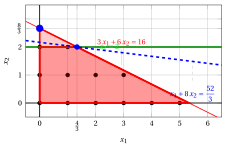
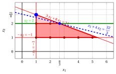
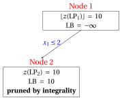
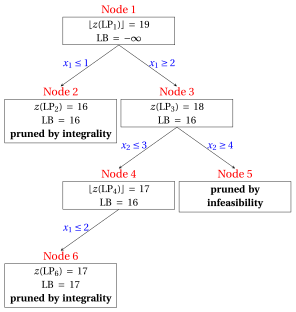
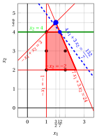
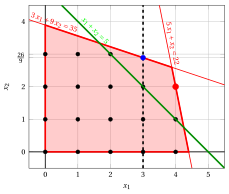

# Exercises · Branch-and-cut

**Exercises · Chapter 8** · each solution opens with a click · [:material-book-open-variant: Chapter 8](../exact-methods/branch-and-cut.md) · [:material-file-pdf-box: Exercises, volume 2 (PDF)](../pdf/exercises-2-exact-methods.pdf)

!!! esercizio "Exercise 8.1: Cut-and-branch (P1)"

    !!! nota ""

        Consider the following ILP problem in canonical maximization form with $n=2$ integer variables and $m=1$ constraint:

        $$
        \begin{array}{rrrrrrr}
        {\max} & {x_1} & {+} & {8}\, {x_2} \\[1.5ex]
        & {3}\, {x_1} & {+} & {6}\, {x_2} & {\le} & {16} \\[1.5ex]
        & {x_1,} &  & {x_2} & {\in} & {\Z_{\ge 0}}
        \end{array}
        $$

        and the following optimal simplex dictionary of its LP relaxation in standard form:

        \begin{equation*}
        \begin{cases}
        \begin{array}{rrrrrrr}
        {x_2} & {=} & {\dfrac{8}{3}} & {-} & {\dfrac{1}{2}}\, {x_1} & {-} & {\dfrac{1}{6}}\, {x_3} \\[2ex]
        {z} & {=} & {\dfrac{64}{3}} & {-} & {3}\, {x_1} & {-} & {\dfrac{4}{3}}\, {x_3}
        \end{array}
        \end{cases}
        \end{equation*}

    **Questions**

    1. Execute the branch-and-bound algorithm using the smallest-index rule as branching-variable selection strategy, the LIFO rule as branching-node selection strategy, the down-branching node solved first, and $\LB = -\infty$ at the start (no heuristic algorithm). Give the branch-and-bound tree and the number of LP problems solved.

    2. Execute one round of a cut-and-branch algorithm at the root node: generate the Gomory fractional cut of the row with the largest fractional right-hand side (smallest index of the basic variable in case of a tie, the objective-function row last), written in the original variables and made primitive before its slack variable is added.

    3. Re-optimize the LP problem of the root node with the cut, using the dual simplex algorithm (leaving variable: the basic variable with negative value and smallest index; ties in the ratio test broken by the smallest index). Show the effect of the cut graphically.

    4. Execute the branch-and-bound algorithm on the strengthened problem, with the same rules, and compare the number of LP problems solved with the first question.

??? soluzione "Solution"

    1. The $\LP_1$ problem has the optimal solution $(0,\tfrac{8}{3})$ with $z(\LP_1) = \dfrac{64}{3}$. The branch-and-bound algorithm solves $4$ LP problems:

        { .fig loading=lazy  }

        
<table>
        <tr>
        <th>Node</th>
        <th>Parent</th>
        <th>Branching</th>
        <th>\(\tilde{\vet x}(\LP_k)\)</th>
        <th>\(z(\LP_k)\)</th>
        <th>\(\LB\)</th>
        <th>Outcome</th>
        </tr>
        <tr>
        <td>1</td>
        <td>–</td>
        <td>–</td>
        <td>\((0,\tfrac{8}{3})\)</td>
        <td>\(\tfrac{64}{3}\)</td>
        <td>\(-\infty\)</td>
        <td>branching on \(x_2\)</td>
        </tr>
        <tr>
        <td>2</td>
        <td>1</td>
        <td>\(x_2 \le 2\)</td>
        <td>\((\tfrac{4}{3},2)\)</td>
        <td>\(\tfrac{52}{3}\)</td>
        <td>\(-\infty\)</td>
        <td>branching on \(x_1\)</td>
        </tr>
        <tr>
        <td>3</td>
        <td>1</td>
        <td>\(x_2 \ge 3\)</td>
        <td>–</td>
        <td>–</td>
        <td>\(-\infty\)</td>
        <td>pruned by infeasibility</td>
        </tr>
        <tr>
        <td>4</td>
        <td>2</td>
        <td>\(x_1 \le 1\)</td>
        <td>\((1,2)\)</td>
        <td>\(17\)</td>
        <td>\(17\)</td>
        <td>pruned by integrality</td>
        </tr>
        </table>

        The optimal solution is $\tilde{\vet x}(\ILP) = (1,2)$, with $z(\ILP) = 17$.

    2. The rows of the optimal dictionary with a fractional right-hand side are the candidates:

        
<table>
        <tr>
        <th>Row</th>
        <th>fractional part of the right-hand side</th>
        </tr>
        <tr>
        <td>\(x_2\)</td>
        <td>\(\tfrac{2}{3}\)</td>
        </tr>
        <tr>
        <td>\(z\)</td>
        <td>\(\tfrac{1}{3}\)</td>
        </tr>
        </table>

        The largest fractional part is $\tfrac{2}{3}$, in the row of $x_2$.

        In equation form, the row of $x_2$ reads

        $$
        x_2 + \tfrac{1}{2}\,x_1 + \tfrac{1}{6}\,x_3 = \dfrac{8}{3},
        $$

        and the Gomory fractional cut generated by this row is

        $$
        \underbrace{\left(\tfrac{1}{2} - \left\lfloor \tfrac{1}{2} \right\rfloor\right)}_{=\tfrac{1}{2}}\,x_1 + \underbrace{\left(\tfrac{1}{6} - \left\lfloor \tfrac{1}{6} \right\rfloor\right)}_{=\tfrac{1}{6}}\,x_3 ~\ge~ \underbrace{\tfrac{8}{3} - \left\lfloor \tfrac{8}{3} \right\rfloor}_{=\tfrac{2}{3}},
        $$

        that is,

        $$
        \dfrac{1}{2}\,x_1 + \dfrac{1}{6}\,x_3 \ge \dfrac{2}{3}.
        $$

        Substituting the slack variables with their expressions in the original variables, the cut becomes

        $$
        x_2 \le 2.
        $$

        The coefficients have greatest common divisor $1$: the cut $x_2 \le 2$ is primitive.

        At the root node no branching constraint exists, so the cut is <strong>global</strong>. It cuts off $(0,\tfrac{8}{3})$: $0 \cdot 0 + 1 \cdot \tfrac{8}{3} = \tfrac{8}{3} > 2$.

    3. The cut $x_2 \le 2$ is added with its slack variable $x_4 = 2 - x_2 \ge 0$. Expressing it with the non-basic variables and adding it to the optimal dictionary we get a dictionary that is dual feasible but not primal feasible:

        \begin{equation*}
        \begin{cases}
        \begin{array}{rrrrrrr}
        {x_2} & {=} & {\dfrac{8}{3}} & {-} & {\dfrac{1}{2}}\, {x_1} & {-} & {\dfrac{1}{6}}\, {x_3} \\[2ex]
        {x_4} & {=} & {-\dfrac{2}{3}} & {+} & {\dfrac{1}{2}}\, {x_1} & {+} & {\dfrac{1}{6}}\, {x_3} \\[2ex]
        {z} & {=} & {\dfrac{64}{3}} & {-} & {3}\, {x_1} & {-} & {\dfrac{4}{3}}\, {x_3}
        \end{array}
        \end{cases}
        \end{equation*}

        If we increase the value of $\pi_{4}$, we can get a better dual solution. We have:

        $$
        \begin{cases}
        \pi_1 &= 3 - \dfrac{1}{2}\,\pi_4 \\[2ex]
        \pi_3 &= \dfrac{4}{3} - \dfrac{1}{6}\,\pi_4
        \end{cases}
        \qquad
        \qquad
        \begin{cases}
        \underbrace{ 3 - \dfrac{1}{2}\,\pi_4 \ge 0}_{\pi_1 \ge 0} \\[2ex]
        \underbrace{ \dfrac{4}{3} - \dfrac{1}{6}\,\pi_4 \ge 0}_{\pi_3 \ge 0}
        \end{cases}
        \qquad
        \qquad
        \begin{cases}
        \pi_4 &\le 6 \\[2ex]
        \pi_4 &\le 8
        \end{cases}
        $$

        By increasing the value of $\pi_{4}$ to $\min \left\{6, 8\right\}=6$, the value of $\pi_{1}$ decreases to $0$. Then we have that:

        - $\pi_{4}$ becomes a dual basic variable and accordingly $x_{4}$ becomes a primal non-basic variable.

        - $\pi_{1}$ becomes a dual non-basic variable and accordingly $x_{1}$ becomes a primal basic variable.

        We have:

        $$
        x_4 = -\dfrac{2}{3} + \dfrac{1}{2} \, x_1 + \dfrac{1}{6} \, x_3
        \quad \Rightarrow \quad
        x_1 = \dfrac{4}{3} - \dfrac{1}{3} \, x_3 + 2 \, x_4
        $$

        Substituting into the other equations of the primal simplex dictionary, we get:

        $$
        x_2
        = \dfrac{8}{3} - \dfrac{1}{2} \left( \dfrac{4}{3} - \dfrac{1}{3} \, x_3 + 2 \, x_4 \right) - \dfrac{1}{6} \; x_3
        = 2 - x_4
        $$

        $$
        z
        = \dfrac{64}{3} - 3 \left( \dfrac{4}{3} - \dfrac{1}{3} \, x_3 + 2 \, x_4 \right) - \dfrac{4}{3} \; x_3
        = \dfrac{52}{3} - \dfrac{1}{3} \, x_3 - 6 \, x_4
        $$

        Accordingly, we now have the following updated primal simplex dictionary:

        \begin{equation*}
        \begin{cases}
        \begin{array}{rrrrrrr}
        {x_1} & {=} & {\dfrac{4}{3}} & {-} & {\dfrac{1}{3}}\, {x_3} & {+} & {2}\, {x_4} \\[2ex]
        {x_2} & {=} & {2} &  &  & {-} & {x_4} \\[2ex]
        {z} & {=} & {\dfrac{52}{3}} & {-} & {\dfrac{1}{3}}\, {x_3} & {-} & {6}\, {x_4}
        \end{array}
        \end{cases}
        \end{equation*}

        where $\pazocal{B}=\{1,2\}$ and $\pazocal{N}=\{3,4\}$ and

        - the basic primal optimal solution is:

            $$
            \tilde x_1=\dfrac{4}{3},~~
            \tilde x_2=2,~~~~~~
            \tilde x_3=0,~~
            \tilde x_4=0~~
            \mathrm{~~of~value~~~} \dfrac{52}{3}
            $$

        - the basic dual optimal solution is:

            $$
            \tilde \pi_1=0,~~
            \tilde \pi_2=0,~~~~~~
            \tilde \pi_3=\dfrac{1}{3},~~
            \tilde \pi_4=6~~
            \mathrm{~~of~value~~~} \dfrac{52}{3}
            $$

        The new optimal solution of $\LP_1$ is $(\tfrac{4}{3},2)$, with $z(\LP_1) = \dfrac{52}{3}$ and the upper bound $17$. Graphically, we have:

        { .fig .ovale loading=lazy  }

        <em>The root LP problem with the Gomory cut (green): the old optimal solution (blue circle) is cut off, and the new optimal solution is blue, with its objective line (dashed).</em>

    4. Every node inherits the cut. The branch-and-bound algorithm now solves $2$ LP problems:

        { .fig loading=lazy  }

        
<table>
        <tr>
        <th>Node</th>
        <th>Parent</th>
        <th>Branching</th>
        <th>\(\tilde{\vet x}(\LP_k)\)</th>
        <th>\(z(\LP_k)\)</th>
        <th>\(\LB\)</th>
        <th>Outcome</th>
        </tr>
        <tr>
        <td>1</td>
        <td>–</td>
        <td>–</td>
        <td>\((\tfrac{4}{3},2)\)</td>
        <td>\(\tfrac{52}{3}\)</td>
        <td>\(-\infty\)</td>
        <td>branching on \(x_1\)</td>
        </tr>
        <tr>
        <td>2</td>
        <td>1</td>
        <td>\(x_1 \le 1\)</td>
        <td>\((1,2)\)</td>
        <td>\(17\)</td>
        <td>\(17\)</td>
        <td>pruned by integrality</td>
        </tr>
        </table>

        !!! chiave ""

            Branch-and-bound: $4$ LP problems; cut-and-branch with one Gomory cut: $2$ LP problems. The cut lowers the root bound and <strong>reduces</strong> the tree. Both find $\tilde{\vet x}(\ILP) = (1,2)$, $z(\ILP) = 17$.

!!! esercizio "Exercise 8.2: Cut-and-branch (P23)"

    !!! nota ""

        Consider the following ILP problem in canonical maximization form with $n=2$ integer variables and $m=3$ constraints:

        $$
        \begin{array}{rrrrrrr}
        {\max} & {x_1} & {+} & {4}\, {x_2} \\[1.5ex]
        & {3}\, {x_1} & {+} & {8}\, {x_2} & {\le} & {24} \\[1.5ex]
        & {-}{x_1} &  &  & {\le} & {-1} \\[1.5ex]
        &  &  & {-}{x_2} & {\le} & {-1} \\[1.5ex]
        & {x_1,} &  & {x_2} & {\in} & {\Z_{\ge 0}}
        \end{array}
        $$

        The constraints $x_1 \ge 1$ and $x_2 \ge 1$ are written in canonical form as $-x_1 \le -1$ and $-x_2 \le -1$.

        and the following optimal simplex dictionary of its LP relaxation in standard form:

        \begin{equation*}
        \begin{cases}
        \begin{array}{rrrrrrr}
        {x_1} & {=} & {1} &  &  & {+} & {x_4} \\[2ex]
        {x_2} & {=} & {\dfrac{21}{8}} & {-} & {\dfrac{1}{8}}\, {x_3} & {-} & {\dfrac{3}{8}}\, {x_4} \\[2ex]
        {x_5} & {=} & {\dfrac{13}{8}} & {-} & {\dfrac{1}{8}}\, {x_3} & {-} & {\dfrac{3}{8}}\, {x_4} \\[2ex]
        {z} & {=} & {\dfrac{23}{2}} & {-} & {\dfrac{1}{2}}\, {x_3} & {-} & {\dfrac{1}{2}}\, {x_4}
        \end{array}
        \end{cases}
        \end{equation*}

    **Questions**

    1. Execute the branch-and-bound algorithm using the smallest-index rule as branching-variable selection strategy, the LIFO rule as branching-node selection strategy, the down-branching node solved first, and $\LB = -\infty$ at the start (no heuristic algorithm). Give the branch-and-bound tree and the number of LP problems solved.

    2. Execute one round of a cut-and-branch algorithm at the root node: generate the Gomory fractional cut of the row with the largest fractional right-hand side (smallest index of the basic variable in case of a tie, the objective-function row last), written in the original variables and made primitive before its slack variable is added.

    3. Re-optimize the LP problem of the root node with the cut, using the dual simplex algorithm (leaving variable: the basic variable with negative value and smallest index; ties in the ratio test broken by the smallest index). Show the effect of the cut graphically.

    4. Execute the branch-and-bound algorithm on the strengthened problem, with the same rules, and compare the number of LP problems solved with the first question.

??? soluzione "Solution"

    1. The $\LP_1$ problem has the optimal solution $(1,\tfrac{21}{8})$ with $z(\LP_1) = \dfrac{23}{2}$. The branch-and-bound algorithm solves $4$ LP problems:

        { .fig loading=lazy  }

        
<table>
        <tr>
        <th>Node</th>
        <th>Parent</th>
        <th>Branching</th>
        <th>\(\tilde{\vet x}(\LP_k)\)</th>
        <th>\(z(\LP_k)\)</th>
        <th>\(\LB\)</th>
        <th>Outcome</th>
        </tr>
        <tr>
        <td>1</td>
        <td>–</td>
        <td>–</td>
        <td>\((1,\tfrac{21}{8})\)</td>
        <td>\(\tfrac{23}{2}\)</td>
        <td>\(-\infty\)</td>
        <td>branching on \(x_2\)</td>
        </tr>
        <tr>
        <td>2</td>
        <td>1</td>
        <td>\(x_2 \le 2\)</td>
        <td>\((\tfrac{8}{3},2)\)</td>
        <td>\(\tfrac{32}{3}\)</td>
        <td>\(-\infty\)</td>
        <td>branching on \(x_1\)</td>
        </tr>
        <tr>
        <td>3</td>
        <td>1</td>
        <td>\(x_2 \ge 3\)</td>
        <td>–</td>
        <td>–</td>
        <td>\(-\infty\)</td>
        <td>pruned by infeasibility</td>
        </tr>
        <tr>
        <td>4</td>
        <td>2</td>
        <td>\(x_1 \le 2\)</td>
        <td>\((2,2)\)</td>
        <td>\(10\)</td>
        <td>\(10\)</td>
        <td>pruned by integrality</td>
        </tr>
        </table>

        The optimal solution is $\tilde{\vet x}(\ILP) = (2,2)$, with $z(\ILP) = 10$.

    2. The rows of the optimal dictionary with a fractional right-hand side are the candidates:

        
<table>
        <tr>
        <th>Row</th>
        <th>fractional part of the right-hand side</th>
        </tr>
        <tr>
        <td>\(x_2\)</td>
        <td>\(\tfrac{5}{8}\)</td>
        </tr>
        <tr>
        <td>\(x_5\)</td>
        <td>\(\tfrac{5}{8}\)</td>
        </tr>
        <tr>
        <td>\(z\)</td>
        <td>\(\tfrac{1}{2}\)</td>
        </tr>
        </table>

        The largest fractional part is $\tfrac{5}{8}$, in the row of $x_2$.

        In equation form, the row of $x_2$ reads

        $$
        x_2 + \tfrac{1}{8}\,x_3 + \tfrac{3}{8}\,x_4 = \dfrac{21}{8},
        $$

        and the Gomory fractional cut generated by this row is

        $$
        \underbrace{\left(\tfrac{1}{8} - \left\lfloor \tfrac{1}{8} \right\rfloor\right)}_{=\tfrac{1}{8}}\,x_3 + \underbrace{\left(\tfrac{3}{8} - \left\lfloor \tfrac{3}{8} \right\rfloor\right)}_{=\tfrac{3}{8}}\,x_4 ~\ge~ \underbrace{\tfrac{21}{8} - \left\lfloor \tfrac{21}{8} \right\rfloor}_{=\tfrac{5}{8}},
        $$

        that is,

        $$
        \dfrac{1}{8}\,x_3 + \dfrac{3}{8}\,x_4 \ge \dfrac{5}{8}.
        $$

        Substituting the slack variables with their expressions in the original variables, the cut becomes

        $$
        x_2 \le 2.
        $$

        The coefficients have greatest common divisor $1$: the cut $x_2 \le 2$ is primitive.

        At the root node no branching constraint exists, so the cut is <strong>global</strong>. It cuts off $(1,\tfrac{21}{8})$: $0 \cdot 1 + 1 \cdot \tfrac{21}{8} = \tfrac{21}{8} > 2$.

    3. The cut $x_2 \le 2$ is added with its slack variable $x_6 = 2 - x_2 \ge 0$. Expressing it with the non-basic variables and adding it to the optimal dictionary we get a dictionary that is dual feasible but not primal feasible:

        \begin{equation*}
        \begin{cases}
        \begin{array}{rrrrrrr}
        {x_1} & {=} & {1} &  &  & {+} & {x_4} \\[2ex]
        {x_2} & {=} & {\dfrac{21}{8}} & {-} & {\dfrac{1}{8}}\, {x_3} & {-} & {\dfrac{3}{8}}\, {x_4} \\[2ex]
        {x_5} & {=} & {\dfrac{13}{8}} & {-} & {\dfrac{1}{8}}\, {x_3} & {-} & {\dfrac{3}{8}}\, {x_4} \\[2ex]
        {x_6} & {=} & {-\dfrac{5}{8}} & {+} & {\dfrac{1}{8}}\, {x_3} & {+} & {\dfrac{3}{8}}\, {x_4} \\[2ex]
        {z} & {=} & {\dfrac{23}{2}} & {-} & {\dfrac{1}{2}}\, {x_3} & {-} & {\dfrac{1}{2}}\, {x_4}
        \end{array}
        \end{cases}
        \end{equation*}

        If we increase the value of $\pi_{6}$, we can get a better dual solution. We have:

        $$
        \begin{cases}
        \pi_3 &= \dfrac{1}{2} - \dfrac{1}{8}\,\pi_6 \\[2ex]
        \pi_4 &= \dfrac{1}{2} - \dfrac{3}{8}\,\pi_6
        \end{cases}
        \qquad
        \qquad
        \begin{cases}
        \underbrace{ \dfrac{1}{2} - \dfrac{1}{8}\,\pi_6 \ge 0}_{\pi_3 \ge 0} \\[2ex]
        \underbrace{ \dfrac{1}{2} - \dfrac{3}{8}\,\pi_6 \ge 0}_{\pi_4 \ge 0}
        \end{cases}
        \qquad
        \qquad
        \begin{cases}
        \pi_6 &\le 4 \\[2ex]
        \pi_6 &\le \dfrac{4}{3}
        \end{cases}
        $$

        By increasing the value of $\pi_{6}$ to $\min \left\{4, \dfrac{4}{3}\right\}=\dfrac{4}{3}$, the value of $\pi_{4}$ decreases to $0$. Then we have that:

        - $\pi_{6}$ becomes a dual basic variable and accordingly $x_{6}$ becomes a primal non-basic variable.

        - $\pi_{4}$ becomes a dual non-basic variable and accordingly $x_{4}$ becomes a primal basic variable.

        We have:

        $$
        x_6 = -\dfrac{5}{8} + \dfrac{1}{8} \, x_3 + \dfrac{3}{8} \, x_4
        \quad \Rightarrow \quad
        x_4 = \dfrac{5}{3} - \dfrac{1}{3} \, x_3 + \dfrac{8}{3} \, x_6
        $$

        Substituting into the other equations of the primal simplex dictionary, we get:

        $$
        x_1
        = 1 + \left( \dfrac{5}{3} - \dfrac{1}{3} \, x_3 + \dfrac{8}{3} \, x_6 \right)
        = \dfrac{8}{3} - \dfrac{1}{3} \, x_3 + \dfrac{8}{3} \, x_6
        $$

        $$
        x_2
        = \dfrac{21}{8} - \dfrac{1}{8} \; x_3 - \dfrac{3}{8} \left( \dfrac{5}{3} - \dfrac{1}{3} \, x_3 + \dfrac{8}{3} \, x_6 \right)
        = 2 - x_6
        $$

        $$
        x_5
        = \dfrac{13}{8} - \dfrac{1}{8} \; x_3 - \dfrac{3}{8} \left( \dfrac{5}{3} - \dfrac{1}{3} \, x_3 + \dfrac{8}{3} \, x_6 \right)
        = 1 - x_6
        $$

        $$
        z
        = \dfrac{23}{2} - \dfrac{1}{2} \; x_3 - \dfrac{1}{2} \left( \dfrac{5}{3} - \dfrac{1}{3} \, x_3 + \dfrac{8}{3} \, x_6 \right)
        = \dfrac{32}{3} - \dfrac{1}{3} \, x_3 - \dfrac{4}{3} \, x_6
        $$

        Accordingly, we now have the following updated primal simplex dictionary:

        \begin{equation*}
        \begin{cases}
        \begin{array}{rrrrrrr}
        {x_1} & {=} & {\dfrac{8}{3}} & {-} & {\dfrac{1}{3}}\, {x_3} & {+} & {\dfrac{8}{3}}\, {x_6} \\[2ex]
        {x_2} & {=} & {2} &  &  & {-} & {x_6} \\[2ex]
        {x_4} & {=} & {\dfrac{5}{3}} & {-} & {\dfrac{1}{3}}\, {x_3} & {+} & {\dfrac{8}{3}}\, {x_6} \\[2ex]
        {x_5} & {=} & {1} &  &  & {-} & {x_6} \\[2ex]
        {z} & {=} & {\dfrac{32}{3}} & {-} & {\dfrac{1}{3}}\, {x_3} & {-} & {\dfrac{4}{3}}\, {x_6}
        \end{array}
        \end{cases}
        \end{equation*}

        where $\pazocal{B}=\{1,2,4,5\}$ and $\pazocal{N}=\{3,6\}$ and

        - the basic primal optimal solution is:

            $$
            \tilde x_1=\dfrac{8}{3},~~
            \tilde x_2=2,~~
            \tilde x_4=\dfrac{5}{3},~~
            \tilde x_5=1,~~~~~~
            \tilde x_3=0,~~
            \tilde x_6=0~~
            \mathrm{~~of~value~~~} \dfrac{32}{3}
            $$

        - the basic dual optimal solution is:

            $$
            \tilde \pi_1=0,~~
            \tilde \pi_2=0,~~
            \tilde \pi_4=0,~~
            \tilde \pi_5=0,~~~~~~
            \tilde \pi_3=\dfrac{1}{3},~~
            \tilde \pi_6=\dfrac{4}{3}~~
            \mathrm{~~of~value~~~} \dfrac{32}{3}
            $$

        The new optimal solution of $\LP_1$ is $(\tfrac{8}{3},2)$, with $z(\LP_1) = \dfrac{32}{3}$ and the upper bound $10$. Graphically, we have:

        { .fig .ovale loading=lazy  }

        <em>The root LP problem with the Gomory cut (green): the old optimal solution (blue circle) is cut off, and the new optimal solution is blue, with its objective line (dashed).</em>

    4. Every node inherits the cut. The branch-and-bound algorithm now solves $2$ LP problems:

        { .fig loading=lazy  }

        
<table>
        <tr>
        <th>Node</th>
        <th>Parent</th>
        <th>Branching</th>
        <th>\(\tilde{\vet x}(\LP_k)\)</th>
        <th>\(z(\LP_k)\)</th>
        <th>\(\LB\)</th>
        <th>Outcome</th>
        </tr>
        <tr>
        <td>1</td>
        <td>–</td>
        <td>–</td>
        <td>\((\tfrac{8}{3},2)\)</td>
        <td>\(\tfrac{32}{3}\)</td>
        <td>\(-\infty\)</td>
        <td>branching on \(x_1\)</td>
        </tr>
        <tr>
        <td>2</td>
        <td>1</td>
        <td>\(x_1 \le 2\)</td>
        <td>\((2,2)\)</td>
        <td>\(10\)</td>
        <td>\(10\)</td>
        <td>pruned by integrality</td>
        </tr>
        </table>

        !!! chiave ""

            Branch-and-bound: $4$ LP problems; cut-and-branch with one Gomory cut: $2$ LP problems. The cut lowers the root bound and <strong>reduces</strong> the tree. Both find $\tilde{\vet x}(\ILP) = (2,2)$, $z(\ILP) = 10$.

!!! esercizio "Exercise 8.3: Cut-and-branch (P24)"

    !!! nota ""

        Consider the following ILP problem in canonical maximization form with $n=2$ integer variables and $m=4$ constraints:

        $$
        \begin{array}{rrrrrrr}
        {\max} & {4}\, {x_1} & {+} & {3}\, {x_2} \\[1.5ex]
        & {7}\, {x_1} & {+} & {3}\, {x_2} & {\le} & {24} \\[1.5ex]
        & {-}{x_1} & {+} & {x_2} & {\le} & {3} \\[1.5ex]
        & {-}{x_1} &  &  & {\le} & {-1} \\[1.5ex]
        &  &  & {-}{x_2} & {\le} & {-2} \\[1.5ex]
        & {x_1,} &  & {x_2} & {\in} & {\Z_{\ge 0}}
        \end{array}
        $$

        The constraints $x_1 \ge 1$ and $x_2 \ge 2$ are written in canonical form as $-x_1 \le -1$ and $-x_2 \le -2$.

        and the following optimal simplex dictionary of its LP relaxation in standard form:

        \begin{equation*}
        \begin{cases}
        \begin{array}{rrrrrrr}
        {x_1} & {=} & {\dfrac{3}{2}} & {-} & {\dfrac{1}{10}}\, {x_3} & {+} & {\dfrac{3}{10}}\, {x_4} \\[2ex]
        {x_2} & {=} & {\dfrac{9}{2}} & {-} & {\dfrac{1}{10}}\, {x_3} & {-} & {\dfrac{7}{10}}\, {x_4} \\[2ex]
        {x_5} & {=} & {\dfrac{1}{2}} & {-} & {\dfrac{1}{10}}\, {x_3} & {+} & {\dfrac{3}{10}}\, {x_4} \\[2ex]
        {x_6} & {=} & {\dfrac{5}{2}} & {-} & {\dfrac{1}{10}}\, {x_3} & {-} & {\dfrac{7}{10}}\, {x_4} \\[2ex]
        {z} & {=} & {\dfrac{39}{2}} & {-} & {\dfrac{7}{10}}\, {x_3} & {-} & {\dfrac{9}{10}}\, {x_4}
        \end{array}
        \end{cases}
        \end{equation*}

    **Questions**

    1. Execute the branch-and-bound algorithm using the smallest-index rule as branching-variable selection strategy, the LIFO rule as branching-node selection strategy, the down-branching node solved first, and $\LB = -\infty$ at the start (no heuristic algorithm). Give the branch-and-bound tree and the number of LP problems solved.

    2. Execute one round of a cut-and-branch algorithm at the root node: generate the Gomory fractional cut of the row with the largest fractional right-hand side (smallest index of the basic variable in case of a tie, the objective-function row last), written in the original variables and made primitive before its slack variable is added.

    3. Re-optimize the LP problem of the root node with the cut, using the dual simplex algorithm (leaving variable: the basic variable with negative value and smallest index; ties in the ratio test broken by the smallest index). Show the effect of the cut graphically.

    4. Execute the branch-and-bound algorithm on the strengthened problem, with the same rules, and compare the number of LP problems solved with the first question.

??? soluzione "Solution"

    1. The $\LP_1$ problem has the optimal solution $(\tfrac{3}{2},\tfrac{9}{2})$ with $z(\LP_1) = \dfrac{39}{2}$. The branch-and-bound algorithm solves $6$ LP problems:

        { .fig loading=lazy  }

        
<table>
        <tr>
        <th>Node</th>
        <th>Parent</th>
        <th>Branching</th>
        <th>\(\tilde{\vet x}(\LP_k)\)</th>
        <th>\(z(\LP_k)\)</th>
        <th>\(\LB\)</th>
        <th>Outcome</th>
        </tr>
        <tr>
        <td>1</td>
        <td>–</td>
        <td>–</td>
        <td>\((\tfrac{3}{2},\tfrac{9}{2})\)</td>
        <td>\(\tfrac{39}{2}\)</td>
        <td>\(-\infty\)</td>
        <td>branching on \(x_1\)</td>
        </tr>
        <tr>
        <td>2</td>
        <td>1</td>
        <td>\(x_1 \le 1\)</td>
        <td>\((1,4)\)</td>
        <td>\(16\)</td>
        <td>\(16\)</td>
        <td>pruned by integrality</td>
        </tr>
        <tr>
        <td>3</td>
        <td>1</td>
        <td>\(x_1 \ge 2\)</td>
        <td>\((2,\tfrac{10}{3})\)</td>
        <td>\(18\)</td>
        <td>\(16\)</td>
        <td>branching on \(x_2\)</td>
        </tr>
        <tr>
        <td>4</td>
        <td>3</td>
        <td>\(x_2 \le 3\)</td>
        <td>\((\tfrac{15}{7},3)\)</td>
        <td>\(\tfrac{123}{7}\)</td>
        <td>\(16\)</td>
        <td>branching on \(x_1\)</td>
        </tr>
        <tr>
        <td>5</td>
        <td>3</td>
        <td>\(x_2 \ge 4\)</td>
        <td>–</td>
        <td>–</td>
        <td>\(16\)</td>
        <td>pruned by infeasibility</td>
        </tr>
        <tr>
        <td>6</td>
        <td>4</td>
        <td>\(x_1 \le 2\)</td>
        <td>\((2,3)\)</td>
        <td>\(17\)</td>
        <td>\(17\)</td>
        <td>pruned by integrality</td>
        </tr>
        </table>

        The optimal solution is $\tilde{\vet x}(\ILP) = (2,3)$, with $z(\ILP) = 17$.

    2. The rows of the optimal dictionary with a fractional right-hand side are the candidates:

        
<table>
        <tr>
        <th>Row</th>
        <th>fractional part of the right-hand side</th>
        </tr>
        <tr>
        <td>\(x_1\)</td>
        <td>\(\tfrac{1}{2}\)</td>
        </tr>
        <tr>
        <td>\(x_2\)</td>
        <td>\(\tfrac{1}{2}\)</td>
        </tr>
        <tr>
        <td>\(x_5\)</td>
        <td>\(\tfrac{1}{2}\)</td>
        </tr>
        <tr>
        <td>\(x_6\)</td>
        <td>\(\tfrac{1}{2}\)</td>
        </tr>
        <tr>
        <td>\(z\)</td>
        <td>\(\tfrac{1}{2}\)</td>
        </tr>
        </table>

        The largest fractional part is $\tfrac{1}{2}$, in the row of $x_1$.

        In equation form, the row of $x_1$ reads

        $$
        x_1 + \tfrac{1}{10}\,x_3 - \tfrac{3}{10}\,x_4 = \dfrac{3}{2},
        $$

        and the Gomory fractional cut generated by this row is

        $$
        \underbrace{\left(\tfrac{1}{10} - \left\lfloor \tfrac{1}{10} \right\rfloor\right)}_{=\tfrac{1}{10}}\,x_3 + \underbrace{\left(-\tfrac{3}{10} - \left\lfloor -\tfrac{3}{10} \right\rfloor\right)}_{=\tfrac{7}{10}}\,x_4 ~\ge~ \underbrace{\tfrac{3}{2} - \left\lfloor \tfrac{3}{2} \right\rfloor}_{=\tfrac{1}{2}},
        $$

        that is,

        $$
        \dfrac{1}{10}\,x_3 + \dfrac{7}{10}\,x_4 \ge \dfrac{1}{2}.
        $$

        Substituting the slack variables with their expressions in the original variables, the cut becomes

        $$
        x_2 \le 4.
        $$

        The coefficients have greatest common divisor $1$: the cut $x_2 \le 4$ is primitive.

        At the root node no branching constraint exists, so the cut is <strong>global</strong>. It cuts off $(\tfrac{3}{2},\tfrac{9}{2})$: $0 \cdot \tfrac{3}{2} + 1 \cdot \tfrac{9}{2} = \tfrac{9}{2} > 4$.

    3. The cut $x_2 \le 4$ is added with its slack variable $x_7 = 4 - x_2 \ge 0$. Expressing it with the non-basic variables and adding it to the optimal dictionary we get a dictionary that is dual feasible but not primal feasible:

        \begin{equation*}
        \begin{cases}
        \begin{array}{rrrrrrr}
        {x_1} & {=} & {\dfrac{3}{2}} & {-} & {\dfrac{1}{10}}\, {x_3} & {+} & {\dfrac{3}{10}}\, {x_4} \\[2ex]
        {x_2} & {=} & {\dfrac{9}{2}} & {-} & {\dfrac{1}{10}}\, {x_3} & {-} & {\dfrac{7}{10}}\, {x_4} \\[2ex]
        {x_5} & {=} & {\dfrac{1}{2}} & {-} & {\dfrac{1}{10}}\, {x_3} & {+} & {\dfrac{3}{10}}\, {x_4} \\[2ex]
        {x_6} & {=} & {\dfrac{5}{2}} & {-} & {\dfrac{1}{10}}\, {x_3} & {-} & {\dfrac{7}{10}}\, {x_4} \\[2ex]
        {x_7} & {=} & {-\dfrac{1}{2}} & {+} & {\dfrac{1}{10}}\, {x_3} & {+} & {\dfrac{7}{10}}\, {x_4} \\[2ex]
        {z} & {=} & {\dfrac{39}{2}} & {-} & {\dfrac{7}{10}}\, {x_3} & {-} & {\dfrac{9}{10}}\, {x_4}
        \end{array}
        \end{cases}
        \end{equation*}

        If we increase the value of $\pi_{7}$, we can get a better dual solution. We have:

        $$
        \begin{cases}
        \pi_3 &= \dfrac{7}{10} - \dfrac{1}{10}\,\pi_7 \\[2ex]
        \pi_4 &= \dfrac{9}{10} - \dfrac{7}{10}\,\pi_7
        \end{cases}
        \qquad
        \qquad
        \begin{cases}
        \underbrace{ \dfrac{7}{10} - \dfrac{1}{10}\,\pi_7 \ge 0}_{\pi_3 \ge 0} \\[2ex]
        \underbrace{ \dfrac{9}{10} - \dfrac{7}{10}\,\pi_7 \ge 0}_{\pi_4 \ge 0}
        \end{cases}
        \qquad
        \qquad
        \begin{cases}
        \pi_7 &\le 7 \\[2ex]
        \pi_7 &\le \dfrac{9}{7}
        \end{cases}
        $$

        By increasing the value of $\pi_{7}$ to $\min \left\{7, \dfrac{9}{7}\right\}=\dfrac{9}{7}$, the value of $\pi_{4}$ decreases to $0$. Then we have that:

        - $\pi_{7}$ becomes a dual basic variable and accordingly $x_{7}$ becomes a primal non-basic variable.

        - $\pi_{4}$ becomes a dual non-basic variable and accordingly $x_{4}$ becomes a primal basic variable.

        We have:

        $$
        x_7 = -\dfrac{1}{2} + \dfrac{1}{10} \, x_3 + \dfrac{7}{10} \, x_4
        \quad \Rightarrow \quad
        x_4 = \dfrac{5}{7} - \dfrac{1}{7} \, x_3 + \dfrac{10}{7} \, x_7
        $$

        Substituting into the other equations of the primal simplex dictionary, we get:

        $$
        x_1
        = \dfrac{3}{2} - \dfrac{1}{10} \; x_3 + \dfrac{3}{10} \left( \dfrac{5}{7} - \dfrac{1}{7} \, x_3 + \dfrac{10}{7} \, x_7 \right)
        = \dfrac{12}{7} - \dfrac{1}{7} \, x_3 + \dfrac{3}{7} \, x_7
        $$

        $$
        x_2
        = \dfrac{9}{2} - \dfrac{1}{10} \; x_3 - \dfrac{7}{10} \left( \dfrac{5}{7} - \dfrac{1}{7} \, x_3 + \dfrac{10}{7} \, x_7 \right)
        = 4 - x_7
        $$

        $$
        x_5
        = \dfrac{1}{2} - \dfrac{1}{10} \; x_3 + \dfrac{3}{10} \left( \dfrac{5}{7} - \dfrac{1}{7} \, x_3 + \dfrac{10}{7} \, x_7 \right)
        = \dfrac{5}{7} - \dfrac{1}{7} \, x_3 + \dfrac{3}{7} \, x_7
        $$

        $$
        x_6
        = \dfrac{5}{2} - \dfrac{1}{10} \; x_3 - \dfrac{7}{10} \left( \dfrac{5}{7} - \dfrac{1}{7} \, x_3 + \dfrac{10}{7} \, x_7 \right)
        = 2 - x_7
        $$

        $$
        z
        = \dfrac{39}{2} - \dfrac{7}{10} \; x_3 - \dfrac{9}{10} \left( \dfrac{5}{7} - \dfrac{1}{7} \, x_3 + \dfrac{10}{7} \, x_7 \right)
        = \dfrac{132}{7} - \dfrac{4}{7} \, x_3 - \dfrac{9}{7} \, x_7
        $$

        Accordingly, we now have the following updated primal simplex dictionary:

        \begin{equation*}
        \begin{cases}
        \begin{array}{rrrrrrr}
        {x_1} & {=} & {\dfrac{12}{7}} & {-} & {\dfrac{1}{7}}\, {x_3} & {+} & {\dfrac{3}{7}}\, {x_7} \\[2ex]
        {x_2} & {=} & {4} &  &  & {-} & {x_7} \\[2ex]
        {x_4} & {=} & {\dfrac{5}{7}} & {-} & {\dfrac{1}{7}}\, {x_3} & {+} & {\dfrac{10}{7}}\, {x_7} \\[2ex]
        {x_5} & {=} & {\dfrac{5}{7}} & {-} & {\dfrac{1}{7}}\, {x_3} & {+} & {\dfrac{3}{7}}\, {x_7} \\[2ex]
        {x_6} & {=} & {2} &  &  & {-} & {x_7} \\[2ex]
        {z} & {=} & {\dfrac{132}{7}} & {-} & {\dfrac{4}{7}}\, {x_3} & {-} & {\dfrac{9}{7}}\, {x_7}
        \end{array}
        \end{cases}
        \end{equation*}

        where $\pazocal{B}=\{1,2,4,5,6\}$ and $\pazocal{N}=\{3,7\}$ and

        - the basic primal optimal solution is:

            $$
            \tilde x_1=\dfrac{12}{7},~~
            \tilde x_2=4,~~
            \tilde x_4=\dfrac{5}{7},~~
            \tilde x_5=\dfrac{5}{7},~~
            \tilde x_6=2,~~~~~~
            \tilde x_3=0,~~
            \tilde x_7=0~~
            \mathrm{~~of~value~~~} \dfrac{132}{7}
            $$

        - the basic dual optimal solution is:

            $$
            \tilde \pi_1=0,~~
            \tilde \pi_2=0,~~
            \tilde \pi_4=0,~~
            \tilde \pi_5=0,~~
            \tilde \pi_6=0,~~~~~~
            \tilde \pi_3=\dfrac{4}{7},~~
            \tilde \pi_7=\dfrac{9}{7}~~
            \mathrm{~~of~value~~~} \dfrac{132}{7}
            $$

        The new optimal solution of $\LP_1$ is $(\tfrac{12}{7},4)$, with $z(\LP_1) = \dfrac{132}{7}$ and the upper bound $18$. Graphically, we have:

        { .fig .ovale loading=lazy  }

        <em>The root LP problem with the Gomory cut (green): the old optimal solution (blue circle) is cut off, and the new optimal solution is blue, with its objective line (dashed).</em>

    4. Every node inherits the cut. The branch-and-bound algorithm now solves $6$ LP problems:

        { .fig loading=lazy  }

        
<table>
        <tr>
        <th>Node</th>
        <th>Parent</th>
        <th>Branching</th>
        <th>\(\tilde{\vet x}(\LP_k)\)</th>
        <th>\(z(\LP_k)\)</th>
        <th>\(\LB\)</th>
        <th>Outcome</th>
        </tr>
        <tr>
        <td>1</td>
        <td>–</td>
        <td>–</td>
        <td>\((\tfrac{12}{7},4)\)</td>
        <td>\(\tfrac{132}{7}\)</td>
        <td>\(-\infty\)</td>
        <td>branching on \(x_1\)</td>
        </tr>
        <tr>
        <td>2</td>
        <td>1</td>
        <td>\(x_1 \le 1\)</td>
        <td>\((1,4)\)</td>
        <td>\(16\)</td>
        <td>\(16\)</td>
        <td>pruned by integrality</td>
        </tr>
        <tr>
        <td>3</td>
        <td>1</td>
        <td>\(x_1 \ge 2\)</td>
        <td>\((2,\tfrac{10}{3})\)</td>
        <td>\(18\)</td>
        <td>\(16\)</td>
        <td>branching on \(x_2\)</td>
        </tr>
        <tr>
        <td>4</td>
        <td>3</td>
        <td>\(x_2 \le 3\)</td>
        <td>\((\tfrac{15}{7},3)\)</td>
        <td>\(\tfrac{123}{7}\)</td>
        <td>\(16\)</td>
        <td>branching on \(x_1\)</td>
        </tr>
        <tr>
        <td>5</td>
        <td>3</td>
        <td>\(x_2 \ge 4\)</td>
        <td>–</td>
        <td>–</td>
        <td>\(16\)</td>
        <td>pruned by infeasibility</td>
        </tr>
        <tr>
        <td>6</td>
        <td>4</td>
        <td>\(x_1 \le 2\)</td>
        <td>\((2,3)\)</td>
        <td>\(17\)</td>
        <td>\(17\)</td>
        <td>pruned by integrality</td>
        </tr>
        </table>

        !!! chiave ""

            Branch-and-bound: $6$ LP problems; cut-and-branch with one Gomory cut: $6$ LP problems. The cut lowers the root bound but does <strong>not</strong> reduce the tree: the quality of the cut matters. Both find $\tilde{\vet x}(\ILP) = (2,3)$, $z(\ILP) = 17$.

!!! esercizio "Exercise 8.4: Global and local cuts"

    !!! nota ""

        Consider the following ILP problem in canonical maximization form with $n=2$ integer variables and $m=2$ constraints:

        $$
        \begin{array}{rrrrrrr}
        {\max} & {2}\, {x_1} & {+} & {3}\, {x_2} \\[1.5ex]
        & {5}\, {x_1} & {+} & {x_2} & {\le} & {22} \\[1.5ex]
        & {3}\, {x_1} & {+} & {9}\, {x_2} & {\le} & {35} \\[1.5ex]
        & {x_1,} &  & {x_2} & {\in} & {\Z_{\ge 0}}
        \end{array}
        $$

        The branch-and-bound algorithm (the smallest-index rule as branching-variable selection strategy, the LIFO rule as branching-node selection strategy, the down-branching node solved first, and $\LB = -\infty$ at the start (no heuristic algorithm)) branches at the root on $x_1$. Node 2 is the down-branching node, with the branching constraint $x_1 \le 3$ and its slack variable $x_5 = 3 - x_1$. The optimal dictionary of $\LP_2$ is:

        \begin{equation*}
        \begin{cases}
        \begin{array}{rrrrrrr}
        {x_1} & {=} & {3} &  &  & {-} & {x_5} \\[2ex]
        {x_2} & {=} & {\dfrac{26}{9}} & {-} & {\dfrac{1}{9}}\, {x_4} & {+} & {\dfrac{1}{3}}\, {x_5} \\[2ex]
        {x_3} & {=} & {\dfrac{37}{9}} & {+} & {\dfrac{1}{9}}\, {x_4} & {+} & {\dfrac{14}{3}}\, {x_5} \\[2ex]
        {z} & {=} & {\dfrac{44}{3}} & {-} & {\dfrac{1}{3}}\, {x_4} & {-} & {x_5}
        \end{array}
        \end{cases}
        \end{equation*}

    **Questions**

    1. Generate at Node 2 the Gomory fractional cut of the row with the largest fractional right-hand side (smallest index of the basic variable in case of a tie, the objective-function row last), written in the original variables and made primitive before its slack variable is added.

    2. From its derivation, is the cut a global cut or a local cut of Node 2?

    3. Check by enumeration whether the cut is satisfied by the integer feasible solutions of Node 2 and by all the integer feasible solutions of the ILP problem.

    4. What would happen if the cut were stored in the global pool and used at every node?

??? soluzione "Solution"

    1. An optimal solution of $\LP_2$ is $(3,\tfrac{26}{9})$, with $z(\LP_2) = \dfrac{44}{3}$. The candidate rows are:

        
<table>
        <tr>
        <th>Row</th>
        <th>fractional part of the right-hand side</th>
        </tr>
        <tr>
        <td>\(x_2\)</td>
        <td>\(\tfrac{8}{9}\)</td>
        </tr>
        <tr>
        <td>\(x_3\)</td>
        <td>\(\tfrac{1}{9}\)</td>
        </tr>
        <tr>
        <td>\(z\)</td>
        <td>\(\tfrac{2}{3}\)</td>
        </tr>
        </table>

        The largest fractional part is $\tfrac{8}{9}$, in the row of $x_2$.

        In equation form, the row of $x_2$ reads

        $$
        x_2 + \tfrac{1}{9}\,x_4 - \tfrac{1}{3}\,x_5 = \dfrac{26}{9},
        $$

        and the Gomory fractional cut generated by this row is

        $$
        \underbrace{\left(\tfrac{1}{9} - \left\lfloor \tfrac{1}{9} \right\rfloor\right)}_{=\tfrac{1}{9}}\,x_4 + \underbrace{\left(-\tfrac{1}{3} - \left\lfloor -\tfrac{1}{3} \right\rfloor\right)}_{=\tfrac{2}{3}}\,x_5 ~\ge~ \underbrace{\tfrac{26}{9} - \left\lfloor \tfrac{26}{9} \right\rfloor}_{=\tfrac{8}{9}},
        $$

        that is,

        $$
        \dfrac{1}{9}\,x_4 + \dfrac{2}{3}\,x_5 \ge \dfrac{8}{9}.
        $$

        Substituting the slack variables with their expressions in the original variables, the cut becomes

        $$
        x_1 + x_2 \le 5.
        $$

        The coefficients have greatest common divisor $1$: the cut $x_1 + x_2 \le 5$ is primitive.

    2. The row used contains the slack variable $x_5$ of the branching constraint $x_1 \le 3$ with the non-zero coefficient $\tfrac{2}{3}$ in the cut: its derivation uses the branching constraint, so the algorithm treats it as a <strong>local cut</strong> of Node 2, valid only in the subtree of Node 2.

    3. The feasible solutions of Node 2 are the $15$ points of $F$ with $x_1 \le 3$: all satisfy $x_1 + x_2 \le 5$ (the largest value of $x_1 + x_2$ among them is $5$). Among all the $18$ feasible solutions, instead, $(4,2)$ violates the cut. Graphically, we have:

        { .fig .ovale loading=lazy  }

        <em>The LP relaxation (red), the branching constraint $x_1 = 3$ (dashed), the cut $x_1 + x_2 = 5$ (green), the optimal solution of $\LP_2$ (blue) and the feasible solutions that violate the cut (red squares).</em>

        The cut is locally valid at Node 2 but <strong>not</strong> globally valid.

    4. The point $(4,2)$ is the unique optimal solution of the ILP problem, with value $14$. With the cut in the global pool it would be removed also from Node 3 ($x_1 \ge 4$), and the algorithm would return $(2,3)$, of value $13$.

        !!! chiave ""

            The Gomory cut $x_1 + x_2 \le 5$ of Node 2 is <strong>local</strong>: it must stay in the subtree of Node 2. Used globally it would cut off the optimal solution $(4,2)$ and the algorithm would return a solution of value $13$ instead of $14$.

!!! esercizio "Exercise 8.5: Rounds of cuts (P5)"

    !!! nota ""

        Consider the following ILP problem in canonical maximization form with $n=2$ integer variables and $m=2$ constraints:

        $$
        \begin{array}{rrrrrrr}
        {\max} & {2}\, {x_1} & {+} & {3}\, {x_2} \\[1.5ex]
        & {6}\, {x_1} & {+} & {21}\, {x_2} & {\le} & {77} \\[1.5ex]
        & {8}\, {x_1} & {+} & {3}\, {x_2} & {\le} & {36} \\[1.5ex]
        & {x_1,} &  & {x_2} & {\in} & {\Z_{\ge 0}}
        \end{array}
        $$

        and the following optimal simplex dictionary of its LP relaxation in standard form:

        \begin{equation*}
        \begin{cases}
        \begin{array}{rrrrrrr}
        {x_1} & {=} & {\dfrac{7}{2}} & {+} & {\dfrac{1}{50}}\, {x_3} & {-} & {\dfrac{7}{50}}\, {x_4} \\[2ex]
        {x_2} & {=} & {\dfrac{8}{3}} & {-} & {\dfrac{4}{75}}\, {x_3} & {+} & {\dfrac{1}{25}}\, {x_4} \\[2ex]
        {z} & {=} & {15} & {-} & {\dfrac{3}{25}}\, {x_3} & {-} & {\dfrac{4}{25}}\, {x_4}
        \end{array}
        \end{cases}
        \end{equation*}

    **Questions**

    1. Generate the first Gomory cut of the root node: the Gomory fractional cut of the row with the largest fractional right-hand side (smallest index of the basic variable in case of a tie, the objective-function row last), written in the original variables and made primitive before its slack variable is added.

    2. A cut-and-branch algorithm executes $R$ rounds of Gomory cuts at the root (one cut per round, with the same rule), and then the branch-and-bound algorithm with the smallest-index rule as branching-variable selection strategy, the LIFO rule as branching-node selection strategy, the down-branching node solved first, and $\LB = -\infty$ at the start (no heuristic algorithm). The table below reports, for each $R$, the last cut added, the root LP problem and the number of LP problems solved. Verify the line $R = 1$ and comment on the table.

        
<table>
        <tr>
        <th>Rounds</th>
        <th>last cut added</th>
        <th>\(\tilde{\vet x}(\LP_1)\)</th>
        <th>\(z(\LP_1)\)</th>
        <th>\(\UB\) at the root</th>
        <th>LP problems solved</th>
        </tr>
        <tr>
        <td>\(0\)</td>
        <td>–</td>
        <td>\((\tfrac{7}{2},\tfrac{8}{3})\)</td>
        <td>\(15\)</td>
        <td>\(15\)</td>
        <td>\(11\)</td>
        </tr>
        <tr>
        <td>\(1\)</td>
        <td>\(2\,x_1 + x_2 \le 9\)</td>
        <td>\((\tfrac{28}{9},\tfrac{25}{9})\)</td>
        <td>\(\tfrac{131}{9}\)</td>
        <td>\(14\)</td>
        <td>\(8\)</td>
        </tr>
        <tr>
        <td>\(2\)</td>
        <td>\(x_1 + x_2 \le 5\)</td>
        <td>\((\tfrac{28}{15},\tfrac{47}{15})\)</td>
        <td>\(\tfrac{197}{15}\)</td>
        <td>\(13\)</td>
        <td>\(3\)</td>
        </tr>
        <tr>
        <td>\(3\)</td>
        <td>\(3\,x_1 + 10\,x_2 \le 36\)</td>
        <td>\((2,3)\)</td>
        <td>\(13\)</td>
        <td>\(13\)</td>
        <td>\(1\)</td>
        </tr>
        </table>

    3. How many rounds are needed to solve the problem at the root node? Which cuts would you add in practice?

??? soluzione "Solution"

    1. The candidate rows are:

        
<table>
        <tr>
        <th>Row</th>
        <th>fractional part of the right-hand side</th>
        </tr>
        <tr>
        <td>\(x_1\)</td>
        <td>\(\tfrac{1}{2}\)</td>
        </tr>
        <tr>
        <td>\(x_2\)</td>
        <td>\(\tfrac{2}{3}\)</td>
        </tr>
        </table>

        The largest fractional part is $\tfrac{2}{3}$, in the row of $x_2$.

        In equation form, the row of $x_2$ reads

        $$
        x_2 + \tfrac{4}{75}\,x_3 - \tfrac{1}{25}\,x_4 = \dfrac{8}{3},
        $$

        and the Gomory fractional cut generated by this row is

        $$
        \underbrace{\left(\tfrac{4}{75} - \left\lfloor \tfrac{4}{75} \right\rfloor\right)}_{=\tfrac{4}{75}}\,x_3 + \underbrace{\left(-\tfrac{1}{25} - \left\lfloor -\tfrac{1}{25} \right\rfloor\right)}_{=\tfrac{24}{25}}\,x_4 ~\ge~ \underbrace{\tfrac{8}{3} - \left\lfloor \tfrac{8}{3} \right\rfloor}_{=\tfrac{2}{3}},
        $$

        that is,

        $$
        \dfrac{4}{75}\,x_3 + \dfrac{24}{25}\,x_4 \ge \dfrac{2}{3}.
        $$

        Substituting the slack variables with their expressions in the original variables, the cut becomes

        $$
        8\,x_1 + 4\,x_2 \le 38.
        $$

        Dividing by the greatest common divisor $g = 4$ of the coefficients and rounding down the right-hand side we get the primitive cut

        $$
        2\,x_1 + x_2 \le 9.
        $$

    2. The cut $2\,x_1 + x_2 \le 9$ is added with its slack variable $x_5 = 9 - 2\,x_1 - x_2 \ge 0$. Expressing it with the non-basic variables and adding it to the optimal dictionary we get a dictionary that is dual feasible but not primal feasible:

        \begin{equation*}
        \begin{cases}
        \begin{array}{rrrrrrr}
        {x_1} & {=} & {\dfrac{7}{2}} & {+} & {\dfrac{1}{50}}\, {x_3} & {-} & {\dfrac{7}{50}}\, {x_4} \\[2ex]
        {x_2} & {=} & {\dfrac{8}{3}} & {-} & {\dfrac{4}{75}}\, {x_3} & {+} & {\dfrac{1}{25}}\, {x_4} \\[2ex]
        {x_5} & {=} & {-\dfrac{2}{3}} & {+} & {\dfrac{1}{75}}\, {x_3} & {+} & {\dfrac{6}{25}}\, {x_4} \\[2ex]
        {z} & {=} & {15} & {-} & {\dfrac{3}{25}}\, {x_3} & {-} & {\dfrac{4}{25}}\, {x_4}
        \end{array}
        \end{cases}
        \end{equation*}

        If we increase the value of $\pi_{5}$, we can get a better dual solution. We have:

        $$
        \begin{cases}
        \pi_3 &= \dfrac{3}{25} - \dfrac{1}{75}\,\pi_5 \\[2ex]
        \pi_4 &= \dfrac{4}{25} - \dfrac{6}{25}\,\pi_5
        \end{cases}
        \qquad
        \qquad
        \begin{cases}
        \underbrace{ \dfrac{3}{25} - \dfrac{1}{75}\,\pi_5 \ge 0}_{\pi_3 \ge 0} \\[2ex]
        \underbrace{ \dfrac{4}{25} - \dfrac{6}{25}\,\pi_5 \ge 0}_{\pi_4 \ge 0}
        \end{cases}
        \qquad
        \qquad
        \begin{cases}
        \pi_5 &\le 9 \\[2ex]
        \pi_5 &\le \dfrac{2}{3}
        \end{cases}
        $$

        By increasing the value of $\pi_{5}$ to $\min \left\{9, \dfrac{2}{3}\right\}=\dfrac{2}{3}$, the value of $\pi_{4}$ decreases to $0$. Then we have that:

        - $\pi_{5}$ becomes a dual basic variable and accordingly $x_{5}$ becomes a primal non-basic variable.

        - $\pi_{4}$ becomes a dual non-basic variable and accordingly $x_{4}$ becomes a primal basic variable.

        We have:

        $$
        x_5 = -\dfrac{2}{3} + \dfrac{1}{75} \, x_3 + \dfrac{6}{25} \, x_4
        \quad \Rightarrow \quad
        x_4 = \dfrac{25}{9} - \dfrac{1}{18} \, x_3 + \dfrac{25}{6} \, x_5
        $$

        Substituting into the other equations of the primal simplex dictionary, we get:

        $$
        x_1
        = \dfrac{7}{2} + \dfrac{1}{50} \; x_3 - \dfrac{7}{50} \left( \dfrac{25}{9} - \dfrac{1}{18} \, x_3 + \dfrac{25}{6} \, x_5 \right)
        = \dfrac{28}{9} + \dfrac{1}{36} \, x_3 - \dfrac{7}{12} \, x_5
        $$

        $$
        x_2
        = \dfrac{8}{3} - \dfrac{4}{75} \; x_3 + \dfrac{1}{25} \left( \dfrac{25}{9} - \dfrac{1}{18} \, x_3 + \dfrac{25}{6} \, x_5 \right)
        = \dfrac{25}{9} - \dfrac{1}{18} \, x_3 + \dfrac{1}{6} \, x_5
        $$

        $$
        z
        = 15 - \dfrac{3}{25} \; x_3 - \dfrac{4}{25} \left( \dfrac{25}{9} - \dfrac{1}{18} \, x_3 + \dfrac{25}{6} \, x_5 \right)
        = \dfrac{131}{9} - \dfrac{1}{9} \, x_3 - \dfrac{2}{3} \, x_5
        $$

        Accordingly, we now have the following updated primal simplex dictionary:

        \begin{equation*}
        \begin{cases}
        \begin{array}{rrrrrrr}
        {x_1} & {=} & {\dfrac{28}{9}} & {+} & {\dfrac{1}{36}}\, {x_3} & {-} & {\dfrac{7}{12}}\, {x_5} \\[2ex]
        {x_2} & {=} & {\dfrac{25}{9}} & {-} & {\dfrac{1}{18}}\, {x_3} & {+} & {\dfrac{1}{6}}\, {x_5} \\[2ex]
        {x_4} & {=} & {\dfrac{25}{9}} & {-} & {\dfrac{1}{18}}\, {x_3} & {+} & {\dfrac{25}{6}}\, {x_5} \\[2ex]
        {z} & {=} & {\dfrac{131}{9}} & {-} & {\dfrac{1}{9}}\, {x_3} & {-} & {\dfrac{2}{3}}\, {x_5}
        \end{array}
        \end{cases}
        \end{equation*}

        where $\pazocal{B}=\{1,2,4\}$ and $\pazocal{N}=\{3,5\}$ and

        - the basic primal optimal solution is:

            $$
            \tilde x_1=\dfrac{28}{9},~~
            \tilde x_2=\dfrac{25}{9},~~
            \tilde x_4=\dfrac{25}{9},~~~~~~
            \tilde x_3=0,~~
            \tilde x_5=0~~
            \mathrm{~~of~value~~~} \dfrac{131}{9}
            $$

        - the basic dual optimal solution is:

            $$
            \tilde \pi_1=0,~~
            \tilde \pi_2=0,~~
            \tilde \pi_4=0,~~~~~~
            \tilde \pi_3=\dfrac{1}{9},~~
            \tilde \pi_5=\dfrac{2}{3}~~
            \mathrm{~~of~value~~~} \dfrac{131}{9}
            $$

        The root LP problem with the cut has the optimal solution $(\tfrac{28}{9},\tfrac{25}{9})$ and $z(\LP_1) = \dfrac{131}{9}$, as in the line $R = 1$. The number of LP problems decreases from $11$ to $8$, $3$ and $1$: each round lowers $z(\LP_1)$ a little, and the tree shrinks.

    3. After $3$ rounds the optimal solution of the root LP problem is integer and the tree reduces to the root node. The first round alone barely changes the bound; in practice a cut-and-branch algorithm stops cutting when the decrease of $z(\LP_1)$ becomes small (tailing off), since each round makes every node LP problem larger.

        !!! chiave ""

            With $0, 1, 2, 3$ rounds of Gomory cuts the algorithm solves $11, 8, 3, 1$ LP problems: on $P5$ the cuts pay off, and $3$ rounds solve the problem at the root, $z(\ILP) = 13$.
