# Exercises · Cover inequalities

**Exercises · Chapter 5** · each solution opens with a click · [:material-book-open-variant: Chapter 5: Cover inequalities](../formulations/cover.md) · [:material-file-pdf-box: Exercises, volume 1 (PDF)](../pdf/exercises-1-models-bounds-formulations.pdf)

## Cover separation

!!! esercizio "Exercise 5.1: Cover inequalities (P1)"

    Consider a binary problem with one constraint $\sum_{j}a_jx_j\le b$, with positive integer coefficients $a_j$ and right-hand side $b=8$, on the binary variables indexed by the set $\mathscr{I}=\{1,2,3,4\}$ of $n=4$ variables with the following objective coefficients and constraint coefficients:

    $$
    \begin{array}{l|rrrr}
    \hline {j} & 1 & 2 & 3 & 4 \\
    \hline {c_j} & 40 & 42 & 25 & 12 \\
    {a_j} & 4 & 7 & 5 & 3 \\
    \hline
    \end{array}
    $$

    The associated $\LP$ is:

    $$
    \begin{array}{rrcrcrcrcl}
    {\max} & {40\,x_1} & {+} & {42\,x_2} & {+} & {25\,x_3} & {+} & {12\,x_4} &  &  \\[1ex]
    \text{subject to} & {4\,x_1} & {+} & {7\,x_2} & {+} & {5\,x_3} & {+} & {3\,x_4} & {\le} & {8} \\[1ex]
    & {x_1} &  &  &  &  &  &  & {\le} & {1} \\[0.5ex]
    &  &  & {x_2} &  &  &  &  & {\le} & {1} \\[0.5ex]
    &  &  &  &  & {x_3} &  &  & {\le} & {1} \\[0.5ex]
    &  &  &  &  &  &  & {x_4} & {\le} & {1} \\[0.5ex]
    & {x_1,} &  & {x_2,} &  & {x_3,} &  & {x_4} & {\ge} & {0}
    \end{array}
    $$

    An optimal solution $\tilde{\boldsymbol{x}}$ of $\LP$ and its value are:

    $$
    \tilde{x}_1=1,~~\tilde{x}_2=\frac{4}{7},~~\tilde{x}_3=0,~~\tilde{x}_4=0\qquad\text{and}\qquad z(\LP)=64.
    $$

    **Questions**

    1. List all the cover inequalities and identify the minimal covers.

    2. For the point $\tilde{\boldsymbol{x}}$, write the separation problem $\CSP$ and its complementary problem $\CSPKP$.

    3. Apply the greedy heuristic to $\CSPKP$ and, if possible, find a violated cover inequality.

    4. Check whether the greedy solution is optimal.

    !!! nota ""

        A subset of indices $C\subseteq\mathscr{I}$ with $\sum_{j\in C}a_j>b$ is a <strong>cover</strong>, and the linear inequality

        \begin{equation*}
        \sum_{j\in C}x_j\le|C|-1
        \end{equation*}

        is the <strong>cover inequality</strong> associated with $C$. Given a point $\tilde{\boldsymbol{x}}$, a cover inequality violated by $\tilde{\boldsymbol{x}}$ exists if and only if $z(\CSP)<1$, where

        \begin{equation*}
        (\CSP)\qquad \min\Big\{\sum_{j\in\mathscr{I}}(1-\tilde{x}_j)\,z_j:\
        \sum_{j\in\mathscr{I}}a_j\,z_j\ge b+1,\ z_j\in\{0,1\}\ \forall j\in\mathscr{I}\Big\}.
        \end{equation*}

??? soluzione "Solution"

    Separation of the cover inequalities violated by $\tilde{\boldsymbol{x}}$.

    - <strong>Cover inequalities</strong>  The covers are the subsets of indices whose total coefficient exceeds $b=8$:

        
<table>
        <tr>
        <th>\(C\)</th>
        <th>\(\sum_{j\in C}a_j\)</th>
        <th>\(|C|\)</th>
        <th>Cover inequality</th>
        <th>Minimal</th>
        </tr>
        <tr>
        <td>\(\{1,2\}\)</td>
        <td>\(11\)</td>
        <td>\(2\)</td>
        <td>\(x_1+x_2\le 1\)</td>
        <td>yes</td>
        </tr>
        <tr>
        <td>\(\{1,3\}\)</td>
        <td>\(9\)</td>
        <td>\(2\)</td>
        <td>\(x_1+x_3\le 1\)</td>
        <td>yes</td>
        </tr>
        <tr>
        <td>\(\{2,3\}\)</td>
        <td>\(12\)</td>
        <td>\(2\)</td>
        <td>\(x_2+x_3\le 1\)</td>
        <td>yes</td>
        </tr>
        <tr>
        <td>\(\{2,4\}\)</td>
        <td>\(10\)</td>
        <td>\(2\)</td>
        <td>\(x_2+x_4\le 1\)</td>
        <td>yes</td>
        </tr>
        <tr>
        <td>\(\{1,2,3\}\)</td>
        <td>\(16\)</td>
        <td>\(3\)</td>
        <td>\(x_1+x_2+x_3\le 2\)</td>
        <td>no</td>
        </tr>
        <tr>
        <td>\(\{1,2,4\}\)</td>
        <td>\(14\)</td>
        <td>\(3\)</td>
        <td>\(x_1+x_2+x_4\le 2\)</td>
        <td>no</td>
        </tr>
        <tr>
        <td>\(\{1,3,4\}\)</td>
        <td>\(12\)</td>
        <td>\(3\)</td>
        <td>\(x_1+x_3+x_4\le 2\)</td>
        <td>no</td>
        </tr>
        <tr>
        <td>\(\{2,3,4\}\)</td>
        <td>\(15\)</td>
        <td>\(3\)</td>
        <td>\(x_2+x_3+x_4\le 2\)</td>
        <td>no</td>
        </tr>
        <tr>
        <td>\(\{1,2,3,4\}\)</td>
        <td>\(19\)</td>
        <td>\(4\)</td>
        <td>\(x_1+x_2+x_3+x_4\le 3\)</td>
        <td>no</td>
        </tr>
        </table>

        There are $9$ covers, of which $4$ are minimal. The cover inequalities of the non-minimal covers are implied by those of the minimal covers and by the bounds $x_j\le1$.

    - <strong>Separation problem</strong>  The costs $q_j=1-\tilde{x}_j$ are $q=\left(0,\tfrac{3}{7},1,1\right)$, and the separation problem $\CSP$ is:

        $$
        \begin{array}{rrcrcrcrcl}
        {\min} &  &  & {\frac{3}{7}\,z_2} & {+} & {z_3} & {+} & {z_4} &  &  \\[1ex]
        \text{subject to} & {4\,z_1} & {+} & {7\,z_2} & {+} & {5\,z_3} & {+} & {3\,z_4} & {\ge} & {9} \\[1ex]
        & {z_1,} &  & {z_2,} &  & {z_3,} &  & {z_4} & {\in} & {\{0,1\}}
        \end{array}
        $$

        With $y_j=1-z_j$, the constant term and the right-hand side of the complementary problem are

        $$
        n-\sum_{j\in\mathscr{I}}\tilde{x}_j=\frac{17}{7},
        \qquad
        \sum_{j\in\mathscr{I}}a_j-(b+1)=19-9=10,
        $$

        and the complementary problem $\CSPKP$ is:

        $$
        \begin{array}{rrcrcrcrcl}
        {\max} &  &  & {\frac{3}{7}\,y_2} & {+} & {y_3} & {+} & {y_4} &  &  \\[1ex]
        \text{subject to} & {4\,y_1} & {+} & {7\,y_2} & {+} & {5\,y_3} & {+} & {3\,y_4} & {\le} & {10} \\[1ex]
        & {y_1,} &  & {y_2,} &  & {y_3,} &  & {y_4} & {\in} & {\{0,1\}}
        \end{array}
        $$

        with $z(\CSP)=\frac{17}{7}-z(\CSPKP)$.

    - <strong>Greedy heuristic</strong>  The indices are scanned by non-increasing ratio $q_j/a_j$, starting from the residual right-hand side $10$:

        
<table>
        <tr>
        <th>\(j\)</th>
        <th>\(q_j\)</th>
        <th>\(a_j\)</th>
        <th>\(q_j/a_j\)</th>
        <th>Decision</th>
        <th>Residual</th>
        </tr>
        <tr>
        <td>\(4\)</td>
        <td>\(1\)</td>
        <td>\(3\)</td>
        <td>\(\tfrac{1}{3}\)</td>
        <td>\(\bar{y}_j=1\)</td>
        <td>\(7\)</td>
        </tr>
        <tr>
        <td>\(3\)</td>
        <td>\(1\)</td>
        <td>\(5\)</td>
        <td>\(\tfrac{1}{5}\)</td>
        <td>\(\bar{y}_j=1\)</td>
        <td>\(2\)</td>
        </tr>
        <tr>
        <td>\(2\)</td>
        <td>\(\tfrac{3}{7}\)</td>
        <td>\(7\)</td>
        <td>\(\tfrac{3}{49}\)</td>
        <td>\(\bar{y}_j=0\)</td>
        <td>\(2\)</td>
        </tr>
        <tr>
        <td>\(1\)</td>
        <td>\(0\)</td>
        <td>\(4\)</td>
        <td>\(0\)</td>
        <td>\(q_j=0\), \(\bar{y}_j=0\)</td>
        <td>\(2\)</td>
        </tr>
        </table>

        The greedy solution is $\bar{\boldsymbol{y}}=\left(0,0,1,1\right)$, with value $2$. The corresponding cover is $\bar{C}=\{j\in\mathscr{I}:\bar{y}_j=0\}=\{1,2\}$, of total coefficient $11>8$ and cost $\frac{17}{7}-2=\frac{3}{7}<1$. Hence the cover inequality

        $$
        x_1+x_2\le 1
        $$

        is violated by $\tilde{\boldsymbol{x}}$: $1+\frac{4}{7}-1=\frac{4}{7}$.

    - <strong>Optimality check</strong>  Indices with $q_j=0$ do not change the value of a solution. The non-empty subsets of the indices $\{2,3,4\}$ with $q_j>0$ that satisfy the constraint with right-hand side $10$ are: $\{2\}$ (value $\frac{3}{7}$), $\{3\}$ (value $1$), $\{4\}$ (value $1$), $\{2,4\}$ (value $\frac{10}{7}$), $\{3,4\}$ (value $2$). Hence $z(\CSPKP)=2$, the greedy solution is optimal, $z(\CSP)=\frac{3}{7}<1$, and the maximum violation of a cover inequality is $\frac{4}{7}$.

!!! esercizio "Exercise 5.2: Cover inequalities (P2)"

    Consider a binary problem with one constraint $\sum_{j}a_jx_j\le b$, with positive integer coefficients $a_j$ and right-hand side $b=15$, on the binary variables indexed by the set $\mathscr{I}=\{1,2,3,4\}$ of $n=4$ variables with the following objective coefficients and constraint coefficients:

    $$
    \begin{array}{l|rrrr}
    \hline {j} & 1 & 2 & 3 & 4 \\
    \hline {c_j} & 24 & 17 & 12 & 6 \\
    {a_j} & 10 & 8 & 6 & 5 \\
    \hline
    \end{array}
    $$

    The associated $\LP$ is:

    $$
    \begin{array}{rrcrcrcrcl}
    {\max} & {24\,x_1} & {+} & {17\,x_2} & {+} & {12\,x_3} & {+} & {6\,x_4} &  &  \\[1ex]
    \text{subject to} & {10\,x_1} & {+} & {8\,x_2} & {+} & {6\,x_3} & {+} & {5\,x_4} & {\le} & {15} \\[1ex]
    & {x_1} &  &  &  &  &  &  & {\le} & {1} \\[0.5ex]
    &  &  & {x_2} &  &  &  &  & {\le} & {1} \\[0.5ex]
    &  &  &  &  & {x_3} &  &  & {\le} & {1} \\[0.5ex]
    &  &  &  &  &  &  & {x_4} & {\le} & {1} \\[0.5ex]
    & {x_1,} &  & {x_2,} &  & {x_3,} &  & {x_4} & {\ge} & {0}
    \end{array}
    $$

    An optimal solution $\tilde{\boldsymbol{x}}$ of $\LP$ and its value are:

    $$
    \tilde{x}_1=1,~~\tilde{x}_2=\frac{5}{8},~~\tilde{x}_3=0,~~\tilde{x}_4=0\qquad\text{and}\qquad z(\LP)=\frac{277}{8}.
    $$

    **Questions**

    1. List all the cover inequalities and identify the minimal covers.

    2. For the point $\tilde{\boldsymbol{x}}$, write the separation problem $\CSP$ and its complementary problem $\CSPKP$.

    3. Apply the greedy heuristic to $\CSPKP$ and, if possible, find a violated cover inequality.

    4. Check whether the greedy solution is optimal.

    !!! nota ""

        A subset of indices $C\subseteq\mathscr{I}$ with $\sum_{j\in C}a_j>b$ is a <strong>cover</strong>, and the linear inequality

        \begin{equation*}
        \sum_{j\in C}x_j\le|C|-1
        \end{equation*}

        is the <strong>cover inequality</strong> associated with $C$. Given a point $\tilde{\boldsymbol{x}}$, a cover inequality violated by $\tilde{\boldsymbol{x}}$ exists if and only if $z(\CSP)<1$, where

        \begin{equation*}
        (\CSP)\qquad \min\Big\{\sum_{j\in\mathscr{I}}(1-\tilde{x}_j)\,z_j:\
        \sum_{j\in\mathscr{I}}a_j\,z_j\ge b+1,\ z_j\in\{0,1\}\ \forall j\in\mathscr{I}\Big\}.
        \end{equation*}

??? soluzione "Solution"

    Separation of the cover inequalities violated by $\tilde{\boldsymbol{x}}$.

    - <strong>Cover inequalities</strong>  The covers are the subsets of indices whose total coefficient exceeds $b=15$:

        
<table>
        <tr>
        <th>\(C\)</th>
        <th>\(\sum_{j\in C}a_j\)</th>
        <th>\(|C|\)</th>
        <th>Cover inequality</th>
        <th>Minimal</th>
        </tr>
        <tr>
        <td>\(\{1,2\}\)</td>
        <td>\(18\)</td>
        <td>\(2\)</td>
        <td>\(x_1+x_2\le 1\)</td>
        <td>yes</td>
        </tr>
        <tr>
        <td>\(\{1,3\}\)</td>
        <td>\(16\)</td>
        <td>\(2\)</td>
        <td>\(x_1+x_3\le 1\)</td>
        <td>yes</td>
        </tr>
        <tr>
        <td>\(\{1,2,3\}\)</td>
        <td>\(24\)</td>
        <td>\(3\)</td>
        <td>\(x_1+x_2+x_3\le 2\)</td>
        <td>no</td>
        </tr>
        <tr>
        <td>\(\{1,2,4\}\)</td>
        <td>\(23\)</td>
        <td>\(3\)</td>
        <td>\(x_1+x_2+x_4\le 2\)</td>
        <td>no</td>
        </tr>
        <tr>
        <td>\(\{1,3,4\}\)</td>
        <td>\(21\)</td>
        <td>\(3\)</td>
        <td>\(x_1+x_3+x_4\le 2\)</td>
        <td>no</td>
        </tr>
        <tr>
        <td>\(\{2,3,4\}\)</td>
        <td>\(19\)</td>
        <td>\(3\)</td>
        <td>\(x_2+x_3+x_4\le 2\)</td>
        <td>yes</td>
        </tr>
        <tr>
        <td>\(\{1,2,3,4\}\)</td>
        <td>\(29\)</td>
        <td>\(4\)</td>
        <td>\(x_1+x_2+x_3+x_4\le 3\)</td>
        <td>no</td>
        </tr>
        </table>

        There are $7$ covers, of which $3$ are minimal. The cover inequalities of the non-minimal covers are implied by those of the minimal covers and by the bounds $x_j\le1$.

    - <strong>Separation problem</strong>  The costs $q_j=1-\tilde{x}_j$ are $q=\left(0,\tfrac{3}{8},1,1\right)$, and the separation problem $\CSP$ is:

        $$
        \begin{array}{rrcrcrcrcl}
        {\min} &  &  & {\frac{3}{8}\,z_2} & {+} & {z_3} & {+} & {z_4} &  &  \\[1ex]
        \text{subject to} & {10\,z_1} & {+} & {8\,z_2} & {+} & {6\,z_3} & {+} & {5\,z_4} & {\ge} & {16} \\[1ex]
        & {z_1,} &  & {z_2,} &  & {z_3,} &  & {z_4} & {\in} & {\{0,1\}}
        \end{array}
        $$

        With $y_j=1-z_j$, the constant term and the right-hand side of the complementary problem are

        $$
        n-\sum_{j\in\mathscr{I}}\tilde{x}_j=\frac{19}{8},
        \qquad
        \sum_{j\in\mathscr{I}}a_j-(b+1)=29-16=13,
        $$

        and the complementary problem $\CSPKP$ is:

        $$
        \begin{array}{rrcrcrcrcl}
        {\max} &  &  & {\frac{3}{8}\,y_2} & {+} & {y_3} & {+} & {y_4} &  &  \\[1ex]
        \text{subject to} & {10\,y_1} & {+} & {8\,y_2} & {+} & {6\,y_3} & {+} & {5\,y_4} & {\le} & {13} \\[1ex]
        & {y_1,} &  & {y_2,} &  & {y_3,} &  & {y_4} & {\in} & {\{0,1\}}
        \end{array}
        $$

        with $z(\CSP)=\frac{19}{8}-z(\CSPKP)$.

    - <strong>Greedy heuristic</strong>  The indices are scanned by non-increasing ratio $q_j/a_j$, starting from the residual right-hand side $13$:

        
<table>
        <tr>
        <th>\(j\)</th>
        <th>\(q_j\)</th>
        <th>\(a_j\)</th>
        <th>\(q_j/a_j\)</th>
        <th>Decision</th>
        <th>Residual</th>
        </tr>
        <tr>
        <td>\(4\)</td>
        <td>\(1\)</td>
        <td>\(5\)</td>
        <td>\(\tfrac{1}{5}\)</td>
        <td>\(\bar{y}_j=1\)</td>
        <td>\(8\)</td>
        </tr>
        <tr>
        <td>\(3\)</td>
        <td>\(1\)</td>
        <td>\(6\)</td>
        <td>\(\tfrac{1}{6}\)</td>
        <td>\(\bar{y}_j=1\)</td>
        <td>\(2\)</td>
        </tr>
        <tr>
        <td>\(2\)</td>
        <td>\(\tfrac{3}{8}\)</td>
        <td>\(8\)</td>
        <td>\(\tfrac{3}{64}\)</td>
        <td>\(\bar{y}_j=0\)</td>
        <td>\(2\)</td>
        </tr>
        <tr>
        <td>\(1\)</td>
        <td>\(0\)</td>
        <td>\(10\)</td>
        <td>\(0\)</td>
        <td>\(q_j=0\), \(\bar{y}_j=0\)</td>
        <td>\(2\)</td>
        </tr>
        </table>

        The greedy solution is $\bar{\boldsymbol{y}}=\left(0,0,1,1\right)$, with value $2$. The corresponding cover is $\bar{C}=\{j\in\mathscr{I}:\bar{y}_j=0\}=\{1,2\}$, of total coefficient $18>15$ and cost $\frac{19}{8}-2=\frac{3}{8}<1$. Hence the cover inequality

        $$
        x_1+x_2\le 1
        $$

        is violated by $\tilde{\boldsymbol{x}}$: $1+\frac{5}{8}-1=\frac{5}{8}$.

    - <strong>Optimality check</strong>  Indices with $q_j=0$ do not change the value of a solution. The non-empty subsets of the indices $\{2,3,4\}$ with $q_j>0$ that satisfy the constraint with right-hand side $13$ are: $\{2\}$ (value $\frac{3}{8}$), $\{3\}$ (value $1$), $\{4\}$ (value $1$), $\{2,4\}$ (value $\frac{11}{8}$), $\{3,4\}$ (value $2$). Hence $z(\CSPKP)=2$, the greedy solution is optimal, $z(\CSP)=\frac{3}{8}<1$, and the maximum violation of a cover inequality is $\frac{5}{8}$.

!!! esercizio "Exercise 5.3: Cover inequalities (P3)"

    Consider a binary problem with one constraint $\sum_{j}a_jx_j\le b$, with positive integer coefficients $a_j$ and right-hand side $b=12$, on the binary variables indexed by the set $\mathscr{I}=\{1,2,3,4\}$ of $n=4$ variables with the following objective coefficients and constraint coefficients:

    $$
    \begin{array}{l|rrrr}
    \hline {j} & 1 & 2 & 3 & 4 \\
    \hline {c_j} & 38 & 14 & 44 & 19 \\
    {a_j} & 5 & 2 & 10 & 6 \\
    \hline
    \end{array}
    $$

    The associated $\LP$ is:

    $$
    \begin{array}{rrcrcrcrcl}
    {\max} & {38\,x_1} & {+} & {14\,x_2} & {+} & {44\,x_3} & {+} & {19\,x_4} &  &  \\[1ex]
    \text{subject to} & {5\,x_1} & {+} & {2\,x_2} & {+} & {10\,x_3} & {+} & {6\,x_4} & {\le} & {12} \\[1ex]
    & {x_1} &  &  &  &  &  &  & {\le} & {1} \\[0.5ex]
    &  &  & {x_2} &  &  &  &  & {\le} & {1} \\[0.5ex]
    &  &  &  &  & {x_3} &  &  & {\le} & {1} \\[0.5ex]
    &  &  &  &  &  &  & {x_4} & {\le} & {1} \\[0.5ex]
    & {x_1,} &  & {x_2,} &  & {x_3,} &  & {x_4} & {\ge} & {0}
    \end{array}
    $$

    An optimal solution $\tilde{\boldsymbol{x}}$ of $\LP$ and its value are:

    $$
    \tilde{x}_1=1,~~\tilde{x}_2=1,~~\tilde{x}_3=\frac{1}{2},~~\tilde{x}_4=0\qquad\text{and}\qquad z(\LP)=74.
    $$

    **Questions**

    1. List all the cover inequalities and identify the minimal covers.

    2. For the point $\tilde{\boldsymbol{x}}$, write the separation problem $\CSP$ and its complementary problem $\CSPKP$.

    3. Apply the greedy heuristic to $\CSPKP$ and, if possible, find a violated cover inequality.

    4. Check whether the greedy solution is optimal.

    !!! nota ""

        A subset of indices $C\subseteq\mathscr{I}$ with $\sum_{j\in C}a_j>b$ is a <strong>cover</strong>, and the linear inequality

        \begin{equation*}
        \sum_{j\in C}x_j\le|C|-1
        \end{equation*}

        is the <strong>cover inequality</strong> associated with $C$. Given a point $\tilde{\boldsymbol{x}}$, a cover inequality violated by $\tilde{\boldsymbol{x}}$ exists if and only if $z(\CSP)<1$, where

        \begin{equation*}
        (\CSP)\qquad \min\Big\{\sum_{j\in\mathscr{I}}(1-\tilde{x}_j)\,z_j:\
        \sum_{j\in\mathscr{I}}a_j\,z_j\ge b+1,\ z_j\in\{0,1\}\ \forall j\in\mathscr{I}\Big\}.
        \end{equation*}

??? soluzione "Solution"

    Separation of the cover inequalities violated by $\tilde{\boldsymbol{x}}$.

    - <strong>Cover inequalities</strong>  The covers are the subsets of indices whose total coefficient exceeds $b=12$:

        
<table>
        <tr>
        <th>\(C\)</th>
        <th>\(\sum_{j\in C}a_j\)</th>
        <th>\(|C|\)</th>
        <th>Cover inequality</th>
        <th>Minimal</th>
        </tr>
        <tr>
        <td>\(\{1,3\}\)</td>
        <td>\(15\)</td>
        <td>\(2\)</td>
        <td>\(x_1+x_3\le 1\)</td>
        <td>yes</td>
        </tr>
        <tr>
        <td>\(\{3,4\}\)</td>
        <td>\(16\)</td>
        <td>\(2\)</td>
        <td>\(x_3+x_4\le 1\)</td>
        <td>yes</td>
        </tr>
        <tr>
        <td>\(\{1,2,3\}\)</td>
        <td>\(17\)</td>
        <td>\(3\)</td>
        <td>\(x_1+x_2+x_3\le 2\)</td>
        <td>no</td>
        </tr>
        <tr>
        <td>\(\{1,2,4\}\)</td>
        <td>\(13\)</td>
        <td>\(3\)</td>
        <td>\(x_1+x_2+x_4\le 2\)</td>
        <td>yes</td>
        </tr>
        <tr>
        <td>\(\{1,3,4\}\)</td>
        <td>\(21\)</td>
        <td>\(3\)</td>
        <td>\(x_1+x_3+x_4\le 2\)</td>
        <td>no</td>
        </tr>
        <tr>
        <td>\(\{2,3,4\}\)</td>
        <td>\(18\)</td>
        <td>\(3\)</td>
        <td>\(x_2+x_3+x_4\le 2\)</td>
        <td>no</td>
        </tr>
        <tr>
        <td>\(\{1,2,3,4\}\)</td>
        <td>\(23\)</td>
        <td>\(4\)</td>
        <td>\(x_1+x_2+x_3+x_4\le 3\)</td>
        <td>no</td>
        </tr>
        </table>

        There are $7$ covers, of which $3$ are minimal. The cover inequalities of the non-minimal covers are implied by those of the minimal covers and by the bounds $x_j\le1$.

    - <strong>Separation problem</strong>  The costs $q_j=1-\tilde{x}_j$ are $q=\left(0,0,\tfrac{1}{2},1\right)$, and the separation problem $\CSP$ is:

        $$
        \begin{array}{rrcrcrcrcl}
        {\min} &  &  &  &  & {\frac{1}{2}\,z_3} & {+} & {z_4} &  &  \\[1ex]
        \text{subject to} & {5\,z_1} & {+} & {2\,z_2} & {+} & {10\,z_3} & {+} & {6\,z_4} & {\ge} & {13} \\[1ex]
        & {z_1,} &  & {z_2,} &  & {z_3,} &  & {z_4} & {\in} & {\{0,1\}}
        \end{array}
        $$

        With $y_j=1-z_j$, the constant term and the right-hand side of the complementary problem are

        $$
        n-\sum_{j\in\mathscr{I}}\tilde{x}_j=\frac{3}{2},
        \qquad
        \sum_{j\in\mathscr{I}}a_j-(b+1)=23-13=10,
        $$

        and the complementary problem $\CSPKP$ is:

        $$
        \begin{array}{rrcrcrcrcl}
        {\max} &  &  &  &  & {\frac{1}{2}\,y_3} & {+} & {y_4} &  &  \\[1ex]
        \text{subject to} & {5\,y_1} & {+} & {2\,y_2} & {+} & {10\,y_3} & {+} & {6\,y_4} & {\le} & {10} \\[1ex]
        & {y_1,} &  & {y_2,} &  & {y_3,} &  & {y_4} & {\in} & {\{0,1\}}
        \end{array}
        $$

        with $z(\CSP)=\frac{3}{2}-z(\CSPKP)$.

    - <strong>Greedy heuristic</strong>  The indices are scanned by non-increasing ratio $q_j/a_j$, starting from the residual right-hand side $10$:

        
<table>
        <tr>
        <th>\(j\)</th>
        <th>\(q_j\)</th>
        <th>\(a_j\)</th>
        <th>\(q_j/a_j\)</th>
        <th>Decision</th>
        <th>Residual</th>
        </tr>
        <tr>
        <td>\(4\)</td>
        <td>\(1\)</td>
        <td>\(6\)</td>
        <td>\(\tfrac{1}{6}\)</td>
        <td>\(\bar{y}_j=1\)</td>
        <td>\(4\)</td>
        </tr>
        <tr>
        <td>\(3\)</td>
        <td>\(\tfrac{1}{2}\)</td>
        <td>\(10\)</td>
        <td>\(\tfrac{1}{20}\)</td>
        <td>\(\bar{y}_j=0\)</td>
        <td>\(4\)</td>
        </tr>
        <tr>
        <td>\(1\)</td>
        <td>\(0\)</td>
        <td>\(5\)</td>
        <td>\(0\)</td>
        <td>\(q_j=0\), \(\bar{y}_j=0\)</td>
        <td>\(4\)</td>
        </tr>
        <tr>
        <td>\(2\)</td>
        <td>\(0\)</td>
        <td>\(2\)</td>
        <td>\(0\)</td>
        <td>\(q_j=0\), \(\bar{y}_j=0\)</td>
        <td>\(4\)</td>
        </tr>
        </table>

        The greedy solution is $\bar{\boldsymbol{y}}=\left(0,0,0,1\right)$, with value $1$. The corresponding cover is $\bar{C}=\{j\in\mathscr{I}:\bar{y}_j=0\}=\{1,2,3\}$, of total coefficient $17>12$ and cost $\frac{3}{2}-1=\frac{1}{2}<1$. Hence the cover inequality

        $$
        x_1+x_2+x_3\le 2
        $$

        is violated by $\tilde{\boldsymbol{x}}$: $1+1+\frac{1}{2}-2=\frac{1}{2}$.

    - <strong>Optimality check</strong>  Indices with $q_j=0$ do not change the value of a solution. The non-empty subsets of the indices $\{3,4\}$ with $q_j>0$ that satisfy the constraint with right-hand side $10$ are: $\{3\}$ (value $\frac{1}{2}$), $\{4\}$ (value $1$). Hence $z(\CSPKP)=1$, the greedy solution is optimal, $z(\CSP)=\frac{1}{2}<1$, and the maximum violation of a cover inequality is $\frac{1}{2}$.

        The cover $\bar{C}$ is not minimal: removing an index with $q_j=0$ gives the minimal cover $\{1,3\}$, with the same cost $\frac{1}{2}$. Its cover inequality $x_1+x_3\le 1$ has the same violation $\frac{1}{2}$ and is stronger.

!!! esercizio "Exercise 5.4: Cover inequalities (P4)"

    Consider a binary problem with one constraint $\sum_{j}a_jx_j\le b$, with positive integer coefficients $a_j$ and right-hand side $b=11$, on the binary variables indexed by the set $\mathscr{I}=\{1,2,3,4\}$ of $n=4$ variables with the following objective coefficients and constraint coefficients:

    $$
    \begin{array}{l|rrrr}
    \hline {j} & 1 & 2 & 3 & 4 \\
    \hline {c_j} & 34 & 40 & 31 & 12 \\
    {a_j} & 5 & 9 & 9 & 5 \\
    \hline
    \end{array}
    $$

    The associated $\LP$ is:

    $$
    \begin{array}{rrcrcrcrcl}
    {\max} & {34\,x_1} & {+} & {40\,x_2} & {+} & {31\,x_3} & {+} & {12\,x_4} &  &  \\[1ex]
    \text{subject to} & {5\,x_1} & {+} & {9\,x_2} & {+} & {9\,x_3} & {+} & {5\,x_4} & {\le} & {11} \\[1ex]
    & {x_1} &  &  &  &  &  &  & {\le} & {1} \\[0.5ex]
    &  &  & {x_2} &  &  &  &  & {\le} & {1} \\[0.5ex]
    &  &  &  &  & {x_3} &  &  & {\le} & {1} \\[0.5ex]
    &  &  &  &  &  &  & {x_4} & {\le} & {1} \\[0.5ex]
    & {x_1,} &  & {x_2,} &  & {x_3,} &  & {x_4} & {\ge} & {0}
    \end{array}
    $$

    An optimal solution $\tilde{\boldsymbol{x}}$ of $\LP$ and its value are:

    $$
    \tilde{x}_1=1,~~\tilde{x}_2=\frac{2}{3},~~\tilde{x}_3=0,~~\tilde{x}_4=0\qquad\text{and}\qquad z(\LP)=\frac{182}{3}.
    $$

    **Questions**

    1. List all the cover inequalities and identify the minimal covers.

    2. For the point $\tilde{\boldsymbol{x}}$, write the separation problem $\CSP$ and its complementary problem $\CSPKP$.

    3. Apply the greedy heuristic to $\CSPKP$ and, if possible, find a violated cover inequality.

    4. Check whether the greedy solution is optimal.

    !!! nota ""

        A subset of indices $C\subseteq\mathscr{I}$ with $\sum_{j\in C}a_j>b$ is a <strong>cover</strong>, and the linear inequality

        \begin{equation*}
        \sum_{j\in C}x_j\le|C|-1
        \end{equation*}

        is the <strong>cover inequality</strong> associated with $C$. Given a point $\tilde{\boldsymbol{x}}$, a cover inequality violated by $\tilde{\boldsymbol{x}}$ exists if and only if $z(\CSP)<1$, where

        \begin{equation*}
        (\CSP)\qquad \min\Big\{\sum_{j\in\mathscr{I}}(1-\tilde{x}_j)\,z_j:\
        \sum_{j\in\mathscr{I}}a_j\,z_j\ge b+1,\ z_j\in\{0,1\}\ \forall j\in\mathscr{I}\Big\}.
        \end{equation*}

??? soluzione "Solution"

    Separation of the cover inequalities violated by $\tilde{\boldsymbol{x}}$.

    - <strong>Cover inequalities</strong>  The covers are the subsets of indices whose total coefficient exceeds $b=11$:

        
<table>
        <tr>
        <th>\(C\)</th>
        <th>\(\sum_{j\in C}a_j\)</th>
        <th>\(|C|\)</th>
        <th>Cover inequality</th>
        <th>Minimal</th>
        </tr>
        <tr>
        <td>\(\{1,2\}\)</td>
        <td>\(14\)</td>
        <td>\(2\)</td>
        <td>\(x_1+x_2\le 1\)</td>
        <td>yes</td>
        </tr>
        <tr>
        <td>\(\{1,3\}\)</td>
        <td>\(14\)</td>
        <td>\(2\)</td>
        <td>\(x_1+x_3\le 1\)</td>
        <td>yes</td>
        </tr>
        <tr>
        <td>\(\{2,3\}\)</td>
        <td>\(18\)</td>
        <td>\(2\)</td>
        <td>\(x_2+x_3\le 1\)</td>
        <td>yes</td>
        </tr>
        <tr>
        <td>\(\{2,4\}\)</td>
        <td>\(14\)</td>
        <td>\(2\)</td>
        <td>\(x_2+x_4\le 1\)</td>
        <td>yes</td>
        </tr>
        <tr>
        <td>\(\{3,4\}\)</td>
        <td>\(14\)</td>
        <td>\(2\)</td>
        <td>\(x_3+x_4\le 1\)</td>
        <td>yes</td>
        </tr>
        <tr>
        <td>\(\{1,2,3\}\)</td>
        <td>\(23\)</td>
        <td>\(3\)</td>
        <td>\(x_1+x_2+x_3\le 2\)</td>
        <td>no</td>
        </tr>
        <tr>
        <td>\(\{1,2,4\}\)</td>
        <td>\(19\)</td>
        <td>\(3\)</td>
        <td>\(x_1+x_2+x_4\le 2\)</td>
        <td>no</td>
        </tr>
        <tr>
        <td>\(\{1,3,4\}\)</td>
        <td>\(19\)</td>
        <td>\(3\)</td>
        <td>\(x_1+x_3+x_4\le 2\)</td>
        <td>no</td>
        </tr>
        <tr>
        <td>\(\{2,3,4\}\)</td>
        <td>\(23\)</td>
        <td>\(3\)</td>
        <td>\(x_2+x_3+x_4\le 2\)</td>
        <td>no</td>
        </tr>
        <tr>
        <td>\(\{1,2,3,4\}\)</td>
        <td>\(28\)</td>
        <td>\(4\)</td>
        <td>\(x_1+x_2+x_3+x_4\le 3\)</td>
        <td>no</td>
        </tr>
        </table>

        There are $10$ covers, of which $5$ are minimal. The cover inequalities of the non-minimal covers are implied by those of the minimal covers and by the bounds $x_j\le1$.

    - <strong>Separation problem</strong>  The costs $q_j=1-\tilde{x}_j$ are $q=\left(0,\tfrac{1}{3},1,1\right)$, and the separation problem $\CSP$ is:

        $$
        \begin{array}{rrcrcrcrcl}
        {\min} &  &  & {\frac{1}{3}\,z_2} & {+} & {z_3} & {+} & {z_4} &  &  \\[1ex]
        \text{subject to} & {5\,z_1} & {+} & {9\,z_2} & {+} & {9\,z_3} & {+} & {5\,z_4} & {\ge} & {12} \\[1ex]
        & {z_1,} &  & {z_2,} &  & {z_3,} &  & {z_4} & {\in} & {\{0,1\}}
        \end{array}
        $$

        With $y_j=1-z_j$, the constant term and the right-hand side of the complementary problem are

        $$
        n-\sum_{j\in\mathscr{I}}\tilde{x}_j=\frac{7}{3},
        \qquad
        \sum_{j\in\mathscr{I}}a_j-(b+1)=28-12=16,
        $$

        and the complementary problem $\CSPKP$ is:

        $$
        \begin{array}{rrcrcrcrcl}
        {\max} &  &  & {\frac{1}{3}\,y_2} & {+} & {y_3} & {+} & {y_4} &  &  \\[1ex]
        \text{subject to} & {5\,y_1} & {+} & {9\,y_2} & {+} & {9\,y_3} & {+} & {5\,y_4} & {\le} & {16} \\[1ex]
        & {y_1,} &  & {y_2,} &  & {y_3,} &  & {y_4} & {\in} & {\{0,1\}}
        \end{array}
        $$

        with $z(\CSP)=\frac{7}{3}-z(\CSPKP)$.

    - <strong>Greedy heuristic</strong>  The indices are scanned by non-increasing ratio $q_j/a_j$, starting from the residual right-hand side $16$:

        
<table>
        <tr>
        <th>\(j\)</th>
        <th>\(q_j\)</th>
        <th>\(a_j\)</th>
        <th>\(q_j/a_j\)</th>
        <th>Decision</th>
        <th>Residual</th>
        </tr>
        <tr>
        <td>\(4\)</td>
        <td>\(1\)</td>
        <td>\(5\)</td>
        <td>\(\tfrac{1}{5}\)</td>
        <td>\(\bar{y}_j=1\)</td>
        <td>\(11\)</td>
        </tr>
        <tr>
        <td>\(3\)</td>
        <td>\(1\)</td>
        <td>\(9\)</td>
        <td>\(\tfrac{1}{9}\)</td>
        <td>\(\bar{y}_j=1\)</td>
        <td>\(2\)</td>
        </tr>
        <tr>
        <td>\(2\)</td>
        <td>\(\tfrac{1}{3}\)</td>
        <td>\(9\)</td>
        <td>\(\tfrac{1}{27}\)</td>
        <td>\(\bar{y}_j=0\)</td>
        <td>\(2\)</td>
        </tr>
        <tr>
        <td>\(1\)</td>
        <td>\(0\)</td>
        <td>\(5\)</td>
        <td>\(0\)</td>
        <td>\(q_j=0\), \(\bar{y}_j=0\)</td>
        <td>\(2\)</td>
        </tr>
        </table>

        The greedy solution is $\bar{\boldsymbol{y}}=\left(0,0,1,1\right)$, with value $2$. The corresponding cover is $\bar{C}=\{j\in\mathscr{I}:\bar{y}_j=0\}=\{1,2\}$, of total coefficient $14>11$ and cost $\frac{7}{3}-2=\frac{1}{3}<1$. Hence the cover inequality

        $$
        x_1+x_2\le 1
        $$

        is violated by $\tilde{\boldsymbol{x}}$: $1+\frac{2}{3}-1=\frac{2}{3}$.

    - <strong>Optimality check</strong>  Indices with $q_j=0$ do not change the value of a solution. The non-empty subsets of the indices $\{2,3,4\}$ with $q_j>0$ that satisfy the constraint with right-hand side $16$ are: $\{2\}$ (value $\frac{1}{3}$), $\{3\}$ (value $1$), $\{4\}$ (value $1$), $\{2,4\}$ (value $\frac{4}{3}$), $\{3,4\}$ (value $2$). Hence $z(\CSPKP)=2$, the greedy solution is optimal, $z(\CSP)=\frac{1}{3}<1$, and the maximum violation of a cover inequality is $\frac{2}{3}$.

!!! esercizio "Exercise 5.5: Cover inequalities (P5)"

    Consider a binary problem with one constraint $\sum_{j}a_jx_j\le b$, with positive integer coefficients $a_j$ and right-hand side $b=12$, on the binary variables indexed by the set $\mathscr{I}=\{1,2,3,4\}$ of $n=4$ variables with the following objective coefficients and constraint coefficients:

    $$
    \begin{array}{l|rrrr}
    \hline {j} & 1 & 2 & 3 & 4 \\
    \hline {c_j} & 41 & 40 & 24 & 11 \\
    {a_j} & 3 & 5 & 5 & 5 \\
    \hline
    \end{array}
    $$

    The associated $\LP$ is:

    $$
    \begin{array}{rrcrcrcrcl}
    {\max} & {41\,x_1} & {+} & {40\,x_2} & {+} & {24\,x_3} & {+} & {11\,x_4} &  &  \\[1ex]
    \text{subject to} & {3\,x_1} & {+} & {5\,x_2} & {+} & {5\,x_3} & {+} & {5\,x_4} & {\le} & {12} \\[1ex]
    & {x_1} &  &  &  &  &  &  & {\le} & {1} \\[0.5ex]
    &  &  & {x_2} &  &  &  &  & {\le} & {1} \\[0.5ex]
    &  &  &  &  & {x_3} &  &  & {\le} & {1} \\[0.5ex]
    &  &  &  &  &  &  & {x_4} & {\le} & {1} \\[0.5ex]
    & {x_1,} &  & {x_2,} &  & {x_3,} &  & {x_4} & {\ge} & {0}
    \end{array}
    $$

    An optimal solution $\tilde{\boldsymbol{x}}$ of $\LP$ and its value are:

    $$
    \tilde{x}_1=1,~~\tilde{x}_2=1,~~\tilde{x}_3=\frac{4}{5},~~\tilde{x}_4=0\qquad\text{and}\qquad z(\LP)=\frac{501}{5}.
    $$

    **Questions**

    1. List all the cover inequalities and identify the minimal covers.

    2. For the point $\tilde{\boldsymbol{x}}$, write the separation problem $\CSP$ and its complementary problem $\CSPKP$.

    3. Apply the greedy heuristic to $\CSPKP$ and, if possible, find a violated cover inequality.

    4. Check whether the greedy solution is optimal.

    !!! nota ""

        A subset of indices $C\subseteq\mathscr{I}$ with $\sum_{j\in C}a_j>b$ is a <strong>cover</strong>, and the linear inequality

        \begin{equation*}
        \sum_{j\in C}x_j\le|C|-1
        \end{equation*}

        is the <strong>cover inequality</strong> associated with $C$. Given a point $\tilde{\boldsymbol{x}}$, a cover inequality violated by $\tilde{\boldsymbol{x}}$ exists if and only if $z(\CSP)<1$, where

        \begin{equation*}
        (\CSP)\qquad \min\Big\{\sum_{j\in\mathscr{I}}(1-\tilde{x}_j)\,z_j:\
        \sum_{j\in\mathscr{I}}a_j\,z_j\ge b+1,\ z_j\in\{0,1\}\ \forall j\in\mathscr{I}\Big\}.
        \end{equation*}

??? soluzione "Solution"

    Separation of the cover inequalities violated by $\tilde{\boldsymbol{x}}$.

    - <strong>Cover inequalities</strong>  The covers are the subsets of indices whose total coefficient exceeds $b=12$:

        
<table>
        <tr>
        <th>\(C\)</th>
        <th>\(\sum_{j\in C}a_j\)</th>
        <th>\(|C|\)</th>
        <th>Cover inequality</th>
        <th>Minimal</th>
        </tr>
        <tr>
        <td>\(\{1,2,3\}\)</td>
        <td>\(13\)</td>
        <td>\(3\)</td>
        <td>\(x_1+x_2+x_3\le 2\)</td>
        <td>yes</td>
        </tr>
        <tr>
        <td>\(\{1,2,4\}\)</td>
        <td>\(13\)</td>
        <td>\(3\)</td>
        <td>\(x_1+x_2+x_4\le 2\)</td>
        <td>yes</td>
        </tr>
        <tr>
        <td>\(\{1,3,4\}\)</td>
        <td>\(13\)</td>
        <td>\(3\)</td>
        <td>\(x_1+x_3+x_4\le 2\)</td>
        <td>yes</td>
        </tr>
        <tr>
        <td>\(\{2,3,4\}\)</td>
        <td>\(15\)</td>
        <td>\(3\)</td>
        <td>\(x_2+x_3+x_4\le 2\)</td>
        <td>yes</td>
        </tr>
        <tr>
        <td>\(\{1,2,3,4\}\)</td>
        <td>\(18\)</td>
        <td>\(4\)</td>
        <td>\(x_1+x_2+x_3+x_4\le 3\)</td>
        <td>no</td>
        </tr>
        </table>

        There are $5$ covers, of which $4$ are minimal. The cover inequalities of the non-minimal covers are implied by those of the minimal covers and by the bounds $x_j\le1$.

    - <strong>Separation problem</strong>  The costs $q_j=1-\tilde{x}_j$ are $q=\left(0,0,\tfrac{1}{5},1\right)$, and the separation problem $\CSP$ is:

        $$
        \begin{array}{rrcrcrcrcl}
        {\min} &  &  &  &  & {\frac{1}{5}\,z_3} & {+} & {z_4} &  &  \\[1ex]
        \text{subject to} & {3\,z_1} & {+} & {5\,z_2} & {+} & {5\,z_3} & {+} & {5\,z_4} & {\ge} & {13} \\[1ex]
        & {z_1,} &  & {z_2,} &  & {z_3,} &  & {z_4} & {\in} & {\{0,1\}}
        \end{array}
        $$

        With $y_j=1-z_j$, the constant term and the right-hand side of the complementary problem are

        $$
        n-\sum_{j\in\mathscr{I}}\tilde{x}_j=\frac{6}{5},
        \qquad
        \sum_{j\in\mathscr{I}}a_j-(b+1)=18-13=5,
        $$

        and the complementary problem $\CSPKP$ is:

        $$
        \begin{array}{rrcrcrcrcl}
        {\max} &  &  &  &  & {\frac{1}{5}\,y_3} & {+} & {y_4} &  &  \\[1ex]
        \text{subject to} & {3\,y_1} & {+} & {5\,y_2} & {+} & {5\,y_3} & {+} & {5\,y_4} & {\le} & {5} \\[1ex]
        & {y_1,} &  & {y_2,} &  & {y_3,} &  & {y_4} & {\in} & {\{0,1\}}
        \end{array}
        $$

        with $z(\CSP)=\frac{6}{5}-z(\CSPKP)$.

    - <strong>Greedy heuristic</strong>  The indices are scanned by non-increasing ratio $q_j/a_j$, starting from the residual right-hand side $5$:

        
<table>
        <tr>
        <th>\(j\)</th>
        <th>\(q_j\)</th>
        <th>\(a_j\)</th>
        <th>\(q_j/a_j\)</th>
        <th>Decision</th>
        <th>Residual</th>
        </tr>
        <tr>
        <td>\(4\)</td>
        <td>\(1\)</td>
        <td>\(5\)</td>
        <td>\(\tfrac{1}{5}\)</td>
        <td>\(\bar{y}_j=1\)</td>
        <td>\(0\)</td>
        </tr>
        <tr>
        <td>\(3\)</td>
        <td>\(\tfrac{1}{5}\)</td>
        <td>\(5\)</td>
        <td>\(\tfrac{1}{25}\)</td>
        <td>\(\bar{y}_j=0\)</td>
        <td>\(0\)</td>
        </tr>
        <tr>
        <td>\(1\)</td>
        <td>\(0\)</td>
        <td>\(3\)</td>
        <td>\(0\)</td>
        <td>\(q_j=0\), \(\bar{y}_j=0\)</td>
        <td>\(0\)</td>
        </tr>
        <tr>
        <td>\(2\)</td>
        <td>\(0\)</td>
        <td>\(5\)</td>
        <td>\(0\)</td>
        <td>\(q_j=0\), \(\bar{y}_j=0\)</td>
        <td>\(0\)</td>
        </tr>
        </table>

        The greedy solution is $\bar{\boldsymbol{y}}=\left(0,0,0,1\right)$, with value $1$. The corresponding cover is $\bar{C}=\{j\in\mathscr{I}:\bar{y}_j=0\}=\{1,2,3\}$, of total coefficient $13>12$ and cost $\frac{6}{5}-1=\frac{1}{5}<1$. Hence the cover inequality

        $$
        x_1+x_2+x_3\le 2
        $$

        is violated by $\tilde{\boldsymbol{x}}$: $1+1+\frac{4}{5}-2=\frac{4}{5}$.

    - <strong>Optimality check</strong>  Indices with $q_j=0$ do not change the value of a solution. The non-empty subsets of the indices $\{3,4\}$ with $q_j>0$ that satisfy the constraint with right-hand side $5$ are: $\{3\}$ (value $\frac{1}{5}$), $\{4\}$ (value $1$). Hence $z(\CSPKP)=1$, the greedy solution is optimal, $z(\CSP)=\frac{1}{5}<1$, and the maximum violation of a cover inequality is $\frac{4}{5}$.

## Cover separation in three dimensions

!!! esercizio "Exercise 5.6: Cover inequalities in 3D (P1)"

    Consider a binary problem with one constraint $\sum_{j}a_jx_j\le b$, with positive integer coefficients $a_j$ and right-hand side $b=8$, on the binary variables indexed by the set $\mathscr{I}=\{1,2,3\}$ of $n=3$ variables with the following objective coefficients and constraint coefficients:

    $$
    \begin{array}{l|rrr}
    \hline {j} & 1 & 2 & 3 \\
    \hline {c_j} & 12 & 4 & 2 \\
    {a_j} & 5 & 4 & 3 \\
    \hline
    \end{array}
    $$

    The associated $\LP$ is:

    $$
    \begin{array}{rrcrcrcl}
    {\max} & {12\,x_1} & {+} & {4\,x_2} & {+} & {2\,x_3} &  &  \\[1ex]
    \text{subject to} & {5\,x_1} & {+} & {4\,x_2} & {+} & {3\,x_3} & {\le} & {8} \\[1ex]
    & {x_1} &  &  &  &  & {\le} & {1} \\[0.5ex]
    &  &  & {x_2} &  &  & {\le} & {1} \\[0.5ex]
    &  &  &  &  & {x_3} & {\le} & {1} \\[0.5ex]
    & {x_1,} &  & {x_2,} &  & {x_3} & {\ge} & {0}
    \end{array}
    $$

    and the following points of its feasible region:

    $$
    \begin{array}{cl}
    (a) & \tilde{\boldsymbol{x}}=\left(1,\tfrac{3}{4},0\right),\\[1ex]
    (b) & \tilde{\boldsymbol{x}}=\left(\tfrac{1}{5},1,1\right),\\[1ex]
    (c) & \tilde{\boldsymbol{x}}=\left(\tfrac{1}{3},\tfrac{1}{3},\tfrac{1}{3}\right).
    \end{array}
    $$

    **Questions**

    For each point:

    1. write the separation problem $\CSP$ and its complementary problem $\CSPKP$;

    2. apply the greedy heuristic to $\CSPKP$ and, if possible, find a violated cover inequality;

    3. check whether the greedy solution is optimal;

    4. draw the LP relaxation together with the violated cover inequality, if any.

    !!! nota ""

        A subset of indices $C\subseteq\mathscr{I}$ with $\sum_{j\in C}a_j>b$ is a <strong>cover</strong>, and the linear inequality

        \begin{equation*}
        \sum_{j\in C}x_j\le|C|-1
        \end{equation*}

        is the <strong>cover inequality</strong> associated with $C$. Given a point $\tilde{\boldsymbol{x}}$, a cover inequality violated by $\tilde{\boldsymbol{x}}$ exists if and only if $z(\CSP)<1$, where

        \begin{equation*}
        (\CSP)\qquad \min\Big\{\sum_{j\in\mathscr{I}}(1-\tilde{x}_j)\,z_j:\
        \sum_{j\in\mathscr{I}}a_j\,z_j\ge b+1,\ z_j\in\{0,1\}\ \forall j\in\mathscr{I}\Big\}.
        \end{equation*}

??? soluzione "Solution"

    Separation of the cover inequalities violated by the three points.

    - <strong>Cover inequalities</strong>  All three points belong to the LP relaxation; the left-hand sides are

        $$
        5+4\cdot\frac{3}{4}+0=8,\qquad 5\cdot\frac{1}{5}+4+3=8,\qquad 5\cdot\frac{1}{3}+4\cdot\frac{1}{3}+3\cdot\frac{1}{3}=4\le 8.
        $$

        The covers are the subsets of indices whose total coefficient exceeds $b=8$:

        
<table>
        <tr>
        <th>\(C\)</th>
        <th>\(\sum_{j\in C}a_j\)</th>
        <th>\(|C|\)</th>
        <th>Cover inequality</th>
        <th>Minimal</th>
        </tr>
        <tr>
        <td>\(\{1,2\}\)</td>
        <td>\(9\)</td>
        <td>\(2\)</td>
        <td>\(x_1+x_2\le 1\)</td>
        <td>yes</td>
        </tr>
        <tr>
        <td>\(\{1,2,3\}\)</td>
        <td>\(12\)</td>
        <td>\(3\)</td>
        <td>\(x_1+x_2+x_3\le 2\)</td>
        <td>no</td>
        </tr>
        </table>

        In all three cases, the right-hand side of the complementary problem is $\sum_{j\in\mathscr{I}}a_j-(b+1)=12-9=3$.

    - <strong>Case (a): $\tilde{\boldsymbol{x}}=\left(1,\tfrac{3}{4},0\right)$</strong>

        - **a)** <strong>Separation problem</strong>   The costs $q_j=1-\tilde{x}_j$ are $q=\left(0,\tfrac{1}{4},1\right)$. The separation problem $\CSP$ (left) and, with $y_j=1-z_j$, the complementary problem $\CSPKP$ (right) are:

            $$
            \begin{array}{rrcrcrcl}
            {\min} &  &  & {\frac{1}{4}\,z_2} & {+} & {z_3} &  &  \\[1ex]
            \text{subject to} & {5\,z_1} & {+} & {4\,z_2} & {+} & {3\,z_3} & {\ge} & {9} \\[1ex]
            & {z_1,} &  & {z_2,} &  & {z_3} & {\in} & {\{0,1\}}
            \end{array}
            $$

            $$
            \begin{array}{rrcrcrcl}
            {\max} &  &  & {\frac{1}{4}\,y_2} & {+} & {y_3} &  &  \\[1ex]
            \text{subject to} & {5\,y_1} & {+} & {4\,y_2} & {+} & {3\,y_3} & {\le} & {3} \\[1ex]
            & {y_1,} &  & {y_2,} &  & {y_3} & {\in} & {\{0,1\}}
            \end{array}
            $$

            with $z(\CSP)=n-\sum_{j\in\mathscr{I}}\tilde{x}_j-z(\CSPKP)=\frac{5}{4}-z(\CSPKP)$.

        - **b)** <strong>Greedy heuristic</strong>   The indices are scanned by non-increasing ratio $q_j/a_j$, starting from the residual right-hand side $3$:

            
<table>
            <tr>
            <th>\(j\)</th>
            <th>\(q_j\)</th>
            <th>\(a_j\)</th>
            <th>\(q_j/a_j\)</th>
            <th>Decision</th>
            <th>Residual</th>
            </tr>
            <tr>
            <td>\(3\)</td>
            <td>\(1\)</td>
            <td>\(3\)</td>
            <td>\(\tfrac{1}{3}\)</td>
            <td>\(\bar{y}_j=1\)</td>
            <td>\(0\)</td>
            </tr>
            <tr>
            <td>\(2\)</td>
            <td>\(\tfrac{1}{4}\)</td>
            <td>\(4\)</td>
            <td>\(\tfrac{1}{16}\)</td>
            <td>\(\bar{y}_j=0\)</td>
            <td>\(0\)</td>
            </tr>
            <tr>
            <td>\(1\)</td>
            <td>\(0\)</td>
            <td>\(5\)</td>
            <td>\(0\)</td>
            <td>\(q_j=0\), \(\bar{y}_j=0\)</td>
            <td>\(0\)</td>
            </tr>
            </table>

            The greedy solution is $\bar{\boldsymbol{y}}=\left(0,0,1\right)$, with value $1$. The corresponding cover is $\bar{C}=\{j\in\mathscr{I}:\bar{y}_j=0\}=\{1,2\}$, of total coefficient $9>8$ and cost $\frac{5}{4}-1=\frac{1}{4}<1$. Hence the cover inequality

            $$
            x_1+x_2\le 1
            $$

            is violated by $\tilde{\boldsymbol{x}}$: $1+\frac{3}{4}-1=\frac{3}{4}$.

        - **c)** <strong>Optimality check</strong>   Indices with $q_j=0$ do not change the value of a solution. The non-empty subsets of the indices $\{2,3\}$ with $q_j>0$ that satisfy the constraint with right-hand side $3$ are: $\{3\}$ (value $1$). Hence $z(\CSPKP)=1$, the greedy solution is optimal, $z(\CSP)=\frac{1}{4}<1$, and the maximum violation of a cover inequality is $\frac{3}{4}$.

        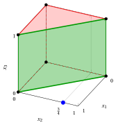{ .fig .ovale loading=lazy  }

        Case (a): the LP relaxation and the cover inequality $x_1+x_2\le 1$.

    - <strong>Case (b): $\tilde{\boldsymbol{x}}=\left(\tfrac{1}{5},1,1\right)$</strong>

        - **a)** <strong>Separation problem</strong>   The costs $q_j=1-\tilde{x}_j$ are $q=\left(\tfrac{4}{5},0,0\right)$. The separation problem $\CSP$ (left) and, with $y_j=1-z_j$, the complementary problem $\CSPKP$ (right) are:

            $$
            \begin{array}{rrcrcrcl}
            {\min} & {\frac{4}{5}\,z_1} &  &  &  &  &  &  \\[1ex]
            \text{subject to} & {5\,z_1} & {+} & {4\,z_2} & {+} & {3\,z_3} & {\ge} & {9} \\[1ex]
            & {z_1,} &  & {z_2,} &  & {z_3} & {\in} & {\{0,1\}}
            \end{array}
            $$

            $$
            \begin{array}{rrcrcrcl}
            {\max} & {\frac{4}{5}\,y_1} &  &  &  &  &  &  \\[1ex]
            \text{subject to} & {5\,y_1} & {+} & {4\,y_2} & {+} & {3\,y_3} & {\le} & {3} \\[1ex]
            & {y_1,} &  & {y_2,} &  & {y_3} & {\in} & {\{0,1\}}
            \end{array}
            $$

            with $z(\CSP)=n-\sum_{j\in\mathscr{I}}\tilde{x}_j-z(\CSPKP)=\frac{4}{5}-z(\CSPKP)$.

        - **b)** <strong>Greedy heuristic</strong>   The indices are scanned by non-increasing ratio $q_j/a_j$, starting from the residual right-hand side $3$:

            
<table>
            <tr>
            <th>\(j\)</th>
            <th>\(q_j\)</th>
            <th>\(a_j\)</th>
            <th>\(q_j/a_j\)</th>
            <th>Decision</th>
            <th>Residual</th>
            </tr>
            <tr>
            <td>\(1\)</td>
            <td>\(\tfrac{4}{5}\)</td>
            <td>\(5\)</td>
            <td>\(\tfrac{4}{25}\)</td>
            <td>\(\bar{y}_j=0\)</td>
            <td>\(3\)</td>
            </tr>
            <tr>
            <td>\(2\)</td>
            <td>\(0\)</td>
            <td>\(4\)</td>
            <td>\(0\)</td>
            <td>\(q_j=0\), \(\bar{y}_j=0\)</td>
            <td>\(3\)</td>
            </tr>
            <tr>
            <td>\(3\)</td>
            <td>\(0\)</td>
            <td>\(3\)</td>
            <td>\(0\)</td>
            <td>\(q_j=0\), \(\bar{y}_j=0\)</td>
            <td>\(3\)</td>
            </tr>
            </table>

            The greedy solution is $\bar{\boldsymbol{y}}=\left(0,0,0\right)$, with value $0$. The corresponding cover is $\bar{C}=\{j\in\mathscr{I}:\bar{y}_j=0\}=\{1,2,3\}$, of total coefficient $12>8$ and cost $\frac{4}{5}-0=\frac{4}{5}<1$. Hence the cover inequality

            $$
            x_1+x_2+x_3\le 2
            $$

            is violated by $\tilde{\boldsymbol{x}}$: $\frac{1}{5}+1+1-2=\frac{1}{5}$.

        - **c)** <strong>Optimality check</strong>   No index with $q_j>0$ satisfies the constraint with right-hand side $3$ alone, hence every feasible solution of $\CSPKP$ has value $0$. Hence $z(\CSPKP)=0$, the greedy solution is optimal, $z(\CSP)=\frac{4}{5}<1$, and the maximum violation of a cover inequality is $\frac{1}{5}$.

            The cover $\bar{C}$ is not minimal: removing an index with $q_j=0$ gives the minimal cover $\{1,2\}$, with the same cost $\frac{4}{5}$. Its cover inequality $x_1+x_2\le 1$ has the same violation $\frac{1}{5}$ and is stronger.

        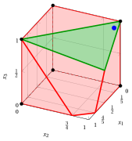{ .fig .ovale loading=lazy  }

        Case (b): the LP relaxation and the cover inequality $x_1+x_2+x_3\le 2$.

    - <strong>Case (c): $\tilde{\boldsymbol{x}}=\left(\tfrac{1}{3},\tfrac{1}{3},\tfrac{1}{3}\right)$</strong>

        - **a)** <strong>Separation problem</strong>   The costs $q_j=1-\tilde{x}_j$ are $q=\left(\tfrac{2}{3},\tfrac{2}{3},\tfrac{2}{3}\right)$. The separation problem $\CSP$ (left) and, with $y_j=1-z_j$, the complementary problem $\CSPKP$ (right) are:

            $$
            \begin{array}{rrcrcrcl}
            {\min} & {\frac{2}{3}\,z_1} & {+} & {\frac{2}{3}\,z_2} & {+} & {\frac{2}{3}\,z_3} &  &  \\[1ex]
            \text{subject to} & {5\,z_1} & {+} & {4\,z_2} & {+} & {3\,z_3} & {\ge} & {9} \\[1ex]
            & {z_1,} &  & {z_2,} &  & {z_3} & {\in} & {\{0,1\}}
            \end{array}
            $$

            $$
            \begin{array}{rrcrcrcl}
            {\max} & {\frac{2}{3}\,y_1} & {+} & {\frac{2}{3}\,y_2} & {+} & {\frac{2}{3}\,y_3} &  &  \\[1ex]
            \text{subject to} & {5\,y_1} & {+} & {4\,y_2} & {+} & {3\,y_3} & {\le} & {3} \\[1ex]
            & {y_1,} &  & {y_2,} &  & {y_3} & {\in} & {\{0,1\}}
            \end{array}
            $$

            with $z(\CSP)=n-\sum_{j\in\mathscr{I}}\tilde{x}_j-z(\CSPKP)=2-z(\CSPKP)$.

        - **b)** <strong>Greedy heuristic</strong>   The indices are scanned by non-increasing ratio $q_j/a_j$, starting from the residual right-hand side $3$:

            
<table>
            <tr>
            <th>\(j\)</th>
            <th>\(q_j\)</th>
            <th>\(a_j\)</th>
            <th>\(q_j/a_j\)</th>
            <th>Decision</th>
            <th>Residual</th>
            </tr>
            <tr>
            <td>\(3\)</td>
            <td>\(\tfrac{2}{3}\)</td>
            <td>\(3\)</td>
            <td>\(\tfrac{2}{9}\)</td>
            <td>\(\bar{y}_j=1\)</td>
            <td>\(0\)</td>
            </tr>
            <tr>
            <td>\(2\)</td>
            <td>\(\tfrac{2}{3}\)</td>
            <td>\(4\)</td>
            <td>\(\tfrac{1}{6}\)</td>
            <td>\(\bar{y}_j=0\)</td>
            <td>\(0\)</td>
            </tr>
            <tr>
            <td>\(1\)</td>
            <td>\(\tfrac{2}{3}\)</td>
            <td>\(5\)</td>
            <td>\(\tfrac{2}{15}\)</td>
            <td>\(\bar{y}_j=0\)</td>
            <td>\(0\)</td>
            </tr>
            </table>

            The greedy solution is $\bar{\boldsymbol{y}}=\left(0,0,1\right)$, with value $\frac{2}{3}$. The corresponding cover is $\bar{C}=\{j\in\mathscr{I}:\bar{y}_j=0\}=\{1,2\}$, with cost $2-\frac{2}{3}=\frac{4}{3}\ge1$: its cover inequality is not violated by $\tilde{\boldsymbol{x}}$.

        - **c)** <strong>Optimality check</strong>   Indices with $q_j=0$ do not change the value of a solution. The non-empty subsets of the indices $\{1,2,3\}$ with $q_j>0$ that satisfy the constraint with right-hand side $3$ are: $\{3\}$ (value $\frac{2}{3}$). Hence $z(\CSPKP)=\frac{2}{3}$, the greedy solution is optimal, and $z(\CSP)=\frac{4}{3}\ge1$: <strong>no</strong> cover inequality is violated by $\tilde{\boldsymbol{x}}$.

        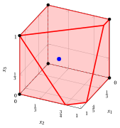{ .fig .ovale loading=lazy  }

        Case (c): the LP relaxation; no cover inequality is violated by the point.

!!! esercizio "Exercise 5.7: Cover inequalities in 3D (P2)"

    Consider a binary problem with one constraint $\sum_{j}a_jx_j\le b$, with positive integer coefficients $a_j$ and right-hand side $b=11$, on the binary variables indexed by the set $\mathscr{I}=\{1,2,3\}$ of $n=3$ variables with the following objective coefficients and constraint coefficients:

    $$
    \begin{array}{l|rrr}
    \hline {j} & 1 & 2 & 3 \\
    \hline {c_j} & 20 & 11 & 4 \\
    {a_j} & 2 & 3 & 9 \\
    \hline
    \end{array}
    $$

    The associated $\LP$ is:

    $$
    \begin{array}{rrcrcrcl}
    {\max} & {20\,x_1} & {+} & {11\,x_2} & {+} & {4\,x_3} &  &  \\[1ex]
    \text{subject to} & {2\,x_1} & {+} & {3\,x_2} & {+} & {9\,x_3} & {\le} & {11} \\[1ex]
    & {x_1} &  &  &  &  & {\le} & {1} \\[0.5ex]
    &  &  & {x_2} &  &  & {\le} & {1} \\[0.5ex]
    &  &  &  &  & {x_3} & {\le} & {1} \\[0.5ex]
    & {x_1,} &  & {x_2,} &  & {x_3} & {\ge} & {0}
    \end{array}
    $$

    and the following points of its feasible region:

    $$
    \begin{array}{cl}
    (a) & \tilde{\boldsymbol{x}}=\left(1,1,\tfrac{2}{3}\right),\\[1ex]
    (b) & \tilde{\boldsymbol{x}}=\left(0,\tfrac{2}{3},1\right),\\[1ex]
    (c) & \tilde{\boldsymbol{x}}=\left(\tfrac{1}{3},\tfrac{1}{3},\tfrac{1}{3}\right).
    \end{array}
    $$

    **Questions**

    For each point:

    1. write the separation problem $\CSP$ and its complementary problem $\CSPKP$;

    2. apply the greedy heuristic to $\CSPKP$ and, if possible, find a violated cover inequality;

    3. check whether the greedy solution is optimal;

    4. draw the LP relaxation together with the violated cover inequality, if any.

    !!! nota ""

        A subset of indices $C\subseteq\mathscr{I}$ with $\sum_{j\in C}a_j>b$ is a <strong>cover</strong>, and the linear inequality

        \begin{equation*}
        \sum_{j\in C}x_j\le|C|-1
        \end{equation*}

        is the <strong>cover inequality</strong> associated with $C$. Given a point $\tilde{\boldsymbol{x}}$, a cover inequality violated by $\tilde{\boldsymbol{x}}$ exists if and only if $z(\CSP)<1$, where

        \begin{equation*}
        (\CSP)\qquad \min\Big\{\sum_{j\in\mathscr{I}}(1-\tilde{x}_j)\,z_j:\
        \sum_{j\in\mathscr{I}}a_j\,z_j\ge b+1,\ z_j\in\{0,1\}\ \forall j\in\mathscr{I}\Big\}.
        \end{equation*}

??? soluzione "Solution"

    Separation of the cover inequalities violated by the three points.

    - <strong>Cover inequalities</strong>  All three points belong to the LP relaxation; the left-hand sides are

        $$
        2+3+9\cdot\frac{2}{3}=11,\qquad 0+3\cdot\frac{2}{3}+9=11,\qquad 2\cdot\frac{1}{3}+3\cdot\frac{1}{3}+9\cdot\frac{1}{3}=\frac{14}{3}\le 11.
        $$

        The covers are the subsets of indices whose total coefficient exceeds $b=11$:

        
<table>
        <tr>
        <th>\(C\)</th>
        <th>\(\sum_{j\in C}a_j\)</th>
        <th>\(|C|\)</th>
        <th>Cover inequality</th>
        <th>Minimal</th>
        </tr>
        <tr>
        <td>\(\{2,3\}\)</td>
        <td>\(12\)</td>
        <td>\(2\)</td>
        <td>\(x_2+x_3\le 1\)</td>
        <td>yes</td>
        </tr>
        <tr>
        <td>\(\{1,2,3\}\)</td>
        <td>\(14\)</td>
        <td>\(3\)</td>
        <td>\(x_1+x_2+x_3\le 2\)</td>
        <td>no</td>
        </tr>
        </table>

        In all three cases, the right-hand side of the complementary problem is $\sum_{j\in\mathscr{I}}a_j-(b+1)=14-12=2$.

    - <strong>Case (a): $\tilde{\boldsymbol{x}}=\left(1,1,\tfrac{2}{3}\right)$</strong>

        - **a)** <strong>Separation problem</strong>   The costs $q_j=1-\tilde{x}_j$ are $q=\left(0,0,\tfrac{1}{3}\right)$. The separation problem $\CSP$ (left) and, with $y_j=1-z_j$, the complementary problem $\CSPKP$ (right) are:

            $$
            \begin{array}{rrcrcrcl}
            {\min} &  &  &  &  & {\frac{1}{3}\,z_3} &  &  \\[1ex]
            \text{subject to} & {2\,z_1} & {+} & {3\,z_2} & {+} & {9\,z_3} & {\ge} & {12} \\[1ex]
            & {z_1,} &  & {z_2,} &  & {z_3} & {\in} & {\{0,1\}}
            \end{array}
            $$

            $$
            \begin{array}{rrcrcrcl}
            {\max} &  &  &  &  & {\frac{1}{3}\,y_3} &  &  \\[1ex]
            \text{subject to} & {2\,y_1} & {+} & {3\,y_2} & {+} & {9\,y_3} & {\le} & {2} \\[1ex]
            & {y_1,} &  & {y_2,} &  & {y_3} & {\in} & {\{0,1\}}
            \end{array}
            $$

            with $z(\CSP)=n-\sum_{j\in\mathscr{I}}\tilde{x}_j-z(\CSPKP)=\frac{1}{3}-z(\CSPKP)$.

        - **b)** <strong>Greedy heuristic</strong>   The indices are scanned by non-increasing ratio $q_j/a_j$, starting from the residual right-hand side $2$:

            
<table>
            <tr>
            <th>\(j\)</th>
            <th>\(q_j\)</th>
            <th>\(a_j\)</th>
            <th>\(q_j/a_j\)</th>
            <th>Decision</th>
            <th>Residual</th>
            </tr>
            <tr>
            <td>\(3\)</td>
            <td>\(\tfrac{1}{3}\)</td>
            <td>\(9\)</td>
            <td>\(\tfrac{1}{27}\)</td>
            <td>\(\bar{y}_j=0\)</td>
            <td>\(2\)</td>
            </tr>
            <tr>
            <td>\(1\)</td>
            <td>\(0\)</td>
            <td>\(2\)</td>
            <td>\(0\)</td>
            <td>\(q_j=0\), \(\bar{y}_j=0\)</td>
            <td>\(2\)</td>
            </tr>
            <tr>
            <td>\(2\)</td>
            <td>\(0\)</td>
            <td>\(3\)</td>
            <td>\(0\)</td>
            <td>\(q_j=0\), \(\bar{y}_j=0\)</td>
            <td>\(2\)</td>
            </tr>
            </table>

            The greedy solution is $\bar{\boldsymbol{y}}=\left(0,0,0\right)$, with value $0$. The corresponding cover is $\bar{C}=\{j\in\mathscr{I}:\bar{y}_j=0\}=\{1,2,3\}$, of total coefficient $14>11$ and cost $\frac{1}{3}-0=\frac{1}{3}<1$. Hence the cover inequality

            $$
            x_1+x_2+x_3\le 2
            $$

            is violated by $\tilde{\boldsymbol{x}}$: $1+1+\frac{2}{3}-2=\frac{2}{3}$.

        - **c)** <strong>Optimality check</strong>   No index with $q_j>0$ satisfies the constraint with right-hand side $2$ alone, hence every feasible solution of $\CSPKP$ has value $0$. Hence $z(\CSPKP)=0$, the greedy solution is optimal, $z(\CSP)=\frac{1}{3}<1$, and the maximum violation of a cover inequality is $\frac{2}{3}$.

            The cover $\bar{C}$ is not minimal: removing an index with $q_j=0$ gives the minimal cover $\{2,3\}$, with the same cost $\frac{1}{3}$. Its cover inequality $x_2+x_3\le 1$ has the same violation $\frac{2}{3}$ and is stronger.

        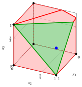{ .fig .ovale loading=lazy  }

        Case (a): the LP relaxation and the cover inequality $x_1+x_2+x_3\le 2$.

    - <strong>Case (b): $\tilde{\boldsymbol{x}}=\left(0,\tfrac{2}{3},1\right)$</strong>

        - **a)** <strong>Separation problem</strong>   The costs $q_j=1-\tilde{x}_j$ are $q=\left(1,\tfrac{1}{3},0\right)$. The separation problem $\CSP$ (left) and, with $y_j=1-z_j$, the complementary problem $\CSPKP$ (right) are:

            $$
            \begin{array}{rrcrcrcl}
            {\min} & {z_1} & {+} & {\frac{1}{3}\,z_2} &  &  &  &  \\[1ex]
            \text{subject to} & {2\,z_1} & {+} & {3\,z_2} & {+} & {9\,z_3} & {\ge} & {12} \\[1ex]
            & {z_1,} &  & {z_2,} &  & {z_3} & {\in} & {\{0,1\}}
            \end{array}
            $$

            $$
            \begin{array}{rrcrcrcl}
            {\max} & {y_1} & {+} & {\frac{1}{3}\,y_2} &  &  &  &  \\[1ex]
            \text{subject to} & {2\,y_1} & {+} & {3\,y_2} & {+} & {9\,y_3} & {\le} & {2} \\[1ex]
            & {y_1,} &  & {y_2,} &  & {y_3} & {\in} & {\{0,1\}}
            \end{array}
            $$

            with $z(\CSP)=n-\sum_{j\in\mathscr{I}}\tilde{x}_j-z(\CSPKP)=\frac{4}{3}-z(\CSPKP)$.

        - **b)** <strong>Greedy heuristic</strong>   The indices are scanned by non-increasing ratio $q_j/a_j$, starting from the residual right-hand side $2$:

            
<table>
            <tr>
            <th>\(j\)</th>
            <th>\(q_j\)</th>
            <th>\(a_j\)</th>
            <th>\(q_j/a_j\)</th>
            <th>Decision</th>
            <th>Residual</th>
            </tr>
            <tr>
            <td>\(1\)</td>
            <td>\(1\)</td>
            <td>\(2\)</td>
            <td>\(\tfrac{1}{2}\)</td>
            <td>\(\bar{y}_j=1\)</td>
            <td>\(0\)</td>
            </tr>
            <tr>
            <td>\(2\)</td>
            <td>\(\tfrac{1}{3}\)</td>
            <td>\(3\)</td>
            <td>\(\tfrac{1}{9}\)</td>
            <td>\(\bar{y}_j=0\)</td>
            <td>\(0\)</td>
            </tr>
            <tr>
            <td>\(3\)</td>
            <td>\(0\)</td>
            <td>\(9\)</td>
            <td>\(0\)</td>
            <td>\(q_j=0\), \(\bar{y}_j=0\)</td>
            <td>\(0\)</td>
            </tr>
            </table>

            The greedy solution is $\bar{\boldsymbol{y}}=\left(1,0,0\right)$, with value $1$. The corresponding cover is $\bar{C}=\{j\in\mathscr{I}:\bar{y}_j=0\}=\{2,3\}$, of total coefficient $12>11$ and cost $\frac{4}{3}-1=\frac{1}{3}<1$. Hence the cover inequality

            $$
            x_2+x_3\le 1
            $$

            is violated by $\tilde{\boldsymbol{x}}$: $\frac{2}{3}+1-1=\frac{2}{3}$.

        - **c)** <strong>Optimality check</strong>   Indices with $q_j=0$ do not change the value of a solution. The non-empty subsets of the indices $\{1,2\}$ with $q_j>0$ that satisfy the constraint with right-hand side $2$ are: $\{1\}$ (value $1$). Hence $z(\CSPKP)=1$, the greedy solution is optimal, $z(\CSP)=\frac{1}{3}<1$, and the maximum violation of a cover inequality is $\frac{2}{3}$.

        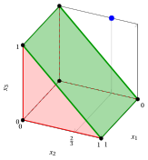{ .fig .ovale loading=lazy  }

        Case (b): the LP relaxation and the cover inequality $x_2+x_3\le 1$.

    - <strong>Case (c): $\tilde{\boldsymbol{x}}=\left(\tfrac{1}{3},\tfrac{1}{3},\tfrac{1}{3}\right)$</strong>

        - **a)** <strong>Separation problem</strong>   The costs $q_j=1-\tilde{x}_j$ are $q=\left(\tfrac{2}{3},\tfrac{2}{3},\tfrac{2}{3}\right)$. The separation problem $\CSP$ (left) and, with $y_j=1-z_j$, the complementary problem $\CSPKP$ (right) are:

            $$
            \begin{array}{rrcrcrcl}
            {\min} & {\frac{2}{3}\,z_1} & {+} & {\frac{2}{3}\,z_2} & {+} & {\frac{2}{3}\,z_3} &  &  \\[1ex]
            \text{subject to} & {2\,z_1} & {+} & {3\,z_2} & {+} & {9\,z_3} & {\ge} & {12} \\[1ex]
            & {z_1,} &  & {z_2,} &  & {z_3} & {\in} & {\{0,1\}}
            \end{array}
            $$

            $$
            \begin{array}{rrcrcrcl}
            {\max} & {\frac{2}{3}\,y_1} & {+} & {\frac{2}{3}\,y_2} & {+} & {\frac{2}{3}\,y_3} &  &  \\[1ex]
            \text{subject to} & {2\,y_1} & {+} & {3\,y_2} & {+} & {9\,y_3} & {\le} & {2} \\[1ex]
            & {y_1,} &  & {y_2,} &  & {y_3} & {\in} & {\{0,1\}}
            \end{array}
            $$

            with $z(\CSP)=n-\sum_{j\in\mathscr{I}}\tilde{x}_j-z(\CSPKP)=2-z(\CSPKP)$.

        - **b)** <strong>Greedy heuristic</strong>   The indices are scanned by non-increasing ratio $q_j/a_j$, starting from the residual right-hand side $2$:

            
<table>
            <tr>
            <th>\(j\)</th>
            <th>\(q_j\)</th>
            <th>\(a_j\)</th>
            <th>\(q_j/a_j\)</th>
            <th>Decision</th>
            <th>Residual</th>
            </tr>
            <tr>
            <td>\(1\)</td>
            <td>\(\tfrac{2}{3}\)</td>
            <td>\(2\)</td>
            <td>\(\tfrac{1}{3}\)</td>
            <td>\(\bar{y}_j=1\)</td>
            <td>\(0\)</td>
            </tr>
            <tr>
            <td>\(2\)</td>
            <td>\(\tfrac{2}{3}\)</td>
            <td>\(3\)</td>
            <td>\(\tfrac{2}{9}\)</td>
            <td>\(\bar{y}_j=0\)</td>
            <td>\(0\)</td>
            </tr>
            <tr>
            <td>\(3\)</td>
            <td>\(\tfrac{2}{3}\)</td>
            <td>\(9\)</td>
            <td>\(\tfrac{2}{27}\)</td>
            <td>\(\bar{y}_j=0\)</td>
            <td>\(0\)</td>
            </tr>
            </table>

            The greedy solution is $\bar{\boldsymbol{y}}=\left(1,0,0\right)$, with value $\frac{2}{3}$. The corresponding cover is $\bar{C}=\{j\in\mathscr{I}:\bar{y}_j=0\}=\{2,3\}$, with cost $2-\frac{2}{3}=\frac{4}{3}\ge1$: its cover inequality is not violated by $\tilde{\boldsymbol{x}}$.

        - **c)** <strong>Optimality check</strong>   Indices with $q_j=0$ do not change the value of a solution. The non-empty subsets of the indices $\{1,2,3\}$ with $q_j>0$ that satisfy the constraint with right-hand side $2$ are: $\{1\}$ (value $\frac{2}{3}$). Hence $z(\CSPKP)=\frac{2}{3}$, the greedy solution is optimal, and $z(\CSP)=\frac{4}{3}\ge1$: <strong>no</strong> cover inequality is violated by $\tilde{\boldsymbol{x}}$.

        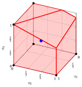{ .fig .ovale loading=lazy  }

        Case (c): the LP relaxation; no cover inequality is violated by the point.

!!! esercizio "Exercise 5.8: Cover inequalities in 3D (P3)"

    Consider a binary problem with one constraint $\sum_{j}a_jx_j\le b$, with positive integer coefficients $a_j$ and right-hand side $b=9$, on the binary variables indexed by the set $\mathscr{I}=\{1,2,3\}$ of $n=3$ variables with the following objective coefficients and constraint coefficients:

    $$
    \begin{array}{l|rrr}
    \hline {j} & 1 & 2 & 3 \\
    \hline {c_j} & 16 & 19 & 8 \\
    {a_j} & 5 & 6 & 7 \\
    \hline
    \end{array}
    $$

    The associated $\LP$ is:

    $$
    \begin{array}{rrcrcrcl}
    {\max} & {16\,x_1} & {+} & {19\,x_2} & {+} & {8\,x_3} &  &  \\[1ex]
    \text{subject to} & {5\,x_1} & {+} & {6\,x_2} & {+} & {7\,x_3} & {\le} & {9} \\[1ex]
    & {x_1} &  &  &  &  & {\le} & {1} \\[0.5ex]
    &  &  & {x_2} &  &  & {\le} & {1} \\[0.5ex]
    &  &  &  &  & {x_3} & {\le} & {1} \\[0.5ex]
    & {x_1,} &  & {x_2,} &  & {x_3} & {\ge} & {0}
    \end{array}
    $$

    and the following points of its feasible region:

    $$
    \begin{array}{cl}
    (a) & \tilde{\boldsymbol{x}}=\left(1,\tfrac{2}{3},0\right),\\[1ex]
    (b) & \tilde{\boldsymbol{x}}=\left(0,\tfrac{1}{3},1\right),\\[1ex]
    (c) & \tilde{\boldsymbol{x}}=\left(\tfrac{1}{3},\tfrac{1}{3},\tfrac{1}{3}\right).
    \end{array}
    $$

    **Questions**

    For each point:

    1. write the separation problem $\CSP$ and its complementary problem $\CSPKP$;

    2. apply the greedy heuristic to $\CSPKP$ and, if possible, find a violated cover inequality;

    3. check whether the greedy solution is optimal;

    4. draw the LP relaxation together with the violated cover inequality, if any.

    !!! nota ""

        A subset of indices $C\subseteq\mathscr{I}$ with $\sum_{j\in C}a_j>b$ is a <strong>cover</strong>, and the linear inequality

        \begin{equation*}
        \sum_{j\in C}x_j\le|C|-1
        \end{equation*}

        is the <strong>cover inequality</strong> associated with $C$. Given a point $\tilde{\boldsymbol{x}}$, a cover inequality violated by $\tilde{\boldsymbol{x}}$ exists if and only if $z(\CSP)<1$, where

        \begin{equation*}
        (\CSP)\qquad \min\Big\{\sum_{j\in\mathscr{I}}(1-\tilde{x}_j)\,z_j:\
        \sum_{j\in\mathscr{I}}a_j\,z_j\ge b+1,\ z_j\in\{0,1\}\ \forall j\in\mathscr{I}\Big\}.
        \end{equation*}

??? soluzione "Solution"

    Separation of the cover inequalities violated by the three points.

    - <strong>Cover inequalities</strong>  All three points belong to the LP relaxation; the left-hand sides are

        $$
        5+6\cdot\frac{2}{3}+0=9,\qquad 0+6\cdot\frac{1}{3}+7=9,\qquad 5\cdot\frac{1}{3}+6\cdot\frac{1}{3}+7\cdot\frac{1}{3}=6\le 9.
        $$

        The covers are the subsets of indices whose total coefficient exceeds $b=9$:

        
<table>
        <tr>
        <th>\(C\)</th>
        <th>\(\sum_{j\in C}a_j\)</th>
        <th>\(|C|\)</th>
        <th>Cover inequality</th>
        <th>Minimal</th>
        </tr>
        <tr>
        <td>\(\{1,2\}\)</td>
        <td>\(11\)</td>
        <td>\(2\)</td>
        <td>\(x_1+x_2\le 1\)</td>
        <td>yes</td>
        </tr>
        <tr>
        <td>\(\{1,3\}\)</td>
        <td>\(12\)</td>
        <td>\(2\)</td>
        <td>\(x_1+x_3\le 1\)</td>
        <td>yes</td>
        </tr>
        <tr>
        <td>\(\{2,3\}\)</td>
        <td>\(13\)</td>
        <td>\(2\)</td>
        <td>\(x_2+x_3\le 1\)</td>
        <td>yes</td>
        </tr>
        <tr>
        <td>\(\{1,2,3\}\)</td>
        <td>\(18\)</td>
        <td>\(3\)</td>
        <td>\(x_1+x_2+x_3\le 2\)</td>
        <td>no</td>
        </tr>
        </table>

        In all three cases, the right-hand side of the complementary problem is $\sum_{j\in\mathscr{I}}a_j-(b+1)=18-10=8$.

    - <strong>Case (a): $\tilde{\boldsymbol{x}}=\left(1,\tfrac{2}{3},0\right)$</strong>

        - **a)** <strong>Separation problem</strong>   The costs $q_j=1-\tilde{x}_j$ are $q=\left(0,\tfrac{1}{3},1\right)$. The separation problem $\CSP$ (left) and, with $y_j=1-z_j$, the complementary problem $\CSPKP$ (right) are:

            $$
            \begin{array}{rrcrcrcl}
            {\min} &  &  & {\frac{1}{3}\,z_2} & {+} & {z_3} &  &  \\[1ex]
            \text{subject to} & {5\,z_1} & {+} & {6\,z_2} & {+} & {7\,z_3} & {\ge} & {10} \\[1ex]
            & {z_1,} &  & {z_2,} &  & {z_3} & {\in} & {\{0,1\}}
            \end{array}
            $$

            $$
            \begin{array}{rrcrcrcl}
            {\max} &  &  & {\frac{1}{3}\,y_2} & {+} & {y_3} &  &  \\[1ex]
            \text{subject to} & {5\,y_1} & {+} & {6\,y_2} & {+} & {7\,y_3} & {\le} & {8} \\[1ex]
            & {y_1,} &  & {y_2,} &  & {y_3} & {\in} & {\{0,1\}}
            \end{array}
            $$

            with $z(\CSP)=n-\sum_{j\in\mathscr{I}}\tilde{x}_j-z(\CSPKP)=\frac{4}{3}-z(\CSPKP)$.

        - **b)** <strong>Greedy heuristic</strong>   The indices are scanned by non-increasing ratio $q_j/a_j$, starting from the residual right-hand side $8$:

            
<table>
            <tr>
            <th>\(j\)</th>
            <th>\(q_j\)</th>
            <th>\(a_j\)</th>
            <th>\(q_j/a_j\)</th>
            <th>Decision</th>
            <th>Residual</th>
            </tr>
            <tr>
            <td>\(3\)</td>
            <td>\(1\)</td>
            <td>\(7\)</td>
            <td>\(\tfrac{1}{7}\)</td>
            <td>\(\bar{y}_j=1\)</td>
            <td>\(1\)</td>
            </tr>
            <tr>
            <td>\(2\)</td>
            <td>\(\tfrac{1}{3}\)</td>
            <td>\(6\)</td>
            <td>\(\tfrac{1}{18}\)</td>
            <td>\(\bar{y}_j=0\)</td>
            <td>\(1\)</td>
            </tr>
            <tr>
            <td>\(1\)</td>
            <td>\(0\)</td>
            <td>\(5\)</td>
            <td>\(0\)</td>
            <td>\(q_j=0\), \(\bar{y}_j=0\)</td>
            <td>\(1\)</td>
            </tr>
            </table>

            The greedy solution is $\bar{\boldsymbol{y}}=\left(0,0,1\right)$, with value $1$. The corresponding cover is $\bar{C}=\{j\in\mathscr{I}:\bar{y}_j=0\}=\{1,2\}$, of total coefficient $11>9$ and cost $\frac{4}{3}-1=\frac{1}{3}<1$. Hence the cover inequality

            $$
            x_1+x_2\le 1
            $$

            is violated by $\tilde{\boldsymbol{x}}$: $1+\frac{2}{3}-1=\frac{2}{3}$.

        - **c)** <strong>Optimality check</strong>   Indices with $q_j=0$ do not change the value of a solution. The non-empty subsets of the indices $\{2,3\}$ with $q_j>0$ that satisfy the constraint with right-hand side $8$ are: $\{2\}$ (value $\frac{1}{3}$), $\{3\}$ (value $1$). Hence $z(\CSPKP)=1$, the greedy solution is optimal, $z(\CSP)=\frac{1}{3}<1$, and the maximum violation of a cover inequality is $\frac{2}{3}$.

        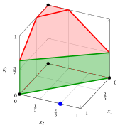{ .fig .ovale loading=lazy  }

        Case (a): the LP relaxation and the cover inequality $x_1+x_2\le 1$.

    - <strong>Case (b): $\tilde{\boldsymbol{x}}=\left(0,\tfrac{1}{3},1\right)$</strong>

        - **a)** <strong>Separation problem</strong>   The costs $q_j=1-\tilde{x}_j$ are $q=\left(1,\tfrac{2}{3},0\right)$. The separation problem $\CSP$ (left) and, with $y_j=1-z_j$, the complementary problem $\CSPKP$ (right) are:

            $$
            \begin{array}{rrcrcrcl}
            {\min} & {z_1} & {+} & {\frac{2}{3}\,z_2} &  &  &  &  \\[1ex]
            \text{subject to} & {5\,z_1} & {+} & {6\,z_2} & {+} & {7\,z_3} & {\ge} & {10} \\[1ex]
            & {z_1,} &  & {z_2,} &  & {z_3} & {\in} & {\{0,1\}}
            \end{array}
            $$

            $$
            \begin{array}{rrcrcrcl}
            {\max} & {y_1} & {+} & {\frac{2}{3}\,y_2} &  &  &  &  \\[1ex]
            \text{subject to} & {5\,y_1} & {+} & {6\,y_2} & {+} & {7\,y_3} & {\le} & {8} \\[1ex]
            & {y_1,} &  & {y_2,} &  & {y_3} & {\in} & {\{0,1\}}
            \end{array}
            $$

            with $z(\CSP)=n-\sum_{j\in\mathscr{I}}\tilde{x}_j-z(\CSPKP)=\frac{5}{3}-z(\CSPKP)$.

        - **b)** <strong>Greedy heuristic</strong>   The indices are scanned by non-increasing ratio $q_j/a_j$, starting from the residual right-hand side $8$:

            
<table>
            <tr>
            <th>\(j\)</th>
            <th>\(q_j\)</th>
            <th>\(a_j\)</th>
            <th>\(q_j/a_j\)</th>
            <th>Decision</th>
            <th>Residual</th>
            </tr>
            <tr>
            <td>\(1\)</td>
            <td>\(1\)</td>
            <td>\(5\)</td>
            <td>\(\tfrac{1}{5}\)</td>
            <td>\(\bar{y}_j=1\)</td>
            <td>\(3\)</td>
            </tr>
            <tr>
            <td>\(2\)</td>
            <td>\(\tfrac{2}{3}\)</td>
            <td>\(6\)</td>
            <td>\(\tfrac{1}{9}\)</td>
            <td>\(\bar{y}_j=0\)</td>
            <td>\(3\)</td>
            </tr>
            <tr>
            <td>\(3\)</td>
            <td>\(0\)</td>
            <td>\(7\)</td>
            <td>\(0\)</td>
            <td>\(q_j=0\), \(\bar{y}_j=0\)</td>
            <td>\(3\)</td>
            </tr>
            </table>

            The greedy solution is $\bar{\boldsymbol{y}}=\left(1,0,0\right)$, with value $1$. The corresponding cover is $\bar{C}=\{j\in\mathscr{I}:\bar{y}_j=0\}=\{2,3\}$, of total coefficient $13>9$ and cost $\frac{5}{3}-1=\frac{2}{3}<1$. Hence the cover inequality

            $$
            x_2+x_3\le 1
            $$

            is violated by $\tilde{\boldsymbol{x}}$: $\frac{1}{3}+1-1=\frac{1}{3}$.

        - **c)** <strong>Optimality check</strong>   Indices with $q_j=0$ do not change the value of a solution. The non-empty subsets of the indices $\{1,2\}$ with $q_j>0$ that satisfy the constraint with right-hand side $8$ are: $\{1\}$ (value $1$), $\{2\}$ (value $\frac{2}{3}$). Hence $z(\CSPKP)=1$, the greedy solution is optimal, $z(\CSP)=\frac{2}{3}<1$, and the maximum violation of a cover inequality is $\frac{1}{3}$.

        { .fig .ovale loading=lazy  }

        Case (b): the LP relaxation and the cover inequality $x_2+x_3\le 1$.

    - <strong>Case (c): $\tilde{\boldsymbol{x}}=\left(\tfrac{1}{3},\tfrac{1}{3},\tfrac{1}{3}\right)$</strong>

        - **a)** <strong>Separation problem</strong>   The costs $q_j=1-\tilde{x}_j$ are $q=\left(\tfrac{2}{3},\tfrac{2}{3},\tfrac{2}{3}\right)$. The separation problem $\CSP$ (left) and, with $y_j=1-z_j$, the complementary problem $\CSPKP$ (right) are:

            $$
            \begin{array}{rrcrcrcl}
            {\min} & {\frac{2}{3}\,z_1} & {+} & {\frac{2}{3}\,z_2} & {+} & {\frac{2}{3}\,z_3} &  &  \\[1ex]
            \text{subject to} & {5\,z_1} & {+} & {6\,z_2} & {+} & {7\,z_3} & {\ge} & {10} \\[1ex]
            & {z_1,} &  & {z_2,} &  & {z_3} & {\in} & {\{0,1\}}
            \end{array}
            $$

            $$
            \begin{array}{rrcrcrcl}
            {\max} & {\frac{2}{3}\,y_1} & {+} & {\frac{2}{3}\,y_2} & {+} & {\frac{2}{3}\,y_3} &  &  \\[1ex]
            \text{subject to} & {5\,y_1} & {+} & {6\,y_2} & {+} & {7\,y_3} & {\le} & {8} \\[1ex]
            & {y_1,} &  & {y_2,} &  & {y_3} & {\in} & {\{0,1\}}
            \end{array}
            $$

            with $z(\CSP)=n-\sum_{j\in\mathscr{I}}\tilde{x}_j-z(\CSPKP)=2-z(\CSPKP)$.

        - **b)** <strong>Greedy heuristic</strong>   The indices are scanned by non-increasing ratio $q_j/a_j$, starting from the residual right-hand side $8$:

            
<table>
            <tr>
            <th>\(j\)</th>
            <th>\(q_j\)</th>
            <th>\(a_j\)</th>
            <th>\(q_j/a_j\)</th>
            <th>Decision</th>
            <th>Residual</th>
            </tr>
            <tr>
            <td>\(1\)</td>
            <td>\(\tfrac{2}{3}\)</td>
            <td>\(5\)</td>
            <td>\(\tfrac{2}{15}\)</td>
            <td>\(\bar{y}_j=1\)</td>
            <td>\(3\)</td>
            </tr>
            <tr>
            <td>\(2\)</td>
            <td>\(\tfrac{2}{3}\)</td>
            <td>\(6\)</td>
            <td>\(\tfrac{1}{9}\)</td>
            <td>\(\bar{y}_j=0\)</td>
            <td>\(3\)</td>
            </tr>
            <tr>
            <td>\(3\)</td>
            <td>\(\tfrac{2}{3}\)</td>
            <td>\(7\)</td>
            <td>\(\tfrac{2}{21}\)</td>
            <td>\(\bar{y}_j=0\)</td>
            <td>\(3\)</td>
            </tr>
            </table>

            The greedy solution is $\bar{\boldsymbol{y}}=\left(1,0,0\right)$, with value $\frac{2}{3}$. The corresponding cover is $\bar{C}=\{j\in\mathscr{I}:\bar{y}_j=0\}=\{2,3\}$, with cost $2-\frac{2}{3}=\frac{4}{3}\ge1$: its cover inequality is not violated by $\tilde{\boldsymbol{x}}$.

        - **c)** <strong>Optimality check</strong>   Indices with $q_j=0$ do not change the value of a solution. The non-empty subsets of the indices $\{1,2,3\}$ with $q_j>0$ that satisfy the constraint with right-hand side $8$ are: $\{1\}$ (value $\frac{2}{3}$), $\{2\}$ (value $\frac{2}{3}$), $\{3\}$ (value $\frac{2}{3}$). Hence $z(\CSPKP)=\frac{2}{3}$, the greedy solution is optimal, and $z(\CSP)=\frac{4}{3}\ge1$: <strong>no</strong> cover inequality is violated by $\tilde{\boldsymbol{x}}$.

        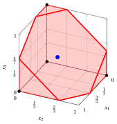{ .fig .ovale loading=lazy  }

        Case (c): the LP relaxation; no cover inequality is violated by the point.

!!! esercizio "Exercise 5.9: Cover inequalities in 3D (P4)"

    Consider a binary problem with one constraint $\sum_{j}a_jx_j\le b$, with positive integer coefficients $a_j$ and right-hand side $b=5$, on the binary variables indexed by the set $\mathscr{I}=\{1,2,3\}$ of $n=3$ variables with the following objective coefficients and constraint coefficients:

    $$
    \begin{array}{l|rrr}
    \hline {j} & 1 & 2 & 3 \\
    \hline {c_j} & 14 & 17 & 8 \\
    {a_j} & 2 & 5 & 5 \\
    \hline
    \end{array}
    $$

    The associated $\LP$ is:

    $$
    \begin{array}{rrcrcrcl}
    {\max} & {14\,x_1} & {+} & {17\,x_2} & {+} & {8\,x_3} &  &  \\[1ex]
    \text{subject to} & {2\,x_1} & {+} & {5\,x_2} & {+} & {5\,x_3} & {\le} & {5} \\[1ex]
    & {x_1} &  &  &  &  & {\le} & {1} \\[0.5ex]
    &  &  & {x_2} &  &  & {\le} & {1} \\[0.5ex]
    &  &  &  &  & {x_3} & {\le} & {1} \\[0.5ex]
    & {x_1,} &  & {x_2,} &  & {x_3} & {\ge} & {0}
    \end{array}
    $$

    and the following points of its feasible region:

    $$
    \begin{array}{cl}
    (a) & \tilde{\boldsymbol{x}}=\left(1,\tfrac{3}{5},0\right),\\[1ex]
    (b) & \tilde{\boldsymbol{x}}=\left(1,0,\tfrac{3}{5}\right),\\[1ex]
    (c) & \tilde{\boldsymbol{x}}=\left(\tfrac{1}{3},\tfrac{1}{3},\tfrac{1}{3}\right).
    \end{array}
    $$

    **Questions**

    For each point:

    1. write the separation problem $\CSP$ and its complementary problem $\CSPKP$;

    2. apply the greedy heuristic to $\CSPKP$ and, if possible, find a violated cover inequality;

    3. check whether the greedy solution is optimal;

    4. draw the LP relaxation together with the violated cover inequality, if any.

    !!! nota ""

        A subset of indices $C\subseteq\mathscr{I}$ with $\sum_{j\in C}a_j>b$ is a <strong>cover</strong>, and the linear inequality

        \begin{equation*}
        \sum_{j\in C}x_j\le|C|-1
        \end{equation*}

        is the <strong>cover inequality</strong> associated with $C$. Given a point $\tilde{\boldsymbol{x}}$, a cover inequality violated by $\tilde{\boldsymbol{x}}$ exists if and only if $z(\CSP)<1$, where

        \begin{equation*}
        (\CSP)\qquad \min\Big\{\sum_{j\in\mathscr{I}}(1-\tilde{x}_j)\,z_j:\
        \sum_{j\in\mathscr{I}}a_j\,z_j\ge b+1,\ z_j\in\{0,1\}\ \forall j\in\mathscr{I}\Big\}.
        \end{equation*}

??? soluzione "Solution"

    Separation of the cover inequalities violated by the three points.

    - <strong>Cover inequalities</strong>  All three points belong to the LP relaxation; the left-hand sides are

        $$
        2+5\cdot\frac{3}{5}+0=5,\qquad 2+0+5\cdot\frac{3}{5}=5,\qquad 2\cdot\frac{1}{3}+5\cdot\frac{1}{3}+5\cdot\frac{1}{3}=4\le 5.
        $$

        The covers are the subsets of indices whose total coefficient exceeds $b=5$:

        
<table>
        <tr>
        <th>\(C\)</th>
        <th>\(\sum_{j\in C}a_j\)</th>
        <th>\(|C|\)</th>
        <th>Cover inequality</th>
        <th>Minimal</th>
        </tr>
        <tr>
        <td>\(\{1,2\}\)</td>
        <td>\(7\)</td>
        <td>\(2\)</td>
        <td>\(x_1+x_2\le 1\)</td>
        <td>yes</td>
        </tr>
        <tr>
        <td>\(\{1,3\}\)</td>
        <td>\(7\)</td>
        <td>\(2\)</td>
        <td>\(x_1+x_3\le 1\)</td>
        <td>yes</td>
        </tr>
        <tr>
        <td>\(\{2,3\}\)</td>
        <td>\(10\)</td>
        <td>\(2\)</td>
        <td>\(x_2+x_3\le 1\)</td>
        <td>yes</td>
        </tr>
        <tr>
        <td>\(\{1,2,3\}\)</td>
        <td>\(12\)</td>
        <td>\(3\)</td>
        <td>\(x_1+x_2+x_3\le 2\)</td>
        <td>no</td>
        </tr>
        </table>

        In all three cases, the right-hand side of the complementary problem is $\sum_{j\in\mathscr{I}}a_j-(b+1)=12-6=6$.

    - <strong>Case (a): $\tilde{\boldsymbol{x}}=\left(1,\tfrac{3}{5},0\right)$</strong>

        - **a)** <strong>Separation problem</strong>   The costs $q_j=1-\tilde{x}_j$ are $q=\left(0,\tfrac{2}{5},1\right)$. The separation problem $\CSP$ (left) and, with $y_j=1-z_j$, the complementary problem $\CSPKP$ (right) are:

            $$
            \begin{array}{rrcrcrcl}
            {\min} &  &  & {\frac{2}{5}\,z_2} & {+} & {z_3} &  &  \\[1ex]
            \text{subject to} & {2\,z_1} & {+} & {5\,z_2} & {+} & {5\,z_3} & {\ge} & {6} \\[1ex]
            & {z_1,} &  & {z_2,} &  & {z_3} & {\in} & {\{0,1\}}
            \end{array}
            $$

            $$
            \begin{array}{rrcrcrcl}
            {\max} &  &  & {\frac{2}{5}\,y_2} & {+} & {y_3} &  &  \\[1ex]
            \text{subject to} & {2\,y_1} & {+} & {5\,y_2} & {+} & {5\,y_3} & {\le} & {6} \\[1ex]
            & {y_1,} &  & {y_2,} &  & {y_3} & {\in} & {\{0,1\}}
            \end{array}
            $$

            with $z(\CSP)=n-\sum_{j\in\mathscr{I}}\tilde{x}_j-z(\CSPKP)=\frac{7}{5}-z(\CSPKP)$.

        - **b)** <strong>Greedy heuristic</strong>   The indices are scanned by non-increasing ratio $q_j/a_j$, starting from the residual right-hand side $6$:

            
<table>
            <tr>
            <th>\(j\)</th>
            <th>\(q_j\)</th>
            <th>\(a_j\)</th>
            <th>\(q_j/a_j\)</th>
            <th>Decision</th>
            <th>Residual</th>
            </tr>
            <tr>
            <td>\(3\)</td>
            <td>\(1\)</td>
            <td>\(5\)</td>
            <td>\(\tfrac{1}{5}\)</td>
            <td>\(\bar{y}_j=1\)</td>
            <td>\(1\)</td>
            </tr>
            <tr>
            <td>\(2\)</td>
            <td>\(\tfrac{2}{5}\)</td>
            <td>\(5\)</td>
            <td>\(\tfrac{2}{25}\)</td>
            <td>\(\bar{y}_j=0\)</td>
            <td>\(1\)</td>
            </tr>
            <tr>
            <td>\(1\)</td>
            <td>\(0\)</td>
            <td>\(2\)</td>
            <td>\(0\)</td>
            <td>\(q_j=0\), \(\bar{y}_j=0\)</td>
            <td>\(1\)</td>
            </tr>
            </table>

            The greedy solution is $\bar{\boldsymbol{y}}=\left(0,0,1\right)$, with value $1$. The corresponding cover is $\bar{C}=\{j\in\mathscr{I}:\bar{y}_j=0\}=\{1,2\}$, of total coefficient $7>5$ and cost $\frac{7}{5}-1=\frac{2}{5}<1$. Hence the cover inequality

            $$
            x_1+x_2\le 1
            $$

            is violated by $\tilde{\boldsymbol{x}}$: $1+\frac{3}{5}-1=\frac{3}{5}$.

        - **c)** <strong>Optimality check</strong>   Indices with $q_j=0$ do not change the value of a solution. The non-empty subsets of the indices $\{2,3\}$ with $q_j>0$ that satisfy the constraint with right-hand side $6$ are: $\{2\}$ (value $\frac{2}{5}$), $\{3\}$ (value $1$). Hence $z(\CSPKP)=1$, the greedy solution is optimal, $z(\CSP)=\frac{2}{5}<1$, and the maximum violation of a cover inequality is $\frac{3}{5}$.

        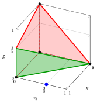{ .fig .ovale loading=lazy  }

        Case (a): the LP relaxation and the cover inequality $x_1+x_2\le 1$.

    - <strong>Case (b): $\tilde{\boldsymbol{x}}=\left(1,0,\tfrac{3}{5}\right)$</strong>

        - **a)** <strong>Separation problem</strong>   The costs $q_j=1-\tilde{x}_j$ are $q=\left(0,1,\tfrac{2}{5}\right)$. The separation problem $\CSP$ (left) and, with $y_j=1-z_j$, the complementary problem $\CSPKP$ (right) are:

            $$
            \begin{array}{rrcrcrcl}
            {\min} &  &  & {z_2} & {+} & {\frac{2}{5}\,z_3} &  &  \\[1ex]
            \text{subject to} & {2\,z_1} & {+} & {5\,z_2} & {+} & {5\,z_3} & {\ge} & {6} \\[1ex]
            & {z_1,} &  & {z_2,} &  & {z_3} & {\in} & {\{0,1\}}
            \end{array}
            $$

            $$
            \begin{array}{rrcrcrcl}
            {\max} &  &  & {y_2} & {+} & {\frac{2}{5}\,y_3} &  &  \\[1ex]
            \text{subject to} & {2\,y_1} & {+} & {5\,y_2} & {+} & {5\,y_3} & {\le} & {6} \\[1ex]
            & {y_1,} &  & {y_2,} &  & {y_3} & {\in} & {\{0,1\}}
            \end{array}
            $$

            with $z(\CSP)=n-\sum_{j\in\mathscr{I}}\tilde{x}_j-z(\CSPKP)=\frac{7}{5}-z(\CSPKP)$.

        - **b)** <strong>Greedy heuristic</strong>   The indices are scanned by non-increasing ratio $q_j/a_j$, starting from the residual right-hand side $6$:

            
<table>
            <tr>
            <th>\(j\)</th>
            <th>\(q_j\)</th>
            <th>\(a_j\)</th>
            <th>\(q_j/a_j\)</th>
            <th>Decision</th>
            <th>Residual</th>
            </tr>
            <tr>
            <td>\(2\)</td>
            <td>\(1\)</td>
            <td>\(5\)</td>
            <td>\(\tfrac{1}{5}\)</td>
            <td>\(\bar{y}_j=1\)</td>
            <td>\(1\)</td>
            </tr>
            <tr>
            <td>\(3\)</td>
            <td>\(\tfrac{2}{5}\)</td>
            <td>\(5\)</td>
            <td>\(\tfrac{2}{25}\)</td>
            <td>\(\bar{y}_j=0\)</td>
            <td>\(1\)</td>
            </tr>
            <tr>
            <td>\(1\)</td>
            <td>\(0\)</td>
            <td>\(2\)</td>
            <td>\(0\)</td>
            <td>\(q_j=0\), \(\bar{y}_j=0\)</td>
            <td>\(1\)</td>
            </tr>
            </table>

            The greedy solution is $\bar{\boldsymbol{y}}=\left(0,1,0\right)$, with value $1$. The corresponding cover is $\bar{C}=\{j\in\mathscr{I}:\bar{y}_j=0\}=\{1,3\}$, of total coefficient $7>5$ and cost $\frac{7}{5}-1=\frac{2}{5}<1$. Hence the cover inequality

            $$
            x_1+x_3\le 1
            $$

            is violated by $\tilde{\boldsymbol{x}}$: $1+\frac{3}{5}-1=\frac{3}{5}$.

        - **c)** <strong>Optimality check</strong>   Indices with $q_j=0$ do not change the value of a solution. The non-empty subsets of the indices $\{2,3\}$ with $q_j>0$ that satisfy the constraint with right-hand side $6$ are: $\{2\}$ (value $1$), $\{3\}$ (value $\frac{2}{5}$). Hence $z(\CSPKP)=1$, the greedy solution is optimal, $z(\CSP)=\frac{2}{5}<1$, and the maximum violation of a cover inequality is $\frac{3}{5}$.

        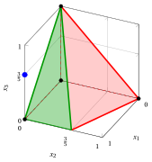{ .fig .ovale loading=lazy  }

        Case (b): the LP relaxation and the cover inequality $x_1+x_3\le 1$.

    - <strong>Case (c): $\tilde{\boldsymbol{x}}=\left(\tfrac{1}{3},\tfrac{1}{3},\tfrac{1}{3}\right)$</strong>

        - **a)** <strong>Separation problem</strong>   The costs $q_j=1-\tilde{x}_j$ are $q=\left(\tfrac{2}{3},\tfrac{2}{3},\tfrac{2}{3}\right)$. The separation problem $\CSP$ (left) and, with $y_j=1-z_j$, the complementary problem $\CSPKP$ (right) are:

            $$
            \begin{array}{rrcrcrcl}
            {\min} & {\frac{2}{3}\,z_1} & {+} & {\frac{2}{3}\,z_2} & {+} & {\frac{2}{3}\,z_3} &  &  \\[1ex]
            \text{subject to} & {2\,z_1} & {+} & {5\,z_2} & {+} & {5\,z_3} & {\ge} & {6} \\[1ex]
            & {z_1,} &  & {z_2,} &  & {z_3} & {\in} & {\{0,1\}}
            \end{array}
            $$

            $$
            \begin{array}{rrcrcrcl}
            {\max} & {\frac{2}{3}\,y_1} & {+} & {\frac{2}{3}\,y_2} & {+} & {\frac{2}{3}\,y_3} &  &  \\[1ex]
            \text{subject to} & {2\,y_1} & {+} & {5\,y_2} & {+} & {5\,y_3} & {\le} & {6} \\[1ex]
            & {y_1,} &  & {y_2,} &  & {y_3} & {\in} & {\{0,1\}}
            \end{array}
            $$

            with $z(\CSP)=n-\sum_{j\in\mathscr{I}}\tilde{x}_j-z(\CSPKP)=2-z(\CSPKP)$.

        - **b)** <strong>Greedy heuristic</strong>   The indices are scanned by non-increasing ratio $q_j/a_j$, starting from the residual right-hand side $6$:

            
<table>
            <tr>
            <th>\(j\)</th>
            <th>\(q_j\)</th>
            <th>\(a_j\)</th>
            <th>\(q_j/a_j\)</th>
            <th>Decision</th>
            <th>Residual</th>
            </tr>
            <tr>
            <td>\(1\)</td>
            <td>\(\tfrac{2}{3}\)</td>
            <td>\(2\)</td>
            <td>\(\tfrac{1}{3}\)</td>
            <td>\(\bar{y}_j=1\)</td>
            <td>\(4\)</td>
            </tr>
            <tr>
            <td>\(2\)</td>
            <td>\(\tfrac{2}{3}\)</td>
            <td>\(5\)</td>
            <td>\(\tfrac{2}{15}\)</td>
            <td>\(\bar{y}_j=0\)</td>
            <td>\(4\)</td>
            </tr>
            <tr>
            <td>\(3\)</td>
            <td>\(\tfrac{2}{3}\)</td>
            <td>\(5\)</td>
            <td>\(\tfrac{2}{15}\)</td>
            <td>\(\bar{y}_j=0\)</td>
            <td>\(4\)</td>
            </tr>
            </table>

            The greedy solution is $\bar{\boldsymbol{y}}=\left(1,0,0\right)$, with value $\frac{2}{3}$. The corresponding cover is $\bar{C}=\{j\in\mathscr{I}:\bar{y}_j=0\}=\{2,3\}$, with cost $2-\frac{2}{3}=\frac{4}{3}\ge1$: its cover inequality is not violated by $\tilde{\boldsymbol{x}}$.

        - **c)** <strong>Optimality check</strong>   Indices with $q_j=0$ do not change the value of a solution. The non-empty subsets of the indices $\{1,2,3\}$ with $q_j>0$ that satisfy the constraint with right-hand side $6$ are: $\{1\}$ (value $\frac{2}{3}$), $\{2\}$ (value $\frac{2}{3}$), $\{3\}$ (value $\frac{2}{3}$). Hence $z(\CSPKP)=\frac{2}{3}$, the greedy solution is optimal, and $z(\CSP)=\frac{4}{3}\ge1$: <strong>no</strong> cover inequality is violated by $\tilde{\boldsymbol{x}}$.

        { .fig .ovale loading=lazy  }

        Case (c): the LP relaxation; no cover inequality is violated by the point.

!!! esercizio "Exercise 5.10: Cover inequalities in 3D (P5)"

    Consider a binary problem with one constraint $\sum_{j}a_jx_j\le b$, with positive integer coefficients $a_j$ and right-hand side $b=10$, on the binary variables indexed by the set $\mathscr{I}=\{1,2,3\}$ of $n=3$ variables with the following objective coefficients and constraint coefficients:

    $$
    \begin{array}{l|rrr}
    \hline {j} & 1 & 2 & 3 \\
    \hline {c_j} & 13 & 10 & 3 \\
    {a_j} & 5 & 4 & 6 \\
    \hline
    \end{array}
    $$

    The associated $\LP$ is:

    $$
    \begin{array}{rrcrcrcl}
    {\max} & {13\,x_1} & {+} & {10\,x_2} & {+} & {3\,x_3} &  &  \\[1ex]
    \text{subject to} & {5\,x_1} & {+} & {4\,x_2} & {+} & {6\,x_3} & {\le} & {10} \\[1ex]
    & {x_1} &  &  &  &  & {\le} & {1} \\[0.5ex]
    &  &  & {x_2} &  &  & {\le} & {1} \\[0.5ex]
    &  &  &  &  & {x_3} & {\le} & {1} \\[0.5ex]
    & {x_1,} &  & {x_2,} &  & {x_3} & {\ge} & {0}
    \end{array}
    $$

    and the following points of its feasible region:

    $$
    \begin{array}{cl}
    (a) & \tilde{\boldsymbol{x}}=\left(1,1,\tfrac{1}{6}\right),\\[1ex]
    (b) & \tilde{\boldsymbol{x}}=\left(\tfrac{4}{5},0,1\right),\\[1ex]
    (c) & \tilde{\boldsymbol{x}}=\left(\tfrac{1}{3},\tfrac{1}{3},\tfrac{1}{3}\right).
    \end{array}
    $$

    **Questions**

    For each point:

    1. write the separation problem $\CSP$ and its complementary problem $\CSPKP$;

    2. apply the greedy heuristic to $\CSPKP$ and, if possible, find a violated cover inequality;

    3. check whether the greedy solution is optimal;

    4. draw the LP relaxation together with the violated cover inequality, if any.

    !!! nota ""

        A subset of indices $C\subseteq\mathscr{I}$ with $\sum_{j\in C}a_j>b$ is a <strong>cover</strong>, and the linear inequality

        \begin{equation*}
        \sum_{j\in C}x_j\le|C|-1
        \end{equation*}

        is the <strong>cover inequality</strong> associated with $C$. Given a point $\tilde{\boldsymbol{x}}$, a cover inequality violated by $\tilde{\boldsymbol{x}}$ exists if and only if $z(\CSP)<1$, where

        \begin{equation*}
        (\CSP)\qquad \min\Big\{\sum_{j\in\mathscr{I}}(1-\tilde{x}_j)\,z_j:\
        \sum_{j\in\mathscr{I}}a_j\,z_j\ge b+1,\ z_j\in\{0,1\}\ \forall j\in\mathscr{I}\Big\}.
        \end{equation*}

??? soluzione "Solution"

    Separation of the cover inequalities violated by the three points.

    - <strong>Cover inequalities</strong>  All three points belong to the LP relaxation; the left-hand sides are

        $$
        5+4+6\cdot\frac{1}{6}=10,\qquad 5\cdot\frac{4}{5}+0+6=10,\qquad 5\cdot\frac{1}{3}+4\cdot\frac{1}{3}+6\cdot\frac{1}{3}=5\le 10.
        $$

        The covers are the subsets of indices whose total coefficient exceeds $b=10$:

        
<table>
        <tr>
        <th>\(C\)</th>
        <th>\(\sum_{j\in C}a_j\)</th>
        <th>\(|C|\)</th>
        <th>Cover inequality</th>
        <th>Minimal</th>
        </tr>
        <tr>
        <td>\(\{1,3\}\)</td>
        <td>\(11\)</td>
        <td>\(2\)</td>
        <td>\(x_1+x_3\le 1\)</td>
        <td>yes</td>
        </tr>
        <tr>
        <td>\(\{1,2,3\}\)</td>
        <td>\(15\)</td>
        <td>\(3\)</td>
        <td>\(x_1+x_2+x_3\le 2\)</td>
        <td>no</td>
        </tr>
        </table>

        In all three cases, the right-hand side of the complementary problem is $\sum_{j\in\mathscr{I}}a_j-(b+1)=15-11=4$.

    - <strong>Case (a): $\tilde{\boldsymbol{x}}=\left(1,1,\tfrac{1}{6}\right)$</strong>

        - **a)** <strong>Separation problem</strong>   The costs $q_j=1-\tilde{x}_j$ are $q=\left(0,0,\tfrac{5}{6}\right)$. The separation problem $\CSP$ (left) and, with $y_j=1-z_j$, the complementary problem $\CSPKP$ (right) are:

            $$
            \begin{array}{rrcrcrcl}
            {\min} &  &  &  &  & {\frac{5}{6}\,z_3} &  &  \\[1ex]
            \text{subject to} & {5\,z_1} & {+} & {4\,z_2} & {+} & {6\,z_3} & {\ge} & {11} \\[1ex]
            & {z_1,} &  & {z_2,} &  & {z_3} & {\in} & {\{0,1\}}
            \end{array}
            $$

            $$
            \begin{array}{rrcrcrcl}
            {\max} &  &  &  &  & {\frac{5}{6}\,y_3} &  &  \\[1ex]
            \text{subject to} & {5\,y_1} & {+} & {4\,y_2} & {+} & {6\,y_3} & {\le} & {4} \\[1ex]
            & {y_1,} &  & {y_2,} &  & {y_3} & {\in} & {\{0,1\}}
            \end{array}
            $$

            with $z(\CSP)=n-\sum_{j\in\mathscr{I}}\tilde{x}_j-z(\CSPKP)=\frac{5}{6}-z(\CSPKP)$.

        - **b)** <strong>Greedy heuristic</strong>   The indices are scanned by non-increasing ratio $q_j/a_j$, starting from the residual right-hand side $4$:

            
<table>
            <tr>
            <th>\(j\)</th>
            <th>\(q_j\)</th>
            <th>\(a_j\)</th>
            <th>\(q_j/a_j\)</th>
            <th>Decision</th>
            <th>Residual</th>
            </tr>
            <tr>
            <td>\(3\)</td>
            <td>\(\tfrac{5}{6}\)</td>
            <td>\(6\)</td>
            <td>\(\tfrac{5}{36}\)</td>
            <td>\(\bar{y}_j=0\)</td>
            <td>\(4\)</td>
            </tr>
            <tr>
            <td>\(1\)</td>
            <td>\(0\)</td>
            <td>\(5\)</td>
            <td>\(0\)</td>
            <td>\(q_j=0\), \(\bar{y}_j=0\)</td>
            <td>\(4\)</td>
            </tr>
            <tr>
            <td>\(2\)</td>
            <td>\(0\)</td>
            <td>\(4\)</td>
            <td>\(0\)</td>
            <td>\(q_j=0\), \(\bar{y}_j=0\)</td>
            <td>\(4\)</td>
            </tr>
            </table>

            The greedy solution is $\bar{\boldsymbol{y}}=\left(0,0,0\right)$, with value $0$. The corresponding cover is $\bar{C}=\{j\in\mathscr{I}:\bar{y}_j=0\}=\{1,2,3\}$, of total coefficient $15>10$ and cost $\frac{5}{6}-0=\frac{5}{6}<1$. Hence the cover inequality

            $$
            x_1+x_2+x_3\le 2
            $$

            is violated by $\tilde{\boldsymbol{x}}$: $1+1+\frac{1}{6}-2=\frac{1}{6}$.

        - **c)** <strong>Optimality check</strong>   No index with $q_j>0$ satisfies the constraint with right-hand side $4$ alone, hence every feasible solution of $\CSPKP$ has value $0$. Hence $z(\CSPKP)=0$, the greedy solution is optimal, $z(\CSP)=\frac{5}{6}<1$, and the maximum violation of a cover inequality is $\frac{1}{6}$.

            The cover $\bar{C}$ is not minimal: removing an index with $q_j=0$ gives the minimal cover $\{1,3\}$, with the same cost $\frac{5}{6}$. Its cover inequality $x_1+x_3\le 1$ has the same violation $\frac{1}{6}$ and is stronger.

        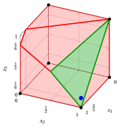{ .fig .ovale loading=lazy  }

        Case (a): the LP relaxation and the cover inequality $x_1+x_2+x_3\le 2$.

    - <strong>Case (b): $\tilde{\boldsymbol{x}}=\left(\tfrac{4}{5},0,1\right)$</strong>

        - **a)** <strong>Separation problem</strong>   The costs $q_j=1-\tilde{x}_j$ are $q=\left(\tfrac{1}{5},1,0\right)$. The separation problem $\CSP$ (left) and, with $y_j=1-z_j$, the complementary problem $\CSPKP$ (right) are:

            $$
            \begin{array}{rrcrcrcl}
            {\min} & {\frac{1}{5}\,z_1} & {+} & {z_2} &  &  &  &  \\[1ex]
            \text{subject to} & {5\,z_1} & {+} & {4\,z_2} & {+} & {6\,z_3} & {\ge} & {11} \\[1ex]
            & {z_1,} &  & {z_2,} &  & {z_3} & {\in} & {\{0,1\}}
            \end{array}
            $$

            $$
            \begin{array}{rrcrcrcl}
            {\max} & {\frac{1}{5}\,y_1} & {+} & {y_2} &  &  &  &  \\[1ex]
            \text{subject to} & {5\,y_1} & {+} & {4\,y_2} & {+} & {6\,y_3} & {\le} & {4} \\[1ex]
            & {y_1,} &  & {y_2,} &  & {y_3} & {\in} & {\{0,1\}}
            \end{array}
            $$

            with $z(\CSP)=n-\sum_{j\in\mathscr{I}}\tilde{x}_j-z(\CSPKP)=\frac{6}{5}-z(\CSPKP)$.

        - **b)** <strong>Greedy heuristic</strong>   The indices are scanned by non-increasing ratio $q_j/a_j$, starting from the residual right-hand side $4$:

            
<table>
            <tr>
            <th>\(j\)</th>
            <th>\(q_j\)</th>
            <th>\(a_j\)</th>
            <th>\(q_j/a_j\)</th>
            <th>Decision</th>
            <th>Residual</th>
            </tr>
            <tr>
            <td>\(2\)</td>
            <td>\(1\)</td>
            <td>\(4\)</td>
            <td>\(\tfrac{1}{4}\)</td>
            <td>\(\bar{y}_j=1\)</td>
            <td>\(0\)</td>
            </tr>
            <tr>
            <td>\(1\)</td>
            <td>\(\tfrac{1}{5}\)</td>
            <td>\(5\)</td>
            <td>\(\tfrac{1}{25}\)</td>
            <td>\(\bar{y}_j=0\)</td>
            <td>\(0\)</td>
            </tr>
            <tr>
            <td>\(3\)</td>
            <td>\(0\)</td>
            <td>\(6\)</td>
            <td>\(0\)</td>
            <td>\(q_j=0\), \(\bar{y}_j=0\)</td>
            <td>\(0\)</td>
            </tr>
            </table>

            The greedy solution is $\bar{\boldsymbol{y}}=\left(0,1,0\right)$, with value $1$. The corresponding cover is $\bar{C}=\{j\in\mathscr{I}:\bar{y}_j=0\}=\{1,3\}$, of total coefficient $11>10$ and cost $\frac{6}{5}-1=\frac{1}{5}<1$. Hence the cover inequality

            $$
            x_1+x_3\le 1
            $$

            is violated by $\tilde{\boldsymbol{x}}$: $\frac{4}{5}+1-1=\frac{4}{5}$.

        - **c)** <strong>Optimality check</strong>   Indices with $q_j=0$ do not change the value of a solution. The non-empty subsets of the indices $\{1,2\}$ with $q_j>0$ that satisfy the constraint with right-hand side $4$ are: $\{2\}$ (value $1$). Hence $z(\CSPKP)=1$, the greedy solution is optimal, $z(\CSP)=\frac{1}{5}<1$, and the maximum violation of a cover inequality is $\frac{4}{5}$.

        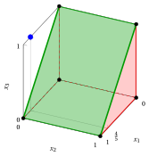{ .fig .ovale loading=lazy  }

        Case (b): the LP relaxation and the cover inequality $x_1+x_3\le 1$.

    - <strong>Case (c): $\tilde{\boldsymbol{x}}=\left(\tfrac{1}{3},\tfrac{1}{3},\tfrac{1}{3}\right)$</strong>

        - **a)** <strong>Separation problem</strong>   The costs $q_j=1-\tilde{x}_j$ are $q=\left(\tfrac{2}{3},\tfrac{2}{3},\tfrac{2}{3}\right)$. The separation problem $\CSP$ (left) and, with $y_j=1-z_j$, the complementary problem $\CSPKP$ (right) are:

            $$
            \begin{array}{rrcrcrcl}
            {\min} & {\frac{2}{3}\,z_1} & {+} & {\frac{2}{3}\,z_2} & {+} & {\frac{2}{3}\,z_3} &  &  \\[1ex]
            \text{subject to} & {5\,z_1} & {+} & {4\,z_2} & {+} & {6\,z_3} & {\ge} & {11} \\[1ex]
            & {z_1,} &  & {z_2,} &  & {z_3} & {\in} & {\{0,1\}}
            \end{array}
            $$

            $$
            \begin{array}{rrcrcrcl}
            {\max} & {\frac{2}{3}\,y_1} & {+} & {\frac{2}{3}\,y_2} & {+} & {\frac{2}{3}\,y_3} &  &  \\[1ex]
            \text{subject to} & {5\,y_1} & {+} & {4\,y_2} & {+} & {6\,y_3} & {\le} & {4} \\[1ex]
            & {y_1,} &  & {y_2,} &  & {y_3} & {\in} & {\{0,1\}}
            \end{array}
            $$

            with $z(\CSP)=n-\sum_{j\in\mathscr{I}}\tilde{x}_j-z(\CSPKP)=2-z(\CSPKP)$.

        - **b)** <strong>Greedy heuristic</strong>   The indices are scanned by non-increasing ratio $q_j/a_j$, starting from the residual right-hand side $4$:

            
<table>
            <tr>
            <th>\(j\)</th>
            <th>\(q_j\)</th>
            <th>\(a_j\)</th>
            <th>\(q_j/a_j\)</th>
            <th>Decision</th>
            <th>Residual</th>
            </tr>
            <tr>
            <td>\(2\)</td>
            <td>\(\tfrac{2}{3}\)</td>
            <td>\(4\)</td>
            <td>\(\tfrac{1}{6}\)</td>
            <td>\(\bar{y}_j=1\)</td>
            <td>\(0\)</td>
            </tr>
            <tr>
            <td>\(1\)</td>
            <td>\(\tfrac{2}{3}\)</td>
            <td>\(5\)</td>
            <td>\(\tfrac{2}{15}\)</td>
            <td>\(\bar{y}_j=0\)</td>
            <td>\(0\)</td>
            </tr>
            <tr>
            <td>\(3\)</td>
            <td>\(\tfrac{2}{3}\)</td>
            <td>\(6\)</td>
            <td>\(\tfrac{1}{9}\)</td>
            <td>\(\bar{y}_j=0\)</td>
            <td>\(0\)</td>
            </tr>
            </table>

            The greedy solution is $\bar{\boldsymbol{y}}=\left(0,1,0\right)$, with value $\frac{2}{3}$. The corresponding cover is $\bar{C}=\{j\in\mathscr{I}:\bar{y}_j=0\}=\{1,3\}$, with cost $2-\frac{2}{3}=\frac{4}{3}\ge1$: its cover inequality is not violated by $\tilde{\boldsymbol{x}}$.

        - **c)** <strong>Optimality check</strong>   Indices with $q_j=0$ do not change the value of a solution. The non-empty subsets of the indices $\{1,2,3\}$ with $q_j>0$ that satisfy the constraint with right-hand side $4$ are: $\{2\}$ (value $\frac{2}{3}$). Hence $z(\CSPKP)=\frac{2}{3}$, the greedy solution is optimal, and $z(\CSP)=\frac{4}{3}\ge1$: <strong>no</strong> cover inequality is violated by $\tilde{\boldsymbol{x}}$.

        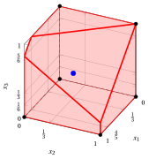{ .fig .ovale loading=lazy  }

        Case (c): the LP relaxation; no cover inequality is violated by the point.

## Closure and separation

!!! esercizio "Exercise 5.11: Cover closure by separation (P1)"

    Consider a binary problem with one constraint $\sum_{j}a_jx_j\le b$, with positive integer coefficients $a_j$ and right-hand side $b=9$, on the binary variables indexed by the set $\mathscr{I}=\{1,2,3,4\}$ of $n=4$ variables with the following objective coefficients and constraint coefficients:

    $$
    \begin{array}{l|rrrr}
    \hline {j} & 1 & 2 & 3 & 4 \\
    \hline {c_j} & 22 & 33 & 9 & 13 \\
    {a_j} & 5 & 9 & 3 & 6 \\
    \hline
    \end{array}
    $$

    The associated $\LP$ is:

    $$
    \begin{array}{rrcrcrcrcl}
    {\max} & {22\,x_1} & {+} & {33\,x_2} & {+} & {9\,x_3} & {+} & {13\,x_4} &  &  \\[1ex]
    \text{subject to} & {5\,x_1} & {+} & {9\,x_2} & {+} & {3\,x_3} & {+} & {6\,x_4} & {\le} & {9} \\[1ex]
    & {x_1} &  &  &  &  &  &  & {\le} & {1} \\[0.5ex]
    &  &  & {x_2} &  &  &  &  & {\le} & {1} \\[0.5ex]
    &  &  &  &  & {x_3} &  &  & {\le} & {1} \\[0.5ex]
    &  &  &  &  &  &  & {x_4} & {\le} & {1} \\[0.5ex]
    & {x_1,} &  & {x_2,} &  & {x_3,} &  & {x_4} & {\ge} & {0}
    \end{array}
    $$

    An optimal solution $\tilde{\boldsymbol{x}}$ of $\LP$ and its value are:

    $$
    \tilde{x}_1=1,~~\tilde{x}_2=\frac{4}{9},~~\tilde{x}_3=0,~~\tilde{x}_4=0\qquad\text{and}\qquad z(\LP)=\frac{110}{3}.
    $$

    **Questions**

    1. Starting from $\tilde{\boldsymbol{x}}$, separate the cover inequalities by solving the complementary problem $\CSPKP$ to optimality. Add the maximally violated cover inequality to the LP, solve it again, and repeat until no cover inequality is violated. If $\CSPKP$ has several optimal solutions, choose the one that selects the largest number of variables.

    2. What is the optimal value over the cover closure? Is the final solution integer?

    !!! nota ""

        The <strong>cover closure</strong> is the polyhedron obtained by adding to $\LP$ all the cover inequalities $\sum_{j\in C}x_j\le|C|-1$, $C\in\mathcal{C}$. Given a point $\tilde{\boldsymbol{x}}$, let $\tilde{y}_1,\dots,\tilde{y}_n$ be an optimal solution of the complementary problem

        \begin{equation*}
        (\CSPKP)\qquad \max\Big\{\sum_{j\in\mathscr{I}}(1-\tilde{x}_j)\,y_j:\
        \sum_{j\in\mathscr{I}}a_j\,y_j\le\sum_{j\in\mathscr{I}}a_j-(b+1),\
        y_j\in\{0,1\}\ \forall j\in\mathscr{I}\Big\}.
        \end{equation*}

        If $n-\sum_{j\in\mathscr{I}}\tilde{x}_j-z(\CSPKP)<1$, the cover $\tilde{C}=\{j\in\mathscr{I}:\tilde{y}_j=0\}$ is associated with the cover inequality maximally violated by $\tilde{\boldsymbol{x}}$; otherwise, no cover inequality is violated by $\tilde{\boldsymbol{x}}$.

??? soluzione "Solution"

    Separation of the cover inequalities with the complementary problem; in all the iterations, the right-hand side of $\CSPKP$ is $\sum_{j\in\mathscr{I}}a_j-(b+1)=23-10=13$.

    - <strong>Iteration 1</strong>  The optimal solution of $\LP$ is $\tilde{\boldsymbol{x}}=\left(1,\tfrac{4}{9},0,0\right)$, with value $z(\LP)=\frac{110}{3}$.

        The costs are $q=\left(0,\tfrac{5}{9},1,1\right)$, the constant term is $n-\sum_{j\in\mathscr{I}}\tilde{x}_j=\frac{23}{9}$, and the complementary problem is:

        $$
        \begin{array}{rrcrcrcrcl}
        {\max} &  &  & {\frac{5}{9}\,y_2} & {+} & {y_3} & {+} & {y_4} &  &  \\[1ex]
        \text{subject to} & {5\,y_1} & {+} & {9\,y_2} & {+} & {3\,y_3} & {+} & {6\,y_4} & {\le} & {13} \\[1ex]
        & {y_1,} &  & {y_2,} &  & {y_3,} &  & {y_4} & {\in} & {\{0,1\}}
        \end{array}
        $$

        The maximal subsets of indices that satisfy the constraint with right-hand side $13$ are: $\{1,3\}$ (value $1$), $\{1,4\}$ (value $1$), $\{2,3\}$ (value $\frac{14}{9}$), $\{3,4\}$ (value $2$). An optimal solution of $\CSPKP$ is $\tilde{y}_1=0,~\tilde{y}_2=0,~\tilde{y}_3=1,~\tilde{y}_4=1$, with value $z(\CSPKP)=2$:

        $$
        n-\sum_{j\in\mathscr{I}}\tilde{x}_j-z(\CSPKP)=\frac{23}{9}-2=\frac{5}{9}<1.
        $$

        Accordingly, $\tilde{C}=\{j\in\mathscr{I}:\tilde{y}_j=0\}=\{1,2\}$ and the cover inequality

        $$
        x_1+x_2\le 1
        $$

        is maximally violated by $\tilde{\boldsymbol{x}}$: $1+\frac{4}{9}-1=\frac{4}{9}$.

    - <strong>Iteration 2</strong>  Adding the cover inequality $x_1+x_2\le 1$, we obtain the following LP, denoted $\mathrm{LP}_{1}$:

        $$
        \begin{array}{rrcrcrcrcl}
        {\max} & {22\,x_1} & {+} & {33\,x_2} & {+} & {9\,x_3} & {+} & {13\,x_4} &  &  \\[1ex]
        \text{subject to} & {5\,x_1} & {+} & {9\,x_2} & {+} & {3\,x_3} & {+} & {6\,x_4} & {\le} & {9} \\[1ex]
        & {x_1} & {+} & {x_2} &  &  &  &  & {\le} & {1} \\[1ex]
        & {x_1} &  &  &  &  &  &  & {\le} & {1} \\[0.5ex]
        &  &  & {x_2} &  &  &  &  & {\le} & {1} \\[0.5ex]
        &  &  &  &  & {x_3} &  &  & {\le} & {1} \\[0.5ex]
        &  &  &  &  &  &  & {x_4} & {\le} & {1} \\[0.5ex]
        & {x_1,} &  & {x_2,} &  & {x_3,} &  & {x_4} & {\ge} & {0}
        \end{array}
        $$

        An optimal solution of $\mathrm{LP}_{1}$ is $\tilde{\boldsymbol{x}}=\left(\tfrac{3}{4},\tfrac{1}{4},1,0\right)$, with value $z(\mathrm{LP}_{1})=\frac{135}{4}$.

        The costs are $q=\left(\tfrac{1}{4},\tfrac{3}{4},0,1\right)$, the constant term is $n-\sum_{j\in\mathscr{I}}\tilde{x}_j=2$, and the complementary problem is:

        $$
        \begin{array}{rrcrcrcrcl}
        {\max} & {\frac{1}{4}\,y_1} & {+} & {\frac{3}{4}\,y_2} &  &  & {+} & {y_4} &  &  \\[1ex]
        \text{subject to} & {5\,y_1} & {+} & {9\,y_2} & {+} & {3\,y_3} & {+} & {6\,y_4} & {\le} & {13} \\[1ex]
        & {y_1,} &  & {y_2,} &  & {y_3,} &  & {y_4} & {\in} & {\{0,1\}}
        \end{array}
        $$

        The maximal subsets of indices that satisfy the constraint with right-hand side $13$ are: $\{1,3\}$ (value $\frac{1}{4}$), $\{1,4\}$ (value $\frac{5}{4}$), $\{2,3\}$ (value $\frac{3}{4}$), $\{3,4\}$ (value $1$). An optimal solution of $\CSPKP$ is $\tilde{y}_1=1,~\tilde{y}_2=0,~\tilde{y}_3=0,~\tilde{y}_4=1$, with value $z(\CSPKP)=\frac{5}{4}$:

        $$
        n-\sum_{j\in\mathscr{I}}\tilde{x}_j-z(\CSPKP)=2-\frac{5}{4}=\frac{3}{4}<1.
        $$

        Accordingly, $\tilde{C}=\{j\in\mathscr{I}:\tilde{y}_j=0\}=\{2,3\}$ and the cover inequality

        $$
        x_2+x_3\le 1
        $$

        is maximally violated by $\tilde{\boldsymbol{x}}$: $\frac{1}{4}+1-1=\frac{1}{4}$.

    - <strong>Iteration 3</strong>  Adding the cover inequality $x_2+x_3\le 1$, we obtain the following LP, denoted $\mathrm{LP}_{2}$:

        $$
        \begin{array}{rrcrcrcrcl}
        {\max} & {22\,x_1} & {+} & {33\,x_2} & {+} & {9\,x_3} & {+} & {13\,x_4} &  &  \\[1ex]
        \text{subject to} & {5\,x_1} & {+} & {9\,x_2} & {+} & {3\,x_3} & {+} & {6\,x_4} & {\le} & {9} \\[1ex]
        & {x_1} & {+} & {x_2} &  &  &  &  & {\le} & {1} \\[1ex]
        &  &  & {x_2} & {+} & {x_3} &  &  & {\le} & {1} \\[1ex]
        & {x_1} &  &  &  &  &  &  & {\le} & {1} \\[0.5ex]
        &  &  & {x_2} &  &  &  &  & {\le} & {1} \\[0.5ex]
        &  &  &  &  & {x_3} &  &  & {\le} & {1} \\[0.5ex]
        &  &  &  &  &  &  & {x_4} & {\le} & {1} \\[0.5ex]
        & {x_1,} &  & {x_2,} &  & {x_3,} &  & {x_4} & {\ge} & {0}
        \end{array}
        $$

        An optimal solution of $\mathrm{LP}_{2}$ is $\tilde{\boldsymbol{x}}=\left(1,0,1,\tfrac{1}{6}\right)$, with value $z(\mathrm{LP}_{2})=\frac{199}{6}$.

        The costs are $q=\left(0,1,0,\tfrac{5}{6}\right)$, the constant term is $n-\sum_{j\in\mathscr{I}}\tilde{x}_j=\frac{11}{6}$, and the complementary problem is:

        $$
        \begin{array}{rrcrcrcrcl}
        {\max} &  &  & {y_2} &  &  & {+} & {\frac{5}{6}\,y_4} &  &  \\[1ex]
        \text{subject to} & {5\,y_1} & {+} & {9\,y_2} & {+} & {3\,y_3} & {+} & {6\,y_4} & {\le} & {13} \\[1ex]
        & {y_1,} &  & {y_2,} &  & {y_3,} &  & {y_4} & {\in} & {\{0,1\}}
        \end{array}
        $$

        The maximal subsets of indices that satisfy the constraint with right-hand side $13$ are: $\{1,3\}$ (value $0$), $\{1,4\}$ (value $\frac{5}{6}$), $\{2,3\}$ (value $1$), $\{3,4\}$ (value $\frac{5}{6}$). An optimal solution of $\CSPKP$ is $\tilde{y}_1=0,~\tilde{y}_2=1,~\tilde{y}_3=1,~\tilde{y}_4=0$, with value $z(\CSPKP)=1$:

        $$
        n-\sum_{j\in\mathscr{I}}\tilde{x}_j-z(\CSPKP)=\frac{11}{6}-1=\frac{5}{6}<1.
        $$

        Accordingly, $\tilde{C}=\{j\in\mathscr{I}:\tilde{y}_j=0\}=\{1,4\}$ and the cover inequality

        $$
        x_1+x_4\le 1
        $$

        is maximally violated by $\tilde{\boldsymbol{x}}$: $1+\frac{1}{6}-1=\frac{1}{6}$.

    - <strong>Iteration 4</strong>  Adding the cover inequality $x_1+x_4\le 1$, we obtain the following LP, denoted $\mathrm{LP}_{3}$:

        $$
        \begin{array}{rrcrcrcrcl}
        {\max} & {22\,x_1} & {+} & {33\,x_2} & {+} & {9\,x_3} & {+} & {13\,x_4} &  &  \\[1ex]
        \text{subject to} & {5\,x_1} & {+} & {9\,x_2} & {+} & {3\,x_3} & {+} & {6\,x_4} & {\le} & {9} \\[1ex]
        & {x_1} & {+} & {x_2} &  &  &  &  & {\le} & {1} \\[1ex]
        &  &  & {x_2} & {+} & {x_3} &  &  & {\le} & {1} \\[1ex]
        & {x_1} &  &  &  &  & {+} & {x_4} & {\le} & {1} \\[1ex]
        & {x_1} &  &  &  &  &  &  & {\le} & {1} \\[0.5ex]
        &  &  & {x_2} &  &  &  &  & {\le} & {1} \\[0.5ex]
        &  &  &  &  & {x_3} &  &  & {\le} & {1} \\[0.5ex]
        &  &  &  &  &  &  & {x_4} & {\le} & {1} \\[0.5ex]
        & {x_1,} &  & {x_2,} &  & {x_3,} &  & {x_4} & {\ge} & {0}
        \end{array}
        $$

        An optimal solution of $\mathrm{LP}_{3}$ is $\tilde{\boldsymbol{x}}=\left(\tfrac{6}{7},\tfrac{1}{7},\tfrac{6}{7},\tfrac{1}{7}\right)$, with value $z(\mathrm{LP}_{3})=\frac{232}{7}$.

        The costs are $q=\left(\tfrac{1}{7},\tfrac{6}{7},\tfrac{1}{7},\tfrac{6}{7}\right)$, the constant term is $n-\sum_{j\in\mathscr{I}}\tilde{x}_j=2$, and the complementary problem is:

        $$
        \begin{array}{rrcrcrcrcl}
        {\max} & {\frac{1}{7}\,y_1} & {+} & {\frac{6}{7}\,y_2} & {+} & {\frac{1}{7}\,y_3} & {+} & {\frac{6}{7}\,y_4} &  &  \\[1ex]
        \text{subject to} & {5\,y_1} & {+} & {9\,y_2} & {+} & {3\,y_3} & {+} & {6\,y_4} & {\le} & {13} \\[1ex]
        & {y_1,} &  & {y_2,} &  & {y_3,} &  & {y_4} & {\in} & {\{0,1\}}
        \end{array}
        $$

        The maximal subsets of indices that satisfy the constraint with right-hand side $13$ are: $\{1,3\}$ (value $\frac{2}{7}$), $\{1,4\}$ (value $1$), $\{2,3\}$ (value $1$), $\{3,4\}$ (value $1$). The optimal value of $\CSPKP$ is $z(\CSPKP)=1$:

        $$
        n-\sum_{j\in\mathscr{I}}\tilde{x}_j-z(\CSPKP)=2-1=1\ge1.
        $$

        !!! chiave ""

            No cover inequality is violated by $\tilde{\boldsymbol{x}}=\left(\tfrac{6}{7},\tfrac{1}{7},\tfrac{6}{7},\tfrac{1}{7}\right)$: the separation stops after $3$ cover inequalities. The optimal value over the cover closure is

            $$
            z(\mathrm{LP}^{\mathrm{cov}})=z(\mathrm{LP}_{3})=\frac{232}{7}<z(\LP)=\frac{110}{3},
            $$

            and $\tilde{\boldsymbol{x}}$ is <strong>fractional</strong>: the cover closure does not coincide with the convex hull of the integer solutions.

!!! esercizio "Exercise 5.12: Cover closure by separation (P2)"

    Consider a binary problem with one constraint $\sum_{j}a_jx_j\le b$, with positive integer coefficients $a_j$ and right-hand side $b=17$, on the binary variables indexed by the set $\mathscr{I}=\{1,2,3,4\}$ of $n=4$ variables with the following objective coefficients and constraint coefficients:

    $$
    \begin{array}{l|rrrr}
    \hline {j} & 1 & 2 & 3 & 4 \\
    \hline {c_j} & 29 & 29 & 27 & 21 \\
    {a_j} & 5 & 10 & 10 & 8 \\
    \hline
    \end{array}
    $$

    The associated $\LP$ is:

    $$
    \begin{array}{rrcrcrcrcl}
    {\max} & {29\,x_1} & {+} & {29\,x_2} & {+} & {27\,x_3} & {+} & {21\,x_4} &  &  \\[1ex]
    \text{subject to} & {5\,x_1} & {+} & {10\,x_2} & {+} & {10\,x_3} & {+} & {8\,x_4} & {\le} & {17} \\[1ex]
    & {x_1} &  &  &  &  &  &  & {\le} & {1} \\[0.5ex]
    &  &  & {x_2} &  &  &  &  & {\le} & {1} \\[0.5ex]
    &  &  &  &  & {x_3} &  &  & {\le} & {1} \\[0.5ex]
    &  &  &  &  &  &  & {x_4} & {\le} & {1} \\[0.5ex]
    & {x_1,} &  & {x_2,} &  & {x_3,} &  & {x_4} & {\ge} & {0}
    \end{array}
    $$

    An optimal solution $\tilde{\boldsymbol{x}}$ of $\LP$ and its value are:

    $$
    \tilde{x}_1=1,~~\tilde{x}_2=1,~~\tilde{x}_3=\frac{1}{5},~~\tilde{x}_4=0\qquad\text{and}\qquad z(\LP)=\frac{317}{5}.
    $$

    **Questions**

    1. Starting from $\tilde{\boldsymbol{x}}$, separate the cover inequalities by solving the complementary problem $\CSPKP$ to optimality. Add the maximally violated cover inequality to the LP, solve it again, and repeat until no cover inequality is violated. If $\CSPKP$ has several optimal solutions, choose the one that selects the largest number of variables.

    2. What is the optimal value over the cover closure? Is the final solution integer?

    !!! nota ""

        The <strong>cover closure</strong> is the polyhedron obtained by adding to $\LP$ all the cover inequalities $\sum_{j\in C}x_j\le|C|-1$, $C\in\mathcal{C}$. Given a point $\tilde{\boldsymbol{x}}$, let $\tilde{y}_1,\dots,\tilde{y}_n$ be an optimal solution of the complementary problem

        \begin{equation*}
        (\CSPKP)\qquad \max\Big\{\sum_{j\in\mathscr{I}}(1-\tilde{x}_j)\,y_j:\
        \sum_{j\in\mathscr{I}}a_j\,y_j\le\sum_{j\in\mathscr{I}}a_j-(b+1),\
        y_j\in\{0,1\}\ \forall j\in\mathscr{I}\Big\}.
        \end{equation*}

        If $n-\sum_{j\in\mathscr{I}}\tilde{x}_j-z(\CSPKP)<1$, the cover $\tilde{C}=\{j\in\mathscr{I}:\tilde{y}_j=0\}$ is associated with the cover inequality maximally violated by $\tilde{\boldsymbol{x}}$; otherwise, no cover inequality is violated by $\tilde{\boldsymbol{x}}$.

??? soluzione "Solution"

    Separation of the cover inequalities with the complementary problem; in all the iterations, the right-hand side of $\CSPKP$ is $\sum_{j\in\mathscr{I}}a_j-(b+1)=33-18=15$.

    - <strong>Iteration 1</strong>  The optimal solution of $\LP$ is $\tilde{\boldsymbol{x}}=\left(1,1,\tfrac{1}{5},0\right)$, with value $z(\LP)=\frac{317}{5}$.

        The costs are $q=\left(0,0,\tfrac{4}{5},1\right)$, the constant term is $n-\sum_{j\in\mathscr{I}}\tilde{x}_j=\frac{9}{5}$, and the complementary problem is:

        $$
        \begin{array}{rrcrcrcrcl}
        {\max} &  &  &  &  & {\frac{4}{5}\,y_3} & {+} & {y_4} &  &  \\[1ex]
        \text{subject to} & {5\,y_1} & {+} & {10\,y_2} & {+} & {10\,y_3} & {+} & {8\,y_4} & {\le} & {15} \\[1ex]
        & {y_1,} &  & {y_2,} &  & {y_3,} &  & {y_4} & {\in} & {\{0,1\}}
        \end{array}
        $$

        The maximal subsets of indices that satisfy the constraint with right-hand side $15$ are: $\{1,2\}$ (value $0$), $\{1,3\}$ (value $\frac{4}{5}$), $\{1,4\}$ (value $1$). An optimal solution of $\CSPKP$ is $\tilde{y}_1=1,~\tilde{y}_2=0,~\tilde{y}_3=0,~\tilde{y}_4=1$, with value $z(\CSPKP)=1$:

        $$
        n-\sum_{j\in\mathscr{I}}\tilde{x}_j-z(\CSPKP)=\frac{9}{5}-1=\frac{4}{5}<1.
        $$

        Accordingly, $\tilde{C}=\{j\in\mathscr{I}:\tilde{y}_j=0\}=\{2,3\}$ and the cover inequality

        $$
        x_2+x_3\le 1
        $$

        is maximally violated by $\tilde{\boldsymbol{x}}$: $1+\frac{1}{5}-1=\frac{1}{5}$.

    - <strong>Iteration 2</strong>  Adding the cover inequality $x_2+x_3\le 1$, we obtain the following LP, denoted $\mathrm{LP}_{1}$:

        $$
        \begin{array}{rrcrcrcrcl}
        {\max} & {29\,x_1} & {+} & {29\,x_2} & {+} & {27\,x_3} & {+} & {21\,x_4} &  &  \\[1ex]
        \text{subject to} & {5\,x_1} & {+} & {10\,x_2} & {+} & {10\,x_3} & {+} & {8\,x_4} & {\le} & {17} \\[1ex]
        &  &  & {x_2} & {+} & {x_3} &  &  & {\le} & {1} \\[1ex]
        & {x_1} &  &  &  &  &  &  & {\le} & {1} \\[0.5ex]
        &  &  & {x_2} &  &  &  &  & {\le} & {1} \\[0.5ex]
        &  &  &  &  & {x_3} &  &  & {\le} & {1} \\[0.5ex]
        &  &  &  &  &  &  & {x_4} & {\le} & {1} \\[0.5ex]
        & {x_1,} &  & {x_2,} &  & {x_3,} &  & {x_4} & {\ge} & {0}
        \end{array}
        $$

        An optimal solution of $\mathrm{LP}_{1}$ is $\tilde{\boldsymbol{x}}=\left(1,1,0,\tfrac{1}{4}\right)$, with value $z(\mathrm{LP}_{1})=\frac{253}{4}$.

        The costs are $q=\left(0,0,1,\tfrac{3}{4}\right)$, the constant term is $n-\sum_{j\in\mathscr{I}}\tilde{x}_j=\frac{7}{4}$, and the complementary problem is:

        $$
        \begin{array}{rrcrcrcrcl}
        {\max} &  &  &  &  & {y_3} & {+} & {\frac{3}{4}\,y_4} &  &  \\[1ex]
        \text{subject to} & {5\,y_1} & {+} & {10\,y_2} & {+} & {10\,y_3} & {+} & {8\,y_4} & {\le} & {15} \\[1ex]
        & {y_1,} &  & {y_2,} &  & {y_3,} &  & {y_4} & {\in} & {\{0,1\}}
        \end{array}
        $$

        The maximal subsets of indices that satisfy the constraint with right-hand side $15$ are: $\{1,2\}$ (value $0$), $\{1,3\}$ (value $1$), $\{1,4\}$ (value $\frac{3}{4}$). An optimal solution of $\CSPKP$ is $\tilde{y}_1=1,~\tilde{y}_2=0,~\tilde{y}_3=1,~\tilde{y}_4=0$, with value $z(\CSPKP)=1$:

        $$
        n-\sum_{j\in\mathscr{I}}\tilde{x}_j-z(\CSPKP)=\frac{7}{4}-1=\frac{3}{4}<1.
        $$

        Accordingly, $\tilde{C}=\{j\in\mathscr{I}:\tilde{y}_j=0\}=\{2,4\}$ and the cover inequality

        $$
        x_2+x_4\le 1
        $$

        is maximally violated by $\tilde{\boldsymbol{x}}$: $1+\frac{1}{4}-1=\frac{1}{4}$.

    - <strong>Iteration 3</strong>  Adding the cover inequality $x_2+x_4\le 1$, we obtain the following LP, denoted $\mathrm{LP}_{2}$:

        $$
        \begin{array}{rrcrcrcrcl}
        {\max} & {29\,x_1} & {+} & {29\,x_2} & {+} & {27\,x_3} & {+} & {21\,x_4} &  &  \\[1ex]
        \text{subject to} & {5\,x_1} & {+} & {10\,x_2} & {+} & {10\,x_3} & {+} & {8\,x_4} & {\le} & {17} \\[1ex]
        &  &  & {x_2} & {+} & {x_3} &  &  & {\le} & {1} \\[1ex]
        &  &  & {x_2} &  &  & {+} & {x_4} & {\le} & {1} \\[1ex]
        & {x_1} &  &  &  &  &  &  & {\le} & {1} \\[0.5ex]
        &  &  & {x_2} &  &  &  &  & {\le} & {1} \\[0.5ex]
        &  &  &  &  & {x_3} &  &  & {\le} & {1} \\[0.5ex]
        &  &  &  &  &  &  & {x_4} & {\le} & {1} \\[0.5ex]
        & {x_1,} &  & {x_2,} &  & {x_3,} &  & {x_4} & {\ge} & {0}
        \end{array}
        $$

        An optimal solution of $\mathrm{LP}_{2}$ is $\tilde{\boldsymbol{x}}=\left(1,\tfrac{3}{4},\tfrac{1}{4},\tfrac{1}{4}\right)$, with value $z(\mathrm{LP}_{2})=\frac{251}{4}$.

        The costs are $q=\left(0,\tfrac{1}{4},\tfrac{3}{4},\tfrac{3}{4}\right)$, the constant term is $n-\sum_{j\in\mathscr{I}}\tilde{x}_j=\frac{7}{4}$, and the complementary problem is:

        $$
        \begin{array}{rrcrcrcrcl}
        {\max} &  &  & {\frac{1}{4}\,y_2} & {+} & {\frac{3}{4}\,y_3} & {+} & {\frac{3}{4}\,y_4} &  &  \\[1ex]
        \text{subject to} & {5\,y_1} & {+} & {10\,y_2} & {+} & {10\,y_3} & {+} & {8\,y_4} & {\le} & {15} \\[1ex]
        & {y_1,} &  & {y_2,} &  & {y_3,} &  & {y_4} & {\in} & {\{0,1\}}
        \end{array}
        $$

        The maximal subsets of indices that satisfy the constraint with right-hand side $15$ are: $\{1,2\}$ (value $\frac{1}{4}$), $\{1,3\}$ (value $\frac{3}{4}$), $\{1,4\}$ (value $\frac{3}{4}$). The optimal value of $\CSPKP$ is $z(\CSPKP)=\frac{3}{4}$:

        $$
        n-\sum_{j\in\mathscr{I}}\tilde{x}_j-z(\CSPKP)=\frac{7}{4}-\frac{3}{4}=1\ge1.
        $$

        !!! chiave ""

            No cover inequality is violated by $\tilde{\boldsymbol{x}}=\left(1,\tfrac{3}{4},\tfrac{1}{4},\tfrac{1}{4}\right)$: the separation stops after $2$ cover inequalities. The optimal value over the cover closure is

            $$
            z(\mathrm{LP}^{\mathrm{cov}})=z(\mathrm{LP}_{2})=\frac{251}{4}<z(\LP)=\frac{317}{5},
            $$

            and $\tilde{\boldsymbol{x}}$ is <strong>fractional</strong>: the cover closure does not coincide with the convex hull of the integer solutions.

!!! esercizio "Exercise 5.13: Cover closure by separation (P3)"

    Consider a binary problem with one constraint $\sum_{j}a_jx_j\le b$, with positive integer coefficients $a_j$ and right-hand side $b=15$, on the binary variables indexed by the set $\mathscr{I}=\{1,2,3,4\}$ of $n=4$ variables with the following objective coefficients and constraint coefficients:

    $$
    \begin{array}{l|rrrr}
    \hline {j} & 1 & 2 & 3 & 4 \\
    \hline {c_j} & 30 & 8 & 9 & 6 \\
    {a_j} & 5 & 2 & 9 & 9 \\
    \hline
    \end{array}
    $$

    The associated $\LP$ is:

    $$
    \begin{array}{rrcrcrcrcl}
    {\max} & {30\,x_1} & {+} & {8\,x_2} & {+} & {9\,x_3} & {+} & {6\,x_4} &  &  \\[1ex]
    \text{subject to} & {5\,x_1} & {+} & {2\,x_2} & {+} & {9\,x_3} & {+} & {9\,x_4} & {\le} & {15} \\[1ex]
    & {x_1} &  &  &  &  &  &  & {\le} & {1} \\[0.5ex]
    &  &  & {x_2} &  &  &  &  & {\le} & {1} \\[0.5ex]
    &  &  &  &  & {x_3} &  &  & {\le} & {1} \\[0.5ex]
    &  &  &  &  &  &  & {x_4} & {\le} & {1} \\[0.5ex]
    & {x_1,} &  & {x_2,} &  & {x_3,} &  & {x_4} & {\ge} & {0}
    \end{array}
    $$

    An optimal solution $\tilde{\boldsymbol{x}}$ of $\LP$ and its value are:

    $$
    \tilde{x}_1=1,~~\tilde{x}_2=1,~~\tilde{x}_3=\frac{8}{9},~~\tilde{x}_4=0\qquad\text{and}\qquad z(\LP)=46.
    $$

    **Questions**

    1. Starting from $\tilde{\boldsymbol{x}}$, separate the cover inequalities by solving the complementary problem $\CSPKP$ to optimality. Add the maximally violated cover inequality to the LP, solve it again, and repeat until no cover inequality is violated. If $\CSPKP$ has several optimal solutions, choose the one that selects the largest number of variables.

    2. What is the optimal value over the cover closure? Is the final solution integer?

    !!! nota ""

        The <strong>cover closure</strong> is the polyhedron obtained by adding to $\LP$ all the cover inequalities $\sum_{j\in C}x_j\le|C|-1$, $C\in\mathcal{C}$. Given a point $\tilde{\boldsymbol{x}}$, let $\tilde{y}_1,\dots,\tilde{y}_n$ be an optimal solution of the complementary problem

        \begin{equation*}
        (\CSPKP)\qquad \max\Big\{\sum_{j\in\mathscr{I}}(1-\tilde{x}_j)\,y_j:\
        \sum_{j\in\mathscr{I}}a_j\,y_j\le\sum_{j\in\mathscr{I}}a_j-(b+1),\
        y_j\in\{0,1\}\ \forall j\in\mathscr{I}\Big\}.
        \end{equation*}

        If $n-\sum_{j\in\mathscr{I}}\tilde{x}_j-z(\CSPKP)<1$, the cover $\tilde{C}=\{j\in\mathscr{I}:\tilde{y}_j=0\}$ is associated with the cover inequality maximally violated by $\tilde{\boldsymbol{x}}$; otherwise, no cover inequality is violated by $\tilde{\boldsymbol{x}}$.

??? soluzione "Solution"

    Separation of the cover inequalities with the complementary problem; in all the iterations, the right-hand side of $\CSPKP$ is $\sum_{j\in\mathscr{I}}a_j-(b+1)=25-16=9$.

    - <strong>Iteration 1</strong>  The optimal solution of $\LP$ is $\tilde{\boldsymbol{x}}=\left(1,1,\tfrac{8}{9},0\right)$, with value $z(\LP)=46$.

        The costs are $q=\left(0,0,\tfrac{1}{9},1\right)$, the constant term is $n-\sum_{j\in\mathscr{I}}\tilde{x}_j=\frac{10}{9}$, and the complementary problem is:

        $$
        \begin{array}{rrcrcrcrcl}
        {\max} &  &  &  &  & {\frac{1}{9}\,y_3} & {+} & {y_4} &  &  \\[1ex]
        \text{subject to} & {5\,y_1} & {+} & {2\,y_2} & {+} & {9\,y_3} & {+} & {9\,y_4} & {\le} & {9} \\[1ex]
        & {y_1,} &  & {y_2,} &  & {y_3,} &  & {y_4} & {\in} & {\{0,1\}}
        \end{array}
        $$

        The maximal subsets of indices that satisfy the constraint with right-hand side $9$ are: $\{3\}$ (value $\frac{1}{9}$), $\{4\}$ (value $1$), $\{1,2\}$ (value $0$). An optimal solution of $\CSPKP$ is $\tilde{y}_1=0,~\tilde{y}_2=0,~\tilde{y}_3=0,~\tilde{y}_4=1$, with value $z(\CSPKP)=1$:

        $$
        n-\sum_{j\in\mathscr{I}}\tilde{x}_j-z(\CSPKP)=\frac{10}{9}-1=\frac{1}{9}<1.
        $$

        Accordingly, $\tilde{C}=\{j\in\mathscr{I}:\tilde{y}_j=0\}=\{1,2,3\}$ and the cover inequality

        $$
        x_1+x_2+x_3\le 2
        $$

        is maximally violated by $\tilde{\boldsymbol{x}}$: $1+1+\frac{8}{9}-2=\frac{8}{9}$.

    - <strong>Iteration 2</strong>  Adding the cover inequality $x_1+x_2+x_3\le 2$, we obtain the following LP, denoted $\mathrm{LP}_{1}$:

        $$
        \begin{array}{rrcrcrcrcl}
        {\max} & {30\,x_1} & {+} & {8\,x_2} & {+} & {9\,x_3} & {+} & {6\,x_4} &  &  \\[1ex]
        \text{subject to} & {5\,x_1} & {+} & {2\,x_2} & {+} & {9\,x_3} & {+} & {9\,x_4} & {\le} & {15} \\[1ex]
        & {x_1} & {+} & {x_2} & {+} & {x_3} &  &  & {\le} & {2} \\[1ex]
        & {x_1} &  &  &  &  &  &  & {\le} & {1} \\[0.5ex]
        &  &  & {x_2} &  &  &  &  & {\le} & {1} \\[0.5ex]
        &  &  &  &  & {x_3} &  &  & {\le} & {1} \\[0.5ex]
        &  &  &  &  &  &  & {x_4} & {\le} & {1} \\[0.5ex]
        & {x_1,} &  & {x_2,} &  & {x_3,} &  & {x_4} & {\ge} & {0}
        \end{array}
        $$

        An optimal solution of $\mathrm{LP}_{1}$ is $\tilde{\boldsymbol{x}}=\left(1,1,0,\tfrac{8}{9}\right)$, with value $z(\mathrm{LP}_{1})=\frac{130}{3}$.

        The costs are $q=\left(0,0,1,\tfrac{1}{9}\right)$, the constant term is $n-\sum_{j\in\mathscr{I}}\tilde{x}_j=\frac{10}{9}$, and the complementary problem is:

        $$
        \begin{array}{rrcrcrcrcl}
        {\max} &  &  &  &  & {y_3} & {+} & {\frac{1}{9}\,y_4} &  &  \\[1ex]
        \text{subject to} & {5\,y_1} & {+} & {2\,y_2} & {+} & {9\,y_3} & {+} & {9\,y_4} & {\le} & {9} \\[1ex]
        & {y_1,} &  & {y_2,} &  & {y_3,} &  & {y_4} & {\in} & {\{0,1\}}
        \end{array}
        $$

        The maximal subsets of indices that satisfy the constraint with right-hand side $9$ are: $\{3\}$ (value $1$), $\{4\}$ (value $\frac{1}{9}$), $\{1,2\}$ (value $0$). An optimal solution of $\CSPKP$ is $\tilde{y}_1=0,~\tilde{y}_2=0,~\tilde{y}_3=1,~\tilde{y}_4=0$, with value $z(\CSPKP)=1$:

        $$
        n-\sum_{j\in\mathscr{I}}\tilde{x}_j-z(\CSPKP)=\frac{10}{9}-1=\frac{1}{9}<1.
        $$

        Accordingly, $\tilde{C}=\{j\in\mathscr{I}:\tilde{y}_j=0\}=\{1,2,4\}$ and the cover inequality

        $$
        x_1+x_2+x_4\le 2
        $$

        is maximally violated by $\tilde{\boldsymbol{x}}$: $1+1+\frac{8}{9}-2=\frac{8}{9}$.

    - <strong>Iteration 3</strong>  Adding the cover inequality $x_1+x_2+x_4\le 2$, we obtain the following LP, denoted $\mathrm{LP}_{2}$:

        $$
        \begin{array}{rrcrcrcrcl}
        {\max} & {30\,x_1} & {+} & {8\,x_2} & {+} & {9\,x_3} & {+} & {6\,x_4} &  &  \\[1ex]
        \text{subject to} & {5\,x_1} & {+} & {2\,x_2} & {+} & {9\,x_3} & {+} & {9\,x_4} & {\le} & {15} \\[1ex]
        & {x_1} & {+} & {x_2} & {+} & {x_3} &  &  & {\le} & {2} \\[1ex]
        & {x_1} & {+} & {x_2} &  &  & {+} & {x_4} & {\le} & {2} \\[1ex]
        & {x_1} &  &  &  &  &  &  & {\le} & {1} \\[0.5ex]
        &  &  & {x_2} &  &  &  &  & {\le} & {1} \\[0.5ex]
        &  &  &  &  & {x_3} &  &  & {\le} & {1} \\[0.5ex]
        &  &  &  &  &  &  & {x_4} & {\le} & {1} \\[0.5ex]
        & {x_1,} &  & {x_2,} &  & {x_3,} &  & {x_4} & {\ge} & {0}
        \end{array}
        $$

        An optimal solution of $\mathrm{LP}_{2}$ is $\tilde{\boldsymbol{x}}=\left(1,\tfrac{1}{2},\tfrac{1}{2},\tfrac{1}{2}\right)$, with value $z(\mathrm{LP}_{2})=\frac{83}{2}$.

        The costs are $q=\left(0,\tfrac{1}{2},\tfrac{1}{2},\tfrac{1}{2}\right)$, the constant term is $n-\sum_{j\in\mathscr{I}}\tilde{x}_j=\frac{3}{2}$, and the complementary problem is:

        $$
        \begin{array}{rrcrcrcrcl}
        {\max} &  &  & {\frac{1}{2}\,y_2} & {+} & {\frac{1}{2}\,y_3} & {+} & {\frac{1}{2}\,y_4} &  &  \\[1ex]
        \text{subject to} & {5\,y_1} & {+} & {2\,y_2} & {+} & {9\,y_3} & {+} & {9\,y_4} & {\le} & {9} \\[1ex]
        & {y_1,} &  & {y_2,} &  & {y_3,} &  & {y_4} & {\in} & {\{0,1\}}
        \end{array}
        $$

        The maximal subsets of indices that satisfy the constraint with right-hand side $9$ are: $\{3\}$ (value $\frac{1}{2}$), $\{4\}$ (value $\frac{1}{2}$), $\{1,2\}$ (value $\frac{1}{2}$). The optimal value of $\CSPKP$ is $z(\CSPKP)=\frac{1}{2}$:

        $$
        n-\sum_{j\in\mathscr{I}}\tilde{x}_j-z(\CSPKP)=\frac{3}{2}-\frac{1}{2}=1\ge1.
        $$

        !!! chiave ""

            No cover inequality is violated by $\tilde{\boldsymbol{x}}=\left(1,\tfrac{1}{2},\tfrac{1}{2},\tfrac{1}{2}\right)$: the separation stops after $2$ cover inequalities. The optimal value over the cover closure is

            $$
            z(\mathrm{LP}^{\mathrm{cov}})=z(\mathrm{LP}_{2})=\frac{83}{2}<z(\LP)=46,
            $$

            and $\tilde{\boldsymbol{x}}$ is <strong>fractional</strong>: the cover closure does not coincide with the convex hull of the integer solutions.

!!! esercizio "Exercise 5.14: Cover closure by separation (P4)"

    Consider a binary problem with one constraint $\sum_{j}a_jx_j\le b$, with positive integer coefficients $a_j$ and right-hand side $b=9$, on the binary variables indexed by the set $\mathscr{I}=\{1,2,3,4\}$ of $n=4$ variables with the following objective coefficients and constraint coefficients:

    $$
    \begin{array}{l|rrrr}
    \hline {j} & 1 & 2 & 3 & 4 \\
    \hline {c_j} & 31 & 13 & 5 & 9 \\
    {a_j} & 8 & 6 & 3 & 8 \\
    \hline
    \end{array}
    $$

    The associated $\LP$ is:

    $$
    \begin{array}{rrcrcrcrcl}
    {\max} & {31\,x_1} & {+} & {13\,x_2} & {+} & {5\,x_3} & {+} & {9\,x_4} &  &  \\[1ex]
    \text{subject to} & {8\,x_1} & {+} & {6\,x_2} & {+} & {3\,x_3} & {+} & {8\,x_4} & {\le} & {9} \\[1ex]
    & {x_1} &  &  &  &  &  &  & {\le} & {1} \\[0.5ex]
    &  &  & {x_2} &  &  &  &  & {\le} & {1} \\[0.5ex]
    &  &  &  &  & {x_3} &  &  & {\le} & {1} \\[0.5ex]
    &  &  &  &  &  &  & {x_4} & {\le} & {1} \\[0.5ex]
    & {x_1,} &  & {x_2,} &  & {x_3,} &  & {x_4} & {\ge} & {0}
    \end{array}
    $$

    An optimal solution $\tilde{\boldsymbol{x}}$ of $\LP$ and its value are:

    $$
    \tilde{x}_1=1,~~\tilde{x}_2=\frac{1}{6},~~\tilde{x}_3=0,~~\tilde{x}_4=0\qquad\text{and}\qquad z(\LP)=\frac{199}{6}.
    $$

    **Questions**

    1. Starting from $\tilde{\boldsymbol{x}}$, separate the cover inequalities by solving the complementary problem $\CSPKP$ to optimality. Add the maximally violated cover inequality to the LP, solve it again, and repeat until no cover inequality is violated. If $\CSPKP$ has several optimal solutions, choose the one that selects the largest number of variables.

    2. What is the optimal value over the cover closure? Is the final solution integer?

    !!! nota ""

        The <strong>cover closure</strong> is the polyhedron obtained by adding to $\LP$ all the cover inequalities $\sum_{j\in C}x_j\le|C|-1$, $C\in\mathcal{C}$. Given a point $\tilde{\boldsymbol{x}}$, let $\tilde{y}_1,\dots,\tilde{y}_n$ be an optimal solution of the complementary problem

        \begin{equation*}
        (\CSPKP)\qquad \max\Big\{\sum_{j\in\mathscr{I}}(1-\tilde{x}_j)\,y_j:\
        \sum_{j\in\mathscr{I}}a_j\,y_j\le\sum_{j\in\mathscr{I}}a_j-(b+1),\
        y_j\in\{0,1\}\ \forall j\in\mathscr{I}\Big\}.
        \end{equation*}

        If $n-\sum_{j\in\mathscr{I}}\tilde{x}_j-z(\CSPKP)<1$, the cover $\tilde{C}=\{j\in\mathscr{I}:\tilde{y}_j=0\}$ is associated with the cover inequality maximally violated by $\tilde{\boldsymbol{x}}$; otherwise, no cover inequality is violated by $\tilde{\boldsymbol{x}}$.

??? soluzione "Solution"

    Separation of the cover inequalities with the complementary problem; in all the iterations, the right-hand side of $\CSPKP$ is $\sum_{j\in\mathscr{I}}a_j-(b+1)=25-10=15$.

    - <strong>Iteration 1</strong>  The optimal solution of $\LP$ is $\tilde{\boldsymbol{x}}=\left(1,\tfrac{1}{6},0,0\right)$, with value $z(\LP)=\frac{199}{6}$.

        The costs are $q=\left(0,\tfrac{5}{6},1,1\right)$, the constant term is $n-\sum_{j\in\mathscr{I}}\tilde{x}_j=\frac{17}{6}$, and the complementary problem is:

        $$
        \begin{array}{rrcrcrcrcl}
        {\max} &  &  & {\frac{5}{6}\,y_2} & {+} & {y_3} & {+} & {y_4} &  &  \\[1ex]
        \text{subject to} & {8\,y_1} & {+} & {6\,y_2} & {+} & {3\,y_3} & {+} & {8\,y_4} & {\le} & {15} \\[1ex]
        & {y_1,} &  & {y_2,} &  & {y_3,} &  & {y_4} & {\in} & {\{0,1\}}
        \end{array}
        $$

        The maximal subsets of indices that satisfy the constraint with right-hand side $15$ are: $\{1,2\}$ (value $\frac{5}{6}$), $\{1,3\}$ (value $1$), $\{2,3\}$ (value $\frac{11}{6}$), $\{2,4\}$ (value $\frac{11}{6}$), $\{3,4\}$ (value $2$). An optimal solution of $\CSPKP$ is $\tilde{y}_1=0,~\tilde{y}_2=0,~\tilde{y}_3=1,~\tilde{y}_4=1$, with value $z(\CSPKP)=2$:

        $$
        n-\sum_{j\in\mathscr{I}}\tilde{x}_j-z(\CSPKP)=\frac{17}{6}-2=\frac{5}{6}<1.
        $$

        Accordingly, $\tilde{C}=\{j\in\mathscr{I}:\tilde{y}_j=0\}=\{1,2\}$ and the cover inequality

        $$
        x_1+x_2\le 1
        $$

        is maximally violated by $\tilde{\boldsymbol{x}}$: $1+\frac{1}{6}-1=\frac{1}{6}$.

    - <strong>Iteration 2</strong>  Adding the cover inequality $x_1+x_2\le 1$, we obtain the following LP, denoted $\mathrm{LP}_{1}$:

        $$
        \begin{array}{rrcrcrcrcl}
        {\max} & {31\,x_1} & {+} & {13\,x_2} & {+} & {5\,x_3} & {+} & {9\,x_4} &  &  \\[1ex]
        \text{subject to} & {8\,x_1} & {+} & {6\,x_2} & {+} & {3\,x_3} & {+} & {8\,x_4} & {\le} & {9} \\[1ex]
        & {x_1} & {+} & {x_2} &  &  &  &  & {\le} & {1} \\[1ex]
        & {x_1} &  &  &  &  &  &  & {\le} & {1} \\[0.5ex]
        &  &  & {x_2} &  &  &  &  & {\le} & {1} \\[0.5ex]
        &  &  &  &  & {x_3} &  &  & {\le} & {1} \\[0.5ex]
        &  &  &  &  &  &  & {x_4} & {\le} & {1} \\[0.5ex]
        & {x_1,} &  & {x_2,} &  & {x_3,} &  & {x_4} & {\ge} & {0}
        \end{array}
        $$

        An optimal solution of $\mathrm{LP}_{1}$ is $\tilde{\boldsymbol{x}}=\left(1,0,\tfrac{1}{3},0\right)$, with value $z(\mathrm{LP}_{1})=\frac{98}{3}$.

        The costs are $q=\left(0,1,\tfrac{2}{3},1\right)$, the constant term is $n-\sum_{j\in\mathscr{I}}\tilde{x}_j=\frac{8}{3}$, and the complementary problem is:

        $$
        \begin{array}{rrcrcrcrcl}
        {\max} &  &  & {y_2} & {+} & {\frac{2}{3}\,y_3} & {+} & {y_4} &  &  \\[1ex]
        \text{subject to} & {8\,y_1} & {+} & {6\,y_2} & {+} & {3\,y_3} & {+} & {8\,y_4} & {\le} & {15} \\[1ex]
        & {y_1,} &  & {y_2,} &  & {y_3,} &  & {y_4} & {\in} & {\{0,1\}}
        \end{array}
        $$

        The maximal subsets of indices that satisfy the constraint with right-hand side $15$ are: $\{1,2\}$ (value $1$), $\{1,3\}$ (value $\frac{2}{3}$), $\{2,3\}$ (value $\frac{5}{3}$), $\{2,4\}$ (value $2$), $\{3,4\}$ (value $\frac{5}{3}$). An optimal solution of $\CSPKP$ is $\tilde{y}_1=0,~\tilde{y}_2=1,~\tilde{y}_3=0,~\tilde{y}_4=1$, with value $z(\CSPKP)=2$:

        $$
        n-\sum_{j\in\mathscr{I}}\tilde{x}_j-z(\CSPKP)=\frac{8}{3}-2=\frac{2}{3}<1.
        $$

        Accordingly, $\tilde{C}=\{j\in\mathscr{I}:\tilde{y}_j=0\}=\{1,3\}$ and the cover inequality

        $$
        x_1+x_3\le 1
        $$

        is maximally violated by $\tilde{\boldsymbol{x}}$: $1+\frac{1}{3}-1=\frac{1}{3}$.

    - <strong>Iteration 3</strong>  Adding the cover inequality $x_1+x_3\le 1$, we obtain the following LP, denoted $\mathrm{LP}_{2}$:

        $$
        \begin{array}{rrcrcrcrcl}
        {\max} & {31\,x_1} & {+} & {13\,x_2} & {+} & {5\,x_3} & {+} & {9\,x_4} &  &  \\[1ex]
        \text{subject to} & {8\,x_1} & {+} & {6\,x_2} & {+} & {3\,x_3} & {+} & {8\,x_4} & {\le} & {9} \\[1ex]
        & {x_1} & {+} & {x_2} &  &  &  &  & {\le} & {1} \\[1ex]
        & {x_1} &  &  & {+} & {x_3} &  &  & {\le} & {1} \\[1ex]
        & {x_1} &  &  &  &  &  &  & {\le} & {1} \\[0.5ex]
        &  &  & {x_2} &  &  &  &  & {\le} & {1} \\[0.5ex]
        &  &  &  &  & {x_3} &  &  & {\le} & {1} \\[0.5ex]
        &  &  &  &  &  &  & {x_4} & {\le} & {1} \\[0.5ex]
        & {x_1,} &  & {x_2,} &  & {x_3,} &  & {x_4} & {\ge} & {0}
        \end{array}
        $$

        An optimal solution of $\mathrm{LP}_{2}$ is $\tilde{\boldsymbol{x}}=\left(1,0,0,\tfrac{1}{8}\right)$, with value $z(\mathrm{LP}_{2})=\frac{257}{8}$.

        The costs are $q=\left(0,1,1,\tfrac{7}{8}\right)$, the constant term is $n-\sum_{j\in\mathscr{I}}\tilde{x}_j=\frac{23}{8}$, and the complementary problem is:

        $$
        \begin{array}{rrcrcrcrcl}
        {\max} &  &  & {y_2} & {+} & {y_3} & {+} & {\frac{7}{8}\,y_4} &  &  \\[1ex]
        \text{subject to} & {8\,y_1} & {+} & {6\,y_2} & {+} & {3\,y_3} & {+} & {8\,y_4} & {\le} & {15} \\[1ex]
        & {y_1,} &  & {y_2,} &  & {y_3,} &  & {y_4} & {\in} & {\{0,1\}}
        \end{array}
        $$

        The maximal subsets of indices that satisfy the constraint with right-hand side $15$ are: $\{1,2\}$ (value $1$), $\{1,3\}$ (value $1$), $\{2,3\}$ (value $2$), $\{2,4\}$ (value $\frac{15}{8}$), $\{3,4\}$ (value $\frac{15}{8}$). An optimal solution of $\CSPKP$ is $\tilde{y}_1=0,~\tilde{y}_2=1,~\tilde{y}_3=1,~\tilde{y}_4=0$, with value $z(\CSPKP)=2$:

        $$
        n-\sum_{j\in\mathscr{I}}\tilde{x}_j-z(\CSPKP)=\frac{23}{8}-2=\frac{7}{8}<1.
        $$

        Accordingly, $\tilde{C}=\{j\in\mathscr{I}:\tilde{y}_j=0\}=\{1,4\}$ and the cover inequality

        $$
        x_1+x_4\le 1
        $$

        is maximally violated by $\tilde{\boldsymbol{x}}$: $1+\frac{1}{8}-1=\frac{1}{8}$.

    - <strong>Iteration 4</strong>  Adding the cover inequality $x_1+x_4\le 1$, we obtain the following LP, denoted $\mathrm{LP}_{3}$:

        $$
        \begin{array}{rrcrcrcrcl}
        {\max} & {31\,x_1} & {+} & {13\,x_2} & {+} & {5\,x_3} & {+} & {9\,x_4} &  &  \\[1ex]
        \text{subject to} & {8\,x_1} & {+} & {6\,x_2} & {+} & {3\,x_3} & {+} & {8\,x_4} & {\le} & {9} \\[1ex]
        & {x_1} & {+} & {x_2} &  &  &  &  & {\le} & {1} \\[1ex]
        & {x_1} &  &  & {+} & {x_3} &  &  & {\le} & {1} \\[1ex]
        & {x_1} &  &  &  &  & {+} & {x_4} & {\le} & {1} \\[1ex]
        & {x_1} &  &  &  &  &  &  & {\le} & {1} \\[0.5ex]
        &  &  & {x_2} &  &  &  &  & {\le} & {1} \\[0.5ex]
        &  &  &  &  & {x_3} &  &  & {\le} & {1} \\[0.5ex]
        &  &  &  &  &  &  & {x_4} & {\le} & {1} \\[0.5ex]
        & {x_1,} &  & {x_2,} &  & {x_3,} &  & {x_4} & {\ge} & {0}
        \end{array}
        $$

        An optimal solution of $\mathrm{LP}_{3}$ is $\tilde{\boldsymbol{x}}=\left(1,0,0,0\right)$, with value $z(\mathrm{LP}_{3})=31$.

        The costs are $q=\left(0,1,1,1\right)$, the constant term is $n-\sum_{j\in\mathscr{I}}\tilde{x}_j=3$, and the complementary problem is:

        $$
        \begin{array}{rrcrcrcrcl}
        {\max} &  &  & {y_2} & {+} & {y_3} & {+} & {y_4} &  &  \\[1ex]
        \text{subject to} & {8\,y_1} & {+} & {6\,y_2} & {+} & {3\,y_3} & {+} & {8\,y_4} & {\le} & {15} \\[1ex]
        & {y_1,} &  & {y_2,} &  & {y_3,} &  & {y_4} & {\in} & {\{0,1\}}
        \end{array}
        $$

        The maximal subsets of indices that satisfy the constraint with right-hand side $15$ are: $\{1,2\}$ (value $1$), $\{1,3\}$ (value $1$), $\{2,3\}$ (value $2$), $\{2,4\}$ (value $2$), $\{3,4\}$ (value $2$). The optimal value of $\CSPKP$ is $z(\CSPKP)=2$:

        $$
        n-\sum_{j\in\mathscr{I}}\tilde{x}_j-z(\CSPKP)=3-2=1\ge1.
        $$

        !!! chiave ""

            No cover inequality is violated by $\tilde{\boldsymbol{x}}=\left(1,0,0,0\right)$: the separation stops after $3$ cover inequalities. The optimal value over the cover closure is

            $$
            z(\mathrm{LP}^{\mathrm{cov}})=z(\mathrm{LP}_{3})=31<z(\LP)=\frac{199}{6},
            $$

            and $\tilde{\boldsymbol{x}}$ is <strong>integer</strong>, hence it is also optimal for the binary problem.

!!! esercizio "Exercise 5.15: Cover closure by separation (P5)"

    Consider a binary problem with one constraint $\sum_{j}a_jx_j\le b$, with positive integer coefficients $a_j$ and right-hand side $b=12$, on the binary variables indexed by the set $\mathscr{I}=\{1,2,3,4\}$ of $n=4$ variables with the following objective coefficients and constraint coefficients:

    $$
    \begin{array}{l|rrrr}
    \hline {j} & 1 & 2 & 3 & 4 \\
    \hline {c_j} & 38 & 16 & 14 & 4 \\
    {a_j} & 7 & 4 & 7 & 6 \\
    \hline
    \end{array}
    $$

    The associated $\LP$ is:

    $$
    \begin{array}{rrcrcrcrcl}
    {\max} & {38\,x_1} & {+} & {16\,x_2} & {+} & {14\,x_3} & {+} & {4\,x_4} &  &  \\[1ex]
    \text{subject to} & {7\,x_1} & {+} & {4\,x_2} & {+} & {7\,x_3} & {+} & {6\,x_4} & {\le} & {12} \\[1ex]
    & {x_1} &  &  &  &  &  &  & {\le} & {1} \\[0.5ex]
    &  &  & {x_2} &  &  &  &  & {\le} & {1} \\[0.5ex]
    &  &  &  &  & {x_3} &  &  & {\le} & {1} \\[0.5ex]
    &  &  &  &  &  &  & {x_4} & {\le} & {1} \\[0.5ex]
    & {x_1,} &  & {x_2,} &  & {x_3,} &  & {x_4} & {\ge} & {0}
    \end{array}
    $$

    An optimal solution $\tilde{\boldsymbol{x}}$ of $\LP$ and its value are:

    $$
    \tilde{x}_1=1,~~\tilde{x}_2=1,~~\tilde{x}_3=\frac{1}{7},~~\tilde{x}_4=0\qquad\text{and}\qquad z(\LP)=56.
    $$

    **Questions**

    1. Starting from $\tilde{\boldsymbol{x}}$, separate the cover inequalities by solving the complementary problem $\CSPKP$ to optimality. Add the maximally violated cover inequality to the LP, solve it again, and repeat until no cover inequality is violated. If $\CSPKP$ has several optimal solutions, choose the one that selects the largest number of variables.

    2. What is the optimal value over the cover closure? Is the final solution integer?

    !!! nota ""

        The <strong>cover closure</strong> is the polyhedron obtained by adding to $\LP$ all the cover inequalities $\sum_{j\in C}x_j\le|C|-1$, $C\in\mathcal{C}$. Given a point $\tilde{\boldsymbol{x}}$, let $\tilde{y}_1,\dots,\tilde{y}_n$ be an optimal solution of the complementary problem

        \begin{equation*}
        (\CSPKP)\qquad \max\Big\{\sum_{j\in\mathscr{I}}(1-\tilde{x}_j)\,y_j:\
        \sum_{j\in\mathscr{I}}a_j\,y_j\le\sum_{j\in\mathscr{I}}a_j-(b+1),\
        y_j\in\{0,1\}\ \forall j\in\mathscr{I}\Big\}.
        \end{equation*}

        If $n-\sum_{j\in\mathscr{I}}\tilde{x}_j-z(\CSPKP)<1$, the cover $\tilde{C}=\{j\in\mathscr{I}:\tilde{y}_j=0\}$ is associated with the cover inequality maximally violated by $\tilde{\boldsymbol{x}}$; otherwise, no cover inequality is violated by $\tilde{\boldsymbol{x}}$.

??? soluzione "Solution"

    Separation of the cover inequalities with the complementary problem; in all the iterations, the right-hand side of $\CSPKP$ is $\sum_{j\in\mathscr{I}}a_j-(b+1)=24-13=11$.

    - <strong>Iteration 1</strong>  The optimal solution of $\LP$ is $\tilde{\boldsymbol{x}}=\left(1,1,\tfrac{1}{7},0\right)$, with value $z(\LP)=56$.

        The costs are $q=\left(0,0,\tfrac{6}{7},1\right)$, the constant term is $n-\sum_{j\in\mathscr{I}}\tilde{x}_j=\frac{13}{7}$, and the complementary problem is:

        $$
        \begin{array}{rrcrcrcrcl}
        {\max} &  &  &  &  & {\frac{6}{7}\,y_3} & {+} & {y_4} &  &  \\[1ex]
        \text{subject to} & {7\,y_1} & {+} & {4\,y_2} & {+} & {7\,y_3} & {+} & {6\,y_4} & {\le} & {11} \\[1ex]
        & {y_1,} &  & {y_2,} &  & {y_3,} &  & {y_4} & {\in} & {\{0,1\}}
        \end{array}
        $$

        The maximal subsets of indices that satisfy the constraint with right-hand side $11$ are: $\{1,2\}$ (value $0$), $\{2,3\}$ (value $\frac{6}{7}$), $\{2,4\}$ (value $1$). An optimal solution of $\CSPKP$ is $\tilde{y}_1=0,~\tilde{y}_2=1,~\tilde{y}_3=0,~\tilde{y}_4=1$, with value $z(\CSPKP)=1$:

        $$
        n-\sum_{j\in\mathscr{I}}\tilde{x}_j-z(\CSPKP)=\frac{13}{7}-1=\frac{6}{7}<1.
        $$

        Accordingly, $\tilde{C}=\{j\in\mathscr{I}:\tilde{y}_j=0\}=\{1,3\}$ and the cover inequality

        $$
        x_1+x_3\le 1
        $$

        is maximally violated by $\tilde{\boldsymbol{x}}$: $1+\frac{1}{7}-1=\frac{1}{7}$.

    - <strong>Iteration 2</strong>  Adding the cover inequality $x_1+x_3\le 1$, we obtain the following LP, denoted $\mathrm{LP}_{1}$:

        $$
        \begin{array}{rrcrcrcrcl}
        {\max} & {38\,x_1} & {+} & {16\,x_2} & {+} & {14\,x_3} & {+} & {4\,x_4} &  &  \\[1ex]
        \text{subject to} & {7\,x_1} & {+} & {4\,x_2} & {+} & {7\,x_3} & {+} & {6\,x_4} & {\le} & {12} \\[1ex]
        & {x_1} &  &  & {+} & {x_3} &  &  & {\le} & {1} \\[1ex]
        & {x_1} &  &  &  &  &  &  & {\le} & {1} \\[0.5ex]
        &  &  & {x_2} &  &  &  &  & {\le} & {1} \\[0.5ex]
        &  &  &  &  & {x_3} &  &  & {\le} & {1} \\[0.5ex]
        &  &  &  &  &  &  & {x_4} & {\le} & {1} \\[0.5ex]
        & {x_1,} &  & {x_2,} &  & {x_3,} &  & {x_4} & {\ge} & {0}
        \end{array}
        $$

        An optimal solution of $\mathrm{LP}_{1}$ is $\tilde{\boldsymbol{x}}=\left(1,1,0,\tfrac{1}{6}\right)$, with value $z(\mathrm{LP}_{1})=\frac{164}{3}$.

        The costs are $q=\left(0,0,1,\tfrac{5}{6}\right)$, the constant term is $n-\sum_{j\in\mathscr{I}}\tilde{x}_j=\frac{11}{6}$, and the complementary problem is:

        $$
        \begin{array}{rrcrcrcrcl}
        {\max} &  &  &  &  & {y_3} & {+} & {\frac{5}{6}\,y_4} &  &  \\[1ex]
        \text{subject to} & {7\,y_1} & {+} & {4\,y_2} & {+} & {7\,y_3} & {+} & {6\,y_4} & {\le} & {11} \\[1ex]
        & {y_1,} &  & {y_2,} &  & {y_3,} &  & {y_4} & {\in} & {\{0,1\}}
        \end{array}
        $$

        The maximal subsets of indices that satisfy the constraint with right-hand side $11$ are: $\{1,2\}$ (value $0$), $\{2,3\}$ (value $1$), $\{2,4\}$ (value $\frac{5}{6}$). An optimal solution of $\CSPKP$ is $\tilde{y}_1=0,~\tilde{y}_2=1,~\tilde{y}_3=1,~\tilde{y}_4=0$, with value $z(\CSPKP)=1$:

        $$
        n-\sum_{j\in\mathscr{I}}\tilde{x}_j-z(\CSPKP)=\frac{11}{6}-1=\frac{5}{6}<1.
        $$

        Accordingly, $\tilde{C}=\{j\in\mathscr{I}:\tilde{y}_j=0\}=\{1,4\}$ and the cover inequality

        $$
        x_1+x_4\le 1
        $$

        is maximally violated by $\tilde{\boldsymbol{x}}$: $1+\frac{1}{6}-1=\frac{1}{6}$.

    - <strong>Iteration 3</strong>  Adding the cover inequality $x_1+x_4\le 1$, we obtain the following LP, denoted $\mathrm{LP}_{2}$:

        $$
        \begin{array}{rrcrcrcrcl}
        {\max} & {38\,x_1} & {+} & {16\,x_2} & {+} & {14\,x_3} & {+} & {4\,x_4} &  &  \\[1ex]
        \text{subject to} & {7\,x_1} & {+} & {4\,x_2} & {+} & {7\,x_3} & {+} & {6\,x_4} & {\le} & {12} \\[1ex]
        & {x_1} &  &  & {+} & {x_3} &  &  & {\le} & {1} \\[1ex]
        & {x_1} &  &  &  &  & {+} & {x_4} & {\le} & {1} \\[1ex]
        & {x_1} &  &  &  &  &  &  & {\le} & {1} \\[0.5ex]
        &  &  & {x_2} &  &  &  &  & {\le} & {1} \\[0.5ex]
        &  &  &  &  & {x_3} &  &  & {\le} & {1} \\[0.5ex]
        &  &  &  &  &  &  & {x_4} & {\le} & {1} \\[0.5ex]
        & {x_1,} &  & {x_2,} &  & {x_3,} &  & {x_4} & {\ge} & {0}
        \end{array}
        $$

        An optimal solution of $\mathrm{LP}_{2}$ is $\tilde{\boldsymbol{x}}=\left(1,1,0,0\right)$, with value $z(\mathrm{LP}_{2})=54$.

        The costs are $q=\left(0,0,1,1\right)$, the constant term is $n-\sum_{j\in\mathscr{I}}\tilde{x}_j=2$, and the complementary problem is:

        $$
        \begin{array}{rrcrcrcrcl}
        {\max} &  &  &  &  & {y_3} & {+} & {y_4} &  &  \\[1ex]
        \text{subject to} & {7\,y_1} & {+} & {4\,y_2} & {+} & {7\,y_3} & {+} & {6\,y_4} & {\le} & {11} \\[1ex]
        & {y_1,} &  & {y_2,} &  & {y_3,} &  & {y_4} & {\in} & {\{0,1\}}
        \end{array}
        $$

        The maximal subsets of indices that satisfy the constraint with right-hand side $11$ are: $\{1,2\}$ (value $0$), $\{2,3\}$ (value $1$), $\{2,4\}$ (value $1$). The optimal value of $\CSPKP$ is $z(\CSPKP)=1$:

        $$
        n-\sum_{j\in\mathscr{I}}\tilde{x}_j-z(\CSPKP)=2-1=1\ge1.
        $$

        !!! chiave ""

            No cover inequality is violated by $\tilde{\boldsymbol{x}}=\left(1,1,0,0\right)$: the separation stops after $2$ cover inequalities. The optimal value over the cover closure is

            $$
            z(\mathrm{LP}^{\mathrm{cov}})=z(\mathrm{LP}_{2})=54<z(\LP)=56,
            $$

            and $\tilde{\boldsymbol{x}}$ is <strong>integer</strong>, hence it is also optimal for the binary problem.
