# Exercises · The cutting plane algorithm with Gomory fractional cuts

**Exercises · Chapter 6** · each solution opens with a click · [:material-book-open-variant: Chapter 6: Cutting planes](../exact-methods/gomory.md) · [:material-file-pdf-box: Exercises, volume 2 (PDF)](../pdf/exercises-2-exact-methods.pdf)

!!! esercizio "Exercise 6.1: Cutting-plane algorithm (P1)"

    Consider the following ILP problem in canonical maximization form with $n=2$ integer variables and $m=1$ linear constraint:

    $$
    \begin{array}{rrrrrr}
    {\max} & {x_1} & {+} & {8\,x_2} &  &  \\[2ex]
    & {3\,x_1} & {+} & {6\,x_2} & {\le} & {16} \\[2ex]
    & {x_1,} &  & {x_2} & {\in} & {\Z_{\ge 0}}
    \end{array}
    $$

    and the following optimal simplex dictionary of its LP relaxation in standard form:

    \begin{equation*}
    \begin{cases}
    \begin{array}{rrrrrrrrrrrrr}
    {x_2} & {=} & {\dfrac{8}{3}} & {-} & {\dfrac{1}{2}}\, {x_1} & {-} & {\dfrac{1}{6}}\, {x_3} \\[2ex]
    {z} & {=} & {\dfrac{64}{3}} & {-} & {3}\, {x_1} & {-} & {\dfrac{4}{3}}\, {x_3}
    \end{array}
    \end{cases}
    \end{equation*}

    **Questions**

    1. Execute the cutting-plane algorithm based on Gomory fractional cuts using:

        1. one Gomory fractional cut at each iteration;

        2. the largest right-hand side as the cut selection strategy.

        Solve the LP problems after adding the Gomory fractional cut using the dual simplex algorithm. Graphically show the optimal solution of the LP problem at each iteration.

    2. Graphically show the effect of each Gomory fractional cut on the LP relaxation of the ILP problem in canonical form.

    !!! nota ""

        Given a row $i \in \pazocal{B}$ of a simplex dictionary associated with a feasible basic solution such that $\bar{b}_i$ is fractional, the linear inequality

        \begin{equation*}
        \sum_{j \in \pazocal{N}}
        \left(
        \bar{a}_{ij}
        -
        \left\lfloor \bar{a}_{ij}\right\rfloor
        \right)x_j
        \ge
        \bar{b}_i - \left\lfloor \bar{b}_i \right\rfloor
        \end{equation*}

        is called the <strong>Gomory fractional cut</strong> generated by row $i$.

??? soluzione "Solution"

    Execution of the Cutting-Plane Algorithm to solve the ILP problem.

    - <strong>Initialization</strong>

        Let us consider the $LP_1$ problem in standard form:

        $$
        \begin{array}{rrrrrrrr}
        {\max} & {x_1} & {+} & {8\,x_2} &  &  &  &  \\[2ex]
        & {3\,x_1} & {+} & {6\,x_2} & {+} & {x_3} & {=} & {16} \\[2ex]
        & {x_1,} &  & {x_2,} &  & {x_3} & {\ge} & {0}
        \end{array}
        $$

        and its  optimal simplex dictionary:

        \begin{equation*}
        \begin{cases}
        \begin{array}{rrrrrrrrrrrrr}
        {x_2} & {=} & {\dfrac{8}{3}} & {-} & {\dfrac{1}{2}}\, {x_1} & {-} & {\dfrac{1}{6}}\, {x_3} \\[2ex]
        {z} & {=} & {\dfrac{64}{3}} & {-} & {3}\, {x_1} & {-} & {\dfrac{4}{3}}\, {x_3}
        \end{array}
        \end{cases}
        \end{equation*}

        The optimal solution ${ \tilde{ \boldsymbol x}}(\,LP_1\,)$ is <strong>fractional</strong> and the $LP_1$ problem is <strong>feasible</strong>.

        We have the upper bound on the optimal value of the ILP problem:

        $$
        z(~ILP~) ~~\le~~  \underbrace{\left\lfloor \dfrac{64}{3} \right\rfloor}_{=21}
        $$

        For the $LP_1$ problem in canonical form, we have:

        $$
        \begin{array}{rrrrrr}
        {\max} & {x_1} & {+} & {8\,x_2} &  &  \\[2ex]
        & {3\,x_1} & {+} & {6\,x_2} & {\le} & {16} \\[2ex]
        & {x_1,} &  & {x_2} & {\ge} & {0}
        \end{array}
        $$

        An optimal solution ${ \tilde{ \boldsymbol x}}(\,LP_1\,)$ is:

        $$
        \tilde{x}_1=0,\qquad \tilde{x}_2=\dfrac{8}{3}
        $$

        The optimal value is:

        $$
        z(~LP_1~)=\dfrac{64}{3}
        $$

        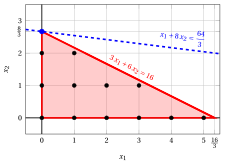{ .fig .ovale loading=lazy style="width:71%" }

    - <strong>Iteration 1</strong>

        - **a)** <strong>Cut generation phase</strong> 

            We have the following simplex dictionary associated with a fractional basic feasible solution of the $LP_1$ problem in standard form:

            \begin{equation*}
            \begin{cases}
            \begin{array}{rrrrrrrrrrrrr}
            {x_2} & {=} & {\dfrac{8}{3}} & {-} & {\dfrac{1}{2}}\, {x_1} & {-} & {\dfrac{1}{6}}\, {x_3} \\[2ex]
            {z} & {=} & {\dfrac{64}{3}} & {-} & {3}\, {x_1} & {-} & {\dfrac{4}{3}}\, {x_3}
            \end{array}
            \end{cases}
            \end{equation*}

            where

            \begin{equation*}
            { \bar{\boldsymbol A}}=
            \begin{pmatrix}
            \frac{1}{2} & \frac{1}{6}
            \end{pmatrix}
            \qquad
            { \bar{\boldsymbol b}}=
            \begin{pmatrix}
            \frac{8}{3}
            \end{pmatrix}
            \end{equation*}

            - The Gomory fractional cut generated by the first row is:

                \begin{align*}
                \underbrace{\left(\frac{1}{2} - \left\lfloor \frac{1}{2} \right\rfloor \right)}_{\frac{1}{2}-0=\frac{1}{2}} \; x_1 + \underbrace{\left(\frac{1}{6} - \left\lfloor \frac{1}{6} \right\rfloor \right)}_{\frac{1}{6}-0=\frac{1}{6}} \; x_3
                \ge \underbrace{\left(\frac{8}{3} - \left\lfloor \frac{8}{3} \right\rfloor \right)}_{\frac{8}{3} -2=\frac{2}{3}}
                \end{align*}

                \begin{align*}
                \frac{1}{2}\;x_1 + \frac{1}{6}\;x_3 \ge \frac{2}{3}
                \quad \Rightarrow \quad
                3\;x_1 + x_3 \ge 4
                \end{align*}

                By subtracting a surplus variable, we obtain the Gomory fractional cut in standard form:

                $$
                \frac{1}{2}\;x_1 + \frac{1}{6}\;x_3 - x_4 = \frac{2}{3}
                \quad \Rightarrow \quad
                3\;x_1 + x_3 - 6\;x_4 = 4
                $$

                From the standard form of the $LP_1$ problem, we have:

                $$
                x_3= 16 - 3 \;x_1 - 6\;x_2.
                $$

                Substituting in the Gomory fractional cut, we can express it in terms of the original variables of the ILP problem:

                $$
                3\;x_1 + (16 - 3 \:x_1 - 6\:x_2) \ge 4
                \quad \Rightarrow \quad
                x_2 \le 2
                $$

                Effect of the Gomory fractional cut generated by the first row on the $LP_1$ problem in canonical form:

                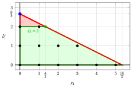{ .fig .ovale loading=lazy style="width:71%" }

            - The Gomory fractional cut generated by the objective-function row is:

                \begin{align*}
                \underbrace{\left(3 - \left\lfloor 3 \right\rfloor \right)}_{3-3=0} \; x_1
                + \underbrace{\left(\frac{4}{3} - \left\lfloor \frac{4}{3} \right\rfloor \right)}_{\frac{4}{3}-1=\frac{1}{3}} \; x_3
                \ge \underbrace{\left(\frac{64}{3} - \left\lfloor \frac{64}{3} \right\rfloor \right)}_{\frac{64}{3} -21=\frac{1}{3}}
                \end{align*}

                \begin{align*}
                \frac{1}{3}\;x_3 \ge \frac{1}{3}
                \quad \Rightarrow \quad
                x_3 \ge 1
                \end{align*}

                By subtracting a surplus variable, we obtain the Gomory fractional cut in standard form:

                $$
                \frac{1}{3}\;x_3 - x_4 = \frac{1}{3}
                \quad \Rightarrow \quad
                x_3 - 3\;x_4 = 1
                $$

                From the standard form of the $LP_1$ problem, we have:

                $$
                x_3= 16 - 3 \;x_1 - 6\;x_2,
                $$

                Substituting in the Gomory fractional cut, we can express it in terms of the original variables of the ILP problem:

                $$
                16 - 3 \;x_1 - 6\;x_2 \ge 1
                \quad \Rightarrow \quad
                x_1 + 2\;x_2 \le 5
                $$

                Effect of the Gomory fractional cut generated by the objective-function row on the $LP_1$ problem in canonical form:

                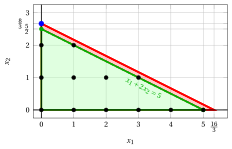{ .fig .ovale loading=lazy style="width:71%" }

                We select the Gomory fractional cut with the largest right-hand side and we create the $LP_2$ problem by adding it to the $LP_1$ problem.

        - **b)** <strong>LP re-optimization phase</strong> 

            Let us consider the $LP_2$ problem in standard form:

            $$
            \begin{array}{rrrrrrrrrr}
            {\max} & {x_1} & {+} & {8\,x_2} &  &  &  &  &  &  \\[2ex]
            & {3\,x_1} & {+} & {6\,x_2} & {+} & {x_3} &  &  & {=} & {16} \\[2ex]
            &  &  & {x_2} &  &  & {+} & {x_4} & {=} & {2} \\[2ex]
            & {x_1,} &  & {x_2,} &  & {x_3,} &  & {x_4} & {\ge} & {0}
            \end{array}
            $$

            For the added Gomory fractional cut we have:

            $$
            3 \; x_1 + x_3 - 6\;x_4 = 4
            \quad \Rightarrow \quad
            x_4 = -\dfrac{2}{3} + \dfrac{1}{2}\;x_1 + \dfrac{1}{6}\;x_3
            $$

            We then add this equation to the previous optimal dictionary and we obtain the following dictionary :

            \begin{equation*}
            \begin{cases}
            \begin{array}{rrrrrrrrrrrrr}
            {x_2} & {=} & {\dfrac{8}{3}} & {-} & {\dfrac{1}{2}}\, {x_1} & {-} & {\dfrac{1}{6}}\, {x_3} \\[2ex]
            {x_4} & {=} & {-\dfrac{2}{3}} & {+} & {\dfrac{1}{2}}\, {x_1} & {+} & {\dfrac{1}{6}}\, {x_3} \\[2ex]
            {z} & {=} & {\dfrac{64}{3}} & {-} & {3}\, {x_1} & {-} & {\dfrac{4}{3}}\, {x_3}
            \end{array}
            \end{cases}
            \end{equation*}

            where  $\pazocal{B}=\{2,4\}$ and $\pazocal{N}=\{1,3\}$ and

            - the  basic primal non-feasible  solution is:

                $$
                \bar x_2=\dfrac{8}{3},~~
                \bar x_4=-\dfrac{2}{3},~~~~~~
                \bar x_1=0,~~
                \bar x_3=0~~
                \text{  of value   }\dfrac{64}{3}
                $$

            - the basic dual feasible  solution is:

                $$
                \bar \pi_2=0,~~
                \bar \pi_4=0,~~~~~~
                \bar \pi_1=3,~~
                \bar \pi_3=\dfrac{4}{3}~~
                \text{  of value   }\dfrac{64}{3}
                $$

            If we increase the value of $\pi_4$, we can get a better dual solution. We have:

            $$
            \begin{cases}
            \pi_1 &= 3 - \dfrac{1}{2}\,\pi_4 \\[2ex]
            \pi_3 &= \dfrac{4}{3} - \dfrac{1}{6}\,\pi_4
            \end{cases}
            \qquad
            \qquad
            \begin{cases}
            \underbrace{ 3 - \dfrac{1}{2}\,\pi_4 \ge 0}_{\pi_1 \ge 0} \\[2ex]
            \underbrace{  \dfrac{4}{3} - \dfrac{1}{6}\,\pi_4 \ge 0}_{\pi_3 \ge 0}
            \end{cases}
            \qquad
            \qquad
            \begin{cases}
            \pi_4 &\le  6 \\[2ex]
            \pi_4 &\le  8
            \end{cases}
            $$

            By increasing the value of $\pi_4$ to $\min \left\{6, 8\right\}=6$,  the value of $\pi_1$ decreases to 0. Then we have that:

            - $\pi_4$ becomes a dual basic variable and accordingly $x_4$ becomes a primal non basic variable

            - $\pi_1$ becomes a dual non-basic variable and accordingly $x_1$ becomes a primal basic variable

            We have:

            $$
            x_4 = -\dfrac{2}{3} + \dfrac{1}{2}\, x_1 + \dfrac{1}{6}\,x_3
            \quad \Longrightarrow \quad
            x_1 = \dfrac{4}{3} - \dfrac{1}{3}x_3 + 2x_4
            $$

            Substituting into the other equations of the primal dictionary, we get:

            $$
            x_2 = \dfrac{8}{3}  -  \dfrac{1}{2} \left( \dfrac{4}{3} - \dfrac{1}{3}x_3 + 2x_4   \right) -  \dfrac{1}{6} x_3
            = 2 - x_4
            $$

            $$
            z = \dfrac{64}{3}  -  3 \left( \dfrac{4}{3} - \dfrac{1}{3}x_3 + 2x_4   \right) -  \dfrac{4}{3} x_3
            = \dfrac{52}{3} - \dfrac{1}{3}x_3 - 6x_4
            $$

            Accordingly, we now have the following optimal primal dictionary:

            \begin{equation*}
            \begin{cases}
            \begin{array}{rrrrrrrrrrrrr}
            {x_1} & {=} & {\dfrac{4}{3}} & {-} & {\dfrac{1}{3}}\, {x_3} & {+} & {2}\, {x_4} \\[2ex]
            {x_2} & {=} & {2} &  &  & {-} & {x_4} \\[2ex]
            {z} & {=} & {\dfrac{52}{3}} & {-} & {\dfrac{1}{3}}\, {x_3} & {-} & {6}\, {x_4}
            \end{array}
            \end{cases}
            \end{equation*}

            where  $\pazocal{B}=\{1,2\}$ and $\pazocal{N}=\{3,4\}$ and

            - the basic primal optimal  solution is:

                $$
                \tilde x_1 = \dfrac{4}{3},~~
                \tilde x_2 = 2,~~
                \tilde x_3 = 0,~~
                \tilde x_4 = 0
                \qquad
                \text{of value  }  \dfrac{52}{3}
                $$

            - the basic dual optimal  solution is:

                $$
                \tilde \pi_1 = 0,~~
                \tilde \pi_2 = 0,~~
                \tilde \pi_3 = \dfrac{1}{3},~~
                \tilde \pi_4 = 6
                \qquad
                \text{of value  }  \dfrac{52}{3}
                $$

            The optimal solution ${ \tilde{ \boldsymbol x}}(\,LP_2\,)$ is <strong>fractional</strong> and the $LP_2$ problem is <strong>feasible</strong>.

            We have the upper bound on the optimal value of the ILP problem:

            $$
            z(~ILP~) ~~\le~~  \underbrace{\left\lfloor \dfrac{52}{3} \right\rfloor}_{=17}
            $$

            For the $LP_2$ problem in canonical form, we have:

            $$
            \begin{array}{rrrrrr}
            {\max} & {x_1} & {+} & {8\,x_2} &  &  \\[2ex]
            & {3\,x_1} & {+} & {6\,x_2} & {\le} & {16} \\[2ex]
            &  &  & {x_2} & {\le} & {2} \\[2ex]
            & {x_1,} &  & {x_2} & {\ge} & {0}
            \end{array}
            $$

            An optimal solution ${ \tilde{ \boldsymbol x}}(\,LP_2\,)$ is:

            $$
            \tilde{x}_1=\dfrac{4}{3},\qquad \tilde{x}_2=2
            $$

            The optimal value is:

            $$
            z(~LP_2~)=\dfrac{52}{3}
            $$

            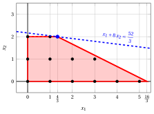{ .fig .ovale loading=lazy style="width:71%" }

    - <strong>Iteration 2</strong>

        - **a)** <strong>Cut generation phase</strong> 

            We have the following simplex dictionary associated with a fractional basic feasible solution of the $LP_2$ problem in standard form:

            \begin{equation*}
            \begin{cases}
            \begin{array}{rrrrrrrrrrrrr}
            {x_1} & {=} & {\dfrac{4}{3}} & {-} & {\dfrac{1}{3}}\, {x_3} & {+} & {2}\, {x_4} \\[2ex]
            {x_2} & {=} & {2} &  &  & {-} & {x_4} \\[2ex]
            {z} & {=} & {\dfrac{52}{3}} & {-} & {\dfrac{1}{3}}\, {x_3} & {-} & {6}\, {x_4}
            \end{array}
            \end{cases}
            \end{equation*}

            where

            \begin{equation*}
            { \bar{\boldsymbol A}}=
            \begin{pmatrix}
            \frac{1}{3} & -2\\[2ex]
            0 & 1
            \end{pmatrix}
            \qquad
            { \bar{\boldsymbol b}}=
            \begin{pmatrix}
            \frac{4}{3}\\[2ex]
            2
            \end{pmatrix}
            \end{equation*}

            - The Gomory fractional cut generated by the first row is:

                \begin{align*}
                \underbrace{\left(\frac{1}{3} - \left\lfloor \frac{1}{3} \right\rfloor \right)}_{\frac{1}{3}-0=\frac{1}{3}} \; x_3
                + \underbrace{\left(-2 - \left\lfloor -2 \right\rfloor \right)}_{-2-(-2)=0} \; x_4
                \ge \underbrace{\left(\frac{4}{3} - \left\lfloor \frac{4}{3} \right\rfloor \right)}_{\frac{4}{3}-1=\frac{1}{3}}
                \end{align*}

                \begin{align*}
                \frac{1}{3}\;x_3 \ge \frac{1}{3}
                \quad \Rightarrow \quad
                x_3 \ge 1
                \end{align*}

                By subtracting a surplus variable, we obtain the Gomory fractional cut in standard form:

                $$
                \frac{1}{3}\;x_3 - x_5 = \frac{1}{3}
                \quad \Rightarrow \quad
                x_3 - 3\;x_5 = 1
                $$

                From the standard form of the $LP_2$ problem, we have:

                $$
                x_3= 16 - 3 \;x_1 - 6\;x_2,
                $$

                Substituting in the Gomory fractional cut, we can express it in terms of the original variables of the ILP problem:

                $$
                (16 - 3 \;x_1 - 6\;x_2) \ge 1
                \quad \Rightarrow \quad
                x_1 + 2\;x_2 \le 5.
                $$

                Effect of the Gomory fractional cut generated by the first row on the $LP_2$ problem in canonical form:

                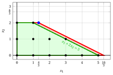{ .fig .ovale loading=lazy style="width:71%" }

            - The Gomory fractional cut generated by the objective-function row is:

                \begin{align*}
                \underbrace{\left(\frac{1}{3} - \left\lfloor \frac{1}{3} \right\rfloor \right)}_{\frac{1}{3}-0=\frac{1}{3}} \; x_3
                + \underbrace{\left(6 - \left\lfloor 6 \right\rfloor \right)}_{6-6=0} \; x_4
                \ge \underbrace{\left(\frac{52}{3} - \left\lfloor \frac{52}{3} \right\rfloor \right)}_{\frac{52}{3} -17=\frac{1}{3}}
                \end{align*}

                \begin{align*}
                \frac{1}{3}\;x_3 \ge \frac{1}{3}
                \quad \Rightarrow \quad
                x_3 \ge 1
                \end{align*}

                This Gomory fractional cut is the same as the one generated from the first row.

                We select the Gomory fractional cut with the largest right-hand side and we create the $LP_3$ problem by adding it to the $LP_2$ problem.

        - **b)** <strong>LP re-optimization phase</strong> 

            Let us consider the $LP_3$ problem in standard form:

            $$
            \begin{array}{rrrrrrrrrrrr}
            {\max} & {x_1} & {+} & {8\,x_2} &  &  &  &  &  &  &  &  \\[2ex]
            & {3\,x_1} & {+} & {6\,x_2} & {+} & {x_3} &  &  &  &  & {=} & 16 \\[2ex]
            &  &  & {x_2} &  &  & {+} & {x_4} &  &  & {=} & 2 \\[2ex]
            & {x_1} & {+} & {2\,x_2} &  &  &  &  & {+} & {x_5} & {=} & 5 \\[2ex]
            & {x_1,} &  & {x_2,} &  & {x_3,} &  & {x_4,} &  & {x_5} & {\ge} & 0
            \end{array}
            $$

            For the added Gomory fractional cut we have:

            $$
            x_3 - 3\;x_5 = 1
            \quad \Rightarrow \quad
            x_5 = -\dfrac{1}{3} + \dfrac{1}{3}\;x_3.
            $$

            We then add this equation to the previous optimal dictionary and we obtain the following dictionary:

            \begin{equation*}
            \begin{cases}
            \begin{array}{rrrrrrrrrrrrr}
            {x_1} & {=} & {\dfrac{4}{3}} & {-} & {\dfrac{1}{3}}\, {x_3} & {+} & {2}\, {x_4} \\[2ex]
            {x_2} & {=} & {2} &  &  & {-} & {x_4} \\[2ex]
            {x_5} & {=} & {-\dfrac{1}{3}} & {+} & {\dfrac{1}{3}}\, {x_3} &  &  \\[2ex]
            {z} & {=} & {\dfrac{52}{3}} & {-} & {\dfrac{1}{3}}\, {x_3} & {-} & {6}\, {x_4}
            \end{array}
            \end{cases}
            \end{equation*}

            where  $\pazocal{B} = \{1, 2, 5\}$ and $\pazocal{N} = \{3, 4\}$ and

            - the basic primal non-feasible solution is:

                $$
                \bar x_1 = \dfrac{4}{3}, \quad
                \bar x_2 = 2, \quad
                \bar x_5 = -\dfrac{1}{3}, \qquad
                \bar x_3 = 0, \quad
                \bar x_4 = 0
                \qquad
                \text{of value }  \dfrac{52}{3}
                $$

            - the basic dual feasible solution is:

                $$
                \bar \pi_1 = 0, \quad
                \bar \pi_2 = 0, \quad
                \bar \pi_5 = 0, \qquad
                \bar \pi_3 = \dfrac{1}{3}, \quad
                \bar \pi_4 = 6
                \qquad
                \text{of value }  \dfrac{52}{3}
                $$

            If we increase the value of $\pi_5$, we can get a better dual solution. We have:

            $$
            \pi_3 = \dfrac{1}{3} - \dfrac{1}{3}\pi_5
            \qquad\Longrightarrow\qquad
            \underbrace{\dfrac{1}{3} - \dfrac{1}{3}\pi_5 \ge 0}_{\pi_3 \ge 0}
            \qquad\Longrightarrow\qquad
            \pi_5 \le 1
            $$

            By increasing the value of $\pi_5$ to $1$, the value of $\pi_3$ decreases to $0$.

            Then we have that:

            - $\pi_5$ becomes a dual basic variable and accordingly $x_5$ becomes a primal non-basic variable

            - $\pi_3$ becomes a dual non-basic variable and accordingly $x_3$ becomes a primal basic variable

            We have:

            $$
            x_5 = -\dfrac{1}{3} + \dfrac{1}{3}\;x_3
            \quad \Longrightarrow \quad
            x_3 = 1 + 3\;x_5.
            $$

            Substituting in the other equations of the primal dictionary, we get:

            $$
            x_1 = \dfrac{4}{3} - \dfrac{1}{3}(1 + 3x_5) + 2x_4
            = 1 + 2x_4 - x_5,
            $$

            $$
            x_2 = 2 - x_4,
            $$

            $$
            z = \dfrac{52}{3} - \dfrac{1}{3}(1 + 3x_5) - 6x_4
            = 17 - 6x_4 - x_5.
            $$

            Accordingly, we now have the following optimal primal dictionary:

            \begin{equation*}
            \begin{cases}
            \begin{array}{rrrrrrrrrrrrr}
            {x_1} & {=} & {1} & {+} & {2}\, {x_4} & {-} & {x_5} \\[2ex]
            {x_2} & {=} & {2} & {-} & {x_4} &  &  \\[2ex]
            {x_3} & {=} & {1} &  &  & {+} & {3}\, {x_5} \\[2ex]
            {z} & {=} & {17} & {-} & {6}\, {x_4} & {-} & {x_5}
            \end{array}
            \end{cases}
            \end{equation*}

            where  $\pazocal{B} = \{1, 2, 3\}$ and $\pazocal{N} = \{4, 5\}$.

            - the basic primal optimal solution is:

                $$
                \tilde x_1 = 1, \quad
                \tilde x_2 = 2, \quad
                \tilde x_3 = 1, \quad
                \tilde x_4 = 0, \qquad
                \tilde x_5 = 0
                \qquad
                \text{of value }  17
                $$

            - the basic dual optimal solution is:

                $$
                \tilde \pi_1 = 0, \quad
                \tilde \pi_2 = 0, \quad
                \tilde \pi_3 = 0, \qquad
                \tilde \pi_4 = 6, \quad
                \tilde \pi_5 = 1
                \qquad
                \text{of value }  17
                $$

            !!! chiave ""

                The optimal solution ${ \tilde{ \boldsymbol x}}(\,LP_3\,)$ is <strong>integer</strong>. Accordingly, an optimal solution ${ \tilde{ \boldsymbol x}}(\,ILP\,)$ is:

                $$
                \tilde{x}_1=1,~~\tilde{x}_2=2
                $$

                The optimal value $z(~ILP~)$ is $17$.

            For the $LP_3$ problem in canonical form, we have:

            $$
            \begin{array}{rrrrrr}
            {\max} & {x_1} & {+} & {8\,x_2} &  &  \\[2ex]
            & {3\,x_1} & {+} & {6\,x_2} & {\le} & {16} \\[2ex]
            &  &  & {x_2} & {\le} & {2} \\[2ex]
            & {x_1} & {+} & {2\,x_2} & {\le} & {5} \\[2ex]
            & {x_1,} &  & {x_2} & {\ge} & {0}
            \end{array}
            $$

            An optimal solution ${ \tilde{ \boldsymbol x}}(\,LP_3\,)$ is:

            $$
            \tilde{x}_1=1,\qquad \tilde{x}_2=2
            $$

            The optimal value is:

            $$
            z(~LP_3~)=17
            $$

            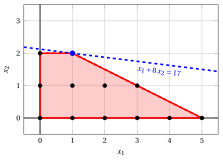{ .fig .ovale loading=lazy style="width:71%" }

!!! esercizio "Exercise 6.2: Cutting-plane algorithm (P2)"

    Consider the following ILP problem in canonical maximization form with $n=2$ integer variables and $m=2$ constraints:

    $$
    \begin{array}{rrrrrrrrrrrrr}
    {\max} & \, {x_1} & {+} & 3 \, {x_2} \\[2ex]
    & {- 4} \, {x_1} & {+} & {10} \, {x_2} & {\le} & {35} \\[2ex]
    & 3 \, {x_1} & {+} & \, {x_2} & {\le} & 12 \\[2ex]
    & {x_1,} &  & {x_2} & { \in } & { \Z_{\ge 0} }
    \end{array}
    $$

    and an optimal dictionary of its LP relaxation in standard form:

    \begin{equation*}
    \begin{cases}
    \begin{array}{rrrrrrrrrrrrr}
    {x_1=\dfrac{5}{2}} & {+} & {\dfrac{1}{34}} \, {x_3} & {-} & {\dfrac{5}{17}}\, {x_4} \\[2ex]
    {x_2=\dfrac{9}{2}} & {-} & {\dfrac{3}{34}}\, {x_3} & {-} & {\dfrac{2}{17}}\, {x_4} \\[2ex]
    {z= 16} & {-} & {\dfrac{4}{17}} \, {x_3} & {-} & {\dfrac{11}{17}} \, {x_4}
    \end{array}
    \end{cases}
    \end{equation*}

    **Questions**

    1. Execute the cutting-plane algorithm based on Gomory fractional cuts using:

        1. one Gomory fractional cut at each iteration;

        2. the largest right-hand side as the cut selection strategy.

        Solve the LP problems after adding the Gomory fractional cut using the dual simplex algorithm. Graphically show the optimal solution of the LP problem at each iteration.

    2. Graphically show the effect of each Gomory fractional cut on the LP relaxation of the ILP problem in canonical form.

    !!! nota ""

        Given a row $i \in \pazocal{B}$ of a simplex dictionary associated with a feasible basic solution such that $\bar{b}_i$ is fractional, the linear inequality

        \begin{equation*}
        \sum_{j \in \pazocal{N}}
        \left(
        \bar{a}_{ij}
        -
        \left\lfloor \bar{a}_{ij}\right\rfloor
        \right)x_j
        \ge
        \bar{b}_i - \left\lfloor \bar{b}_i \right\rfloor
        \end{equation*}

        is called the <strong>Gomory fractional cut</strong> generated by row $i$.

??? soluzione "Solution"

    Execution of the Cutting-Plane Algorithm to solve the ILP problem.

    - <strong>Initialization</strong>

        Let us consider the $LP_1$ problem in standard form:

        $$
        \begin{array}{rrrrrrrrrrrrr}
        {\max} & \, {x_1} & {+} & 3 \, {x_2} \\[2ex]
        & {- 4} \, {x_1} & {+} & {10} \, {x_2} & {+} & {x_3} &  &  & {=} & {35} \\[2ex]
        & 3 \, {x_1} & {+} & \, {x_2} &  &  & {+} & \, {x_4} & {=} & 12 \\[2ex]
        & {x_1,} &  & {x_2,} &  & {x_3,} &  & {x_4} & { \ge } & { 0 }
        \end{array}
        $$

        and its  optimal simplex dictionary:

        \begin{equation*}
        \begin{cases}
        \begin{array}{rrrrrrrrrrrrr}
        {x_1=\dfrac{5}{2}} & {+} & {\dfrac{1}{34}} \, {x_3} & {-} & {\dfrac{5}{17}}\, {x_4} \\[2ex]
        {x_2=\dfrac{9}{2}} & {-} & {\dfrac{3}{34}}\, {x_3} & {-} & {\dfrac{2}{17}}\, {x_4} \\[2ex]
        {z= 16} & {-} & {\dfrac{4}{17}} \, {x_3} & {-} & {\dfrac{11}{17}} \, {x_4}
        \end{array}
        \end{cases}
        \end{equation*}

        The optimal solution ${ \tilde{ \boldsymbol x}}(\,LP_1\,)$ is <strong>fractional</strong> and the $LP_1$ problem is <strong>feasible</strong>.

        We have the upper bound on the optimal value of the ILP problem:

        $$
        z(~ILP~) ~~\le~~ 16
        $$

        For the $LP_1$ problem in canonical form, we have:

        $$
        \begin{array}{rrrrrrrrrrrrr}
        {\max} & \, {x_1} & {+} & 3 \, {x_2} \\[2ex]
        & {- 4} \, {x_1} & {+} & {10} \, {x_2} & {\le} & {35} \\[2ex]
        & 3 \, {x_1} & {+} & \, {x_2} & {\le} & 12 \\[2ex]
        & {x_1,} &  & {x_2} & { \ge } & { 0 }
        \end{array}
        $$

        An optimal solution ${ \tilde{ \boldsymbol x}}(\,LP_1\,)$ is:

        $$
        \tilde{x}_1=\dfrac{5}{2},\qquad \tilde{x}_2=\dfrac{9}{2}
        $$

        The optimal value is:

        $$
        z(~LP_1~)=16
        $$

        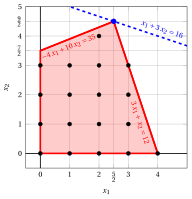{ .fig .ovale loading=lazy style="width:71%" }

    - <strong>Iteration 1</strong>

        - **a)** <strong>Cut generation phase</strong> 

            We have the following simplex dictionary associated with a fractional basic feasible solution of the $LP_1$ problem in standard form:

            \begin{equation*}
            \begin{cases}
            \begin{array}{rrrrrrrrrrrrr}
            {x_1=\dfrac{5}{2}} & {+} & {\dfrac{1}{34}} \, {x_3} & {-} & {\dfrac{5}{17}}\, {x_4} \\[2ex]
            {x_2=\dfrac{9}{2}} & {-} & {\dfrac{3}{34}}\, {x_3} & {-} & {\dfrac{2}{17}}\, {x_4} \\[2ex]
            {z= 16} & {-} & {\dfrac{4}{17}} \, {x_3} & {-} & {\dfrac{11}{17}} \, {x_4}
            \end{array}
            \end{cases}
            \end{equation*}

            where

            \begin{equation*}
            { \bar{\boldsymbol A}}=
            \begin{pmatrix}
            -\dfrac{1}{34} & \dfrac{5}{17} \\[2ex]
            \dfrac{3}{34} & \dfrac{2}{17}
            \end{pmatrix}
            \qquad
            { \bar{\boldsymbol b}}=
            \begin{pmatrix}
            \dfrac{5}{2} \\[2ex]
            \dfrac{9}{2}
            \end{pmatrix}
            \end{equation*}

            - The Gomory fractional cut generated by the first row is:

                \begin{align*}
                \underbrace{\left(-\dfrac{1}{34} - \left\lfloor -\dfrac{1}{34} \right\rfloor \right)}_{-\dfrac{1}{34}-(-1)=\dfrac{33}{34}} \; x_3 + \underbrace{\left(\dfrac{5}{17} - \left\lfloor \dfrac{5}{17} \right\rfloor \right)}_{\dfrac{5}{17}-0=\dfrac{5}{17}} \; x_4 \ge \underbrace{\left(\dfrac{5}{2} - \left\lfloor \dfrac{5}{2} \right\rfloor \right)}_{\dfrac{5}{2} -2=\dfrac{1}{2}}
                \end{align*}

                \begin{align*}
                \dfrac{33}{34}\;x_3 + \dfrac{5}{17} \;x_4 \ge \dfrac{1}{2}
                \quad \Rightarrow \quad
                33 \;x_3 + 10 \;x_4 \ge 17
                \end{align*}

                By subtracting a surplus variable, we obtain the Gomory fractional cut in standard form:

                $$
                \dfrac{33}{34}\;x_3 + \dfrac{5}{17} \;x_4 -x_5 = \dfrac{1}{2}
                \quad \Rightarrow \quad
                33 \;x_3 + 10 \;x_4 - 34\;x_5 = 17
                $$

                From the standard form of the $LP_1$ problem, we have:

                $$
                x_3=35+4\;x_1-10\;x_2,
                \qquad
                x_4=12-3\;x_1-x_2.
                $$

                Substituting in the Gomory fractional cut, we can express it in terms of the original variables of the ILP problem:

                $$
                33\;(35+4\:x_1-10\:x_2)+10\;(12-3\:x_1-x_2)\ge 17
                \quad \Rightarrow \quad
                -3\;x_1+10\;x_2\le 37
                $$

                Effect of the Gomory fractional cut generated by the first row on the $LP_1$ problem in canonical form:

                { .fig .ovale loading=lazy style="width:71%" }

            - The Gomory fractional cut generated by the second row is:

                \begin{align*}
                \underbrace{\left(\dfrac{3}{34} - \left\lfloor \dfrac{3}{34} \right\rfloor \right)}_{\dfrac{3}{34}-0=\dfrac{3}{34}} \; x_3 + \underbrace{\left(\dfrac{2}{17} - \left\lfloor \dfrac{2}{17} \right\rfloor \right)}_{\dfrac{2}{17}-0=\dfrac{2}{17}} \; x_4 \ge \underbrace{\left(\dfrac{9}{2} - \left\lfloor \dfrac{9}{2} \right\rfloor \right)}_{\dfrac{9}{2} -4=\dfrac{1}{2}}
                \end{align*}

                \begin{align*}
                \dfrac{3}{34}\;x_3 + \dfrac{2}{17} \;x_4 \ge \dfrac{1}{2}
                \quad \Rightarrow \quad
                3\;x_3 + 4 \;x_4 \ge 17
                \end{align*}

                By subtracting a surplus variable, we obtain the Gomory fractional cut in standard form:

                $$
                \dfrac{3}{34}\;x_3 + \dfrac{2}{17} \;x_4 - x_5 = \dfrac{1}{2}
                \quad \Rightarrow \quad
                3\;x_3 + 4 \;x_4 - 34\;x_5 = 17
                $$

                From the standard form of the $LP_1$ problem, we have:

                $$
                x_3=35+4\;x_1-10\;x_2,
                \qquad
                x_4=12-3\;x_1-x_2.
                $$

                Substituting in the Gomory fractional cut, we can express it in terms of the original variables of the ILP problem:

                $$
                3\;(35+4\:x_1-10\:x_2)+4\;(12-3\:x_1-x_2)\ge 17
                \quad \Rightarrow \quad
                x_2\le 4
                $$

                Effect of the Gomory fractional cut generated by the second row on the $LP_1$ problem in canonical form:

                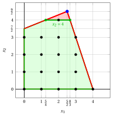{ .fig .ovale loading=lazy style="width:71%" }

            Both Gomory fractional cuts have the same right-hand side, equal to $\dfrac{1}{2}$. We select the Gomory fractional cut generated by the second row and we create the $LP_2$ problem by adding it to the $LP_1$ problem.

        - **b)** <strong>LP re-optimization phase</strong> 

            Let us consider the $LP_2$ problem in standard form:

            $$
            \begin{array}{rrrrrrrrrrrrr}
            {\max} & \, {x_1} & {+} & 3 \, {x_2} \\[2ex]
            & {- 4} \, {x_1} & {+} & {10} \, {x_2} & {+} & {x_3} &  &  &  &  & {=} & {35} \\[2ex]
            & 3 \, {x_1} & {+} & \, {x_2} &  &  & {+} & \, {x_4} &  &  & {=} & 12 \\[2ex]
            &  &  & {x_2} &  &  &  &  & {+} & {x_5} & {=} & {4} \\[2ex]
            & {x_1,} &  & {x_2,} &  & {x_3,} &  & {x_4,} &  & {x_5} & { \ge } & { 0 }
            \end{array}
            $$

            For the added Gomory fractional cut we have:

            $$
            3\;x_3 + 4 \;x_4 - 34\;x_5 = 17 \quad \quad \Rightarrow \quad    x_5 = -\dfrac{1}{2} + \dfrac{3}{34}\;x_3 + \dfrac{2}{17} \;x_4
            $$

            We then add this equation to the previous optimal dictionary and we obtain the following dictionary :

            \begin{equation*}
            \begin{cases}
            \begin{array}{rrrrrrrrrrrrr}
            {x_1=\dfrac{5}{2}} & {+} & {\dfrac{1}{34}} \, {x_3} & {-} & {\dfrac{5}{17}}\, {x_4} \\[2ex]
            {x_2=\dfrac{9}{2}} & {-} & {\dfrac{3}{34}}\, {x_3} & {-} & {\dfrac{2}{17}}\, {x_4} \\[2ex]
            {x_5=-\dfrac{1}{2}} & {+} & {\dfrac{3}{34}}\, {x_3} & {+} & {\dfrac{2}{17}}\, {x_4} \\[2ex]
            {z= 16} & {-} & {\dfrac{4}{17}} \, {x_3} & {-} & {\dfrac{11}{17}} \, {x_4}
            \end{array}
            \end{cases}
            \end{equation*}

            where  $\pazocal{B}=\{1,2,5\}$ and $\pazocal{N}=\{3,4\}$ and

            - the  basic primal non-feasible  solution is:

                $$
                \bar x_1=\dfrac{5}{2},~~
                \bar x_2=\dfrac{9}{2},~~
                \bar x_5=-\dfrac{1}{2},~~~~~~
                \bar x_3=0,~~
                \bar x_4=0~~
                \text{  of value   }16
                $$

            - the basic dual feasible  solution is:

                $$
                \bar \pi_1=0,~~
                \bar \pi_2=0,~~
                \bar \pi_5=0,~~~~~~
                \bar \pi_3=\dfrac{4}{17},~~
                \bar \pi_4=\dfrac{11}{17}~~
                \text{  of value   }16
                $$

            If we increase the value of $\pi_5$, we can get a better dual solution. We have:

            $$
            \begin{cases}
            \pi_3 &= \dfrac{4}{17} - \dfrac{3}{34}\,\pi_5 \\[2ex]
            \pi_4 &= \dfrac{11}{17} - \dfrac{2}{17}\,\pi_5
            \end{cases}
            \qquad
            \qquad
            \begin{cases}
            \underbrace{ \dfrac{4}{17} - \dfrac{3}{34}\,\pi_5 \ge 0}_{\pi_3 \ge 0} \\[2ex]
            \underbrace{  \dfrac{11}{17} - \dfrac{2}{17}\,\pi_5 \ge 0}_{\pi_4 \ge 0}
            \end{cases}
            \qquad
            \qquad
            \begin{cases}
            \pi_5 &\le  \dfrac{8}{3} \\[2ex]
            \pi_5 &\le  \dfrac{11}{2}
            \end{cases}
            $$

            By increasing the value of $\pi_5$ to $\min \left\{\dfrac{8}{3}, \dfrac{11}{2}\right\}=\dfrac{8}{3}$,  the value of $\pi_3$ decreases to 0. Then we have that:

            - $\pi_5$ becomes a dual basic variable and accordingly $x_5$ becomes a primal non basic variable

            - $\pi_3$ becomes a dual non-basic variable and accordingly $x_3$ becomes a primal basic variable

            We have:

            $$
            x_5 = -\dfrac{1}{2} + \dfrac{3}{34}\,  x_3 + \dfrac{2}{17}\, x_4 \text{    then     } x_3= \dfrac{17}{3} - \dfrac{4}{3} x_4 + \dfrac{34}{3} x_5.
            $$

            Substituting in the other equations of the primal dictionary, we get:

            $$
            x_1 = \dfrac{5}{2} +  \dfrac{1}{34}  \left( \dfrac{17}{3} - \dfrac{4}{3} x_4 + \dfrac{34}{3} x_5  \right) -  \dfrac{5}{17} x_4= \dfrac{8}{3} -\dfrac{1}{3} x_4 + \dfrac{1}{3} x_5
            $$

            $$
            x_2 = \dfrac{9}{2} -  \dfrac{3}{34}   \left(  \dfrac{17}{3} - \dfrac{4}{3} x_4 + \dfrac{34}{3} x_5 \right) -  \dfrac{2}{17} x_4=  4 -  x_5
            $$

            $$
            z = 16 -  \dfrac{4}{17}   \left(  \dfrac{17}{3} - \dfrac{4}{3} x_4 + \dfrac{34}{3} x_5 \right) -  \dfrac{11}{17} x_4=   \dfrac{44}{3} - \dfrac{1}{3} x_4 - \dfrac{8}{3} x_5
            $$

            Accordingly, we now have the following optimal primal dictionary:

            \begin{equation*}
            \begin{cases}
            \begin{array}{rrrrrrrrrrrrr}
            {x_1=\dfrac{8}{3}} & {-} & {\dfrac{1}{3}} \, {x_4} & {+} & {\dfrac{1}{3}}\, {x_5} \\[2ex]
            {x_2=4} &  &  & {-} & {x_5} \\[2ex]
            {x_3=\dfrac{17}{3}} & {-} & {\dfrac{4}{3}}\, {x_4} & {+} & {\dfrac{34}{3}}\, {x_5} \\[2ex]
            {z= \dfrac{44}{3}} & {-} & {\dfrac{1}{3}} \, {x_4} & {-} & {\dfrac{8}{3}} \, {x_5}
            \end{array}
            \end{cases}
            \end{equation*}

            where  $\pazocal{B}=\{1,2,3\}$ and $\pazocal{N}=\{4,5\}$ and

            - the basic primal optimal  solution is:

                $$
                \tilde x_1=\dfrac{8}{3},~~
                \tilde x_2=4,~~
                \tilde x_3=\dfrac{17}{3},~~~~~~
                \tilde x_4=0,~~
                \tilde x_5=0~~
                \text{  of value   }\dfrac{44}{3}
                $$

            - the basic dual optimal  solution is:

                $$
                \tilde \pi_1=0,~~
                \tilde \pi_2=0,~~
                \tilde \pi_3=0,~~~~~~
                \tilde \pi_4=\dfrac{1}{3},~~
                \tilde \pi_5=\dfrac{8}{3}~~
                \text{  of value   }\dfrac{44}{3}
                $$

            The optimal solution ${ \tilde{ \boldsymbol x}}(\,LP_2\,)$ is <strong>fractional</strong> and the $LP_2$ problem is <strong>feasible</strong>.

            We have the upper bound on the optimal value of the ILP problem:

            $$
            z(~ILP~) ~~\le~~  \underbrace{\left\lfloor \dfrac{44}{3} \right\rfloor}_{=14}
            $$

            For the $LP_2$ problem in canonical form, we have:

            $$
            \begin{array}{rrrrrrrrrrrrr}
            {\max} & \, {x_1} & {+} & 3 \, {x_2} \\[2ex]
            & {- 4} \, {x_1} & {+} & {10} \, {x_2} & {\le} & {35} \\[2ex]
            & 3 \, {x_1} & {+} & \, {x_2} & {\le} & 12 \\[2ex]
            &  &  & \, {x_2} & {\le} & 4 \\[2ex]
            & {x_1,} &  & {x_2} & { \ge } & { 0 }
            \end{array}
            $$

            An optimal solution ${ \tilde{ \boldsymbol x}}(\,LP_2\,)$ is:

            $$
            \tilde{x}_1=\dfrac{8}{3},\qquad \tilde{x}_2=4
            $$

            The optimal value is:

            $$
            z(~LP_2~)=\dfrac{44}{3}
            $$

            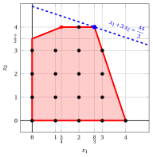{ .fig .ovale loading=lazy style="width:71%" }

    - <strong>Iteration 2</strong>

        - **a)** <strong>Cut generation phase</strong> 

            We have the following simplex dictionary associated with a fractional basic feasible solution of the $LP_2$ problem in standard form:

            \begin{equation*}
            \begin{cases}
            \begin{array}{rrrrrrrrrrrrr}
            {x_1} & {=} & {\dfrac{8}{3}} & {-} & {\dfrac{1}{3}}\, {x_4} & {+} & {\dfrac{1}{3}}\, {x_5} \\[2ex]
            {x_2} & {=} & {4} &  &  & {-} & {x_5} \\[2ex]
            {x_3} & {=} & {\dfrac{17}{3}} & {-} & {\dfrac{4}{3}}\, {x_4} & {+} & {\dfrac{34}{3}}\, {x_5} \\[2ex]
            {z} & {=} & {\dfrac{44}{3}} & {-} & {\dfrac{1}{3}}\, {x_4} & {-} & {\dfrac{8}{3}}\, {x_5}
            \end{array}
            \end{cases}
            \end{equation*}

            where

            \begin{equation*}
            { \bar{\boldsymbol A}}=
            \begin{pmatrix}
            \dfrac{1}{3} & -\dfrac{1}{3}\\[2ex]
            0 & 1\\[2ex]
            \dfrac{4}{3} & -\dfrac{34}{3}
            \end{pmatrix}
            \qquad
            { \bar{\boldsymbol b}}=
            \begin{pmatrix}
            \dfrac{8}{3}\\[2ex]
            4\\[2ex]
            \dfrac{17}{3}
            \end{pmatrix}
            \end{equation*}

            - The Gomory fractional cut generated by the first row is:

                \begin{align*}
                \underbrace{\left(\dfrac{1}{3} - \left\lfloor \dfrac{1}{3} \right\rfloor \right)}_{\dfrac{1}{3}-0=\dfrac{1}{3}} \; x_4
                + \underbrace{\left(-\dfrac{1}{3} - \left\lfloor -\dfrac{1}{3} \right\rfloor \right)}_{-\dfrac{1}{3}+1=\dfrac{2}{3}} \; x_5
                \ge \underbrace{\left(\dfrac{8}{3} - \left\lfloor \dfrac{8}{3} \right\rfloor \right)}_{\dfrac{8}{3} -2=\dfrac{2}{3}}
                \end{align*}

                \begin{align*}
                \dfrac{1}{3}\;x_4 + \dfrac{2}{3} \;x_5 \ge \dfrac{2}{3}
                \quad \Rightarrow \quad
                x_4 + 2 \;x_5 \ge 2
                \end{align*}

                By subtracting a surplus variable, we obtain the Gomory fractional cut in standard form:

                $$
                \dfrac{1}{3}\;x_4 + \dfrac{2}{3} \;x_5 - x_6 = \dfrac{2}{3}
                \quad \Rightarrow \quad
                x_4 + 2 \;x_5 - 3\;x_6 = 2
                $$

                From the standard form of the $LP_2$ problem, we have:

                $$
                x_4=12-3\;x_1-x_2,
                \qquad
                x_5=4-x_2.
                $$

                Substituting in the Gomory fractional cut, we can express it in terms of the original variables of the ILP problem:

                $$
                (12-3\;x_1-x_2)+2\;(4-x_2)\ge 2
                \quad \Rightarrow \quad
                x_1+x_2\le 6.
                $$

                Effect of the Gomory fractional cut generated by the first row on the $LP_2$ problem in canonical form:

                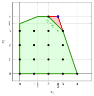{ .fig .ovale loading=lazy style="width:71%" }

            - The Gomory fractional cut generated by the third row is:

                \begin{align*}
                \underbrace{\left(\dfrac{4}{3} - \left\lfloor \dfrac{4}{3} \right\rfloor \right)}_{\dfrac{4}{3}-1=\dfrac{1}{3}} \; x_4
                + \underbrace{\left(-\dfrac{34}{3} - \left\lfloor -\dfrac{34}{3} \right\rfloor \right)}_{-\dfrac{34}{3}+12=\dfrac{2}{3}} \; x_5
                \ge \underbrace{\left(\dfrac{17}{3} - \left\lfloor \dfrac{17}{3} \right\rfloor \right)}_{\dfrac{17}{3} -5=\dfrac{2}{3}}
                \end{align*}

                \begin{align*}
                \dfrac{1}{3}\;x_4 + \dfrac{2}{3} \;x_5 \ge \dfrac{2}{3}
                \quad \Rightarrow \quad
                x_4 + 2 \;x_5 \ge 2
                \end{align*}

                This is the same Gomory fractional cut obtained with the first generating row.

            We select the Gomory fractional cut with the largest right-hand side and we create the $LP_3$ problem by adding it to the $LP_2$ problem.

        - **b)** <strong>LP re-optimization phase</strong> 

            Let us consider the $LP_3$ problem in standard form:

            $$
            \begin{array}{rrrrrrrrrrrrrrrrr}
            {\max} & \, {x_1} & {+} & 3 \, {x_2} \\[2ex]
            & {- 4} \, {x_1} & {+} & {10} \, {x_2} & {+} & {x_3} &  &  &  &  &  &  & {=} & {35} \\[2ex]
            & 3 \, {x_1} & {+} & \, {x_2} &  &  & {+} & \, {x_4} &  &  &  &  & {=} & 12 \\[2ex]
            &  &  & {x_2} &  &  &  &  & {+} & {x_5} &  &  & {=} & {4} \\[2ex]
            & \, {x_1} & {+} & \, {x_2} &  &  &  &  &  &  & {+} & {x_6} & {=} & {6} \\[2ex]
            & {x_1,} &  & {x_2,} &  & {x_3,} &  & {x_4,} &  & {x_5,} &  & {x_6} & { \ge } & { 0 }
            \end{array}
            $$

            For the added Gomory fractional cut we have:

            $$
            x_4 + 2 \;x_5 - 3\;x_6 = 2   \quad \quad \Rightarrow \quad    x_6 = -\dfrac{2}{3} + \dfrac{1}{3} x_4 + \dfrac{2}{3} \;x_5
            $$

            We then add this equation to the previous optimal dictionary and we obtain the following dictionary :

            \begin{equation*}
            \begin{cases}
            \begin{array}{rrrrrrrrrrrrr}
            {x_1=\dfrac{8}{3}} & {-} & {\dfrac{1}{3}} \, {x_4} & {+} & {\dfrac{1}{3}}\, {x_5} \\[2ex]
            {x_2=4} &  &  & {-} & {x_5} \\[2ex]
            {x_3=\dfrac{17}{3}} & {-} & {\dfrac{4}{3}}\, {x_4} & {+} & {\dfrac{34}{3}}\, {x_5} \\[2ex]
            {x_6=-\dfrac{2}{3}} & {+} & {\dfrac{1}{3}}\, {x_4} & {+} & {\dfrac{2}{3}}\, {x_5} \\[2ex]
            {z= \dfrac{44}{3}} & {-} & {\dfrac{1}{3}} \, {x_4} & {-} & {\dfrac{8}{3}} \, {x_5}
            \end{array}
            \end{cases}
            \end{equation*}

            where  $\pazocal{B}=\{1,2,3,6\}$ and $\pazocal{N}=\{4,5\}$ and

            - the basic primal non-feasible  solution is:

                $$
                \bar x_1=\dfrac{8}{3},~~
                \bar x_2=4,~~
                \bar x_3=\dfrac{17}{3},~~
                \bar x_6=-\dfrac{2}{3},~~~~~~
                \bar x_4=0,~~
                \bar x_5=0~~
                \text{  of value   } \dfrac{44}{3}
                $$

            - the basic dual feasible  solution is:

                $$
                \bar \pi_1=0,~~
                \bar \pi_2=0,~~
                \bar \pi_3=0,~~
                \bar \pi_6=0,~~~~~~
                \bar \pi_4=\dfrac{1}{3},~~
                \bar \pi_5=\dfrac{8}{3}~~
                \text{  of value   }\dfrac{44}{3}
                $$

            If we increase the value of $\pi_6$, we can get a better dual solution. We have:

            $$
            \begin{cases}
            \pi_4 &= \dfrac{1}{3} - \dfrac{1}{3}\pi_6 \\[2ex]
            \pi_5 &= \dfrac{8}{3} - \dfrac{2}{3}\,\pi_6
            \end{cases}
            \qquad
            \qquad
            \begin{cases}
            \underbrace{ \dfrac{1}{3} - \dfrac{1}{3} \pi_6 \ge 0}_{\pi_4 \ge 0} \\[2ex]
            \underbrace{  \dfrac{8}{3} - \dfrac{2}{3}\,\pi_6 \ge 0}_{\pi_5 \ge 0}
            \end{cases}
            \qquad
            \qquad
            \begin{cases}
            \pi_6 &\le  1 \\[2ex]
            \pi_6 &\le  4
            \end{cases}
            $$

            By increasing the value of $\pi_6$ to $\min \left\{1, 4\right\}=1$,  the value of $\pi_4$ decreases to 0. Then we have that:

            - $\pi_6$ becomes a dual basic variable and accordingly $x_6$ becomes a primal non basic variable

            - $\pi_4$ becomes a dual non-basic variable and accordingly $x_4$ becomes a primal basic variable

            We have:

            $$
            x_6 = -\dfrac{2}{3} + \dfrac{1}{3} x_4 + \dfrac{2}{3} \;x_5 \text{    then     } x_4= 2 - 2 x_5 + 3 x_6.
            $$

            Substituting in the other equations of the primal dictionary, we get:

            $$
            x_1 = \dfrac{8}{3}  -  \dfrac{1}{3}  \left( 2 - 2 x_5 + 3 x_6 \right) +  \dfrac{1}{3} x_5 = 2 +  x_5 -  x_6
            $$

            $$
            x_3 = \dfrac{17}{3}  -  \dfrac{4}{3}  \left( 2 - 2 x_5 + 3 x_6 \right) +  \dfrac{34}{3} x_5 =  3 + 14 x_5 - 4 x_6
            $$

            $$
            z  = \dfrac{44}{3}  -  \dfrac{1}{3}  \left( 2 - 2 x_5 + 3 x_6 \right) -  \dfrac{8}{3} x_5 =  14 - 2 x_5 -  x_6
            $$

            Accordingly, we now have the following optimal primal dictionary:

            \begin{equation*}
            \begin{cases}
            \begin{array}{rrrrrrrrrrrrr}
            {x_1=2} & {+} & {x_5} & {-} & {x_6} \\[2ex]
            {x_2=4} & {-} & {x_5} &  &  \\[2ex]
            {x_3=3} & {+} & {14} \, {x_5} & {-} & {4}\, {x_6} \\[2ex]
            {x_4=2} & {-} & {2} \, {x_5} & {+} & {3}\, {x_6} \\[2ex]
            {z= 14} & {-} & {2} \, {x_5} & {-} & {x_6}
            \end{array}
            \end{cases}
            \end{equation*}

            where  $\pazocal{B}=\{1,2,3,4\}$ and $\pazocal{N}=\{5,6\}$ and

            - the basic primal optimal  solution is:

                $$
                \tilde x_1=2,~~
                \tilde x_2=4,~~
                \tilde x_3=3,~~
                \tilde x_4=2,~~~~~~
                \tilde x_5=0,~~
                \tilde x_6=0~~
                \text{  of value   } 14
                $$

            - the basic dual optimal  solution is:

                $$
                \tilde \pi_1=0,~~
                \tilde \pi_2=0,~~
                \tilde \pi_3=0,~~
                \tilde \pi_4=0,~~~~~~
                \tilde \pi_5=2~~
                \tilde \pi_6=1~~
                \text{  of value   } 14
                $$

            !!! chiave ""

                The optimal solution ${ \tilde{ \boldsymbol x}}(\,LP_3\,)$ is <strong>integer</strong>. Accordingly, an optimal solution ${ \tilde{ \boldsymbol x}}(\,ILP\,)$ is:

                $$
                \tilde{x}_1=2,~~\tilde{x}_2=4
                $$

                The optimal value $z(~ILP~)$ is $14$.

            For the $LP_3$ problem in canonical form, we have:

            $$
            \begin{array}{rrrrrrrrrrrrr}
            {\max} & \, {x_1} & {+} & 3 \, {x_2} \\[2ex]
            & {- 4} \, {x_1} & {+} & {10} \, {x_2} & {\le} & {35} \\[2ex]
            & 3 \, {x_1} & {+} & \, {x_2} & {\le} & 12 \\[2ex]
            &  &  & \, {x_2} & {\le} & 4 \\[2ex]
            & {x_1} & {+} & \, {x_2} & {\le} & 6 \\[2ex]
            & {x_1,} &  & {x_2} & { \ge } & { 0 }
            \end{array}
            $$

            An optimal solution ${ \tilde{ \boldsymbol x}}(\,LP_3\,)$ is:

            $$
            \tilde{x}_1=2,\qquad \tilde{x}_2=4
            $$

            The optimal value is:

            $$
            z(~LP_3~)=14
            $$

            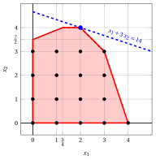{ .fig .ovale loading=lazy style="width:71%" }

!!! esercizio "Exercise 6.3: Cutting-plane algorithm (P3)"

    Consider the following ILP problem in canonical maximization form with $n=2$ integer variables and $m=2$ constraints:

    $$
    \begin{array}{rrrrrrrrrrrrr}
    {\max} & {2}\, {x_1} & {+} & {4}\, {x_2} \\[2ex]
    & {-} \, {x_1} & {+} & \, {x_2} & {\le} & {2} \\[2ex]
    & {8} \, {x_1} & {+} & {2} \, {x_2} & {\le} & {19} \\[2ex]
    & {x_1,} &  & {x_2} & { \in } & { \Z_{\ge 0} }
    \end{array}
    $$

    and an optimal dictionary of its LP relaxation in standard form:

    \begin{equation*}
    \begin{cases}
    \begin{array}{rrrrrrrrrrrrr}
    {x_1} & {=} & {\dfrac{3}{2}} & {+} & {\dfrac{1}{5}} \, {x_3} & {-} & {\dfrac{1}{10}}\, {x_4} \\[2ex]
    {x_2} & {=} & {\dfrac{7}{2}} & {-} & {\dfrac{4}{5}}\, {x_3} & {-} & {\dfrac{1}{10}}\, {x_4} \\[2ex]
    {z} & {=} & {17} & {-} & {\dfrac{14}{5}} \, {x_3} & {-} & {\dfrac{3}{5}} \, {x_4}
    \end{array}
    \end{cases}
    \end{equation*}

    **Questions**

    1. Execute the cutting-plane algorithm based on Gomory fractional cuts using:

        1. one Gomory fractional cut at each iteration;

        2. the largest right-hand side as the cut selection strategy.

        Solve the LP problems after adding the Gomory fractional cut using the dual simplex algorithm. Graphically show the optimal solution of the LP problem at each iteration.

    2. Graphically show the effect of each Gomory fractional cut on the LP relaxation of the ILP problem in canonical form.

    !!! nota ""

        Given a row $i \in \pazocal{B}$ of a simplex dictionary associated with a feasible basic solution such that $\bar{b}_i$ is fractional, the linear inequality

        \begin{equation*}
        \sum_{j \in \pazocal{N}}
        \left(
        \bar{a}_{ij}
        -
        \left\lfloor \bar{a}_{ij}\right\rfloor
        \right)x_j
        \ge
        \bar{b}_i - \left\lfloor \bar{b}_i \right\rfloor
        \end{equation*}

        is called the <strong>Gomory fractional cut</strong> generated by row $i$.

??? soluzione "Solution"

    Execution of the Cutting-Plane Algorithm to solve the ILP problem.

    - <strong>Initialization</strong>

        Let us consider the $LP_1$ problem in standard form:

        $$
        \begin{array}{rrrrrrrrrrrrr}
        {\max} & {2} \, {x_1} & {+} & {4} \, {x_2} \\[1.5ex]
        & {-} \, {x_1} & {+} & \, {x_2} & {+} & {x_3} &  &  & {=} & {2} \\[2ex]
        & {8} \, {x_1} & {+} & {2} \, {x_2} &  &  & {+} & {x_4} & {=} & {19} \\[2ex]
        & {x_1,} &  & {x_2,} &  & {x_3,} &  & {x_4} & { \ge} & { 0 }
        \end{array}
        $$

        and its  optimal simplex dictionary:

        \begin{equation*}
        \begin{cases}
        \begin{array}{rrrrrrrrrrrrr}
        {x_1} & {=} & {\dfrac{3}{2}} & {+} & {\dfrac{1}{5}} \, {x_3} & {-} & {\dfrac{1}{10}}\, {x_4} \\[2ex]
        {x_2} & {=} & {\dfrac{7}{2}} & {-} & {\dfrac{4}{5}}\, {x_3} & {-} & {\dfrac{1}{10}}\, {x_4} \\[2ex]
        {z} & {=} & {17} & {-} & {\dfrac{14}{5}} \, {x_3} & {-} & {\dfrac{3}{5}} \, {x_4}
        \end{array}
        \end{cases}
        \end{equation*}

        The optimal solution ${ \tilde{ \boldsymbol x}}(\,LP_1\,)$ is <strong>fractional</strong> and the $LP_1$ problem is <strong>feasible</strong>.

        We have the upper bound on the optimal value of the ILP problem:

        $$
        z(~ILP~) ~~\le~~ 17
        $$

        For the $LP_1$ problem in canonical form, we have:

        $$
        \begin{array}{rrrrrrrrrrrrr}
        {\max} & {2}\, {x_1} & {+} & {4}\, {x_2} \\[2ex]
        & {-} \, {x_1} & {+} & \, {x_2} & {\le} & {2} \\[2ex]
        & {8} \, {x_1} & {+} & {2} \, {x_2} & {\le} & {19} \\[2ex]
        & {x_1,} &  & {x_2} & { \ge } & {0}
        \end{array}
        $$

        An optimal solution ${ \tilde{ \boldsymbol x}}(\,LP_1\,)$ is:

        $$
        \tilde{x}_1=\dfrac{3}{2},\qquad \tilde{x}_2=\dfrac{7}{2}
        $$

        The optimal value is:

        $$
        z(~LP_1~)=17
        $$

        { .fig .ovale loading=lazy style="width:71%" }

    - <strong>Iteration 1</strong>

        - **a)** <strong>Cut generation phase</strong> 

            We have the following simplex dictionary associated with a fractional basic feasible solution of the $LP_1$ problem in standard form:

            \begin{equation*}
            \begin{cases}
            \begin{array}{rrrrrrrrrrrrr}
            {x_1} & {=} & {\dfrac{3}{2}} & {+} & {\dfrac{1}{5}} \, {x_3} & {-} & {\dfrac{1}{10}}\, {x_4} \\[2ex]
            {x_2} & {=} & {\dfrac{7}{2}} & {-} & {\dfrac{4}{5}}\, {x_3} & {-} & {\dfrac{1}{10}}\, {x_4} \\[2ex]
            {z} & {=} & {17} & {-} & {\dfrac{14}{5}} \, {x_3} & {-} & {\dfrac{3}{5}} \, {x_4}
            \end{array}
            \end{cases}
            \end{equation*}

            where

            \begin{equation*}
            { \bar{\boldsymbol A}}=
            \begin{pmatrix}
            -\dfrac{1}{5} & \dfrac{1}{10} \\[2ex]
            \dfrac{4}{5} & \dfrac{1}{10}
            \end{pmatrix}
            \qquad
            { \bar{\boldsymbol b}}=
            \begin{pmatrix}
            \dfrac{3}{2}\\[2ex]
            \dfrac{7}{2}
            \end{pmatrix}
            \end{equation*}

            - The Gomory fractional cut generated by the first row is:

                \begin{align*}
                \underbrace{\left(-\dfrac{1}{5} - \left\lfloor -\dfrac{1}{5} \right\rfloor \right)}_{-\dfrac{1}{5}-(-1)=\dfrac{4}{5}} \; x_3
                + \underbrace{\left(\dfrac{1}{10} - \left\lfloor \dfrac{1}{10} \right\rfloor \right)}_{\dfrac{1}{10}-0=\dfrac{1}{10}} \; x_4
                \ge \underbrace{\left(\dfrac{3}{2} - \left\lfloor \dfrac{3}{2} \right\rfloor \right)}_{\dfrac{3}{2} -1=\dfrac{1}{2}}
                \end{align*}

                \begin{align*}
                \dfrac{4}{5}\;x_3 + \dfrac{1}{10}\;x_4 \ge \dfrac{1}{2}
                \quad \Rightarrow \quad
                8\;x_3+x_4 \ge 5
                \end{align*}

                By subtracting a surplus variable, we obtain the Gomory fractional cut in standard form:

                $$
                \dfrac{4}{5}\;x_3 + \dfrac{1}{10}\;x_4 - x_5 = \dfrac{1}{2}
                \quad \Rightarrow \quad
                8\;x_3+x_4-10\;x_5=5
                $$

                From the standard form of the $LP_1$ problem, we have:

                $$
                x_3=2+x_1-x_2,
                \qquad
                x_4=19-8\;x_1-2\;x_2.
                $$

                Substituting in the Gomory fractional cut, we can express it in terms of the original variables of the ILP problem:

                $$
                8\;(2+x_1-x_2)+(19-8\;x_1-2\;x_2)\ge 5
                \quad \Rightarrow \quad
                x_2\le 3.
                $$

                Effect of the Gomory fractional cut generated by the first row on the $LP_1$ problem in canonical form:

                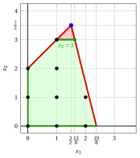{ .fig .ovale loading=lazy style="width:71%" }

            - The Gomory fractional cut generated by the second row is:

                \begin{align*}
                \underbrace{\left(\dfrac{4}{5} - \left\lfloor \dfrac{4}{5} \right\rfloor \right)}_{\dfrac{4}{5}-0=\dfrac{4}{5}} \; x_3
                + \underbrace{\left(\dfrac{1}{10} - \left\lfloor \dfrac{1}{10} \right\rfloor \right)}_{\dfrac{1}{10}-0=\dfrac{1}{10}} \; x_4
                \ge \underbrace{\left(\dfrac{7}{2} - \left\lfloor \dfrac{7}{2} \right\rfloor \right)}_{\dfrac{7}{2} -3=\dfrac{1}{2}}
                \end{align*}

                \begin{align*}
                \dfrac{4}{5}\;x_3 + \dfrac{1}{10}\;x_4 \ge \dfrac{1}{2}
                \quad \Rightarrow \quad
                8\;x_3+x_4 \ge 5
                \end{align*}

                This is the same Gomory fractional cut obtained with the first generating row.

            We select the Gomory fractional cut with the largest right-hand side and we create the $LP_2$ problem by adding it to the $LP_1$ problem.

        - **b)** <strong>Dual simplex reoptimization phase</strong> 

            Let us consider the $LP_2$ problem in standard form:

            $$
            \begin{array}{rrrrrrrrrrrrr}
            {\max} & {2} \, {x_1} & {+} & {4} \, {x_2} \\[1.5ex]
            & {-} \, {x_1} & {+} & \, {x_2} & {+} & {x_3} &  &  &  &  & {=} & {2} \\[2ex]
            & {8} \, {x_1} & {+} & {2} \, {x_2} &  &  & {+} & {x_4} &  &  & {=} & {19} \\[2ex]
            &  &  & {x_2} &  &  &  &  & {+} & {x_5} & {=} & {3} \\[2ex]
            & {x_1,} &  & {x_2,} &  & {x_3,} &  & {x_4,} &  & {x_5} & { \ge} & { 0 }
            \end{array}
            $$

            For the added Gomory fractional cut we have:

            $$
            8\;x_3+x_4-10\;x_5=5
            \quad \Rightarrow \quad
            x_5=-\dfrac{1}{2}+\dfrac{4}{5}\;x_3+\dfrac{1}{10}\;x_4
            $$

            We then add this equation to the previous optimal dictionary and we obtain the following dictionary :

            \begin{equation*}
            \begin{cases}
            \begin{array}{rrrrrrrrrrrrr}
            {x_1} & {=} & {\dfrac{3}{2}} & {+} & {\dfrac{1}{5}} \, {x_3} & {-} & {\dfrac{1}{10}}\, {x_4} \\[2ex]
            {x_2} & {=} & {\dfrac{7}{2}} & {-} & {\dfrac{4}{5}}\, {x_3} & {-} & {\dfrac{1}{10}}\, {x_4} \\[2ex]
            {x_5} & {=} & {-\dfrac{1}{2}} & {+} & {\dfrac{4}{5}}\, {x_3} & {+} & {\dfrac{1}{10}}\, {x_4} \\[2ex]
            {z} & {=} & {17} & {-} & {\dfrac{14}{5}} \, {x_3} & {-} & {\dfrac{3}{5}} \, {x_4}
            \end{array}
            \end{cases}
            \end{equation*}

            where  $\pazocal{B}=\{1,2,5\}$ and $\pazocal{N}=\{3,4\}$ and

            - the  basic primal non-feasible  solution is:

                $$
                \bar x_1=\dfrac{3}{2},~~
                \bar x_2=\dfrac{7}{2},~~
                \bar x_5=-\dfrac{1}{2},~~~~~~
                \bar x_3=0,~~
                \bar x_4=0~~
                \text{  of value   }17
                $$

            - the basic dual feasible  solution is:

                $$
                \bar \pi_1=0,~~
                \bar \pi_2=0,~~
                \bar \pi_5=0,~~~~~~
                \bar \pi_3=\dfrac{14}{5},~~
                \bar \pi_4=\dfrac{3}{5}~~
                \text{  of value   }17
                $$

            If we increase the value of $\pi_5$, we can get a better dual solution. We have:

            $$
            \begin{cases}
            \pi_3 &= \dfrac{14}{5} - \dfrac{4}{5} \,\pi_5 \\[2ex]
            \pi_4 &= \dfrac{3}{5} - \dfrac{1}{10}\,\pi_5
            \end{cases}
            \qquad
            \qquad
            \begin{cases}
            \underbrace{ \dfrac{14}{5} - \dfrac{4}{5}\,\pi_5 \ge 0}_{\pi_3 \ge 0} \\[2ex]
            \underbrace{  \dfrac{3}{5} - \dfrac{1}{10} \,\pi_5 \ge 0}_{\pi_4 \ge 0}
            \end{cases}
            \qquad
            \qquad
            \begin{cases}
            \pi_5 &\le  \dfrac{7}{2} \\[2ex]
            \pi_5 &\le 6
            \end{cases}
            $$

            By increasing the value of $\pi_5$ to $\min \left\{\dfrac{7}{2}, 6\right\}=\dfrac{7}{2}$,  the value of $\pi_3$ decreases to 0. Then we have that:

            - $\pi_5$ becomes a dual basic variable and accordingly $x_5$ becomes a primal non basic variable

            - $\pi_3$ becomes a dual non-basic variable and accordingly $x_3$ becomes a primal basic variable

            We have:

            $$
            x_5 = -\dfrac{1}{2} + \dfrac{4}{5}\,x_3 + \dfrac{1}{10}\,x_4
            \quad \Longrightarrow \quad
            x_3= \dfrac{5}{8} - \dfrac{1}{8} x_4 + \dfrac{5}{4} x_5.
            $$

            Substituting into the other equations of the primal dictionary, we get:

            $$
            x_1 = \dfrac{3}{2} +  \dfrac{1}{5}  \left( \dfrac{5}{8} - \dfrac{1}{8} x_4 + \dfrac{5}{4} x_5  \right) -  \dfrac{1}{10} x_4
            = \dfrac{13}{8} - \dfrac{1}{8} x_4 + \dfrac{1}{4} x_5
            $$

            $$
            x_2 = \dfrac{7}{2} -  \dfrac{4}{5}   \left(  \dfrac{5}{8} - \dfrac{1}{8} x_4 + \dfrac{5}{4} x_5 \right) -  \dfrac{1}{10} x_4
            = 3 - x_5
            $$

            $$
            z = 17 -  \dfrac{14}{5}   \left(  \dfrac{5}{8} - \dfrac{1}{8} x_4 + \dfrac{5}{4} x_5 \right) -  \dfrac{3}{5} x_4
            =   \dfrac{61}{4} - \dfrac{1}{4} x_4 - \dfrac{7}{2} x_5
            $$

            Accordingly, we now have the following optimal primal dictionary:

            \begin{equation*}
            \begin{cases}
            \begin{array}{rrrrrrrrrrrrr}
            {x_1} & {=} & {\dfrac{13}{8}} & {-} & {\dfrac{1}{8}}\, {x_4} & {+} & {\dfrac{1}{4}}\, {x_5} \\[2ex]
            {x_2} & {=} & {3} &  &  & {-} & \, {x_5} \\[2ex]
            {x_3} & {=} & {\dfrac{5}{8}} & {-} & {\dfrac{1}{8}} \, {x_4} & {+} & {\dfrac{5}{4}} \, {x_5} \\[2ex]
            {z} & {=} & {\dfrac{61}{4}} & {-} & {\dfrac{1}{4}}\, {x_4} & {-} & {\dfrac{7}{2}} \, {x_5}
            \end{array}
            \end{cases}
            \end{equation*}

            The optimal solution ${ \tilde{ \boldsymbol x}}(\,LP_2\,)$ is <strong>fractional</strong> and the $LP_2$ problem is <strong>feasible</strong>.

            We have the upper bound on the optimal value of the ILP problem:

            $$
            z(~ILP~) ~~\le~~  \underbrace{\left\lfloor \dfrac{61}{4} \right\rfloor}_{=15}
            $$

            For the $LP_2$ problem in canonical form, we have:

            $$
            \begin{array}{rrrrrrrrrrrrr}
            {\max} & {2}\, {x_1} & {+} & {4}\, {x_2} \\[2ex]
            & {-} \, {x_1} & {+} & \, {x_2} & {\le} & {2} \\[2ex]
            & {8} \, {x_1} & {+} & {2} \, {x_2} & {\le} & {19} \\[2ex]
            &  &  & \, {x_2} & {\le} & {3} \\[2ex]
            & {x_1,} &  & {x_2} & { \ge } & {0}
            \end{array}
            $$

            An optimal solution ${ \tilde{ \boldsymbol x}}(\,LP_2\,)$ is:

            $$
            \tilde{x}_1=\dfrac{13}{8},\qquad \tilde{x}_2=3
            $$

            The optimal value is:

            $$
            z(~LP_2~)=\dfrac{61}{4}
            $$

            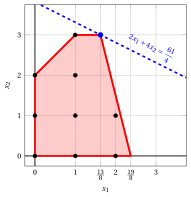{ .fig .ovale loading=lazy style="width:71%" }

    - <strong>Iteration 2</strong>

        - **a)** <strong>Cut generation phase</strong> 

            We have the following simplex dictionary associated with a fractional basic feasible solution of the $LP_2$ problem in standard form:

            \begin{equation*}
            \begin{cases}
            \begin{array}{rrrrrrrrrrrrr}
            {x_1} & {=} & {\dfrac{13}{8}} & {-} & {\dfrac{1}{8}}\, {x_4} & {+} & {\dfrac{1}{4}}\, {x_5} \\[2ex]
            {x_2} & {=} & {3} &  &  & {-} & \, {x_5} \\[2ex]
            {x_3} & {=} & {\dfrac{5}{8}} & {-} & {\dfrac{1}{8}} \, {x_4} & {+} & {\dfrac{5}{4}} \, {x_5} \\[2ex]
            {z} & {=} & {\dfrac{61}{4}} & {-} & {\dfrac{1}{4}}\, {x_4} & {-} & {\dfrac{7}{2}} \, {x_5}
            \end{array}
            \end{cases}
            \end{equation*}

            where

            \begin{equation*}
            { \bar{\boldsymbol A}}=
            \begin{pmatrix}
            \dfrac{1}{8} & -\dfrac{1}{4} \\[2ex]
            0 & 1 \\[2ex]
            \dfrac{1}{8} & -\dfrac{5}{4}
            \end{pmatrix}
            \qquad
            { \bar{\boldsymbol b}}=
            \begin{pmatrix}
            \dfrac{13}{8}\\[2ex]
            3\\[2ex]
            \dfrac{5}{8}
            \end{pmatrix}
            \end{equation*}

            - The Gomory fractional cut generated by the first row is:

                \begin{align*}
                \underbrace{\left(\dfrac{1}{8} - \left\lfloor \dfrac{1}{8} \right\rfloor \right)}_{\dfrac{1}{8}-0=\dfrac{1}{8}} \; x_4
                + \underbrace{\left(-\dfrac{1}{4} - \left\lfloor -\dfrac{1}{4} \right\rfloor \right)}_{-\dfrac{1}{4}-(-1)=\dfrac{3}{4}} \; x_5
                \ge \underbrace{\left(\dfrac{13}{8} - \left\lfloor \dfrac{13}{8} \right\rfloor \right)}_{\dfrac{13}{8} -1=\dfrac{5}{8}}
                \end{align*}

                \begin{align*}
                \dfrac{1}{8}\;x_4 + \dfrac{3}{4}\;x_5 \ge \dfrac{5}{8}
                \quad \Rightarrow \quad
                x_4+6\;x_5 \ge 5
                \end{align*}

                By subtracting a surplus variable, we obtain the Gomory fractional cut in standard form:

                $$
                \dfrac{1}{8}\;x_4 + \dfrac{3}{4}\;x_5 - x_6 = \dfrac{5}{8}
                \quad \Rightarrow \quad
                x_4+6\;x_5-8\;x_6=5
                $$

                From the standard form of the $LP_2$ problem, we have:

                $$
                x_4=19-8\;x_1-2\;x_2,
                \qquad
                x_5=3-x_2.
                $$

                Substituting in the Gomory fractional cut, we can express it in terms of the original variables of the ILP problem:

                $$
                (19-8\;x_1-2\;x_2)+6\;(3-x_2)\ge 5
                \quad \Rightarrow \quad
                x_1+x_2\le 4.
                $$

                Effect of the Gomory fractional cut generated by the first row on the $LP_2$ problem in canonical form:

                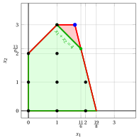{ .fig .ovale loading=lazy style="width:71%" }

            - The Gomory fractional cut generated by the third row is:

                \begin{align*}
                \underbrace{\left(\dfrac{1}{8} - \left\lfloor \dfrac{1}{8} \right\rfloor \right)}_{\dfrac{1}{8}-0=\dfrac{1}{8}} \; x_4
                + \underbrace{\left(-\dfrac{5}{4} - \left\lfloor -\dfrac{5}{4} \right\rfloor \right)}_{-\dfrac{5}{4}+2=\dfrac{3}{4}} \; x_5
                \ge \underbrace{\left(\dfrac{5}{8} - \left\lfloor \dfrac{5}{8} \right\rfloor \right)}_{\dfrac{5}{8} -0=\dfrac{5}{8}}
                \end{align*}

                \begin{align*}
                \dfrac{1}{8}\;x_4 + \dfrac{3}{4}\;x_5 \ge \dfrac{5}{8}
                \quad \Rightarrow \quad
                x_4+6\;x_5 \ge 5
                \end{align*}

                This is the same Gomory fractional cut obtained with the first generating row.

            We select the Gomory fractional cut with the largest right-hand side and we create the $LP_3$ problem by adding it to the $LP_2$ problem.

        - **b)** <strong>Dual simplex reoptimization phase</strong> 

            Let us consider the $LP_3$ problem in standard form:

            $$
            \begin{array}{rrrrrrrrrrrrrrrrr}
            {\max} & {2} \, {x_1} & {+} & {4} \, {x_2} \\[2ex]
            & {-} \, {x_1} & {+} & \, {x_2} & {+} & {x_3} &  &  &  &  &  &  & {=} & {2} \\[2ex]
            & {8} \, {x_1} & {+} & {2} \, {x_2} &  &  & {+} & \, {x_4} &  &  &  &  & {=} & {19} \\[2ex]
            &  &  & {x_2} &  &  &  &  & {+} & {x_5} &  &  & {=} & {3} \\[2ex]
            & \, {x_1} & {+} & \, {x_2} &  &  &  &  &  &  & {+} & {x_6} & {=} & {4} \\[2ex]
            & {x_1,} &  & {x_2,} &  & {x_3,} &  & {x_4,} &  & {x_5,} &  & {x_6} & { \ge } & {0}
            \end{array}
            $$

            For the added Gomory fractional cut we have:

            $$
            x_4+6\;x_5-8\;x_6=5
            \quad \Rightarrow \quad
            x_6=-\dfrac{5}{8}+\dfrac{1}{8}\;x_4+\dfrac{3}{4}\;x_5
            $$

            We then add this equation to the previous optimal dictionary and we obtain the following dictionary :

            \begin{equation*}
            \begin{cases}
            \begin{array}{rrrrrrrrrrrrr}
            {x_1} & {=} & {\dfrac{13}{8}} & {-} & {\dfrac{1}{8}}\, {x_4} & {+} & {\dfrac{1}{4}}\, {x_5} \\[2ex]
            {x_2} & {=} & {3} &  &  & {-} & \, {x_5} \\[2ex]
            {x_3} & {=} & {\dfrac{5}{8}} & {-} & {\dfrac{1}{8}} \, {x_4} & {+} & {\dfrac{5}{4}} \, {x_5} \\[2ex]
            {x_6} & {=} & {-\dfrac{5}{8}} & {+} & {\dfrac{1}{8}} \, {x_4} & {+} & {\dfrac{3}{4}} \, {x_5} \\[2ex]
            {z} & {=} & {\dfrac{61}{4}} & {-} & {\dfrac{1}{4}}\, {x_4} & {-} & {\dfrac{7}{2}} \, {x_5}
            \end{array}
            \end{cases}
            \end{equation*}

            where  $\pazocal{B}=\{1,2,3,6\}$ and $\pazocal{N}=\{4,5\}$ and

            - the basic primal non-feasible  solution is:

                $$
                \bar x_1=\dfrac{13}{8},~~
                \bar x_2=3,~~
                \bar x_3=\dfrac{5}{8},~~
                \bar x_6=-\dfrac{5}{8},~~~~~~
                \bar x_4=0,~~
                \bar x_5=0~~
                \text{  of value   }\dfrac{61}{4}
                $$

            - the basic dual feasible  solution is:

                $$
                \bar \pi_1=0,~~
                \bar \pi_2=0,~~
                \bar \pi_3=0,~~
                \bar \pi_6=0,~~~~~~
                \bar \pi_4=\dfrac{1}{4},~~
                \bar \pi_5=\dfrac{7}{2}~~
                \text{  of value   }\dfrac{61}{4}
                $$

            If we increase the value of $\pi_6$, we can get a better dual solution. We have:

            $$
            \begin{cases}
            \pi_4 &= \dfrac{1}{4} - \dfrac{1}{8} \,\pi_6 \\[2ex]
            \pi_5 &= \dfrac{7}{2} - \dfrac{3}{4}\,\pi_6
            \end{cases}
            \qquad
            \qquad
            \begin{cases}
            \underbrace{ \dfrac{1}{4} - \dfrac{1}{8}\,\pi_6 \ge 0}_{\pi_4 \ge 0} \\[2ex]
            \underbrace{  \dfrac{7}{2} - \dfrac{3}{4} \,\pi_6 \ge 0}_{\pi_5 \ge 0}
            \end{cases}
            \qquad
            \qquad
            \begin{cases}
            \pi_6 &\le  2 \\[2ex]
            \pi_6 &\le \dfrac{14}{3}
            \end{cases}
            $$

            By increasing the value of $\pi_6$ to $\min \left\{2, \dfrac{14}{3}\right\}=2$,  the value of $\pi_4$ decreases to 0. Then we have that:

            - $\pi_6$ becomes a dual basic variable and accordingly $x_6$ becomes a primal non basic variable

            - $\pi_4$ becomes a dual non-basic variable and accordingly $x_4$ becomes a primal basic variable

            We have:

            $$
            x_6 = - \dfrac{5}{8} + \dfrac{1}{8} \;x_4 + \dfrac{3}{4} \;x_5
            \quad \Longrightarrow \quad
            x_4= 5 - 6 x_5 + 8  x_6.
            $$

            Substituting into the other equations of the primal dictionary, we get:

            $$
            x_1 = \dfrac{13}{8} -  \dfrac{1}{8}  \left( 5 - 6 x_5 + 8  x_6  \right) +  \dfrac{1}{4} x_5
            = 1 +  x_5 -  x_6
            $$

            $$
            x_3 = \dfrac{5}{8} -  \dfrac{1}{8}   \left(  5 - 6 x_5 + 8  x_6 \right) +  \dfrac{5}{4} x_5
            =  2\; x_5 -  x_6
            $$

            $$
            z = \dfrac{61}{4} -  \dfrac{1}{4}   \left(  5 - 6 x_5 + 8  x_6 \right) -  \dfrac{7}{2} x_5
            =   14 - 2 x_5 - 2 x_6
            $$

            Accordingly, we now have the following optimal primal dictionary:

            \begin{equation*}
            \begin{cases}
            \begin{array}{rrrrrrrrrrrrr}
            {x_1} & {=} & {1} & {+} & {x_5} & {-} & {x_6} \\[2ex]
            {x_2} & {=} & {3} & {-} & {x_5} &  &  \\[2ex]
            {x_3} & {=} & {0} & {+} & {2} \, {x_5} & {-} & {x_6} \\[2ex]
            {x_4} & {=} & {5} & {-} & {6} \, {x_5} & {+} & {8} \, {x_6} \\[2ex]
            {z} & {=} & {14} & {-} & {2}\, {x_5} & {-} & {2} \, {x_6}
            \end{array}
            \end{cases}
            \end{equation*}

            where  $\pazocal{B}=\{1,2,3,4\}$ and $\pazocal{N}=\{5,6\}$ and

            - the basic primal optimal  solution is:

                $$
                \tilde x_1=1,~~
                \tilde x_2=3,~~
                \tilde x_3=0,~~
                \tilde x_4=5,~~~~~~
                \tilde x_5=0,~~
                \tilde x_6=0~~
                \text{  of value   }14
                $$

            - the basic dual optimal  solution is:

                $$
                \tilde \pi_1=0,~~
                \tilde \pi_2=0,~~
                \tilde \pi_3=0,~~
                \tilde \pi_4=0,~~~~~~
                \tilde \pi_5=2,~~
                \tilde \pi_6=2~~
                \text{  of value   }14
                $$

            The optimal solution ${ \tilde{ \boldsymbol x}}(\,LP_3\,)$ is <strong>integer</strong> and the $LP_3$ problem is <strong>feasible</strong>.

            We have the upper bound on the optimal value of the ILP problem:

            $$
            z(~ILP~) ~~\le~~ 14
            $$

            For the $LP_3$ problem in canonical form, we have:

            $$
            \begin{array}{rrrrrrrrrrrrr}
            {\max} & {2}\, {x_1} & {+} & {4}\, {x_2} \\[2ex]
            & {-} \, {x_1} & {+} & \, {x_2} & {\le} & {2} \\[2ex]
            & {8} \, {x_1} & {+} & {2} \, {x_2} & {\le} & {19} \\[2ex]
            &  &  & \, {x_2} & {\le} & {3} \\[2ex]
            & {x_1} & {+} & \, {x_2} & {\le} & {4} \\[2ex]
            & {x_1,} &  & {x_2} & { \ge } & {0}
            \end{array}
            $$

            An optimal solution ${ \tilde{ \boldsymbol x}}(\,LP_3\,)$ is:

            $$
            \tilde{x}_1=1,\qquad \tilde{x}_2=3
            $$

            The optimal value is:

            $$
            z(~LP_3~)=14
            $$

            !!! chiave ""

                The optimal solution ${ \tilde{ \boldsymbol x}}(\,LP_3\,)=(1,3)$ is <strong>integer</strong>. Therefore, it is also an optimal solution of the ILP problem.

                $$
                z(~ILP~)=14.
                $$

            { .fig .ovale loading=lazy style="width:71%" }

!!! esercizio "Exercise 6.4: Cutting-plane algorithm (P4)"

    Consider the following ILP problem in canonical maximization form with $n=2$ integer variables and $m=2$ constraints:

    $$
    \begin{array}{rrrrrrrrrrrrr}
    {\max} & 5 \, {x_1} & {+} & 3 \, {x_2} \\[2ex]
    & {2} \, {x_1} & {+} & \, {x_2} & {\le} & {14} \\[2ex]
    & \, {x_1} & {+} & 8 \, {x_2} & {\le} & 32 \\[2ex]
    & {x_1,} &  & {x_2} & { \in } & { \Z_{\ge 0} }
    \end{array}
    $$

    and the following optimal simplex dictionary of its LP relaxation in standard form:

    \begin{equation*}
    \begin{cases}
    \begin{array}{rrrrrrrrrrrrr}
    {x_1} & {=} & {\dfrac{16}{3}} & {-} & {\dfrac{8}{15}} \, {x_3} & {+} & {\dfrac{1}{15}}\, {x_4} \\[2ex]
    {x_2} & {=} & {\dfrac{10}{3}} & {+} & {\dfrac{1}{15}}\, {x_3} & {-} & {\dfrac{2}{15}}\, {x_4} \\[2ex]
    {z} & {=} & {\dfrac{110}{3}} & {-} & {\dfrac{37}{15}} \, {x_3} & {-} & {\dfrac{1}{15}} \, {x_4}
    \end{array}
    \end{cases}
    \end{equation*}

    **Questions**

    1. Execute the cutting-plane algorithm based on Gomory fractional cuts using:

        1. one Gomory fractional cut at each iteration;

        2. the largest right-hand side as the cut selection strategy.

        Solve the LP problems after adding the Gomory fractional cut using the dual simplex algorithm. Graphically show the optimal solution of the LP problem at each iteration.

    2. Graphically show the effect of each Gomory fractional cut on the LP relaxation of the ILP problem in canonical form.

    !!! nota ""

        Given a row $i \in \pazocal{B}$ of a simplex dictionary associated with a feasible basic solution such that $\bar{b}_i$ is fractional, the linear inequality

        \begin{equation*}
        \sum_{j \in \pazocal{N}}
        \left(
        \bar{a}_{ij}
        -
        \left\lfloor \bar{a}_{ij}\right\rfloor
        \right)x_j
        \ge
        \bar{b}_i - \left\lfloor \bar{b}_i \right\rfloor
        \end{equation*}

        is called the <strong>Gomory fractional cut</strong> generated by row $i$.

??? soluzione "Solution"

    Execution of the Cutting-Plane Algorithm to solve the ILP problem.

    - <strong>Initialization</strong>

        Let us consider the $LP_1$ problem in standard form:

        $$
        \begin{array}{rrrrrrrrrr}
        {\max} & 5 \, {x_1} & {+} & 3 \, {x_2} &  &  &  &  \\[2ex]
        & {2} \, {x_1} & {+} & \, {x_2} & {+} & {x_3} &  &  & {=} & {14} \\[2ex]
        & \, {x_1} & {+} & 8 \, {x_2} &  &  & {+} & {x_4} & {=} & 32 \\[2ex]
        & {x_1,} &  & {x_2,} &  & {x_3,} &  & {x_4} & { \ge } & { 0 }
        \end{array}
        $$

        and its  optimal simplex dictionary:

        \begin{equation*}
        \begin{cases}
        \begin{array}{rrrrrrrrrrrrr}
        {x_1} & {=} & {\dfrac{16}{3}} & {-} & {\dfrac{8}{15}} \, {x_3} & {+} & {\dfrac{1}{15}}\, {x_4} \\[2ex]
        {x_2} & {=} & {\dfrac{10}{3}} & {+} & {\dfrac{1}{15}}\, {x_3} & {-} & {\dfrac{2}{15}}\, {x_4} \\[2ex]
        {z} & {=} & {\dfrac{110}{3}} & {-} & {\dfrac{37}{15}} \, {x_3} & {-} & {\dfrac{1}{15}} \, {x_4}
        \end{array}
        \end{cases}
        \end{equation*}

        The optimal solution ${ \tilde{ \boldsymbol x}}(\,LP_1\,)$ is <strong>fractional</strong> and the $LP_1$ problem is <strong>feasible</strong>.

        We have the upper bound on the optimal value of the ILP problem:

        $$
        z(~ILP~) ~~\le~~  \underbrace{\left\lfloor \dfrac{110}{3} \right\rfloor}_{=36}
        $$

        For the $LP_1$ problem in canonical form, we have:

        $$
        \begin{array}{rrrrrrrrrrrrr}
        {\max} & 5 \, {x_1} & {+} & 3 \, {x_2} \\[2ex]
        & {2} \, {x_1} & {+} & \, {x_2} & {\le} & {14} \\[2ex]
        & \, {x_1} & {+} & 8 \, {x_2} & {\le} & 32 \\[2ex]
        & {x_1,} &  & {x_2} & { \ge } & { 0 }
        \end{array}
        $$

        An optimal solution ${ \tilde{ \boldsymbol x}}(\,LP_1\,)$ is:

        $$
        \tilde{x}_1=\dfrac{16}{3},\qquad \tilde{x}_2=\dfrac{10}{3}
        $$

        The optimal value is:

        $$
        z(~LP_1~)=\dfrac{110}{3}
        $$

        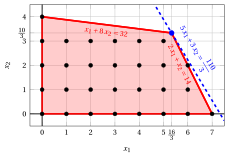{ .fig .ovale loading=lazy style="width:82%" }

    - <strong>Iteration 1</strong>

        - **a)** <strong>Cut generation phase</strong> 

            We have the following simplex dictionary associated with a fractional basic feasible solution of the $LP_1$ problem in standard form:

            \begin{equation*}
            \begin{cases}
            \begin{array}{rrrrrrrrrrrrr}
            {x_1} & {=} & {\dfrac{16}{3}} & {-} & {\dfrac{8}{15}} \, {x_3} & {+} & {\dfrac{1}{15}}\, {x_4} \\[2ex]
            {x_2} & {=} & {\dfrac{10}{3}} & {+} & {\dfrac{1}{15}}\, {x_3} & {-} & {\dfrac{2}{15}}\, {x_4} \\[2ex]
            {z} & {=} & {\dfrac{110}{3}} & {-} & {\dfrac{37}{15}} \, {x_3} & {-} & {\dfrac{1}{15}} \, {x_4}
            \end{array}
            \end{cases}
            \end{equation*}

            where

            \begin{equation*}
            { \bar{\boldsymbol A}}=
            \begin{pmatrix}
            \dfrac{8}{15} & -\dfrac{1}{15} \\[2ex]
            -\dfrac{1}{15} & \dfrac{2}{15}
            \end{pmatrix}
            \qquad
            { \bar{\boldsymbol b}}=
            \begin{pmatrix}
            \dfrac{16}{3}\\[2ex]
            \dfrac{10}{3}
            \end{pmatrix}
            \end{equation*}

            - The Gomory fractional cut generated by the first row is:

                \begin{align*}
                \underbrace{\left(\dfrac{8}{15} - \left\lfloor \dfrac{8}{15} \right\rfloor \right)}_{\dfrac{8}{15}-0=\dfrac{8}{15}} \; x_3 + \underbrace{\left(-\dfrac{1}{15} - \left\lfloor -\dfrac{1}{15} \right\rfloor \right)}_{-\dfrac{1}{15}-(-1)=\dfrac{14}{15}} \; x_4 \ge \underbrace{\left(\dfrac{16}{3} - \left\lfloor \dfrac{16}{3} \right\rfloor \right)}_{\dfrac{16}{3} -5=\dfrac{1}{3}}
                \end{align*}

                \begin{align*}
                \dfrac{8}{15}\;x_3 + \dfrac{14}{15} \;x_4 \ge \dfrac{1}{3}
                \quad \Rightarrow \quad
                8 \;x_3 + 14 \;x_4 \ge 5
                \end{align*}

                From the standard form of the $LP_1$ problem, we have:

                $$
                x_3=14-2\;x_1-x_2,
                \qquad
                x_4=32-x_1-8\;x_2.
                $$

                Substituting in the Gomory fractional cut, we can express it in terms of the original variables of the ILP problem:

                $$
                8\;(14-2\:x_1-x_2)+14\;(32-x_1-8\:x_2)\ge 5
                \quad \Rightarrow \quad
                2\;x_1+8\;x_2\le 37
                $$

                Dividing by the greatest common divisor $2$ of the coefficients and rounding down the right-hand side, we obtain the cut in primitive form:

                $$
                x_1+4\;x_2\le \left\lfloor \dfrac{37}{2} \right\rfloor = 18
                $$

                Effect of the Gomory fractional cut generated by the first row on the $LP_1$ problem in canonical form:

                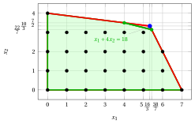{ .fig .ovale loading=lazy style="width:82%" }

            - The Gomory fractional cut generated by the second row is:

                \begin{align*}
                \underbrace{\left(-\dfrac{1}{15} - \left\lfloor -\dfrac{1}{15} \right\rfloor \right)}_{-\dfrac{1}{15}-(-1)=\dfrac{14}{15}} \; x_3 + \underbrace{\left(\dfrac{2}{15} - \left\lfloor \dfrac{2}{15} \right\rfloor \right)}_{\dfrac{2}{15}-0=\dfrac{2}{15}} \; x_4 \ge \underbrace{\left(\dfrac{10}{3} - \left\lfloor \dfrac{10}{3} \right\rfloor \right)}_{\dfrac{10}{3} -3=\dfrac{1}{3}}
                \end{align*}

                \begin{align*}
                \dfrac{14}{15}\;x_3 + \dfrac{2}{15} \;x_4 \ge \dfrac{1}{3}
                \quad \Rightarrow \quad
                14\;x_3 + 2 \;x_4 \ge 5
                \end{align*}

                From the standard form of the $LP_1$ problem, we have:

                $$
                x_3=14-2\;x_1-x_2,
                \qquad
                x_4=32-x_1-8\;x_2.
                $$

                Substituting in the Gomory fractional cut, we can express it in terms of the original variables of the ILP problem:

                $$
                14\;(14-2\:x_1-x_2)+2\;(32-x_1-8\:x_2)\ge 5
                \quad \Rightarrow \quad
                2\;x_1+2\;x_2\le 17
                $$

                Dividing by the greatest common divisor $2$ of the coefficients and rounding down the right-hand side, we obtain the cut in primitive form:

                $$
                x_1+x_2\le \left\lfloor \dfrac{17}{2} \right\rfloor = 8
                $$

                Effect of the Gomory fractional cut generated by the second row on the $LP_1$ problem in canonical form:

                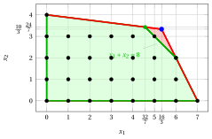{ .fig .ovale loading=lazy style="width:82%" }

            Both Gomory fractional cuts have the same right-hand side, equal to $\dfrac{1}{3}$. We select the Gomory fractional cut generated by the second row and we create the $LP_2$ problem by adding it to the $LP_1$ problem.

        - **b)** <strong>Dual simplex reoptimization phase</strong> 

            Let us consider the $LP_2$ problem in standard form:

            $$
            \begin{array}{rrrrrrrrrrrr}
            {\max} & 5 \, {x_1} & {+} & 3 \, {x_2} &  &  &  &  &  &  \\[2ex]
            & {2}\, {x_1} & {+} & \, {x_2} & {+} & {x_3} &  &  &  &  & {=} & {14} \\[2ex]
            & \, {x_1} & {+} & {8}\, {x_2} &  &  & {+} & {x_4} &  &  & {=} & {32} \\[2ex]
            & \, {x_1} & {+} & \, {x_2} &  &  &  &  & {+} & {x_5} & {=} & {8} \\[2ex]
            & {x_1,} &  & {x_2,} &  & {x_3,} &  & {x_4,} &  & {x_5} & {\ge} & {0}
            \end{array}
            $$

            The slack variable of the added primitive cut is $x_5 = 8 - x_1 - x_2$. Substituting the rows of $x_1$ and $x_2$ of the previous optimal dictionary, we have:

            $$
            x_5 = 8 - \left(\dfrac{16}{3} - \dfrac{8}{15}\;x_3 + \dfrac{1}{15}\;x_4\right) - \left(\dfrac{10}{3} + \dfrac{1}{15}\;x_3 - \dfrac{2}{15}\;x_4\right)
            = -\dfrac{2}{3} + \dfrac{7}{15}\;x_3 + \dfrac{1}{15} \;x_4
            $$

            We then add this equation to the previous optimal dictionary and we obtain the following dictionary:

            \begin{equation*}
            \begin{cases}
            \begin{array}{rrrrrrrrrrrrr}
            {x_1} & {=} & {\dfrac{16}{3}} & {-} & {\dfrac{8}{15}} \, {x_3} & {+} & {\dfrac{1}{15}}\, {x_4} \\[2ex]
            {x_2} & {=} & {\dfrac{10}{3}} & {+} & {\dfrac{1}{15}}\, {x_3} & {-} & {\dfrac{2}{15}}\, {x_4} \\[2ex]
            {x_5} & {=} & {-\dfrac{2}{3}} & {+} & {\dfrac{7}{15}}\, {x_3} & {+} & {\dfrac{1}{15}}\, {x_4} \\[2ex]
            {z} & {=} & {\dfrac{110}{3}} & {-} & {\dfrac{37}{15}} \, {x_3} & {-} & {\dfrac{1}{15}} \, {x_4}
            \end{array}
            \end{cases}
            \end{equation*}

            where  $\pazocal{B}=\{1,2,5\}$ and $\pazocal{N}=\{3,4\}$ and

            - the  basic primal non-feasible  solution is:

                $$
                \bar x_1=\dfrac{16}{3},~~
                \bar x_2=\dfrac{10}{3},~~
                \bar x_5=-\dfrac{2}{3},~~~~~~
                \bar x_3=0,~~
                \bar x_4=0~~
                \text{  of value   }\dfrac{110}{3}
                $$

            - the basic dual feasible  solution is:

                $$
                \bar \pi_1=0,~~
                \bar \pi_2=0,~~
                \bar \pi_5=0,~~~~~~
                \bar \pi_3=\dfrac{37}{15},~~
                \bar \pi_4=\dfrac{1}{15}~~
                \text{  of value   }\dfrac{110}{3}
                $$

            If we increase the value of $\pi_5$, we can get a better dual solution. We have:

            $$
            \begin{cases}
            \pi_3 &= \dfrac{37}{15} - \dfrac{7}{15}\,\pi_5 \\[2ex]
            \pi_4 &= \dfrac{1}{15} - \dfrac{1}{15}\,\pi_5
            \end{cases}
            \qquad
            \qquad
            \begin{cases}
            \underbrace{ \dfrac{37}{15} - \dfrac{7}{15}\,\pi_5 \ge 0}_{\pi_3 \ge 0} \\[2ex]
            \underbrace{  \dfrac{1}{15} - \dfrac{1}{15}\,\pi_5 \ge 0}_{\pi_4 \ge 0}
            \end{cases}
            \qquad
            \qquad
            \begin{cases}
            \pi_5 &\le  \dfrac{37}{7} \\[2ex]
            \pi_5 &\le  1
            \end{cases}
            $$

            By increasing the value of $\pi_5$ to $\min \left\{\dfrac{37}{7}, 1\right\}=1$,  the value of $\pi_4$ decreases to 0. Then we have that:

            - $\pi_5$ becomes a dual basic variable and accordingly $x_5$ becomes a primal non basic variable

            - $\pi_4$ becomes a dual non-basic variable and accordingly $x_4$ becomes a primal basic variable

            We have:

            $$
            x_5 = -\dfrac{2}{3} + \dfrac{7}{15}\,  x_3 + \dfrac{1}{15}\, x_4 \quad \Rightarrow \quad x_4= 10 - 7\, x_3 + 15\, x_5.
            $$

            Substituting in the other equations of the primal dictionary, we get:

            $$
            x_1 = \dfrac{16}{3} -  \dfrac{8}{15}  x_3 + \dfrac{1}{15} \left( 10 - 7 x_3 + 15 x_5 \right)= 6 - x_3 + x_5
            $$

            $$
            x_2 = \dfrac{10}{3} + \dfrac{1}{15} x_3 -  \dfrac{2}{15} \left( 10 - 7 x_3 + 15 x_5 \right) =  2 + x_3 - 2\, x_5
            $$

            $$
            z = \dfrac{110}{3} -  \dfrac{37}{15} x_3 -  \dfrac{1}{15} \left( 10 - 7 x_3 + 15 x_5 \right) =   36 - 2 x_3 - x_5
            $$

            Accordingly, we now have the following optimal primal dictionary:

            \begin{equation*}
            \begin{cases}
            \begin{array}{rrrrrrrrrrrrr}
            {x_1} & {=} & {6} & {-} & {x_3} & {+} & {x_5} \\[2ex]
            {x_2} & {=} & {2} & {+} & {x_3} & {-} & {2} \, {x_5} \\[2ex]
            {x_4} & {=} & {10} & {-} & {7} \, {x_3} & {+} & {15}\, {x_5} \\[2ex]
            {z} & {=} & {36} & {-} & {2} \, {x_3} & {-} & {x_5}
            \end{array}
            \end{cases}
            \end{equation*}

            where  $\pazocal{B}=\{1,2,4\}$ and $\pazocal{N}=\{3,5\}$ and

            - the basic primal optimal  solution is:

                $$
                \tilde x_1=6,~~
                \tilde x_2=2,~~
                \tilde x_4=10,~~~~~~
                \tilde x_3=0,~~
                \tilde x_5=0~~
                \text{  of value   } 36
                $$

            - the basic dual optimal  solution is:

                $$
                \tilde \pi_1=0,~~
                \tilde \pi_2=0,~~
                \tilde \pi_4=0,~~~~~~
                \tilde \pi_3=2,~~
                \tilde \pi_5=1~~
                \text{  of value   } 36
                $$

            !!! chiave ""

                The optimal solution ${ \tilde{ \boldsymbol x}}(\,LP_2\,)=(6,2)$ is <strong>integer</strong>. Therefore, it is also an optimal solution of the ILP problem.

                $$
                z(~ILP~)=36.
                $$

            For the $LP_2$ problem in canonical form, we have:

            $$
            \begin{array}{rrrrrrrrrrrrr}
            {\max} & 5 \, {x_1} & {+} & 3 \, {x_2} \\[2ex]
            & {2} \, {x_1} & {+} & \, {x_2} & {\le} & {14} \\[2ex]
            & \, {x_1} & {+} & 8 \, {x_2} & {\le} & 32 \\[2ex]
            & \, {x_1} & {+} & \, {x_2} & {\le} & 8 \\[2ex]
            & {x_1,} &  & {x_2} & { \ge } & { 0 }
            \end{array}
            $$

            An optimal solution ${ \tilde{ \boldsymbol x}}(\,LP_2\,)$ is:

            $$
            \tilde{x}_1=6,\qquad \tilde{x}_2=2
            $$

            The optimal value is:

            $$
            z(~LP_2~)=36
            $$

            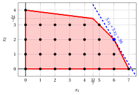{ .fig .ovale loading=lazy style="width:82%" }

!!! esercizio "Exercise 6.5: Cutting-plane algorithm (P7)"

    Consider the following ILP problem in canonical maximization form with $n=2$ integer variables and $m=2$ linear constraints:

    $$
    \begin{array}{rrrrrr}
    {\max} & {3\,x_1} & {+} & {x_2} &  &  \\[2ex]
    & {x_1} & {+} & {4\,x_2} & {\le} & {12} \\[2ex]
    & {2\,x_1} & {+} & {x_2} & {\le} & {5} \\[2ex]
    & {x_1,} &  & {x_2} & {\in} & {\Z_{\ge 0}}
    \end{array}
    $$

    and the following optimal simplex dictionary of its LP relaxation in standard form:

    \begin{equation*}
    \begin{cases}
    \begin{array}{rrrrrrrrrrrrr}
    {x_1} & {=} & {\dfrac{5}{2}} & {-} & {\dfrac{1}{2}}\, {x_2} & {-} & {\dfrac{1}{2}}\, {x_4} \\[2ex]
    {x_3} & {=} & {\dfrac{19}{2}} & {-} & {\dfrac{7}{2}}\, {x_2} & {+} & {\dfrac{1}{2}}\, {x_4} \\[2ex]
    {z} & {=} & {\dfrac{15}{2}} & {-} & {\dfrac{1}{2}}\, {x_2} & {-} & {\dfrac{3}{2}}\, {x_4}
    \end{array}
    \end{cases}
    \end{equation*}

    **Questions**

    1. Execute the cutting-plane algorithm based on Gomory fractional cuts using:

        1. one Gomory fractional cut at each iteration;

        2. the largest right-hand side as the cut selection strategy.

        Solve the LP problems after adding the Gomory fractional cut using the dual simplex algorithm. Graphically show the optimal solution of the LP problem at each iteration.

    2. Graphically show the effect of each Gomory fractional cut on the LP relaxation of the ILP problem in canonical form.

    !!! nota ""

        Given a row $i \in \pazocal{B}$ of a simplex dictionary associated with a feasible basic solution such that $\bar{b}_i$ is fractional, the linear inequality

        \begin{equation*}
        \sum_{j \in \pazocal{N}}
        \left(
        \bar{a}_{ij}
        -
        \left\lfloor \bar{a}_{ij}\right\rfloor
        \right)x_j
        \ge
        \bar{b}_i - \left\lfloor \bar{b}_i \right\rfloor
        \end{equation*}

        is called the <strong>Gomory fractional cut</strong> generated by row $i$.

??? soluzione "Solution"

    Execution of the Cutting-Plane Algorithm to solve the ILP problem.

    - <strong>Initialization</strong>

        Let us consider the $LP_1$ problem in standard form:

        $$
        \begin{array}{rrrrrrrrrr}
        {\max} & {3\,x_1} & {+} & {x_2} &  &  &  &  \\[2ex]
        & {x_1} & {+} & {4\,x_2} & {+} & {x_3} &  &  & {=} & {12} \\[2ex]
        & {2\,x_1} & {+} & {x_2} &  &  & {+} & {x_4} & {=} & {5} \\[2ex]
        & {x_1,} &  & {x_2,} &  & {x_3,} &  & {x_4} & {\ge} & {0}
        \end{array}
        $$

        and its  optimal simplex dictionary:

        \begin{equation*}
        \begin{cases}
        \begin{array}{rrrrrrrrrrrrr}
        {x_1} & {=} & {\dfrac{5}{2}} & {-} & {\dfrac{1}{2}}\, {x_2} & {-} & {\dfrac{1}{2}}\, {x_4} \\[2ex]
        {x_3} & {=} & {\dfrac{19}{2}} & {-} & {\dfrac{7}{2}}\, {x_2} & {+} & {\dfrac{1}{2}}\, {x_4} \\[2ex]
        {z} & {=} & {\dfrac{15}{2}} & {-} & {\dfrac{1}{2}}\, {x_2} & {-} & {\dfrac{3}{2}}\, {x_4}
        \end{array}
        \end{cases}
        \end{equation*}

        The optimal solution ${ \tilde{ \boldsymbol x}}(\,LP_1\,)$ is <strong>fractional</strong> and the $LP_1$ problem is <strong>feasible</strong>.

        We have the upper bound on the optimal value of the ILP problem:

        $$
        z(~ILP~) ~~\le~~  \underbrace{\left\lfloor \dfrac{15}{2} \right\rfloor}_{=7}
        $$

        For the $LP_1$ problem in canonical form, we have:

        $$
        \begin{array}{rrrrrr}
        {\max} & {3\,x_1} & {+} & {x_2} &  &  \\[2ex]
        & {x_1} & {+} & {4\,x_2} & {\le} & {12} \\[2ex]
        & {2\,x_1} & {+} & {x_2} & {\le} & {5} \\[2ex]
        & {x_1,} &  & {x_2} & {\ge} & {0}
        \end{array}
        $$

        An optimal solution ${ \tilde{ \boldsymbol x}}(\,LP_1\,)$ is:

        $$
        \tilde{x}_1=\dfrac{5}{2},\qquad \tilde{x}_2=0
        $$

        The optimal value is:

        $$
        z(~LP_1~)=\dfrac{15}{2}
        $$

        { .fig .ovale loading=lazy style="width:71%" }

    - <strong>Iteration 1</strong>

        - **a)** <strong>Cut generation phase</strong> 

            We have the following simplex dictionary associated with a fractional basic feasible solution of the $LP_1$ problem in standard form:

            \begin{equation*}
            \begin{cases}
            \begin{array}{rrrrrrrrrrrrr}
            {x_1} & {=} & {\dfrac{5}{2}} & {-} & {\dfrac{1}{2}}\, {x_2} & {-} & {\dfrac{1}{2}}\, {x_4} \\[2ex]
            {x_3} & {=} & {\dfrac{19}{2}} & {-} & {\dfrac{7}{2}}\, {x_2} & {+} & {\dfrac{1}{2}}\, {x_4} \\[2ex]
            {z} & {=} & {\dfrac{15}{2}} & {-} & {\dfrac{1}{2}}\, {x_2} & {-} & {\dfrac{3}{2}}\, {x_4}
            \end{array}
            \end{cases}
            \end{equation*}

            where

            \begin{equation*}
            { \bar{\boldsymbol A}}=
            \begin{pmatrix}
            \frac{1}{2} & \frac{1}{2} \\[2ex]
            \frac{7}{2} & -\frac{1}{2}
            \end{pmatrix}
            \qquad
            { \bar{\boldsymbol b}}=
            \begin{pmatrix}
            \frac{5}{2}\\[2ex]
            \frac{19}{2}
            \end{pmatrix}
            \end{equation*}

            - The Gomory fractional cut generated by the first row is:

                \begin{align*}
                \underbrace{\left(\frac{1}{2} - \left\lfloor \frac{1}{2} \right\rfloor \right)}_{\frac{1}{2}-0=\frac{1}{2}} \; x_2 + \underbrace{\left(\frac{1}{2} - \left\lfloor \frac{1}{2} \right\rfloor \right)}_{\frac{1}{2}-0=\frac{1}{2}} \; x_4
                \ge \underbrace{\left(\frac{5}{2} - \left\lfloor \frac{5}{2} \right\rfloor \right)}_{\frac{5}{2} -2=\frac{1}{2}}
                \end{align*}

                \begin{align*}
                \frac{1}{2}\;x_2 + \frac{1}{2}\;x_4 \ge \frac{1}{2}
                \quad \Rightarrow \quad
                x_2 + x_4 \ge 1
                \end{align*}

                By subtracting a surplus variable, we obtain the Gomory fractional cut in standard form:

                $$
                \frac{1}{2}\;x_2 + \frac{1}{2}\;x_4 - x_5 = \frac{1}{2}
                \quad \Rightarrow \quad
                x_2 + x_4 - 2\;x_5 = 1
                $$

                From the standard form of the $LP_1$ problem, we have:

                $$
                x_4= 5 - 2 \;x_1 - x_2.
                $$

                Substituting in the Gomory fractional cut, we can express it in terms of the original variables of the ILP problem:

                $$
                x_2 + (5 - 2\;x_1 - x_2) \ge 1
                \quad \Rightarrow \quad
                x_1 \le 2
                $$

                Effect of the Gomory fractional cut generated by the first row on the $LP_1$ problem in canonical form:

                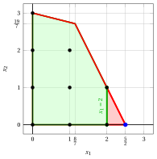{ .fig .ovale loading=lazy style="width:71%" }

            - The Gomory fractional cut generated by the second row is:

                \begin{align*}
                \underbrace{\left(\frac{7}{2} - \left\lfloor \frac{7}{2} \right\rfloor \right)}_{\frac{7}{2}-3=\frac{1}{2}} \; x_2
                + \underbrace{\left(-\frac{1}{2} - \left\lfloor -\frac{1}{2} \right\rfloor \right)}_{-\frac{1}{2}-(-1)=\frac{1}{2}} \; x_4
                \ge \underbrace{\left(\frac{19}{2} - \left\lfloor \frac{19}{2} \right\rfloor \right)}_{\frac{19}{2} -9=\frac{1}{2}}
                \end{align*}

                \begin{align*}
                \frac{1}{2}\;x_2 + \frac{1}{2}\;x_4 \ge \frac{1}{2}
                \quad \Rightarrow \quad
                x_2 + x_4 \ge 1
                \end{align*}

                This Gomory fractional cut is the same as the one generated by the first row.

                We select the Gomory fractional cut with the largest right-hand side and we create the $LP_2$ problem by adding it to the $LP_1$ problem.

        - **b)** <strong>LP re-optimization phase</strong> 

            Let us consider the $LP_2$ problem in standard form:

            $$
            \begin{array}{rrrrrrrrrrrr}
            {\max} & {3\,x_1} & {+} & {x_2} &  &  &  &  &  &  &  &  \\[2ex]
            & {x_1} & {+} & {4\,x_2} & {+} & {x_3} &  &  &  &  & {=} & {12} \\[2ex]
            & {2\,x_1} & {+} & {x_2} &  &  & {+} & {x_4} &  &  & {=} & {5} \\[2ex]
            & {x_1} &  &  &  &  &  &  & {+} & {x_5} & {=} & {2} \\[2ex]
            & {x_1,} &  & {x_2,} &  & {x_3,} &  & {x_4,} &  & {x_5} & {\ge} & {0}
            \end{array}
            $$

            For the added Gomory fractional cut we have:

            $$
            x_2 + x_4 - 2\;x_5 = 1
            \quad \Rightarrow \quad
            x_5 = -\dfrac{1}{2} + \dfrac{1}{2}\;x_2 + \dfrac{1}{2}\;x_4
            $$

            We then add this equation to the previous optimal dictionary and we obtain the following dictionary :

            \begin{equation*}
            \begin{cases}
            \begin{array}{rrrrrrrrrrrrr}
            {x_1} & {=} & {\dfrac{5}{2}} & {-} & {\dfrac{1}{2}}\, {x_2} & {-} & {\dfrac{1}{2}}\, {x_4} \\[2ex]
            {x_3} & {=} & {\dfrac{19}{2}} & {-} & {\dfrac{7}{2}}\, {x_2} & {+} & {\dfrac{1}{2}}\, {x_4} \\[2ex]
            {x_5} & {=} & {-\dfrac{1}{2}} & {+} & {\dfrac{1}{2}}\, {x_2} & {+} & {\dfrac{1}{2}}\, {x_4} \\[2ex]
            {z} & {=} & {\dfrac{15}{2}} & {-} & {\dfrac{1}{2}}\, {x_2} & {-} & {\dfrac{3}{2}}\, {x_4}
            \end{array}
            \end{cases}
            \end{equation*}

            where  $\pazocal{B}=\{1,3,5\}$ and $\pazocal{N}=\{2,4\}$ and

            - the  basic primal non-feasible  solution is:

                $$
                \bar x_1=\dfrac{5}{2},~~
                \bar x_3=\dfrac{19}{2},~~
                \bar x_5=-\dfrac{1}{2},~~~~~~
                \bar x_2=0,~~
                \bar x_4=0~~
                \text{  of value   }\dfrac{15}{2}
                $$

            - the basic dual feasible  solution is:

                $$
                \bar \pi_1=0,~~
                \bar \pi_3=0,~~
                \bar \pi_5=0,~~~~~~
                \bar \pi_2=\dfrac{1}{2},~~
                \bar \pi_4=\dfrac{3}{2}~~
                \text{  of value   }\dfrac{15}{2}
                $$

            If we increase the value of $\pi_5$, we can get a better dual solution. We have:

            $$
            \begin{cases}
            \pi_2 &= \dfrac{1}{2} - \dfrac{1}{2}\,\pi_5 \\[2ex]
            \pi_4 &= \dfrac{3}{2} - \dfrac{1}{2}\,\pi_5
            \end{cases}
            \qquad
            \qquad
            \begin{cases}
            \underbrace{ \dfrac{1}{2} - \dfrac{1}{2}\,\pi_5 \ge 0}_{\pi_2 \ge 0} \\[2ex]
            \underbrace{  \dfrac{3}{2} - \dfrac{1}{2}\,\pi_5 \ge 0}_{\pi_4 \ge 0}
            \end{cases}
            \qquad
            \qquad
            \begin{cases}
            \pi_5 &\le  1 \\[2ex]
            \pi_5 &\le  3
            \end{cases}
            $$

            By increasing the value of $\pi_5$ to $\min \left\{1, 3\right\}=1$,  the value of $\pi_2$ decreases to 0. Then we have that:

            - $\pi_5$ becomes a dual basic variable and accordingly $x_5$ becomes a primal non basic variable

            - $\pi_2$ becomes a dual non-basic variable and accordingly $x_2$ becomes a primal basic variable

            We have:

            $$
            x_5 = -\dfrac{1}{2} + \dfrac{1}{2}\, x_2 + \dfrac{1}{2}\, x_4
            \quad \Longrightarrow \quad
            x_2 = 1 - x_4 + 2\,x_5
            $$

            Substituting into the other equations of the primal dictionary, we get:

            $$
            x_1 = \dfrac{5}{2}  -  \dfrac{1}{2} \left( 1 - x_4 + 2\,x_5   \right) -  \dfrac{1}{2} x_4
            = 2 - x_5
            $$

            $$
            x_3 = \dfrac{19}{2}  -  \dfrac{7}{2} \left( 1 - x_4 + 2\,x_5   \right) +  \dfrac{1}{2} x_4
            = 6 + 4\,x_4 - 7\,x_5
            $$

            $$
            z = \dfrac{15}{2}  -  \dfrac{1}{2} \left( 1 - x_4 + 2\,x_5   \right) -  \dfrac{3}{2} x_4
            = 7 - x_4 - x_5
            $$

            Accordingly, we now have the following optimal primal dictionary:

            \begin{equation*}
            \begin{cases}
            \begin{array}{rrrrrrrrrrrrr}
            {x_1} & {=} & {2} &  &  & {-} & {x_5} \\[2ex]
            {x_2} & {=} & {1} & {-} & {x_4} & {+} & {2}\, {x_5} \\[2ex]
            {x_3} & {=} & {6} & {+} & {4}\, {x_4} & {-} & {7}\, {x_5} \\[2ex]
            {z} & {=} & {7} & {-} & {x_4} & {-} & {x_5}
            \end{array}
            \end{cases}
            \end{equation*}

            where  $\pazocal{B}=\{1,2,3\}$ and $\pazocal{N}=\{4,5\}$.

            - the basic primal optimal  solution is:

                $$
                \tilde x_1 = 2,~~
                \tilde x_2 = 1,~~
                \tilde x_3 = 6,~~
                \tilde x_4 = 0,~~
                \tilde x_5 = 0
                \qquad
                \text{of value  }  7
                $$

            - the basic dual optimal  solution is:

                $$
                \tilde \pi_1 = 0,~~
                \tilde \pi_2 = 0,~~
                \tilde \pi_3 = 0,~~
                \tilde \pi_4 = 1,~~
                \tilde \pi_5 = 1
                \qquad
                \text{of value  }  7
                $$

            !!! chiave ""

                The optimal solution ${ \tilde{ \boldsymbol x}}(\,LP_2\,)$ is <strong>integer</strong>. Accordingly, an optimal solution ${ \tilde{ \boldsymbol x}}(\,ILP\,)$ is:

                $$
                \tilde{x}_1=2,~~\tilde{x}_2=1
                $$

                The optimal value $z(~ILP~)$ is $7$.

            For the $LP_2$ problem in canonical form, we have:

            $$
            \begin{array}{rrrrrr}
            {\max} & {3\,x_1} & {+} & {x_2} &  &  \\[2ex]
            & {x_1} & {+} & {4\,x_2} & {\le} & {12} \\[2ex]
            & {2\,x_1} & {+} & {x_2} & {\le} & {5} \\[2ex]
            & {x_1} &  &  & {\le} & {2} \\[2ex]
            & {x_1,} &  & {x_2} & {\ge} & {0}
            \end{array}
            $$

            An optimal solution ${ \tilde{ \boldsymbol x}}(\,LP_2\,)$ is:

            $$
            \tilde{x}_1=2,\qquad \tilde{x}_2=1
            $$

            The optimal value is:

            $$
            z(~LP_2~)=7
            $$

            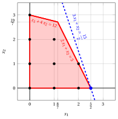{ .fig .ovale loading=lazy style="width:71%" }

!!! esercizio "Exercise 6.6: Cutting-plane algorithm (P8)"

    Consider the following ILP problem in canonical maximization form with $n=2$ integer variables and $m=2$ linear constraints:

    $$
    \begin{array}{rrrrrr}
    {\max} & {x_1} & {+} & {2\,x_2} &  &  \\[2ex]
    & {-x_1} & {+} & {2\,x_2} & {\le} & {2} \\[2ex]
    & {x_1} & {+} & {x_2} & {\le} & {3} \\[2ex]
    & {x_1,} &  & {x_2} & {\in} & {\Z_{\ge 0}}
    \end{array}
    $$

    and the following optimal simplex dictionary of its LP relaxation in standard form:

    \begin{equation*}
    \begin{cases}
    \begin{array}{rrrrrrrrrrrrr}
    {x_1} & {=} & {\dfrac{4}{3}} & {+} & {\dfrac{1}{3}}\, {x_3} & {-} & {\dfrac{2}{3}}\, {x_4} \\[2ex]
    {x_2} & {=} & {\dfrac{5}{3}} & {-} & {\dfrac{1}{3}}\, {x_3} & {-} & {\dfrac{1}{3}}\, {x_4} \\[2ex]
    {z} & {=} & {\dfrac{14}{3}} & {-} & {\dfrac{1}{3}}\, {x_3} & {-} & {\dfrac{4}{3}}\, {x_4}
    \end{array}
    \end{cases}
    \end{equation*}

    **Questions**

    1. Execute the cutting-plane algorithm based on Gomory fractional cuts using:

        1. one Gomory fractional cut at each iteration;

        2. the largest right-hand side as the cut selection strategy.

        Solve the LP problems after adding the Gomory fractional cut using the dual simplex algorithm. Graphically show the optimal solution of the LP problem at each iteration.

    2. Graphically show the effect of each Gomory fractional cut on the LP relaxation of the ILP problem in canonical form.

    !!! nota ""

        Given a row $i \in \pazocal{B}$ of a simplex dictionary associated with a feasible basic solution such that $\bar{b}_i$ is fractional, the linear inequality

        \begin{equation*}
        \sum_{j \in \pazocal{N}}
        \left(
        \bar{a}_{ij}
        -
        \left\lfloor \bar{a}_{ij}\right\rfloor
        \right)x_j
        \ge
        \bar{b}_i - \left\lfloor \bar{b}_i \right\rfloor
        \end{equation*}

        is called the <strong>Gomory fractional cut</strong> generated by row $i$.

??? soluzione "Solution"

    Execution of the Cutting-Plane Algorithm to solve the ILP problem.

    - <strong>Initialization</strong>

        Let us consider the $LP_1$ problem in standard form:

        $$
        \begin{array}{rrrrrrrrrr}
        {\max} & {x_1} & {+} & {2\,x_2} &  &  &  &  \\[2ex]
        & {-x_1} & {+} & {2\,x_2} & {+} & {x_3} &  &  & {=} & {2} \\[2ex]
        & {x_1} & {+} & {x_2} &  &  & {+} & {x_4} & {=} & {3} \\[2ex]
        & {x_1,} &  & {x_2,} &  & {x_3,} &  & {x_4} & {\ge} & {0}
        \end{array}
        $$

        and its  optimal simplex dictionary:

        \begin{equation*}
        \begin{cases}
        \begin{array}{rrrrrrrrrrrrr}
        {x_1} & {=} & {\dfrac{4}{3}} & {+} & {\dfrac{1}{3}}\, {x_3} & {-} & {\dfrac{2}{3}}\, {x_4} \\[2ex]
        {x_2} & {=} & {\dfrac{5}{3}} & {-} & {\dfrac{1}{3}}\, {x_3} & {-} & {\dfrac{1}{3}}\, {x_4} \\[2ex]
        {z} & {=} & {\dfrac{14}{3}} & {-} & {\dfrac{1}{3}}\, {x_3} & {-} & {\dfrac{4}{3}}\, {x_4}
        \end{array}
        \end{cases}
        \end{equation*}

        The optimal solution ${ \tilde{ \boldsymbol x}}(\,LP_1\,)$ is <strong>fractional</strong> and the $LP_1$ problem is <strong>feasible</strong>.

        We have the upper bound on the optimal value of the ILP problem:

        $$
        z(~ILP~) ~~\le~~  \underbrace{\left\lfloor \dfrac{14}{3} \right\rfloor}_{=4}
        $$

        For the $LP_1$ problem in canonical form, we have:

        $$
        \begin{array}{rrrrrr}
        {\max} & {x_1} & {+} & {2\,x_2} &  &  \\[2ex]
        & {-x_1} & {+} & {2\,x_2} & {\le} & {2} \\[2ex]
        & {x_1} & {+} & {x_2} & {\le} & {3} \\[2ex]
        & {x_1,} &  & {x_2} & {\ge} & {0}
        \end{array}
        $$

        An optimal solution ${ \tilde{ \boldsymbol x}}(\,LP_1\,)$ is:

        $$
        \tilde{x}_1=\dfrac{4}{3},\qquad \tilde{x}_2=\dfrac{5}{3}
        $$

        The optimal value is:

        $$
        z(~LP_1~)=\dfrac{14}{3}
        $$

        { .fig .ovale loading=lazy style="width:71%" }

    - <strong>Iteration 1</strong>

        - **a)** <strong>Cut generation phase</strong> 

            We have the following simplex dictionary associated with a fractional basic feasible solution of the $LP_1$ problem in standard form:

            \begin{equation*}
            \begin{cases}
            \begin{array}{rrrrrrrrrrrrr}
            {x_1} & {=} & {\dfrac{4}{3}} & {+} & {\dfrac{1}{3}}\, {x_3} & {-} & {\dfrac{2}{3}}\, {x_4} \\[2ex]
            {x_2} & {=} & {\dfrac{5}{3}} & {-} & {\dfrac{1}{3}}\, {x_3} & {-} & {\dfrac{1}{3}}\, {x_4} \\[2ex]
            {z} & {=} & {\dfrac{14}{3}} & {-} & {\dfrac{1}{3}}\, {x_3} & {-} & {\dfrac{4}{3}}\, {x_4}
            \end{array}
            \end{cases}
            \end{equation*}

            where

            \begin{equation*}
            { \bar{\boldsymbol A}}=
            \begin{pmatrix}
            -\frac{1}{3} & \frac{2}{3} \\[2ex]
            \frac{1}{3} & \frac{1}{3}
            \end{pmatrix}
            \qquad
            { \bar{\boldsymbol b}}=
            \begin{pmatrix}
            \frac{4}{3}\\[2ex]
            \frac{5}{3}
            \end{pmatrix}
            \end{equation*}

            - The Gomory fractional cut generated by the first row is:

                \begin{align*}
                \underbrace{\left(-\frac{1}{3} - \left\lfloor -\frac{1}{3} \right\rfloor \right)}_{-\frac{1}{3}-(-1)=\frac{2}{3}} \; x_3
                + \underbrace{\left(\frac{2}{3} - \left\lfloor \frac{2}{3} \right\rfloor \right)}_{\frac{2}{3}-0=\frac{2}{3}} \; x_4
                \ge \underbrace{\left(\frac{4}{3} - \left\lfloor \frac{4}{3} \right\rfloor \right)}_{\frac{4}{3} -1=\frac{1}{3}}
                \end{align*}

                \begin{align*}
                \frac{2}{3}\;x_3 + \frac{2}{3}\;x_4 \ge \frac{1}{3}
                \quad \Rightarrow \quad
                2\;x_3 + 2\;x_4 \ge 1
                \end{align*}

                From the standard form of the $LP_1$ problem, we have:

                $$
                x_3= 2 + x_1 - 2\;x_2, \qquad x_4= 3 - x_1 - x_2.
                $$

                Substituting in the Gomory fractional cut, we can express it in terms of the original variables of the ILP problem:

                $$
                2\;(2 + x_1 - 2\;x_2) + 2\;(3 - x_1 - x_2) \ge 1
                \quad \Rightarrow \quad
                6\;x_2 \le 9
                $$

                Dividing by the greatest common divisor $6$ of the coefficients and rounding down the right-hand side, we obtain the cut in primitive form, the same inequality as the cut generated by the second row:

                $$
                x_2 \le \left\lfloor \frac{9}{6} \right\rfloor = 1
                $$

                Effect of the Gomory fractional cut generated by the first row on the $LP_1$ problem in canonical form:

                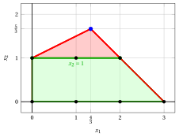{ .fig .ovale loading=lazy style="width:71%" }

            - The Gomory fractional cut generated by the second row is:

                \begin{align*}
                \underbrace{\left(\frac{1}{3} - \left\lfloor \frac{1}{3} \right\rfloor \right)}_{\frac{1}{3}-0=\frac{1}{3}} \; x_3
                + \underbrace{\left(\frac{1}{3} - \left\lfloor \frac{1}{3} \right\rfloor \right)}_{\frac{1}{3}-0=\frac{1}{3}} \; x_4
                \ge \underbrace{\left(\frac{5}{3} - \left\lfloor \frac{5}{3} \right\rfloor \right)}_{\frac{5}{3} -1=\frac{2}{3}}
                \end{align*}

                \begin{align*}
                \frac{1}{3}\;x_3 + \frac{1}{3}\;x_4 \ge \frac{2}{3}
                \quad \Rightarrow \quad
                x_3 + x_4 \ge 2
                \end{align*}

                By subtracting a surplus variable, we obtain the Gomory fractional cut in standard form:

                $$
                \frac{1}{3}\;x_3 + \frac{1}{3}\;x_4 - x_5 = \frac{2}{3}
                \quad \Rightarrow \quad
                x_3 + x_4 - 3\;x_5 = 2
                $$

                From the standard form of the $LP_1$ problem, we have:

                $$
                x_3= 2 + x_1 - 2\;x_2, \qquad x_4= 3 - x_1 - x_2.
                $$

                Substituting in the Gomory fractional cut, we can express it in terms of the original variables of the ILP problem:

                $$
                (2 + x_1 - 2\;x_2) + (3 - x_1 - x_2) \ge 2
                \quad \Rightarrow \quad
                x_2 \le 1
                $$

                Effect of the Gomory fractional cut generated by the second row on the $LP_1$ problem in canonical form:

                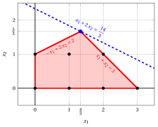{ .fig .ovale loading=lazy style="width:71%" }

                We select the Gomory fractional cut with the largest right-hand side and we create the $LP_2$ problem by adding it to the $LP_1$ problem.

        - **b)** <strong>LP re-optimization phase</strong> 

            Let us consider the $LP_2$ problem in standard form:

            $$
            \begin{array}{rrrrrrrrrrrr}
            {\max} & {x_1} & {+} & {2\,x_2} &  &  &  &  &  &  &  &  \\[2ex]
            & {-x_1} & {+} & {2\,x_2} & {+} & {x_3} &  &  &  &  & {=} & {2} \\[2ex]
            & {x_1} & {+} & {x_2} &  &  & {+} & {x_4} &  &  & {=} & {3} \\[2ex]
            &  &  & {x_2} &  &  &  &  & {+} & {x_5} & {=} & {1} \\[2ex]
            & {x_1,} &  & {x_2,} &  & {x_3,} &  & {x_4,} &  & {x_5} & {\ge} & {0}
            \end{array}
            $$

            For the added Gomory fractional cut we have:

            $$
            x_3 + x_4 - 3\;x_5 = 2
            \quad \Rightarrow \quad
            x_5 = -\dfrac{2}{3} + \dfrac{1}{3}\;x_3 + \dfrac{1}{3}\;x_4
            $$

            We then add this equation to the previous optimal dictionary and we obtain the following dictionary :

            \begin{equation*}
            \begin{cases}
            \begin{array}{rrrrrrrrrrrrr}
            {x_1} & {=} & {\dfrac{4}{3}} & {+} & {\dfrac{1}{3}}\, {x_3} & {-} & {\dfrac{2}{3}}\, {x_4} \\[2ex]
            {x_2} & {=} & {\dfrac{5}{3}} & {-} & {\dfrac{1}{3}}\, {x_3} & {-} & {\dfrac{1}{3}}\, {x_4} \\[2ex]
            {x_5} & {=} & {-\dfrac{2}{3}} & {+} & {\dfrac{1}{3}}\, {x_3} & {+} & {\dfrac{1}{3}}\, {x_4} \\[2ex]
            {z} & {=} & {\dfrac{14}{3}} & {-} & {\dfrac{1}{3}}\, {x_3} & {-} & {\dfrac{4}{3}}\, {x_4}
            \end{array}
            \end{cases}
            \end{equation*}

            where  $\pazocal{B}=\{1,2,5\}$ and $\pazocal{N}=\{3,4\}$ and

            - the  basic primal non-feasible  solution is:

                $$
                \bar x_1=\dfrac{4}{3},~~
                \bar x_2=\dfrac{5}{3},~~
                \bar x_5=-\dfrac{2}{3},~~~~~~
                \bar x_3=0,~~
                \bar x_4=0~~
                \text{  of value   }\dfrac{14}{3}
                $$

            - the basic dual feasible  solution is:

                $$
                \bar \pi_1=0,~~
                \bar \pi_2=0,~~
                \bar \pi_5=0,~~~~~~
                \bar \pi_3=\dfrac{1}{3},~~
                \bar \pi_4=\dfrac{4}{3}~~
                \text{  of value   }\dfrac{14}{3}
                $$

            If we increase the value of $\pi_5$, we can get a better dual solution. We have:

            $$
            \begin{cases}
            \pi_3 &= \dfrac{1}{3} - \dfrac{1}{3}\,\pi_5 \\[2ex]
            \pi_4 &= \dfrac{4}{3} - \dfrac{1}{3}\,\pi_5
            \end{cases}
            \qquad
            \qquad
            \begin{cases}
            \underbrace{ \dfrac{1}{3} - \dfrac{1}{3}\,\pi_5 \ge 0}_{\pi_3 \ge 0} \\[2ex]
            \underbrace{  \dfrac{4}{3} - \dfrac{1}{3}\,\pi_5 \ge 0}_{\pi_4 \ge 0}
            \end{cases}
            \qquad
            \qquad
            \begin{cases}
            \pi_5 &\le  1 \\[2ex]
            \pi_5 &\le  4
            \end{cases}
            $$

            By increasing the value of $\pi_5$ to $\min \left\{1, 4\right\}=1$,  the value of $\pi_3$ decreases to 0. Then we have that:

            - $\pi_5$ becomes a dual basic variable and accordingly $x_5$ becomes a primal non basic variable

            - $\pi_3$ becomes a dual non-basic variable and accordingly $x_3$ becomes a primal basic variable

            We have:

            $$
            x_5 = -\dfrac{2}{3} + \dfrac{1}{3}\, x_3 + \dfrac{1}{3}\, x_4
            \quad \Longrightarrow \quad
            x_3 = 2 - x_4 + 3\,x_5
            $$

            Substituting into the other equations of the primal dictionary, we get:

            $$
            x_1 = \dfrac{4}{3}  +  \dfrac{1}{3} \left( 2 - x_4 + 3\,x_5   \right) -  \dfrac{2}{3} x_4
            = 2 - x_4 + x_5
            $$

            $$
            x_2 = \dfrac{5}{3}  -  \dfrac{1}{3} \left( 2 - x_4 + 3\,x_5   \right) -  \dfrac{1}{3} x_4
            = 1 - x_5
            $$

            $$
            z = \dfrac{14}{3}  -  \dfrac{1}{3} \left( 2 - x_4 + 3\,x_5   \right) -  \dfrac{4}{3} x_4
            = 4 - x_4 - x_5
            $$

            Accordingly, we now have the following optimal primal dictionary:

            \begin{equation*}
            \begin{cases}
            \begin{array}{rrrrrrrrrrrrr}
            {x_1} & {=} & {2} & {-} & {x_4} & {+} & {x_5} \\[2ex]
            {x_2} & {=} & {1} &  &  & {-} & {x_5} \\[2ex]
            {x_3} & {=} & {2} & {-} & {x_4} & {+} & {3}\, {x_5} \\[2ex]
            {z} & {=} & {4} & {-} & {x_4} & {-} & {x_5}
            \end{array}
            \end{cases}
            \end{equation*}

            where  $\pazocal{B}=\{1,2,3\}$ and $\pazocal{N}=\{4,5\}$.

            - the basic primal optimal  solution is:

                $$
                \tilde x_1 = 2,~~
                \tilde x_2 = 1,~~
                \tilde x_3 = 2,~~
                \tilde x_4 = 0,~~
                \tilde x_5 = 0
                \qquad
                \text{of value  }  4
                $$

            - the basic dual optimal  solution is:

                $$
                \tilde \pi_1 = 0,~~
                \tilde \pi_2 = 0,~~
                \tilde \pi_3 = 0,~~
                \tilde \pi_4 = 1,~~
                \tilde \pi_5 = 1
                \qquad
                \text{of value  }  4
                $$

            !!! chiave ""

                The optimal solution ${ \tilde{ \boldsymbol x}}(\,LP_2\,)$ is <strong>integer</strong>. Accordingly, an optimal solution ${ \tilde{ \boldsymbol x}}(\,ILP\,)$ is:

                $$
                \tilde{x}_1=2,~~\tilde{x}_2=1
                $$

                The optimal value $z(~ILP~)$ is $4$.

            For the $LP_2$ problem in canonical form, we have:

            $$
            \begin{array}{rrrrrr}
            {\max} & {x_1} & {+} & {2\,x_2} &  &  \\[2ex]
            & {-x_1} & {+} & {2\,x_2} & {\le} & {2} \\[2ex]
            & {x_1} & {+} & {x_2} & {\le} & {3} \\[2ex]
            &  &  & {x_2} & {\le} & {1} \\[2ex]
            & {x_1,} &  & {x_2} & {\ge} & {0}
            \end{array}
            $$

            An optimal solution ${ \tilde{ \boldsymbol x}}(\,LP_2\,)$ is:

            $$
            \tilde{x}_1=2,\qquad \tilde{x}_2=1
            $$

            The optimal value is:

            $$
            z(~LP_2~)=4
            $$

            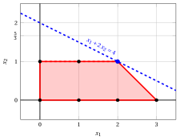{ .fig .ovale loading=lazy style="width:71%" }

!!! esercizio "Exercise 6.7: Cutting-plane algorithm (P10)"

    Consider the following ILP problem in canonical maximization form with $n=2$ integer variables and $m=3$ linear constraints:

    $$
    \begin{array}{rrrrrr}
    {\max} & {5\,x_1} & {+} & {2\,x_2} &  &  \\[2ex]
    & {-x_1} & {+} & {3\,x_2} & {\le} & {12} \\[2ex]
    & {x_1} & {+} & {2\,x_2} & {\le} & {12} \\[2ex]
    & {3\,x_1} & {-} & {2\,x_2} & {\le} & {8} \\[2ex]
    & {x_1,} &  & {x_2} & {\in} & {\Z_{\ge 0}}
    \end{array}
    $$

    and the following optimal simplex dictionary of its LP relaxation in standard form:

    \begin{equation*}
    \begin{cases}
    \begin{array}{rrrrrrrrrrrrr}
    {x_1} & {=} & {5} & {-} & {\dfrac{1}{4}}\, {x_4} & {-} & {\dfrac{1}{4}}\, {x_5} \\[2ex]
    {x_2} & {=} & {\dfrac{7}{2}} & {-} & {\dfrac{3}{8}}\, {x_4} & {+} & {\dfrac{1}{8}}\, {x_5} \\[2ex]
    {x_3} & {=} & {\dfrac{13}{2}} & {+} & {\dfrac{7}{8}}\, {x_4} & {-} & {\dfrac{5}{8}}\, {x_5} \\[2ex]
    {z} & {=} & {32} & {-} & {2}\, {x_4} & {-} & {x_5}
    \end{array}
    \end{cases}
    \end{equation*}

    **Questions**

    1. Execute the cutting-plane algorithm based on Gomory fractional cuts using:

        1. one Gomory fractional cut at each iteration;

        2. the largest right-hand side as the cut selection strategy.

        Solve the LP problems after adding the Gomory fractional cut using the dual simplex algorithm. Graphically show the optimal solution of the LP problem at each iteration.

    2. Graphically show the effect of each Gomory fractional cut on the LP relaxation of the ILP problem in canonical form.

    !!! nota ""

        Given a row $i \in \pazocal{B}$ of a simplex dictionary associated with a feasible basic solution such that $\bar{b}_i$ is fractional, the linear inequality

        \begin{equation*}
        \sum_{j \in \pazocal{N}}
        \left(
        \bar{a}_{ij}
        -
        \left\lfloor \bar{a}_{ij}\right\rfloor
        \right)x_j
        \ge
        \bar{b}_i - \left\lfloor \bar{b}_i \right\rfloor
        \end{equation*}

        is called the <strong>Gomory fractional cut</strong> generated by row $i$.

??? soluzione "Solution"

    Execution of the Cutting-Plane Algorithm to solve the ILP problem.

    - <strong>Initialization</strong>

        Let us consider the $LP_1$ problem in standard form:

        $$
        \begin{array}{rrrrrrrrrrrr}
        {\max} & {5\,x_1} & {+} & {2\,x_2} &  &  &  &  &  &  &  &  \\[2ex]
        & {-x_1} & {+} & {3\,x_2} & {+} & {x_3} &  &  &  &  & {=} & {12} \\[2ex]
        & {x_1} &  &  & {+} & {2\,x_2} & {+} & {x_4} &  &  & {=} & {12} \\[2ex]
        & {3\,x_1} & {-} & {2\,x_2} &  &  &  &  & {+} & {x_5} & {=} & {8} \\[2ex]
        & {x_1,} &  & {x_2,} &  & {x_3,} &  & {x_4,} &  & {x_5} & {\ge} & {0}
        \end{array}
        $$

        and its  optimal simplex dictionary:

        \begin{equation*}
        \begin{cases}
        \begin{array}{rrrrrrrrrrrrr}
        {x_1} & {=} & {5} & {-} & {\dfrac{1}{4}}\, {x_4} & {-} & {\dfrac{1}{4}}\, {x_5} \\[2ex]
        {x_2} & {=} & {\dfrac{7}{2}} & {-} & {\dfrac{3}{8}}\, {x_4} & {+} & {\dfrac{1}{8}}\, {x_5} \\[2ex]
        {x_3} & {=} & {\dfrac{13}{2}} & {+} & {\dfrac{7}{8}}\, {x_4} & {-} & {\dfrac{5}{8}}\, {x_5} \\[2ex]
        {z} & {=} & {32} & {-} & {2}\, {x_4} & {-} & {x_5}
        \end{array}
        \end{cases}
        \end{equation*}

        The optimal solution ${ \tilde{ \boldsymbol x}}(\,LP_1\,)$ is <strong>fractional</strong> and the $LP_1$ problem is <strong>feasible</strong>.

        We have the upper bound on the optimal value of the ILP problem:

        $$
        z(~ILP~) ~~\le~~  32
        $$

        For the $LP_1$ problem in canonical form, we have:

        $$
        \begin{array}{rrrrrr}
        {\max} & {5\,x_1} & {+} & {2\,x_2} &  &  \\[2ex]
        & {-x_1} & {+} & {3\,x_2} & {\le} & {12} \\[2ex]
        & {x_1} & {+} & {2\,x_2} & {\le} & {12} \\[2ex]
        & {3\,x_1} & {-} & {2\,x_2} & {\le} & {8} \\[2ex]
        & {x_1,} &  & {x_2} & {\ge} & {0}
        \end{array}
        $$

        An optimal solution ${ \tilde{ \boldsymbol x}}(\,LP_1\,)$ is:

        $$
        \tilde{x}_1=5,\qquad \tilde{x}_2=\dfrac{7}{2}
        $$

        The optimal value is:

        $$
        z(~LP_1~)=32
        $$

        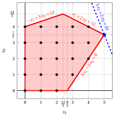{ .fig .ovale loading=lazy style="width:71%" }

    - <strong>Iteration 1</strong>

        - **a)** <strong>Cut generation phase</strong> 

            We have the following simplex dictionary associated with a fractional basic feasible solution of the $LP_1$ problem in standard form:

            \begin{equation*}
            \begin{cases}
            \begin{array}{rrrrrrrrrrrrr}
            {x_1} & {=} & {5} & {-} & {\dfrac{1}{4}}\, {x_4} & {-} & {\dfrac{1}{4}}\, {x_5} \\[2ex]
            {x_2} & {=} & {\dfrac{7}{2}} & {-} & {\dfrac{3}{8}}\, {x_4} & {+} & {\dfrac{1}{8}}\, {x_5} \\[2ex]
            {x_3} & {=} & {\dfrac{13}{2}} & {+} & {\dfrac{7}{8}}\, {x_4} & {-} & {\dfrac{5}{8}}\, {x_5} \\[2ex]
            {z} & {=} & {32} & {-} & {2}\, {x_4} & {-} & {x_5}
            \end{array}
            \end{cases}
            \end{equation*}

            where

            \begin{equation*}
            { \bar{\boldsymbol A}}=
            \begin{pmatrix}
            \frac{1}{4} & \frac{1}{4} \\[2ex]
            \frac{3}{8} & -\frac{1}{8} \\[2ex]
            -\frac{7}{8} & \frac{5}{8}
            \end{pmatrix}
            \qquad
            { \bar{\boldsymbol b}}=
            \begin{pmatrix}
            5\\[2ex]
            \frac{7}{2}\\[2ex]
            \frac{13}{2}
            \end{pmatrix}
            \end{equation*}

            - The Gomory fractional cut generated by the second row is:

                \begin{align*}
                \underbrace{\left(\frac{3}{8} - \left\lfloor \frac{3}{8} \right\rfloor \right)}_{\frac{3}{8}-0=\frac{3}{8}} \; x_4
                + \underbrace{\left(-\frac{1}{8} - \left\lfloor -\frac{1}{8} \right\rfloor \right)}_{-\frac{1}{8}-(-1)=\frac{7}{8}} \; x_5
                \ge \underbrace{\left(\frac{7}{2} - \left\lfloor \frac{7}{2} \right\rfloor \right)}_{\frac{7}{2} -3=\frac{1}{2}}
                \end{align*}

                \begin{align*}
                \frac{3}{8}\;x_4 + \frac{7}{8}\;x_5 \ge \frac{1}{2}
                \quad \Rightarrow \quad
                3\;x_4 + 7\;x_5 \ge 4
                \end{align*}

                By subtracting a surplus variable, we obtain the Gomory fractional cut in standard form:

                $$
                \frac{3}{8}\;x_4 + \frac{7}{8}\;x_5 - x_6 = \frac{1}{2}
                \quad \Rightarrow \quad
                3\;x_4 + 7\;x_5 - 8\;x_6 = 4
                $$

                From the standard form of the $LP_1$ problem, we have:

                $$
                x_4= 12 - x_1 - 2\;x_2, \qquad x_5= 8 - 3\;x_1 + 2\;x_2.
                $$

                Substituting in the Gomory fractional cut, we can express it in terms of the original variables of the ILP problem:

                $$
                3\,(12 - x_1 - 2\;x_2) + 7\,(8 - 3\;x_1 + 2\;x_2) \ge 4
                \quad \Rightarrow \quad
                3\;x_1 - x_2 \le 11
                $$

                Effect of the Gomory fractional cut generated by the second row on the $LP_1$ problem in canonical form:

                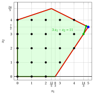{ .fig .ovale loading=lazy style="width:71%" }

            - The Gomory fractional cut generated by the third row is:

                \begin{align*}
                \underbrace{\left(-\frac{7}{8} - \left\lfloor -\frac{7}{8} \right\rfloor \right)}_{-\frac{7}{8}-(-1)=\frac{1}{8}} \; x_4
                + \underbrace{\left(\frac{5}{8} - \left\lfloor \frac{5}{8} \right\rfloor \right)}_{\frac{5}{8}-0=\frac{5}{8}} \; x_5
                \ge \underbrace{\left(\frac{13}{2} - \left\lfloor \frac{13}{2} \right\rfloor \right)}_{\frac{13}{2} -6=\frac{1}{2}}
                \end{align*}

                \begin{align*}
                \frac{1}{8}\;x_4 + \frac{5}{8}\;x_5 \ge \frac{1}{2}
                \quad \Rightarrow \quad
                x_4 + 5\;x_5 \ge 4
                \end{align*}

                By subtracting a surplus variable, we obtain the Gomory fractional cut in standard form:

                $$
                \frac{1}{8}\;x_4 + \frac{5}{8}\;x_5 - x_6 = \frac{1}{2}
                \quad \Rightarrow \quad
                x_4 + 5\;x_5 - 8\;x_6 = 4
                $$

                From the standard form of the $LP_1$ problem, we have:

                $$
                x_4= 12 - x_1 - 2\;x_2, \qquad x_5= 8 - 3\;x_1 + 2\;x_2.
                $$

                Substituting in the Gomory fractional cut, we can express it in terms of the original variables of the ILP problem:

                $$
                (12 - x_1 - 2\;x_2) + 5\,(8 - 3\;x_1 + 2\;x_2) \ge 4
                \quad \Rightarrow \quad
                2\;x_1 - x_2 \le 6
                $$

                Effect of the Gomory fractional cut generated by the third row on the $LP_1$ problem in canonical form:

                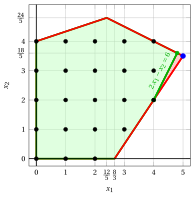{ .fig .ovale loading=lazy style="width:71%" }

                Both Gomory fractional cuts have the same right-hand side, equal to $\dfrac{1}{2}$. We select the Gomory fractional cut generated by the third row and we create the $LP_2$ problem by adding it to the $LP_1$ problem.

        - **b)** <strong>LP re-optimization phase</strong> 

            Let us consider the $LP_2$ problem in standard form:

            $$
            \begin{array}{rrrrrrrrrrrrrr}
            {\max} & {5\,x_1} & {+} & {2\,x_2} &  &  &  &  &  &  &  &  &  &  \\[2ex]
            & {-x_1} & {+} & {3\,x_2} & {+} & {x_3} &  &  &  &  &  &  & {=} & {12} \\[2ex]
            & {x_1} &  &  & {+} & {2\,x_2} & {+} & {x_4} &  &  &  &  & {=} & {12} \\[2ex]
            & {3\,x_1} & {-} & {2\,x_2} &  &  &  &  & {+} & {x_5} &  &  & {=} & {8} \\[2ex]
            & {2\,x_1} & {-} & {x_2} &  &  &  &  &  &  & {+} & {x_6} & {=} & {6} \\[2ex]
            & {x_1,} &  & {x_2,} &  & {x_3,} &  & {x_4,} &  & {x_5,} &  & {x_6} & {\ge} & {0}
            \end{array}
            $$

            For the added Gomory fractional cut we have:

            $$
            x_4 + 5\;x_5 - 8\;x_6 = 4
            \quad \Rightarrow \quad
            x_6 = -\dfrac{1}{2} + \dfrac{1}{8}\;x_4 + \dfrac{5}{8}\;x_5
            $$

            We then add this equation to the previous optimal dictionary and we obtain the following dictionary :

            \begin{equation*}
            \begin{cases}
            \begin{array}{rrrrrrrrrrrrr}
            {x_1} & {=} & {5} & {-} & {\dfrac{1}{4}}\, {x_4} & {-} & {\dfrac{1}{4}}\, {x_5} \\[2ex]
            {x_2} & {=} & {\dfrac{7}{2}} & {-} & {\dfrac{3}{8}}\, {x_4} & {+} & {\dfrac{1}{8}}\, {x_5} \\[2ex]
            {x_3} & {=} & {\dfrac{13}{2}} & {+} & {\dfrac{7}{8}}\, {x_4} & {-} & {\dfrac{5}{8}}\, {x_5} \\[2ex]
            {x_6} & {=} & {-\dfrac{1}{2}} & {+} & {\dfrac{1}{8}}\, {x_4} & {+} & {\dfrac{5}{8}}\, {x_5} \\[2ex]
            {z} & {=} & {32} & {-} & {2}\, {x_4} & {-} & {x_5}
            \end{array}
            \end{cases}
            \end{equation*}

            where  $\pazocal{B}=\{1,2,3,6\}$ and $\pazocal{N}=\{4,5\}$ and

            - the  basic primal non-feasible  solution is:

                $$
                \bar x_1=5,~~
                \bar x_2=\dfrac{7}{2},~~
                \bar x_3=\dfrac{13}{2},~~
                \bar x_6=-\dfrac{1}{2},~~~~~~
                \bar x_4=0,~~
                \bar x_5=0~~
                \text{  of value   }32
                $$

            - the basic dual feasible  solution is:

                $$
                \bar \pi_1=0,~~
                \bar \pi_2=0,~~
                \bar \pi_3=0,~~
                \bar \pi_6=0,~~~~~~
                \bar \pi_4=2,~~
                \bar \pi_5=1~~
                \text{  of value   }32
                $$

            If we increase the value of $\pi_6$, we can get a better dual solution. We have:

            $$
            \begin{cases}
            \pi_4 &= 2 - \dfrac{1}{8}\,\pi_6 \\[2ex]
            \pi_5 &= 1 - \dfrac{5}{8}\,\pi_6
            \end{cases}
            \qquad
            \qquad
            \begin{cases}
            \underbrace{ 2 - \dfrac{1}{8}\,\pi_6 \ge 0}_{\pi_4 \ge 0} \\[2ex]
            \underbrace{  1 - \dfrac{5}{8}\,\pi_6 \ge 0}_{\pi_5 \ge 0}
            \end{cases}
            \qquad
            \qquad
            \begin{cases}
            \pi_6 &\le  16 \\[2ex]
            \pi_6 &\le  \dfrac{8}{5}
            \end{cases}
            $$

            By increasing the value of $\pi_6$ to $\min \left\{16, \dfrac{8}{5}\right\}=\dfrac{8}{5}$,  the value of $\pi_5$ decreases to 0. Then we have that:

            - $\pi_6$ becomes a dual basic variable and accordingly $x_6$ becomes a primal non basic variable

            - $\pi_5$ becomes a dual non-basic variable and accordingly $x_5$ becomes a primal basic variable

            We have:

            $$
            x_6 = -\dfrac{1}{2} + \dfrac{1}{8}\, x_4 + \dfrac{5}{8}\, x_5
            \quad \Longrightarrow \quad
            x_5 = \dfrac{4}{5} - \dfrac{1}{5}\,x_4 + \dfrac{8}{5}\,x_6
            $$

            Substituting into the other equations of the primal dictionary, we get:

            $$
            x_1 = 5  -  \dfrac{1}{4} x_4 -  \dfrac{1}{4} \left( \dfrac{4}{5} - \dfrac{1}{5}\,x_4 + \dfrac{8}{5}\,x_6   \right)
            = \dfrac{24}{5} - \dfrac{1}{5}\,x_4 - \dfrac{2}{5}\,x_6
            $$

            $$
            x_2 = \dfrac{7}{2}  -  \dfrac{3}{8} x_4 +  \dfrac{1}{8} \left( \dfrac{4}{5} - \dfrac{1}{5}\,x_4 + \dfrac{8}{5}\,x_6   \right)
            = \dfrac{18}{5} - \dfrac{2}{5}\,x_4 + \dfrac{1}{5}\,x_6
            $$

            $$
            x_3 = \dfrac{13}{2}  +  \dfrac{7}{8} x_4 -  \dfrac{5}{8} \left( \dfrac{4}{5} - \dfrac{1}{5}\,x_4 + \dfrac{8}{5}\,x_6   \right)
            = 6 + x_4 - x_6
            $$

            $$
            z = 32  -  2 x_4 -  \left( \dfrac{4}{5} - \dfrac{1}{5}\,x_4 + \dfrac{8}{5}\,x_6   \right)
            = \dfrac{156}{5} - \dfrac{9}{5}\,x_4 - \dfrac{8}{5}\,x_6
            $$

            Accordingly, we now have the following optimal primal dictionary:

            \begin{equation*}
            \begin{cases}
            \begin{array}{rrrrrrrrrrrrr}
            {x_1} & {=} & {\dfrac{24}{5}} & {-} & {\dfrac{1}{5}}\, {x_4} & {-} & {\dfrac{2}{5}}\, {x_6} \\[2ex]
            {x_2} & {=} & {\dfrac{18}{5}} & {-} & {\dfrac{2}{5}}\, {x_4} & {+} & {\dfrac{1}{5}}\, {x_6} \\[2ex]
            {x_3} & {=} & {6} & {+} & {x_4} & {-} & {x_6} \\[2ex]
            {x_5} & {=} & {\dfrac{4}{5}} & {-} & {\dfrac{1}{5}}\, {x_4} & {+} & {\dfrac{8}{5}}\, {x_6} \\[2ex]
            {z} & {=} & {\dfrac{156}{5}} & {-} & {\dfrac{9}{5}}\, {x_4} & {-} & {\dfrac{8}{5}}\, {x_6}
            \end{array}
            \end{cases}
            \end{equation*}

            where  $\pazocal{B}=\{1,2,3,5\}$ and $\pazocal{N}=\{4,6\}$.

            - the basic primal optimal  solution is:

                $$
                \tilde x_1 = \dfrac{24}{5},~~
                \tilde x_2 = \dfrac{18}{5},~~
                \tilde x_3 = 6,~~
                \tilde x_5 = \dfrac{4}{5},~~
                \tilde x_4 = 0,~~
                \tilde x_6 = 0
                \qquad
                \text{of value  }  \dfrac{156}{5}
                $$

            - the basic dual optimal  solution is:

                $$
                \tilde \pi_1 = 0,~~
                \tilde \pi_2 = 0,~~
                \tilde \pi_3 = 0,~~
                \tilde \pi_5 = 0,~~
                \tilde \pi_4 = \dfrac{9}{5},~~
                \tilde \pi_6 = \dfrac{8}{5}
                \qquad
                \text{of value  }  \dfrac{156}{5}
                $$

            The optimal solution ${ \tilde{ \boldsymbol x}}(\,LP_2\,)$ is <strong>fractional</strong> and the $LP_2$ problem is <strong>feasible</strong>.

            We have the upper bound on the optimal value of the ILP problem:

            $$
            z(~ILP~) ~~\le~~  \underbrace{\left\lfloor \dfrac{156}{5} \right\rfloor}_{=31}
            $$

            For the $LP_2$ problem in canonical form, we have:

            $$
            \begin{array}{rrrrrr}
            {\max} & {5\,x_1} & {+} & {2\,x_2} &  &  \\[2ex]
            & {-x_1} & {+} & {3\,x_2} & {\le} & {12} \\[2ex]
            & {x_1} & {+} & {2\,x_2} & {\le} & {12} \\[2ex]
            & {3\,x_1} & {-} & {2\,x_2} & {\le} & {8} \\[2ex]
            & {2\,x_1} & {-} & {x_2} & {\le} & {6} \\[2ex]
            & {x_1,} &  & {x_2} & {\ge} & {0}
            \end{array}
            $$

            An optimal solution ${ \tilde{ \boldsymbol x}}(\,LP_2\,)$ is:

            $$
            \tilde{x}_1=\dfrac{24}{5},\qquad \tilde{x}_2=\dfrac{18}{5}
            $$

            The optimal value is:

            $$
            z(~LP_2~)=\dfrac{156}{5}
            $$

            { .fig .ovale loading=lazy style="width:71%" }

    - <strong>Iteration 2</strong>

        - **a)** <strong>Cut generation phase</strong> 

            We have the following simplex dictionary associated with a fractional basic feasible solution of the $LP_2$ problem in standard form:

            \begin{equation*}
            \begin{cases}
            \begin{array}{rrrrrrrrrrrrr}
            {x_1} & {=} & {\dfrac{24}{5}} & {-} & {\dfrac{1}{5}}\, {x_4} & {-} & {\dfrac{2}{5}}\, {x_6} \\[2ex]
            {x_2} & {=} & {\dfrac{18}{5}} & {-} & {\dfrac{2}{5}}\, {x_4} & {+} & {\dfrac{1}{5}}\, {x_6} \\[2ex]
            {x_3} & {=} & {6} & {+} & {x_4} & {-} & {x_6} \\[2ex]
            {x_5} & {=} & {\dfrac{4}{5}} & {-} & {\dfrac{1}{5}}\, {x_4} & {+} & {\dfrac{8}{5}}\, {x_6} \\[2ex]
            {z} & {=} & {\dfrac{156}{5}} & {-} & {\dfrac{9}{5}}\, {x_4} & {-} & {\dfrac{8}{5}}\, {x_6}
            \end{array}
            \end{cases}
            \end{equation*}

            where

            \begin{equation*}
            { \bar{\boldsymbol A}}=
            \begin{pmatrix}
            \frac{1}{5} & \frac{2}{5} \\[2ex]
            \frac{2}{5} & -\frac{1}{5} \\[2ex]
            -1 & 1 \\[2ex]
            \frac{1}{5} & -\frac{8}{5}
            \end{pmatrix}
            \qquad
            { \bar{\boldsymbol b}}=
            \begin{pmatrix}
            \frac{24}{5}\\[2ex]
            \frac{18}{5}\\[2ex]
            6\\[2ex]
            \frac{4}{5}
            \end{pmatrix}
            \end{equation*}

            - The Gomory fractional cut generated by the first row is:

                \begin{align*}
                \underbrace{\left(\frac{1}{5} - \left\lfloor \frac{1}{5} \right\rfloor \right)}_{\frac{1}{5}-0=\frac{1}{5}} \; x_4
                + \underbrace{\left(\frac{2}{5} - \left\lfloor \frac{2}{5} \right\rfloor \right)}_{\frac{2}{5}-0=\frac{2}{5}} \; x_6
                \ge \underbrace{\left(\frac{24}{5} - \left\lfloor \frac{24}{5} \right\rfloor \right)}_{\frac{24}{5} -4=\frac{4}{5}}
                \end{align*}

                \begin{align*}
                \frac{1}{5}\;x_4 + \frac{2}{5}\;x_6 \ge \frac{4}{5}
                \quad \Rightarrow \quad
                x_4 + 2\;x_6 \ge 4
                \end{align*}

                By subtracting a surplus variable, we obtain the Gomory fractional cut in standard form:

                $$
                \frac{1}{5}\;x_4 + \frac{2}{5}\;x_6 - x_7 = \frac{4}{5}
                \quad \Rightarrow \quad
                x_4 + 2\;x_6 - 5\;x_7 = 4
                $$

                From the standard form of the $LP_1$ problem and the added cut, we have:

                $$
                x_4= 12 - x_1 - 2\;x_2, \qquad x_6= 6 - 2\;x_1 + x_2.
                $$

                Substituting in the Gomory fractional cut, we can express it in terms of the original variables of the ILP problem:

                $$
                (12 - x_1 - 2\;x_2) + 2\,(6 - 2\;x_1 + x_2) \ge 4
                \quad \Rightarrow \quad
                x_1 \le 4
                $$

                Effect of the Gomory fractional cut generated by the first row on the $LP_2$ problem in canonical form:

                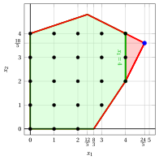{ .fig .ovale loading=lazy style="width:71%" }

            - The Gomory fractional cut generated by the second row is:

                \begin{align*}
                \underbrace{\left(\frac{2}{5} - \left\lfloor \frac{2}{5} \right\rfloor \right)}_{\frac{2}{5}-0=\frac{2}{5}} \; x_4
                + \underbrace{\left(-\frac{1}{5} - \left\lfloor -\frac{1}{5} \right\rfloor \right)}_{-\frac{1}{5}-(-1)=\frac{4}{5}} \; x_6
                \ge \underbrace{\left(\frac{18}{5} - \left\lfloor \frac{18}{5} \right\rfloor \right)}_{\frac{18}{5} -3=\frac{3}{5}}
                \end{align*}

                \begin{align*}
                \frac{2}{5}\;x_4 + \frac{4}{5}\;x_6 \ge \frac{3}{5}
                \quad \Rightarrow \quad
                2\;x_4 + 4\;x_6 \ge 3
                \end{align*}

                From the standard form of the $LP_1$ problem and the added cut, we have:

                $$
                x_4= 12 - x_1 - 2\;x_2, \qquad x_6= 6 - 2\;x_1 + x_2.
                $$

                Substituting in the Gomory fractional cut, we can express it in terms of the original variables of the ILP problem:

                $$
                2\,(12 - x_1 - 2\;x_2) + 4\,(6 - 2\;x_1 + x_2) \ge 3
                \quad \Rightarrow \quad
                10\;x_1 \le 45
                $$

                Dividing by the greatest common divisor $10$ of the coefficients and rounding down the right-hand side, we obtain the cut in primitive form, the same inequality as the cut generated by the first row:

                $$
                x_1 \le \left\lfloor \frac{45}{10} \right\rfloor = 4
                $$

                Effect of the Gomory fractional cut generated by the second row on the $LP_2$ problem in canonical form:

                { .fig .ovale loading=lazy style="width:71%" }

            - The Gomory fractional cut generated by the fourth row is:

                \begin{align*}
                \underbrace{\left(\frac{1}{5} - \left\lfloor \frac{1}{5} \right\rfloor \right)}_{\frac{1}{5}-0=\frac{1}{5}} \; x_4
                + \underbrace{\left(-\frac{8}{5} - \left\lfloor -\frac{8}{5} \right\rfloor \right)}_{-\frac{8}{5}-(-2)=\frac{2}{5}} \; x_6
                \ge \underbrace{\left(\frac{4}{5} - \left\lfloor \frac{4}{5} \right\rfloor \right)}_{\frac{4}{5} -0=\frac{4}{5}}
                \end{align*}

                \begin{align*}
                \frac{1}{5}\;x_4 + \frac{2}{5}\;x_6 \ge \frac{4}{5}
                \quad \Rightarrow \quad
                x_4 + 2\;x_6 \ge 4
                \end{align*}

                This Gomory fractional cut is the same as the one generated by the first row.

                We select the Gomory fractional cut with the largest right-hand side and we create the $LP_3$ problem by adding it to the $LP_2$ problem.

        - **b)** <strong>LP re-optimization phase</strong> 

            Let us consider the $LP_3$ problem in standard form:

            $$
            \begin{array}{rrrrrrrrrrrrrrrr}
            {\max} & {5\,x_1} & {+} & {2\,x_2} &  &  &  &  &  &  &  &  &  &  &  &  \\[2ex]
            & {-x_1} & {+} & {3\,x_2} & {+} & {x_3} &  &  &  &  &  &  &  &  & {=} & {12} \\[2ex]
            & {x_1} &  &  & {+} & {2\,x_2} & {+} & {x_4} &  &  &  &  &  &  & {=} & {12} \\[2ex]
            & {3\,x_1} & {-} & {2\,x_2} &  &  &  &  & {+} & {x_5} &  &  &  &  & {=} & {8} \\[2ex]
            & {2\,x_1} & {-} & {x_2} &  &  &  &  &  &  & {+} & {x_6} &  &  & {=} & {6} \\[2ex]
            & {x_1} &  &  &  &  &  &  &  &  &  &  & {+} & {x_7} & {=} & {4} \\[2ex]
            & {x_1,} &  & {x_2,} &  & {x_3,} &  & {x_4,} &  & {x_5,} &  & {x_6,} &  & {x_7} & {\ge} & {0}
            \end{array}
            $$

            For the added Gomory fractional cut we have:

            $$
            x_4 + 2\;x_6 - 5\;x_7 = 4
            \quad \Rightarrow \quad
            x_7 = -\dfrac{4}{5} + \dfrac{1}{5}\;x_4 + \dfrac{2}{5}\;x_6
            $$

            We then add this equation to the previous optimal dictionary and we obtain the following dictionary :

            \begin{equation*}
            \begin{cases}
            \begin{array}{rrrrrrrrrrrrr}
            {x_1} & {=} & {\dfrac{24}{5}} & {-} & {\dfrac{1}{5}}\, {x_4} & {-} & {\dfrac{2}{5}}\, {x_6} \\[2ex]
            {x_2} & {=} & {\dfrac{18}{5}} & {-} & {\dfrac{2}{5}}\, {x_4} & {+} & {\dfrac{1}{5}}\, {x_6} \\[2ex]
            {x_3} & {=} & {6} & {+} & {x_4} & {-} & {x_6} \\[2ex]
            {x_5} & {=} & {\dfrac{4}{5}} & {-} & {\dfrac{1}{5}}\, {x_4} & {+} & {\dfrac{8}{5}}\, {x_6} \\[2ex]
            {x_7} & {=} & {-\dfrac{4}{5}} & {+} & {\dfrac{1}{5}}\, {x_4} & {+} & {\dfrac{2}{5}}\, {x_6} \\[2ex]
            {z} & {=} & {\dfrac{156}{5}} & {-} & {\dfrac{9}{5}}\, {x_4} & {-} & {\dfrac{8}{5}}\, {x_6}
            \end{array}
            \end{cases}
            \end{equation*}

            where  $\pazocal{B}=\{1,2,3,5,7\}$ and $\pazocal{N}=\{4,6\}$ and

            - the  basic primal non-feasible  solution is:

                $$
                \begin{gathered}
                \bar x_1=\dfrac{24}{5},~~
                \bar x_2=\dfrac{18}{5},~~
                \bar x_3=6,~~
                \bar x_5=\dfrac{4}{5},~~
                \bar x_7=-\dfrac{4}{5},\\[1ex]
                \bar x_4=0,~~
                \bar x_6=0~~
                \text{  of value   }\dfrac{156}{5}
                \end{gathered}
                $$

            - the basic dual feasible  solution is:

                $$
                \begin{gathered}
                \bar \pi_1=0,~~
                \bar \pi_2=0,~~
                \bar \pi_3=0,~~
                \bar \pi_5=0,~~
                \bar \pi_7=0,\\[1ex]
                \bar \pi_4=\dfrac{9}{5},~~
                \bar \pi_6=\dfrac{8}{5}~~
                \text{  of value   }\dfrac{156}{5}
                \end{gathered}
                $$

            If we increase the value of $\pi_7$, we can get a better dual solution. We have:

            $$
            \begin{cases}
            \pi_4 &= \dfrac{9}{5} - \dfrac{1}{5}\,\pi_7 \\[2ex]
            \pi_6 &= \dfrac{8}{5} - \dfrac{2}{5}\,\pi_7
            \end{cases}
            \qquad
            \qquad
            \begin{cases}
            \underbrace{ \dfrac{9}{5} - \dfrac{1}{5}\,\pi_7 \ge 0}_{\pi_4 \ge 0} \\[2ex]
            \underbrace{  \dfrac{8}{5} - \dfrac{2}{5}\,\pi_7 \ge 0}_{\pi_6 \ge 0}
            \end{cases}
            \qquad
            \qquad
            \begin{cases}
            \pi_7 &\le  9 \\[2ex]
            \pi_7 &\le  4
            \end{cases}
            $$

            By increasing the value of $\pi_7$ to $\min \left\{9, 4\right\}=4$,  the value of $\pi_6$ decreases to 0. Then we have that:

            - $\pi_7$ becomes a dual basic variable and accordingly $x_7$ becomes a primal non basic variable

            - $\pi_6$ becomes a dual non-basic variable and accordingly $x_6$ becomes a primal basic variable

            We have:

            $$
            x_7 = -\dfrac{4}{5} + \dfrac{1}{5}\, x_4 + \dfrac{2}{5}\, x_6
            \quad \Longrightarrow \quad
            x_6 = 2 - \dfrac{1}{2}\,x_4 + \dfrac{5}{2}\,x_7
            $$

            Substituting into the other equations of the primal dictionary, we get:

            $$
            x_1 = \dfrac{24}{5}  -  \dfrac{1}{5} x_4 -  \dfrac{2}{5} \left( 2 - \dfrac{1}{2}\,x_4 + \dfrac{5}{2}\,x_7   \right)
            = 4 - x_7
            $$

            $$
            x_2 = \dfrac{18}{5}  -  \dfrac{2}{5} x_4 +  \dfrac{1}{5} \left( 2 - \dfrac{1}{2}\,x_4 + \dfrac{5}{2}\,x_7   \right)
            = 4 - \dfrac{1}{2}\,x_4 + \dfrac{1}{2}\,x_7
            $$

            $$
            x_3 = 6  +  x_4 -  \left( 2 - \dfrac{1}{2}\,x_4 + \dfrac{5}{2}\,x_7   \right)
            = 4 + \dfrac{3}{2}\,x_4 - \dfrac{5}{2}\,x_7
            $$

            $$
            x_5 = \dfrac{4}{5}  -  \dfrac{1}{5} x_4 +  \dfrac{8}{5} \left( 2 - \dfrac{1}{2}\,x_4 + \dfrac{5}{2}\,x_7   \right)
            = 4 - x_4 + 4\,x_7
            $$

            $$
            z = \dfrac{156}{5}  -  \dfrac{9}{5} x_4 -  \dfrac{8}{5} \left( 2 - \dfrac{1}{2}\,x_4 + \dfrac{5}{2}\,x_7   \right)
            = 28 - x_4 - 4\,x_7
            $$

            Accordingly, we now have the following optimal primal dictionary:

            \begin{equation*}
            \begin{cases}
            \begin{array}{rrrrrrrrrrrrr}
            {x_1} & {=} & {4} &  &  & {-} & {x_7} \\[2ex]
            {x_2} & {=} & {4} & {-} & {\dfrac{1}{2}}\, {x_4} & {+} & {\dfrac{1}{2}}\, {x_7} \\[2ex]
            {x_3} & {=} & {4} & {+} & {\dfrac{3}{2}}\, {x_4} & {-} & {\dfrac{5}{2}}\, {x_7} \\[2ex]
            {x_5} & {=} & {4} & {-} & {x_4} & {+} & {4}\, {x_7} \\[2ex]
            {x_6} & {=} & {2} & {-} & {\dfrac{1}{2}}\, {x_4} & {+} & {\dfrac{5}{2}}\, {x_7} \\[2ex]
            {z} & {=} & {28} & {-} & {x_4} & {-} & {4}\, {x_7}
            \end{array}
            \end{cases}
            \end{equation*}

            where  $\pazocal{B}=\{1,2,3,5,6\}$ and $\pazocal{N}=\{4,7\}$.

            - the basic primal optimal  solution is:

                $$
                \begin{gathered}
                \tilde x_1 = 4,~~
                \tilde x_2 = 4,~~
                \tilde x_3 = 4,~~
                \tilde x_5 = 4,~~
                \tilde x_6 = 2,~~
                \tilde x_4 = 0,~~
                \tilde x_7 = 0\\[1ex]
                \text{of value  }  28
                \end{gathered}
                $$

            - the basic dual optimal  solution is:

                $$
                \begin{gathered}
                \tilde \pi_1 = 0,~~
                \tilde \pi_2 = 0,~~
                \tilde \pi_3 = 0,~~
                \tilde \pi_5 = 0,~~
                \tilde \pi_6 = 0,~~
                \tilde \pi_4 = 1,~~
                \tilde \pi_7 = 4\\[1ex]
                \text{of value  }  28
                \end{gathered}
                $$

            !!! chiave ""

                The optimal solution ${ \tilde{ \boldsymbol x}}(\,LP_3\,)$ is <strong>integer</strong>. Accordingly, an optimal solution ${ \tilde{ \boldsymbol x}}(\,ILP\,)$ is:

                $$
                \tilde{x}_1=4,~~\tilde{x}_2=4
                $$

                The optimal value $z(~ILP~)$ is $28$.

            For the $LP_3$ problem in canonical form, we have:

            $$
            \begin{array}{rrrrrr}
            {\max} & {5\,x_1} & {+} & {2\,x_2} &  &  \\[2ex]
            & {-x_1} & {+} & {3\,x_2} & {\le} & {12} \\[2ex]
            & {x_1} & {+} & {2\,x_2} & {\le} & {12} \\[2ex]
            & {3\,x_1} & {-} & {2\,x_2} & {\le} & {8} \\[2ex]
            & {2\,x_1} & {-} & {x_2} & {\le} & {6} \\[2ex]
            & {x_1} &  &  & {\le} & {4} \\[2ex]
            & {x_1,} &  & {x_2} & {\ge} & {0}
            \end{array}
            $$

            An optimal solution ${ \tilde{ \boldsymbol x}}(\,LP_3\,)$ is:

            $$
            \tilde{x}_1=4,\qquad \tilde{x}_2=4
            $$

            The optimal value is:

            $$
            z(~LP_3~)=28
            $$

            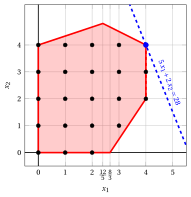{ .fig .ovale loading=lazy style="width:71%" }

!!! esercizio "Exercise 6.8: Cutting-plane algorithm (P21)"

    Consider the following ILP problem in canonical maximization form with $n=2$ integer variables and $m=3$ linear constraints:

    $$
    \begin{array}{rrrrrr}
    {\max} & {x_1} & {+} & {2\,x_2} &  &  \\[2ex]
    & {-x_1} & {-} & {x_2} & {\le} & {-2} \\[2ex]
    & {4\,x_1} & {-} & {2\,x_2} & {\le} & {7} \\[2ex]
    & {x_1} & {+} & {5\,x_2} & {\le} & {21} \\[2ex]
    & {x_1,} &  & {x_2} & {\in} & {\Z_{\ge 0}}
    \end{array}
    $$

    and the following optimal simplex dictionary of its LP relaxation in standard form:

    \begin{equation*}
    \begin{cases}
    \begin{array}{rrrrrrrrrrrrr}
    {x_1} & {=} & {\dfrac{7}{2}} & {-} & {\dfrac{5}{22}}\, {x_4} & {-} & {\dfrac{1}{11}}\, {x_5} \\[2ex]
    {x_2} & {=} & {\dfrac{7}{2}} & {+} & {\dfrac{1}{22}}\, {x_4} & {-} & {\dfrac{2}{11}}\, {x_5} \\[2ex]
    {x_3} & {=} & {5} & {-} & {\dfrac{2}{11}}\, {x_4} & {-} & {\dfrac{3}{11}}\, {x_5} \\[2ex]
    {z} & {=} & {\dfrac{21}{2}} & {-} & {\dfrac{3}{22}}\, {x_4} & {-} & {\dfrac{5}{11}}\, {x_5}
    \end{array}
    \end{cases}
    \end{equation*}

    **Questions**

    1. Execute the cutting-plane algorithm based on Gomory fractional cuts using:

        1. one Gomory fractional cut at each iteration;

        2. the largest right-hand side as the cut selection strategy.

        Solve the LP problems after adding the Gomory fractional cut using the dual simplex algorithm. Graphically show the optimal solution of the LP problem at each iteration.

    2. Graphically show the effect of each Gomory fractional cut on the LP relaxation of the ILP problem in canonical form.

    !!! nota ""

        Given a row $i \in \pazocal{B}$ of a simplex dictionary associated with a feasible basic solution such that $\bar{b}_i$ is fractional, the linear inequality

        \begin{equation*}
        \sum_{j \in \pazocal{N}}
        \left(
        \bar{a}_{ij}
        -
        \left\lfloor \bar{a}_{ij}\right\rfloor
        \right)x_j
        \ge
        \bar{b}_i - \left\lfloor \bar{b}_i \right\rfloor
        \end{equation*}

        is called the <strong>Gomory fractional cut</strong> generated by row $i$.

??? soluzione "Solution"

    Execution of the Cutting-Plane Algorithm to solve the ILP problem.

    - <strong>Initialization</strong>

        Let us consider the $LP_1$ problem in standard form:

        $$
        \begin{array}{rrrrrrrrrrrr}
        {\max} & {x_1} & {+} & {2\,x_2} &  &  &  &  &  &  &  &  \\[2ex]
        & {-x_1} & {-} & {x_2} & {+} & {x_3} &  &  &  &  & {=} & {-2} \\[2ex]
        & {4\,x_1} & {-} & {2\,x_2} &  &  & {+} & {x_4} &  &  & {=} & {7} \\[2ex]
        & {x_1} & {+} & {5\,x_2} &  &  &  &  & {+} & {x_5} & {=} & {21} \\[2ex]
        & {x_1,} &  & {x_2,} &  & {x_3,} &  & {x_4,} &  & {x_5} & {\ge} & {0}
        \end{array}
        $$

        and its  optimal simplex dictionary:

        \begin{equation*}
        \begin{cases}
        \begin{array}{rrrrrrrrrrrrr}
        {x_1} & {=} & {\dfrac{7}{2}} & {-} & {\dfrac{5}{22}}\, {x_4} & {-} & {\dfrac{1}{11}}\, {x_5} \\[2ex]
        {x_2} & {=} & {\dfrac{7}{2}} & {+} & {\dfrac{1}{22}}\, {x_4} & {-} & {\dfrac{2}{11}}\, {x_5} \\[2ex]
        {x_3} & {=} & {5} & {-} & {\dfrac{2}{11}}\, {x_4} & {-} & {\dfrac{3}{11}}\, {x_5} \\[2ex]
        {z} & {=} & {\dfrac{21}{2}} & {-} & {\dfrac{3}{22}}\, {x_4} & {-} & {\dfrac{5}{11}}\, {x_5}
        \end{array}
        \end{cases}
        \end{equation*}

        The optimal solution ${ \tilde{ \boldsymbol x}}(\,LP_1\,)$ is <strong>fractional</strong> and the $LP_1$ problem is <strong>feasible</strong>.

        We have the upper bound on the optimal value of the ILP problem:

        $$
        z(~ILP~) ~~\le~~  \underbrace{\left\lfloor \dfrac{21}{2} \right\rfloor}_{=10}
        $$

        For the $LP_1$ problem in canonical form, we have:

        $$
        \begin{array}{rrrrrr}
        {\max} & {x_1} & {+} & {2\,x_2} &  &  \\[2ex]
        & {-x_1} & {-} & {x_2} & {\le} & {-2} \\[2ex]
        & {4\,x_1} & {-} & {2\,x_2} & {\le} & {7} \\[2ex]
        & {x_1} & {+} & {5\,x_2} & {\le} & {21} \\[2ex]
        & {x_1,} &  & {x_2} & {\ge} & {0}
        \end{array}
        $$

        An optimal solution ${ \tilde{ \boldsymbol x}}(\,LP_1\,)$ is:

        $$
        \tilde{x}_1=\dfrac{7}{2},\qquad \tilde{x}_2=\dfrac{7}{2}
        $$

        The optimal value is:

        $$
        z(~LP_1~)=\dfrac{21}{2}
        $$

        { .fig .ovale loading=lazy style="width:71%" }

    - <strong>Iteration 1</strong>

        - **a)** <strong>Cut generation phase</strong> 

            We have the following simplex dictionary associated with a fractional basic feasible solution of the $LP_1$ problem in standard form:

            \begin{equation*}
            \begin{cases}
            \begin{array}{rrrrrrrrrrrrr}
            {x_1} & {=} & {\dfrac{7}{2}} & {-} & {\dfrac{5}{22}}\, {x_4} & {-} & {\dfrac{1}{11}}\, {x_5} \\[2ex]
            {x_2} & {=} & {\dfrac{7}{2}} & {+} & {\dfrac{1}{22}}\, {x_4} & {-} & {\dfrac{2}{11}}\, {x_5} \\[2ex]
            {x_3} & {=} & {5} & {-} & {\dfrac{2}{11}}\, {x_4} & {-} & {\dfrac{3}{11}}\, {x_5} \\[2ex]
            {z} & {=} & {\dfrac{21}{2}} & {-} & {\dfrac{3}{22}}\, {x_4} & {-} & {\dfrac{5}{11}}\, {x_5}
            \end{array}
            \end{cases}
            \end{equation*}

            where

            \begin{equation*}
            { \bar{\boldsymbol A}}=
            \begin{pmatrix}
            \frac{5}{22} & \frac{1}{11} \\[2ex]
            -\frac{1}{22} & \frac{2}{11} \\[2ex]
            \frac{2}{11} & \frac{3}{11}
            \end{pmatrix}
            \qquad
            { \bar{\boldsymbol b}}=
            \begin{pmatrix}
            \frac{7}{2}\\[2ex]
            \frac{7}{2}\\[2ex]
            5
            \end{pmatrix}
            \end{equation*}

            - The Gomory fractional cut generated by the first row is:

                \begin{align*}
                \underbrace{\left(\frac{5}{22} - \left\lfloor \frac{5}{22} \right\rfloor \right)}_{\frac{5}{22}-0=\frac{5}{22}} \; x_4
                + \underbrace{\left(\frac{1}{11} - \left\lfloor \frac{1}{11} \right\rfloor \right)}_{\frac{1}{11}-0=\frac{1}{11}} \; x_5
                \ge \underbrace{\left(\frac{7}{2} - \left\lfloor \frac{7}{2} \right\rfloor \right)}_{\frac{7}{2} -3=\frac{1}{2}}
                \end{align*}

                \begin{align*}
                \frac{5}{22}\;x_4 + \frac{1}{11}\;x_5 \ge \frac{1}{2}
                \quad \Rightarrow \quad
                5\;x_4 + 2\;x_5 \ge 11
                \end{align*}

                By subtracting a surplus variable, we obtain the Gomory fractional cut in standard form:

                $$
                \frac{5}{22}\;x_4 + \frac{1}{11}\;x_5 - x_6 = \frac{1}{2}
                \quad \Rightarrow \quad
                5\;x_4 + 2\;x_5 - 22\;x_6 = 11
                $$

                From the standard form of the $LP_1$ problem, we have:

                $$
                x_4= 7 - 4\;x_1 + 2\;x_2, \qquad x_5= 21 - x_1 - 5\;x_2.
                $$

                Substituting in the Gomory fractional cut, we can express it in terms of the original variables of the ILP problem:

                $$
                5\,(7 - 4\;x_1 + 2\;x_2) + 2\,(21 - x_1 - 5\;x_2) \ge 11
                \quad \Rightarrow \quad
                x_1 \le 3
                $$

                Effect of the Gomory fractional cut generated by the first row on the $LP_1$ problem in canonical form:

                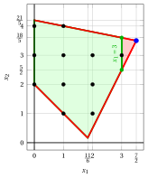{ .fig .ovale loading=lazy style="width:71%" }

            - The Gomory fractional cut generated by the second row is:

                \begin{align*}
                \underbrace{\left(-\frac{1}{22} - \left\lfloor -\frac{1}{22} \right\rfloor \right)}_{-\frac{1}{22}-(-1)=\frac{21}{22}} \; x_4
                + \underbrace{\left(\frac{2}{11} - \left\lfloor \frac{2}{11} \right\rfloor \right)}_{\frac{2}{11}-0=\frac{2}{11}} \; x_5
                \ge \underbrace{\left(\frac{7}{2} - \left\lfloor \frac{7}{2} \right\rfloor \right)}_{\frac{7}{2} -3=\frac{1}{2}}
                \end{align*}

                \begin{align*}
                \frac{21}{22}\;x_4 + \frac{2}{11}\;x_5 \ge \frac{1}{2}
                \quad \Rightarrow \quad
                21\;x_4 + 4\;x_5 \ge 11
                \end{align*}

                By subtracting a surplus variable, we obtain the Gomory fractional cut in standard form:

                $$
                \frac{21}{22}\;x_4 + \frac{2}{11}\;x_5 - x_6 = \frac{1}{2}
                \quad \Rightarrow \quad
                21\;x_4 + 4\;x_5 - 22\;x_6 = 11
                $$

                From the standard form of the $LP_1$ problem, we have:

                $$
                x_4= 7 - 4\;x_1 + 2\;x_2, \qquad x_5= 21 - x_1 - 5\;x_2.
                $$

                Substituting in the Gomory fractional cut, we can express it in terms of the original variables of the ILP problem:

                $$
                21\,(7 - 4\;x_1 + 2\;x_2) + 4\,(21 - x_1 - 5\;x_2) \ge 11
                \quad \Rightarrow \quad
                4\;x_1 - x_2 \le 10
                $$

                Effect of the Gomory fractional cut generated by the second row on the $LP_1$ problem in canonical form:

                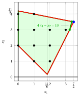{ .fig .ovale loading=lazy style="width:71%" }

                Both Gomory fractional cuts have the same right-hand side, equal to $\dfrac{1}{2}$. We select the Gomory fractional cut generated by the first row and we create the $LP_2$ problem by adding it to the $LP_1$ problem.

        - **b)** <strong>LP re-optimization phase</strong> 

            Let us consider the $LP_2$ problem in standard form:

            $$
            \begin{array}{rrrrrrrrrrrrrr}
            {\max} & {x_1} & {+} & {2\,x_2} &  &  &  &  &  &  &  &  &  &  \\[2ex]
            & {-x_1} & {-} & {x_2} & {+} & {x_3} &  &  &  &  &  &  & {=} & {-2} \\[2ex]
            & {4\,x_1} & {-} & {2\,x_2} &  &  & {+} & {x_4} &  &  &  &  & {=} & {7} \\[2ex]
            & {x_1} & {+} & {5\,x_2} &  &  &  &  & {+} & {x_5} &  &  & {=} & {21} \\[2ex]
            & {x_1} &  &  &  &  &  &  &  &  & {+} & {x_6} & {=} & {3} \\[2ex]
            & {x_1,} &  & {x_2,} &  & {x_3,} &  & {x_4,} &  & {x_5,} &  & {x_6} & {\ge} & {0}
            \end{array}
            $$

            For the added Gomory fractional cut we have:

            $$
            5\;x_4 + 2\;x_5 - 22\;x_6 = 11
            \quad \Rightarrow \quad
            x_6 = -\dfrac{1}{2} + \dfrac{5}{22}\;x_4 + \dfrac{1}{11}\;x_5
            $$

            We then add this equation to the previous optimal dictionary and we obtain the following dictionary :

            \begin{equation*}
            \begin{cases}
            \begin{array}{rrrrrrrrrrrrr}
            {x_1} & {=} & {\dfrac{7}{2}} & {-} & {\dfrac{5}{22}}\, {x_4} & {-} & {\dfrac{1}{11}}\, {x_5} \\[2ex]
            {x_2} & {=} & {\dfrac{7}{2}} & {+} & {\dfrac{1}{22}}\, {x_4} & {-} & {\dfrac{2}{11}}\, {x_5} \\[2ex]
            {x_3} & {=} & {5} & {-} & {\dfrac{2}{11}}\, {x_4} & {-} & {\dfrac{3}{11}}\, {x_5} \\[2ex]
            {x_6} & {=} & {-\dfrac{1}{2}} & {+} & {\dfrac{5}{22}}\, {x_4} & {+} & {\dfrac{1}{11}}\, {x_5} \\[2ex]
            {z} & {=} & {\dfrac{21}{2}} & {-} & {\dfrac{3}{22}}\, {x_4} & {-} & {\dfrac{5}{11}}\, {x_5}
            \end{array}
            \end{cases}
            \end{equation*}

            where  $\pazocal{B}=\{1,2,3,6\}$ and $\pazocal{N}=\{4,5\}$ and

            - the  basic primal non-feasible  solution is:

                $$
                \bar x_1=\dfrac{7}{2},~~
                \bar x_2=\dfrac{7}{2},~~
                \bar x_3=5,~~
                \bar x_6=-\dfrac{1}{2},~~~~~~
                \bar x_4=0,~~
                \bar x_5=0~~
                \text{  of value   }\dfrac{21}{2}
                $$

            - the basic dual feasible  solution is:

                $$
                \bar \pi_1=0,~~
                \bar \pi_2=0,~~
                \bar \pi_3=0,~~
                \bar \pi_6=0,~~~~~~
                \bar \pi_4=\dfrac{3}{22},~~
                \bar \pi_5=\dfrac{5}{11}~~
                \text{  of value   }\dfrac{21}{2}
                $$

            If we increase the value of $\pi_6$, we can get a better dual solution. We have:

            $$
            \begin{cases}
            \pi_4 &= \dfrac{3}{22} - \dfrac{5}{22}\,\pi_6 \\[2ex]
            \pi_5 &= \dfrac{5}{11} - \dfrac{1}{11}\,\pi_6
            \end{cases}
            \qquad
            \qquad
            \begin{cases}
            \underbrace{ \dfrac{3}{22} - \dfrac{5}{22}\,\pi_6 \ge 0}_{\pi_4 \ge 0} \\[2ex]
            \underbrace{  \dfrac{5}{11} - \dfrac{1}{11}\,\pi_6 \ge 0}_{\pi_5 \ge 0}
            \end{cases}
            \qquad
            \qquad
            \begin{cases}
            \pi_6 &\le  \dfrac{3}{5} \\[2ex]
            \pi_6 &\le  5
            \end{cases}
            $$

            By increasing the value of $\pi_6$ to $\min \left\{\dfrac{3}{5}, 5\right\}=\dfrac{3}{5}$,  the value of $\pi_4$ decreases to 0. Then we have that:

            - $\pi_6$ becomes a dual basic variable and accordingly $x_6$ becomes a primal non basic variable

            - $\pi_4$ becomes a dual non-basic variable and accordingly $x_4$ becomes a primal basic variable

            We have:

            $$
            x_6 = -\dfrac{1}{2} + \dfrac{5}{22}\, x_4 + \dfrac{1}{11}\, x_5
            \quad \Longrightarrow \quad
            x_4 = \dfrac{11}{5} - \dfrac{2}{5}\,x_5 + \dfrac{22}{5}\,x_6
            $$

            Substituting into the other equations of the primal dictionary, we get:

            $$
            x_1 = \dfrac{7}{2}  -  \dfrac{5}{22} \left( \dfrac{11}{5} - \dfrac{2}{5}\,x_5 + \dfrac{22}{5}\,x_6   \right) -  \dfrac{1}{11} x_5
            = 3 - x_6
            $$

            $$
            x_2 = \dfrac{7}{2}  +  \dfrac{1}{22} \left( \dfrac{11}{5} - \dfrac{2}{5}\,x_5 + \dfrac{22}{5}\,x_6   \right) -  \dfrac{2}{11} x_5
            = \dfrac{18}{5} - \dfrac{1}{5}\,x_5 + \dfrac{1}{5}\,x_6
            $$

            $$
            x_3 = 5  -  \dfrac{2}{11} \left( \dfrac{11}{5} - \dfrac{2}{5}\,x_5 + \dfrac{22}{5}\,x_6   \right) -  \dfrac{3}{11} x_5
            = \dfrac{23}{5} - \dfrac{1}{5}\,x_5 - \dfrac{4}{5}\,x_6
            $$

            $$
            z = \dfrac{21}{2}  -  \dfrac{3}{22} \left( \dfrac{11}{5} - \dfrac{2}{5}\,x_5 + \dfrac{22}{5}\,x_6   \right) -  \dfrac{5}{11} x_5
            = \dfrac{51}{5} - \dfrac{2}{5}\,x_5 - \dfrac{3}{5}\,x_6
            $$

            Accordingly, we now have the following optimal primal dictionary:

            \begin{equation*}
            \begin{cases}
            \begin{array}{rrrrrrrrrrrrr}
            {x_1} & {=} & {3} &  &  & {-} & {x_6} \\[2ex]
            {x_2} & {=} & {\dfrac{18}{5}} & {-} & {\dfrac{1}{5}}\, {x_5} & {+} & {\dfrac{1}{5}}\, {x_6} \\[2ex]
            {x_3} & {=} & {\dfrac{23}{5}} & {-} & {\dfrac{1}{5}}\, {x_5} & {-} & {\dfrac{4}{5}}\, {x_6} \\[2ex]
            {x_4} & {=} & {\dfrac{11}{5}} & {-} & {\dfrac{2}{5}}\, {x_5} & {+} & {\dfrac{22}{5}}\, {x_6} \\[2ex]
            {z} & {=} & {\dfrac{51}{5}} & {-} & {\dfrac{2}{5}}\, {x_5} & {-} & {\dfrac{3}{5}}\, {x_6}
            \end{array}
            \end{cases}
            \end{equation*}

            where  $\pazocal{B}=\{1,2,3,4\}$ and $\pazocal{N}=\{5,6\}$.

            - the basic primal optimal  solution is:

                $$
                \tilde x_1 = 3,~~
                \tilde x_2 = \dfrac{18}{5},~~
                \tilde x_3 = \dfrac{23}{5},~~
                \tilde x_4 = \dfrac{11}{5},~~
                \tilde x_5 = 0,~~
                \tilde x_6 = 0
                \qquad
                \text{of value  }  \dfrac{51}{5}
                $$

            - the basic dual optimal  solution is:

                $$
                \tilde \pi_1 = 0,~~
                \tilde \pi_2 = 0,~~
                \tilde \pi_3 = 0,~~
                \tilde \pi_4 = 0,~~
                \tilde \pi_5 = \dfrac{2}{5},~~
                \tilde \pi_6 = \dfrac{3}{5}
                \qquad
                \text{of value  }  \dfrac{51}{5}
                $$

            The optimal solution ${ \tilde{ \boldsymbol x}}(\,LP_2\,)$ is <strong>fractional</strong> and the $LP_2$ problem is <strong>feasible</strong>.

            We have the upper bound on the optimal value of the ILP problem:

            $$
            z(~ILP~) ~~\le~~  \underbrace{\left\lfloor \dfrac{51}{5} \right\rfloor}_{=10}
            $$

            For the $LP_2$ problem in canonical form, we have:

            $$
            \begin{array}{rrrrrr}
            {\max} & {x_1} & {+} & {2\,x_2} &  &  \\[2ex]
            & {-x_1} & {-} & {x_2} & {\le} & {-2} \\[2ex]
            & {4\,x_1} & {-} & {2\,x_2} & {\le} & {7} \\[2ex]
            & {x_1} & {+} & {5\,x_2} & {\le} & {21} \\[2ex]
            & {x_1} &  &  & {\le} & {3} \\[2ex]
            & {x_1,} &  & {x_2} & {\ge} & {0}
            \end{array}
            $$

            An optimal solution ${ \tilde{ \boldsymbol x}}(\,LP_2\,)$ is:

            $$
            \tilde{x}_1=3,\qquad \tilde{x}_2=\dfrac{18}{5}
            $$

            The optimal value is:

            $$
            z(~LP_2~)=\dfrac{51}{5}
            $$

            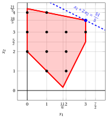{ .fig .ovale loading=lazy style="width:71%" }

    - <strong>Iteration 2</strong>

        - **a)** <strong>Cut generation phase</strong> 

            We have the following simplex dictionary associated with a fractional basic feasible solution of the $LP_2$ problem in standard form:

            \begin{equation*}
            \begin{cases}
            \begin{array}{rrrrrrrrrrrrr}
            {x_1} & {=} & {3} &  &  & {-} & {x_6} \\[2ex]
            {x_2} & {=} & {\dfrac{18}{5}} & {-} & {\dfrac{1}{5}}\, {x_5} & {+} & {\dfrac{1}{5}}\, {x_6} \\[2ex]
            {x_3} & {=} & {\dfrac{23}{5}} & {-} & {\dfrac{1}{5}}\, {x_5} & {-} & {\dfrac{4}{5}}\, {x_6} \\[2ex]
            {x_4} & {=} & {\dfrac{11}{5}} & {-} & {\dfrac{2}{5}}\, {x_5} & {+} & {\dfrac{22}{5}}\, {x_6} \\[2ex]
            {z} & {=} & {\dfrac{51}{5}} & {-} & {\dfrac{2}{5}}\, {x_5} & {-} & {\dfrac{3}{5}}\, {x_6}
            \end{array}
            \end{cases}
            \end{equation*}

            where

            \begin{equation*}
            { \bar{\boldsymbol A}}=
            \begin{pmatrix}
            0 & 1 \\[2ex]
            \frac{1}{5} & -\frac{1}{5} \\[2ex]
            \frac{1}{5} & \frac{4}{5} \\[2ex]
            \frac{2}{5} & -\frac{22}{5}
            \end{pmatrix}
            \qquad
            { \bar{\boldsymbol b}}=
            \begin{pmatrix}
            3\\[2ex]
            \frac{18}{5}\\[2ex]
            \frac{23}{5}\\[2ex]
            \frac{11}{5}
            \end{pmatrix}
            \end{equation*}

            - The Gomory fractional cut generated by the second row is:

                \begin{align*}
                \underbrace{\left(\frac{1}{5} - \left\lfloor \frac{1}{5} \right\rfloor \right)}_{\frac{1}{5}-0=\frac{1}{5}} \; x_5
                + \underbrace{\left(-\frac{1}{5} - \left\lfloor -\frac{1}{5} \right\rfloor \right)}_{-\frac{1}{5}-(-1)=\frac{4}{5}} \; x_6
                \ge \underbrace{\left(\frac{18}{5} - \left\lfloor \frac{18}{5} \right\rfloor \right)}_{\frac{18}{5} -3=\frac{3}{5}}
                \end{align*}

                \begin{align*}
                \frac{1}{5}\;x_5 + \frac{4}{5}\;x_6 \ge \frac{3}{5}
                \quad \Rightarrow \quad
                x_5 + 4\;x_6 \ge 3
                \end{align*}

                By subtracting a surplus variable, we obtain the Gomory fractional cut in standard form:

                $$
                \frac{1}{5}\;x_5 + \frac{4}{5}\;x_6 - x_7 = \frac{3}{5}
                \quad \Rightarrow \quad
                x_5 + 4\;x_6 - 5\;x_7 = 3
                $$

                From the standard form of the $LP_1$ problem and the added cut, we have:

                $$
                x_5= 21 - x_1 - 5\;x_2, \qquad x_6= 3 - x_1.
                $$

                Substituting in the Gomory fractional cut, we can express it in terms of the original variables of the ILP problem:

                $$
                (21 - x_1 - 5\;x_2) + 4\,(3 - x_1) \ge 3
                \quad \Rightarrow \quad
                x_1 + x_2 \le 6
                $$

                Effect of the Gomory fractional cut generated by the second row on the $LP_2$ problem in canonical form:

                { .fig .ovale loading=lazy style="width:71%" }

            - The Gomory fractional cut generated by the third row is:

                \begin{align*}
                \underbrace{\left(\frac{1}{5} - \left\lfloor \frac{1}{5} \right\rfloor \right)}_{\frac{1}{5}-0=\frac{1}{5}} \; x_5
                + \underbrace{\left(\frac{4}{5} - \left\lfloor \frac{4}{5} \right\rfloor \right)}_{\frac{4}{5}-0=\frac{4}{5}} \; x_6
                \ge \underbrace{\left(\frac{23}{5} - \left\lfloor \frac{23}{5} \right\rfloor \right)}_{\frac{23}{5} -4=\frac{3}{5}}
                \end{align*}

                \begin{align*}
                \frac{1}{5}\;x_5 + \frac{4}{5}\;x_6 \ge \frac{3}{5}
                \quad \Rightarrow \quad
                x_5 + 4\;x_6 \ge 3
                \end{align*}

                This Gomory fractional cut is the same as the one generated by the second row.

            - The Gomory fractional cut generated by the fourth row is:

                \begin{align*}
                \underbrace{\left(\frac{2}{5} - \left\lfloor \frac{2}{5} \right\rfloor \right)}_{\frac{2}{5}-0=\frac{2}{5}} \; x_5
                + \underbrace{\left(-\frac{22}{5} - \left\lfloor -\frac{22}{5} \right\rfloor \right)}_{-\frac{22}{5}-(-5)=\frac{3}{5}} \; x_6
                \ge \underbrace{\left(\frac{11}{5} - \left\lfloor \frac{11}{5} \right\rfloor \right)}_{\frac{11}{5} -2=\frac{1}{5}}
                \end{align*}

                \begin{align*}
                \frac{2}{5}\;x_5 + \frac{3}{5}\;x_6 \ge \frac{1}{5}
                \quad \Rightarrow \quad
                2\;x_5 + 3\;x_6 \ge 1
                \end{align*}

                By subtracting a surplus variable, we obtain the Gomory fractional cut in standard form:

                $$
                \frac{2}{5}\;x_5 + \frac{3}{5}\;x_6 - x_7 = \frac{1}{5}
                \quad \Rightarrow \quad
                2\;x_5 + 3\;x_6 - 5\;x_7 = 1
                $$

                From the standard form of the $LP_1$ problem and the added cut, we have:

                $$
                x_5= 21 - x_1 - 5\;x_2, \qquad x_6= 3 - x_1.
                $$

                Substituting in the Gomory fractional cut, we can express it in terms of the original variables of the ILP problem:

                $$
                2\,(21 - x_1 - 5\;x_2) + 3\,(3 - x_1) \ge 1
                \quad \Rightarrow \quad
                x_1 + 2\;x_2 \le 10
                $$

                Effect of the Gomory fractional cut generated by the fourth row on the $LP_2$ problem in canonical form:

                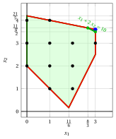{ .fig .ovale loading=lazy style="width:71%" }

                We select the Gomory fractional cut with the largest right-hand side and we create the $LP_3$ problem by adding it to the $LP_2$ problem.

        - **b)** <strong>LP re-optimization phase</strong> 

            Let us consider the $LP_3$ problem in standard form:

            $$
            \begin{array}{rrrrrrrrrrrrrrrr}
            {\max} & {x_1} & {+} & {2\,x_2} &  &  &  &  &  &  &  &  &  &  &  &  \\[2ex]
            & {-x_1} & {-} & {x_2} & {+} & {x_3} &  &  &  &  &  &  &  &  & {=} & {-2} \\[2ex]
            & {4\,x_1} & {-} & {2\,x_2} &  &  & {+} & {x_4} &  &  &  &  &  &  & {=} & {7} \\[2ex]
            & {x_1} & {+} & {5\,x_2} &  &  &  &  & {+} & {x_5} &  &  &  &  & {=} & {21} \\[2ex]
            & {x_1} &  &  &  &  &  &  &  &  & {+} & {x_6} &  &  & {=} & {3} \\[2ex]
            & {x_1} & {+} & {x_2} &  &  &  &  &  &  &  &  & {+} & {x_7} & {=} & {6} \\[2ex]
            & {x_1,} &  & {x_2,} &  & {x_3,} &  & {x_4,} &  & {x_5,} &  & {x_6,} &  & {x_7} & {\ge} & {0}
            \end{array}
            $$

            For the added Gomory fractional cut we have:

            $$
            x_5 + 4\;x_6 - 5\;x_7 = 3
            \quad \Rightarrow \quad
            x_7 = -\dfrac{3}{5} + \dfrac{1}{5}\;x_5 + \dfrac{4}{5}\;x_6
            $$

            We then add this equation to the previous optimal dictionary and we obtain the following dictionary :

            \begin{equation*}
            \begin{cases}
            \begin{array}{rrrrrrrrrrrrr}
            {x_1} & {=} & {3} &  &  & {-} & {x_6} \\[2ex]
            {x_2} & {=} & {\dfrac{18}{5}} & {-} & {\dfrac{1}{5}}\, {x_5} & {+} & {\dfrac{1}{5}}\, {x_6} \\[2ex]
            {x_3} & {=} & {\dfrac{23}{5}} & {-} & {\dfrac{1}{5}}\, {x_5} & {-} & {\dfrac{4}{5}}\, {x_6} \\[2ex]
            {x_4} & {=} & {\dfrac{11}{5}} & {-} & {\dfrac{2}{5}}\, {x_5} & {+} & {\dfrac{22}{5}}\, {x_6} \\[2ex]
            {x_7} & {=} & {-\dfrac{3}{5}} & {+} & {\dfrac{1}{5}}\, {x_5} & {+} & {\dfrac{4}{5}}\, {x_6} \\[2ex]
            {z} & {=} & {\dfrac{51}{5}} & {-} & {\dfrac{2}{5}}\, {x_5} & {-} & {\dfrac{3}{5}}\, {x_6}
            \end{array}
            \end{cases}
            \end{equation*}

            where  $\pazocal{B}=\{1,2,3,4,7\}$ and $\pazocal{N}=\{5,6\}$ and

            - the  basic primal non-feasible  solution is:

                $$
                \begin{gathered}
                \bar x_1=3,~~
                \bar x_2=\dfrac{18}{5},~~
                \bar x_3=\dfrac{23}{5},~~
                \bar x_4=\dfrac{11}{5},~~
                \bar x_7=-\dfrac{3}{5},\\[1ex]
                \bar x_5=0,~~
                \bar x_6=0~~
                \text{  of value   }\dfrac{51}{5}
                \end{gathered}
                $$

            - the basic dual feasible  solution is:

                $$
                \begin{gathered}
                \bar \pi_1=0,~~
                \bar \pi_2=0,~~
                \bar \pi_3=0,~~
                \bar \pi_4=0,~~
                \bar \pi_7=0,\\[1ex]
                \bar \pi_5=\dfrac{2}{5},~~
                \bar \pi_6=\dfrac{3}{5}~~
                \text{  of value   }\dfrac{51}{5}
                \end{gathered}
                $$

            If we increase the value of $\pi_7$, we can get a better dual solution. We have:

            $$
            \begin{cases}
            \pi_5 &= \dfrac{2}{5} - \dfrac{1}{5}\,\pi_7 \\[2ex]
            \pi_6 &= \dfrac{3}{5} - \dfrac{4}{5}\,\pi_7
            \end{cases}
            \qquad
            \qquad
            \begin{cases}
            \underbrace{ \dfrac{2}{5} - \dfrac{1}{5}\,\pi_7 \ge 0}_{\pi_5 \ge 0} \\[2ex]
            \underbrace{  \dfrac{3}{5} - \dfrac{4}{5}\,\pi_7 \ge 0}_{\pi_6 \ge 0}
            \end{cases}
            \qquad
            \qquad
            \begin{cases}
            \pi_7 &\le  2 \\[2ex]
            \pi_7 &\le  \dfrac{3}{4}
            \end{cases}
            $$

            By increasing the value of $\pi_7$ to $\min \left\{2, \dfrac{3}{4}\right\}=\dfrac{3}{4}$,  the value of $\pi_6$ decreases to 0. Then we have that:

            - $\pi_7$ becomes a dual basic variable and accordingly $x_7$ becomes a primal non basic variable

            - $\pi_6$ becomes a dual non-basic variable and accordingly $x_6$ becomes a primal basic variable

            We have:

            $$
            x_7 = -\dfrac{3}{5} + \dfrac{1}{5}\, x_5 + \dfrac{4}{5}\, x_6
            \quad \Longrightarrow \quad
            x_6 = \dfrac{3}{4} - \dfrac{1}{4}\,x_5 + \dfrac{5}{4}\,x_7
            $$

            Substituting into the other equations of the primal dictionary, we get:

            $$
            x_1 = 3 - \left( \dfrac{3}{4} - \dfrac{1}{4}\,x_5 + \dfrac{5}{4}\,x_7   \right)
            = \dfrac{9}{4} + \dfrac{1}{4}\,x_5 - \dfrac{5}{4}\,x_7
            $$

            $$
            x_2 = \dfrac{18}{5}  -  \dfrac{1}{5} x_5 +  \dfrac{1}{5} \left( \dfrac{3}{4} - \dfrac{1}{4}\,x_5 + \dfrac{5}{4}\,x_7   \right)
            = \dfrac{15}{4} - \dfrac{1}{4}\,x_5 + \dfrac{1}{4}\,x_7
            $$

            $$
            x_3 = \dfrac{23}{5}  -  \dfrac{1}{5} x_5 -  \dfrac{4}{5} \left( \dfrac{3}{4} - \dfrac{1}{4}\,x_5 + \dfrac{5}{4}\,x_7   \right)
            = 4 - x_7
            $$

            $$
            x_4 = \dfrac{11}{5}  -  \dfrac{2}{5} x_5 +  \dfrac{22}{5} \left( \dfrac{3}{4} - \dfrac{1}{4}\,x_5 + \dfrac{5}{4}\,x_7   \right)
            = \dfrac{11}{2} - \dfrac{3}{2}\,x_5 + \dfrac{11}{2}\,x_7
            $$

            $$
            z = \dfrac{51}{5}  -  \dfrac{2}{5} x_5 -  \dfrac{3}{5} \left( \dfrac{3}{4} - \dfrac{1}{4}\,x_5 + \dfrac{5}{4}\,x_7   \right)
            = \dfrac{39}{4} - \dfrac{1}{4}\,x_5 - \dfrac{3}{4}\,x_7
            $$

            Accordingly, we now have the following optimal primal dictionary:

            \begin{equation*}
            \begin{cases}
            \begin{array}{rrrrrrrrrrrrr}
            {x_1} & {=} & {\dfrac{9}{4}} & {+} & {\dfrac{1}{4}}\, {x_5} & {-} & {\dfrac{5}{4}}\, {x_7} \\[2ex]
            {x_2} & {=} & {\dfrac{15}{4}} & {-} & {\dfrac{1}{4}}\, {x_5} & {+} & {\dfrac{1}{4}}\, {x_7} \\[2ex]
            {x_3} & {=} & {4} &  &  & {-} & {x_7} \\[2ex]
            {x_4} & {=} & {\dfrac{11}{2}} & {-} & {\dfrac{3}{2}}\, {x_5} & {+} & {\dfrac{11}{2}}\, {x_7} \\[2ex]
            {x_6} & {=} & {\dfrac{3}{4}} & {-} & {\dfrac{1}{4}}\, {x_5} & {+} & {\dfrac{5}{4}}\, {x_7} \\[2ex]
            {z} & {=} & {\dfrac{39}{4}} & {-} & {\dfrac{1}{4}}\, {x_5} & {-} & {\dfrac{3}{4}}\, {x_7}
            \end{array}
            \end{cases}
            \end{equation*}

            where  $\pazocal{B}=\{1,2,3,4,6\}$ and $\pazocal{N}=\{5,7\}$.

            - the basic primal optimal  solution is:

                $$
                \begin{gathered}
                \tilde x_1 = \dfrac{9}{4},~~
                \tilde x_2 = \dfrac{15}{4},~~
                \tilde x_3 = 4,~~
                \tilde x_4 = \dfrac{11}{2},~~
                \tilde x_6 = \dfrac{3}{4},~~
                \tilde x_5 = 0,~~
                \tilde x_7 = 0\\[1ex]
                \text{of value  }  \dfrac{39}{4}
                \end{gathered}
                $$

            - the basic dual optimal  solution is:

                $$
                \begin{gathered}
                \tilde \pi_1 = 0,~~
                \tilde \pi_2 = 0,~~
                \tilde \pi_3 = 0,~~
                \tilde \pi_4 = 0,~~
                \tilde \pi_6 = 0,~~
                \tilde \pi_5 = \dfrac{1}{4},~~
                \tilde \pi_7 = \dfrac{3}{4}\\[1ex]
                \text{of value  }  \dfrac{39}{4}
                \end{gathered}
                $$

            The optimal solution ${ \tilde{ \boldsymbol x}}(\,LP_3\,)$ is <strong>fractional</strong> and the $LP_3$ problem is <strong>feasible</strong>.

            We have the upper bound on the optimal value of the ILP problem:

            $$
            z(~ILP~) ~~\le~~  \underbrace{\left\lfloor \dfrac{39}{4} \right\rfloor}_{=9}
            $$

            For the $LP_3$ problem in canonical form, we have:

            $$
            \begin{array}{rrrrrr}
            {\max} & {x_1} & {+} & {2\,x_2} &  &  \\[2ex]
            & {-x_1} & {-} & {x_2} & {\le} & {-2} \\[2ex]
            & {4\,x_1} & {-} & {2\,x_2} & {\le} & {7} \\[2ex]
            & {x_1} & {+} & {5\,x_2} & {\le} & {21} \\[2ex]
            & {x_1} &  &  & {\le} & {3} \\[2ex]
            & {x_1} & {+} & {x_2} & {\le} & {6} \\[2ex]
            & {x_1,} &  & {x_2} & {\ge} & {0}
            \end{array}
            $$

            An optimal solution ${ \tilde{ \boldsymbol x}}(\,LP_3\,)$ is:

            $$
            \tilde{x}_1=\dfrac{9}{4},\qquad \tilde{x}_2=\dfrac{15}{4}
            $$

            The optimal value is:

            $$
            z(~LP_3~)=\dfrac{39}{4}
            $$

            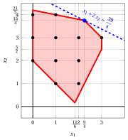{ .fig .ovale loading=lazy style="width:71%" }

    - <strong>Iteration 3</strong>

        - **a)** <strong>Cut generation phase</strong> 

            We have the following simplex dictionary associated with a fractional basic feasible solution of the $LP_3$ problem in standard form:

            \begin{equation*}
            \begin{cases}
            \begin{array}{rrrrrrrrrrrrr}
            {x_1} & {=} & {\dfrac{9}{4}} & {+} & {\dfrac{1}{4}}\, {x_5} & {-} & {\dfrac{5}{4}}\, {x_7} \\[2ex]
            {x_2} & {=} & {\dfrac{15}{4}} & {-} & {\dfrac{1}{4}}\, {x_5} & {+} & {\dfrac{1}{4}}\, {x_7} \\[2ex]
            {x_3} & {=} & {4} &  &  & {-} & {x_7} \\[2ex]
            {x_4} & {=} & {\dfrac{11}{2}} & {-} & {\dfrac{3}{2}}\, {x_5} & {+} & {\dfrac{11}{2}}\, {x_7} \\[2ex]
            {x_6} & {=} & {\dfrac{3}{4}} & {-} & {\dfrac{1}{4}}\, {x_5} & {+} & {\dfrac{5}{4}}\, {x_7} \\[2ex]
            {z} & {=} & {\dfrac{39}{4}} & {-} & {\dfrac{1}{4}}\, {x_5} & {-} & {\dfrac{3}{4}}\, {x_7}
            \end{array}
            \end{cases}
            \end{equation*}

            where

            \begin{equation*}
            { \bar{\boldsymbol A}}=
            \begin{pmatrix}
            -\frac{1}{4} & \frac{5}{4} \\[2ex]
            \frac{1}{4} & -\frac{1}{4} \\[2ex]
            0 & 1 \\[2ex]
            \frac{3}{2} & -\frac{11}{2} \\[2ex]
            \frac{1}{4} & -\frac{5}{4}
            \end{pmatrix}
            \qquad
            { \bar{\boldsymbol b}}=
            \begin{pmatrix}
            \frac{9}{4}\\[2ex]
            \frac{15}{4}\\[2ex]
            4\\[2ex]
            \frac{11}{2}\\[2ex]
            \frac{3}{4}
            \end{pmatrix}
            \end{equation*}

            - The Gomory fractional cut generated by the first row is:

                \begin{align*}
                \underbrace{\left(-\frac{1}{4} - \left\lfloor -\frac{1}{4} \right\rfloor \right)}_{-\frac{1}{4}-(-1)=\frac{3}{4}} \; x_5
                + \underbrace{\left(\frac{5}{4} - \left\lfloor \frac{5}{4} \right\rfloor \right)}_{\frac{5}{4}-1=\frac{1}{4}} \; x_7
                \ge \underbrace{\left(\frac{9}{4} - \left\lfloor \frac{9}{4} \right\rfloor \right)}_{\frac{9}{4} -2=\frac{1}{4}}
                \end{align*}

                \begin{align*}
                \frac{3}{4}\;x_5 + \frac{1}{4}\;x_7 \ge \frac{1}{4}
                \quad \Rightarrow \quad
                3\;x_5 + x_7 \ge 1
                \end{align*}

                By subtracting a surplus variable, we obtain the Gomory fractional cut in standard form:

                $$
                \frac{3}{4}\;x_5 + \frac{1}{4}\;x_7 - x_8 = \frac{1}{4}
                \quad \Rightarrow \quad
                3\;x_5 + x_7 - 4\;x_8 = 1
                $$

                From the standard form of the $LP_1$ problem and the cut added at iteration 2 (the $LP_3$ problem), we have:

                $$
                x_5= 21 - x_1 - 5\;x_2, \qquad x_7= 6 - x_1 - x_2.
                $$

                Substituting in the Gomory fractional cut, we can express it in terms of the original variables of the ILP problem:

                $$
                3\,(21 - x_1 - 5\;x_2) + (6 - x_1 - x_2) \ge 1
                \quad \Rightarrow \quad
                x_1 + 4\;x_2 \le 17
                $$

                Effect of the Gomory fractional cut generated by the first row on the $LP_3$ problem in canonical form:

                { .fig .ovale loading=lazy style="width:71%" }

            - The Gomory fractional cut generated by the second row is:

                \begin{align*}
                \underbrace{\left(\frac{1}{4} - \left\lfloor \frac{1}{4} \right\rfloor \right)}_{\frac{1}{4}-0=\frac{1}{4}} \; x_5
                + \underbrace{\left(-\frac{1}{4} - \left\lfloor -\frac{1}{4} \right\rfloor \right)}_{-\frac{1}{4}-(-1)=\frac{3}{4}} \; x_7
                \ge \underbrace{\left(\frac{15}{4} - \left\lfloor \frac{15}{4} \right\rfloor \right)}_{\frac{15}{4} -3=\frac{3}{4}}
                \end{align*}

                \begin{align*}
                \frac{1}{4}\;x_5 + \frac{3}{4}\;x_7 \ge \frac{3}{4}
                \quad \Rightarrow \quad
                x_5 + 3\;x_7 \ge 3
                \end{align*}

                By subtracting a surplus variable, we obtain the Gomory fractional cut in standard form:

                $$
                \frac{1}{4}\;x_5 + \frac{3}{4}\;x_7 - x_8 = \frac{3}{4}
                \quad \Rightarrow \quad
                x_5 + 3\;x_7 - 4\;x_8 = 3
                $$

                From the standard form of the $LP_1$ problem and the cut added at iteration 2 (the $LP_3$ problem), we have:

                $$
                x_5= 21 - x_1 - 5\;x_2, \qquad x_7= 6 - x_1 - x_2.
                $$

                Substituting in the Gomory fractional cut, we can express it in terms of the original variables of the ILP problem:

                $$
                (21 - x_1 - 5\;x_2) + 3\,(6 - x_1 - x_2) \ge 3
                \quad \Rightarrow \quad
                x_1 + 2\;x_2 \le 9
                $$

                Effect of the Gomory fractional cut generated by the second row on the $LP_3$ problem in canonical form:

                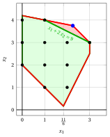{ .fig .ovale loading=lazy style="width:71%" }

            - The Gomory fractional cut generated by the fourth row is:

                \begin{align*}
                \underbrace{\left(\frac{3}{2} - \left\lfloor \frac{3}{2} \right\rfloor \right)}_{\frac{3}{2}-1=\frac{1}{2}} \; x_5
                + \underbrace{\left(-\frac{11}{2} - \left\lfloor -\frac{11}{2} \right\rfloor \right)}_{-\frac{11}{2}-(-6)=\frac{1}{2}} \; x_7
                \ge \underbrace{\left(\frac{11}{2} - \left\lfloor \frac{11}{2} \right\rfloor \right)}_{\frac{11}{2} -5=\frac{1}{2}}
                \end{align*}

                \begin{align*}
                \frac{1}{2}\;x_5 + \frac{1}{2}\;x_7 \ge \frac{1}{2}
                \quad \Rightarrow \quad
                x_5 + x_7 \ge 1
                \end{align*}

                By subtracting a surplus variable, we obtain the Gomory fractional cut in standard form:

                $$
                \frac{1}{2}\;x_5 + \frac{1}{2}\;x_7 - x_8 = \frac{1}{2}
                \quad \Rightarrow \quad
                x_5 + x_7 - 2\;x_8 = 1
                $$

                From the standard form of the $LP_1$ problem and the cut added at iteration 2 (the $LP_3$ problem), we have:

                $$
                x_5= 21 - x_1 - 5\;x_2, \qquad x_7= 6 - x_1 - x_2.
                $$

                Substituting in the Gomory fractional cut, we can express it in terms of the original variables of the ILP problem:

                $$
                (21 - x_1 - 5\;x_2) + (6 - x_1 - x_2) \ge 1
                \quad \Rightarrow \quad
                x_1 + 3\;x_2 \le 13
                $$

                Effect of the Gomory fractional cut generated by the fourth row on the $LP_3$ problem in canonical form:

                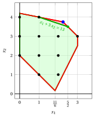{ .fig .ovale loading=lazy style="width:71%" }

            - The Gomory fractional cut generated by the fifth row is:

                \begin{align*}
                \underbrace{\left(\frac{1}{4} - \left\lfloor \frac{1}{4} \right\rfloor \right)}_{\frac{1}{4}-0=\frac{1}{4}} \; x_5
                + \underbrace{\left(-\frac{5}{4} - \left\lfloor -\frac{5}{4} \right\rfloor \right)}_{-\frac{5}{4}-(-2)=\frac{3}{4}} \; x_7
                \ge \underbrace{\left(\frac{3}{4} - \left\lfloor \frac{3}{4} \right\rfloor \right)}_{\frac{3}{4} -0=\frac{3}{4}}
                \end{align*}

                \begin{align*}
                \frac{1}{4}\;x_5 + \frac{3}{4}\;x_7 \ge \frac{3}{4}
                \quad \Rightarrow \quad
                x_5 + 3\;x_7 \ge 3
                \end{align*}

                This Gomory fractional cut is the same as the one generated by the second row.

                We select the Gomory fractional cut with the largest right-hand side and we create the $LP_4$ problem by adding it to the $LP_3$ problem.

        - **b)** <strong>LP re-optimization phase</strong> 

            Let us consider the $LP_4$ problem in standard form:

            $$
            \begin{array}{rrrrrrrrrrrrrrrrrr}
            {\max} & {x_1} & {+} & {2\,x_2} &  &  &  &  &  &  &  &  &  &  &  &  &  &  \\[2ex]
            & {-x_1} & {-} & {x_2} & {+} & {x_3} &  &  &  &  &  &  &  &  &  &  & {=} & {-2} \\[2ex]
            & {4\,x_1} & {-} & {2\,x_2} &  &  & {+} & {x_4} &  &  &  &  &  &  &  &  & {=} & {7} \\[2ex]
            & {x_1} & {+} & {5\,x_2} &  &  &  &  & {+} & {x_5} &  &  &  &  &  &  & {=} & {21} \\[2ex]
            & {x_1} &  &  &  &  &  &  &  &  & {+} & {x_6} &  &  &  &  & {=} & {3} \\[2ex]
            & {x_1} & {+} & {x_2} &  &  &  &  &  &  &  &  & {+} & {x_7} &  &  & {=} & {6} \\[2ex]
            & {x_1} & {+} & {2\,x_2} &  &  &  &  &  &  &  &  &  &  & {+} & {x_8} & {=} & {9} \\[2ex]
            & {x_1,} &  & {x_2,} &  & {x_3,} &  & {x_4,} &  & {x_5,} &  & {x_6,} &  & {x_7,} &  & {x_8} & {\ge} & {0}
            \end{array}
            $$

            For the added Gomory fractional cut we have:

            $$
            x_5 + 3\;x_7 - 4\;x_8 = 3
            \quad \Rightarrow \quad
            x_8 = -\dfrac{3}{4} + \dfrac{1}{4}\;x_5 + \dfrac{3}{4}\;x_7
            $$

            We then add this equation to the previous optimal dictionary and we obtain the following dictionary :

            \begin{equation*}
            \begin{cases}
            \begin{array}{rrrrrrrrrrrrr}
            {x_1} & {=} & {\dfrac{9}{4}} & {+} & {\dfrac{1}{4}}\, {x_5} & {-} & {\dfrac{5}{4}}\, {x_7} \\[2ex]
            {x_2} & {=} & {\dfrac{15}{4}} & {-} & {\dfrac{1}{4}}\, {x_5} & {+} & {\dfrac{1}{4}}\, {x_7} \\[2ex]
            {x_3} & {=} & {4} &  &  & {-} & {x_7} \\[2ex]
            {x_4} & {=} & {\dfrac{11}{2}} & {-} & {\dfrac{3}{2}}\, {x_5} & {+} & {\dfrac{11}{2}}\, {x_7} \\[2ex]
            {x_6} & {=} & {\dfrac{3}{4}} & {-} & {\dfrac{1}{4}}\, {x_5} & {+} & {\dfrac{5}{4}}\, {x_7} \\[2ex]
            {x_8} & {=} & {-\dfrac{3}{4}} & {+} & {\dfrac{1}{4}}\, {x_5} & {+} & {\dfrac{3}{4}}\, {x_7} \\[2ex]
            {z} & {=} & {\dfrac{39}{4}} & {-} & {\dfrac{1}{4}}\, {x_5} & {-} & {\dfrac{3}{4}}\, {x_7}
            \end{array}
            \end{cases}
            \end{equation*}

            where  $\pazocal{B}=\{1,2,3,4,6,8\}$ and $\pazocal{N}=\{5,7\}$ and

            - the  basic primal non-feasible  solution is:

                $$
                \begin{gathered}
                \bar x_1=\dfrac{9}{4},~~
                \bar x_2=\dfrac{15}{4},~~
                \bar x_3=4,~~
                \bar x_4=\dfrac{11}{2},~~
                \bar x_6=\dfrac{3}{4},~~
                \bar x_8=-\dfrac{3}{4},\\[1ex]
                \bar x_5=0,~~
                \bar x_7=0~~
                \text{  of value   }\dfrac{39}{4}
                \end{gathered}
                $$

            - the basic dual feasible  solution is:

                $$
                \begin{gathered}
                \bar \pi_1=0,~~
                \bar \pi_2=0,~~
                \bar \pi_3=0,~~
                \bar \pi_4=0,~~
                \bar \pi_6=0,~~
                \bar \pi_8=0,\\[1ex]
                \bar \pi_5=\dfrac{1}{4},~~
                \bar \pi_7=\dfrac{3}{4}~~
                \text{  of value   }\dfrac{39}{4}
                \end{gathered}
                $$

            If we increase the value of $\pi_8$, we can get a better dual solution. We have:

            $$
            \begin{cases}
            \pi_5 &= \dfrac{1}{4} - \dfrac{1}{4}\,\pi_8 \\[2ex]
            \pi_7 &= \dfrac{3}{4} - \dfrac{3}{4}\,\pi_8
            \end{cases}
            \qquad
            \qquad
            \begin{cases}
            \underbrace{ \dfrac{1}{4} - \dfrac{1}{4}\,\pi_8 \ge 0}_{\pi_5 \ge 0} \\[2ex]
            \underbrace{  \dfrac{3}{4} - \dfrac{3}{4}\,\pi_8 \ge 0}_{\pi_7 \ge 0}
            \end{cases}
            \qquad
            \qquad
            \begin{cases}
            \pi_8 &\le  1 \\[2ex]
            \pi_8 &\le  1
            \end{cases}
            $$

            By increasing the value of $\pi_8$ to $\min \left\{1, 1\right\}=1$, the values of $\pi_5$ and $\pi_7$ decrease to 0 <strong>at the same time</strong>: the ratio test is tied. We choose to make $x_5$ enter the primal basis (the choice of $x_7$ instead would lead to the other optimal vertex $(1,4)$, also with value $9$: the ILP problem has two optimal solutions, $(3,3)$ and $(1,4)$). Then we have that:

            - $\pi_8$ becomes a dual basic variable and accordingly $x_8$ becomes a primal non basic variable

            - $\pi_5$ becomes a dual non-basic variable and accordingly $x_5$ becomes a primal basic variable

            We have:

            $$
            x_8 = -\dfrac{3}{4} + \dfrac{1}{4}\, x_5 + \dfrac{3}{4}\, x_7
            \quad \Longrightarrow \quad
            x_5 = 3 - 3\,x_7 + 4\,x_8
            $$

            Substituting into the other equations of the primal dictionary, we get:

            $$
            x_1 = \dfrac{9}{4} + \dfrac{1}{4} \left( 3 - 3\,x_7 + 4\,x_8 \right) - \dfrac{5}{4}\,x_7
            = 3 - 2\,x_7 + x_8
            $$

            $$
            x_2 = \dfrac{15}{4} - \dfrac{1}{4} \left( 3 - 3\,x_7 + 4\,x_8 \right) + \dfrac{1}{4}\,x_7
            = 3 + x_7 - x_8
            $$

            $$
            x_3 = 4 - x_7
            $$

            $$
            x_4 = \dfrac{11}{2} - \dfrac{3}{2} \left( 3 - 3\,x_7 + 4\,x_8 \right) + \dfrac{11}{2}\,x_7
            = 1 + 10\,x_7 - 6\,x_8
            $$

            $$
            x_6 = \dfrac{3}{4} - \dfrac{1}{4} \left( 3 - 3\,x_7 + 4\,x_8 \right) + \dfrac{5}{4}\,x_7
            = 2\,x_7 - x_8
            $$

            $$
            z = \dfrac{39}{4} - \dfrac{1}{4} \left( 3 - 3\,x_7 + 4\,x_8 \right) - \dfrac{3}{4}\,x_7
            = 9 - x_8
            $$

            Accordingly, we now have the following optimal primal dictionary:

            \begin{equation*}
            \begin{cases}
            \begin{array}{rrrrrrrrrrrrr}
            {x_1} & {=} & {3} & {-} & {2}\, {x_7} & {+} & {x_8} \\[2ex]
            {x_2} & {=} & {3} & {+} & {x_7} & {-} & {x_8} \\[2ex]
            {x_3} & {=} & {4} & {-} & {x_7} &  &  \\[2ex]
            {x_4} & {=} & {1} & {+} & {10}\, {x_7} & {-} & {6}\, {x_8} \\[2ex]
            {x_5} & {=} & {3} & {-} & {3}\, {x_7} & {+} & {4}\, {x_8} \\[2ex]
            {x_6} & {=} & {0} & {+} & {2}\, {x_7} & {-} & {x_8} \\[2ex]
            {z} & {=} & {9} &  &  & {-} & {x_8}
            \end{array}
            \end{cases}
            \end{equation*}

            where  $\pazocal{B}=\{1,2,3,4,5,6\}$ and $\pazocal{N}=\{7,8\}$.

            - the basic primal optimal  solution is:

                $$
                \begin{gathered}
                \tilde x_1 = 3,~~
                \tilde x_2 = 3,~~
                \tilde x_3 = 4,~~
                \tilde x_4 = 1,~~
                \tilde x_5 = 3,~~
                \tilde x_6 = 0,~~
                \tilde x_7 = 0,~~
                \tilde x_8 = 0\\[1ex]
                \text{of value  }  9
                \end{gathered}
                $$

            - the basic dual optimal  solution is:

                $$
                \begin{gathered}
                \tilde \pi_1 = 0,~~
                \tilde \pi_2 = 0,~~
                \tilde \pi_3 = 0,~~
                \tilde \pi_4 = 0,~~
                \tilde \pi_5 = 0,~~
                \tilde \pi_6 = 0,~~
                \tilde \pi_7 = 0,~~
                \tilde \pi_8 = 1\\[1ex]
                \text{of value  }  9
                \end{gathered}
                $$

            !!! chiave ""

                The optimal solution ${ \tilde{ \boldsymbol x}}(\,LP_4\,)$ is <strong>integer</strong>. Accordingly, an optimal solution ${ \tilde{ \boldsymbol x}}(\,ILP\,)$ is:

                $$
                \tilde{x}_1=3,~~\tilde{x}_2=3
                $$

                The optimal value $z(~ILP~)$ is $9$.

            For the $LP_4$ problem in canonical form, we have:

            $$
            \begin{array}{rrrrrr}
            {\max} & {x_1} & {+} & {2\,x_2} &  &  \\[2ex]
            & {-x_1} & {-} & {x_2} & {\le} & {-2} \\[2ex]
            & {4\,x_1} & {-} & {2\,x_2} & {\le} & {7} \\[2ex]
            & {x_1} & {+} & {5\,x_2} & {\le} & {21} \\[2ex]
            & {x_1} &  &  & {\le} & {3} \\[2ex]
            & {x_1} & {+} & {x_2} & {\le} & {6} \\[2ex]
            & {x_1} & {+} & {2\,x_2} & {\le} & {9} \\[2ex]
            & {x_1,} &  & {x_2} & {\ge} & {0}
            \end{array}
            $$

            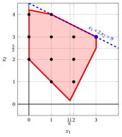{ .fig .ovale loading=lazy style="width:71%" }
