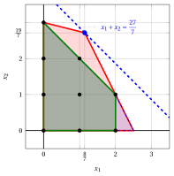

# Exercises · Ideal formulations

**Exercises · Chapter 3** · each solution opens with a click · [:material-book-open-variant: Chapter 3: Ideal formulations](../formulations/ideal-formulations.md) · [:material-file-pdf-box: Exercises, volume 1 (PDF)](../pdf/exercises-1-models-bounds-formulations.pdf)

!!! esercizio "Exercise 3.1: Convex hull and ideal formulation (P8)"

    !!! nota ""

        Consider the following ILP problem in canonical maximization form with $n=2$ integer variables and $m=2$ constraints:

        $$
        \begin{array}{rrrrrrr}
        {\max} & {x_1} & {+} & {2}\, {x_2} \\[1.5ex]
        & {-}{x_1} & {+} & {2}\, {x_2} & {\le} & {2} \\[1.5ex]
        & {x_1} & {+} & {x_2} & {\le} & {3} \\[1.5ex]
        & {x_1,} &  & {x_2} & {\in} & {\Z_{\ge 0}}
        \end{array}
        $$

    **Questions**

    1. List the feasible solutions and compute the convex hull $\mathrm{conv}(F)$ of the feasible region. Classify the feasible solutions as vertices, boundary points or interior points of the hull.

    2. Describe $\mathrm{conv}(F)$ with linear inequalities and write the corresponding ideal formulation.

    3. Solve the LP relaxation of the given formulation and the LP problem over the ideal formulation, and compare the two upper bounds.

??? soluzione "Solution"

    1. For $x_2 = 0$ the constraints give $x_1 \le 3$, for $x_2 = 1$ they give $x_1 \le 2$, and for $x_2 = 2$ they require $x_1 \ge 2$ and $x_1 \le 1$. The feasible region has the $7$ points

        $$
        (0,0), \quad (1,0), \quad (2,0), \quad (3,0), \quad (0,1), \quad (1,1), \quad (2,1).
        $$

        Graphically, we have:

        { .fig .ovale loading=lazy  }

        <em>The polyhedron of the formulation (red) and the convex hull of the integer points (green): vertices of the hull as black squares, the other integer points as black dots.</em>

        The convex hull $\mathrm{conv}(F)$ is the quadrilateral with

        - the $4$ <strong>vertices</strong> $(0,0)$, $(3,0)$, $(0,1)$, $(2,1)$;

        - $3$ points on the boundary, $(1,0)$, $(2,0)$, $(1,1)$;

        - no point in the interior.

    2. The edges of the hull lie on the lines

        $$
        x_1 + x_2 = 3,\qquad x_2 = 1,
        $$

        together with the axes $x_1 = 0$ and $x_2 = 0$. The ideal formulation is therefore

        $$
        \begin{array}{rrrrrrr}
        {\max} & {x_1} & {+} & {2}\, {x_2} \\[1.5ex]
        & {x_1} & {+} & {x_2} & {\le} & {3} \\[1.5ex]
        &  &  & {x_2} & {\le} & {1} \\[1.5ex]
        & {x_1,} &  & {x_2} & {\ge} & {0}
        \end{array}
        $$

        Its integer points are the same $7$ points of $F$, and its polyhedron has only integer vertices.

    3. For the given formulation the optimal vertex is the intersection of the lines of constraints 1 and 2:

        $$
        \begin{cases}
        -x_1 + 2\,x_2 = 2 \\
        x_1 + x_2 = 3
        \end{cases}
        \qquad\Longrightarrow\qquad x_1 = \dfrac{4}{3}, \quad x_2 = \dfrac{5}{3}
        $$

        with $z(\LP) = \dfrac{14}{3}$ and the bound $\lfloor z(\LP) \rfloor = 4$. Over the ideal formulation the optimal vertex is the integer point $(2,1)$, with value $4$.

        !!! chiave ""

            The LP problem over the ideal formulation gives $z = 4 = z(\ILP)$ at the integer vertex $(2,1)$; the given formulation gives only the bound $z(\LP) = \dfrac{14}{3}$, rounded down to $4$.

!!! esercizio "Exercise 3.2: Ideal formulation (P3)"

    !!! nota ""

        Consider the following ILP problem in canonical maximization form with $n=2$ integer variables and $m=2$ constraints:

        $$
        \begin{array}{rrrrrrr}
        {\max} & {2}\, {x_1} & {+} & {4}\, {x_2} \\[1.5ex]
        & {-}{x_1} & {+} & {x_2} & {\le} & {2} \\[1.5ex]
        & {8}\, {x_1} & {+} & {2}\, {x_2} & {\le} & {19} \\[1.5ex]
        & {x_1,} &  & {x_2} & {\in} & {\Z_{\ge 0}}
        \end{array}
        $$

    **Questions**

    1. Compute the convex hull $\mathrm{conv}(F)$ of the feasible region and classify the feasible solutions as vertices, boundary points or interior points.

    2. Write an ideal formulation of the ILP problem.

    3. The optimal solution of the LP relaxation of the given formulation is $\tilde{\vet x}(\LP) = (\tfrac{3}{2},\tfrac{7}{2})$. Show that it does not belong to $\mathrm{conv}(F)$, and conclude that the given formulation is not ideal.

    4. Compare the upper bounds of the two formulations.

??? soluzione "Solution"

    1. The feasible region has $9$ points. Graphically, we have:

        { .fig .ovale loading=lazy  }

        <em>The polyhedron of the given formulation (red), the convex hull of the integer points (green) with its vertices (black squares), and the optimal solution of the LP relaxation (blue), outside the hull.</em>

        The convex hull $\mathrm{conv}(F)$ is a polygon with

        - the $5$ <strong>vertices</strong> $(0,0)$, $(2,0)$, $(2,1)$, $(0,2)$, $(1,3)$;

        - $2$ points on the boundary, $(1,0)$, $(0,1)$;

        - $2$ points in the interior, $(1,1)$, $(1,2)$.

    2. The edges of the hull lie on the lines $x_1 = 2$, $2\,x_1 + x_2 = 5$, $-x_1 + x_2 = 2$ and on the axes. The ideal formulation is

        $$
        \begin{array}{rrrrrrr}
        {\max} & {2}\, {x_1} & {+} & {4}\, {x_2} \\[1.5ex]
        & {x_1} &  &  & {\le} & {2} \\[1.5ex]
        & {2}\, {x_1} & {+} & {x_2} & {\le} & {5} \\[1.5ex]
        & {-}{x_1} & {+} & {x_2} & {\le} & {2} \\[1.5ex]
        & {x_1,} &  & {x_2} & {\ge} & {0}
        \end{array}
        $$

    3. The point $(\tfrac{3}{2},\tfrac{7}{2})$ violates the inequality $2\,x_1 + x_2 \le 5$ of the hull: $2 \cdot \tfrac{3}{2} + 1 \cdot \tfrac{7}{2} = \tfrac{13}{2} > 5$. Every point of $\mathrm{conv}(F)$ satisfies this inequality, so $\tilde{\vet x}(\LP) \notin \mathrm{conv}(F)$ and $\mathrm{conv}(F) \subsetneq P$: the given formulation is <strong>not ideal</strong>.

    4. The given formulation gives $z(\LP) = 17$, hence $z(\ILP) \le 17$. The ideal formulation has the optimal vertex $(1,3)$, with value $14$.

        !!! chiave ""

            The ideal formulation gives the exact value $z(\ILP) = 14$, attained at the integer vertex $(1,3)$; the given formulation gives the weaker bound $17$.

!!! esercizio "Exercise 3.3: Comparing formulations (P23)"

    !!! nota ""

        Consider the ILP problem in canonical maximization form

        $$
        \begin{array}{rrrrrrr}
        {\max} & {x_1} & {+} & {4}\, {x_2} \\[1.5ex]
        & {3}\, {x_1} & {+} & {8}\, {x_2} & {\le} & {24} \\[1.5ex]
        & {-}{x_1} &  &  & {\le} & {-1} \\[1.5ex]
        &  &  & {-}{x_2} & {\le} & {-1} \\[1.5ex]
        & {x_1,} &  & {x_2} & {\in} & {\Z_{\ge 0}}
        \end{array}
        $$

        and the two polyhedra (both with $x_1, x_2 \ge 0$)

        $$
        \begin{aligned}
        P_A &= \{\, 3\,x_1 + 8\,x_2 \le 24,~ x_1 \ge 1,~ x_2 \ge 1 \,\}, \\
        P_B &= \{\, x_1 + 3\,x_2 \le 8,~ x_1 \le 5,~ x_1 \ge 1,~ x_2 \ge 1 \,\}.
        \end{aligned}
        $$

    **Questions**

    1. Show that $P_A$ and $P_B$ are two formulations of the same ILP problem.

    2. Compute the vertices of $P_A$ and $P_B$, and decide which formulation is stronger.

    3. Compare the upper bounds given by the LP relaxations of the two formulations.

    4. Is $P_B$ an ideal formulation?

??? soluzione "Solution"

    1. In both polyhedra $x_1 \ge 1$ and $x_2 \ge 1$. In $P_A$, $x_2 = 1$ gives $3\,x_1 \le 16$, that is $x_1 \le 5$, and $x_2 = 2$ gives $x_1 \le 2$; $x_2 \ge 3$ is impossible. In $P_B$, $x_2 = 1$ gives $x_1 \le 5$, and $x_2 = 2$ gives $x_1 \le 2$; $x_2 \ge 3$ is impossible. Both contain exactly the $7$ integer points

        $$
        (1,1), \quad (2,1), \quad (3,1), \quad (4,1), \quad (5,1), \quad (1,2), \quad (2,2),
        $$

        so $P_A \cap \Z^2 = P_B \cap \Z^2 = F$.

    2. The vertices are

        $$
        P_A:~ (1,1),~ (1,\tfrac{21}{8}),~ (\tfrac{16}{3},1), \qquad P_B:~ (1,1),~ (1,\tfrac{7}{3}),~ (5,1).
        $$

        Every vertex of $P_B$ satisfies the constraints of $P_A$, so $P_B \subseteq P_A$ (both are convex). The vertex $(1,\tfrac{21}{8})$ of $P_A$ violates $x_1 + 3\,x_2 \le 8~~(1 \cdot 1 + 3 \cdot \tfrac{21}{8} = \tfrac{71}{8} > 8)$, so $P_B \subsetneq P_A$: <strong>$P_B$ is stronger</strong>.

        Graphically, we have:

        { .fig .ovale loading=lazy  }

        <em>The formulation $P_A$ (red), the formulation $P_B$ (blue, dashed) and the convex hull of the integer points (green), with its vertices (black squares).</em>

    3. The LP relaxations give $\tilde{\vet x} = (1,\tfrac{21}{8})$ with $z = \dfrac{23}{2}$ over $P_A$, and $\tilde{\vet x} = (1,\tfrac{7}{3})$ with $z = \dfrac{31}{3}$ over $P_B$. The rounded bounds are $11$ and $10$. The feasible point $(2,2)$ has value $10$, so $P_B$ certifies that it is optimal, while $P_A$ leaves a gap.

    4. No: the vertex $(1,\tfrac{7}{3})$ of $P_B$ is fractional. The convex hull has the vertices $(1,1)$, $(5,1)$, $(2,2)$, $(1,2)$ and the edges on $x_2 \ge 1$, $x_1 + 3\,x_2 \le 8$, $x_2 \le 2$, $x_1 \ge 1$.

        !!! chiave ""

            $P_B \subsetneq P_A$: the formulation $P_B$ is stronger and its bound $\lfloor \dfrac{31}{3} \rfloor = 10$ certifies $z(\ILP) = 10$, but it is not ideal.

!!! esercizio "Exercise 3.4: Recognizing an ideal formulation"

    !!! nota ""

        Consider the three polyhedra (all with $x_1, x_2 \ge 0$)

        $$
        \begin{aligned}
        P_C &= \{\, x_1 + x_2 \le 3,~ x_1 \le 2 \,\}, \\
        P_D &= \{\, x_1 + 4\,x_2 \le 12,~ 2\,x_1 + x_2 \le 5 \,\}, \\
        P_E &= \{\, x_1 + x_2 \le 3,~ 2\,x_1 + x_2 \le 5 \,\}.
        \end{aligned}
        $$

    **Questions**

    1. Show that $P_C$, $P_D$ and $P_E$ contain the same integer points, so they are formulations of the same ILP problems.

    2. Compute the vertices of the three polyhedra. Which formulation is ideal? Order the formulations from the strongest to the weakest.

    3. With the objective function $x_1 + 5\,x_2$, the LP problem over $P_D$ has an integer optimal solution. Does this prove that $P_D$ is ideal? Use the objective function $x_1 + x_2$ to answer.

??? soluzione "Solution"

    1. An integer point of any of the three polyhedra has $x_1 \le 2$ ($x_1 \le 2$ in $P_C$, $2\,x_1 \le 5$ in $P_D$ and $P_E$). For $x_1 = 0, 1, 2$ the largest integer value of $x_2$ is

        $$
        \begin{aligned}
        P_C&:~ 3 - x_1 = 3,~ 2,~ 1, \\
        P_D&:~ \min\{\lfloor (12 - x_1)/4 \rfloor,~ 5 - 2\,x_1\} = 3,~ 2,~ 1, \\
        P_E&:~ \min\{3 - x_1,~ 5 - 2\,x_1\} = 3,~ 2,~ 1.
        \end{aligned}
        $$

        The three formulations have the same $9$ integer points

        $$
        (0,0), \quad (0,1), \quad (0,2), \quad (0,3), \quad (1,0), \quad (1,1), \quad (1,2), \quad (2,0), \quad (2,1).
        $$

    2. The vertices are

        $$
        \begin{aligned}
        P_C&:~ (0,0),~ (0,3),~ (2,0),~ (2,1) \\
        P_D&:~ (0,0),~ (0,3),~ (\tfrac{8}{7},\tfrac{19}{7}),~ (\tfrac{5}{2},0) \\
        P_E&:~ (0,0),~ (0,3),~ (2,1),~ (\tfrac{5}{2},0)
        \end{aligned}
        $$

        Only $P_C$ has all its vertices integer: $P_C = \mathrm{conv}(F)$ is the <strong>ideal</strong> formulation. Every vertex of $P_C$ belongs to $P_E$ and every vertex of $P_E$ belongs to $P_D$, so

        $$
        \mathrm{conv}(F) = P_C ~\subsetneq~ P_E ~\subsetneq~ P_D,
        $$

        and the order from the strongest to the weakest formulation is $P_C$, $P_E$, $P_D$. Graphically, we have:

        { .fig .ovale loading=lazy  }

        <em>The formulations $P_D$ (red), $P_E$ (blue, dashed) and $P_C$ (green), the $9$ integer points (black), and the optimal solution $(\frac{8}{7},\frac{19}{7})$ of the LP problem over $P_D$ with the objective $x_1 + x_2$ (blue), with its objective line (dashed).</em>

    3. With $x_1 + 5\,x_2$ the optimal vertex of $P_D$ is $(0,3)$, of value $15$: it is integer. With $x_1 + x_2$, instead, the optimal vertex of $P_D$ is $(\tfrac{8}{7},\tfrac{19}{7})$, of value $\dfrac{27}{7}$, while the best integer point has value $3$.

        !!! chiave ""

            An integer LP optimum for one objective function does <strong>not</strong> prove that a formulation is ideal: $P_D$ has the fractional vertex $(\frac{8}{7},\frac{19}{7})$, optimal for $x_1 + x_2$. Only $P_C$ gives an integer optimal vertex for every objective function.

!!! esercizio "Exercise 3.5: An ideal formulation in three dimensions (P43)"

    !!! nota ""

        Consider the following ILP problem in canonical maximization form with $n=3$ integer variables and $m=2$ constraints:

        $$
        \begin{array}{rrrrrrrrr}
        {\max} & {x_1} & {+} & {2}\, {x_2} & {+} & {7}\, {x_3} \\[1.5ex]
        & {x_1} &  &  & {+} & {2}\, {x_3} & {\le} & {2} \\[1.5ex]
        &  &  & {x_2} & {+} & {2}\, {x_3} & {\le} & {2} \\[1.5ex]
        & {x_1,} &  & {x_2,} &  & {x_3} & {\in} & {\Z_{\ge 0}}
        \end{array}
        $$

    **Questions**

    1. Compute all the vertices of the polyhedron $P$ of the LP relaxation.

    2. Is the formulation ideal? What does this imply for the LP relaxation with any objective function?

    3. Solve the LP relaxation with the given objective function and give $z(\ILP)$.

??? soluzione "Solution"

    1. A vertex of $P \subseteq \R^3$ is a feasible point where $3$ linearly independent constraints (among the $2$ constraints and the $3$ non-negativity constraints) hold with equality. Solving all the $3 \times 3$ systems and keeping the feasible solutions gives the vertices

        $$
        (0,0,0),\quad (0,0,1),\quad (0,2,0),\quad (2,0,0),\quad (2,2,0).
        $$

        For example, $x_1 = 0$, $x_1 + 2\,x_3 = 2$ and $x_2 + 2\,x_3 = 2$ give $(0,0,1)$. The systems that are inconsistent, or whose solution violates a constraint, give no vertex.

    2. All the vertices are integer and belong to $F$. The polyhedron $P$ is bounded, so it is the convex hull of its vertices: $P = \mathrm{conv}(\text{vertices}) \subseteq \mathrm{conv}(F) \subseteq P$, hence $P = \mathrm{conv}(F)$ and the formulation is <strong>ideal</strong>. For every objective function the LP relaxation has an integer optimal vertex, for example:

        
<table>
        <tr>
        <th>Objective function</th>
        <th>optimal vertex</th>
        <th>optimal value</th>
        </tr>
        <tr>
        <td>\(x_1 + 2\,x_2 + 7\,x_3\)</td>
        <td>\((0,0,1)\)</td>
        <td>\(7\)</td>
        </tr>
        <tr>
        <td>\(x_1 + x_2 + 3\,x_3\)</td>
        <td>\((2,2,0)\)</td>
        <td>\(4\)</td>
        </tr>
        <tr>
        <td>\(3\,x_1 + 2\,x_2 + 9\,x_3\)</td>
        <td>\((2,2,0)\)</td>
        <td>\(10\)</td>
        </tr>
        <tr>
        <td>\(x_1 + x_2 + x_3\)</td>
        <td>\((2,2,0)\)</td>
        <td>\(4\)</td>
        </tr>
        </table>

        and complete enumeration gives the same values.

    3. The values of $x_1 + 2\,x_2 + 7\,x_3$ at the five vertices are $0$, $7$, $4$, $2$, $6$: the optimal vertex is $(0,0,1)$, with value $7$.

        !!! chiave ""

            The formulation is ideal: the optimal vertex $(0,0,1)$ of the LP relaxation is integer, and $z(\LP) = z(\ILP) = 7$.
