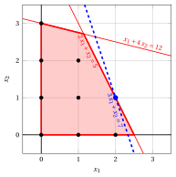
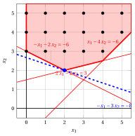
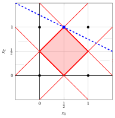
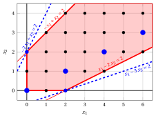

# Exercises · Integer linear programming

**Exercises · Chapter 1** · each solution opens with a click · [:material-book-open-variant: Chapter 1](../models-and-bounds/ilp.md) · [:material-file-pdf-box: Exercises, volume 1 (PDF)](../pdf/exercises-1-models-bounds-formulations.pdf)

!!! esercizio "Exercise 1.1: Integer linear programming (P7)"

    !!! nota ""

        Consider the following input data of an ILP problem with $n=2$ variables and $m=2$ constraints:

        $$
        \vet c = \begin{pmatrix}
        3 \\[1ex]
        1
        \end{pmatrix} \qquad \boldsymbol A = \begin{pmatrix}
        1 & 4 \\[1ex]
        2 & 1
        \end{pmatrix} \qquad \vet b = \begin{pmatrix}
        12 \\[1ex]
        5
        \end{pmatrix}
        $$

    **Questions**

    1. Write the ILP problem in canonical maximization form.

    2. Draw the feasible region of the ILP problem and list all its feasible solutions.

    3. Find an optimal solution graphically, and check it by complete enumeration.

??? soluzione "Solution"

    1. The ILP problem in canonical maximization form with $n=2$ non-negative integer variables and $m=2$ less-than-or-equal-to linear constraints reads as follows:

        $$
        \begin{array}{rrrrrrr}
        {\max} & {3}\, {x_1} & {+} & {x_2} \\[1.5ex]
        & {x_1} & {+} & {4}\, {x_2} & {\le} & {12} \\[1.5ex]
        & {2}\, {x_1} & {+} & {x_2} & {\le} & {5} \\[1.5ex]
        & {x_1,} &  & {x_2} & {\in} & {\Z_{\ge 0}}
        \end{array}
        $$

    2. Both constraints have non-negative coefficients, so every feasible solution satisfies $x_1 \le \lfloor \frac{5}{2} \rfloor = 2$ (constraint 2). For each value of $x_1$ the constraints give the integer values of $x_2$:

        
<table>
        <tr>
        <th>\(x_1\)</th>
        <th>bounds on \(x_2\)</th>
        <th>feasible points</th>
        </tr>
        <tr>
        <td>\(0\)</td>
        <td>\(x_2 \le 3,~~x_2 \le 5\)</td>
        <td>\((0,0)\), \((0,1)\), \((0,2)\), \((0,3)\)</td>
        </tr>
        <tr>
        <td>\(1\)</td>
        <td>\(x_2 \le \tfrac{11}{4},~~x_2 \le 3\)</td>
        <td>\((1,0)\), \((1,1)\), \((1,2)\)</td>
        </tr>
        <tr>
        <td>\(2\)</td>
        <td>\(x_2 \le \tfrac{5}{2},~~x_2 \le 1\)</td>
        <td>\((2,0)\), \((2,1)\)</td>
        </tr>
        </table>

        The feasible region $F$ is made of the $9$ black points of the figure, the integer points of the polyhedron $P$ (red):

        { .fig .ovale loading=lazy  }

        <em>Feasible region of the ILP problem: the integer points (black) inside the polyhedron of the constraints (red). The optimal solution $(2,1)$ is blue, with the objective line $3\,x_1 + x_2 = 7$ (dashed).</em>

    3. The gradient of the objective function is $\nabla f = (3,1)$. Moving the level line $3\,x_1 + x_2 = z$ in the direction of $\nabla f$, the last point of $F$ reached is $(2,1)$, on the dashed line $3\,x_1 + x_2 = 7$ of the figure; no other point of $F$ lies on this line.

        Complete enumeration of the $9$ feasible solutions confirms it (the optimum in bold):

        
<table>
        <tr>
        <th>\(x_1\)</th>
        <th>\(x_2\)</th>
        <th>\(z\)</th>
        <th>\(x_1\)</th>
        <th>\(x_2\)</th>
        <th>\(z\)</th>
        <th>\(x_1\)</th>
        <th>\(x_2\)</th>
        <th>\(z\)</th>
        </tr>
        <tr>
        <td>\(0\)</td>
        <td>\(0\)</td>
        <td>\(0\)</td>
        <td>\(0\)</td>
        <td>\(3\)</td>
        <td>\(3\)</td>
        <td>\(1\)</td>
        <td>\(2\)</td>
        <td>\(5\)</td>
        </tr>
        <tr>
        <td>\(0\)</td>
        <td>\(1\)</td>
        <td>\(1\)</td>
        <td>\(1\)</td>
        <td>\(0\)</td>
        <td>\(3\)</td>
        <td>\(2\)</td>
        <td>\(0\)</td>
        <td>\(6\)</td>
        </tr>
        <tr>
        <td>\(0\)</td>
        <td>\(2\)</td>
        <td>\(2\)</td>
        <td>\(1\)</td>
        <td>\(1\)</td>
        <td>\(4\)</td>
        <td>\(\mathbf{2}\)</td>
        <td>\(\mathbf{1}\)</td>
        <td>\(\mathbf{7}\)</td>
        </tr>
        </table>

        !!! chiave ""

            The ILP problem has the <strong>unique</strong> optimal solution $\tilde{\vet x}(\ILP) = (2,1)$, with optimal value $z(\ILP) = 7$.

!!! esercizio "Exercise 1.2: Canonical maximization form (P13)"

    !!! nota ""

        Consider the following ILP problem with $n=2$ integer variables:

        $$
        \begin{array}{rrrrrrr}
        {\min} & {x_1} & {+} & {3}\, {x_2} \\[1.5ex]
        & {x_1} & {+} & {2}\, {x_2} & {\ge} & {6} \\[1.5ex]
        & {-}{x_1} & {+} & {4}\, {x_2} & {\ge} & {6} \\[1.5ex]
        & {2}\, {x_1} & {-} & {2}\, {x_2} & {\le} & {3} \\[1.5ex]
        & {x_1,} &  & {x_2} & {\in} & {\Z_{\ge 0}}
        \end{array}
        $$

    **Questions**

    1. Write the ILP problem in canonical maximization form, and give its data $\vet c$, $\boldsymbol A$ and $\vet b$.

    2. Draw the feasible region. Is it a finite set?

    3. Explain why the ILP problem has an optimal solution, and find it graphically.

??? soluzione "Solution"

    1. The minimization of $x_1 + 3\,x_2$ is the maximization of $-x_1 - 3\,x_2$, with $\min \{x_1 + 3\,x_2\} = -\max\{-x_1 - 3\,x_2\}$. Each constraint $\ge$ is multiplied by $-1$:

        $$
        x_1 + 2\,x_2 \ge 6 \iff -x_1 - 2\,x_2 \le -6, \qquad -x_1 + 4\,x_2 \ge 6 \iff x_1 - 4\,x_2 \le -6.
        $$

        The ILP problem in canonical maximization form (problem $P13$ of the catalogue) is

        $$
        \begin{array}{rrrrrrr}
        {\max} & {-}{x_1} & {-} & {3}\, {x_2} \\[1.5ex]
        & {-}{x_1} & {-} & {2}\, {x_2} & {\le} & {-6} \\[1.5ex]
        & {x_1} & {-} & {4}\, {x_2} & {\le} & {-6} \\[1.5ex]
        & {2}\, {x_1} & {-} & {2}\, {x_2} & {\le} & {3} \\[1.5ex]
        & {x_1,} &  & {x_2} & {\in} & {\Z_{\ge 0}}
        \end{array}
        $$

        with data

        $$
        \vet c = \begin{pmatrix}
        -1 \\[1ex]
        -3
        \end{pmatrix} \qquad \boldsymbol A = \begin{pmatrix}
        -1 & -2 \\[1ex]
        1 & -4 \\[1ex]
        2 & -2
        \end{pmatrix} \qquad \vet b = \begin{pmatrix}
        -6 \\[1ex]
        -6 \\[1ex]
        3
        \end{pmatrix}
        $$

    2. The polyhedron of the constraints is drawn in red inside the box $0 \le x_1, x_2 \le 5$; it continues upwards without limit.

        { .fig .ovale loading=lazy  }

        <em>Feasible region of $P13$ inside the box (red), its integer points (black) and the optimal solution $(2,2)$ (blue), with the objective line $-x_1 - 3\,x_2 = -8$ (dashed).</em>

        The feasible region is <strong>not finite</strong>: for every integer $k \ge 3$ the point $(0,k)$ satisfies $-2k \le -6$, $-4k \le -6$ and $-2k \le 3$, so it belongs to $F$.

    3. All the costs of the maximization problem are negative and $x_1, x_2 \ge 0$, so $-x_1 - 3\,x_2 \le 0$ on $F$: the objective function is bounded from above. The feasible point $(0,3)$ has value $-9$, and only the finitely many points with $x_1 + 3\,x_2 < 9$ can do better: an optimal solution exists.

        The gradient is $\nabla f = (-1,-3)$: the level line moves towards the origin. The last point of $F$ reached is $(2,2)$, on the dashed line $-x_1 - 3\,x_2 = -8$. The row $x_2 = 1$ contains no feasible point, because $x_1 + 2 \ge 6$ requires $x_1 \ge 4$ and $-x_1 + 4 \ge 6$ requires $x_1 \le -2$.

        !!! chiave ""

            The ILP problem has the <strong>unique</strong> optimal solution $\tilde{\vet x}(\ILP) = (2,2)$, with optimal value $z(\ILP) = -8$ in canonical maximization form, that is, a minimum value $x_1 + 3\,x_2 = 8$ of the original problem.

!!! esercizio "Exercise 1.3: Complete enumeration (P43)"

    !!! nota ""

        Consider the following input data of an ILP problem with $n=3$ variables and $m=2$ constraints:

        $$
        \vet c = \begin{pmatrix}
        1 \\[1ex]
        2 \\[1ex]
        7
        \end{pmatrix} \qquad \boldsymbol A = \begin{pmatrix}
        1 & 0 & 2 \\[1ex]
        0 & 1 & 2
        \end{pmatrix} \qquad \vet b = \begin{pmatrix}
        2 \\[1ex]
        2
        \end{pmatrix}
        $$

    **Questions**

    1. Write the ILP problem in canonical maximization form.

    2. Derive an upper bound on each variable from the constraints, and list all the feasible solutions.

    3. Find an optimal solution by complete enumeration. Is it unique?

??? soluzione "Solution"

    1. The ILP problem in canonical maximization form with $n=3$ non-negative integer variables and $m=2$ less-than-or-equal-to linear constraints reads as follows:

        $$
        \begin{array}{rrrrrrrrr}
        {\max} & {x_1} & {+} & {2}\, {x_2} & {+} & {7}\, {x_3} \\[1.5ex]
        & {x_1} &  &  & {+} & {2}\, {x_3} & {\le} & {2} \\[1.5ex]
        &  &  & {x_2} & {+} & {2}\, {x_3} & {\le} & {2} \\[1.5ex]
        & {x_1,} &  & {x_2,} &  & {x_3} & {\in} & {\Z_{\ge 0}}
        \end{array}
        $$

    2. All the coefficients are non-negative, so each variable is at most the right-hand side divided by its coefficient, rounded down:

        $$
        x_1 \le \lfloor 2/1 \rfloor = 2, \qquad x_2 \le \lfloor 2/1 \rfloor = 2, \qquad x_3 \le \min\left\{ \lfloor 2/2 \rfloor, \lfloor 2/2 \rfloor \right\} = 1.
        $$

        - If $x_3 = 1$, the constraints become $x_1 \le 0$ and $x_2 \le 0$: the only point is $(0,0,1)$.

        - If $x_3 = 0$, the constraints become $x_1 \le 2$ and $x_2 \le 2$: the $9$ points $(x_1,x_2,0)$ with $x_1, x_2 \in \{0,1,2\}$.

        The feasible region has $10$ points.

    3. The values of the objective function $x_1 + 2\,x_2 + 7\,x_3$ are (the optimum in bold):

        
<table>
        <tr>
        <th>\(x_1\)</th>
        <th>\(x_2\)</th>
        <th>\(x_3\)</th>
        <th>\(z\)</th>
        <th>\(x_1\)</th>
        <th>\(x_2\)</th>
        <th>\(x_3\)</th>
        <th>\(z\)</th>
        </tr>
        <tr>
        <td>\(0\)</td>
        <td>\(0\)</td>
        <td>\(0\)</td>
        <td>\(0\)</td>
        <td>\(1\)</td>
        <td>\(2\)</td>
        <td>\(0\)</td>
        <td>\(5\)</td>
        </tr>
        <tr>
        <td>\(0\)</td>
        <td>\(1\)</td>
        <td>\(0\)</td>
        <td>\(2\)</td>
        <td>\(2\)</td>
        <td>\(0\)</td>
        <td>\(0\)</td>
        <td>\(2\)</td>
        </tr>
        <tr>
        <td>\(0\)</td>
        <td>\(2\)</td>
        <td>\(0\)</td>
        <td>\(4\)</td>
        <td>\(2\)</td>
        <td>\(1\)</td>
        <td>\(0\)</td>
        <td>\(4\)</td>
        </tr>
        <tr>
        <td>\(1\)</td>
        <td>\(0\)</td>
        <td>\(0\)</td>
        <td>\(1\)</td>
        <td>\(2\)</td>
        <td>\(2\)</td>
        <td>\(0\)</td>
        <td>\(6\)</td>
        </tr>
        <tr>
        <td>\(1\)</td>
        <td>\(1\)</td>
        <td>\(0\)</td>
        <td>\(3\)</td>
        <td>\(\mathbf{0}\)</td>
        <td>\(\mathbf{0}\)</td>
        <td>\(\mathbf{1}\)</td>
        <td>\(\mathbf{7}\)</td>
        </tr>
        </table>

        The best point with $x_3 = 0$ is $(2,2,0)$, of value $6$: it is worse than $(0,0,1)$, of value $7$.

        !!! chiave ""

            Complete enumeration gives the <strong>unique</strong> optimal solution $\tilde{\vet x}(\ILP) = (0,0,1)$, with optimal value $z(\ILP) = 7$.

!!! esercizio "Exercise 1.4: Possible outcomes: an infeasible ILP problem"

    !!! nota ""

        Consider the following ILP problem in canonical maximization form with $n=2$ integer variables and $m=4$ constraints:

        $$
        \begin{array}{rrrrrrr}
        {\max} & {x_1} & {+} & {2}\, {x_2} \\[1.5ex]
        & {2}\, {x_1} & {-} & {2}\, {x_2} & {\le} & {1} \\[1.5ex]
        & {-}{2}\, {x_1} & {+} & {2}\, {x_2} & {\le} & {1} \\[1.5ex]
        & {-}{2}\, {x_1} & {-} & {2}\, {x_2} & {\le} & {-1} \\[1.5ex]
        & {2}\, {x_1} & {+} & {2}\, {x_2} & {\le} & {3} \\[1.5ex]
        & {x_1,} &  & {x_2} & {\in} & {\Z_{\ge 0}}
        \end{array}
        $$

    **Questions**

    1. Draw the polyhedron $P$ of the constraints, and decide whether the LP problem with the same data (with $x_1, x_2 \ge 0$ instead of $x_1, x_2 \in \Z_{\ge 0}$) is feasible.

    2. Decide the outcome of the ILP problem.

    3. Find an optimal solution of the LP problem with the same data.

??? soluzione "Solution"

    1. The four constraints are $-\frac{1}{2} \le x_1 - x_2 \le \frac{1}{2}$ and $\frac{1}{2} \le x_1 + x_2 \le \frac{3}{2}$: the polyhedron $P$ is the square with vertices $(0,\dfrac{1}{2})$, $(\dfrac{1}{2},0)$, $(\dfrac{1}{2},1)$, $(1,\dfrac{1}{2})$.

        { .fig .ovale loading=lazy  }

        <em>The polyhedron $P$ (red) contains no integer point: the four integer points nearest to it (black) are outside. The optimal solution $(\frac{1}{2},1)$ of the LP problem is blue, with the objective line $x_1 + 2\,x_2 = \frac{5}{2}$ (dashed).</em>

        The point $(\frac{1}{2},\frac{1}{2})$ satisfies all the constraints, so the LP problem is <strong>feasible</strong>.

    2. - From the first two constraints, an integer point has $x_1 - x_2 \in \Z$ and $|x_1 - x_2| \le \frac{1}{2}$, hence $x_1 = x_2$.

        - With $x_1 = x_2$ the last two constraints read $1 \le 4\,x_1 \le 3$, that is $\frac{1}{4} \le x_1 \le \frac{3}{4}$: no integer value of $x_1$ satisfies them.

        !!! chiave ""

            The feasible region $F = P \cap \Z^2$ is empty: the ILP problem is <strong>infeasible</strong>, although the LP problem with the same data is feasible.

    3. The polyhedron $P$ is bounded and non-empty, so the LP problem has an optimal vertex. The values of $x_1 + 2\,x_2$ at the four vertices are

        $$
        (0,\tfrac{1}{2}) \mapsto 1,\qquad (\tfrac{1}{2},0) \mapsto \dfrac{1}{2},\qquad (\tfrac{1}{2},1) \mapsto \dfrac{5}{2},\qquad (1,\tfrac{1}{2}) \mapsto 2
        $$

        so the optimal solution is $\tilde{\vet x}(\LP) = (\frac{1}{2},1)$, with $z(\LP) = \frac{5}{2}$ (see the figure).

!!! esercizio "Exercise 1.5: Possible outcomes: an unbounded feasible region"

    !!! nota ""

        Consider the constraints

        $$
        \begin{array}{rrrrrrr}
        & {-}{x_1} & {+} & {x_2} & {\le} & {2} \\[1.5ex]
        & {x_1} & {-} & {2}\, {x_2} & {\le} & {2} \\[1.5ex]
        & {x_1,} &  & {x_2} & {\in} & {\Z_{\ge 0}}
        \end{array}
        $$

        and the three ILP problems in canonical maximization form with these constraints and the objective functions

        $$
        \text{(a)}~~\max~ x_1 + x_2, \qquad \text{(b)}~~\max~ -2\,x_1 + x_2, \qquad \text{(c)}~~\max~ x_1 - 3\,x_2.
        $$

    **Questions**

    1. Draw the feasible region. Is it a finite set?

    2. Decide the outcome of each of the three ILP problems (a), (b) and (c), and give an optimal solution when it exists.

??? soluzione "Solution"

    1. The feasible region is <strong>not finite</strong>: for every $k \in \Z_{\ge 0}$ the point $(2k,k)$ satisfies $-2k + k = -k \le 2$ and $2k - 2k = 0 \le 2$.

        { .fig .ovale loading=lazy  }

        <em>Feasible region inside the box $0 \le x_1 \le 6$, $0 \le x_2 \le 4$ (red), its integer points (black), the points $(2k,k)$ (blue circles), and the optimal solutions $(0,2)$ of (b) and $(2,0)$ of (c) (blue) with their objective lines (dashed).</em>

    2. - <strong>(a)</strong> The points $(2k,k)$ are feasible with value $3k$, which grows without limit: the ILP problem (a) is <strong>unbounded</strong>.

        - <strong>(b)</strong> For every feasible point, $-2\,x_1 + x_2 = (-x_1 + x_2) - x_1 \le 2 - x_1 \le 2$. The value $2$ requires $x_1 = 0$ and $-x_1 + x_2 = 2$, that is, the point $(0,2)$, which is feasible: the <strong>unique</strong> optimal solution is $(0,2)$, with optimal value $2$.

        - <strong>(c)</strong> For every feasible point, $x_1 - 3\,x_2 = (x_1 - 2\,x_2) - x_2 \le 2 - x_2 \le 2$. The value $2$ requires $x_2 = 0$ and $x_1 - 2\,x_2 = 2$, that is, the point $(2,0)$: the <strong>unique</strong> optimal solution is $(2,0)$, with optimal value $2$.

        !!! chiave ""

            With the same unbounded feasible region, problem (a) is <strong>unbounded</strong>, while problems (b) and (c) have an <strong>optimal solution</strong>: $(0,2)$ and $(2,0)$, both of value $2$.
