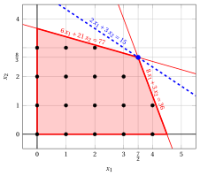
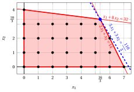
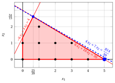

# Exercises · Primal and dual bounds

**Exercises · Chapter 2** · each solution opens with a click · [:material-book-open-variant: Chapter 2: Primal and dual bounds](../models-and-bounds/lp-relaxation.md) · [:material-file-pdf-box: Exercises, volume 1 (PDF)](../pdf/exercises-1-models-bounds-formulations.pdf)

!!! esercizio "Exercise 2.1: Primal and dual bounds (P5)"

    !!! nota ""

        Consider the following ILP problem in canonical maximization form with $n=2$ integer variables and $m=2$ constraints:

        $$
        \begin{array}{rrrrrrr}
        {\max} & {2}\, {x_1} & {+} & {3}\, {x_2} \\[1.5ex]
        & {6}\, {x_1} & {+} & {21}\, {x_2} & {\le} & {77} \\[1.5ex]
        & {8}\, {x_1} & {+} & {3}\, {x_2} & {\le} & {36} \\[1.5ex]
        & {x_1,} &  & {x_2} & {\in} & {\Z_{\ge 0}}
        \end{array}
        $$

    **Questions**

    1. Apply the one-variable heuristic and the two-step heuristic, in both orders of the variables, and give the best primal bound $\LB$.

    2. Solve the LP relaxation graphically and give the dual bound $\UB$ it provides.

    3. Compute the optimality gap. Is the best heuristic solution certified optimal?

??? soluzione "Solution"

    1. The <strong>one-variable heuristic</strong> sets a single variable to its maximum value, with the other variables equal to $0$. The <strong>two-step heuristic</strong> sets first one variable to its maximum value, and then the other one to its maximum value with the <strong>residual right-hand sides</strong>.

        - Only $x_1$ ($x_2 = 0$): $\bar x_1 = \min\{\lfloor \tfrac{77}{6} \rfloor, \lfloor \tfrac{9}{2} \rfloor\} = 4$, so $\bar{\vet x} = (4,0)$ and $\LB = 2 \cdot 4 + 3 \cdot 0 = 8$.

        - Only $x_2$ ($x_1 = 0$): $\bar x_2 = \min\{\lfloor \tfrac{11}{3} \rfloor, \lfloor 12 \rfloor\} = 3$, so $\bar{\vet x} = (0,3)$ and $\LB = 2 \cdot 0 + 3 \cdot 3 = 9$.

        - $x_1$ first: $\bar x_1 = \min\{\lfloor \tfrac{77}{6} \rfloor, \lfloor \tfrac{9}{2} \rfloor\} = 4$, leaving the residual right-hand sides $53$ and $4$. Then $\bar x_2 = \min\{\lfloor \tfrac{53}{21} \rfloor, \lfloor \tfrac{4}{3} \rfloor\} = 1$, so $\bar{\vet x} = (4,1)$ and $\LB = 11$.

        - $x_2$ first: $\bar x_2 = \min\{\lfloor \tfrac{11}{3} \rfloor, \lfloor 12 \rfloor\} = 3$, leaving the residual right-hand sides $14$ and $27$. Then $\bar x_1 = \min\{\lfloor \tfrac{7}{3} \rfloor, \lfloor \tfrac{27}{8} \rfloor\} = 2$, so $\bar{\vet x} = (2,3)$ and $\LB = 13$.

        
<table>
        <tr>
        <th>Heuristic</th>
        <th>Order</th>
        <th>\(\bar x_1\)</th>
        <th>\(\bar x_2\)</th>
        <th>\(\LB\)</th>
        </tr>
        <tr>
        <td>one-variable</td>
        <td>\(x_1\)</td>
        <td>\(4\)</td>
        <td>\(0\)</td>
        <td>\(8\)</td>
        </tr>
        <tr>
        <td>one-variable</td>
        <td>\(x_2\)</td>
        <td>\(0\)</td>
        <td>\(3\)</td>
        <td>\(9\)</td>
        </tr>
        <tr>
        <td>two-step</td>
        <td>\(x_1\) first</td>
        <td>\(4\)</td>
        <td>\(1\)</td>
        <td>\(11\)</td>
        </tr>
        <tr>
        <td>two-step</td>
        <td>\(x_2\) first</td>
        <td>\(2\)</td>
        <td>\(3\)</td>
        <td>\(13\)</td>
        </tr>
        </table>

        The best primal bound is $\LB = 13$, given by $\bar{\vet x} = (2,3)$.

    2. Graphically, we have:

        { .fig .ovale loading=lazy  }

        <em>Feasible region of the LP relaxation (red), integer points (black) and optimal solution of the LP relaxation (blue), with the objective line through it (dashed).</em>

        The optimal vertex is the intersection of the lines of constraints 1 and 2:

        $$
        \begin{cases}
        6\,x_1 + 21\,x_2 = 77 \\
        8\,x_1 + 3\,x_2 = 36
        \end{cases}
        \qquad\Longrightarrow\qquad x_1 = \dfrac{7}{2}, \quad x_2 = \dfrac{8}{3}
        $$

        The optimal value is $z(\LP) = 2 \cdot \tfrac{7}{2} + 3 \cdot \tfrac{8}{3} = 15$. The data are integer, so the dual bound is

        $$
        z(\ILP) \le z(\LP) = 15
        $$

    3. With $\LB = 13$ and $\UB = 15$ the optimality gap is

        $$
        \frac{\UB - \LB}{|\LB|} = \frac{15 - 13}{13} = \dfrac{2}{13} \approx 15.4\%
        $$

        The gap is not zero: the bounds give only $13 \le z(\ILP) \le 15$, and $\bar{\vet x} = (2,3)$ is <strong>not certified</strong> optimal.

        !!! chiave ""

            $\LB = 13$ from the two-step heuristic, $\UB = 15$ from the LP relaxation, optimality gap $\dfrac{2}{13}$. Complete enumeration shows that $z(\ILP) = 13$: the heuristic solution $(2,3)$ is optimal, but the two bounds do not prove it.

!!! esercizio "Exercise 2.2: Rounding and certificates (P4)"

    !!! nota ""

        Consider the following ILP problem in canonical maximization form with $n=2$ integer variables and $m=2$ constraints:

        $$
        \begin{array}{rrrrrrr}
        {\max} & {5}\, {x_1} & {+} & {3}\, {x_2} \\[1.5ex]
        & {2}\, {x_1} & {+} & {x_2} & {\le} & {14} \\[1.5ex]
        & {x_1} & {+} & {8}\, {x_2} & {\le} & {32} \\[1.5ex]
        & {x_1,} &  & {x_2} & {\in} & {\Z_{\ge 0}}
        \end{array}
        $$

    **Questions**

    1. Solve the LP relaxation graphically and give the dual bound $\UB$.

    2. Round the optimal solution of the LP relaxation in the four possible ways (each component down or up). Which rounded points are feasible? Give the best primal bound $\LB$ obtained by rounding.

    3. Compute the optimality gap.

    4. Show that the point $(6,2)$ is feasible and certify that it is an optimal solution.

??? soluzione "Solution"

    1. Graphically, we have:

        { .fig .ovale loading=lazy  }

        <em>Feasible region of the LP relaxation (red), integer points (black) and optimal solution of the LP relaxation (blue), with the objective line through it (dashed).</em>

        The optimal vertex is the intersection of the lines of constraints 1 and 2:

        $$
        \begin{cases}
        2\,x_1 + x_2 = 14 \\
        x_1 + 8\,x_2 = 32
        \end{cases}
        \qquad\Longrightarrow\qquad x_1 = \dfrac{16}{3}, \quad x_2 = \dfrac{10}{3}
        $$

        The optimal value is $z(\LP) = 5 \cdot \tfrac{16}{3} + 3 \cdot \tfrac{10}{3} = \dfrac{110}{3}$. The data are integer, so

        $$
        z(\ILP) \le \left\lfloor z(\LP) \right\rfloor = \left\lfloor \dfrac{110}{3} \right\rfloor = 36
        $$

    2. The optimal solution of the LP relaxation is $(\dfrac{16}{3},\dfrac{10}{3})$, and its rounding to the nearest integer point is $(5,3)$. The four rounded points are:

        
<table>
        <tr>
        <th>Rounded point</th>
        <th>feasible</th>
        <th>violated constraint</th>
        <th>value</th>
        </tr>
        <tr>
        <td>\((5,3)\)</td>
        <td>yes</td>
        <td>–</td>
        <td>\(34\)</td>
        </tr>
        <tr>
        <td>\((5,4)\)</td>
        <td>no</td>
        <td>\(1 \cdot 5 + 8 \cdot 4 = 37 > 32\)</td>
        <td>–</td>
        </tr>
        <tr>
        <td>\((6,3)\)</td>
        <td>no</td>
        <td>\(2 \cdot 6 + 1 \cdot 3 = 15 > 14\)</td>
        <td>–</td>
        </tr>
        <tr>
        <td>\((6,4)\)</td>
        <td>no</td>
        <td>\(2 \cdot 6 + 1 \cdot 4 = 16 > 14\)</td>
        <td>–</td>
        </tr>
        </table>

        Only $(5,3)$ is feasible, so rounding gives $\LB = 5 \cdot 5 + 3 \cdot 3 = 34$.

    3. With $\LB = 34$ and $\UB = 36$ the optimality gap is

        $$
        \frac{\UB - \LB}{|\LB|} = \frac{36 - 34}{34} = \dfrac{1}{17} \approx 5.9\%
        $$

    4. The point $(6,2)$ satisfies the constraints, $2 \cdot 6 + 1 \cdot 2 = 14 \le 14, \quad 1 \cdot 6 + 8 \cdot 2 = 22 \le 32$, and its value is $5 \cdot 6 + 3 \cdot 2 = 36$. Hence $\LB = 36 = \UB$: the optimality gap is zero.

        !!! chiave ""

            The feasible solution $(6,2)$ has value $36 = \lfloor z(\LP) \rfloor$: it is <strong>certified optimal</strong>, $z(\ILP) = 36$. Rounding the LP solution gives only $(5,3)$, of value $34$.

!!! esercizio "Exercise 2.3: Rounding fails"

    !!! nota ""

        Consider the following ILP problem in canonical maximization form with $n=2$ integer variables and $m=2$ constraints:

        $$
        \begin{array}{rrrrrrr}
        {\max} & {4}\, {x_1} & {+} & {7}\, {x_2} \\[1.5ex]
        & {6}\, {x_1} & {+} & {10}\, {x_2} & {\le} & {30} \\[1.5ex]
        & {-}{6}\, {x_1} & {+} & {3}\, {x_2} & {\le} & {4} \\[1.5ex]
        & {x_1,} &  & {x_2} & {\in} & {\Z_{\ge 0}}
        \end{array}
        $$

    **Questions**

    1. Solve the LP relaxation graphically and give the dual bound $\UB$.

    2. Round the optimal solution of the LP relaxation in the four possible ways. Is the rounding down feasible? Is the rounding to the nearest integer point feasible? Give the best primal bound obtained by rounding.

    3. Find an optimal solution of the ILP problem graphically, and compare it with the solution of the LP relaxation.

??? soluzione "Solution"

    1. Graphically, we have:

        { .fig .ovale loading=lazy  }

        <em>Feasible region of the LP relaxation (red), its integer points (black), the optimal solution of the LP relaxation (blue) with the objective line through it (dashed), and the optimal ILP solution $(5,0)$ (blue circle).</em>

        The optimal vertex is the intersection of the lines of constraints 1 and 2:

        $$
        \begin{cases}
        6\,x_1 + 10\,x_2 = 30 \\
        -6\,x_1 + 3\,x_2 = 4
        \end{cases}
        \qquad\Longrightarrow\qquad x_1 = \dfrac{25}{39}, \quad x_2 = \dfrac{34}{13}
        $$

        with $z(\LP) = 4 \cdot \tfrac{25}{39} + 7 \cdot \tfrac{34}{13} = \dfrac{814}{39} \approx 20.87$. The data are integer, so

        $$
        z(\ILP) \le \left\lfloor z(\LP) \right\rfloor = \left\lfloor \dfrac{814}{39} \right\rfloor = 20
        $$

    2. The four roundings of $(\dfrac{25}{39},\dfrac{34}{13}) \approx (0.64,2.62)$ are:

        
<table>
        <tr>
        <th>Rounded point</th>
        <th>feasible</th>
        <th>violated constraint</th>
        <th>value</th>
        </tr>
        <tr>
        <td>\((0,2)\)</td>
        <td>no</td>
        <td>\(-6 \cdot 0 + 3 \cdot 2 = 6 > 4\)</td>
        <td>–</td>
        </tr>
        <tr>
        <td>\((0,3)\)</td>
        <td>no</td>
        <td>\(-6 \cdot 0 + 3 \cdot 3 = 9 > 4\)</td>
        <td>–</td>
        </tr>
        <tr>
        <td>\((1,2)\)</td>
        <td>yes</td>
        <td>–</td>
        <td>\(18\)</td>
        </tr>
        <tr>
        <td>\((1,3)\)</td>
        <td>no</td>
        <td>\(6 \cdot 1 + 10 \cdot 3 = 36 > 30\)</td>
        <td>–</td>
        </tr>
        </table>

        The rounding down $(0,2)$ and the rounding to the nearest point $(1,3)$ are both <strong>infeasible</strong>. The only feasible rounding is $(1,2)$, with $\LB = 18$.

    3. The gradient of the objective function is $\nabla f = (4,7)$. The integer points near the LP optimum lie under the steep line of constraint 2, and the last point of $F$ reached by the level line is $(5,0)$, on the line $4\,x_1 + 7\,x_2 = 20$. Its value $20$ equals $\UB = 20$, so it is certified optimal.

        !!! chiave ""

            The optimal ILP solution $\tilde{\vet x}(\ILP) = (5,0)$, with $z(\ILP) = 20$, is far from $\tilde{\vet x}(\LP) \approx (0.64,2.62)$: <strong>no rounding</strong> finds it, while the bound $\lfloor z(\LP) \rfloor = 20$ is exact.

!!! esercizio "Exercise 2.4: Dual bounds (P2)"

    !!! nota ""

        Consider the following ILP problem in canonical maximization form with $n=2$ integer variables and $m=2$ constraints:

        $$
        \begin{array}{rrrrrrr}
        {\max} & {x_1} & {+} & {3}\, {x_2} \\[1.5ex]
        & {-}{4}\, {x_1} & {+} & {10}\, {x_2} & {\le} & {35} \\[1.5ex]
        & {3}\, {x_1} & {+} & {x_2} & {\le} & {12} \\[1.5ex]
        & {x_1,} &  & {x_2} & {\in} & {\Z_{\ge 0}}
        \end{array}
        $$

        The optimal solution of its LP relaxation is $\tilde{\vet x}(\LP) = (\dfrac{5}{2},\dfrac{9}{2})$, with $z(\LP) = 16$.

    **Questions**

    1. Multiply the constraints by the multipliers $(\pi_1,\pi_2)$ of the table below. Which multipliers are valid, and which upper bound on $z(\ILP)$ does each valid choice give?

        $$
        (0,3),\qquad (\tfrac{1}{2},1),\qquad (\tfrac{3}{10},0),\qquad (\tfrac{1}{4},\tfrac{2}{3})
        $$

    2. Write the dual problem D(LP) of the LP relaxation, and verify that $\tilde{\vet\pi} = (\tfrac{4}{17},\tfrac{11}{17})$ is an optimal dual solution.

    3. Derive upper bounds on the variables from the constraints. Do they improve the bound of the LP relaxation?

??? soluzione "Solution"

    1. With multipliers $\pi_1, \pi_2 \ge 0$ the sum of the constraints is

        $$
        (-4\,\pi_1 + 3\,\pi_2)\,x_1 + (10\,\pi_1 + \pi_2)\,x_2 \le 35\,\pi_1 + 12\,\pi_2,
        $$

        and it gives an upper bound when the coefficients are at least the costs: $-4\,\pi_1 + 3\,\pi_2 \ge 1$ and $10\,\pi_1 + \pi_2 \ge 3$.

        
<table>
        <tr>
        <th>\((\pi_1,\pi_2)\)</th>
        <th>coefficients of \(x_1\), \(x_2\)</th>
        <th>valid multipliers</th>
        <th>upper bound \(35\,\pi_1 + 12\,\pi_2\)</th>
        </tr>
        <tr>
        <td>\((0,3)\)</td>
        <td>\(9\), \(3\)</td>
        <td>yes</td>
        <td>\(36\)</td>
        </tr>
        <tr>
        <td>\((\tfrac{1}{2},1)\)</td>
        <td>\(1\), \(6\)</td>
        <td>yes</td>
        <td>\(\tfrac{59}{2}\)</td>
        </tr>
        <tr>
        <td>\((\tfrac{3}{10},0)\)</td>
        <td>\(-\tfrac{6}{5}\), \(3\)</td>
        <td>no: \(-\tfrac{6}{5} < 1\)</td>
        <td>–</td>
        </tr>
        <tr>
        <td>\((\tfrac{1}{4},\tfrac{2}{3})\)</td>
        <td>\(1\), \(\tfrac{19}{6}\)</td>
        <td>yes</td>
        <td>\(\tfrac{67}{4}\)</td>
        </tr>
        </table>

        The best of these bounds is $\tfrac{67}{4}$, given by $(\tfrac{1}{4},\tfrac{2}{3})$. The multipliers $(\frac{3}{10},0)$ are not valid: the first constraint has a negative coefficient of $x_1$.

    2. The dual problem D(LP) is

        $$
        \begin{array}{rrrrrrr}
        {\min} & {35}\, {\pi_1} & {+} & {12}\, {\pi_2} \\[1.5ex]
        & {-}{4}\, {\pi_1} & {+} & {3}\, {\pi_2} & {\ge} & {1} \\[1.5ex]
        & {10}\, {\pi_1} & {+} & {\pi_2} & {\ge} & {3} \\[1.5ex]
        & {\pi_1,} &  & {\pi_2} & {\in} & {\R_{\ge 0}}
        \end{array}
        $$

        The point $(\tfrac{4}{17},\tfrac{11}{17})$ is feasible, since $-4 \cdot \tfrac{4}{17} + 3 \cdot \tfrac{11}{17} = 1 \ge 1$ and $10 \cdot \tfrac{4}{17} + 1 \cdot \tfrac{11}{17} = 3 \ge 3$, and its value is $35 \cdot \tfrac{4}{17} + 12 \cdot \tfrac{11}{17} = 16 = z(\LP)$. By weak duality no dual feasible solution has a smaller value, so it is optimal.

    3. Only constraint 2, $3\,x_1 + x_2 \le 12$, has non-negative coefficients; constraint 1 has a negative coefficient and gives no bound. From constraint 2:

        $$
        x_1 \le \lfloor 12/3 \rfloor = 4, \qquad x_2 \le \lfloor 12/1 \rfloor = 12.
        $$

        The optimal LP solution $(\tfrac{5}{2},\tfrac{9}{2})$ satisfies both bounds, so it is not cut off and $z(\LP) = 16$ does not change.

        !!! chiave ""

            The best multipliers $\tilde{\vet\pi} = (\tfrac{4}{17},\tfrac{11}{17})$ give the bound $16 = z(\LP)$, which the variable upper bounds do not improve: $z(\ILP) \le 16$ (in fact $z(\ILP) = 14$).

!!! esercizio "Exercise 2.5: Bounds with three variables (P46)"

    !!! nota ""

        Consider the following ILP problem in canonical maximization form with $n=3$ integer variables and $m=3$ constraints:

        $$
        \begin{array}{rrrrrrrrr}
        {\max} & {5}\, {x_1} & {+} & {6}\, {x_2} & {+} & {10}\, {x_3} \\[1.5ex]
        & {9}\, {x_1} & {+} & {2}\, {x_2} & {+} & {2}\, {x_3} & {\le} & {11} \\[1.5ex]
        & {2}\, {x_1} & {+} & {6}\, {x_2} & {+} & {6}\, {x_3} & {\le} & {16} \\[1.5ex]
        & {4}\, {x_1} & {+} & {2}\, {x_2} & {+} & {7}\, {x_3} & {\le} & {10} \\[1.5ex]
        & {x_1,} &  & {x_2,} &  & {x_3} & {\in} & {\Z_{\ge 0}}
        \end{array}
        $$

        The optimal solution of its LP relaxation is $\tilde{\vet x}(\LP) = (\tfrac{17}{25},\tfrac{49}{25},\tfrac{12}{25})$, with $z(\LP) = \dfrac{499}{25}$.

    **Questions**

    1. Give the dual bound $\UB$ provided by the LP relaxation.

    2. Round down the optimal solution of the LP relaxation. Is the rounded point feasible, and which primal bound does it give?

    3. Apply the two-step heuristic (extended to three steps) with the variables in order of decreasing cost, $x_3$, $x_2$, $x_1$.

    4. Compute the optimality gap with the best primal bound.

??? soluzione "Solution"

    1. The data are integer, so

        $$
        z(\ILP) \le \left\lfloor z(\LP) \right\rfloor = \left\lfloor \dfrac{499}{25} \right\rfloor = 19
        $$

    2. Rounding down gives $(0,1,0)$, which is feasible: $9 \cdot 0 + 2 \cdot 1 + 2 \cdot 0 = 2 \le 11, \quad 2 \cdot 0 + 6 \cdot 1 + 6 \cdot 0 = 6 \le 16, \quad 4 \cdot 0 + 2 \cdot 1 + 7 \cdot 0 = 2 \le 10$. Its value gives $\LB = 5 \cdot 0 + 6 \cdot 1 + 10 \cdot 0 = 6$, far from the upper bound.

    3. Each variable, in the order $x_3$, $x_2$, $x_1$, takes its maximum value with the residual right-hand sides:

        1. $\bar x_3 = \min\{\lfloor \tfrac{11}{2} \rfloor, \lfloor \tfrac{8}{3} \rfloor, \lfloor \tfrac{10}{7} \rfloor\} = 1$; the residual right-hand sides become $9$, $10$, $3$.

        2. $\bar x_2 = \min\{\lfloor \tfrac{9}{2} \rfloor, \lfloor \tfrac{5}{3} \rfloor, \lfloor \tfrac{3}{2} \rfloor\} = 1$; the residual right-hand sides become $7$, $4$, $1$.

        3. $\bar x_1 = \min\{\lfloor \tfrac{7}{9} \rfloor, \lfloor 2 \rfloor, \lfloor \tfrac{1}{4} \rfloor\} = 0$; the residual right-hand sides become $7$, $4$, $1$.

        The heuristic solution is $\bar{\vet x} = (0,1,1)$, with $\LB = 5 \cdot 0 + 6 \cdot 1 + 10 \cdot 1 = 16$.

    4. With $\LB = 16$ and $\UB = 19$ the optimality gap is

        $$
        \frac{\UB - \LB}{|\LB|} = \frac{19 - 16}{16} = \dfrac{3}{16} \approx 18.8\%
        $$

        !!! chiave ""

            $16 \le z(\ILP) \le 19$. Complete enumeration shows that the heuristic solution $(0,1,1)$ is optimal, $z(\ILP) = 16$, but the gap $\dfrac{3}{16}$ does not certify it.
