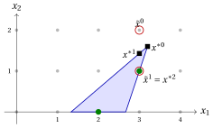
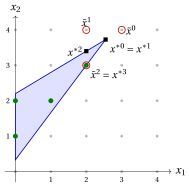
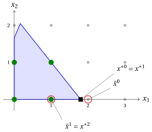

# Exercises · MIP heuristics

**Exercises · Chapter 10** · each solution opens with a click · [:material-book-open-variant: Chapter 10](../mip-heuristics/mip-heuristics.md) · [:material-file-pdf-box: Exercises, volume 4 (PDF)](../pdf/exercises-4-mip-heuristics.pdf)

## Rounding and diving

!!! esercizio "Exercise 10.1: Rounding and diving (P5)"

    !!! nota ""

        Consider the following ILP problem in canonical maximization form with $n=2$ integer variables and $m=2$ constraints:

        $$
        \begin{array}{rrrrrrr}
        {\max} & {2}\, {x_1} & {+} & {3}\, {x_2} \\[2ex]
        & {6}\, {x_1} & {+} & {21}\, {x_2} & {\le} & {77} \\[2ex]
        & {8}\, {x_1} & {+} & {3}\, {x_2} & {\le} & {36} \\[2ex]
        & {x_1,} &  & {x_2} & {\in} & {\Z_{\ge 0}}
        \end{array}
        $$

    **Questions**

    1. Compute the optimal solution $\tilde{\vet x}$ of the LP relaxation and its value $z(\LP)$.

    2. Apply rounding: round $\tilde{\vet x}$ to the nearest integer point, check whether it is feasible, and then round it down.

    3. Apply fractional diving: at each step solve the LP relaxation with the variables fixed so far, fix the least fractional variable to its nearest integer (ties: smallest index), and repeat until the LP solution is integer.

    4. Compute the optimality gap of the solution of the dive with respect to the upper bound $\lfloor z(\LP)\rfloor$, and prove that the solution is optimal by examining the possible values of $x_2$.

??? soluzione "Solution"

    1. The two constraints are tight at the optimal vertex: from $8x_1+3x_2=36$ we get $x_2=12-\frac83x_1$, and $6x_1+21x_2=77$ becomes $6x_1+252-56x_1=77$, i.e., $x_1=\frac72$ and $x_2=\frac83$:

        $$
        \tilde{\vet x}=\Big(\frac72,\frac83\Big),\qquad z(\LP)=7+8=15 .
        $$

    2. $\big(\rnd{\frac72},\rnd{\frac83}\big)=(4,3)$ violates the second constraint: $8\cdot4+3\cdot3=41>36$. <strong>Rounding fails.</strong> Rounding down gives $(3,2)$: $60\le77$ and $30\le36$, feasible, of value $12$.

    3. <strong>Step 1.</strong> The distances from the nearest integer are $\frac12$ for $x_1$ and $\frac13$ for $x_2$: fix $x_2:=3$.

        <strong>Step 2.</strong> With $x_2=3$ the constraints become $6x_1\le14$ and $8x_1\le27$, so $\tilde{\vet x}=\big(\frac73,3\big)$, of value $\frac{14}{3}+9=\frac{41}{3}$. Fix $x_1:=\rnd{\frac73}=2$.

        <strong>Step 3.</strong> The LP solution $(2,3)$, of value $13$, is integer: the dive returns $(2,3)$.

    4. The upper bound is $\lfloor15\rfloor=15$, so the gap is $\frac{15-13}{13}\approx15.4\%$. To prove optimality, let $x_2$ vary: $x_2\ge4$ is infeasible ($21\cdot4=84>77$); $x_2=3$ gives $x_1\le2$, value at most $13$; $x_2=2$ gives $x_1\le3$, value at most $12$; $x_2=1$ gives $x_1\le4$, value at most $11$; $x_2=0$ gives $x_1\le4$, value at most $8$. Hence $z(\ILP)=13$ and $(2,3)$ is <strong>optimal</strong>.

!!! esercizio "Exercise 10.2: Rounding and diving (P3)"

    !!! nota ""

        Consider the following ILP problem in canonical maximization form with $n=2$ integer variables and $m=2$ constraints:

        $$
        \begin{array}{rrrrrrr}
        {\max} & {2}\, {x_1} & {+} & {4}\, {x_2} \\[2ex]
        & {-} {x_1} & {+} & {x_2} & {\le} & {2} \\[2ex]
        & {8}\, {x_1} & {+} & {2}\, {x_2} & {\le} & {19} \\[2ex]
        & {x_1,} &  & {x_2} & {\in} & {\Z_{\ge 0}}
        \end{array}
        $$

    **Questions**

    1. Compute the optimal solution $\tilde{\vet x}$ of the LP relaxation and its value $z(\LP)$.

    2. Round $\tilde{\vet x}$ to the nearest integer point: is it feasible? Round it down instead, and give the value.

    3. Apply fractional diving (ties: smallest index). Does it return a solution?

    4. Repeat the dive taking the opposite decision at the first step, and continue with the rule of fractional diving. Then prove that the solution is optimal by examining the possible values of $x_1$.

??? soluzione "Solution"

    1. Both constraints are tight at the optimal vertex: $x_2=2+x_1$ and $8x_1+2x_2=19$ give $10x_1=15$:

        $$
        \tilde{\vet x}=\Big(\frac32,\frac72\Big),\qquad z(\LP)=3+14=17 .
        $$

    2. $\big(\rnd{\frac32},\rnd{\frac72}\big)=(2,4)$ satisfies the first constraint ($2\le2$) but violates the second: $16+8=24>19$. <strong>Rounding fails.</strong> Rounding down gives $(1,3)$: $2\le2$ and $14\le19$, feasible, of value $14$.

    3. <strong>Step 1.</strong> Both variables are at distance $\frac12$: fix $x_1:=\rnd{\frac32}=2$.

        <strong>Step 2.</strong> With $x_1=2$ the constraints become $x_2\le4$ and $2x_2\le3$, so $\tilde{\vet x}=\big(2,\frac32\big)$, of value $10$. Fix $x_2:=\rnd{\frac32}=2$.

        <strong>Step 3.</strong> With $x_1=2$ and $x_2=2$ the second constraint is $16+4=20>19$: the LP is infeasible, <strong>the dive fails</strong>.

    4. <strong>Step 1.</strong> Fix $x_1:=1$ instead of $2$. The constraints become $x_2\le3$ and $2x_2\le11$, so $\tilde{\vet x}=(1,3)$, of value $14$, which is integer: the dive returns $(1,3)$. The first decision of the first dive, $\rnd{\frac32}=2$, was the wrong one.

        Optimality: the second constraint gives $x_1\le2$. For $x_1=0$ it is $x_2\le2$, value at most $8$; for $x_1=1$ it is $x_2\le3$, value at most $14$; for $x_1=2$ it is $x_2\le1$, value at most $8$. Hence $z(\ILP)=14$ and $(1,3)$ is <strong>optimal</strong>.

## Feasibility pump

!!! esercizio "Exercise 10.3: Feasibility pump 1"

    Consider the integer program

    \begin{align*}
    && \max ~~ x_1 + x_2 & & \\[0.5ex]
    && \text{subject to} \quad 6\,x_1 - 2\,x_2 &\le 16 & \\[0.5ex]
    && 6\,x_1 - 7\,x_2 &\ge 8 & \\[0.5ex]
    && x_1 &\in \{0,1,\dots,5\} & \\[0.5ex]
    && x_2 &\in \{0,1,\dots,5\} &
    \end{align*}

    (Recall that the $L_1$ distance from a point to a segment that is neither horizontal, vertical, nor of slope $\pm1$ is minimized at an endpoint or where the segment crosses the horizontal or the vertical line through the point.)

    **Questions**

    1. Draw the region $\mathcal{L}$ of the LP relaxation and its integer points, and compute the optimal solution $x^{*0}$ of the LP relaxation.

    2. Round $x^{*0}$ to the nearest integer point $\tilde x^0$, and check whether it is feasible.

    3. Apply the feasibility pump: at each iteration compute the projection $x^{*k}$, i.e., the point of $\mathcal{L}$ that minimizes the $L_1$ distance $\Delta(x,\tilde x^{k-1})$, round it, and, if the rounding gives back the same integer point, move the component with the largest $|x^{*k}_j-\tilde x^{k-1}_j|$ by one unit toward $x^{*k}_j$. Stop when the distance is $0$.

    4. Is the solution found by the pump optimal? Compare its value with the LP bound.

??? soluzione "Solution"

    1. The constraint $6x_1-7x_2\ge 8$ with $x_2\ge0$ requires $x_1\ge\frac43$, and $6x_1-2x_2\le16$ with $x_2\ge 0$ gives $x_1\le\frac83$ on the axis. $\mathcal{L}$ is the triangle with vertices $\big(\frac43,0\big)$, $\big(\frac83,0\big)$ and the intersection of the two lines, $\big(\frac{16}{5},\frac85\big)$. Its integer points are $(2,0)$ and $(3,1)$. The objective $x_1+x_2$ is maximized at the vertex

        $$
        x^{*0}=\Big(\frac{16}{5},\frac85\Big),\qquad z_{LP}(I)=\frac{24}{5}=4.8 .
        $$

        { .fig loading=lazy  }

    2. $\tilde x^0=\big(\rnd{3.2},\rnd{1.6}\big)=(3,2)$: $6\cdot3-2\cdot2=14\le16$, but $6\cdot3-7\cdot2=4<8$: infeasible.

    3. <strong>Iteration 1.</strong> Projection of $(3,2)$. The vertical line $x_1=3$ crosses $\mathcal{L}$ for $18-2x_2\le16$ and $18-7x_2\ge8$, i.e., between $(3,1)$ and $\big(3,\frac{10}{7}\big)$: the closest is $\big(3,\frac{10}7\big)$, at distance $2-\frac{10}{7}=\frac47$. The horizontal line $x_2=2$ does not cross $\mathcal{L}$ ($x_1\le\frac{10}3$ and $x_1\ge\frac{11}{3}$). The vertex $\big(\frac{16}5,\frac85\big)$ is at distance $\frac15+\frac25=\frac35>\frac47$, the other vertices are farther. Hence $x^{*1}=\big(3,\frac{10}7\big)$, $\Delta=\frac47$, and $\tilde x^1=\rnd{x^{*1}}=(3,1)$, a new point.

        <strong>Iteration 2.</strong> $(3,1)\in\mathcal{L}$ ($16\le16$, $11\ge8$): $\Delta=0$, the pump stops with $(3,1)$, of value $4$, after two projections.

    4. The other integer point $(2,0)$ has value $2$, so $(3,1)$ is <strong>optimal</strong>. The LP bound gives $z(I)\le\lfloor 4.8\rfloor=4$ as well, which certifies the optimality without enumerating the integer points.

!!! esercizio "Exercise 10.4: Feasibility pump 2"

    Consider the integer program

    \begin{align*}
    && \max ~~ 4\,x_1 + 4\,x_2 & & \\[0.5ex]
    && \text{subject to} \quad -3\,x_1 + 5\,x_2 &\le 11 & \\[0.5ex]
    && 4\,x_1 - 3\,x_2 &\le -1 & \\[0.5ex]
    && x_1 &\in \{0,1,\dots,5\} & \\[0.5ex]
    && x_2 &\in \{0,1,\dots,5\} &
    \end{align*}

    (Recall that the $L_1$ distance from a point to a segment that is neither horizontal, vertical, nor of slope $\pm1$ is minimized at an endpoint or where the segment crosses the horizontal or the vertical line through the point.)

    **Questions**

    1. Draw the region $\mathcal{L}$ of the LP relaxation and its integer points, and compute the optimal solution $x^{*0}$ of the LP relaxation.

    2. Round $x^{*0}$ to the nearest integer point $\tilde x^0$, and check whether it is feasible.

    3. Apply the feasibility pump: at each iteration compute the projection $x^{*k}$, i.e., the point of $\mathcal{L}$ that minimizes the $L_1$ distance $\Delta(x,\tilde x^{k-1})$, round it, and, if the rounding gives back the same integer point, move the component with the largest $|x^{*k}_j-\tilde x^{k-1}_j|$ by one unit toward $x^{*k}_j$. Stop when the distance is $0$.

    4. How many times does the pump need a flip? Is the solution found optimal?

??? soluzione "Solution"

    1. With $x_1\ge0$, $\mathcal{L}$ is the triangle with vertices $\big(0,\frac13\big)$ and $\big(0,\frac{11}5\big)$, on the axis $x_1=0$, and the intersection of the two lines, $\big(\frac{28}{11},\frac{41}{11}\big)$. Its integer points are $(0,1)$, $(0,2)$, $(1,2)$, $(2,3)$. The objective is maximized at

        $$
        x^{*0}=\Big(\frac{28}{11},\frac{41}{11}\Big),\qquad z_{LP}(I)=\frac{276}{11}\approx 25.09 .
        $$

        { .fig loading=lazy  }

    2. $\tilde x^0=\big(\rnd{2.55},\rnd{3.73}\big)=(3,4)$: $-9+20=11\le11$, but $12-12=0>-1$: infeasible.

    3. <strong>Iteration 1.</strong> Projection of $(3,4)$. The vertical line $x_1=3$ would need $x_2\ge\frac{13}3$ and $x_2\le4$: no crossing. The horizontal line $x_2=4$ would need $x_1\ge3$ and $x_1\le\frac{11}4$: no crossing. The closest point is the vertex $x^{*1}=\big(\frac{28}{11},\frac{41}{11}\big)$, at distance $\frac5{11}+\frac3{11}=\frac8{11}$. Its rounding is $(3,4)$ again: a <strong>short cycle</strong>. The largest difference is on $x_1$ ($\frac{5}{11}>\frac3{11}$), which moves toward $\frac{28}{11}$: $\tilde x^1=(2,4)$.

        <strong>Iteration 2.</strong> Projection of $(2,4)$. The vertical line $x_1=2$ crosses $\mathcal{L}$ for $x_2\ge3$ and $x_2\le\frac{17}{5}$: the closest point is $\big(2,\frac{17}5\big)$, at distance $\frac35$. The horizontal line $x_2=4$ does not cross $\mathcal{L}$, and the vertex $\big(\frac{28}{11},\frac{41}{11}\big)$ is at distance $\frac6{11}+\frac3{11}=\frac9{11}>\frac35$. Hence $x^{*2}=\big(2,\frac{17}5\big)$ and $\tilde x^2=(2,3)$.

        <strong>Iteration 3.</strong> $(2,3)\in\mathcal{L}$ ($-6+15=9\le11$, $8-9=-1\le-1$): $\Delta=0$, the pump stops with $(2,3)$, of value $20$.

    4. The pump needs <strong>one flip</strong>: without it, it would cycle forever between $(3,4)$ and the vertex $x^{*0}$. The values of the integer points are $4$, $8$, $12$, $20$: $(2,3)$ is <strong>optimal</strong>.

!!! esercizio "Exercise 10.5: Feasibility pump 3"

    Consider the integer program

    \begin{align*}
    && \max ~~ 4\,x_1 + 2\,x_2 & & \\[0.5ex]
    && \text{subject to} \quad 5\,x_1 + 4\,x_2 &\le 9 & \\[0.5ex]
    && -7\,x_1 + 3\,x_2 &\le 5 & \\[0.5ex]
    && x_1 &\in \{0,1,\dots,5\} & \\[0.5ex]
    && x_2 &\in \{0,1,\dots,5\} &
    \end{align*}

    (Recall that the $L_1$ distance from a point to a segment that is neither horizontal, vertical, nor of slope $\pm1$ is minimized at an endpoint or where the segment crosses the horizontal or the vertical line through the point.)

    **Questions**

    1. Draw the region $\mathcal{L}$ of the LP relaxation and its integer points, and compute the optimal solution $x^{*0}$ of the LP relaxation.

    2. Round $x^{*0}$ to the nearest integer point $\tilde x^0$, and check whether it is feasible.

    3. Apply the feasibility pump: at each iteration compute the projection $x^{*k}$, i.e., the point of $\mathcal{L}$ that minimizes the $L_1$ distance $\Delta(x,\tilde x^{k-1})$, round it, and, if the rounding gives back the same integer point, move the component with the largest $|x^{*k}_j-\tilde x^{k-1}_j|$ by one unit toward $x^{*k}_j$. Stop when the distance is $0$.

    4. Find the optimal solution by inspecting the integer points, and compute the gap of the solution of the pump with respect to the LP bound. Why does the pump miss the optimum?

??? soluzione "Solution"

    1. $\mathcal{L}$ is the quadrilateral with vertices $(0,0)$, $\big(\frac95,0\big)$, $\big(\frac{7}{43},\frac{88}{43}\big)$ (intersection of the two lines) and $\big(0,\frac53\big)$. Its integer points are $(0,0)$, $(1,0)$, $(0,1)$, $(1,1)$. The objective values of the vertices are $0$, $\frac{36}5$, $\frac{204}{43}\approx4.74$, $\frac{10}3$, so

        $$
        x^{*0}=\Big(\frac95,0\Big),\qquad z_{LP}(I)=\frac{36}{5}=7.2 .
        $$

        { .fig loading=lazy  }

    2. $\tilde x^0=(\rnd{1.8},0)=(2,0)$: $10>9$, infeasible.

    3. <strong>Iteration 1.</strong> With $\tilde x^0=(2,0)$, $\Delta(x,\tilde x^0)=|x_1-2|+x_2$. The vertical line $x_1=2$ does not cross $\mathcal{L}$; the horizontal line $x_2=0$ crosses it on the segment from $(0,0)$ to $\big(\frac95,0\big)$, whose closest point is $\big(\frac95,0\big)$, at distance $\frac15$; the other vertices are farther. So $x^{*1}=\big(\frac95,0\big)=x^{*0}$, whose rounding is $(2,0)$ again: a short cycle. The flip moves $x_1$ toward $\frac95$: $\tilde x^1=(1,0)$.

        <strong>Iteration 2.</strong> $(1,0)\in\mathcal{L}$: $\Delta=0$, the pump stops with $(1,0)$, of value $4$.

    4. The values of the integer points are $0$, $4$, $2$, $6$: the optimum is $(1,1)$, with $z(I)=6$ ($5+4=9\le9$, $-7+3\le5$). With respect to the LP bound $\lfloor7.2\rfloor=7$ the gap of the pump's solution is $\frac{7-4}{7}\approx42.9\%$ (its true relative error is $\frac{6-4}{6}\approx33.3\%$). The pump looks only at the distance from $\mathcal{L}$, never at the objective after the first LP: it stops at the first feasible point it meets. Improving it is the job of methods such as local branching or proximity search.

## RINS and local branching

!!! esercizio "Exercise 10.6: RINS, local branching and proximity search (P23)"

    !!! nota ""

        Consider the following ILP problem in canonical maximization form with $n=2$ integer variables and $m=3$ constraints:

        $$
        \begin{array}{rrrrrrr}
        {\max} & {x_1} & {+} & {4}\, {x_2} \\[2ex]
        & {3}\, {x_1} & {+} & {8}\, {x_2} & {\le} & {24} \\[2ex]
        & {-} {x_1} &  &  & {\le} & {-1} \\[2ex]
        &  &  & {-} & {x_2} & {\le} & {-1} \\[2ex]
        & {x_1,} &  & {x_2} & {\in} & {\Z_{\ge 0}}
        \end{array}
        $$

        The incumbent solution is $\bar{\vet x}=(1,2)$.

    **Questions**

    1. Compute the value of the incumbent, the optimal solution $\tilde{\vet x}$ of the LP relaxation and the upper bound $\lfloor z(\LP)\rfloor$.

    2. Apply RINS with $\theta=1$: list the variables that are fixed, write the sub-MIP with the cutoff constraint and solve it.

    3. Apply local branching with $k=1$, $k_{\max}=3$, $k_{step}=1$ and $\theta=1$. Write the local branching constraints explicitly.

    4. Apply proximity search with $\theta=1$. Compare the three methods, and say which of them proves the optimality of the solution found.

??? soluzione "Solution"

    1. The incumbent is feasible ($3+16=19\le24$), of value $1+8=9$. The LP optimum is $x_1=1$ (its lower bound) and $x_2=\frac{21}{8}$:

        $$
        \tilde{\vet x}=\Big(1,\frac{21}{8}\Big),\qquad z(\LP)=1+\frac{21}{2}=\frac{23}{2},\qquad \lfloor z(\LP)\rfloor=11 .
        $$

    2. $\tilde x_1=1=\bar x_1$, while $\tilde x_2=\frac{21}8\neq2=\bar x_2$: RINS fixes $x_1:=1$. The sub-MIP is

        $$
        \max~ 1+4\,x_2 \quad\text{s.t.}\quad 3+8\,x_2\le 24,\quad 1+4\,x_2\ge 10,\quad x_2\in\Z_{\ge1} .
        $$

        The first constraint gives $x_2\le2$, the cutoff $x_2\ge3$: the sub-MIP is infeasible and RINS returns the incumbent, of value $9$.

    3. With $\bar{\vet x}^1=(1,2)$ the constraint $\Delta(\vet x,\bar{\vet x}^1)\le1$ reads $|x_1-1|+|x_2-2|\le1$, with the auxiliary variables $d_1\ge x_1-1$, $d_1\ge1-x_1$, $d_2\ge x_2-2$, $d_2\ge2-x_2$, $d_1+d_2\le1$; the cutoff is $x_1+4x_2\ge10$.

        <strong>$k=1$.</strong> The neighbours at distance $1$ are $(2,2)$, $(0,2)$, $(1,3)$, $(1,1)$. Only $(2,2)$ is feasible and has value $10$: $\bar{\vet x}^2=(2,2)$. Add $\Delta(\vet x,\bar{\vet x}^1)\ge2$.

        <strong>$k=1,2,3$, around $\bar{\vet x}^2$.</strong> The cutoff is $x_1+4x_2\ge11$. For $x_2=2$ the first constraint gives $x_1\le\frac83$, value at most $10$; for $x_2\ge3$ it is violated; for $x_2=1$ the cutoff needs $x_1\ge7$, which violates it. No solution: the method stops with $(2,2)$, of value $10$.

    4. <strong>Iteration 1.</strong> Cutoff $x_1+4x_2\ge10$: the closest solution is $(2,2)$, at distance $1$, of value $10$.

        <strong>Iteration 2.</strong> Cutoff $x_1+4x_2\ge11$: infeasible, as shown in question 3. By Proposition (?), $10$ is <strong>optimal</strong>.

        Comparison: RINS fails, because the variable $x_1$ on which the LP and the incumbent agree is the one that must change; local branching finds the optimum with $k=1$ but, stopping at $k_{\max}$, does not prove it; proximity search finds it and proves it. The bound $\lfloor z(\LP)\rfloor=11$ alone does not prove it.

!!! esercizio "Exercise 10.7: RINS, local branching and proximity search (P4)"

    !!! nota ""

        Consider the following ILP problem in canonical maximization form with $n=2$ integer variables and $m=2$ constraints:

        $$
        \begin{array}{rrrrrrr}
        {\max} & {5}\, {x_1} & {+} & {3}\, {x_2} \\[2ex]
        & {2}\, {x_1} & {+} & {x_2} & {\le} & {14} \\[2ex]
        & {x_1} & {+} & {8}\, {x_2} & {\le} & {32} \\[2ex]
        & {x_1,} &  & {x_2} & {\in} & {\Z_{\ge 0}}
        \end{array}
        $$

        The incumbent solution is $\bar{\vet x}=(5,3)$.

    **Questions**

    1. Compute the value of the incumbent, the optimal solution $\tilde{\vet x}$ of the LP relaxation and the upper bound $\lfloor z(\LP)\rfloor$.

    2. Apply RINS with $\theta=1$: which variables are fixed, and what does the sub-MIP return?

    3. Apply local branching with $k=1$ and then, after adding the reverse constraint, with $k=2$.

    4. Apply proximity search with $\theta=1$. Which methods prove the optimality of the solution found?

??? soluzione "Solution"

    1. The incumbent is feasible ($13\le14$, $29\le32$), of value $34$. Both constraints are tight at the LP optimum: $x_2=14-2x_1$ and $x_1+8x_2=32$ give $15x_1=80$:

        $$
        \tilde{\vet x}=\Big(\frac{16}{3},\frac{10}{3}\Big),\qquad z(\LP)=\frac{80}{3}+10=\frac{110}{3},\qquad \lfloor z(\LP)\rfloor=36 .
        $$

    2. $\frac{16}3\neq5$ and $\frac{10}3\neq3$: no variable is fixed, the sub-MIP is the whole problem with the cutoff $5x_1+3x_2\ge35$. Its solution is $(6,2)$ ($12+2=14$, $6+16=22$), of value $36$. Since $36=\lfloor z(\LP)\rfloor$, the solution is <strong>optimal</strong>.

    3. $\bar{\vet x}^1=(5,3)$. <strong>$k=1$.</strong> The neighbours at distance $1$ are $(4,3)$, $(6,3)$, $(5,2)$, $(5,4)$: $(6,3)$ violates the first constraint ($15>14$), $(5,4)$ the second ($37>32$), and $(4,3)$, $(5,2)$ have values $29$ and $31<35$. No solution; add $\Delta(\vet x,\bar{\vet x}^1)\ge2$ and set $k=2$.

        <strong>$k=2$.</strong> The solution $(6,2)$, at distance $2$, has value $36\ge35$: $\bar{\vet x}^2=(6,2)$. No solution of value at least $37$ exists, since $37>\lfloor z(\LP)\rfloor$: the method continues to $k_{\max}$ and stops with $36$.

    4. <strong>Iteration 1.</strong> Cutoff $5x_1+3x_2\ge35$: no solution at distance $1$ (question 3), and $(6,2)$ is at distance $2$: it is returned, of value $36$.

        <strong>Iteration 2.</strong> Cutoff $\ge37$: infeasible. By Proposition (?), $36$ is <strong>optimal</strong>.

        RINS and proximity search find the optimum in one step; the bound $\lfloor z(\LP)\rfloor=36$ also proves it, here without any further work. Local branching finds it with $k=2$ and does not need to prove it: the neighbourhood of radius $1$ is not enough.

!!! esercizio "Exercise 10.8: Proximity search (P3)"

    !!! nota ""

        Consider the following ILP problem in canonical maximization form with $n=2$ integer variables and $m=2$ constraints:

        $$
        \begin{array}{rrrrrrr}
        {\max} & {2}\, {x_1} & {+} & {4}\, {x_2} \\[2ex]
        & {-} {x_1} & {+} & {x_2} & {\le} & {2} \\[2ex]
        & {8}\, {x_1} & {+} & {2}\, {x_2} & {\le} & {19} \\[2ex]
        & {x_1,} &  & {x_2} & {\in} & {\Z_{\ge 0}}
        \end{array}
        $$

        The incumbent solution is $\bar{\vet x}=(0,0)$. Among the solutions of the proximity sub-MIP at the same distance, choose the one of larger value.

    **Questions**

    1. Compute the value of the incumbent and the upper bound $\lfloor z(\LP)\rfloor$ (the LP optimum is $\big(\frac32,\frac72\big)$).

    2. Apply the first iteration of proximity search with $\theta=1$.

    3. Apply the following iterations until the sub-MIP is infeasible.

    4. Conclude: is the last solution optimal? How many sub-MIPs were solved?

??? soluzione "Solution"

    1. The incumbent has value $0$. The LP value is $z(\LP)=3+14=17$, so $\lfloor z(\LP)\rfloor=17$.

    2. <strong>Iteration 1.</strong> Cutoff $2x_1+4x_2\ge1$. Two feasible points are at distance $1$ from $(0,0)$: $(1,0)$, of value $2$, and $(0,1)$, of value $4$. Choose $(0,1)$.

    3. <strong>Iteration 2.</strong> Cutoff $2x_1+4x_2\ge5$, around $(0,1)$. At distance $1$: $(0,2)$, of value $8$, and $(1,1)$, of value $6$. Choose $(0,2)$.

        <strong>Iteration 3.</strong> Cutoff $\ge9$, around $(0,2)$. At distance $1$: $(0,3)$ violates $-x_1+x_2\le2$; $(1,2)$ has value $10$ and is feasible ($1\le2$, $12\le19$). Return $(1,2)$.

        <strong>Iteration 4.</strong> Cutoff $\ge11$, around $(1,2)$. At distance $1$: $(2,2)$ violates the second constraint ($20>19$); $(1,3)$ has value $14$ and is feasible ($2\le2$, $14\le19$). Return $(1,3)$.

        <strong>Iteration 5.</strong> Cutoff $\ge15$, around $(1,3)$. The second constraint gives $x_1\le2$, and for $x_1=0,1,2$ the values are at most $8$, $14$, $8$: infeasible.

    4. The last solution $(1,3)$, of value $14$, is <strong>optimal</strong> by Proposition (?): $5$ sub-MIPs were solved, four of them with a solution. The bound $17$ alone leaves a gap of $\frac{17-14}{14}\approx21.4\%$. Each step moves by one unit because the cutoff is small: a larger $\theta$ would ask for larger moves and fewer iterations.
