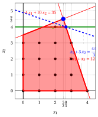

# Exercises · Valid inequalities

**Exercises · Chapter 4** · each solution opens with a click · [:material-book-open-variant: Chapter 4: Valid inequalities](../formulations/valid-inequalities.md) · [:material-file-pdf-box: Exercises, volume 1 (PDF)](../pdf/exercises-1-models-bounds-formulations.pdf)

!!! esercizio "Exercise 4.1: A valid inequality by rounding (P2)"

    !!! nota ""

        Consider the following ILP problem in canonical maximization form with $n=2$ integer variables and $m=2$ constraints:

        $$
        \begin{array}{rrrrrrr}
        {\max} & {x_1} & {+} & {3}\, {x_2} \\[1.5ex]
        & {-}{4}\, {x_1} & {+} & {10}\, {x_2} & {\le} & {35} \\[1.5ex]
        & {3}\, {x_1} & {+} & {x_2} & {\le} & {12} \\[1.5ex]
        & {x_1,} &  & {x_2} & {\in} & {\Z_{\ge 0}}
        \end{array}
        $$

        The optimal solution of its LP relaxation is $\tilde{\vet x}(\LP) = (\tfrac{5}{2},\tfrac{9}{2})$, with $z(\LP) = 16$.

    **Questions**

    1. Using the multipliers $(\frac{3}{34}, \frac{2}{17})$, show that $x_2 \le 4$ is a valid inequality.

    2. Is the inequality tight? Does it cut off the optimal solution of the LP relaxation?

    3. Add the inequality to the formulation and compute the new upper bound.

??? soluzione "Solution"

    1. Multiplying the constraints by the non-negative multipliers $(\tfrac{3}{34}, \tfrac{2}{17})$ and summing, $\tfrac{3}{34} \cdot (-4\,x_1 + 10\,x_2 \le 35) + \tfrac{2}{17} \cdot (3\,x_1 + x_2 \le 12)$, we get

        $$
        x_2 \le \dfrac{9}{2}.
        $$

        Since $x_j \ge 0$ and the coefficients $0 \ge 0$, $1 \ge 1$ are at least those of $x_2$, every feasible solution satisfies $x_2 \le x_2 \le \tfrac{9}{2}$. The left-hand side is an integer, so

        $$
        x_2 \le \left\lfloor \dfrac{9}{2} \right\rfloor = 4
        $$

        is a <strong>valid inequality</strong>.

    2. The feasible solutions $(2,4)$ satisfy $x_2 = 4$, so the inequality is <strong>tight</strong>. It <strong>cuts off</strong> $\tilde{\vet x}(\LP) = (\tfrac{5}{2},\tfrac{9}{2})$, since $0 \cdot \tfrac{5}{2} + 1 \cdot \tfrac{9}{2} = \tfrac{9}{2} > 4$.

    3. Graphically, we have:

        { .fig .ovale loading=lazy  }

        <em>The LP relaxation with the valid inequality $x_2 \le 4$ (green): the optimal solution $(\frac{5}{2},\frac{9}{2})$ of the original LP relaxation (blue circle) is cut off, and the new optimal solution is blue, with its objective line (dashed).</em>

        
<table>
        <tr>
        <th>Formulation</th>
        <th>\(\tilde{\vet x}(\LP)\)</th>
        <th>\(z(\LP)\)</th>
        <th>upper bound</th>
        </tr>
        <tr>
        <td>original</td>
        <td>\((\tfrac{5}{2},\tfrac{9}{2})\)</td>
        <td>\(16\)</td>
        <td>\(16\)</td>
        </tr>
        <tr>
        <td>with \(x_2 \le 4\)</td>
        <td>\((\tfrac{8}{3},4)\)</td>
        <td>\(\tfrac{44}{3}\)</td>
        <td>\(14\)</td>
        </tr>
        </table>

        !!! chiave ""

            $x_2 \le 4$ is valid and tight, it cuts off $\tilde{\vet x}(\LP)$, and the upper bound improves from $16$ to $14$ (the optimal value is $z(\ILP) = 14$).

!!! esercizio "Exercise 4.2: Valid or not valid (P4)"

    !!! nota ""

        Consider the following ILP problem in canonical maximization form with $n=2$ integer variables and $m=2$ constraints:

        $$
        \begin{array}{rrrrrrr}
        {\max} & {5}\, {x_1} & {+} & {3}\, {x_2} \\[1.5ex]
        & {2}\, {x_1} & {+} & {x_2} & {\le} & {14} \\[1.5ex]
        & {x_1} & {+} & {8}\, {x_2} & {\le} & {32} \\[1.5ex]
        & {x_1,} &  & {x_2} & {\in} & {\Z_{\ge 0}}
        \end{array}
        $$

        The optimal solution of its LP relaxation is $\tilde{\vet x}(\LP) = (\tfrac{16}{3},\tfrac{10}{3})$, with $z(\LP) = \dfrac{110}{3}$.

    **Questions**

    1. Is $x_1 + x_2 \le 7$ a valid inequality?

    2. Show that $x_1 + x_2 \le 8$ is a valid inequality, using the multipliers $(\frac{7}{15},\frac{1}{15})$. Does it cut off the optimal solution of the LP relaxation?

    3. Add $x_1 + x_2 \le 8$ to the formulation and solve the new LP relaxation. What can you conclude?

??? soluzione "Solution"

    1. No. The point $(6,2)$ is feasible, $2 \cdot 6 + 1 \cdot 2 = 14 \le 14, \quad 1 \cdot 6 + 8 \cdot 2 = 22 \le 32$, and it violates the inequality: $6 + 2 = 8 > 7$; the same holds for the feasible point $(5,3)$. A valid inequality must be satisfied by <strong>all</strong> the feasible solutions.

    2. Multiplying the constraints by the non-negative multipliers $(\tfrac{7}{15}, \tfrac{1}{15})$ and summing, $\tfrac{7}{15} \cdot (2\,x_1 + x_2 \le 14) + \tfrac{1}{15} \cdot (x_1 + 8\,x_2 \le 32)$, we get

        $$
        x_1 + x_2 \le \dfrac{26}{3}.
        $$

        Since $x_j \ge 0$ and the coefficients $1 \ge 1$, $1 \ge 1$ are at least those of $x_1 + x_2$, every feasible solution satisfies $x_1 + x_2 \le x_1 + x_2 \le \tfrac{26}{3}$. The left-hand side is an integer, so

        $$
        x_1 + x_2 \le \left\lfloor \dfrac{26}{3} \right\rfloor = 8
        $$

        is a <strong>valid inequality</strong>. It <strong>cuts off</strong> $\tilde{\vet x}(\LP) = (\tfrac{16}{3},\tfrac{10}{3})$, since $1 \cdot \tfrac{16}{3} + 1 \cdot \tfrac{10}{3} = \tfrac{26}{3} > 8$.

    3. Graphically, we have:

        { .fig .ovale loading=lazy  }

        <em>The LP relaxation with the valid inequality $x_1 + x_2 \le 8$ (green): the old optimal solution (blue circle) is cut off and the new optimal solution $(6,2)$ (blue) is integer.</em>

        
<table>
        <tr>
        <th>Formulation</th>
        <th>\(\tilde{\vet x}(\LP)\)</th>
        <th>\(z(\LP)\)</th>
        <th>upper bound</th>
        </tr>
        <tr>
        <td>original</td>
        <td>\((\tfrac{16}{3},\tfrac{10}{3})\)</td>
        <td>\(\tfrac{110}{3}\)</td>
        <td>\(36\)</td>
        </tr>
        <tr>
        <td>with \(x_1 + x_2 \le 8\)</td>
        <td>\((6,2)\)</td>
        <td>\(36\)</td>
        <td>\(36\)</td>
        </tr>
        </table>

        !!! chiave ""

            The new LP relaxation has the <strong>integer</strong> optimal solution $(6,2)$: it is an optimal ILP solution, $z(\ILP) = 36$, and the inequality $x_1 + x_2 \le 7$, which removes it, is not valid.

!!! esercizio "Exercise 4.3: Rounding and tightening (P5)"

    !!! nota ""

        Consider the following ILP problem in canonical maximization form with $n=2$ integer variables and $m=2$ constraints:

        $$
        \begin{array}{rrrrrrr}
        {\max} & {2}\, {x_1} & {+} & {3}\, {x_2} \\[1.5ex]
        & {6}\, {x_1} & {+} & {21}\, {x_2} & {\le} & {77} \\[1.5ex]
        & {8}\, {x_1} & {+} & {3}\, {x_2} & {\le} & {36} \\[1.5ex]
        & {x_1,} &  & {x_2} & {\in} & {\Z_{\ge 0}}
        \end{array}
        $$

        The optimal solution of its LP relaxation is $\tilde{\vet x}(\LP) = (\tfrac{7}{2},\tfrac{8}{3})$, with $z(\LP) = 15$.

    **Questions**

    1. Multiply both constraints by $\frac{1}{7}$, sum them, and derive a valid inequality $2\,x_1 + 3\,x_2 \le \beta$ by rounding. Does it cut off the optimal solution of the LP relaxation?

    2. Make the inequality tight with Step 1 of the algorithm of the chapter: decrease $\beta$ until a feasible integer point lies on the line $2\,x_1 + 3\,x_2 = \beta$.

    3. Add the tight inequality to the formulation. What is the new upper bound?

??? soluzione "Solution"

    1. Multiplying the constraints by the non-negative multipliers $(\tfrac{1}{7}, \tfrac{1}{7})$ and summing, $\tfrac{1}{7} \cdot (6\,x_1 + 21\,x_2 \le 77) + \tfrac{1}{7} \cdot (8\,x_1 + 3\,x_2 \le 36)$, we get

        $$
        2\,x_1 + \dfrac{24}{7}\,x_2 \le \dfrac{113}{7}.
        $$

        Since $x_j \ge 0$ and the coefficients $2 \ge 2$, $\tfrac{24}{7} \ge 3$ are at least those of $2\,x_1 + 3\,x_2$, every feasible solution satisfies $2\,x_1 + 3\,x_2 \le 2\,x_1 + \tfrac{24}{7}\,x_2 \le \tfrac{113}{7}$. The left-hand side is an integer, so

        $$
        2\,x_1 + 3\,x_2 \le \left\lfloor \dfrac{113}{7} \right\rfloor = 16
        $$

        is a <strong>valid inequality</strong>. It does <strong>not</strong> cut off $\tilde{\vet x}(\LP) = (\tfrac{7}{2},\tfrac{8}{3})$, since $2 \cdot \tfrac{7}{2} + 3 \cdot \tfrac{8}{3} = 15 \le 16$. The inequality is valid but useless for the bound.

    2. For two variables the integer points of the line $2\,x_1 + 3\,x_2 = \beta$ with $x_1, x_2 \ge 0$ are finitely many, and we check each of them against the constraints.

        - <strong>$\beta = 16$.</strong> The integer points of $2\,x_1 + 3\,x_2 = 16$ with $x \ge 0$: $(2,4)$ violates constraint 1 ($6 \cdot 2 + 21 \cdot 4 = 96 > 77$); $(5,2)$ violates constraint 2 ($8 \cdot 5 + 3 \cdot 2 = 46 > 36$); $(8,0)$ violates constraint 2 ($8 \cdot 8 + 3 \cdot 0 = 64 > 36$). Hence no feasible point: set $\beta = 15$.

        - <strong>$\beta = 15$.</strong> The integer points of $2\,x_1 + 3\,x_2 = 15$ with $x \ge 0$: $(0,5)$ violates constraint 1 ($6 \cdot 0 + 21 \cdot 5 = 105 > 77$); $(3,3)$ violates constraint 1 ($6 \cdot 3 + 21 \cdot 3 = 81 > 77$); $(6,1)$ violates constraint 2 ($8 \cdot 6 + 3 \cdot 1 = 51 > 36$). Hence no feasible point: set $\beta = 14$.

        - <strong>$\beta = 14$.</strong> The integer points of $2\,x_1 + 3\,x_2 = 14$ with $x \ge 0$: $(1,4)$ violates constraint 1 ($6 \cdot 1 + 21 \cdot 4 = 90 > 77$); $(4,2)$ violates constraint 2 ($8 \cdot 4 + 3 \cdot 2 = 38 > 36$); $(7,0)$ violates constraint 2 ($8 \cdot 7 + 3 \cdot 0 = 56 > 36$). Hence no feasible point: set $\beta = 13$.

        - <strong>$\beta = 13$.</strong> The integer points of $2\,x_1 + 3\,x_2 = 13$ with $x \ge 0$: $(2,3)$ is feasible; $(5,1)$ violates constraint 2 ($8 \cdot 5 + 3 \cdot 1 = 43 > 36$). Hence a feasible point exists: the inequality is tight. <code>STOP</code>.

        The tight valid inequality is $2\,x_1 + 3\,x_2 \le 13$. It <strong>cuts off</strong> $\tilde{\vet x}(\LP) = (\tfrac{7}{2},\tfrac{8}{3})$, since $2 \cdot \tfrac{7}{2} + 3 \cdot \tfrac{8}{3} = 15 > 13$.

    3. The tight inequality has the same coefficients as the objective function, so the new LP relaxation has optimal value $z(\LP) = 13$, attained for example at $(\tfrac{23}{6},\tfrac{16}{9})$.

        
<table>
        <tr>
        <th>Formulation</th>
        <th>\(\tilde{\vet x}(\LP)\)</th>
        <th>\(z(\LP)\)</th>
        <th>upper bound</th>
        </tr>
        <tr>
        <td>original</td>
        <td>\((\tfrac{7}{2},\tfrac{8}{3})\)</td>
        <td>\(15\)</td>
        <td>\(15\)</td>
        </tr>
        <tr>
        <td>with \(2\,x_1 + 3\,x_2 \le 13\)</td>
        <td>\((\tfrac{23}{6},\tfrac{16}{9})\)</td>
        <td>\(13\)</td>
        <td>\(13\)</td>
        </tr>
        </table>

        !!! chiave ""

            The rounding gives $2\,x_1 + 3\,x_2 \le 16$, which does not cut off the LP optimum; the tight version $2\,x_1 + 3\,x_2 \le 13$ gives $\UB = 13$, equal to the value of the feasible point $(2,3)$: $z(\ILP) = 13$ is certified.

!!! esercizio "Exercise 4.4: Reaching the convex hull by rounding (P1)"

    !!! nota ""

        Consider the following ILP problem in canonical maximization form with $n=2$ integer variables and $m=1$ constraint:

        $$
        \begin{array}{rrrrrrr}
        {\max} & {x_1} & {+} & {8}\, {x_2} \\[1.5ex]
        & {3}\, {x_1} & {+} & {6}\, {x_2} & {\le} & {16} \\[1.5ex]
        & {x_1,} &  & {x_2} & {\in} & {\Z_{\ge 0}}
        \end{array}
        $$

        The optimal solution of its LP relaxation is $\tilde{\vet x}(\LP) = (0,\tfrac{8}{3})$, with $z(\LP) = \dfrac{64}{3}$.

    **Questions**

    1. Derive a valid inequality $x_2 \le \beta_1$ with the multiplier $\frac{1}{6}$, and a valid inequality $x_1 + 2\,x_2 \le \beta_2$ with the multiplier $\frac{1}{3}$.

    2. Compute the upper bound given by the LP relaxation after adding each inequality alone, and after adding both.

    3. Show that the formulation with both inequalities is ideal.

??? soluzione "Solution"

    1. - Multiplying the constraints by the non-negative multipliers $(\tfrac{1}{6})$ and summing, $\tfrac{1}{6} \cdot (3\,x_1 + 6\,x_2 \le 16)$, we get

            $$
            \dfrac{1}{2}\,x_1 + x_2 \le \dfrac{8}{3}.
            $$

            Since $x_j \ge 0$ and the coefficients $\tfrac{1}{2} \ge 0$, $1 \ge 1$ are at least those of $x_2$, every feasible solution satisfies $x_2 \le \tfrac{1}{2}\,x_1 + x_2 \le \tfrac{8}{3}$. The left-hand side is an integer, so

            $$
            x_2 \le \left\lfloor \dfrac{8}{3} \right\rfloor = 2
            $$

            is a <strong>valid inequality</strong>.

        - Multiplying the constraints by the non-negative multipliers $(\tfrac{1}{3})$ and summing, $\tfrac{1}{3} \cdot (3\,x_1 + 6\,x_2 \le 16)$, we get

            $$
            x_1 + 2\,x_2 \le \dfrac{16}{3}.
            $$

            Since $x_j \ge 0$ and the coefficients $1 \ge 1$, $2 \ge 2$ are at least those of $x_1 + 2\,x_2$, every feasible solution satisfies $x_1 + 2\,x_2 \le x_1 + 2\,x_2 \le \tfrac{16}{3}$. The left-hand side is an integer, so

            $$
            x_1 + 2\,x_2 \le \left\lfloor \dfrac{16}{3} \right\rfloor = 5
            $$

            is a <strong>valid inequality</strong>.

    2. Graphically, we have:

        { .fig .ovale loading=lazy  }

        <em>The LP relaxation (light red) with the valid inequalities $x_2 \le 2$ and $x_1 + 2\,x_2 \le 5$ (green): the new polyhedron (red) has the integer optimal vertex $(1,2)$ (blue); the old optimal solution is the blue circle.</em>

        
<table>
        <tr>
        <th>Formulation</th>
        <th>\(\tilde{\vet x}(\LP)\)</th>
        <th>\(z(\LP)\)</th>
        <th>upper bound</th>
        </tr>
        <tr>
        <td>original</td>
        <td>\((0,\tfrac{8}{3})\)</td>
        <td>\(\tfrac{64}{3}\)</td>
        <td>\(21\)</td>
        </tr>
        <tr>
        <td>with \(x_2 \le 2\)</td>
        <td>\((\tfrac{4}{3},2)\)</td>
        <td>\(\tfrac{52}{3}\)</td>
        <td>\(17\)</td>
        </tr>
        <tr>
        <td>with \(x_1 + 2\,x_2 \le 5\)</td>
        <td>\((0,\tfrac{5}{2})\)</td>
        <td>\(20\)</td>
        <td>\(20\)</td>
        </tr>
        <tr>
        <td>with both</td>
        <td>\((1,2)\)</td>
        <td>\(17\)</td>
        <td>\(17\)</td>
        </tr>
        </table>

        Each inequality alone cuts off $\tilde{\vet x}(\LP)$ but leaves a fractional optimum; together they give the integer optimum $(1,2)$.

    3. The polyhedron with both inequalities has the vertices $(0,0)$, $(0,2)$, $(1,2)$, $(5,0)$, all integer: it is the convex hull of the feasible solutions, so the formulation is <strong>ideal</strong>.

        !!! chiave ""

            With $x_2 \le 2$ and $x_1 + 2\,x_2 \le 5$, both obtained by rounding, the LP relaxation gives $z(\LP) = 17 = z(\ILP)$ at the integer vertex $(1,2)$.

!!! esercizio "Exercise 4.5: Rounding with three variables (P42)"

    !!! nota ""

        Consider the following ILP problem in canonical maximization form with $n=3$ integer variables and $m=3$ constraints:

        $$
        \begin{array}{rrrrrrrrr}
        {\max} & {3}\, {x_1} & {+} & {2}\, {x_2} & {+} & {4}\, {x_3} \\[1.5ex]
        & {x_1} & {+} & {x_2} & {+} & {2}\, {x_3} & {\le} & {4} \\[1.5ex]
        & {2}\, {x_1} &  &  & {+} & {3}\, {x_3} & {\le} & {5} \\[1.5ex]
        & {2}\, {x_1} & {+} & {x_2} & {+} & {3}\, {x_3} & {\le} & {7} \\[1.5ex]
        & {x_1,} &  & {x_2,} &  & {x_3} & {\in} & {\Z_{\ge 0}}
        \end{array}
        $$

        The optimal solution of its LP relaxation is $\tilde{\vet x}(\LP) = (\tfrac{5}{2},\tfrac{3}{2},0)$, with $z(\LP) = \dfrac{21}{2}$.

    **Questions**

    1. Multiply the second constraint by $\frac{1}{2}$, round down its coefficients and its right-hand side, and show that the result is a valid inequality.

    2. Does it cut off the optimal solution of the LP relaxation?

    3. Add the inequality to the formulation. The new LP relaxation has the optimal solution $(2,2,0)$: what can you conclude?

??? soluzione "Solution"

    1. The second constraint multiplied by $\frac{1}{2}$ is $x_1 + \dfrac{3}{2}\,x_3 \le \dfrac{5}{2}$. Rounding down the coefficients gives $x_1 + x_3$, whose coefficients are not larger. Multiplying the constraints by the non-negative multipliers $(0, \tfrac{1}{2}, 0)$ and summing, $\tfrac{1}{2} \cdot (2\,x_1 + 3\,x_3 \le 5)$, we get

        $$
        x_1 + \dfrac{3}{2}\,x_3 \le \dfrac{5}{2}.
        $$

        Since $x_j \ge 0$ and the coefficients $1 \ge 1$, $0 \ge 0$, $\tfrac{3}{2} \ge 1$ are at least those of $x_1 + x_3$, every feasible solution satisfies $x_1 + x_3 \le x_1 + \tfrac{3}{2}\,x_3 \le \tfrac{5}{2}$. The left-hand side is an integer, so

        $$
        x_1 + x_3 \le \left\lfloor \dfrac{5}{2} \right\rfloor = 2
        $$

        is a <strong>valid inequality</strong>.

    2. It <strong>cuts off</strong> $\tilde{\vet x}(\LP) = (\tfrac{5}{2},\tfrac{3}{2},0)$, since $1 \cdot \tfrac{5}{2} + 0 \cdot \tfrac{3}{2} + 1 \cdot 0 = \tfrac{5}{2} > 2$.

    3. The new LP relaxation has the <strong>integer</strong> optimal solution $(2,2,0)$, with value $10$. By the proposition on the LP relaxation, it is an optimal ILP solution.

        !!! chiave ""

            The valid inequality $x_1 + x_3 \le 2$ lowers the bound of the LP relaxation from $\dfrac{21}{2}$ to $10$ and makes its optimal solution integer: $(2,2,0)$, $z(\ILP) = 10$.
