# Cover inequalities

**Part 2 · Strengthening the formulation · Chapter 5** · [:material-file-pdf-box: Lecture notes, volume 1 (PDF)](../pdf/lecture-notes-1-models-bounds-formulations.pdf) · [:material-pencil: Exercises: Cover inequalities](../exercises/cover.md)

\(\newcommand{\LPcov}{\mathrm{LP}^{\mathrm{cov}}} \newcommand{\CSP}{\mathrm{ILP}_{\mathrm{CSP}}} \newcommand{\CSPKP}{\mathrm{ILP}^{2}_{\mathrm{CSP}}}\)

!!! nota "Prerequisites"

    - From this module, [Chapter 1 «Integer linear programming»](https://fabiofurini.github.io/integer-linear-programming/models-and-bounds/ilp/) and [Chapter 2 «LP relaxation»](https://fabiofurini.github.io/integer-linear-programming/models-and-bounds/lp-relaxation/): ILP problems, the LP relaxation, and the upper bound given by the LP relaxation.

    - From this module, [Chapter 3 «Ideal formulations»](https://fabiofurini.github.io/integer-linear-programming/formulations/ideal-formulations/) and [Chapter 4 «Valid inequalities»](https://fabiofurini.github.io/integer-linear-programming/formulations/valid-inequalities/): the convex hull of the integer solutions, valid inequalities, and cuts that remove fractional points.

    - The LP relaxation of a binary problem with one constraint, solved by inserting the variables in non-increasing order of the ratio $c_j/a_j$ between objective and constraint coefficients (Dantzig's rule).

!!! chiave "Objectives"

    At the end of this chapter you will be able to:

    - write the cover inequalities of a $\le$ constraint with positive coefficients of a binary MIP, and prove that they are valid;

    - list the covers and the minimal covers of an instance, and describe the cover closure;

    - separate a cover inequality from a fractional point by solving a cover separation problem, exactly or with the greedy heuristic algorithm;

    - strengthen a cover inequality into an extended cover inequality;

    - compute the violation of a cover inequality and the distance of a point from it.

## 5.1 A constraint with positive coefficients and its LP relaxation

!!! definizione "Definition 5.1: constraint with positive coefficients of a binary MIP"

    Given binary variables $x_j$, for $j \in \mathscr{I} = \{1,2,\ldots,n\}$, integer coefficients $a_j \in \Z_{\ge 1}$ and a right-hand side $b \in \Z_{\ge 1}$, consider the constraint

    

    \begin{align*}
    \sum_{j\in\mathscr{I}}a_jx_j&\le b, \label{eq:main} \tag{5.1a}\\
    x_j&\in\{0,1\}, &\forall j\in\mathscr{I}. \label{eq:binary} \tag{5.1b}
    \end{align*}

    Its set of feasible solutions is

    \begin{equation*}
    \label{eq:binary-feasible-set}
    X=\left\{\vet x\in\{0,1\}^n:
    \sum_{j\in\mathscr{I}}a_jx_j\le b\right\}, \tag{5.2}
    \end{equation*}

    and its LP relaxation is

    \begin{equation*}
    \label{eq:relaxation}
    P=\left\{\vet x\in[0,1]^n:
    \sum_{j\in\mathscr{I}}a_jx_j\le b\right\}. \tag{5.3}
    \end{equation*}

- Constraints of this type are called <strong>knapsack constraints</strong> or <strong>budget constraints</strong>.

- We assume that

    $$
    a_j \le b ~~~~\text{for all}~~~~ j \in \mathscr{I} ~~~~~~~\text{and}~~~~~~~ \sum_{j \in \mathscr{I}} a_j>b.
    $$

    The first assumption guarantees that every variable can be set to $1$, the second one that they cannot all be set to $1$ together.

- $X$ is a finite set of binary points, and an exact description of its convex hull $\operatorname{conv}(X)$ is generally hard to obtain. The aim is to strengthen $P$ by removing fractional points without removing any point of $X$.

- A MIP can contain several constraints of this type, and further constraints. Valid inequalities for $X$ remain valid when other constraints are imposed.

!!! chiave ""

    With objective coefficients $c_j$, maximizing $\sum_{j\in\mathscr{I}}c_jx_j$ over $P$ gives an upper bound on the integer maximization problem; valid inequalities for $X$ can improve this upper bound.

## 5.2 Covers and cover inequalities

!!! definizione "Definition 5.2: Cover and collection of all covers"

    A <em>cover</em> is a subset $C\subseteq\mathscr{I}$ whose total coefficient $\sum_{j\in C}a_j$ exceeds the right-hand side $b$. The collection of all covers is

    \begin{equation*}
    \label{eq:covers}
    \mathcal{C}=\left\{C\subseteq\mathscr{I}:
    \sum_{j\in C}a_j>b\right\}. \tag{5.4}
    \end{equation*}

    Since coefficients and right-hand side are integer, the condition is equivalent to $\sum_{j\in C}a_j\ge b+1$.

!!! definizione "Definition 5.3: Cover inequality"

    Given $C\in\mathcal{C}$, the associated <em>cover inequality</em> is

    \begin{equation*}
    \label{eq:cover-cut}
    \sum_{j\in C}x_j\le |C|-1. \tag{5.5}
    \end{equation*}

!!! teorema "Proposition 5.4"

    For every cover $C\in\mathcal{C}$, the cover inequality $\eqref{eq:cover-cut}$ is valid for $X$.

??? dimostrazione "Proof"

    Suppose that a point $\vet x\in X$ violates $\eqref{eq:cover-cut}$. The sum of $|C|$ binary variables is then greater than $|C|-1$, hence $x_j=1$ for every $j\in C$. Since all coefficients are positive,

    $$
    \sum_{j\in\mathscr{I}}a_jx_j\ge\sum_{j\in C}a_j>b.
    $$

    This contradicts the constraint $\eqref{eq:main}$: at most $|C|-1$ variables of $C$ can be equal to $1$ together. □

### 5.2.1 Minimal covers

!!! definizione "Definition 5.5: Minimal cover"

    A cover $C$ is <em>minimal</em> if no proper subset of $C$ is a cover. Equivalently,

    \begin{equation*}
    \label{eq:minimal}
    \sum_{j\in C}a_j>b,\qquad
    \sum_{j\in C}a_j-a_i\le b\quad\forall i\in C. \tag{5.6}
    \end{equation*}

- Since the coefficients are positive, it suffices to remove one variable at a time: if each of these $|C|$ subsets satisfies the constraint, every smaller subset satisfies it as well.

!!! teorema "Proposition 5.6"

    The inequalities of the minimal covers, together with the upper bounds $x_j\le1$ for all $j\in\mathscr{I}$, imply every cover inequality.

??? dimostrazione "Proof"

    Starting from a cover $C$, remove variables as long as the remaining set is still a cover: this gives a minimal cover $D\subseteq C$. Adding the cover inequality of $D$ and the upper bounds of the variables in $C\setminus D$ gives

    $$
    \sum_{j\in C}x_j
    =\sum_{j\in D}x_j+\sum_{j\in C\setminus D}x_j
    \le |D|-1+|C\setminus D|=|C|-1.\qedhere
    $$

    
□

### 5.2.2 The cover closure

!!! definizione "Definition 5.7: Cover closure"

    The <em>cover closure</em> of $P$ is the polyhedron

    \begin{equation*}
    \label{eq:closure}
    P^{\mathrm{cov}}=
    \left\{\vet x\in P:
    \sum_{j\in C}x_j\le |C|-1\quad\forall C\in\mathcal{C}\right\}. \tag{5.7}
    \end{equation*}

- Since all cover inequalities are valid,

    $$
    \operatorname{conv}(X)\subseteq P^{\mathrm{cov}}\subseteq P,
    $$

    and in general the first inclusion is strict.

- By [Proposition 5.6](#box-6-prop-minimal-covers-suffice), the inequalities of the minimal covers are sufficient to describe $P^{\mathrm{cov}}$.

- The number of covers can be exponential in $n$. For example, if $a_j=1$ for all $j\in\mathscr{I}$ and $b=1$, every subset with at least two indices is a cover, i.e., there are $2^n-n-1$ covers. Also the minimal covers can be exponentially many: for $a_j=1$ for all $j\in\mathscr{I}$, $n=2m$ and $b=m$, they are the $\binom{2m}{m+1}$ subsets of $m+1$ indices.

- Therefore, cover inequalities are not added all at once: they are added only when they are violated, i.e., they are <em>separated</em> (Section [5.4](#sez-sec-separation)).

!!! esempio "Example 5.1: A binary problem with one constraint of this form"

    Consider $\mathscr{I}=\{1,2,3,4\}$, right-hand side $b=9$, and the following objective coefficients $c_j$ and constraint coefficients $a_j$.

    $$
    \begin{array}{l|rrrr}
    \hline {j} & 1 & 2 & 3 & 4 \\
    \hline {c_j} & 6 & 5 & 8 & 9 \\
    {a_j} & 2 & 3 & 6 & 7 \\
    \hline
    \end{array}
    $$

    The associated $\LP$ model is:

    $$
    \begin{array}{rrcrcrcrcl}
    {\max} & {6\,x_1} & {+} & {5\,x_2} & {+} & {8\,x_3} & {+} & {9\,x_4} &  &  \\[1ex]
    \text{subject to} & {2\,x_1} & {+} & {3\,x_2} & {+} & {6\,x_3} & {+} & {7\,x_4} & {\le} & {9} \\[1ex]
    & {x_1} &  &  &  &  &  &  & {\le} & {1} \\[0.5ex]
    &  &  & {x_2} &  &  &  &  & {\le} & {1} \\[0.5ex]
    &  &  &  &  & {x_3} &  &  & {\le} & {1} \\[0.5ex]
    &  &  &  &  &  &  & {x_4} & {\le} & {1} \\[0.5ex]
    & {x_1,} &  & {x_2,} &  & {x_3,} &  & {x_4} & {\ge} & {0}
    \end{array}
    $$

    The ratios $c_j/a_j$ are $3,5/3,4/3,9/7$, in non-increasing order. Dantzig's rule sets to $1$ the variables in this order, as long as the constraint is satisfied, and gives to the first variable that would violate it the largest fractional value allowed: this gives an optimal solution of $\LP$. An optimal solution $\tilde{\vet x}(\LP)$ is:

    $$
    \tilde{x}_1=\tilde{x}_2=1,\qquad
    \tilde{x}_3=\frac23,\qquad \tilde{x}_4=0.
    $$

    The optimal value $z(\LP)$ is $6+5+8(2/3)=49/3$.

!!! esempio "Example 5.2: The cover closure of the four-variable instance"

    The instance of [Example 5.1](#box-8-ex-guide) has the following seven covers.

    
<table>
    <tr>
    <th>\(C\)</th>
    <th>\(\sum_{j\in C}a_j\)</th>
    <th>\(|C|\)</th>
    <th>Cover inequality</th>
    <th>Minimal</th>
    </tr>
    <tr>
    <td>\(\{2,4\}\)</td>
    <td>\(10\)</td>
    <td>\(2\)</td>
    <td>\(x_2+x_4\le 1\)</td>
    <td>yes</td>
    </tr>
    <tr>
    <td>\(\{3,4\}\)</td>
    <td>\(13\)</td>
    <td>\(2\)</td>
    <td>\(x_3+x_4\le 1\)</td>
    <td>yes</td>
    </tr>
    <tr>
    <td>\(\{1,2,3\}\)</td>
    <td>\(11\)</td>
    <td>\(3\)</td>
    <td>\(x_1+x_2+x_3\le 2\)</td>
    <td>yes</td>
    </tr>
    <tr>
    <td>\(\{1,2,4\}\)</td>
    <td>\(12\)</td>
    <td>\(3\)</td>
    <td>\(x_1+x_2+x_4\le 2\)</td>
    <td>no</td>
    </tr>
    <tr>
    <td>\(\{1,3,4\}\)</td>
    <td>\(15\)</td>
    <td>\(3\)</td>
    <td>\(x_1+x_3+x_4\le 2\)</td>
    <td>no</td>
    </tr>
    <tr>
    <td>\(\{2,3,4\}\)</td>
    <td>\(16\)</td>
    <td>\(3\)</td>
    <td>\(x_2+x_3+x_4\le 2\)</td>
    <td>no</td>
    </tr>
    <tr>
    <td>\(\{1,2,3,4\}\)</td>
    <td>\(18\)</td>
    <td>\(4\)</td>
    <td>\(x_1+x_2+x_3+x_4\le 3\)</td>
    <td>no</td>
    </tr>
    </table>

    Only the first three covers are minimal; their inequalities already describe the cover closure. Denote by $\LPcov$ the LP obtained by adding them to $\LP$. An optimal solution $\tilde{\vet x}(\LPcov)$ is:

    $$
    \tilde{x}_1=1,\qquad \tilde{x}_2=\frac35,\qquad
    \tilde{x}_3=\frac25,\qquad \tilde{x}_4=\frac25.
    $$

    The optimal value is $z(\LPcov)=79/5<z(\LP)=49/3$.

## 5.3 Geometric interpretation { #sez-sec-geometry }

- All coordinates in the figures are the actual variable values. The ticks mark the coordinates of the blue point and of the main vertices; a few vertices have no tick, to keep the axes readable. In 3D, dashed edges are hidden behind the visible faces.

- Every step is illustrated both in two and in three dimensions, with the same colours in all figures: the red region is the continuous region under consideration; green identifies a cover inequality (an edge in 2D, a face in 3D); black points are the feasible binary points; the blue point is the fractional point discussed in the text.

- First consider only the domain, $[0,1]^2$ or $[0,1]^3$: no constraint other than the bounds is imposed in the next two examples.

!!! esempio "Example 5.3: A cover inequality in the unit square"

    In $[0,1]^2$, the inequality $x_1+x_2\le1$ removes only the binary point $(1,1)$ and preserves the binary points $(0,0)$, $(1,0)$ and $(0,1)$.

    { .fig .ovale loading=lazy  }

    Unit square: domain only.

    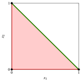{ .fig .ovale loading=lazy  }

    Domain with $x_1+x_2\le1$.

!!! esempio "Example 5.4: Cover inequalities in the unit cube"

    - In $[0,1]^3$, the inequality $x_1+x_2\le1$ is independent of $x_3$; its boundary is parallel to the $x_3$ axis. Similarly, the boundary of $x_1+x_3\le1$ is parallel to the $x_2$ axis.

    - The two halfspaces remove different portions of the cube. Their intersection preserves exactly the binary points $(0,0,0),(1,0,0),(0,1,0),(0,0,1),(0,1,1)$.

    - The inequality $x_1+x_2+x_3\le2$ removes only the binary point $x_1=x_2=x_3=1$.

    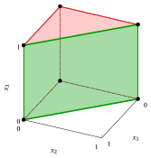{ .fig .ovale loading=lazy  }

    Domain with $x_1+x_2\le1$.

    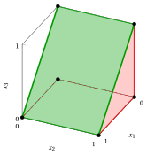{ .fig .ovale loading=lazy  }

    Domain with $x_1+x_3\le1$.

    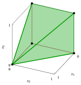{ .fig .ovale loading=lazy  }

    Domain with both inequalities.

    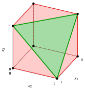{ .fig .ovale loading=lazy  }

    Domain with $x_1+x_2+x_3\le2$.

!!! esempio "Example 5.5: A cover in two dimensions"

    For $\mathscr{I}=\{1,2\}$, consider

    $$
    P_2=\{\vet x\in[0,1]^2:10x_1+5x_2\le12\}.
    $$

    The cover $C=\{1,2\}$ gives $x_1+x_2\le1$. The point $\tilde{x}_1=1$, $\tilde{x}_2=2/5$ satisfies the constraint at equality, but violates the cover by $2/5$. The original polygon has vertices

    $$
    (0,0),\ (1,0),\ (1,2/5),\ (7/10,1),\ (0,1).
    $$

    After adding the cut, the region is the triangle with vertices $(0,0),(1,0),(0,1)$. Thus all three feasible binary points are preserved, and the constraint becomes redundant, since $10x_1+5x_2\le10<12$ on the triangle.

    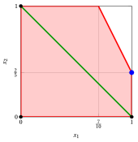{ .fig .ovale loading=lazy  }

    Original $P_2$ and the boundary $x_1+x_2=1$.

    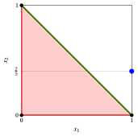{ .fig .ovale loading=lazy  }

    $P_2\cap\{x_1+x_2\le1\}$: the blue point is removed.

!!! esempio "Example 5.6: Successive cover cuts"

    For $\mathscr{I}=\{1,2,3\}$, let

    $$
    P_A=\{\vet x\in[0,1]^3:10x_1+5x_2+6x_3\le12\}.
    $$

    There are exactly three covers:

    $$
    \begin{array}{ccl}
    \{1,2,3\}&:&x_1+x_2+x_3\le2,\\
    \{1,3\}&:&x_1+x_3\le1,\\
    \{1,2\}&:&x_1+x_2\le1.
    \end{array}
    $$

    Only the last two are minimal. The blue point $\tilde{x}_1=1$, $\tilde{x}_2=2/5$, $\tilde{x}_3=0$ lies in $P_A$. It satisfies the first inequality and is on the boundary of the second; the third is violated by $2/5$, exactly as in [Example 5.5](#box-12-ex-2d). Unlike the previous domain-only panels, every following panel includes the constraint $10x_1+5x_2+6x_3\le12$.

    { .fig .ovale loading=lazy  }

    Original $P_A$.

    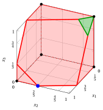{ .fig .ovale loading=lazy  }

    Add $x_1+x_2+x_3\le2$.

    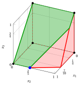{ .fig .ovale loading=lazy  }

    Also add $x_1+x_3\le1$.

    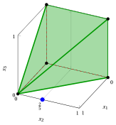{ .fig .ovale loading=lazy  }

    Also add $x_1+x_2\le1$: the cover closure.

    - For the objective $\max\,40x_1+15x_2+12x_3$, the optimal solution over $P_A$ is $\tilde{\vet x}=(1,2/5,0)$, with value $46$. Over the cover closure, the optimal solution is $(1,0,0)$, with value $40$, which is also optimal for the binary problem.

    - In this instance the cover closure coincides with $\operatorname{conv}(X)$: its vertices, shown in the last panel, are all binary. This is a property of this instance, not of every cover closure.

!!! esempio "Example 5.7: A different constraint"

    For $\mathscr{I}=\{1,2,3\}$, consider now the instance

    $$
    P_B=\{\vet x\in[0,1]^3:5x_1+4x_2+6x_3\le12\}.
    $$

    Every pair of variables satisfies the constraint, whereas the three coefficients sum to $15>12$. Thus the only cover is $\{1,2,3\}$ and it is minimal. Its inequality is $x_1+x_2+x_3\le2$. The blue point $\tilde{x}_1=\tilde{x}_2=1$, $\tilde{x}_3=1/2$ has left-hand side $12$ and violates this cut by $1/2$.

    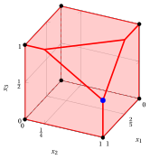{ .fig .ovale loading=lazy  }

    Original $P_B$.

    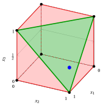{ .fig .ovale loading=lazy  }

    $P_B\cap\{x_1+x_2+x_3\le2\}$.

    - The plane of the constraint intersects the cube edges at $(1,1,1/2)$, $(1,1/4,1)$ and $(2/5,1,1)$.

    - The cover removes these fractional vertices while preserving all seven feasible binary points. As in the 2D example, after the cut the constraint is redundant: the sum of the two largest coefficients is $6+5=11<12$.

    - The polyhedron $P_B\cap\{x_1+x_2+x_3\le2\}$ has only binary vertices (last panel): here a single cover inequality gives $\operatorname{conv}(X)$.

## 5.4 Separation of cover inequalities { #sez-sec-separation }

!!! chiave ""

    Given a point $\tilde{\vet x}\in P$, the <strong>cover separation problem</strong> (CSP) consists in finding a cover inequality violated by $\tilde{\vet x}$, or in proving that $\tilde{\vet x}$ satisfies all the cover inequalities.

    Formally, the CSP asks to find a cover

    $$
    C\in\mathcal{C}:\qquad \sum_{j\in C}\tilde{x}_j>|C|-1,
    $$

    or to prove that

    $$
    \sum_{j\in C}\tilde{x}_j\le|C|-1\qquad\forall\, C\in\mathcal{C}.
    $$

- Typically, $\tilde{\vet x}$ is an optimal solution of the current LP relaxation, but any point of $P$ can be separated.

- For a cover $C$, the cover inequality is violated by $\tilde{\vet x}$ if

    \begin{equation*}
    \label{eq:violated}
    \sum_{j\in C}\tilde{x}_j>|C|-1. \tag{5.8}
    \end{equation*}

    Moving $\sum_{j\in C}\tilde{x}_j$ to the right-hand side and $1$ to the left-hand side, and writing $|C|=\sum_{j\in C}1$, we obtain the equivalent conditions:

    \begin{align*}
    |C|-\sum_{j\in C}\tilde{x}_j&<1, \\
    \sum_{j\in C}1-\sum_{j\in C}\tilde{x}_j&<1, \\
    \sum_{j\in C}(1-\tilde{x}_j)&<1. \label{eq:cost-test} \tag{5.9}
    \end{align*}

- Assigning to each index $j$ the cost $q_j=1-\tilde{x}_j\ge0$, the CSP amounts to finding a cover of <em>minimum cost</em>: a violated cover inequality exists if and only if this minimum cost is less than $1$.

### 5.4.1 An ILP formulation for the CSP

- Introduce $n$ binary variables $z_j$: $z_j=1$ if $j$ belongs to the cover and $z_j=0$ otherwise.

- The objective minimizes the total cover cost; the single constraint forces the selected set to be a cover.

!!! chiave ""

    

    \begin{align*}
    (\CSP)\qquad
    \min\quad\sum_{j\in\mathscr{I}}(1-\tilde{x}_j)z_j
    \label{eq:csp-obj} \tag{5.10a}\\
    \text{subject to}\quad\sum_{j\in\mathscr{I}}a_jz_j&\ge b+1,
    \label{eq:csp-constraint} \tag{5.10b}\\
    z_j&\in\{0,1\},&\forall j\in\mathscr{I}.
    \label{eq:csp-domain} \tag{5.10c}
    \end{align*}

!!! teorema "Proposition 5.8"

    A cover inequality violated by $\tilde{\vet x}$ exists if and only if $z(\CSP)<1$.

??? dimostrazione "Proof"

    Every feasible assignment of the binary variables $z_j$ represents a cover $C=\{j:z_j=1\}$, and its objective is $\sum_{j\in C}(1-\tilde{x}_j)$. By $\eqref{eq:cost-test}$, this is less than $1$ exactly when the corresponding cut is violated. Taking the minimum over all covers proves both implications. The CSP is feasible because $\mathscr{I}$ itself is a cover. □

!!! chiave ""

    Let $\tilde{z}_1,\tilde{z}_2,\dots,\tilde{z}_n$ be an optimal solution of $\CSP$. If $z(\CSP)<1$, the cover

    $$
    \tilde{C}=\big\{j\in\mathscr{I}:\ \tilde{z}_j=1\big\}
    $$

    is associated with the cover inequality $\sum_{j\in\tilde{C}}x_j\le|\tilde{C}|-1$ maximally violated by $\tilde{\vet x}$. Otherwise, no cover inequality is violated by $\tilde{\vet x}$.

- To find a violated cover inequality, it is not necessary to solve $\CSP$ to optimality: any feasible solution $\bar{z}_1,\dots,\bar{z}_n$ of cost less than $1$ gives the cover $\bar{C}=\{j\in\mathscr{I}:\ \bar{z}_j=1\}$, whose cover inequality is violated by $\tilde{\vet x}$.

- Conversely, a feasible solution of cost at least $1$ does <em>not</em> prove that no violated cover inequality exists: this requires the optimal value (or a lower bound) of $\CSP$.

- If $z(\CSP)<1$, the maximum violation of a cover inequality at $\tilde{\vet x}$ is $1-z(\CSP)$.

!!! esempio "Example 5.8: Separation of the cover inequalities"

    We consider again [Example 5.1](#box-8-ex-guide). The cover inequalities are separated iteratively: at each iteration, the current LP is solved, the $\CSP$ is solved for its optimal solution $\tilde{\vet x}$, and the maximally violated cover inequality is added, until no cover inequality is violated.

    <strong>Iteration 1.</strong> An optimal solution of $\LP$ is

    $$
    \tilde{x}_1=1,\qquad \tilde{x}_2=1,\qquad \tilde{x}_3=\frac23,\qquad
    \tilde{x}_4=0,\qquad z(\LP)=\frac{49}{3}.
    $$

    The associated $\CSP$ is:

    $$
    \begin{array}{rrcrcrcrcl}
    {\min} &  &  &  &  & {\frac{1}{3}\,z_3} & {+} & {z_4} &  &  \\[1ex]
    \text{subject to} & {2\,z_1} & {+} & {3\,z_2} & {+} & {6\,z_3} & {+} & {7\,z_4} & {\ge} & {10} \\[1ex]
    & {z_1,} &  & {z_2,} &  & {z_3,} &  & {z_4} & {\in} & {\{0,1\}}
    \end{array}
    $$

    An optimal solution of $\CSP$ is $\tilde{z}_1=\tilde{z}_2=\tilde{z}_3=1$, $\tilde{z}_4=0$, with value $z(\CSP)=\frac13<1$. Accordingly, $\tilde{C}=\{j\in\mathscr{I}:\tilde{z}_j=1\}=\{1,2,3\}$ is the cover associated with the cover inequality maximally violated by $\tilde{\vet x}$:

    $$
    x_1+x_2+x_3\le 2,
    \qquad\text{since}\qquad
    \tilde{x}_1+\tilde{x}_2+\tilde{x}_3=1+1+\frac23=\frac83>2.
    $$

    <strong>Iteration 2.</strong> Adding this cover inequality to $\LP$, we obtain the following LP, denoted $\LP_1$:

    $$
    \begin{array}{rrcrcrcrcl}
    {\max} & {6\,x_1} & {+} & {5\,x_2} & {+} & {8\,x_3} & {+} & {9\,x_4} &  &  \\[1ex]
    \text{subject to} & {2\,x_1} & {+} & {3\,x_2} & {+} & {6\,x_3} & {+} & {7\,x_4} & {\le} & {9} \\[1ex]
    & {x_1} & {+} & {x_2} & {+} & {x_3} &  &  & {\le} & {2} \\[1ex]
    & {x_1} &  &  &  &  &  &  & {\le} & {1} \\[0.5ex]
    &  &  & {x_2} &  &  &  &  & {\le} & {1} \\[0.5ex]
    &  &  &  &  & {x_3} &  &  & {\le} & {1} \\[0.5ex]
    &  &  &  &  &  &  & {x_4} & {\le} & {1} \\[0.5ex]
    & {x_1,} &  & {x_2,} &  & {x_3,} &  & {x_4} & {\ge} & {0}
    \end{array}
    $$

    An optimal solution of $\LP_1$ is

    $$
    \tilde{x}_1=1,\qquad \tilde{x}_2=1,\qquad \tilde{x}_3=0,\qquad
    \tilde{x}_4=\frac47,\qquad z(\LP_1)=\frac{113}{7}.
    $$

    The associated $\CSP$ is:

    $$
    \begin{array}{rrcrcrcrcl}
    {\min} &  &  &  &  & {z_3} & {+} & {\frac{3}{7}\,z_4} &  &  \\[1ex]
    \text{subject to} & {2\,z_1} & {+} & {3\,z_2} & {+} & {6\,z_3} & {+} & {7\,z_4} & {\ge} & {10} \\[1ex]
    & {z_1,} &  & {z_2,} &  & {z_3,} &  & {z_4} & {\in} & {\{0,1\}}
    \end{array}
    $$

    An optimal solution of $\CSP$ is $\tilde{z}_1=0$, $\tilde{z}_2=1$, $\tilde{z}_3=0$, $\tilde{z}_4=1$, with value $z(\CSP)=\frac37<1$ (the cover $\{1,2,4\}$ has the same cost; we choose the minimal cover). Accordingly, $\tilde{C}=\{j\in\mathscr{I}:\tilde{z}_j=1\}=\{2,4\}$ and the maximally violated cover inequality is

    $$
    x_2+x_4\le 1,
    \qquad\text{since}\qquad
    \tilde{x}_2+\tilde{x}_4=1+\frac47=\frac{11}{7}>1.
    $$

    <strong>Iteration 3.</strong> Adding this cover inequality to $\LP_1$, we obtain the following LP, denoted $\LP_2$:

    $$
    \begin{array}{rrcrcrcrcl}
    {\max} & {6\,x_1} & {+} & {5\,x_2} & {+} & {8\,x_3} & {+} & {9\,x_4} &  &  \\[1ex]
    \text{subject to} & {2\,x_1} & {+} & {3\,x_2} & {+} & {6\,x_3} & {+} & {7\,x_4} & {\le} & {9} \\[1ex]
    & {x_1} & {+} & {x_2} & {+} & {x_3} &  &  & {\le} & {2} \\[1ex]
    &  &  & {x_2} &  &  & {+} & {x_4} & {\le} & {1} \\[1ex]
    & {x_1} &  &  &  &  &  &  & {\le} & {1} \\[0.5ex]
    &  &  & {x_2} &  &  &  &  & {\le} & {1} \\[0.5ex]
    &  &  &  &  & {x_3} &  &  & {\le} & {1} \\[0.5ex]
    &  &  &  &  &  &  & {x_4} & {\le} & {1} \\[0.5ex]
    & {x_1,} &  & {x_2,} &  & {x_3,} &  & {x_4} & {\ge} & {0}
    \end{array}
    $$

    An optimal solution of $\LP_2$ is

    $$
    \tilde{x}_1=1,\qquad \tilde{x}_2=\frac35,\qquad \tilde{x}_3=\frac25,\qquad
    \tilde{x}_4=\frac25,\qquad z(\LP_2)=\frac{79}{5}.
    $$

    The associated $\CSP$ is:

    $$
    \begin{array}{rrcrcrcrcl}
    {\min} &  &  & {\frac{2}{5}\,z_2} & {+} & {\frac{3}{5}\,z_3} & {+} & {\frac{3}{5}\,z_4} &  &  \\[1ex]
    \text{subject to} & {2\,z_1} & {+} & {3\,z_2} & {+} & {6\,z_3} & {+} & {7\,z_4} & {\ge} & {10} \\[1ex]
    & {z_1,} &  & {z_2,} &  & {z_3,} &  & {z_4} & {\in} & {\{0,1\}}
    \end{array}
    $$

    An optimal solution of $\CSP$ is $\tilde{z}_1=0$, $\tilde{z}_2=1$, $\tilde{z}_3=0$, $\tilde{z}_4=1$, with value $z(\CSP)=1$ (the covers $\{1,2,3\}$ and $\{1,2,4\}$ have the same cost): <strong>no</strong> cover inequality is violated by $\tilde{\vet x}$, and the separation stops.

    The final value $z(\LP_2)=\frac{79}{5}$ coincides with the value $z(\LPcov)$ of the cover closure ([Example 5.2](#box-9-ex-guide-closure)): the separation reaches the bound of the cover closure by adding only $2$ of the $7$ cover inequalities.

    The solution $\tilde{\vet x}$ is still <strong>fractional</strong>, although it satisfies all the cover inequalities: the cover closure does not coincide, in general, with the convex hull of the integer solutions.

## 5.5 Transforming the CSP into a complementary problem

- Consider a feasible assignment of the CSP variables $z_j$. Define the complementary binary variables $y_j$ by

    $$
    y_j=1-z_j\qquad\forall j\in\mathscr{I}.
    $$

    Thus $y_j=1$ if $j$ is outside the cover, whereas $y_j=0$ if $j$ belongs to the cover.

- The constraint becomes

    $$
    \sum_{j\in\mathscr{I}}a_j(1-y_j)\ge b+1
    \quad\Longleftrightarrow\quad
    \sum_{j\in\mathscr{I}}a_jy_j\le\sum_{j\in\mathscr{I}}a_j-(b+1).
    $$

    By the assumption $\sum_{j\in\mathscr{I}}a_j>b$, this right-hand side is non-negative.

- The objective can be written as

    $$
    \sum_{j\in\mathscr{I}}(1-\tilde{x}_j)(1-y_j)
    =n-\sum_{j\in\mathscr{I}}\tilde{x}_j
    -\sum_{j\in\mathscr{I}}(1-\tilde{x}_j)y_j.
    $$

    Since the first two terms are constant, minimizing it is equivalent to the following problem, called the <em>complementary problem</em>, with non-negative (possibly zero) objective coefficients $1-\tilde{x}_j$.

!!! chiave ""

    

    \begin{align*}
    (\CSPKP)\qquad
    \max\quad\sum_{j\in\mathscr{I}}(1-\tilde{x}_j)y_j
    \label{eq:complement-obj} \tag{5.11a}\\
    \text{subject to}\quad\sum_{j\in\mathscr{I}}a_jy_j&\le\sum_{j\in\mathscr{I}}a_j-(b+1),
    \label{eq:complement-constraint} \tag{5.11b}\\
    y_j&\in\{0,1\},&\forall j\in\mathscr{I}.
    \label{eq:complement-domain} \tag{5.11c}
    \end{align*}

- Complementation is a bijection between feasible solutions, so

    \begin{equation*}
    \label{eq:values}
    z(\CSP)
    =n-\sum_{j\in\mathscr{I}}\tilde{x}_j-z(\CSPKP). \tag{5.12}
    \end{equation*}

!!! chiave ""

    Let $\tilde{y}_1,\tilde{y}_2,\dots,\tilde{y}_n$ be an optimal solution of $\CSPKP$. If $n-\sum_{j\in\mathscr{I}}\tilde{x}_j-z(\CSPKP)<1$, the cover

    $$
    \tilde{C}=\big\{j\in\mathscr{I}:\ \tilde{y}_j=0\big\}
    $$

    is associated with the cover inequality $\sum_{j\in\tilde{C}}x_j\le|\tilde{C}|-1$ maximally violated by $\tilde{\vet x}$. Otherwise, no cover inequality is violated by $\tilde{\vet x}$.

- Any feasible solution $\bar{y}_1,\dots,\bar{y}_n$ of $\CSPKP$ gives the cover $\bar{C}=\{j\in\mathscr{I}:\ \bar{y}_j=0\}$, with cost $n-\sum_{j\in\mathscr{I}}\tilde{x}_j-\sum_{j\in\mathscr{I}}(1-\tilde{x}_j)\bar{y}_j$: if this cost is less than $1$, the cover inequality of $\bar{C}$ is violated by $\tilde{\vet x}$.

### 5.5.1 A greedy separation heuristic

The following greedy procedure constructs feasible values $\bar{y}_j$ for the complementary problem.

1. Set $\bar{y}_j=0$ for all $j\in\mathscr{I}$ and the residual right-hand side $r=\sum_{j\in\mathscr{I}}a_j-(b+1)$. Sort the indices by non-increasing ratio $q_j/a_j=(1-\tilde{x}_j)/a_j$, breaking ties by increasing index.

2. Scan the indices in this order. If $q_j>0$ and $a_j\le r$, set $\bar{y}_j=1$ and $r:=r-a_j$; otherwise skip it.

3. Reconstruct the cover $C=\{j:\bar{y}_j=0\}$ and evaluate its cost. If desired, reduce it to a minimal cover by removing indices as long as $\sum_{j\in C}a_j$ exceeds $b$.

- Indices with $q_j=0$ ($\tilde{x}_j=1$) are never selected: they remain in the cover, which may then be non-minimal.

- Removing an index from a cover decreases its cost by $q_j\ge0$: reducing a violated cover to a minimal one cannot decrease its violation.

- The greedy algorithm is a <em>heuristic</em> for the complementary problem: if it does not find a violated cover inequality, we cannot conclude that none exists.

!!! esempio "Example 5.9: Complementary problem and greedy scan"

    For the point $\tilde{\vet x}=(1,1,\frac23,0)$ of Iteration 1 in [Example 5.8](#box-16-ex-guide-csp),

    \begin{align*}
    4-\sum_{j\in\mathscr{I}}\tilde{x}_j&=4-1-1-\frac23=\frac43,\\
    \sum_{j\in\mathscr{I}}a_j-(b+1)&=2+3+6+7-(9+1)=8.
    \end{align*}

    The complementary problem is

    $$
    \begin{array}{rrcrcrcrcl}
    {\max} &  &  &  &  & {\frac{1}{3}\,y_3} & {+} & {y_4} &  &  \\[1ex]
    \text{subject to} & {2\,y_1} & {+} & {3\,y_2} & {+} & {6\,y_3} & {+} & {7\,y_4} & {\le} & {8} \\[1ex]
    & {y_1,} &  & {y_2,} &  & {y_3,} &  & {y_4} & {\in} & {\{0,1\}}
    \end{array}
    $$

    
<table>
    <tr>
    <th>\(j\)</th>
    <th>\(q_j\)</th>
    <th>\(a_j\)</th>
    <th>\(q_j/a_j\)</th>
    <th>Decision</th>
    <th>Residual</th>
    </tr>
    <tr>
    <td>\(4\)</td>
    <td>\(1\)</td>
    <td>\(7\)</td>
    <td>\(\frac{1}{7}\)</td>
    <td>\(\bar{y}_j=1\)</td>
    <td>\(1\)</td>
    </tr>
    <tr>
    <td>\(3\)</td>
    <td>\(\frac{1}{3}\)</td>
    <td>\(6\)</td>
    <td>\(\frac{1}{18}\)</td>
    <td>\(\bar{y}_j=0\)</td>
    <td>\(1\)</td>
    </tr>
    <tr>
    <td>\(1\)</td>
    <td>\(0\)</td>
    <td>\(2\)</td>
    <td>\(0\)</td>
    <td>\(q_j=0\), \(\bar{y}_j=0\)</td>
    <td>\(1\)</td>
    </tr>
    <tr>
    <td>\(2\)</td>
    <td>\(0\)</td>
    <td>\(3\)</td>
    <td>\(0\)</td>
    <td>\(q_j=0\), \(\bar{y}_j=0\)</td>
    <td>\(1\)</td>
    </tr>
    </table>

    The scan gives $\bar{y}_1=\bar{y}_2=\bar{y}_3=0$ and $\bar{y}_4=1$, of value $1$. Indices $3$ and $4$ cannot be taken together; the only alternatives with positive objective coefficient have values $1/3$ and $1$. Thus this greedy solution is also optimal, and

    $$
    z(\CSP)
    =4-\sum_{j\in\mathscr{I}}\tilde{x}_j-z(\CSPKP)
    =\frac43-1=\frac13.
    $$

    The cover is $\tilde{C}=\{j\in\mathscr{I}:\tilde{y}_j=0\}=\{1,2,3\}$, as found in Iteration 1 of [Example 5.8](#box-16-ex-guide-csp).

## 5.6 Extended cover inequalities

- A cover inequality can be strengthened by also considering the variables outside the cover whose coefficients are at least as large as every coefficient of the cover. Let

    $$
    \widehat{a}(C)=\max_{j\in C}a_j
    $$

    be the maximum coefficient of the variables in $C$.

!!! definizione "Definition 5.9: Extended cover inequality"

    For a cover $C$, let

    $$
    E(C)=C\cup\{j\in\mathscr{I}\setminus C:a_j\ge\widehat{a}(C)\}.
    $$

    The associated <em>extended cover inequality</em> is

    \begin{equation*}
    \label{eq:extended}
    \sum_{j\in E(C)}x_j\le |C|-1. \tag{5.13}
    \end{equation*}

    The right-hand side depends on $|C|$, not on $|E(C)|$.

!!! teorema "Proposition 5.10"

    For every cover $C\in\mathcal{C}$, the extended cover inequality $\eqref{eq:extended}$ is valid for $X$.

??? dimostrazione "Proof"

    Let $k=|C|$ and take any set $S\subseteq E(C)$ with $|S|=k$. The sets $S\setminus C$ and $C\setminus S$ have the same number of variables, and each coefficient $a_j$ with $j\in S\setminus C$ is at least $\widehat{a}(C)$, i.e., at least as large as each coefficient with $j\in C\setminus S$. Replacing the indices of $C\setminus S$ with those of $S\setminus C$ gives

    $$
    \sum_{j\in S}a_j\ge\sum_{j\in C}a_j>b.
    $$

    Hence no point $\vet x\in X$ can have $k$ variables of $E(C)$ equal to $1$: at most $k-1$ of them can be equal to $1$ together. □

- Since $C\subseteq E(C)$ and the right-hand side is the same, the extended cover inequality dominates the cover inequality of $C$.

- It can be seen as a <em>lifting</em> of the coefficients of the variables in $E(C)\setminus C$ from $0$ to $1$. It does not forbid a variable with a large coefficient to be equal to $1$ together with variables of $C$: it limits to $|C|-1$ the number of variables of the whole set $E(C)$ equal to $1$.

!!! esempio "Example 5.10: Strengthening the cover of the four-variable instance"

    In [Example 5.1](#box-8-ex-guide), consider the cover $C=\{1,2,3\}$. Then $\widehat{a}(C)=6$, and the coefficient of $x_4$ is $7\ge6$, so

    $$
    E(C)=\{1,2,3,4\},\qquad x_1+x_2+x_3+x_4\le2.
    $$

    The strengthened LP, denoted $\LP_{\mathrm{ext}}$, is

    $$
    \begin{array}{rrcrcrcrcl}
    {\max} & {6\,x_1} & {+} & {5\,x_2} & {+} & {8\,x_3} & {+} & {9\,x_4} &  &  \\[1ex]
    \text{subject to} & {2\,x_1} & {+} & {3\,x_2} & {+} & {6\,x_3} & {+} & {7\,x_4} & {\le} & {9} \\[1ex]
    & {x_1} & {+} & {x_2} & {+} & {x_3} & {+} & {x_4} & {\le} & {2} \\[1ex]
    & {x_1} &  &  &  &  &  &  & {\le} & {1} \\[0.5ex]
    &  &  & {x_2} &  &  &  &  & {\le} & {1} \\[0.5ex]
    &  &  &  &  & {x_3} &  &  & {\le} & {1} \\[0.5ex]
    &  &  &  &  &  &  & {x_4} & {\le} & {1} \\[0.5ex]
    & {x_1,} &  & {x_2,} &  & {x_3,} &  & {x_4} & {\ge} & {0}
    \end{array}
    $$

    An optimal solution of $\LP_{\mathrm{ext}}$ is $\tilde{\vet x}=(1,0,0,1)$, with value $z(\LP_{\mathrm{ext}})=6+9=15$. Since it is binary, $\tilde{\vet x}$ is also optimal for the binary problem. We have $z(\LP_{\mathrm{ext}})=15<z(\LPcov)=79/5$: in this instance, one extended cover inequality is stronger than all the cover inequalities together.

## 5.7 Violation and distance from a cover inequality

- Let $C\subseteq\mathscr{I}$ be a cover. Its cover inequality is

    $$
    \sum_{j\in C}x_j\le |C|-1,
    $$

    and its boundary hyperplane is

    $$
    H_C=\left\{\vet x\in\mathbb{R}^n:
    \sum_{j\in C}x_j=|C|-1\right\}.
    $$

- The violation of the cover inequality at a point $\tilde{\vet x}$ is

    \begin{equation*}
    \label{eq:violation}
    v_C(\tilde{\vet x})
    =\max\left\{0,
    \sum_{j\in C}\tilde{x}_j-(|C|-1)\right\}. \tag{5.14}
    \end{equation*}

    The point violates the cover inequality precisely when $v_C(\tilde{\vet x})>0$.

- The coefficients of the cover inequality are $1$ for $j\in C$ and $0$ otherwise, so their Euclidean norm is $\sqrt{|C|}$. Therefore, the Euclidean distance of $\tilde{\vet x}$ from $H_C$ is

    \begin{equation*}
    \label{eq:distance}
    d(\tilde{\vet x},H_C)
    =\frac{\left|\sum_{j\in C}\tilde{x}_j-(|C|-1)\right|}
    {\sqrt{|C|}}. \tag{5.15}
    \end{equation*}

    If the cover inequality is violated,

    $$
    d(\tilde{\vet x},H_C)=\frac{v_C(\tilde{\vet x})}{\sqrt{|C|}}.
    $$

- The orthogonal projection $\vet x^{\perp}$ of $\tilde{\vet x}$ onto $H_C$ has components

    \begin{equation*}
    \label{eq:projection}
    x_j^{\perp}
    =\begin{cases}
    \displaystyle
    \tilde{x}_j-
    \dfrac{\sum_{k\in C}\tilde{x}_k-(|C|-1)}{|C|},
    &j\in C,\\[2ex]
    \tilde{x}_j,&j\in\mathscr{I}\setminus C.
    \end{cases} \tag{5.16}
    \end{equation*}

    Indeed, substitution gives $\sum_{j\in C}x_j^{\perp}=|C|-1$.

- The CSP maximizes the violation, not the distance: when the covers have different cardinalities, the two criteria can rank them differently. For example, at the point $\tilde{\vet x}=(1/10,1,1)$ of $P_A$ ([Example 5.6](#box-13-ex-3d-a)), the covers $\{1,2\}$, $\{1,3\}$ and $\{1,2,3\}$ all have violation $1/10$, but their distances are $1/(10\sqrt2)$, $1/(10\sqrt2)$ and $1/(10\sqrt3)$, respectively.

!!! esempio "Example 5.11: Orthogonal projection in two dimensions"

    Take the vertex $\tilde{x}_1=7/10$, $\tilde{x}_2=1$ of $P_2$ in [Example 5.5](#box-12-ex-2d) and the cover $C=\{1,2\}$. Its cover inequality is $x_1+x_2\le1$ and $|C|=2$. Then

    $$
    v_C(\tilde{\vet x})=\frac7{10},\qquad
    x_1^{\perp}=\frac7{20},\qquad
    x_2^{\perp}=\frac{13}{20},
    \qquad d(\tilde{\vet x},H_C)=\frac7{10\sqrt2}.
    $$

    The red region is $P_2$ and the green edge is the boundary $H_C$. The blue dashed segment is perpendicular to $H_C$ and the orange point is the orthogonal projection.

    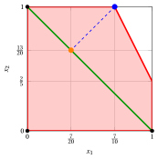{ .fig .ovale loading=lazy  }

!!! esempio "Example 5.12: Orthogonal projection in three dimensions"

    Take the point $\tilde{x}_1=1$, $\tilde{x}_2=2/5$, $\tilde{x}_3=0$ of $P_A$ in [Example 5.6](#box-13-ex-3d-a) and the cover $C=\{1,2\}$. Its cover inequality is $x_1+x_2\le1$ and $|C|=2$. Then

    $$
    v_C(\tilde{\vet x})=\frac25,\qquad
    x_1^{\perp}=\frac45,\qquad
    x_2^{\perp}=\frac15,\qquad
    x_3^{\perp}=0,
    \qquad d(\tilde{\vet x},H_C)=\frac{2}{5\sqrt2}.
    $$

    The red region is $P_A$ and the green dashed rectangle is $H_C$ restricted to the unit cube. Since $3\notin C$, the projection does not change $\tilde{x}_3$.

    { .fig .ovale loading=lazy  }

## 5.8 Typical mistakes

!!! attenzione "Warning"

    - <strong>Using a set that is not a cover.</strong> The inequality $\sum_{j\in C}x_j\le|C|-1$ is valid only if the total coefficient $\sum_{j\in C}a_j$ exceeds the right-hand side $b$; check the coefficients before writing it.

    - <strong>Using $|E(C)|-1$ for an extended cover.</strong> The right-hand side of the extended cover inequality is $|C|-1$, where $C$ is the cover, not $|E(C)|-1$.

    - <strong>Removing all the indices with $q_j=0$ from a cover.</strong> To obtain a minimal cover, remove indices one at a time as long as the remaining set is still a cover: removing all of them may leave a set that is not a cover.

    - <strong>Stopping the separation at a heuristic failure.</strong> If the greedy heuristic algorithm finds no violated cover inequality, we cannot conclude that none exists: only the optimal value of the separation problem proves it.

    - <strong>Confusing violation and distance.</strong> The cover separation problem maximizes the violation; covers with the same violation can have different distances from the point.

    - <strong>Believing that the cover closure is the convex hull.</strong> A point can satisfy all the cover inequalities and still be fractional ([Example 5.8](#box-16-ex-guide-csp)).

## 5.9 In summary

!!! chiave "In summary"

    - A cover is a set of variables whose total coefficient exceeds the right-hand side; its cover inequality allows at most $|C|-1$ of its variables to be equal to $1$, and it is valid for $X$.

    - The minimal covers are enough: their inequalities imply all the others, but they can be exponentially many, so they are separated only when violated.

    - Separating a cover inequality means finding a cover of minimum cost $\sum_{j\in C}(1-\tilde{x}_j)$: a violated inequality exists if and only if the minimum cost is less than $1$; this is a 0–1 problem with one $\le$ constraint, defined in the chapter.

    - An extended cover inequality dominates the cover inequality of the same cover.

    - The cover closure is closer to $\operatorname{conv}(X)$ than the LP relaxation, but in general it is not equal to it.

    <strong>Dashboard of the four-variable instance.</strong> The lower and upper bounds on the optimal value of the binary problem of [Example 5.1](#box-8-ex-guide). The objective coefficients are integer, so the upper bound is the rounded-down value of the LP relaxation.

    
<table>
    <tr>
    <th>Source</th>
    <th>Lower bound</th>
    <th>Upper bound</th>
    <th>From</th>
    </tr>
    <tr>
    <td>LP relaxation</td>
    <td>\(11\)</td>
    <td>\(16\)</td>
    <td>greedy solution \((1,1,0,0)\), \(\lfloor z(\LP)\rfloor\) with \(z(\LP)=\tfrac{49}{3}\)</td>
    </tr>
    <tr>
    <td>Cover closure</td>
    <td>\(11\)</td>
    <td>\(15\)</td>
    <td>\(\lfloor z(\LPcov)\rfloor\) with \(z(\LPcov)=\tfrac{79}{5}\), \(2\) separated covers</td>
    </tr>
    <tr>
    <td>Extended cover</td>
    <td>\(15\)</td>
    <td>\(15\)</td>
    <td>\(z(\LP_{\mathrm{ext}})=15\), optimal solution \((1,0,0,1)\)</td>
    </tr>
    </table>

---

**Exercises on this chapter:** [:material-pencil: Cover inequalities](../exercises/cover.md)
