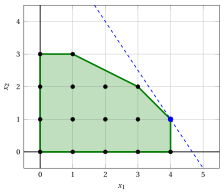

# Ideal formulations

**Part 2 · Strengthening the formulation · Chapter 3** · [:material-file-pdf-box: Lecture notes, volume 1 (PDF)](../pdf/lecture-notes-1-models-bounds-formulations.pdf) · [:material-pencil: Exercises](../exercises/ideal-formulations.md)

!!! nota "Prerequisites"

    - From this module, the chapters «Integer linear programming» and «Primal and dual bounds»: the feasible region of an ILP problem, the LP relaxation and its bound, and the car example.

    - From the module <em>Linear Programming</em>, [Chapter 15 «The geometry of Linear Programming»](https://fabiofurini.github.io/linear-programming/advanced-methods/15-geometry/): vertices of a polyhedron, and the fact that an LP problem with an optimal solution has an optimal vertex.

    - From the module <em>Convex optimization</em>, [Chapter 1 «Convex sets»](https://fabiofurini.github.io/convex-optimization/preliminaries/01-convex-sets/): convex combinations and convex hulls. A short recap is given in this chapter.

!!! chiave "Objectives"

    At the end of this chapter you will be able to:

    - compute the convex hull of the feasible solutions of a small ILP problem, and classify its points as vertices, boundary points or interior points;

    - define a formulation of an ILP problem, and decide whether it is ideal;

    - explain why an LP problem over an ideal formulation solves the ILP problem;

    - compare two formulations of the same problem through their LP relaxations;

    - explain why ideal formulations exist but are hard to find.

!!! nota "Where we were"

    In the car example we have the lower bound $14$ and the upper bound $\lfloor z(\LP) \rfloor = 15$. The gap of $\frac{1}{14}$ is due to the polyhedron of the constraints, which contains fractional points outside the convex hull of the integer points. This chapter defines the polyhedron that gives no gap.

## 3.1 The convex hull

!!! definizione "Definition 3.1: of convex hull"

    Given a set $S \subseteq \R^n$, a <strong>convex combination</strong> of points $\vet s^1, \vet s^2, \dots, \vet s^k \in S$ is a point $\sum_{h=1}^k \lambda_h \, \vet s^h$ with $\lambda_h \ge 0$ and $\sum_{h=1}^k \lambda_h = 1$. The <strong>convex hull</strong> of $S$, denoted by $\mathrm{conv}(S)$, is the set of all the convex combinations of points of $S$.

- The convex hull is the smallest convex set containing $S$. If $S$ is a finite set of points, the convex hull is a bounded polyhedron (a <strong>polytope</strong>), and its <strong>vertices</strong> are points of $S$. The other points of $S$ lie either on the boundary of the polytope, or in its interior: they are not needed to describe it.

- For an ILP problem we take $S = F$, the set of the feasible solutions. The vertices of $\mathrm{conv}(F)$ are integer feasible solutions.

!!! esempio "Example 3.1: convex hull of the car example"

    The convex hull of the $16$ integer points of the car example has $6$ vertices:

    $$
    (0,0), \quad (4,0), \quad (4,1), \quad (3,2), \quad (1,3), \quad (0,3).
    $$

    Of the other $10$ points, five lie on its boundary, namely $(0,1)$, $(0,2)$, $(1,0)$, $(2,0)$ and $(3,0)$, and five in its interior, namely $(1,1)$, $(2,1)$, $(3,1)$, $(1,2)$ and $(2,2)$.

    { .fig .ovale loading=lazy  }

    <em>The convex hull of the $16$ integer points of the car example (green). Its $6$ vertices (black squares) are integer points; five other points lie on its boundary and five in its interior.</em>

## 3.2 Formulations and ideal formulations

!!! definizione "Definition 3.2: of formulation"

    A <strong>formulation</strong> of an ILP problem with feasible region $F$ is a polyhedron $P = \{ \vet x \in \R^n : \sum_{j} a_{ij} \, x_j \le b_i,~ \forall i,~ x_j \ge 0,~ \forall j \}$ such that $P \cap \Z^n = F$. The <strong>LP relaxation of the formulation</strong> is the problem of maximizing $\sum_j c_j \, x_j$ over $P$.

- An ILP problem has many formulations: they share the integer points and differ in the fractional points. Since $P$ is convex and contains $F$, every formulation contains the convex hull:

    $$
    \mathrm{conv}(F) ~\subseteq~ P.
    $$

!!! definizione "Definition 3.3: of ideal formulation"

    A formulation $P$ of an ILP problem is <strong>ideal</strong> if $P = \mathrm{conv}(F)$, that is, if the feasible region of its LP relaxation is exactly the convex hull of the integer feasible solutions.

!!! teorema "Theorem 3.4: LP over an ideal formulation"

    Let $P$ be an ideal formulation of an ILP problem with $F \ne \emptyset$ and $P$ bounded. Then the LP relaxation has an optimal vertex, every optimal vertex is an optimal solution of the ILP problem, and $z(\LP) = z(\ILP)$.

??? dimostrazione "Proof"

    The polyhedron $P = \mathrm{conv}(F)$ is non-empty and bounded, so the LP problem has an optimal vertex of $P$. The vertices of $\mathrm{conv}(F)$ belong to $F$, so this vertex is a feasible ILP solution, whose value is $z(\LP)$. Since $z(\ILP) \le z(\LP)$, the vertex is optimal for the ILP problem. □

- The simplex algorithm returns an optimal vertex, so with an ideal formulation it returns an integer solution. If the LP problem has several optimal solutions, a method that does not return vertices can give a fractional point on the optimal face: this is why the theorem speaks of an optimal vertex.

!!! chiave ""

    With an ideal formulation, an ILP problem is solved as an LP problem: an optimal vertex of the LP relaxation is an optimal ILP solution.

!!! esempio "Example 3.2: the formulation of the car example is not ideal"

    The point $(\frac{7}{2},\frac{5}{2})$ belongs to the polyhedron $P$ of the car example but not to $\mathrm{conv}(F)$, because it violates $x_1 + x_2 \le 5$, which all the vertices of the hull of [Example 3.1](#box-2-ex-hull-car) satisfy: $\mathrm{conv}(F) \subsetneq P$.

    { .fig .ovale loading=lazy  }

    <em>The car example: the polyhedron of the LP relaxation (red) contains the convex hull of the integer points (green), and the optimal solution of the LP relaxation (blue) is outside the hull.</em>

!!! esempio "Example 3.3: an ideal formulation of the car example"

    The convex hull of the car example is described by the following four inequalities and the non-negativity constraints:

    $$
    \begin{array}{rrrrrrr}
    {\max} & {3}\, {x_1} & {+} & {2}\, {x_2} \\[1ex]
    \text{subject to} & {x_1} & {+} & {x_2} & {\le} & {5} \\[1ex]
    & {x_1} & {+} & {2}\, {x_2} & {\le} & {7} \\[1ex]
    & {x_1} &  &  & {\le} & {4} \\[1ex]
    &  &  & {x_2} & {\le} & {3} \\[1ex]
    & {x_1,} &  & {x_2} & {\ge} & {0}
    \end{array}
    $$

    These inequalities define exactly the $6$ vertices of the hull, and the same $16$ integer points. The LP relaxation of this <strong>ideal formulation</strong> has the optimal solution $(4,1)$, which is integer, with $z(\LP) = 14 = z(\ILP)$.

    { .fig .ovale loading=lazy  }

    <em>The ideal formulation of the car example: its feasible region (green) is the convex hull of the integer points. The optimal solution of the LP problem is the integer point $(4,1)$ (blue).</em>

## 3.3 Comparing formulations

!!! definizione "Definition 3.5: stronger formulation"

    Given two formulations $P_1$ and $P_2$ of the same ILP problem, $P_1$ is <strong>stronger</strong> than $P_2$ if $P_1 \subseteq P_2$.

- A stronger formulation never gives a worse upper bound: the maximum over a smaller set is not larger, so

    $$
    P_1 \subseteq P_2 \quad \Longrightarrow \quad z(\ILP) ~\le~ z(\LP_1) ~\le~ z(\LP_2).
    $$

- The ideal formulation is the strongest of all, because it is contained in every formulation. In the car example the original formulation gives the bound $\lfloor \frac{31}{2} \rfloor = 15$, and the ideal one of [Example 3.3](#box-7-ex-car-ideal) gives the bound $14$.

!!! chiave ""

    Among the formulations of the same ILP problem, we prefer the ones with the smallest polyhedron: their LP relaxations give the best upper bounds, and the ideal formulation gives the optimal value.

## 3.4 Existence of ideal formulations

- An ideal formulation exists for every ILP problem whose feasible region is bounded or, more in general, whose data are rational (Meyer's theorem; in this module the data are integer). The convex hull of the integer points is a polyhedron, so it is described by a finite number of linear inequalities.

- Finding the ideal formulation is in general very difficult. It can require an exponential number of inequalities, and finding the necessary ones is often as hard as solving the ILP problem itself.

- In practice we keep the formulation we have and add, step by step, inequalities that are satisfied by all the integer points and cut off fractional points: the <strong>valid inequalities</strong> of the next chapter.

## 3.5 Typical mistakes

!!! attenzione "Warning"

    - <strong>Believing that the points that are not vertices lie strictly inside the hull.</strong> They can lie on its boundary, as $(0,1)$ and $(3,0)$ in the car example.

    - <strong>Checking only the optimal solution.</strong> A formulation can return an integer optimal solution without being ideal: the LP optimum can be integer for one objective function and fractional for another one.

    - <strong>Believing that every formulation is ideal.</strong> The formulation of the car example has the right integer points but contains fractional points outside the hull.

    - <strong>Adding inequalities that remove integer points.</strong> A formulation must keep all the points of $F$: the polyhedron can shrink only down to the convex hull, never below it.

## 3.6 In summary

!!! chiave "In summary"

    - The convex hull of the feasible solutions is the smallest polyhedron containing them, and its vertices are integer feasible solutions.

    - A formulation is ideal if its polyhedron is the convex hull; then an optimal vertex of the LP relaxation is an optimal ILP solution.

    - A stronger formulation, with a smaller polyhedron, never gives a worse bound.

    - The car example has an ideal formulation with $4$ inequalities, which gives $z(\LP) = 14 = z(\ILP)$.

    - Ideal formulations exist for rational data, but in general they need exponentially many inequalities and are hard to find.

    <strong>Dashboard of the car example.</strong> The bounds on $z(\ILP)$ found so far in this module:

    
<table>
    <tr>
    <th>Chapter</th>
    <th>Lower bound</th>
    <th>Upper bound</th>
    <th>From</th>
    </tr>
    <tr>
    <td>Primal and dual bounds</td>
    <td>\(14\)</td>
    <td>\(15\)</td>
    <td>heuristic solution \((4, 1)\), and \(\lfloor z(\LP) \rfloor\) with \(z(\LP) = \tfrac{31}{2}\)</td>
    </tr>
    <tr>
    <td>Ideal formulations</td>
    <td>\(14\)</td>
    <td>\(14\)</td>
    <td>ideal formulation, optimal vertex \((4,1)\)</td>
    </tr>
    </table>

