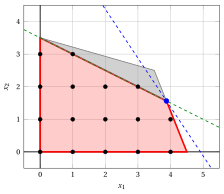

# Valid inequalities

**Part 2 · Strengthening the formulation · Chapter 4** · [:material-file-pdf-box: Lecture notes, volume 1 (PDF)](../pdf/lecture-notes-1-models-bounds-formulations.pdf)

!!! nota "Prerequisites"

    - From this module, the chapter «LP relaxation and dual bounds»: the LP relaxation, the rounded bound $\lfloor z(\LP) \rfloor$, and bounds from non-negative multipliers of the constraints.

    - From this module, the chapter «Ideal formulations»: formulations, the convex hull, and the comparison of formulations through their polyhedra.

!!! chiave "Objectives"

    At the end of this chapter you will be able to:

    - define a valid inequality, and say when it cuts off a fractional point;

    - derive a valid inequality from non-negative multipliers of the constraints by rounding down;

    - improve a valid inequality until it touches a feasible integer point;

    - measure the effect of a valid inequality on the optimal value of the LP relaxation and on the upper bound;

    - explain why valid inequalities are the practical way to approach an ideal formulation.

!!! nota "Where we were"

    In the car example the ideal formulation gives the upper bound $14$, equal to the lower bound, so it certifies that $(4,1)$ is optimal. But we found its four inequalities by looking at the convex hull, which is not possible in general. We now learn to <strong>derive</strong> such inequalities from the constraints.

## 4.1 Why valid inequalities?

- We cannot compute the ideal formulation of a large ILP problem, but we can add to the model a few inequalities that tighten the LP relaxation. Each one removes some fractional points and keeps all the integer ones.

- In the car example the upper bound is $15$ and the lower bound is $14$. Is there an inequality, satisfied by all the integer points, that pushes the upper bound down to $14$?

## 4.2 Valid inequalities

!!! definizione "Definition 4.1: of valid inequality"

    An inequality $\sum_{j=1}^n \alpha_j \, x_j \le \beta$ is a <strong>valid inequality</strong> for an ILP problem with feasible region $F$ if it is satisfied by all the points of $F$.

- A valid inequality is satisfied by all the integer feasible solutions, but it can be violated by some fractional points of the LP relaxation. We say that it <strong>cuts off</strong> these points.

- Adding a valid inequality to the formulation does not change $F$, and it shrinks the polyhedron $P$. The new formulation is stronger, so its LP relaxation gives an upper bound that is not worse.

- A valid inequality is satisfied by a point of $F$ if and only if it is satisfied by the convex hull, so it is valid for $\mathrm{conv}(F)$. The inequalities of the ideal formulation are valid inequalities.

- A valid inequality is <strong>tight</strong> if at least one point of $F$ satisfies it with equality: its right-hand side cannot be decreased without losing a feasible solution.

!!! chiave ""

    A valid inequality removes fractional points and never an integer feasible solution. Adding valid inequalities makes the formulation stronger and the upper bound better.

- The inequalities $x_1 \le 4$ and $x_2 \le 3$ of the previous chapters are valid inequalities of the car example. They did not cut off the optimal solution of the LP relaxation, so they did not improve the bound.

## 4.3 Deriving valid inequalities by rounding

- We know how to combine the constraints with non-negative multipliers. In an ILP problem we can round the result, because the variables are integer.

!!! teorema "Proposition 4.2: valid inequalities by rounding"

    Let $\pi_1, \pi_2, \dots, \pi_m \ge 0$ be multipliers such that $\sum_{i=1}^m \pi_i \, a_{ij} \ge \alpha_j$, with $\alpha_j \in \Z$, for all $j \in \{1,2,\dots,n\}$. Then the inequality

    \begin{equation*}
    \label{rounding}
    \sum_{j=1}^n \alpha_j \, x_j ~\le~ \left\lfloor \sum_{i=1}^m \pi_i \, b_i \right\rfloor \tag{4.1}
    \end{equation*}

    is valid for the ILP problem.

??? dimostrazione "Proof"

    For every feasible solution, $\sum_j \alpha_j \, x_j \le \sum_j \big( \sum_i \pi_i \, a_{ij} \big) x_j \le \sum_i \pi_i \, b_i$, by $x_j \ge 0$ and by the constraints multiplied by $\pi_i \ge 0$. The left-hand side is an integer, because $\alpha_j$ and $x_j$ are integer, so it is at most the integer part of the right-hand side. □

- The proposition needs all the variables to be integer and non-negative. With a continuous variable the left-hand side is not an integer, and the right-hand side cannot be rounded.

!!! esempio "Example 4.1: rounding with multiplier $\frac{1}{2}$"

    In the car example, multiply the first constraint by $\frac{1}{2}$: we get $5\,x_1 + 2\,x_2 \le \frac{45}{2}$. Since the left-hand side is integer, we obtain the valid inequality

    $$
    5\,x_1 + 2\,x_2 \le 22.
    $$

    Multiplying the second constraint by $\frac{1}{2}$ we get $2\,x_1 + 7\,x_2 \le \frac{49}{2}$, hence

    $$
    2\,x_1 + 7\,x_2 \le 24.
    $$

    Both inequalities cut off the optimal solution $(\frac{7}{2},\frac{5}{2})$ of the LP relaxation: $5 \cdot \frac{7}{2} + 2 \cdot \frac{5}{2} = \frac{45}{2} > 22$ and $2 \cdot \frac{7}{2} + 7 \cdot \frac{5}{2} = \frac{49}{2} > 24$. The new LP relaxations give:

    
<table>
    <tr>
    <th>Added inequality</th>
    <th>\(\tilde{\vet x}(\LP)\)</th>
    <th>\(z(\LP)\)</th>
    <th>\(\lfloor z(\LP) \rfloor\)</th>
    </tr>
    <tr>
    <td>none</td>
    <td>\((\frac{7}{2},\frac{5}{2})\)</td>
    <td>\(\frac{31}{2}\)</td>
    <td>\(15\)</td>
    </tr>
    <tr>
    <td>\(5\,x_1 + 2\,x_2 \le 22\)</td>
    <td>\((\frac{105}{31},\frac{157}{62})\)</td>
    <td>\(\frac{472}{31}\)</td>
    <td>\(15\)</td>
    </tr>
    <tr>
    <td>\(2\,x_1 + 7\,x_2 \le 24\)</td>
    <td>\((\frac{219}{62},\frac{75}{31})\)</td>
    <td>\(\frac{957}{62}\)</td>
    <td>\(15\)</td>
    </tr>
    </table>

    The LP optimum moves, but the upper bound does not improve: $\lfloor \frac{472}{31} \rfloor = \lfloor \frac{957}{62} \rfloor = 15$.

!!! chiave ""

    A valid inequality that cuts off the optimal LP solution does not always improve the upper bound. The choice of the multipliers matters: we look for inequalities that touch the integer points.

## 4.4 Improving a valid inequality

- Given the coefficients $\alpha_j$, the strongest valid inequality has the smallest possible right-hand side, which is the maximum of $\sum_j \alpha_j \, x_j$ over $F$. We find it by lowering the right-hand side $\beta$ of $\eqref{rounding}$ until a feasible integer point reaches it.

!!! algoritmo "Algorithm"

    - <strong>Input:</strong> An ILP problem in canonical maximization form with $F \ne \emptyset$, and integer coefficients $\alpha_1, \alpha_2, \dots, \alpha_n$.

    - <strong>Output:</strong> A tight valid inequality $\sum_{j=1}^n \alpha_j \, x_j \le \beta$.

    - **Step 0:** <strong>Coarse bound</strong>

        Find multipliers $\pi_i \ge 0$ with $\sum_{i} \pi_i \, a_{ij} \ge \alpha_j$ for all $j$, and set $\beta \leftarrow \lfloor \sum_{i} \pi_i \, b_i \rfloor$.

    - **Step 1:** <strong>Test the right-hand side</strong>

        If no feasible integer point satisfies $\sum_{j} \alpha_j \, x_j = \beta$, set $\beta \leftarrow \beta - 1$ and repeat Step 1.

    - **Step 2:** <strong>Tight inequality</strong>

        A feasible integer point satisfies $\sum_{j} \alpha_j \, x_j = \beta$, so $\sum_{j} \alpha_j \, x_j \le \beta$ is valid and tight. <code>STOP</code>.

- In Step 0 the multipliers can be chosen freely: the better they are, the fewer repetitions of Step 1 are needed. In Step 1, for two variables, we substitute one variable using the equation and bound the other one with the constraints: if the bounds contradict each other, no point exists.

!!! esempio "Example 4.2: the inequality $x_1 + x_2 \le 5$"

    We look for a valid inequality with $\alpha = (1,1)$.

    - <strong>Step 0.</strong> With the multipliers $(\frac{1}{14},\frac{1}{14})$ the sum of the constraints, divided by $14$, is $x_1 + \frac{9}{7}\,x_2 \le \frac{47}{7}$. The coefficients are at least $(1,1)$, so $x_1 + x_2 \le \lfloor \frac{47}{7} \rfloor = 6$, and we set $\beta = 6$.

    - <strong>Step 1, $\beta = 6$.</strong> Let $x_1 + x_2 = 6$, so $x_2 = 6 - x_1$. The first constraint becomes $6\,x_1 + 24 \le 45$, that is $x_1 \le \frac{7}{2}$, hence $x_1 \le 3$. The second becomes $84 - 10\,x_1 \le 49$, that is $x_1 \ge \frac{7}{2}$, hence $x_1 \ge 4$. The bounds contradict each other: no feasible point has $x_1 + x_2 = 6$, and we set $\beta = 5$.

    - <strong>Step 1, $\beta = 5$.</strong> Let $x_2 = 5 - x_1$. The constraints become $x_1 \le \frac{25}{6}$, hence $x_1 \le 4$, and $x_1 \ge \frac{21}{10}$, hence $x_1 \ge 3$. There is no contradiction, and the points $(3,2)$ and $(4,1)$ are feasible with $x_1 + x_2 = 5$.

    - <strong>Step 2.</strong> The inequality $x_1 + x_2 \le 5$ is valid and tight.

    It cuts off $(\frac{7}{2},\frac{5}{2})$ (the sum is $6$). The new LP relaxation has the optimal solution $(\frac{25}{6},\frac{5}{6})$ with $z(\LP) = \frac{85}{6}$, so the upper bound is $\lfloor \frac{85}{6} \rfloor = 14$.

    { .fig .ovale loading=lazy  }

    <em>The valid inequality $x_1 + x_2 \le 5$ (green) cuts off the gray triangle, which contains no integer point, and the optimal solution of the previous LP relaxation. The new optimal solution is $(\frac{25}{6},\frac{5}{6})$ (blue), with $z = \frac{85}{6}$ (dashed line).</em>

!!! esempio "Example 4.3: the inequality $x_1 + 2\,x_2 \le 7$"

    We look for a valid inequality with $\alpha = (1,2)$.

    - <strong>Step 0.</strong> With the multipliers $(\frac{3}{62},\frac{4}{31})$ the combination of the constraints is $x_1 + 2\,x_2 \le \frac{17}{2}$, because $\frac{3 \cdot 10}{62} + \frac{4 \cdot 4}{31} = 1$, $\frac{3 \cdot 4}{62} + \frac{4 \cdot 14}{31} = 2$ and $\frac{3 \cdot 45}{62} + \frac{4 \cdot 49}{31} = \frac{17}{2}$. Hence $x_1 + 2\,x_2 \le \lfloor \frac{17}{2} \rfloor = 8$, and we set $\beta = 8$.

    - <strong>Step 1, $\beta = 8$.</strong> Let $x_1 = 8 - 2\,x_2$. The first constraint becomes $80 - 16\,x_2 \le 45$, hence $x_2 \ge 3$; the second becomes $32 + 6\,x_2 \le 49$, hence $x_2 \le 2$. They contradict each other, and we set $\beta = 7$.

    - <strong>Step 1, $\beta = 7$.</strong> Let $x_1 = 7 - 2\,x_2$: the constraints become $70 - 16\,x_2 \le 45$, hence $x_2 \ge 2$, and $28 + 6\,x_2 \le 49$, hence $x_2 \le 3$. The points $(3,2)$ and $(1,3)$ are feasible with $x_1 + 2\,x_2 = 7$.

    - <strong>Step 2.</strong> The inequality $x_1 + 2\,x_2 \le 7$ is valid and tight.

    The new LP relaxation has the optimal solution $(\frac{31}{8},\frac{25}{16})$ with $z(\LP) = \frac{59}{4}$, so the upper bound is $\lfloor \frac{59}{4} \rfloor = 14$.

    { .fig .ovale loading=lazy  }

    <em>The valid inequality $x_1 + 2\,x_2 \le 7$ (green) cuts off the gray triangle, which contains no integer point. The new optimal solution is $(\frac{31}{8},\frac{25}{16})$ (blue), with $z = \frac{59}{4}$ (dashed line).</em>

!!! chiave ""

    With the valid inequality $x_1 + x_2 \le 5$, or with $x_1 + 2\,x_2 \le 7$, the upper bound drops from $15$ to $14$. It equals the lower bound given by $(4,1)$: <strong>the solution $(4,1)$ is certified optimal</strong>, and the gap is zero.

- The two inequalities, together with $x_1 \le 4$ and $x_2 \le 3$, are exactly the four inequalities of the ideal formulation of the previous chapter. For the car example we have reached the convex hull with valid inequalities derived from the constraints.

## 4.5 What comes next

- By hand and with two variables we chose the directions $\alpha$ looking at the picture. For real problems we need two ingredients: valid inequalities for the structures that appear in the models, and a systematic way to find inequalities that cut off the current LP optimum.

- The first ingredient gives the families of inequalities for specific structures, such as the <strong>cover inequalities</strong> of the knapsack constraints (next chapter).

- The second ingredient is the rounding of this chapter, applied systematically to the rows of the optimal dictionary of the LP relaxation: the <strong>Gomory fractional cuts</strong> of the cutting plane algorithm, and then the <strong>branch-and-cut</strong> algorithm.

## 4.6 Typical mistakes

!!! attenzione "Warning"

    - <strong>Rounding when a variable is continuous.</strong> The rounding of $\eqref{rounding}$ needs integer variables and integer coefficients $\alpha_j$.

    - <strong>Rounding up instead of down.</strong> The right-hand side is rounded <u>down</u>. Rounding up gives an inequality that is not valid, and it can remove integer solutions.

    - <strong>Believing that every valid inequality improves the bound.</strong> The inequalities $5\,x_1 + 2\,x_2 \le 22$ and $2\,x_1 + 7\,x_2 \le 24$ cut off the LP optimum, but leave the bound at $15$.

    - <strong>Using multipliers that are not large enough.</strong> The combined coefficients must be at least $\alpha_j$ for every $j$, and the multipliers must be non-negative.

    - <strong>Stopping at a coarse right-hand side.</strong> The inequality $x_1 + x_2 \le 6$ is valid, but it does not cut off the LP optimum of the car example (its sum is $6$); the tight inequality $x_1 + x_2 \le 5$ does.

## 4.7 In summary

!!! chiave "In summary"

    - A valid inequality is satisfied by all the feasible integer solutions; it can cut off fractional points of the LP relaxation, and it makes the formulation stronger.

    - Non-negative multipliers of the constraints, with the right-hand side rounded down, give valid inequalities for ILP problems.

    - Lowering the right-hand side until an integer point touches the line gives a tight inequality.

    - A valid inequality helps only if it cuts off the LP optimum and improves the rounded bound.

    - In the car example, $x_1 + x_2 \le 5$ or $x_1 + 2\,x_2 \le 7$ lowers the upper bound from $15$ to $14$, and certifies that $(4,1)$ is optimal.

    <strong>Dashboard of the car example.</strong> The bounds on $z(\ILP)$ found so far in this module:

    
<table>
    <tr>
    <th>Chapter</th>
    <th>Lower bound</th>
    <th>Upper bound</th>
    <th>From</th>
    </tr>
    <tr>
    <td>Integer linear programming</td>
    <td>\(12\), \(14\)</td>
    <td>–</td>
    <td>heuristic solutions \((4, 0)\) and \((4, 1)\)</td>
    </tr>
    <tr>
    <td>LP relaxation and dual bounds</td>
    <td>\(14\)</td>
    <td>\(15\)</td>
    <td>\(\lfloor z(\LP) \rfloor\), with \(z(\LP) = \tfrac{31}{2}\)</td>
    </tr>
    <tr>
    <td>Ideal formulations</td>
    <td>\(14\)</td>
    <td>\(14\)</td>
    <td>ideal formulation, optimal vertex \((4,1)\)</td>
    </tr>
    <tr>
    <td>Valid inequalities</td>
    <td>\(14\)</td>
    <td>\(14\)</td>
    <td>\(x_1 + x_2 \le 5\) gives \(z(\LP) = \tfrac{85}{6}\)</td>
    </tr>
    </table>

<!-- laboratorio-interattivo: sezione generata da interattivi.py -->

## Interactive lab { #interactive-lab }

The ideas of the chapter, hands on: move the sliders and drag the points.
Each app also opens full page in the [interactive lab](../lab/index.md): [Valid inequalities and the convex hull](../lab/convex-hull.md).

