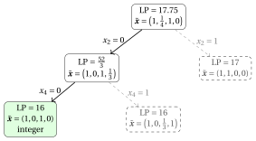
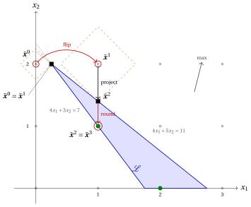
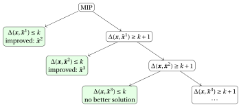
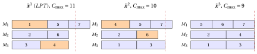
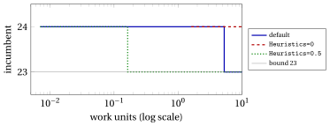

# MIP heuristics

<div class="info-capitolo" markdown>

**Part 5 · MIP heuristics · Chapter 10** · [:material-file-pdf-box: Lecture notes, volume 4 (PDF)](../pdf/lecture-notes-4-mip-heuristics.pdf) · [:material-pencil: Exercises](../exercises/mip-heuristics.md)

</div>

<span class="arithmatex">\(\newcommand{\rnd}[1]{\left[\,#1\,\right]}\)</span>

!!! nota "Prerequisites"

    - From this module, the chapters «LP relaxation and dual bounds» and «LP-based branch-and-bound algorithms»: the LP relaxation, the primal and dual bounds, the optimality gap, and the branching operations.

    - From this module, the chapter «What a MIP solver does»: the incumbent solution, the sub-problems solved by a solver, and the heuristics inside it.

    - From the module <em>Algorithms</em>: constructive heuristics ($GR$, $FF$, $NN$, $LPT$), local search and metaheuristics, whose solutions are the starting points of this chapter.

    - From the module <em>Linear Programming</em>: the dual simplex algorithm, which re-optimizes an LP after a change of a bound.

!!! chiave "Objectives"

    At the end of this chapter you will be able to:

    - explain how a heuristic algorithm uses the LP relaxation and a MIP solver;

    - execute by hand rounding, diving, the feasibility pump, RINS, local branching and proximity search on small instances;

    - execute relax-and-fix and fix-and-optimize on a lot sizing instance;

    - decide which method to use when a feasible solution is missing, or when an incumbent solution must be improved;

    - compute the gap of a heuristic solution when a dual bound is available.

## 10.1 MIP-based heuristics { #sez-sec-intro }

- The heuristic algorithms of the previous notes — constructive heuristics, local search and metaheuristics — work directly on a representation of the solutions (a binary vector, a vector $bin$, a tour, a vector $mach$). They never look at a mathematical model of the problem, and they never use a solver.

- In this last set of notes on heuristic algorithms the problem is given as a <strong>mixed-integer linear program</strong> (MIP), and the heuristic uses two tools that come with the model:

    - the <strong>LP relaxation</strong>, whose optimal solution tells <em>where to look</em>: it is the solution of a simpler problem, often close to the good solutions of the original one;

    - the <strong>MIP solver</strong>, which can explore <em>exactly</em> a set of solutions far too large to be enumerated, provided that the set is described by linear constraints.

    Heuristics that combine a mathematical programming model with heuristic ideas are also called <strong>matheuristics</strong>.

- The methods of these notes are built on five ideas, one or two per section.

<div class="tabella" markdown="0"><table>
<tr>
<th>idea</th>
<th>methods</th>
</tr>
<tr>
<td>round the relaxation</td>
<td>rounding; diving (fix one variable, re-solve, repeat)</td>
</tr>
<tr>
<td>chase feasibility</td>
<td>the feasibility pump</td>
</tr>
<tr>
<td>fix where relaxation and incumbent agree</td>
<td>RINS</td>
</tr>
<tr>
<td>bound the distance from the incumbent</td>
<td>local branching; proximity search</td>
</tr>
<tr>
<td>decompose along the time</td>
<td>relax-and-fix; fix-and-optimize</td>
</tr>
</table></div>

- All the methods are written for a MIP in the following general form.

!!! chiave ""

    A <strong>MIP</strong> with $N$ variables $\vet x=(x_1,x_2,\dots,x_N)$ reads

    <a id="eq-eq-mip"></a>

    \begin{align*}
    && \min ~~ f(\vet x) \label{eq:mip-obj} \tag{10.1a}\\[1ex]
    && \text{subject to} \quad A\,\vet x &\le b, & \label{eq:mip-cons} \tag{10.1b}\\[1ex]
    && l_j \le x_j &\le u_j, & \forall j \in \{1,2,\dots,N\}, \label{eq:mip-bounds} \tag{10.1c}\\[1ex]
    && x_j &\in \Z, & \forall j \in \mathscr{D}, \label{eq:mip-int} \tag{10.1d}
    \end{align*}

    where $f$ is a linear function and $\mathscr{D}\subseteq\{1,2,\dots,N\}$ is the set of the indices of the <strong>integer variables</strong>. The feasible region of the <strong>LP relaxation</strong> is

    $$
    \mathcal{L} = \big\{\vet x\in\R^N : A\,\vet x\le b,~ l\le \vet x\le u\big\},
    $$

    and $z(\LP)=\min\{f(\vet x): \vet x\in\mathcal{L}\}$ is the value of the LP relaxation on the instance $I$.

- A maximization problem, such as the KP, is handled in the same way, exchanging $\min$ and $\max$, $\le$ and $\ge$ in the comparisons of objective values.

- Throughout the notes, $\tilde{\vet x}$ denotes an optimal solution of an LP relaxation, and $\bar{\vet x}$ a point whose integer components $\bar x_j$, $j\in\mathscr{D}$, are integer. When $\bar{\vet x}$ is a feasible solution, the best one known, it is called the <strong>incumbent</strong>, and $f(\bar{\vet x})$ is its value. The <strong>rounding</strong> of a real number $v$ to the nearest integer is

    $$
    \rnd{v} = \Big\lfloor v + \frac12 \Big\rfloor ,
    $$

    so that a value $\frac12$ is rounded up.

- A point $\bar{\vet x}$ with integer components on $\mathscr{D}$ is <strong>completed</strong> by fixing the integer variables to their values $\bar x_j$ and solving the LP on the continuous variables: either the LP has an optimal solution, and $\bar{\vet x}$ is turned into a feasible solution of the MIP, or the LP is infeasible, and so is $\bar{\vet x}$. When all the variables are integer, the completion simply checks the constraints.

- The examples of the notes are solved with the MIP solver Gurobi, used from Python through <code>gurobipy</code>, as in the chapter on Gurobi of the MIP modelling course. When an LP has several optimal solutions, the text reports the one returned by the solver; all the codes are in the last section.

## 10.2 The problems and their MIP models { #sez-sec-models }

- The heuristics are illustrated on the four problems of the previous notes, whose definitions and assumptions are given in the notes on combinatorial optimization problems, and on their reference instances, recalled in the following table with the values computed in the previous notes on heuristic algorithms.

<div class="tabella" markdown="0"><table>
<tr>
<th>problem</th>
<th>reference instance</th>
<th>values</th>
</tr>
<tr>
<td>KP</td>
<td><span class="arithmatex">\(p=(10,7,6,4)\)</span>, <span class="arithmatex">\(w=(5,4,3,3)\)</span>, <span class="arithmatex">\(c=9\)</span></td>
<td><span class="arithmatex">\(GR\)</span>: <span class="arithmatex">\(\{1,3\}\)</span>, profit <span class="arithmatex">\(16\)</span>; <span class="arithmatex">\(z(I)=17\)</span>, <span class="arithmatex">\(\{1,2\}\)</span></td>
</tr>
<tr>
<td>BPP</td>
<td><span class="arithmatex">\(w=(4,4,5,3,2,3)\)</span>, <span class="arithmatex">\(c=7\)</span></td>
<td><span class="arithmatex">\(FF\)</span>: <span class="arithmatex">\(4\)</span> bins; <span class="arithmatex">\(z(I)=3\)</span></td>
</tr>
<tr>
<td>TSP</td>
<td><span class="arithmatex">\(5\)</span> cities, as in the notes on definitions</td>
<td><span class="arithmatex">\(NN\)</span> from city <span class="arithmatex">\(1\)</span>: <span class="arithmatex">\(25\)</span>; <span class="arithmatex">\(z(I)=18\)</span></td>
</tr>
<tr>
<td><span class="arithmatex">\(P\,||\,C_{\max}\)</span></td>
<td><span class="arithmatex">\(t=(5,5,4,4,3,3,3)\)</span>, <span class="arithmatex">\(m=3\)</span></td>
<td><span class="arithmatex">\(LPT\)</span>: <span class="arithmatex">\(J_1=\{1,5,7\}\)</span>, <span class="arithmatex">\(J_2=\{2,6\}\)</span>, <span class="arithmatex">\(J_3=\{3,4\}\)</span>, <span class="arithmatex">\(11\)</span>; <span class="arithmatex">\(z(I)=9\)</span></td>
</tr>
</table></div>

- The MIP models below are the classical ones, studied in the notes on ILP formulations of classical problems and in the MIP modelling course; we recall them in the form used by the codes of these notes.

### 10.2.1 The knapsack problem

!!! chiave ""

    With $x_j=1$ if and only if item $j$ is selected:

    <a id="eq-eq-kp"></a>

    \begin{align*}
    && \max ~~ \sum_{j\in\mathscr{I}} p_j\, x_j \label{eq:kp-obj} \tag{10.2a}\\[1ex]
    && \text{subject to} \quad \sum_{j\in\mathscr{I}} w_j\, x_j &\le c, & \label{eq:kp-cap} \tag{10.2b}\\[1ex]
    && x_j &\in \{0,1\}, & \forall j\in\mathscr{I}. \label{eq:kp-dom} \tag{10.2c}
    \end{align*}

### 10.2.2 The bin packing problem

!!! chiave ""

    With a set $\mathscr{B}=\{1,2,\dots,n\}$ of available bins, $x_{jb}=1$ if and only if item $j$ is packed into bin $b$, and $y_b=1$ if and only if bin $b$ is used:

    <a id="eq-eq-bpp"></a>

    \begin{align*}
    && \min ~~ \sum_{b\in\mathscr{B}} y_b \label{eq:bpp-obj} \tag{10.3a}\\[1ex]
    && \text{subject to} \quad \sum_{b\in\mathscr{B}} x_{jb} &= 1, & \forall j\in\mathscr{I}, \label{eq:bpp-assign} \tag{10.3b}\\[1ex]
    && \sum_{j\in\mathscr{I}} w_j\, x_{jb} &\le c\, y_b, & \forall b\in\mathscr{B}, \label{eq:bpp-cap} \tag{10.3c}\\[1ex]
    && x_{jb} &\in \{0,1\}, & \forall j\in\mathscr{I},~\forall b\in\mathscr{B}, \label{eq:bpp-domx} \tag{10.3d}\\[1ex]
    && y_b &\in \{0,1\}, & \forall b\in\mathscr{B}. \label{eq:bpp-domy} \tag{10.3e}
    \end{align*}

- The content of bin $b$ is the packing pattern $P_b=\{j\in\mathscr{I}: x_{jb}=1\}$. Any upper bound on the number of bins can be used as $|\mathscr{B}|$; we use $n$, which is always enough.

### 10.2.3 The travelling salesman problem

!!! chiave ""

    Let $E=\big\{\{i,j\}: i,j\in\mathscr{V},~ i<j\big\}$ be the set of the edges, $\delta(i)$ the set of the edges incident to city $i$, and $E(S)$ the set of the edges with both endpoints in $S\subseteq\mathscr{V}$. With $x_{ij}=1$ if and only if the tour uses the edge $\{i,j\}$:

    <a id="eq-eq-tsp"></a>

    \begin{align*}
    && \min ~~ \sum_{\{i,j\}\in E} d_{ij}\, x_{ij} \label{eq:tsp-obj} \tag{10.4a}\\[1ex]
    && \text{subject to} \quad \sum_{\{i,j\}\in\delta(i)} x_{ij} &= 2, & \forall i\in\mathscr{V}, \label{eq:tsp-deg} \tag{10.4b}\\[1ex]
    && \sum_{\{i,j\}\in E(S)} x_{ij} &\le |S|-1, & \forall S\subset\mathscr{V},~ 2\le|S|\le n-2, \label{eq:tsp-sec} \tag{10.4c}\\[1ex]
    && x_{ij} &\in \{0,1\}, & \forall \{i,j\}\in E. \label{eq:tsp-dom} \tag{10.4d}
    \end{align*}

- The <strong>degree constraints</strong> $\eqref{eq:tsp-deg}$ say that every city is the endpoint of two edges of the tour; the <strong>subtour elimination constraints</strong> $\eqref{eq:tsp-sec}$ forbid closed subtours on a proper subset $S$ of the cities. They are exponentially many, and on large instances they are generated only when violated.

### 10.2.4 The scheduling problem $P\,||\,C_{\max}$

!!! chiave ""

    With $x_{jh}=1$ if and only if job $j$ is assigned to machine $h$, and $C_{\max}$ the makespan:

    <a id="eq-eq-pcm"></a>

    \begin{align*}
    && \min ~~ C_{\max} \label{eq:pcm-obj} \tag{10.5a}\\[1ex]
    && \text{subject to} \quad \sum_{h=1}^{m} x_{jh} &= 1, & \forall j\in\mathscr{J}, \label{eq:pcm-assign} \tag{10.5b}\\[1ex]
    && \sum_{j\in\mathscr{J}} t_j\, x_{jh} &\le C_{\max}, & \forall h\in\{1,2,\dots,m\}, \label{eq:pcm-load} \tag{10.5c}\\[1ex]
    && x_{jh} &\in \{0,1\}, & \forall j\in\mathscr{J},~\forall h\in\{1,2,\dots,m\}, \label{eq:pcm-domx} \tag{10.5d}\\[1ex]
    && C_{\max} &\ge 0. & \label{eq:pcm-domc} \tag{10.5e}
    \end{align*}

- $C_{\max}$ is the only continuous variable of the four models: given the assignment, the completion sets it to the largest load $L_h=\sum_{j\in\mathscr{J}} t_j\,x_{jh}$.

### 10.2.5 The LP relaxations on the reference instances

- The following table reports the size of the four models on the reference instances, the value $z(\LP)$ of their LP relaxations, computed with Gurobi, and the optimal value $z(I)$.

<div class="tabella" markdown="0"><table>
<tr>
<th>problem</th>
<th>variables</th>
<th>constraints</th>
<th><span class="arithmatex">\(z(\LP)\)</span></th>
<th><span class="arithmatex">\(z(I)\)</span></th>
<th>LP solution integer?</th>
</tr>
<tr>
<td>KP</td>
<td><span class="arithmatex">\(4\)</span></td>
<td><span class="arithmatex">\(1\)</span></td>
<td><span class="arithmatex">\(17.75\)</span></td>
<td><span class="arithmatex">\(17\)</span></td>
<td>no</td>
</tr>
<tr>
<td>BPP</td>
<td><span class="arithmatex">\(42\)</span></td>
<td><span class="arithmatex">\(12\)</span></td>
<td><span class="arithmatex">\(3\)</span></td>
<td><span class="arithmatex">\(3\)</span></td>
<td>no</td>
</tr>
<tr>
<td>TSP</td>
<td><span class="arithmatex">\(10\)</span></td>
<td><span class="arithmatex">\(25\)</span></td>
<td><span class="arithmatex">\(18\)</span></td>
<td><span class="arithmatex">\(18\)</span></td>
<td>yes</td>
</tr>
<tr>
<td><span class="arithmatex">\(P\,||\,C_{\max}\)</span></td>
<td><span class="arithmatex">\(22\)</span></td>
<td><span class="arithmatex">\(10\)</span></td>
<td><span class="arithmatex">\(9\)</span></td>
<td><span class="arithmatex">\(9\)</span></td>
<td>no</td>
</tr>
</table></div>

- On all four instances the LP value, rounded in the direction of the bound (down for the KP, up for the three minimization problems), is already the optimal value. The relaxations are <em>strong</em> on these instances: the difficulty is to find a solution that attains the bound, not to prove it.

- This is the typical situation in which MIP-based heuristics are useful.

- On the TSP reference instance the LP solution is itself the optimal tour $(1,3,5,2,4)$: every method of these notes finds it at once. With $5$ cities, moreover, every integer solution of the degree constraints is a tour, since a subtour needs at least $3$ cities and the remaining $2$ cities cannot form another one. The TSP is therefore not used in the examples of the following sections.

<a id="box-1-ex-lpsol"></a>

!!! esempio "Example 10.1: The LP solutions of the reference instances"

    <strong>KP.</strong> The LP solution is $\tilde{\vet x}=\big(1,\frac14,1,0\big)$: the items are taken by non-increasing efficiency, and the split item $2$ is taken for the fraction $\frac{9-8}{4}=\frac14$ of its weight, so $z(\LP)=10+\frac74+6=17.75$.

    <strong>$P\,||\,C_{\max}$.</strong> The LP solution returned by the solver is (zeros omitted)

    <div class="tabella" markdown="0"><table>
    <tr>
    <th></th>
    <th><span class="arithmatex">\(j=1\)</span></th>
    <th><span class="arithmatex">\(j=2\)</span></th>
    <th><span class="arithmatex">\(j=3\)</span></th>
    <th><span class="arithmatex">\(j=4\)</span></th>
    <th><span class="arithmatex">\(j=5\)</span></th>
    <th><span class="arithmatex">\(j=6\)</span></th>
    <th><span class="arithmatex">\(j=7\)</span></th>
    </tr>
    <tr>
    <td><span class="arithmatex">\(\tilde x_{j1}\)</span></td>
    <td></td>
    <td><span class="arithmatex">\(\frac35\)</span></td>
    <td></td>
    <td></td>
    <td></td>
    <td><span class="arithmatex">\(1\)</span></td>
    <td><span class="arithmatex">\(1\)</span></td>
    </tr>
    <tr>
    <td><span class="arithmatex">\(\tilde x_{j2}\)</span></td>
    <td></td>
    <td></td>
    <td><span class="arithmatex">\(\frac12\)</span></td>
    <td><span class="arithmatex">\(1\)</span></td>
    <td><span class="arithmatex">\(1\)</span></td>
    <td></td>
    <td></td>
    </tr>
    <tr>
    <td><span class="arithmatex">\(\tilde x_{j3}\)</span></td>
    <td><span class="arithmatex">\(1\)</span></td>
    <td><span class="arithmatex">\(\frac25\)</span></td>
    <td><span class="arithmatex">\(\frac12\)</span></td>
    <td></td>
    <td></td>
    <td></td>
    <td></td>
    </tr>
    </table></div>

    with loads $L_1=3+5\cdot\frac35+3=9$, $L_2=4\cdot\frac12+4+3=9$, $L_3=5+5\cdot\frac25+4\cdot\frac12=9$ and $\tilde C_{\max}=9=\frac{27}{3}$. The LP has infinitely many optimal solutions: every fractional assignment with three loads equal to $9$ is optimal.

    <strong>BPP.</strong> The LP solution returned by the solver puts item $1$ into bin $6$, item $2$ into bin $4$, item $3$ for $\frac45$ into bin $3$ and for $\frac15$ into bin $4$, item $4$ into bin $6$, item $5$ into bin $1$, item $6$ into bin $3$, and opens the bins by the fractions

    $$
    y^* = \Big(\frac27,\, 0,\, 1,\, \frac57,\, 0,\, 1\Big),
    $$

    just enough to contain their loads: $2$, $0$, $7$, $5$, $0$, $7$. Its value is $\frac{21}{7}=3$.

## 10.3 Rounding { #sez-sec-rounding }

!!! chiave ""

    <em>Rounding</em> is the simplest MIP-based heuristic. It solves the LP relaxation, rounds every integer variable of the LP solution to the nearest integer, and completes the continuous variables. It returns a feasible solution, or it fails if the rounded point violates a constraint.

- The pseudo-code of rounding reads as follows:

!!! algoritmo "Algorithm: Rounding"

    <strong>Input:</strong> MIP [(10.1)](#eq-eq-mip) with integer variables $\mathscr{D}$  
    <strong>Output:</strong> Feasible solution $\bar{\vet x}$, or FAIL  
    <strong>function</strong> Rounding(MIP)  
    &emsp;&emsp;$\tilde{\vet x} :=$ optimal solution of the LP relaxation&emsp;*// $\min\{f(\vet x): \vet x\in\mathcal{L}\}$*  
    &emsp;&emsp;<strong>for</strong> $j\in\mathscr{D}$ <strong>do</strong>  
    &emsp;&emsp;&emsp;&emsp;$\bar x_j \leftarrow \rnd{\tilde x_j}$&emsp;*// round to the nearest integer*  
    &emsp;&emsp;fix $x_j:=\bar x_j$ for all $j\in\mathscr{D}$ and solve the LP on the continuous variables  
    &emsp;&emsp;<strong>if</strong> the LP is feasible <strong>then</strong>  
    &emsp;&emsp;&emsp;&emsp;<strong>return</strong> $\bar{\vet x}$ completed with the continuous part of the LP solution  
    &emsp;&emsp;<strong>else</strong>  
    &emsp;&emsp;&emsp;&emsp;<strong>return</strong> FAIL&emsp;*// the rounded point violates a constraint*

- <strong>Why it can work.</strong> When the formulation is strong, the LP solution is close to an optimal integer solution, and many of its integer variables are already integer: rounding changes only a few of them, by less than $\frac12$ each.

- <strong>Why it can fail.</strong> Rounding treats the variables one at a time, while the constraints link them. A constraint with all non-negative coefficients and right-hand side $b_i\ge0$ stays satisfied if the variables are rounded <em>down</em>, and one of the form $\ge$ if they are rounded <em>up</em>.

- An <strong>equality</strong> constraint, such as the assignment constraints of the BPP and of $P\,||\,C_{\max}$, is almost always violated by independent roundings.

<a id="box-2-obs-rounddown"></a>

!!! teorema "Observation 10.1"

    Let all the coefficients of $A$ be non-negative, $b\ge 0$ and $l=0$. If $\tilde{\vet x}\in\mathcal{L}$, then the point $\lfloor \tilde{\vet x}\rfloor$, obtained by rounding down every integer variable, belongs to $\mathcal{L}$.

??? dimostrazione "Proof"

    For every $j$, $0\le\lfloor \tilde x_j\rfloor\le \tilde x_j\le u_j$, so the bounds hold. For every row $i$, since $a_{ij}\ge0$, $\sum_j a_{ij}\lfloor \tilde x_j\rfloor\le\sum_j a_{ij}\tilde x_j\le b_i$. <span class="qed">□</span>

- For the KP, rounding the LP solution down gives the items that precede the split item: always feasible, and in general not optimal.

<a id="box-3-ex-rounding"></a>

!!! esempio "Example 10.2: Rounding on the reference instances"

    <strong>KP.</strong> The LP solution $\tilde{\vet x}=\big(1,\frac14,1,0\big)$ is rounded to $\bar{\vet x}=(1,0,1,0)$: weight $8\le9$, profit $16$. It is the solution of $GR$ of the notes on constructive heuristics. Rounding $\tilde x_2=\frac14$ up instead would give $(1,1,1,0)$, of weight $12>9$: infeasible.

    <strong>$P\,||\,C_{\max}$.</strong> In the LP solution of [Example 10.1](#box-1-ex-lpsol), $\rnd{\frac35}=1$ and $\rnd{\frac25}=0$ send job $2$ to machine $1$, but $\rnd{\frac12}=1$ assigns job $3$ to <em>both</em> machines $2$ and $3$:

    $$
    \bar x_{31}+\bar x_{32}+\bar x_{33}=0+1+1=2\neq 1 .
    $$

    The assignment constraint $\eqref{eq:pcm-assign}$ of job $3$ is violated: <strong>rounding fails</strong>.

    <strong>BPP.</strong> Rounding the LP solution of [Example 10.1](#box-1-ex-lpsol) gives $\bar{\vet y}=(0,0,1,1,0,1)$ and puts item $3$ into bin $3$. Two capacity constraints $\eqref{eq:bpp-cap}$ are violated: bin $1$ contains item $5$ but $\bar y_1=0$ ($2\le 0$ is false), and bin $3$ contains items $3$ and $6$ ($5+3=8>7$). <strong>Rounding fails</strong>.

- The three outcomes summarize the method: on the KP, with a single packing constraint, rounding is safe ([Observation 10.1](#box-2-obs-rounddown)); on the problems with assignment constraints it fails, because the LP spreads a job or an item over several machines or bins, and rounding cannot decide where it goes.

## 10.4 Diving { #sez-sec-diving }

- Rounding takes all its decisions at once, on the basis of a single LP solution. <strong>Diving</strong> takes them one at a time, and after each decision it asks the LP again: the LP solution is re-computed with the decisions taken so far, and it adapts to them.

!!! chiave ""

    <em>Diving</em> repeatedly solves the LP relaxation, selects one integer variable with a fractional value, fixes it to an integer value, and solves the LP again. It stops with a feasible solution when the LP solution is integer on all the integer variables, and it fails when the LP becomes infeasible. A <em>rule</em> decides which variable is fixed and to which value.

- The pseudo-code of diving reads as follows:

!!! algoritmo "Algorithm: Diving"

    <strong>Input:</strong> MIP [(10.1)](#eq-eq-mip); a rule; for guided diving, an incumbent $\bar{\vet x}$  
    <strong>Output:</strong> Feasible solution, or FAIL  
    <strong>function</strong> Diving(MIP, rule)  
    &emsp;&emsp;<strong>while</strong> true <strong>do</strong>  
    &emsp;&emsp;&emsp;&emsp;solve the LP relaxation with the current bounds $l,u$  
    &emsp;&emsp;&emsp;&emsp;<strong>if</strong> the LP is infeasible <strong>then</strong>  
    &emsp;&emsp;&emsp;&emsp;&emsp;&emsp;<strong>return</strong> FAIL&emsp;*// the dive ends in an infeasible LP*  
    &emsp;&emsp;&emsp;&emsp;$\tilde{\vet x} :=$ optimal solution of the LP  
    &emsp;&emsp;&emsp;&emsp;$F := \{j\in\mathscr{D} : \tilde x_j\notin\Z\}$&emsp;*// fractional integer variables*  
    &emsp;&emsp;&emsp;&emsp;<strong>if</strong> $F=\emptyset$ <strong>then</strong>  
    &emsp;&emsp;&emsp;&emsp;&emsp;&emsp;<strong>return</strong> $\tilde{\vet x}$&emsp;*// integer on $\mathscr{D}$: feasible*  
    &emsp;&emsp;&emsp;&emsp;select $j\in F$ and a value $v\in\Z$ according to the rule  
    &emsp;&emsp;&emsp;&emsp;$l_j\leftarrow v$;   $u_j\leftarrow v$&emsp;*// fix $x_j:=v$*

- <strong>Fractional diving.</strong> Select the variable that is <em>least</em> fractional, i.e., the $j\in F$ that minimizes $\big|\tilde x_j-\rnd{\tilde x_j}\big|$, and fix it to $v=\rnd{\tilde x_j}$. The LP is almost sure about this variable, so the fixing changes the LP solution as little as possible. In the codes of these notes, ties are broken in favour of the variable that comes first in the order of the variables ($x_{11},x_{12},\dots$ for the assignment models, then $C_{\max}$ or $y_1,y_2,\dots$).

- <strong>Guided diving</strong> [\[3\]](#ref-DRL05). With an incumbent $\bar{\vet x}$, select the $j\in F$ that minimizes $|\tilde x_j-\bar x_j|$, and fix it to $v=\bar x_j$. The incumbent guides the dive toward a region of good solutions, and the LP decides in which order its values are adopted.

- Many other rules exist: <em>coefficient diving</em> fixes the variable that appears in the fewest constraints that can be violated by rounding it; <em>pseudo-cost diving</em> uses the history of the branch-and-bound tree; <em>vector-length diving</em> is tailored to set covering constraints. Modern solvers run several of them.

- <strong>Diving and branch-and-bound.</strong> Fixing $x_j:=\rnd{\tilde x_j}$ is a branching decision. A dive is a single path from the root of the branch-and-bound tree to a leaf, always taking one of the two children, without ever coming back: depth-first search without backtracking.

- <strong>Cost.</strong> Every step solves an LP that differs from the previous one by a single bound, so the dual simplex method re-optimizes it starting from the previous basis in a few iterations. A dive with $|\mathscr{D}|$ integer variables needs at most $|\mathscr{D}|$ LPs, usually far fewer, since an LP solution has many integer components already.

- <strong>Failure.</strong> The LP becomes infeasible when the fixings taken so far are incompatible. Implementations then undo the last fixing and try the other value (a single backtrack), or give up.

<a id="box-4-ex-divekp"></a>

!!! esempio "Example 10.3: Fractional diving on the KP"

    <strong>Step 1.</strong> The LP solution is $\tilde{\vet x}=\big(1,\frac14,1,0\big)$, of value $17.75$. The only fractional variable is $x_2$, rounded to $\rnd{\frac14}=0$: fix $x_2:=0$.

    <strong>Step 2.</strong> Without item $2$, the LP takes items $1$ and $3$ (weight $8$) and the fraction $\frac13$ of item $4$: $\tilde{\vet x}=\big(1,0,1,\frac13\big)$, of value $10+6+\frac43=\frac{52}{3}\approx 17.33$. Fix $x_4:=\rnd{\frac13}=0$.

    <strong>Step 3.</strong> The LP solution $\tilde{\vet x}=(1,0,1,0)$, of value $16$, is integer: the dive returns $\{1,3\}$, of profit $16$.

    The dive is the path drawn with solid lines in the branch-and-bound tree below; the dashed nodes are the branches it never visits, with the value of their LP relaxations.

    { .fig loading=lazy  }

    The branch $x_2=1$, abandoned at the first step, contains the optimal solution $\{1,2\}$ of profit $17$, which is an optimal solution of its LP relaxation. The first decision of the dive, $\rnd{\frac14}=0$, was the wrong one.

<a id="box-5-ex-divepcm"></a>

!!! esempio "Example 10.4: Fractional diving on $P\,||\,C_{\max}$"

    The dive starts from the LP solution of [Example 10.1](#box-1-ex-lpsol). The table reports, for each step, the value of the LP, its fractional variables and the fixing; a fractionality $|\tilde x_j-\rnd{\tilde x_j}|$ equal for two variables is broken by the order $x_{11},x_{12},x_{13},x_{21},\dots$

    <div class="tabella" markdown="0"><table>
    <tr>
    <th>step</th>
    <th>LP value</th>
    <th>fractional variables</th>
    <th>fixing</th>
    </tr>
    <tr>
    <td><span class="arithmatex">\(1\)</span></td>
    <td><span class="arithmatex">\(9\)</span></td>
    <td><span class="arithmatex">\(x_{21}=\frac35\)</span>, <span class="arithmatex">\(x_{23}=\frac25\)</span>, <span class="arithmatex">\(x_{32}=\frac12\)</span>, <span class="arithmatex">\(x_{33}=\frac12\)</span></td>
    <td><span class="arithmatex">\(x_{21}:=1\)</span></td>
    </tr>
    <tr>
    <td><span class="arithmatex">\(2\)</span></td>
    <td><span class="arithmatex">\(9\)</span></td>
    <td><span class="arithmatex">\(x_{11}=\frac15\)</span>, <span class="arithmatex">\(x_{13}=\frac45\)</span>, <span class="arithmatex">\(x_{32}=\frac34\)</span>, <span class="arithmatex">\(x_{33}=\frac14\)</span></td>
    <td><span class="arithmatex">\(x_{11}:=0\)</span></td>
    </tr>
    <tr>
    <td><span class="arithmatex">\(3\)</span></td>
    <td><span class="arithmatex">\(9\)</span></td>
    <td><span class="arithmatex">\(x_{32}=\frac34\)</span>, <span class="arithmatex">\(x_{33}=\frac14\)</span>, <span class="arithmatex">\(x_{41}=\frac14\)</span>, <span class="arithmatex">\(x_{43}=\frac34\)</span></td>
    <td><span class="arithmatex">\(x_{32}:=1\)</span></td>
    </tr>
    <tr>
    <td><span class="arithmatex">\(4\)</span></td>
    <td><span class="arithmatex">\(9\)</span></td>
    <td><span class="arithmatex">\(x_{41}=\frac14\)</span>, <span class="arithmatex">\(x_{43}=\frac34\)</span>, <span class="arithmatex">\(x_{52}=\frac23\)</span>, <span class="arithmatex">\(x_{53}=\frac13\)</span></td>
    <td><span class="arithmatex">\(x_{41}:=0\)</span></td>
    </tr>
    <tr>
    <td><span class="arithmatex">\(5\)</span></td>
    <td><span class="arithmatex">\(9\)</span></td>
    <td><span class="arithmatex">\(x_{61}=\frac13\)</span>, <span class="arithmatex">\(x_{62}=\frac23\)</span></td>
    <td><span class="arithmatex">\(x_{61}:=0\)</span></td>
    </tr>
    <tr>
    <td><span class="arithmatex">\(6\)</span></td>
    <td><span class="arithmatex">\(9\)</span></td>
    <td><span class="arithmatex">\(x_{12}=\frac35\)</span>, <span class="arithmatex">\(x_{13}=\frac25\)</span>, <span class="arithmatex">\(x_{71}=\frac13\)</span>, <span class="arithmatex">\(x_{72}=\frac23\)</span></td>
    <td><span class="arithmatex">\(x_{71}:=0\)</span></td>
    </tr>
    <tr>
    <td><span class="arithmatex">\(7\)</span></td>
    <td><span class="arithmatex">\(9.5\)</span></td>
    <td><span class="arithmatex">\(x_{42}=\frac18\)</span>, <span class="arithmatex">\(x_{43}=\frac78\)</span></td>
    <td><span class="arithmatex">\(x_{42}:=0\)</span></td>
    </tr>
    <tr>
    <td><span class="arithmatex">\(8\)</span></td>
    <td><span class="arithmatex">\(9.5\)</span></td>
    <td><span class="arithmatex">\(x_{62}=\frac16\)</span>, <span class="arithmatex">\(x_{63}=\frac56\)</span></td>
    <td><span class="arithmatex">\(x_{62}:=0\)</span></td>
    </tr>
    <tr>
    <td><span class="arithmatex">\(9\)</span></td>
    <td><span class="arithmatex">\(9.5\)</span></td>
    <td><span class="arithmatex">\(x_{12}=\frac12\)</span>, <span class="arithmatex">\(x_{13}=\frac12\)</span></td>
    <td><span class="arithmatex">\(x_{12}:=1\)</span></td>
    </tr>
    <tr>
    <td><span class="arithmatex">\(10\)</span></td>
    <td><span class="arithmatex">\(9.5\)</span></td>
    <td><span class="arithmatex">\(x_{72}=\frac16\)</span>, <span class="arithmatex">\(x_{73}=\frac56\)</span></td>
    <td><span class="arithmatex">\(x_{72}:=0\)</span></td>
    </tr>
    <tr>
    <td><span class="arithmatex">\(11\)</span></td>
    <td><span class="arithmatex">\(10\)</span></td>
    <td>none</td>
    <td>—</td>
    </tr>
    </table></div>

    The last LP solution is integer: $J_1=\{2,5\}$, $J_2=\{1,3\}$, $J_3=\{4,6,7\}$, with loads $8$, $9$, $10$ and makespan $10$. The dive improves on rounding, which failed, and on $LPT$ ($11$), but it does not reach the optimum $9$.

- For six steps the LP value stays at $9$: the LP of $P\,||\,C_{\max}$ has a huge set of optimal solutions, and fixing one variable just moves the LP to another of them. The LP value tells nothing about the quality of the decisions until the load of a machine is forced above $9$, at step $7$, and then it is too late to undo the decisions that caused it. Min-max objectives are as flat for the LP as they are for local search.

<a id="box-6-ex-guided"></a>

!!! esempio "Example 10.5: Guided diving on $P\,||\,C_{\max}$"

    The incumbent is the solution of $LPT$, $J_1=\{1,5,7\}$, $J_2=\{2,6\}$, $J_3=\{3,4\}$, of makespan $11$, i.e., $\bar x_{11}=\bar x_{51}=\bar x_{71}=\bar x_{22}=\bar x_{62}=\bar x_{33}=\bar x_{43}=1$ and all the other $\bar x_{jh}=0$.

    <strong>Step 1.</strong> In the LP solution of [Example 10.1](#box-1-ex-lpsol) the fractional variables and their distances from the incumbent are

    $$
    |\tilde x_{21}-\bar x_{21}|=\tfrac35,\quad |\tilde x_{23}-\bar x_{23}|=\tfrac25,\quad |\tilde x_{32}-\bar x_{32}|=\tfrac12,\quad
    |\tilde x_{33}-\bar x_{33}|=\tfrac12 .
    $$

    The closest is $x_{23}$: fix $x_{23}:=\bar x_{23}=0$.

    <strong>Step 2.</strong> The new LP solution, of value $9$, has the fractional variables $x_{12}=\frac25$, $x_{13}=\frac35$, $x_{31}=\frac12$, $x_{32}=\frac12$, at distances $\frac25$, $\frac35$, $\frac12$, $\frac12$ from the incumbent. Fix $x_{12}:=\bar x_{12}=0$.

    <strong>Step 3.</strong> The LP solution is integer, of value $9$: $J_1=\{5,6,7\}$, $J_2=\{2,4\}$, $J_3=\{1,3\}$, all loads equal to $9$. Guided diving finds an <strong>optimal</strong> solution after two LPs.

- Guided by a solution of makespan $11$, the dive ends at a solution of makespan $9$: the incumbent only decides the <em>values</em> of the two fixed variables, both equal to $0$, while the LP rebuilds the rest of the assignment.

- On the BPP reference instance, fractional diving takes $8$ fixings, all with LP value $3$; the ninth, $x_{12}:=1$, puts item $1$ into bin $2$, which already contains item $2$ by an earlier fixing, and $4+4>7$ makes the LP infeasible: <strong>the dive fails</strong>. The fixings $x_{jb}=1$ commit items to bins one at a time, and the LP of the BPP is so weak ($3$ at every step) that it gives no warning before the dead end.

## 10.5 The feasibility pump { #sez-sec-fp }

- Rounding and diving fail on the BPP reference instance, and on many real MIPs they fail most of the time: for a general MIP, even <em>deciding whether a feasible solution exists</em> is NP-complete. The <strong>feasibility pump</strong> of Fischetti, Glover and Lodi [\[4\]](#ref-FGL05) gives up the objective function and concentrates on a single goal: to find a feasible solution.

- The idea is to work with two points at the same time. A point of $\mathcal{L}$ satisfies all the linear constraints, but may be fractional; an integer point is integer, but may violate the constraints. A feasible solution is a point that is both. The pump makes the two points chase each other until they coincide, and to do so it needs to measure how far apart they are.

<a id="box-7-def-distance"></a>

!!! definizione "Definition 10.2: Distance from an integer point"

    Let $\bar{\vet x}$ be a point with $\bar x_j\in\Z$ for all $j\in\mathscr{D}$. The <strong>distance</strong> of a point $\vet x\in\R^N$ from $\bar{\vet x}$ is

    $$
    \Delta(\vet x,\bar{\vet x}) = \sum_{j\in\mathscr{D}} |x_j-\bar x_j| ,
    $$

    the $L_1$ distance computed on the integer variables only.

- When all the integer variables are <strong>binary</strong>, $|x_j-\bar x_j|$ equals $x_j$ if $\bar x_j=0$ and $1-x_j$ if $\bar x_j=1$, for every $x_j\in[0,1]$. The distance is then a <em>linear</em> function of $\vet x$:

!!! chiave ""

    $$
    \Delta(\vet x,\bar{\vet x}) \;=\; \sum_{j\in\mathscr{D}:\ \bar x_j=0} x_j \;+\; \sum_{j\in\mathscr{D}:\ \bar x_j=1} (1-x_j)
    \qquad \text{for binary variables}
    $$

- For a general integer variable the same holds if $\bar x_j=l_j$ (the term is $x_j-l_j$) or $\bar x_j=u_j$ (the term is $u_j-x_j$). Otherwise $|x_j-\bar x_j|$ is replaced by an auxiliary variable $d_j$ with the two constraints $d_j\ge x_j-\bar x_j$ and $d_j\ge \bar x_j-x_j$; at the minimum, $d_j=|x_j-\bar x_j|$. In all cases, the point of $\mathcal{L}$ closest to $\bar{\vet x}$ is computed by solving <strong>one LP</strong>.

!!! chiave ""

    The <em>feasibility pump</em> builds two sequences of points: points $\tilde{\vet x}^{0},\tilde{\vet x}^{1},\tilde{\vet x}^{2},\dots$ of $\mathcal{L}$, which satisfy the linear constraints, and integer points $\bar{\vet x}^0,\bar{\vet x}^1,\bar{\vet x}^2,\dots$, which satisfy the integrality constraints. It starts from the LP solution $\tilde{\vet x}^{0}$; each integer point is the <em>rounding</em> of the last point of $\mathcal{L}$, and each point of $\mathcal{L}$ is the <em>projection</em> of the last integer point, i.e., the point of $\mathcal{L}$ at minimum distance from it. It stops when the distance is $0$: the two points coincide and are a feasible solution. When the rounding returns an integer point already visited, the pump <em>perturbs</em> it.

- The pseudo-code of the feasibility pump reads as follows:

!!! algoritmo "Algorithm: Feasibility pump"

    <strong>Input:</strong> MIP [(10.1)](#eq-eq-mip); maximum number of iterations $maxIter$; seed of the random numbers  
    <strong>Output:</strong> Feasible solution, or FAIL  
    <strong>function</strong> FeasibilityPump(MIP, $maxIter$, $seed$)  
    &emsp;&emsp;$\tilde{\vet x} :=$ optimal solution of the LP relaxation  
    &emsp;&emsp;<strong>if</strong> $\tilde x_j\in\Z$ for all $j\in\mathscr{D}$ <strong>then</strong>  
    &emsp;&emsp;&emsp;&emsp;<strong>return</strong> $\tilde{\vet x}$  
    &emsp;&emsp;$\bar{\vet x} \leftarrow \rnd{\tilde{\vet x}}$&emsp;*// round the integer components*  
    &emsp;&emsp;<strong>for</strong> $it := 1$ <strong>to</strong> $maxIter$ <strong>do</strong>  
    &emsp;&emsp;&emsp;&emsp;$\tilde{\vet x} \leftarrow \arg\min\{\Delta(\vet x,\bar{\vet x}) : \vet x\in\mathcal{L}\}$&emsp;*// projection: one LP*  
    &emsp;&emsp;&emsp;&emsp;<strong>if</strong> $\Delta(\tilde{\vet x},\bar{\vet x})=0$ <strong>then</strong>  
    &emsp;&emsp;&emsp;&emsp;&emsp;&emsp;<strong>return</strong> $\tilde{\vet x}$&emsp;*// $\tilde{\vet x}$ is integer on $\mathscr{D}$: feasible*  
    &emsp;&emsp;&emsp;&emsp;$\hat{\vet x} \leftarrow \rnd{\tilde{\vet x}}$  
    &emsp;&emsp;&emsp;&emsp;<strong>if</strong> $\hat x_j=\bar x_j$ for all $j\in\mathscr{D}$ <strong>then</strong>&emsp;*// short cycle*  
    &emsp;&emsp;&emsp;&emsp;&emsp;&emsp;$j \leftarrow \arg\max_{k\in\mathscr{D}} |\tilde x_k-\bar x_k|$  
    &emsp;&emsp;&emsp;&emsp;&emsp;&emsp;move $\hat x_j$ by one unit toward $\tilde x_j$&emsp;*// flip*  
    &emsp;&emsp;&emsp;&emsp;<strong>if</strong> $\hat{\vet x}$ equals one of the last $3$ points $\bar{\vet x}$ <strong>then</strong>&emsp;*// long cycle*  
    &emsp;&emsp;&emsp;&emsp;&emsp;&emsp;<strong>for</strong> $j\in\mathscr{D}$ <strong>do</strong>  
    &emsp;&emsp;&emsp;&emsp;&emsp;&emsp;&emsp;&emsp;$\rho_j \leftarrow$ uniform random number in $[-0.3,\,0.7]$  
    &emsp;&emsp;&emsp;&emsp;&emsp;&emsp;&emsp;&emsp;<strong>if</strong> $|\tilde x_j-\hat x_j|+\max\{\rho_j,0\}>\frac12$ <strong>then</strong>  
    &emsp;&emsp;&emsp;&emsp;&emsp;&emsp;&emsp;&emsp;&emsp;&emsp;$\hat x_j\leftarrow 1-\hat x_j$&emsp;*// restart*  
    &emsp;&emsp;&emsp;&emsp;$\bar{\vet x}\leftarrow\hat{\vet x}$  
    &emsp;&emsp;<strong>return</strong> FAIL

- <strong>Why the pump works.</strong> Each projection moves the point of $\mathcal{L}$ toward the last integer point, and each rounding moves the integer point to the nearest one. The distance between the two sequences tends to decrease, and the points are <em>pumped</em> toward a region where $\mathcal{L}$ contains integer points. Each iteration costs one LP and a rounding.

- <strong>Short cycles.</strong> If the rounding of the projection gives back the same integer point, the pump would repeat the same two points forever. It then changes the components of $\bar{\vet x}$ on which $\tilde{\vet x}$ is most uncertain, those with the largest $|\tilde x_j-\bar x_j|$.

- The original pump flips a random number of components between $10$ and $30$. On the small instances of these notes one flip is enough: the code flips the single component with the largest $|\tilde x_j-\bar x_j|$ (the first one, in case of ties).

- <strong>Long cycles.</strong> The pump can also cycle among several integer points. When the new integer point equals one of the last ones, the original pump makes a <strong>restart</strong>: a binary component is flipped when $|\tilde x_j-\hat x_j|+\max\{\rho_j,0\}>\frac12$, with $\rho_j$ uniformly random in $[-0.3,0.7]$, so that the components where $\tilde x_j$ is far from $\hat x_j$ are flipped with high probability.

- <strong>Random numbers.</strong> In all the notes on heuristic algorithms, random numbers are produced by the <em>minimal standard</em> generator of Park and Miller, with integer arithmetic on $64$ bits:

    $$
    seed \leftarrow (16807\cdot seed) \bmod (2^{31}-1), \qquad u = \frac{seed}{2^{31}-1}\in(0,1),
    $$

    and in the pump $\rho_j=u-0.3$. Fixing the initial seed makes every run reproducible.

- <strong>The objective.</strong> After the first LP, the original objective $f$ is ignored: the pump finds a feasible solution, but not necessarily a good one. The <em>objective feasibility pump</em> of Achterberg and Berthold [\[1\]](#ref-AB07) minimizes a combination $(1-\alpha)\,\Delta(\vet x,\bar{\vet x})+\alpha\, f(\vet x)$ with a weight $\alpha$ that decreases at every iteration: the solutions found are much better, at the price of a few more iterations.

- <strong>General integer variables.</strong> The pump was designed for binary variables, where the flip changes $\bar x_j$ into $1-\bar x_j$; for general integer variables it moves $\bar x_j$ by one unit toward $\tilde x_j$, and the distance uses the auxiliary variables $d_j$ [\[2\]](#ref-BFL07).

<a id="box-8-ex-fp2"></a>

!!! esempio "Example 10.6: The feasibility pump in two variables"

    Consider the integer program

    \begin{align*}
    && \max ~~ x_1 + 4\,x_2 & & \\[0.5ex]
    && \text{subject to} \quad 4\,x_1 + 3\,x_2 &\ge 7 & \\[0.5ex]
    && 4\,x_1 + 5\,x_2 &\le 11 & \\[0.5ex]
    && x_1 &\in \{0,1,\dots,5\} & \\[0.5ex]
    && x_2 &\in \{0,1,\dots,5\} &
    \end{align*}

    The region $\mathcal{L}$ is the triangle with vertices $\big(\frac14,2\big)$, $\big(\frac74,0\big)$, $\big(\frac{11}{4},0\big)$, which contains only two integer points, $(1,1)$ and $(2,0)$. The figure shows the two sequences of points: squares for the points of $\mathcal{L}$, circles for the integer points, and the diamonds $\{\vet x:\Delta(\vet x,\bar{\vet x})\le r\}$ of the two projections.

    { .fig loading=lazy  }

    The iterations are the following.

    <div class="tabella" markdown="0"><table>
    <tr>
    <th><span class="arithmatex">\(k\)</span></th>
    <th>integer point</th>
    <th>projection <span class="arithmatex">\(\tilde{\vet x}^{k}\)</span></th>
    <th><span class="arithmatex">\(\Delta\big(\tilde{\vet x}^{k},\bar{\vet x}^{k-1}\big)\)</span></th>
    <th>next integer point</th>
    </tr>
    <tr>
    <td><span class="arithmatex">\(0\)</span></td>
    <td>—</td>
    <td>LP optimum <span class="arithmatex">\(\big(\frac14,2\big)\)</span></td>
    <td>—</td>
    <td>rounding: <span class="arithmatex">\(\bar{\vet x}^0=(0,2)\)</span></td>
    </tr>
    <tr>
    <td><span class="arithmatex">\(1\)</span></td>
    <td><span class="arithmatex">\(\bar{\vet x}^0=(0,2)\)</span></td>
    <td><span class="arithmatex">\(\big(\frac14,2\big)\)</span></td>
    <td><span class="arithmatex">\(\frac14\)</span></td>
    <td><span class="arithmatex">\(\rnd{\tilde{\vet x}^{1}}=\bar{\vet x}^0\)</span>: flip <span class="arithmatex">\(x_1\)</span>, <span class="arithmatex">\(\bar{\vet x}^1=(1,2)\)</span></td>
    </tr>
    <tr>
    <td><span class="arithmatex">\(2\)</span></td>
    <td><span class="arithmatex">\(\bar{\vet x}^1=(1,2)\)</span></td>
    <td><span class="arithmatex">\(\big(1,\frac75\big)\)</span></td>
    <td><span class="arithmatex">\(\frac35\)</span></td>
    <td>rounding: <span class="arithmatex">\(\bar{\vet x}^2=(1,1)\)</span></td>
    </tr>
    <tr>
    <td><span class="arithmatex">\(3\)</span></td>
    <td><span class="arithmatex">\(\bar{\vet x}^2=(1,1)\)</span></td>
    <td><span class="arithmatex">\((1,1)\)</span></td>
    <td><span class="arithmatex">\(0\)</span></td>
    <td>stop: feasible</td>
    </tr>
    </table></div>

    <strong>Iteration 0.</strong> The LP optimum is the vertex $\big(\frac14,2\big)$, of value $\frac{33}{4}$. Its rounding $(0,2)$ violates the first constraint: $4\cdot0+3\cdot2=6<7$.

    <strong>Iteration 1.</strong> With $\bar{\vet x}^0=(0,2)$, $x_1$ is at its lower bound and $\Delta(\vet x,\bar{\vet x}^0)=x_1+|x_2-2|$. The L$_1$ distance from a point to a segment that is neither horizontal, vertical nor of slope $\pm1$ is minimized at an endpoint or where the segment crosses the horizontal or the vertical line through the point; so the candidates are the three vertices and these crossings. The horizontal line $x_2=2$ touches $\mathcal{L}$ only at the vertex $\big(\frac14,2\big)$, and the vertical line $x_1=0$ misses it; the closest point is $\tilde{\vet x}^{1}=\big(\frac14,2\big)$, at distance $\frac14$. Its rounding is $(0,2)=\bar{\vet x}^0$ again: a short cycle. The component with the largest $|\tilde x^{1}_j-\bar x^0_j|$ is $x_1$ ($\frac14$ against $0$), which moves one unit toward $\frac14$: $\bar{\vet x}^1=(1,2)$.

    <strong>Iteration 2.</strong> The point $(1,2)$ violates the second constraint ($14>11$). The vertical line $x_1=1$ crosses $\mathcal{L}$ between $(1,1)$ and $\big(1,\frac75\big)$, at distances $1$ and $\frac35$ from $(1,2)$; the horizontal line $x_2=2$ gives $\big(\frac14,2\big)$, at distance $\frac34$; the other two vertices are farther. Hence $\tilde{\vet x}^{2}=\big(1,\frac75\big)$, and its rounding $(1,1)$ is a new point.

    <strong>Iteration 3.</strong> The point $(1,1)$ belongs to $\mathcal{L}$ ($4+3=7\ge7$ and $4+5=9\le 11$): its distance from $\mathcal{L}$ is $0$, and the pump returns $(1,1)$, of value $5$. It is optimal, since the other integer point $(2,0)$ has value $2$.

<a id="box-9-ex-fppcm"></a>

!!! esempio "Example 10.7: The feasibility pump on $P\,||\,C_{\max}$"

    <strong>Iteration 0.</strong> The LP solution of [Example 10.1](#box-1-ex-lpsol) is rounded as in [Example 10.2](#box-3-ex-rounding): job $3$ is assigned to machines $2$ and $3$, and $\bar{\vet x}^0$ is infeasible.

    <strong>Iteration 1.</strong> The projection minimizes $\Delta(\vet x,\bar{\vet x}^0)$, which is linear since all the integer variables are binary. The solver returns the point of $\mathcal{L}$ that keeps all the assignments of $\bar{\vet x}^0$ and removes job $3$ from machine $2$, i.e., it moves $x_{32}$ from $1$ to $0$: $\Delta=1$ (removing job $3$ from machine $3$ would be equally close). The result is integer:

    $$
    J_1=\{2,6,7\},\qquad J_2=\{4,5\},\qquad J_3=\{1,3\},
    $$

    with loads $11$, $7$, $9$, and its rounding is the new integer point $\bar{\vet x}^1$.

    <strong>Iteration 2.</strong> $\bar{\vet x}^1\in\mathcal{L}$, the distance is $0$, and the pump returns a solution of makespan $11$, after two projections.

- The solution has the same makespan as $LPT$: the projection takes care of the assignment constraints and ignores the loads, since $C_{\max}$ is continuous and does not enter $\Delta$. The pump answers the question “is there a feasible solution?”, which for $P\,||\,C_{\max}$ was not a difficult question.

<a id="box-10-ex-fpbpp"></a>

!!! esempio "Example 10.8: The feasibility pump on the BPP"

    On the BPP reference instance, where rounding and diving fail, the pump is run with the seeds $1,2,\dots,10$ of the random numbers. The table reports the number of projections, of flips and of restarts, the number of bins opened by the solution found ($\sum_b \bar y_b$, the value of the solution) and the number of non-empty bins.

    <div class="tabella" markdown="0"><table>
    <tr>
    <th>seed</th>
    <th><span class="arithmatex">\(1\)</span></th>
    <th><span class="arithmatex">\(2\)</span></th>
    <th><span class="arithmatex">\(3\)</span></th>
    <th><span class="arithmatex">\(4\)</span></th>
    <th><span class="arithmatex">\(5\)</span></th>
    <th><span class="arithmatex">\(6\)</span></th>
    <th><span class="arithmatex">\(7\)</span></th>
    <th><span class="arithmatex">\(8\)</span></th>
    <th><span class="arithmatex">\(9\)</span></th>
    <th><span class="arithmatex">\(10\)</span></th>
    </tr>
    <tr>
    <td>projections</td>
    <td><span class="arithmatex">\(15\)</span></td>
    <td><span class="arithmatex">\(12\)</span></td>
    <td><span class="arithmatex">\(9\)</span></td>
    <td><span class="arithmatex">\(9\)</span></td>
    <td><span class="arithmatex">\(6\)</span></td>
    <td><span class="arithmatex">\(6\)</span></td>
    <td><span class="arithmatex">\(19\)</span></td>
    <td><span class="arithmatex">\(5\)</span></td>
    <td><span class="arithmatex">\(10\)</span></td>
    <td><span class="arithmatex">\(20\)</span></td>
    </tr>
    <tr>
    <td>flips</td>
    <td><span class="arithmatex">\(8\)</span></td>
    <td><span class="arithmatex">\(5\)</span></td>
    <td><span class="arithmatex">\(3\)</span></td>
    <td><span class="arithmatex">\(4\)</span></td>
    <td><span class="arithmatex">\(3\)</span></td>
    <td><span class="arithmatex">\(3\)</span></td>
    <td><span class="arithmatex">\(8\)</span></td>
    <td><span class="arithmatex">\(2\)</span></td>
    <td><span class="arithmatex">\(5\)</span></td>
    <td><span class="arithmatex">\(8\)</span></td>
    </tr>
    <tr>
    <td>restarts</td>
    <td><span class="arithmatex">\(4\)</span></td>
    <td><span class="arithmatex">\(3\)</span></td>
    <td><span class="arithmatex">\(3\)</span></td>
    <td><span class="arithmatex">\(2\)</span></td>
    <td><span class="arithmatex">\(1\)</span></td>
    <td><span class="arithmatex">\(1\)</span></td>
    <td><span class="arithmatex">\(5\)</span></td>
    <td><span class="arithmatex">\(1\)</span></td>
    <td><span class="arithmatex">\(2\)</span></td>
    <td><span class="arithmatex">\(4\)</span></td>
    </tr>
    <tr>
    <td>bins opened</td>
    <td><span class="arithmatex">\(4\)</span></td>
    <td><span class="arithmatex">\(4\)</span></td>
    <td><span class="arithmatex">\(4\)</span></td>
    <td><span class="arithmatex">\(5\)</span></td>
    <td><span class="arithmatex">\(5\)</span></td>
    <td><span class="arithmatex">\(4\)</span></td>
    <td><span class="arithmatex">\(3\)</span></td>
    <td><span class="arithmatex">\(4\)</span></td>
    <td><span class="arithmatex">\(4\)</span></td>
    <td><span class="arithmatex">\(5\)</span></td>
    </tr>
    <tr>
    <td>non-empty bins</td>
    <td><span class="arithmatex">\(4\)</span></td>
    <td><span class="arithmatex">\(4\)</span></td>
    <td><span class="arithmatex">\(4\)</span></td>
    <td><span class="arithmatex">\(3\)</span></td>
    <td><span class="arithmatex">\(5\)</span></td>
    <td><span class="arithmatex">\(4\)</span></td>
    <td><span class="arithmatex">\(3\)</span></td>
    <td><span class="arithmatex">\(4\)</span></td>
    <td><span class="arithmatex">\(4\)</span></td>
    <td><span class="arithmatex">\(4\)</span></td>
    </tr>
    </table></div>

    The pump finds a feasible solution with every seed, but always after some restarts: without them it would cycle. Only with seed $7$ the solution is optimal: $\{3,5\}$, $\{2,4\}$, $\{1,6\}$, of value $3$. With seed $4$ the pump opens $5$ bins, two of which stay empty: the packing $\{3,5\}$, $\{1,6\}$, $\{2,4\}$ is optimal, but the solution has value $5$, because nothing in the distance function asks to close the empty bins.

- The pump is a method to find a <em>first</em> feasible solution, and it does that well. The quality of the solution is the job of the improvement methods of the next sections, which start from an incumbent.

## 10.6 Improving an incumbent with a sub-MIP { #sez-sec-submip }

- The methods of the previous sections build a solution from the LP relaxation. The three methods of this section start from an <strong>incumbent</strong> $\bar{\vet x}$, computed by any heuristic — a constructive heuristic, a local search, the feasibility pump — and try to improve it.

- They all follow the same pattern: add to the MIP some constraints that restrict it to a set of solutions <em>related to</em> $\bar{\vet x}$, and solve the restricted problem, called the <strong>sub-MIP</strong>, with the MIP solver.

- The sub-MIP is a neighbourhood of $\bar{\vet x}$ in the sense of the notes on definitions, but a very large one, explored exactly by the solver rather than by enumeration. It is the idea of large neighbourhood search of the notes on metaheuristics, with the solver as the repair method.

- Only solutions <em>better</em> than the incumbent are of interest. With an improvement step $\theta>0$, the sub-MIP contains the <strong>cutoff constraint</strong>

!!! chiave ""

    $$
    f(\vet x)\;\le\; f(\bar{\vet x})-\theta \qquad\text{(minimization)},\qquad\qquad
    f(\vet x)\;\ge\; f(\bar{\vet x})+\theta \qquad\text{(maximization)}.
    $$

- When $f$ takes integer values on all the feasible solutions, as for the four problems of these notes, $\theta=1$ excludes exactly the solutions that are not better than $\bar{\vet x}$. If the sub-MIP with the cutoff is infeasible, the neighbourhood contains no better solution: the solver has <em>proved</em> that $\bar{\vet x}$ is a local optimum for that neighbourhood.

- The methods differ in <em>which</em> constraints define the neighbourhood: RINS fixes variables (<strong>hard fixing</strong>), local branching and proximity search bound the number of variables that change (<strong>soft fixing</strong>).

### 10.6.1 RINS { #sez-sec-rins }

!!! chiave ""

    <em>RINS</em> (Relaxation Induced Neighbourhood Search) [\[3\]](#ref-DRL05) compares the incumbent $\bar{\vet x}$ with the solution $\tilde{\vet x}$ of the LP relaxation. The integer variables on which the two solutions <em>agree</em> are fixed to their common value; the sub-MIP on the remaining variables, with the cutoff constraint, is solved by the MIP solver.

- The pseudo-code of RINS reads as follows:

!!! algoritmo "Algorithm: RINS"

    <strong>Input:</strong> MIP [(10.1)](#eq-eq-mip); incumbent $\bar{\vet x}$; improvement step $\theta$  
    <strong>Output:</strong> A solution at least as good as $\bar{\vet x}$  
    <strong>function</strong> RINS(MIP, $\bar{\vet x}$, $\theta$)  
    &emsp;&emsp;$\tilde{\vet x} :=$ optimal solution of the LP relaxation  
    &emsp;&emsp;<strong>for</strong> $j\in\mathscr{D}$ <strong>do</strong>  
    &emsp;&emsp;&emsp;&emsp;<strong>if</strong> $\tilde x_j=\bar x_j$ <strong>then</strong>  
    &emsp;&emsp;&emsp;&emsp;&emsp;&emsp;fix $x_j:=\bar x_j$&emsp;*// LP and incumbent agree*  
    &emsp;&emsp;add the cutoff constraint $f(\vet x)\le f(\bar{\vet x})-\theta$  
    &emsp;&emsp;solve the sub-MIP with the MIP solver (with a node limit)  
    &emsp;&emsp;<strong>if</strong> the sub-MIP has a feasible solution $\vet x'$ <strong>then</strong>  
    &emsp;&emsp;&emsp;&emsp;<strong>return</strong> $\vet x'$&emsp;*// better than $\bar{\vet x}$*  
    &emsp;&emsp;<strong>else</strong>  
    &emsp;&emsp;&emsp;&emsp;<strong>return</strong> $\bar{\vet x}$&emsp;*// no better solution in the neighbourhood*

- <strong>Why the agreement.</strong> The LP solution is optimistic and possibly infeasible, the incumbent is feasible and possibly poor: two advisers with opposite defects. Where they agree, the value is probably right in good solutions too; where they disagree, there is something to decide, and the decision is left to the solver.

- <strong>The size of the neighbourhood is not chosen.</strong> It is the number of variables on which $\tilde{\vet x}$ and $\bar{\vet x}$ disagree: small if the incumbent is already close to the LP solution, large otherwise. For this reason the sub-MIP is solved with a limit on the number of nodes.

- <strong>RINS inside branch-and-bound.</strong> Danna, Rothberg and Le Pape apply RINS at the nodes of the branch-and-bound tree, with the LP solution of the node: deeper nodes have different LP solutions, hence different neighbourhoods of the same incumbent. Every modern MIP solver runs RINS in this way.

- <strong>Hard fixing.</strong> A fixed variable cannot change in the sub-MIP. If a better solution needs to change a variable on which $\tilde{\vet x}$ and $\bar{\vet x}$ agree, RINS cannot find it.

<a id="box-11-ex-rinskp"></a>

!!! esempio "Example 10.9: RINS on the KP"

    The incumbent is the solution $\bar{\vet x}=(1,0,1,0)$ of $GR$, of profit $16$, and the LP solution is $\tilde{\vet x}=\big(1,\frac14,1,0\big)$. They agree on $x_1=1$, $x_3=1$, $x_4=0$, which are fixed. The sub-MIP

    $$
    \max~ 16+7\,x_2 \quad\text{subject to}\quad 8+4\,x_2\le 9,\quad 16+7\,x_2\ge 17,\quad x_2\in\{0,1\}
    $$

    is infeasible: the capacity requires $x_2=0$, the cutoff $x_2=1$. RINS returns the incumbent. The optimal solution $\{1,2\}$ has $x_3=0$, but $x_3$ is fixed to $1$ because the LP and the incumbent agree on it.

<a id="box-12-ex-rinspcm"></a>

!!! esempio "Example 10.10: RINS on $P\,||\,C_{\max}$"

    The incumbent is the solution of $LPT$ ($J_1=\{1,5,7\}$, $J_2=\{2,6\}$, $J_3=\{3,4\}$, makespan $11$), and $\tilde{\vet x}$ is the LP solution of [Example 10.1](#box-1-ex-lpsol). The table compares, for each job, the machine of the incumbent with the LP solution.

    <div class="tabella" markdown="0"><table>
    <tr>
    <th></th>
    <th><span class="arithmatex">\(j=1\)</span></th>
    <th><span class="arithmatex">\(j=2\)</span></th>
    <th><span class="arithmatex">\(j=3\)</span></th>
    <th><span class="arithmatex">\(j=4\)</span></th>
    <th><span class="arithmatex">\(j=5\)</span></th>
    <th><span class="arithmatex">\(j=6\)</span></th>
    <th><span class="arithmatex">\(j=7\)</span></th>
    </tr>
    <tr>
    <td>machine in <span class="arithmatex">\(\bar{\vet x}\)</span></td>
    <td><span class="arithmatex">\(1\)</span></td>
    <td><span class="arithmatex">\(2\)</span></td>
    <td><span class="arithmatex">\(3\)</span></td>
    <td><span class="arithmatex">\(3\)</span></td>
    <td><span class="arithmatex">\(1\)</span></td>
    <td><span class="arithmatex">\(2\)</span></td>
    <td><span class="arithmatex">\(1\)</span></td>
    </tr>
    <tr>
    <td>machines in <span class="arithmatex">\(\tilde{\vet x}\)</span></td>
    <td><span class="arithmatex">\(3\)</span></td>
    <td><span class="arithmatex">\(1\)</span> (<span class="arithmatex">\(\frac35\)</span>), <span class="arithmatex">\(3\)</span> (<span class="arithmatex">\(\frac25\)</span>)</td>
    <td><span class="arithmatex">\(2\)</span> (<span class="arithmatex">\(\frac12\)</span>), <span class="arithmatex">\(3\)</span> (<span class="arithmatex">\(\frac12\)</span>)</td>
    <td><span class="arithmatex">\(2\)</span></td>
    <td><span class="arithmatex">\(2\)</span></td>
    <td><span class="arithmatex">\(1\)</span></td>
    <td><span class="arithmatex">\(1\)</span></td>
    </tr>
    <tr>
    <td>fixed variables</td>
    <td><span class="arithmatex">\(x_{12}=0\)</span></td>
    <td>—</td>
    <td><span class="arithmatex">\(x_{31}=0\)</span></td>
    <td><span class="arithmatex">\(x_{41}=0\)</span></td>
    <td><span class="arithmatex">\(x_{53}=0\)</span></td>
    <td><span class="arithmatex">\(x_{63}=0\)</span></td>
    <td><span class="arithmatex">\(x_{71}=1\)</span>, <span class="arithmatex">\(x_{72}=x_{73}=0\)</span></td>
    </tr>
    </table></div>

    Only job $7$ is on the same machine in both solutions; for the other jobs, the two solutions agree only on some machines that the job does <em>not</em> use. Eight of the $21$ binary variables are fixed. The sub-MIP with the cutoff $C_{\max}\le 10$ is solved by Gurobi, which returns

    $$
    J_1=\{5,6,7\},\qquad J_2=\{2,3\},\qquad J_3=\{1,4\},
    $$

    with all loads equal to $9$: <strong>RINS finds an optimal solution</strong>.

- On the KP the incumbent and the LP solution are too similar, and the neighbourhood of RINS has a single free variable; on $P\,||\,C_{\max}$ they are very different, and the neighbourhood is large enough to contain the optimum.

### 10.6.2 Local branching { #sez-sec-lb }

- RINS decides <em>which</em> variables may change. Local branching [\[5\]](#ref-FL03) decides only <em>how many</em> of them may change, and leaves the choice of which ones to the solver. For a MIP whose integer variables are binary, the <strong>local branching constraint</strong> with radius $k\in\Z_{\ge1}$ is

!!! chiave ""

    $$
    \Delta(\vet x,\bar{\vet x}) \;=\; \sum_{j\in\mathscr{D}:\ \bar x_j=1} (1-x_j) \;+\; \sum_{j\in\mathscr{D}:\ \bar x_j=0} x_j \;\le\; k
    $$

- $\Delta(\vet x,\bar{\vet x})$ is the distance of [Definition 10.2](#box-7-def-distance) for binary variables: on binary points, it counts the variables whose value differs from the incumbent. The constraint is linear, so it can be added to the MIP like any other constraint.

!!! chiave ""

    <em>Local branching</em> solves, with the MIP solver, the sub-MIP made of the MIP, the cutoff constraint and the local branching constraint $\Delta(\vet x,\bar{\vet x})\le k$. If it finds a better solution, the new solution becomes the incumbent and the neighbourhood is centred on it. If it proves that the neighbourhood contains no better solution, the radius $k$ is enlarged. In both cases the explored neighbourhood is excluded from the following sub-MIPs by the <em>reverse</em> constraint $\Delta(\vet x,\bar{\vet x})\ge k+1$.

!!! algoritmo "Algorithm: Local branching"

    <strong>Input:</strong> MIP [(10.1)](#eq-eq-mip) with binary integer variables; incumbent $\bar{\vet x}$; radius $k$; maximum radius $k_{\max}$; step $k_{step}$; improvement step $\theta$  
    <strong>Output:</strong> A solution at least as good as $\bar{\vet x}$  
    <strong>function</strong> LocalBranching(MIP, $\bar{\vet x}$, $k$, $k_{\max}$, $k_{step}$, $\theta$)  
    &emsp;&emsp;$\mathscr{R} := \emptyset$&emsp;*// reverse constraints added so far*  
    &emsp;&emsp;<strong>while</strong> $k\le k_{\max}$ <strong>do</strong>  
    &emsp;&emsp;&emsp;&emsp;solve the MIP with the constraints $\mathscr{R}$, $\Delta(\vet x,\bar{\vet x})\le k$ and $f(\vet x)\le f(\bar{\vet x})-\theta$  
    &emsp;&emsp;&emsp;&emsp;$\mathscr{R} \leftarrow \mathscr{R}\cup\big\{\Delta(\vet x,\bar{\vet x})\ge k+1\big\}$&emsp;*// never explore it again*  
    &emsp;&emsp;&emsp;&emsp;<strong>if</strong> a feasible solution $\vet x'$ is found <strong>then</strong>  
    &emsp;&emsp;&emsp;&emsp;&emsp;&emsp;$\bar{\vet x} \leftarrow \vet x'$&emsp;*// re-centre the neighbourhood*  
    &emsp;&emsp;&emsp;&emsp;<strong>else</strong>  
    &emsp;&emsp;&emsp;&emsp;&emsp;&emsp;$k \leftarrow k+k_{step}$&emsp;*// no better solution within distance $k$*  
    &emsp;&emsp;<strong>return</strong> $\bar{\vet x}$

- <strong>Soft fixing.</strong> With $|\mathscr{D}|$ binary variables, the neighbourhood $\Delta(\vet x,\bar{\vet x})\le k$ contains $\sum_{i=0}^{k}\binom{|\mathscr{D}|}{i}$ binary points: for $k$ small it is much smaller than the whole space, but it does not commit to any particular variable. Any $k$ variables may change.

- <strong>A branching scheme.</strong> The name comes from the original use of the constraint as a <em>branching rule</em>: the left branch $\Delta(\vet x,\bar{\vet x})\le k$ is solved first, and the right branch $\Delta(\vet x,\bar{\vet x})\ge k+1$ contains the rest of the problem. If the left branch improves the incumbent, the right branch is split again around the new incumbent; the tree is a long chain of right branches:

{ .fig loading=lazy  }

- <strong>The radius.</strong> $k$ must be small enough for the sub-MIP to be solved quickly, and large enough for the neighbourhood to contain better solutions. The original method uses small values compared with $|\mathscr{D}|$, a time limit on each sub-MIP, and <em>diversification</em> — a larger $k$, or a jump to a different solution — when no improvement is found.

- <strong>Local branching and local search.</strong> With $k=1$ the neighbourhood is the flip neighbourhood of the KP in the notes on definitions; with $k=2$ it contains the swap neighbourhood as well. For the assignment variables of the BPP and of $P\,||\,C_{\max}$ the distance has a simple meaning.

<a id="box-13-obs-assign"></a>

!!! teorema "Observation 10.3"

    Let $\vet x$ and $\bar{\vet x}$ be two feasible assignments of $P\,||\,C_{\max}$. Then $\Delta(\vet x,\bar{\vet x})=2\,r$, where $r$ is the number of jobs assigned to different machines in $\vet x$ and in $\bar{\vet x}$.

??? dimostrazione "Proof"

    A job on the same machine in $\vet x$ and $\bar{\vet x}$ contributes $0$ to $\Delta$. A job on machine $h$ in $\bar{\vet x}$ and on machine $h'\neq h$ in $\vet x$ contributes $1-x_{jh}=1$ and $x_{jh'}=1$, and $0$ for the other machines. <span class="qed">□</span>

- Hence, for $P\,||\,C_{\max}$, the neighbourhood $\Delta(\vet x,\bar{\vet x})\le 2$ is the <strong>move</strong> neighbourhood of the notes on local search (one job changes machine), and $\Delta(\vet x,\bar{\vet x})\le 4$ contains the <strong>swap</strong> neighbourhood (two jobs change machine). The same holds for the variables $x_{jb}$ of the BPP.

<a id="box-14-ex-lbkp"></a>

!!! esempio "Example 10.11: Local branching on the KP"

    Start from $\bar{\vet x}^1=(1,0,1,0)$, of profit $16$, with $k=1$, $k_{\max}=3$, $k_{step}=1$ and $\theta=1$.

    <strong>$k=1$.</strong> The neighbours at distance $1$ are the flips of $\bar{\vet x}^1$; with the cutoff $\sum_j p_j x_j\ge 17$ no one is feasible. Add $\Delta(\vet x,\bar{\vet x}^1)\ge 2$ and set $k=2$.

    <strong>$k=2$.</strong> The sub-MIP with $2\le\Delta(\vet x,\bar{\vet x}^1)\le 2$ finds the swap $(1,1,0,0)$, of profit $17$: the new incumbent $\bar{\vet x}^2$. Add $\Delta(\vet x,\bar{\vet x}^1)\ge 3$.

    <strong>$k=2$, around $\bar{\vet x}^2$.</strong> No solution of profit at least $18$: add $\Delta(\vet x,\bar{\vet x}^2)\ge 3$ and set $k=3$.  <strong>$k=3$.</strong> No solution of profit at least $18$ either; $k$ becomes $4>k_{\max}$ and the method stops with $\{1,2\}$, of profit $17$: the optimum.

<a id="box-15-ex-lbpcm"></a>

!!! esempio "Example 10.12: Local branching on $P\,||\,C_{\max}$"

    Start from the solution $\bar{\vet x}^1$ of $LPT$, of makespan $11$, with $k=2$, $k_{\max}=6$, $k_{step}=2$ and $\theta=1$, so that the cutoff is $C_{\max}\le 10$, then $9$, and so on.

    <strong>$k=2$.</strong> By [Observation 10.3](#box-13-obs-assign) the neighbourhood is the move neighbourhood, and $LPT$ is a local optimum for it (notes on local search): the sub-MIP is infeasible. Add $\Delta(\vet x,\bar{\vet x}^1)\ge 3$ and set $k=4$.

    <strong>$k=4$.</strong> The best solution with two jobs reassigned has makespan $10$; the solver returns the swap of jobs $1$ and $4$, $\bar{\vet x}^2$ below. Add $\Delta(\vet x,\bar{\vet x}^1)\ge 5$.

    <strong>$k=4$, around $\bar{\vet x}^2$.</strong> The solver returns the swap of jobs $4$ and $6$, of makespan $9$: $\bar{\vet x}^3$. Add $\Delta(\vet x,\bar{\vet x}^2)\ge 5$.

    <strong>$k=4$ and $k=6$, around $\bar{\vet x}^3$.</strong> No solution of makespan $8$: $k$ becomes $8>k_{\max}$, and the method stops with makespan $9$, the optimum.

    { .fig loading=lazy  }

    The dashed line is the lower bound $9$; the jobs swapped to obtain the next solution are coloured.

- In the language of the notes on local search, local branching performs a local search with a neighbourhood whose size is controlled by $k$, explored exactly by the solver, and it enlarges the neighbourhood when it gets stuck — exactly the idea of variable neighbourhood search, with the solver doing the exploration.

### 10.6.3 Proximity search { #sez-sec-ps }

- Local branching keeps the objective and constrains the distance. <strong>Proximity search</strong> of Fischetti and Monaci [\[6\]](#ref-FM14) does the opposite: it keeps the cutoff as a constraint and <em>minimizes</em> the distance.

!!! chiave ""

    The <strong>proximity sub-MIP</strong> around the incumbent $\bar{\vet x}$ reads

    \begin{align*}
    && \min ~~ \Delta(\vet x,\bar{\vet x}) & & \\[1ex]
    && \text{subject to} \quad A\,\vet x &\le b, & \\[1ex]
    && l_j\le x_j &\le u_j, & \forall j\in\{1,2,\dots,N\}, \\[1ex]
    && f(\vet x) &\le f(\bar{\vet x})-\theta, & \\[1ex]
    && x_j &\in\Z, & \forall j\in\mathscr{D}.
    \end{align*}

    <em>Proximity search</em> solves it, replaces the incumbent with its solution, and repeats, until the proximity sub-MIP is infeasible.

!!! algoritmo "Algorithm: Proximity search"

    <strong>Input:</strong> MIP [(10.1)](#eq-eq-mip) with binary integer variables; incumbent $\bar{\vet x}$; improvement step $\theta$  
    <strong>Output:</strong> A solution at least as good as $\bar{\vet x}$  
    <strong>function</strong> ProximitySearch(MIP, $\bar{\vet x}$, $\theta$)  
    &emsp;&emsp;<strong>while</strong> true <strong>do</strong>  
    &emsp;&emsp;&emsp;&emsp;solve $\min\{\Delta(\vet x,\bar{\vet x}) : \vet x \text{ feasible for the MIP},~ f(\vet x)\le f(\bar{\vet x})-\theta\}$  
    &emsp;&emsp;&emsp;&emsp;<strong>if</strong> the proximity sub-MIP is infeasible <strong>then</strong>  
    &emsp;&emsp;&emsp;&emsp;&emsp;&emsp;<strong>return</strong> $\bar{\vet x}$&emsp;*// no solution better than $f(\bar{\vet x})-\theta$*  
    &emsp;&emsp;&emsp;&emsp;$\vet x' :=$ its optimal solution  
    &emsp;&emsp;&emsp;&emsp;fix $x_j:=x'_j$ for $j\in\mathscr{D}$ and re-optimize $f$ on the continuous variables  
    &emsp;&emsp;&emsp;&emsp;$\bar{\vet x}\leftarrow \vet x'$&emsp;*// the closest improving solution*

- <strong>Why minimize the distance.</strong> The original objective is often what makes a MIP hard: its LP relaxation drives the solver toward fractional points far from feasible solutions. In the proximity sub-MIP the objective is the distance, and the LP solution stays close to $\bar{\vet x}$, which is almost feasible: the heuristics of the solver work well, and a feasible solution is usually found quickly.

- In practice the proximity sub-MIP is not solved to optimality: any feasible solution is an improvement.

- <strong>No radius to choose.</strong> The size of the move is decided by the sub-MIP itself: the smallest change that improves the objective by at least $\theta$.

- <strong>Re-optimizing the continuous part.</strong> The solution of the sub-MIP has the right integer part, but its continuous variables were chosen to minimize the distance, not $f$. Fixing the integer variables and solving the LP on the continuous ones gives the true value of the new incumbent.

- <strong>The step $\theta$.</strong> A large $\theta$ asks for large improvements, hence large moves and hard sub-MIPs; a small $\theta$ gives easy sub-MIPs and many iterations. With $\theta=1$ and integer objective values, the method also proves optimality.

<a id="box-16-prop-ps"></a>

!!! teorema "Proposition 10.4"

    If $f$ takes integer values on all the feasible solutions of the MIP and the proximity sub-MIP around $\bar{\vet x}$ with $\theta=1$ is infeasible, then $f(\bar{\vet x})=z(I)$.

??? dimostrazione "Proof"

    The feasible region of the proximity sub-MIP is the set of the feasible solutions $\vet x$ of the MIP with $f(\vet x)\le f(\bar{\vet x})-1$; it does not depend on the objective $\Delta$. If it is empty, every feasible solution has $f(\vet x)>f(\bar{\vet x})-1$, hence $f(\vet x)\ge f(\bar{\vet x})$ since both values are integer. So $\bar{\vet x}$ is optimal. <span class="qed">□</span>

<a id="box-17-ex-pskp"></a>

!!! esempio "Example 10.13: Proximity search on the KP"

    From $\bar{\vet x}=(1,0,1,0)$, of profit $16$: the closest solution of profit at least $17$ is $(1,1,0,0)$, at distance $2$ (item $3$ out, item $2$ in), of profit $17$. Around it, no solution has profit at least $18$: by [Proposition 10.4](#box-16-prop-ps), $\{1,2\}$ is <strong>optimal</strong>.

<a id="box-18-ex-pspcm"></a>

!!! esempio "Example 10.14: Proximity search on $P\,||\,C_{\max}$"

    From the solution of $LPT$, of makespan $11$:

    <div class="tabella" markdown="0"><table>
    <tr>
    <th>iteration</th>
    <th>cutoff</th>
    <th><span class="arithmatex">\(\min\Delta\)</span></th>
    <th>solution returned</th>
    <th><span class="arithmatex">\(C_{\max}\)</span></th>
    </tr>
    <tr>
    <td><span class="arithmatex">\(1\)</span></td>
    <td><span class="arithmatex">\(C_{\max}\le 10\)</span></td>
    <td><span class="arithmatex">\(4\)</span></td>
    <td><span class="arithmatex">\(J_1=\{5,6,7\}\)</span>, <span class="arithmatex">\(J_2=\{1,2\}\)</span>, <span class="arithmatex">\(J_3=\{3,4\}\)</span></td>
    <td><span class="arithmatex">\(10\)</span></td>
    </tr>
    <tr>
    <td><span class="arithmatex">\(2\)</span></td>
    <td><span class="arithmatex">\(C_{\max}\le 9\)</span></td>
    <td><span class="arithmatex">\(4\)</span></td>
    <td><span class="arithmatex">\(J_1=\{5,6,7\}\)</span>, <span class="arithmatex">\(J_2=\{1,4\}\)</span>, <span class="arithmatex">\(J_3=\{2,3\}\)</span></td>
    <td><span class="arithmatex">\(9\)</span></td>
    </tr>
    <tr>
    <td><span class="arithmatex">\(3\)</span></td>
    <td><span class="arithmatex">\(C_{\max}\le 8\)</span></td>
    <td>—</td>
    <td>infeasible</td>
    <td>—</td>
    </tr>
    </table></div>

    By [Observation 10.3](#box-13-obs-assign), distance $4$ means two jobs reassigned: jobs $1$ and $6$ at the first iteration, jobs $2$ and $4$ at the second. No solution at distance $2$ improves the makespan, as for local branching with $k=2$. At the third iteration the sub-MIP is infeasible, and [Proposition 10.4](#box-16-prop-ps) proves that makespan $9$ is optimal.

- The proof of optimality comes from the solver, which proves the infeasibility of the last sub-MIP with its own dual bounds: proximity search, used with $\theta=1$, is an exact method that improves the incumbent along the way.

## 10.7 Relax-and-fix and fix-and-optimize { #sez-sec-rf }

- Many MIPs of production planning, scheduling and logistics are <strong>time-indexed</strong>: their variables are indexed by the periods $t=1,2,\dots,T$ of a planning horizon, and the decisions of a period mainly interact with those of the nearby periods. The two methods of this section exploit this structure: they decompose the MIP along the time, and solve a sequence of small MIPs instead of a large one.

- They are illustrated on the <strong>lot sizing</strong> problem of the MIP modelling course: in each period $t$ a demand $d_t$ must be satisfied, from the production $q_t$ of the period or from the stock $s_{t-1}$ of the previous one; producing in period $t$ requires a set-up, $y_t=1$, which costs $F$, and each unit in stock at the end of a period costs $h$. The production of a period is at most $Q$ (the capacity), or unbounded.

!!! chiave ""

    With $M_t=\min\big\{Q,\ \sum_{\tau=t}^{T} d_\tau\big\}$ (only the sum for the uncapacitated problem) and $s_0=0$:

    <a id="eq-eq-ls"></a>

    \begin{align*}
    && \min ~~ \sum_{t=1}^{T} \big(F\, y_t + h\, s_t\big) \label{eq:ls-obj} \tag{10.6a}\\[1ex]
    && \text{subject to} \quad s_{t-1}+q_t-s_t &= d_t, & \forall t\in\{1,2,\dots,T\}, \label{eq:ls-bal} \tag{10.6b}\\[1ex]
    && q_t &\le M_t\, y_t, & \forall t\in\{1,2,\dots,T\}, \label{eq:ls-setup} \tag{10.6c}\\[1ex]
    && q_t &\ge 0, & \forall t\in\{1,2,\dots,T\}, \label{eq:ls-domq} \tag{10.6d}\\[1ex]
    && s_t &\ge 0, & \forall t\in\{1,2,\dots,T\}, \label{eq:ls-doms} \tag{10.6e}\\[1ex]
    && y_t &\in\{0,1\}, & \forall t\in\{1,2,\dots,T\}. \label{eq:ls-domy} \tag{10.6f}
    \end{align*}

- Once the set-ups $y$ are fixed, the rest is an LP: the hard decisions are the $T$ binary variables. The LP relaxation is weak, because a fraction $y_t=q_t/M_t$ of a set-up is enough to produce $q_t$.

### 10.7.1 Relax-and-fix

!!! chiave ""

    <em>Relax-and-fix</em> splits the integer variables into blocks $B_1,B_2,\dots,B_p$, ordered in time. At step $r$ it solves the MIP in which the variables of $B_r$ are integer, those of $B_1,\dots,B_{r-1}$ are fixed to the values decided at the previous steps, and those of $B_{r+1},\dots,B_p$ are <em>relaxed</em> (continuous). Then it fixes the variables of $B_r$ to their values, and moves to the next block. The solution of the last step is feasible.

!!! algoritmo "Algorithm: Relax-and-fix"

    <strong>Input:</strong> MIP [(10.1)](#eq-eq-mip); partition $B_1,B_2,\dots,B_p$ of $\mathscr{D}$, ordered in time  
    <strong>Output:</strong> Feasible solution, or FAIL  
    <strong>function</strong> RelaxAndFix(MIP, $B_1,\dots,B_p$)  
    &emsp;&emsp;<strong>for</strong> $r := 1$ <strong>to</strong> $p$ <strong>do</strong>  
    &emsp;&emsp;&emsp;&emsp;solve the MIP with: $x_j$ fixed for $j\in B_1\cup\dots\cup B_{r-1}$, $x_j$ integer for $j\in B_r$, $x_j$ continuous for $j\in B_{r+1}\cup\dots\cup B_p$  
    &emsp;&emsp;&emsp;&emsp;<strong>if</strong> it is infeasible <strong>then</strong>  
    &emsp;&emsp;&emsp;&emsp;&emsp;&emsp;<strong>return</strong> FAIL  
    &emsp;&emsp;&emsp;&emsp;$\vet x' :=$ its optimal solution  
    &emsp;&emsp;&emsp;&emsp;fix $x_j:=x'_j$ for all $j\in B_r$  
    &emsp;&emsp;<strong>return</strong> $\vet x'$&emsp;*// all the integer variables are integer*

- <strong>Why.</strong> The decisions of the first periods are taken with care (integer), while the future is only estimated (relaxed). Each MIP has the integer variables of a single block, so it is small.

- <strong>Myopia.</strong> The relaxed future is optimistic: a fraction of a set-up costs a fraction of $F$. A decision that looks good because the future is cheap may turn out to be bad when the future becomes integer. With capacities, the fixed decisions can even make a later step infeasible.

- <strong>Variants.</strong> Larger blocks give better solutions and harder MIPs; <em>overlapping</em> blocks solve $B_r\cup B_{r+1}$ as integer but fix only $B_r$, to see a little further into the future.

<a id="box-19-ex-rfcourse"></a>

!!! esempio "Example 10.15: Relax-and-fix on the lot sizing instance of the MIP course"

    The instance of the MIP course has $T=5$, $d=(20,10,30,40,10)$, $F=50$, $h=1$, no capacity. Its LP relaxation has value $\frac{36985}{396}\approx 93.40$, the constructive heuristic least unit cost of the course gives $200$, and the optimal value is $170$. Relax-and-fix with one period per block, $B_t=\{y_t\}$, finds a solution of value $170$: <strong>optimal</strong>.

<a id="box-20-ex-rfcap"></a>

!!! esempio "Example 10.16: Relax-and-fix on a capacitated instance"

    Consider $T=6$, $d=(50,30,10,10,40,10)$, $F=40$, $h=1$ and capacity $Q=80$. The LP relaxation has value $\frac{2150}{21}\approx 102.38$ and the optimal value is $160$, with set-ups in periods $1$, $2$, $5$. Relax-and-fix with $B_t=\{y_t\}$:

    <div class="tabella" markdown="0"><table>
    <tr>
    <th>step <span class="arithmatex">\(r\)</span></th>
    <th>value of the MIP of step <span class="arithmatex">\(r\)</span></th>
    <th><span class="arithmatex">\(y\)</span> of the solution</th>
    <th>fixing</th>
    </tr>
    <tr>
    <td><span class="arithmatex">\(1\)</span></td>
    <td><span class="arithmatex">\(\frac{2465}{21}\approx 117.38\)</span></td>
    <td><span class="arithmatex">\(\big(1,\,0.375,\,0.143,\,0.167,\,1,\,0\big)\)</span></td>
    <td><span class="arithmatex">\(y_1:=1\)</span></td>
    </tr>
    <tr>
    <td><span class="arithmatex">\(2\)</span></td>
    <td><span class="arithmatex">\(\frac{2780}{21}\approx 132.38\)</span></td>
    <td><span class="arithmatex">\(\big(1,\,0,\,0.143,\,0.167,\,1,\,0\big)\)</span></td>
    <td><span class="arithmatex">\(y_2:=0\)</span></td>
    </tr>
    <tr>
    <td><span class="arithmatex">\(3\)</span></td>
    <td><span class="arithmatex">\(\frac{500}{3}\approx 166.67\)</span></td>
    <td><span class="arithmatex">\(\big(1,\,0,\,1,\,0.167,\,1,\,0\big)\)</span></td>
    <td><span class="arithmatex">\(y_3:=1\)</span></td>
    </tr>
    <tr>
    <td><span class="arithmatex">\(4\)</span></td>
    <td><span class="arithmatex">\(170\)</span></td>
    <td><span class="arithmatex">\((1,0,1,0,1,0)\)</span></td>
    <td><span class="arithmatex">\(y_4:=0\)</span></td>
    </tr>
    <tr>
    <td><span class="arithmatex">\(5\)</span></td>
    <td><span class="arithmatex">\(170\)</span></td>
    <td><span class="arithmatex">\((1,0,1,0,1,0)\)</span></td>
    <td><span class="arithmatex">\(y_5:=1\)</span></td>
    </tr>
    <tr>
    <td><span class="arithmatex">\(6\)</span></td>
    <td><span class="arithmatex">\(170\)</span></td>
    <td><span class="arithmatex">\((1,0,1,0,1,0)\)</span></td>
    <td><span class="arithmatex">\(y_6:=0\)</span></td>
    </tr>
    </table></div>

    (the fractional values are rounded to three decimals). The result has set-ups in periods $1$, $3$, $5$: production $80$, $20$, $50$, stocks $30$, $10$, $10$ at the end of periods $1$, $3$, $5$, cost $3\cdot 40+50=170$. The wrong decision is taken at step $2$: with the future relaxed, $y_2=0$ gives $132.38$ and $y_2=1$ gives $142.38$, so relax-and-fix saves the set-up of period $2$; but then the capacity forces a set-up in period $3$, which the relaxation had paid only for a fraction $0.143$.

### 10.7.2 Fix-and-optimize

!!! chiave ""

    <em>Fix-and-optimize</em> improves an incumbent $\bar{\vet x}$. It considers a sequence of <em>windows</em> $W_1,W_2,\dots,W_q\subseteq\mathscr{D}$, typically consecutive periods. For each window it fixes all the integer variables <em>outside</em> the window to their values in $\bar{\vet x}$, and solves the sub-MIP on the variables of the window, with the cutoff constraint. A better solution becomes the incumbent. The passes over the windows are repeated until a whole pass gives no improvement.

!!! algoritmo "Algorithm: Fix-and-optimize"

    <strong>Input:</strong> MIP [(10.1)](#eq-eq-mip); incumbent $\bar{\vet x}$; windows $W_1,\dots,W_q$; improvement step $\theta$  
    <strong>Output:</strong> A solution at least as good as $\bar{\vet x}$  
    <strong>function</strong> FixAndOptimize(MIP, $\bar{\vet x}$, $W_1,\dots,W_q$, $\theta$)  
    &emsp;&emsp;$improved :=$ true  
    &emsp;&emsp;<strong>while</strong> $improved$ <strong>do</strong>  
    &emsp;&emsp;&emsp;&emsp;$improved \leftarrow$ false  
    &emsp;&emsp;&emsp;&emsp;<strong>for</strong> $r := 1$ <strong>to</strong> $q$ <strong>do</strong>  
    &emsp;&emsp;&emsp;&emsp;&emsp;&emsp;solve the MIP with $x_j:=\bar x_j$ for $j\in\mathscr{D}\setminus W_r$ and $f(\vet x)\le f(\bar{\vet x})-\theta$  
    &emsp;&emsp;&emsp;&emsp;&emsp;&emsp;<strong>if</strong> a feasible solution $\vet x'$ is found <strong>then</strong>  
    &emsp;&emsp;&emsp;&emsp;&emsp;&emsp;&emsp;&emsp;$\bar{\vet x}\leftarrow \vet x'$;   $improved\leftarrow$ true  
    &emsp;&emsp;<strong>return</strong> $\bar{\vet x}$

- Fix-and-optimize is a <strong>local search</strong> whose moves change all the integer variables of a window at once, explored exactly by the solver: the integer-programming counterpart of the neighbourhoods of the notes on local search. It stops in a local optimum with respect to all the windows.

- Relax-and-fix and fix-and-optimize are natural partners: the first builds a solution looking forward in time, the second repairs the myopic decisions looking at the past and the future together.

<a id="box-21-ex-fo"></a>

!!! esempio "Example 10.17: Fix-and-optimize on the capacitated instance"

    Start from the solution of relax-and-fix of [Example 10.16](#box-20-ex-rfcap), $\bar{\vet y}=(1,0,1,0,1,0)$ of cost $170$, with the windows of two consecutive periods $W_t=\{y_t,y_{t+1}\}$, $t=1,2,\dots,5$.

    <div class="tabella" markdown="0"><table>
    <tr>
    <th>window</th>
    <th>incumbent after the window</th>
    <th></th>
    </tr>
    <tr>
    <td><span class="arithmatex">\(\{y_1,y_2\}\)</span></td>
    <td><span class="arithmatex">\(170\)</span></td>
    <td>no improvement</td>
    </tr>
    <tr>
    <td><span class="arithmatex">\(\{y_2,y_3\}\)</span></td>
    <td><span class="arithmatex">\(160\)</span></td>
    <td><span class="arithmatex">\(\bar{\vet y}=(1,1,0,0,1,0)\)</span></td>
    </tr>
    <tr>
    <td><span class="arithmatex">\(\{y_3,y_4\}\)</span>, <span class="arithmatex">\(\{y_4,y_5\}\)</span>, <span class="arithmatex">\(\{y_5,y_6\}\)</span></td>
    <td><span class="arithmatex">\(160\)</span></td>
    <td>no improvement</td>
    </tr>
    <tr>
    <td>second pass, all windows</td>
    <td><span class="arithmatex">\(160\)</span></td>
    <td>no improvement: stop</td>
    </tr>
    </table></div>

    The window $\{y_2,y_3\}$ revises the wrong decision of relax-and-fix: the set-up moves from period $3$ to period $2$. The plan produces $50$, $50$, $50$ in periods $1$, $2$, $5$, with stocks $20$ and $10$ at the end of periods $2$, $3$ and $10$ at the end of period $5$: cost $3\cdot 40+40=160$, the <strong>optimum</strong>.

## 10.8 Heuristics inside the solver { #sez-sec-gurobi }

- A modern MIP solver is not only a branch-and-bound algorithm: it runs, automatically, most of the heuristics of these notes. In Gurobi (the chapter on Gurobi of the MIP modelling course explains how to use it from Python):

    - <em>before the root LP</em>, heuristics that need no relaxation look for a first solution;

    - <em>at the root</em>, after the LP, rounding, several diving heuristics and the feasibility pump are run;

    - <em>during the branch-and-bound</em>, RINS and other sub-MIP heuristics are run at some nodes, with the LP solution of the node, and the new incumbents are reported in the log by a line starting with <code>H</code> (heuristic) instead of <code>\*</code> (integer LP solution of a node).

- The effort spent in heuristics is controlled by parameters. The most important ones are:

<div class="tabella" markdown="0"><table>
<tr>
<th>parameter</th>
<th>default</th>
<th>meaning</th>
</tr>
<tr>
<td><code>Heuristics</code></td>
<td><span class="arithmatex">\(0.05\)</span></td>
<td>fraction of the work spent in the heuristics (<span class="arithmatex">\(0\)</span> to <span class="arithmatex">\(1\)</span>)</td>
</tr>
<tr>
<td><code>MIPFocus</code></td>
<td><span class="arithmatex">\(0\)</span></td>
<td><span class="arithmatex">\(1\)</span>: focus on finding good feasible solutions rather than on the bound</td>
</tr>
<tr>
<td><code>RINS</code></td>
<td><span class="arithmatex">\(-1\)</span></td>
<td>frequency of RINS (every <span class="arithmatex">\(n\)</span> nodes; <span class="arithmatex">\(-1\)</span> automatic, <span class="arithmatex">\(0\)</span> off)</td>
</tr>
<tr>
<td><code>PumpPasses</code></td>
<td><span class="arithmatex">\(-1\)</span></td>
<td>passes of the feasibility pump at the root (<span class="arithmatex">\(-1\)</span> automatic)</td>
</tr>
<tr>
<td><code>SubMIPNodes</code></td>
<td><span class="arithmatex">\(500\)</span></td>
<td>node limit of the sub-MIPs of RINS and similar heuristics</td>
</tr>
<tr>
<td><code>NoRelHeurWork</code></td>
<td><span class="arithmatex">\(0\)</span></td>
<td>work spent in the heuristic without relaxation before the root</td>
</tr>
<tr>
<td><code>ImproveStartGap</code></td>
<td><span class="arithmatex">\(0\)</span></td>
<td>when the gap reaches this value, switch to improving the incumbent only</td>
</tr>
</table></div>

- A heuristic solution computed outside the solver — by $FFD$, $LPT$, a local search — can be passed to it as a <strong>MIP start</strong> (the attribute <code>Start</code> of the variables): the solver starts from it as incumbent, uses it for pruning and for RINS, and never returns anything worse.

<a id="box-22-ex-gurobi"></a>

!!! esempio "Example 10.18: The effect of the heuristics of Gurobi on a medium BPP instance"

    The instance has $n=60$ items, with weights $w_j=20+(s_j \bmod 41)$, where $s_1,s_2,\dots$ is the Park–Miller sequence from the seed $1$, and capacity $c=100$:

    $$
    \begin{array}{cccccccccc}
    {58} & {29} & {22} & {22} & {55} & {45} & {38} & {40} & {34} & {32} \\
    {43} & {57} & {20} & {57} & {53} & {32} & {40} & {57} & {50} & {33} \\
    {29} & {49} & {37} & {20} & {27} & {22} & {55} & {40} & {48} & {40} \\
    {52} & {24} & {21} & {48} & {31} & {36} & {38} & {46} & {30} & {20} \\
    {31} & {58} & {40} & {28} & {54} & {50} & {26} & {31} & {27} & {54} \\
    {26} & {26} & {22} & {30} & {33} & {55} & {27} & {50} & {47} & {26}
    \end{array}
    $$

    The total weight is $2271$, so $LB=\lceil 2271/100\rceil=23$; $FFD$ uses $24$ bins, and the model is built with $|\mathscr{B}|=24$ bins. Gurobi 13.0.3 is run on one thread with a limit of $10$ <em>work units</em> (a deterministic measure of the computing effort, roughly a second each), with different parameters.

    <div class="tabella" markdown="0"><table>
    <tr>
    <th>parameters</th>
    <th>incumbent</th>
    <th>bound</th>
    <th>nodes</th>
    <th>work</th>
    <th>incumbents found (work: value)</th>
    </tr>
    <tr>
    <td>default</td>
    <td><span class="arithmatex">\(23\)</span></td>
    <td><span class="arithmatex">\(23\)</span></td>
    <td><span class="arithmatex">\(2533\)</span></td>
    <td><span class="arithmatex">\(5.27\)</span></td>
    <td><span class="arithmatex">\(0.007\)</span>: <span class="arithmatex">\(24\)</span>; <span class="arithmatex">\(5.273\)</span>: <span class="arithmatex">\(23\)</span></td>
    </tr>
    <tr>
    <td><code>Heuristics=0</code></td>
    <td><span class="arithmatex">\(24\)</span></td>
    <td><span class="arithmatex">\(23\)</span></td>
    <td><span class="arithmatex">\(4809\)</span></td>
    <td><span class="arithmatex">\(10.00\)</span></td>
    <td><span class="arithmatex">\(1.610\)</span>: <span class="arithmatex">\(24\)</span></td>
    </tr>
    <tr>
    <td><code>Heuristics=0.5</code></td>
    <td><span class="arithmatex">\(23\)</span></td>
    <td><span class="arithmatex">\(23\)</span></td>
    <td><span class="arithmatex">\(1\)</span></td>
    <td><span class="arithmatex">\(0.16\)</span></td>
    <td><span class="arithmatex">\(0.007\)</span>: <span class="arithmatex">\(24\)</span>; <span class="arithmatex">\(0.163\)</span>: <span class="arithmatex">\(23\)</span></td>
    </tr>
    <tr>
    <td><code>MIPFocus=1</code></td>
    <td><span class="arithmatex">\(23\)</span></td>
    <td><span class="arithmatex">\(23\)</span></td>
    <td><span class="arithmatex">\(1\)</span></td>
    <td><span class="arithmatex">\(0.16\)</span></td>
    <td><span class="arithmatex">\(0.007\)</span>: <span class="arithmatex">\(24\)</span>; <span class="arithmatex">\(0.160\)</span>: <span class="arithmatex">\(23\)</span></td>
    </tr>
    <tr>
    <td><code>NoRelHeurWork=1</code></td>
    <td><span class="arithmatex">\(23\)</span></td>
    <td><span class="arithmatex">\(23\)</span></td>
    <td><span class="arithmatex">\(2533\)</span></td>
    <td><span class="arithmatex">\(6.48\)</span></td>
    <td><span class="arithmatex">\(0.007\)</span>: <span class="arithmatex">\(24\)</span>; <span class="arithmatex">\(6.477\)</span>: <span class="arithmatex">\(23\)</span></td>
    </tr>
    <tr>
    <td><code>RINS=0</code></td>
    <td><span class="arithmatex">\(23\)</span></td>
    <td><span class="arithmatex">\(23\)</span></td>
    <td><span class="arithmatex">\(2959\)</span></td>
    <td><span class="arithmatex">\(5.86\)</span></td>
    <td><span class="arithmatex">\(0.007\)</span>: <span class="arithmatex">\(24\)</span>; <span class="arithmatex">\(5.861\)</span>: <span class="arithmatex">\(23\)</span></td>
    </tr>
    </table></div>

    { .fig loading=lazy  }

    With the default parameters, a solution of $24$ bins is found at once, and the optimal one only after $2533$ nodes. Spending more effort in the heuristics (<code>Heuristics=0.5</code> or <code>MIPFocus=1</code>) finds $23$ at the root, about $30$ times faster; without heuristics the first solution arrives after $1.61$ work units, and the optimum is not found within the limit. Since the bound is $23$ from the root, the whole difficulty of this instance is primal: finding the solution, not proving it optimal.

- The numbers depend on the instance, on the version of the solver and on the machine; a single instance proves nothing (notes on definitions). The lesson is qualitative: on instances whose bound is strong, as the BPP with $LB=z(I)$, the time to solve is the time to find a good solution, and the heuristics of the solver — or a good MIP start — decide it.

## 10.9 What MIP-based heuristics give { #sez-sec-give }

- The notes on definitions ended with a warning: a heuristic gives only one side of the gap, and without a dual bound nothing can be said about the quality of its solution. The heuristics of the previous notes give <em>only</em> primal bounds.

- A MIP-based heuristic works with a MIP model, and the model comes with its LP relaxation; run inside a MIP solver, it comes with the dual bound of the branch-and-bound as well. For the first time, the heuristic <strong>knows how far it is from the optimum</strong> while it runs: the gap of the notes on definitions is computed at every moment, and when it is $0$ the solution is <em>proved</em> optimal.

<div class="tabella" markdown="0"><table>
<tr>
<th></th>
<th colspan="3">heuristics of the previous notes</th>
<th colspan="3">MIP-based heuristics</th>
</tr>
<tr>
<td>instance</td>
<td>solution</td>
<td>dual bound</td>
<td>gap</td>
<td>solution</td>
<td>dual bound</td>
<td>gap</td>
</tr>
<tr>
<td>KP</td>
<td><span class="arithmatex">\(GR\)</span>: <span class="arithmatex">\(16\)</span></td>
<td>LP: <span class="arithmatex">\(17\)</span></td>
<td><span class="arithmatex">\(5.9\%\)</span></td>
<td>LB, PS: <span class="arithmatex">\(17\)</span></td>
<td>PS: <span class="arithmatex">\(17\)</span></td>
<td><span class="arithmatex">\(0\%\)</span></td>
</tr>
<tr>
<td>BPP</td>
<td><span class="arithmatex">\(FF\)</span>: <span class="arithmatex">\(4\)</span></td>
<td><span class="arithmatex">\(\lceil 21/7\rceil=3\)</span></td>
<td><span class="arithmatex">\(33.3\%\)</span></td>
<td>pump (seed <span class="arithmatex">\(7\)</span>): <span class="arithmatex">\(3\)</span></td>
<td>LP: <span class="arithmatex">\(3\)</span></td>
<td><span class="arithmatex">\(0\%\)</span></td>
</tr>
<tr>
<td>TSP</td>
<td><span class="arithmatex">\(NN\)</span>: <span class="arithmatex">\(25\)</span></td>
<td>two-edge: <span class="arithmatex">\(17\)</span></td>
<td><span class="arithmatex">\(47.1\%\)</span></td>
<td>rounding: <span class="arithmatex">\(18\)</span></td>
<td>LP: <span class="arithmatex">\(18\)</span></td>
<td><span class="arithmatex">\(0\%\)</span></td>
</tr>
<tr>
<td><span class="arithmatex">\(P\,||\,C_{\max}\)</span></td>
<td><span class="arithmatex">\(LPT\)</span>: <span class="arithmatex">\(11\)</span></td>
<td><span class="arithmatex">\(9\)</span></td>
<td><span class="arithmatex">\(22.2\%\)</span></td>
<td>RINS, LB, PS: <span class="arithmatex">\(9\)</span></td>
<td>LP: <span class="arithmatex">\(9\)</span></td>
<td><span class="arithmatex">\(0\%\)</span></td>
</tr>
<tr>
<td>lot sizing, capacitated</td>
<td>RF: <span class="arithmatex">\(170\)</span></td>
<td>LP: <span class="arithmatex">\(102.38\)</span></td>
<td><span class="arithmatex">\(66.0\%\)</span></td>
<td>FO: <span class="arithmatex">\(160\)</span></td>
<td>solver: <span class="arithmatex">\(160\)</span></td>
<td><span class="arithmatex">\(0\%\)</span></td>
</tr>
<tr>
<td>medium BPP</td>
<td><span class="arithmatex">\(FFD\)</span>: <span class="arithmatex">\(24\)</span></td>
<td><span class="arithmatex">\(23\)</span></td>
<td><span class="arithmatex">\(4.3\%\)</span></td>
<td>Gurobi: <span class="arithmatex">\(23\)</span></td>
<td><span class="arithmatex">\(23\)</span></td>
<td><span class="arithmatex">\(0\%\)</span></td>
</tr>
</table></div>

- On the KP the integer rounding of the LP value is $\lfloor 17.75\rfloor=17$, and proximity search proves the optimality of $17$ by itself ([Proposition 10.4](#box-16-prop-ps)). On the capacitated lot sizing instance the LP bound is weak, and the gap is closed by the branch-and-bound of the solver, which proves that $160$ is optimal.

!!! chiave ""

    A MIP-based heuristic does not only find solutions: inside a MIP solver it works with a dual bound, so the gap of its solution is always known, and a gap equal to $0$ certifies optimality.

- The methods of these notes, in summary:

<div class="tabella" markdown="0"><table>
<tr>
<th>method</th>
<th>needs LP</th>
<th>needs incumbent</th>
<th>fixing</th>
<th>idea</th>
</tr>
<tr>
<td>rounding</td>
<td>yes</td>
<td>no</td>
<td>—</td>
<td>round the LP solution</td>
</tr>
<tr>
<td>diving</td>
<td>yes</td>
<td>guided: yes</td>
<td>one at a time</td>
<td>fix a variable, re-solve the LP, repeat</td>
</tr>
<tr>
<td>feasibility pump</td>
<td>yes</td>
<td>no</td>
<td>—</td>
<td>alternate rounding and projection until they meet</td>
</tr>
<tr>
<td>RINS</td>
<td>yes</td>
<td>yes</td>
<td>hard</td>
<td>fix where LP and incumbent agree, solve the sub-MIP</td>
</tr>
<tr>
<td>local branching</td>
<td>no</td>
<td>yes</td>
<td>soft</td>
<td>sub-MIP with <span class="arithmatex">\(\Delta(\vet x,\bar{\vet x})\le k\)</span></td>
</tr>
<tr>
<td>proximity search</td>
<td>no</td>
<td>yes</td>
<td>soft</td>
<td>minimize <span class="arithmatex">\(\Delta(\vet x,\bar{\vet x})\)</span> subject to the cutoff</td>
</tr>
<tr>
<td>relax-and-fix</td>
<td>yes</td>
<td>no</td>
<td>by blocks</td>
<td>integer now, relaxed later, then fix</td>
</tr>
<tr>
<td>fix-and-optimize</td>
<td>no</td>
<td>yes</td>
<td>by windows</td>
<td>re-optimize a window, the rest fixed</td>
</tr>
</table></div>

## 10.10 <code>Python</code> implementation { #sez-sec-python }

- The codes use Python 3 and <code>gurobipy</code>. The variables of a model are accessed by their position $j$ in <code>m.getVars()</code>, and the list <code>I</code> of the positions of the integer variables is the set $\mathscr{D}$; indices start from $0$.

- The module <code>common.py</code> contains the environment of the solver and the operations used by all the methods: the LP relaxation, the rounding $\rnd{\cdot}$, the completion of a point, the distance $\Delta$ and the cutoff constraint.

```python
import math
import gurobipy as gp
from gurobipy import GRB

EPS = 1e-6                                   # integrality and comparison tolerance

ENV = gp.Env(empty=True)                     # one silent, single-thread (deterministic) environment
ENV.setParam("OutputFlag", 0)
ENV.setParam("Threads", 1)
ENV.start()

def int_index(m):
    """positions j (in m.getVars()) of the integer and binary variables: the set I"""
    return [j for j, v in enumerate(m.getVars()) if v.VType != GRB.CONTINUOUS]

def nearest(v):
    """[v] = floor(v + 1/2): rounding to the nearest integer, 1/2 rounded up"""
    return math.floor(v + 0.5 + EPS)

def is_integral(v):
    return abs(v - round(v)) <= EPS

def solve_lp(m):
    """optimal solution of the LP relaxation of m (with its current bounds), None if infeasible"""
    m.update()
    r = m.relax()
    r.optimize()
    if r.Status != GRB.OPTIMAL:
        return None
    return [v.X for v in r.getVars()]

def obj_of(m, x):
    """value of the objective function of m at the point x"""
    e = m.getObjective()
    return e.getConstant() + sum(e.getCoeff(k) * x[e.getVar(k).index] for k in range(e.size()))

def round_point(x_star, I):
    """x~ = [x*]: round the integer components, copy the continuous ones"""
    x_tilde = list(x_star)
    for j in I:
        x_tilde[j] = nearest(x_star[j])
    return x_tilde

def evaluate(m, x_int):
    """fix the integer variables to x_int and optimize the continuous ones:
       returns (value, x), or None if the point cannot be completed to a feasible solution"""
    f = m.copy()
    V = f.getVars()
    for j in int_index(f):
        V[j].LB = V[j].UB = x_int[j]
    f.optimize()
    if f.Status != GRB.OPTIMAL:
        return None
    return f.ObjVal, [v.X for v in V]

def solve_mip(m):
    """optimal value and solution of the MIP m, None if infeasible"""
    m.optimize()
    if m.SolCount == 0:
        return None
    return m.ObjVal, [v.X for v in m.getVars()]

def distance(m, x_tilde, I):
    """the linear expression Delta(x, x~) = sum_{j in I} |x_j - x~_j| in the variables of m:
       x_j - l_j if x~_j is at its lower bound, u_j - x_j if at its upper bound,
       otherwise an auxiliary variable d_j >= |x_j - x~_j|"""
    V = m.getVars()
    expr = gp.LinExpr()
    for j in I:
        if x_tilde[j] == V[j].LB:
            expr += V[j] - x_tilde[j]
        elif x_tilde[j] == V[j].UB:
            expr += x_tilde[j] - V[j]
        else:
            d = m.addVar(name=f"d[{j}]")
            m.addConstr(d >= V[j] - x_tilde[j])
            m.addConstr(d >= x_tilde[j] - V[j])
            expr += d
    return expr

def delta(x, x_tilde, I):
    """value of Delta(x, x~)"""
    return sum(abs(x[j] - x_tilde[j]) for j in I)

def add_cutoff(m, z, theta):
    """require a solution better than z by at least theta"""
    obj = m.getObjective()
    if m.ModelSense == GRB.MINIMIZE:
        m.addConstr(obj <= z - theta, name="cutoff")
    else:
        m.addConstr(obj >= z + theta, name="cutoff")

def note(trace, *items):
    """record a step of the algorithm (used to print the examples of the notes)"""
    if trace is not None:
        trace.append(items)
```

- The models of Section [10.2](#sez-sec-models) and of the lot sizing problem (<code>models.py</code>):

```python
from itertools import combinations

def build_kp(p, w, c):
    m = gp.Model("KP", env=ENV)
    n = len(p)
    x = m.addVars(n, vtype=GRB.BINARY, name="x")
    m.setObjective(gp.quicksum(p[i] * x[i] for i in range(n)), GRB.MAXIMIZE)
    m.addConstr(gp.quicksum(w[i] * x[i] for i in range(n)) <= c, name="capacity")
    m.update()
    return m

def build_bpp(w, c, nb):
    m = gp.Model("BPP", env=ENV)
    n = len(w)
    x = m.addVars(n, nb, vtype=GRB.BINARY, name="x")
    y = m.addVars(nb, vtype=GRB.BINARY, name="y")
    m.setObjective(y.sum(), GRB.MINIMIZE)
    m.addConstrs((x.sum(i, "*") == 1 for i in range(n)), name="assign")
    m.addConstrs((gp.quicksum(w[i] * x[i, b] for i in range(n)) <= c * y[b]
                  for b in range(nb)), name="capacity")
    m.update()
    return m

def build_tsp(d):
    """symmetric TSP: one binary variable per edge, degree and subtour elimination constraints"""
    m = gp.Model("TSP", env=ENV)
    n = len(d)
    E = [(i, j) for i in range(n) for j in range(i + 1, n)]
    x = m.addVars(E, vtype=GRB.BINARY, name="x")
    m.setObjective(gp.quicksum(d[i][j] * x[i, j] for i, j in E), GRB.MINIMIZE)
    m.addConstrs((gp.quicksum(x[e] for e in E if i in e) == 2 for i in range(n)), name="degree")
    for k in range(2, n - 1):
        for S in combinations(range(n), k):
            m.addConstr(gp.quicksum(x[i, j] for i, j in E if i in S and j in S) <= len(S) - 1)
    m.update()
    return m

def build_pcm(t, m):
    model = gp.Model("PCmax", env=ENV)
    n = len(t)
    x = model.addVars(n, m, vtype=GRB.BINARY, name="x")
    Cmax = model.addVar(name="Cmax")
    model.setObjective(Cmax, GRB.MINIMIZE)
    model.addConstrs((x.sum(j, "*") == 1 for j in range(n)), name="assign")
    model.addConstrs((gp.quicksum(t[j] * x[j, h] for j in range(n)) <= Cmax
                      for h in range(m)), name="load")
    model.update()
    return model

def build_lot_sizing(d, f, h, cap=None):
    """single-item lot sizing: production q_t, stock s_t, set-up y_t; capacity cap (None = uncapacitated)"""
    m = gp.Model("LS", env=ENV)
    T = len(d)
    y = m.addVars(T, vtype=GRB.BINARY, name="y")
    q = m.addVars(T, name="q")
    s = m.addVars(T, name="s")
    m.setObjective(f * y.sum() + h * s.sum(), GRB.MINIMIZE)
    for t in range(T):
        m.addConstr((s[t - 1] if t > 0 else 0) + q[t] - s[t] == d[t], name=f"balance[{t}]")
        M = sum(d[t:]) if cap is None else min(cap, sum(d[t:]))
        m.addConstr(q[t] <= M * y[t], name=f"setup[{t}]")
    m.update()
    return m

def build_ip2(A, b, c, U):
    """max c1 x1 + c2 x2 subject to A x <= b, 0 <= x <= U, x integer"""
    m = gp.Model("IP2", env=ENV)
    x = m.addVars(2, lb=0, ub=U, vtype=GRB.INTEGER, name="x")
    m.setObjective(c[0] * x[0] + c[1] * x[1], GRB.MAXIMIZE)
    for k in range(len(A)):
        m.addConstr(A[k][0] * x[0] + A[k][1] * x[1] <= b[k])
    m.update()
    return m

def pcm_solution(m, sets):
    """the solution of the P||Cmax model with job sets J_1, ..., J_m (1-based jobs)"""
    x = [0] * m.NumVars
    index = {v.VarName: k for k, v in enumerate(m.getVars())}
    for h, J in enumerate(sets):
        for j in J:
            x[index[f"x[{j - 1},{h}]"]] = 1
    return evaluate(m, x)[1]
```

- Rounding and diving:

```python
def rounding(m, trace=None):
    I = int_index(m)
    x_star = solve_lp(m)                       # optimal solution of the LP relaxation
    note(trace, "LP", x_star)
    x_tilde = round_point(x_star, I)           # x~_j = [x*_j] for every integer variable
    note(trace, "rounded", x_tilde)
    return evaluate(m, x_tilde)                # (value, x) if feasible, None otherwise
```

```python
def diving(m, rule="fractional", x_inc=None, trace=None):
    d = m.copy()                               # the bounds of the copy are changed, not those of m
    V = d.getVars()
    I = int_index(d)
    while True:
        x_star = solve_lp(d)                   # LP relaxation with the current bounds
        if x_star is None:
            note(trace, "LP infeasible")
            return None                        # the dive fails
        F = [j for j in I if not is_integral(x_star[j])]
        note(trace, "LP", obj_of(d, x_star), x_star)
        if not F:
            return evaluate(m, round_point(x_star, I))
        if rule == "fractional":               # the least fractional variable, to its nearest integer
            j = min(F, key=lambda k: round(abs(x_star[k] - nearest(x_star[k])), 9))
            v = nearest(x_star[j])
        else:                                  # guided: the variable closest to the incumbent, to its value
            j = min(F, key=lambda k: round(abs(x_star[k] - x_inc[k]), 9))
            v = x_inc[j]
        note(trace, "fix", V[j].VarName, v)
        V[j].LB = V[j].UB = v                  # fix x_j := v
```

- The feasibility pump:

```python
def projection(m, x_tilde, I):
    """x* = argmin { Delta(x, x~) : x in P }, P the LP relaxation of m"""
    p = m.relax()
    p.setObjective(distance(p, x_tilde, I), GRB.MINIMIZE)
    p.optimize()
    return [v.X for v in p.getVars()][:m.NumVars]

def feasibility_pump(m, max_iter=100, seed=1, trace=None):
    I = int_index(m)
    x_star = solve_lp(m)                       # x* = optimal solution of the LP relaxation
    note(trace, "LP", x_star)
    if all(is_integral(x_star[j]) for j in I):
        return evaluate(m, x_star)
    x_tilde = round_point(x_star, I)           # x~ = [x*]
    note(trace, "round", x_tilde)
    history = [x_tilde]                        # the points x~ visited so far
    for it in range(1, max_iter + 1):
        x_star = projection(m, x_tilde, I)     # the point of P closest to x~
        dist = delta(x_star, x_tilde, I)
        note(trace, "project", x_star, dist)
        if dist <= EPS:                        # x* = x~ is integer and feasible
            return evaluate(m, x_tilde)
        x_new = round_point(x_star, I)
        if all(x_new[j] == x_tilde[j] for j in I):          # short cycle: [x*] = x~
            j = max(I, key=lambda k: (round(abs(x_star[k] - x_tilde[k]), 9), -k))
            x_new[j] += 1 if x_star[j] > x_tilde[j] else -1  # flip the most uncertain component
            note(trace, "flip", x_new, j)
        else:
            note(trace, "round", x_new)
        if any(all(x_new[j] == y[j] for j in I) for y in history[-3:]):   # long cycle
            for j in I:                        # restart: random flips (binary variables)
                seed = (16807 * seed) % 2147483647
                rho = seed / 2147483647 - 0.3  # rho_j uniform in [-0.3, 0.7]
                if abs(x_star[j] - x_new[j]) + max(rho, 0) > 0.5:
                    x_new[j] = 1 - x_new[j]
            note(trace, "restart", x_new)
        x_tilde = x_new
        history.append(x_tilde)
    return None                                # no feasible solution found
```

- RINS, local branching and proximity search:

```python
def rins(m, x_tilde, theta=1, trace=None):
    I = int_index(m)
    z_tilde = obj_of(m, x_tilde)               # value of the incumbent
    x_star = solve_lp(m)                       # optimal solution of the LP relaxation
    s = m.copy()
    V = s.getVars()
    fixed = []
    for j in I:
        if abs(x_star[j] - x_tilde[j]) <= EPS:     # LP and incumbent agree on x_j
            V[j].LB = V[j].UB = x_tilde[j]
            fixed.append(j)
    note(trace, "LP", x_star, "fixed", [V[j].VarName for j in fixed])
    add_cutoff(s, z_tilde, theta)              # look only for better solutions
    res = solve_mip(s)                         # the sub-MIP on the free variables
    if res is None:
        note(trace, "sub-MIP infeasible")
        return z_tilde, x_tilde
    note(trace, "sub-MIP", res[0])
    return res
```

```python
def local_branching(m, x_tilde, k, k_max, k_step, theta=1, trace=None):
    I = int_index(m)
    w = m.copy()                               # the master MIP, which receives the reverse constraints
    z_tilde = obj_of(m, x_tilde)
    while k <= k_max:
        s = w.copy()
        s.addConstr(distance(s, x_tilde, I) <= k, name="local_branch")    # Delta(x, x~) <= k
        add_cutoff(s, z_tilde, theta)
        res = solve_mip(s)
        w.addConstr(distance(w, x_tilde, I) >= k + 1)                     # never explore it again
        if res is not None:                    # better solution: re-center the neighbourhood
            note(trace, "improved", k, res[0], res[1])
            z_tilde, x_tilde = res
        else:                                  # no better solution within distance k: enlarge it
            note(trace, "no improvement", k)
            k += k_step
    return z_tilde, x_tilde
```

```python
def proximity_search(m, x_tilde, theta=1, trace=None):
    I = int_index(m)
    z_tilde = obj_of(m, x_tilde)
    while True:
        p = m.copy()
        add_cutoff(p, z_tilde, theta)          # better than the incumbent by at least theta
        p.setObjective(distance(p, x_tilde, I), GRB.MINIMIZE)   # as close as possible to it
        res = solve_mip(p)
        if res is None:                        # no solution better than z~ - theta exists
            note(trace, "infeasible")
            return z_tilde, x_tilde
        z_new, x_new = evaluate(m, res[1])     # value of the new solution, continuous part re-optimized
        note(trace, "found", res[0], z_new, x_new)
        z_tilde, x_tilde = z_new, x_new
```

- Relax-and-fix and fix-and-optimize:

```python
def relax_and_fix(m, blocks, trace=None):
    r = m.copy()
    V = {v.VarName: v for v in r.getVars()}
    vtype = {name: V[name].VType for B in blocks for name in B}
    for B in blocks:                           # at first, all the blocks are relaxed
        for name in B:
            V[name].VType = GRB.CONTINUOUS
    for B in blocks:
        for name in B:                         # the current block is integer again
            V[name].VType = vtype[name]
        res = solve_mip(r)
        if res is None:
            note(trace, "infeasible")
            return None
        note(trace, "block", B, res[0], {n: V[n].X for BB in blocks for n in BB})
        for name in B:                         # fix the current block to its value
            V[name].LB = V[name].UB = round(V[name].X)
    return res
```

```python
def fix_and_optimize(m, x_tilde, windows, theta=1, trace=None):
    I = int_index(m)
    names = [v.VarName for v in m.getVars()]
    z_tilde = obj_of(m, x_tilde)
    improved = True
    while improved:                            # one pass over all the windows
        improved = False
        for W in windows:
            s = m.copy()
            V = s.getVars()
            for j in I:
                if names[j] not in W:          # outside the window: fixed to the incumbent
                    V[j].LB = V[j].UB = x_tilde[j]
            add_cutoff(s, z_tilde, theta)
            res = solve_mip(s)
            if res is not None:
                z_tilde, x_tilde = res
                improved = True
            note(trace, "window", W, z_tilde)
    return z_tilde, x_tilde
```

- The experiment of [Example 10.18](#box-22-ex-gurobi), with a callback that records every new incumbent:

```python
def run_with_parameters(m, params, work_limit):
    """solve m with the given Gurobi parameters for at most work_limit work units;
       returns incumbent, dual bound, nodes, work and the list of the incumbents found (work, value)"""
    s = m.copy()
    s.Params.WorkLimit = work_limit
    for name, value in params.items():
        s.setParam(name, value)
    found = []
    def callback(model, where):                # called by Gurobi at every new incumbent
        if where == GRB.Callback.MIPSOL:
            found.append((model.cbGet(GRB.Callback.WORK), model.cbGet(GRB.Callback.MIPSOL_OBJ)))
    s.optimize(callback)
    z = s.ObjVal if s.SolCount > 0 else None
    return z, s.ObjBound, int(s.NodeCount), s.Work, found
```

- All the functions of this section are in the folder <code>MIP\_HEUR\_CODE</code>, together with <code>instances.py</code>, which contains the instances of the notes and of the exercises. The command <code>python3 run\_tests.py</code> runs every example of these notes and every instance of the exercises, checking each value against the expected value, written in the file.

## 10.11 Typical mistakes { #sez-sec-mistakes }

!!! attenzione "Warning"

    - <strong>Rounding a problem with equality constraints.</strong> Independent roundings of an assignment constraint almost never sum to $1$: on the BPP and on $P\,||\,C_{\max}$ rounding fails.

    - <strong>Believing that a dive can undo a decision.</strong> A dive is one path of the tree, without backtracking: the first wrong fixing (on the KP, $x_2:=0$) is never revised.

    - <strong>Using the feasibility pump to get a good solution.</strong> After the first LP the pump ignores the objective: it returns a feasible solution, possibly with empty bins left open.

    - <strong>Trusting hard fixing.</strong> RINS fixes the variables on which the LP and the incumbent agree, so it cannot find a better solution that changes one of them.

    - <strong>Forgetting the cutoff constraint.</strong> Without $f(\vet x)\le f(\bar{\vet x})-\theta$ the sub-MIP returns the incumbent solution again; with it, an infeasible sub-MIP proves a local optimum.

    - <strong>Claiming optimality without the conditions.</strong> [Proposition 10.4](#box-16-prop-ps) needs $\theta=1$ and integer objective values on all the feasible solutions.

    - <strong>Ignoring the myopia of relax-and-fix.</strong> The relaxed future is optimistic: a decision that looks cheap can force a set-up later.

    - <strong>Generalizing from one instance or one solver run.</strong> Paths and times depend on the version of the solver and on the tie-breaking rules, so the lessons are qualitative.

## 10.12 In summary { #sez-sec-summary }

!!! chiave "In summary"

    - MIP-based heuristics use the LP relaxation to decide where to look and a MIP solver to explore a large neighbourhood exactly.

    - Rounding and diving build a solution from the LP; the feasibility pump looks only for feasibility; RINS, local branching and proximity search improve an incumbent solution with a sub-MIP.

    - Relax-and-fix builds a solution along the time, fix-and-optimize improves it window by window.

    - Inside a MIP solver the dual bound is available: the gap of the heuristic solution is known, and a gap equal to $0$ certifies optimality.

    <strong>Dashboard of the reference instances.</strong> Best solution found by the methods of this chapter against the dual bound ($\max$ for the KP, $\min$ for the others):

    <div class="tabella" markdown="0"><table>
    <tr>
    <th>instance</th>
    <th>solution</th>
    <th>dual bound</th>
    <th>gap</th>
    </tr>
    <tr>
    <td>KP</td>
    <td><span class="arithmatex">\(17\)</span></td>
    <td><span class="arithmatex">\(17\)</span></td>
    <td><span class="arithmatex">\(0\%\)</span></td>
    </tr>
    <tr>
    <td>BPP</td>
    <td><span class="arithmatex">\(3\)</span></td>
    <td><span class="arithmatex">\(3\)</span></td>
    <td><span class="arithmatex">\(0\%\)</span></td>
    </tr>
    <tr>
    <td><span class="arithmatex">\(P\,||\,C_{\max}\)</span></td>
    <td><span class="arithmatex">\(9\)</span></td>
    <td><span class="arithmatex">\(9\)</span></td>
    <td><span class="arithmatex">\(0\%\)</span></td>
    </tr>
    <tr>
    <td>lot sizing, capacitated</td>
    <td><span class="arithmatex">\(160\)</span></td>
    <td><span class="arithmatex">\(160\)</span></td>
    <td><span class="arithmatex">\(0\%\)</span></td>
    </tr>
    <tr>
    <td>medium BPP</td>
    <td><span class="arithmatex">\(23\)</span></td>
    <td><span class="arithmatex">\(23\)</span></td>
    <td><span class="arithmatex">\(0\%\)</span></td>
    </tr>
    </table></div>

## References

<a id="ref-AB07"></a>**[1]** T. Achterberg, T. Berthold, Improving the feasibility pump, <em>Discrete Optimization</em> 4 (2007) 77–86.

<a id="ref-BFL07"></a>**[2]** L. Bertacco, M. Fischetti, A. Lodi, A feasibility pump heuristic for general mixed-integer problems, <em>Discrete Optimization</em> 4 (2007) 63–76.

<a id="ref-DRL05"></a>**[3]** E. Danna, E. Rothberg, C. Le Pape, Exploring relaxation induced neighborhoods to improve MIP solutions, <em>Mathematical Programming</em> 102 (2005) 71–90.

<a id="ref-FGL05"></a>**[4]** M. Fischetti, F. Glover, A. Lodi, The feasibility pump, <em>Mathematical Programming</em> 104 (2005) 91–104.

<a id="ref-FL03"></a>**[5]** M. Fischetti, A. Lodi, Local branching, <em>Mathematical Programming</em> 98 (2003) 23–47.

<a id="ref-FM14"></a>**[6]** M. Fischetti, M. Monaci, Proximity search for 0-1 mixed-integer convex programming, <em>Journal of Heuristics</em> 20 (2014) 709–731.
