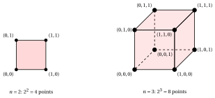

# Integer linear programming

**Part 1 · Models and bounds · Chapter 1** · [:material-file-pdf-box: Lecture notes, volume 1 (PDF)](../pdf/lecture-notes-1-models-bounds-formulations.pdf)

!!! nota "Prerequisites"

    - From the module <em>Linear Programming</em>: Chapter 2 «Halfspaces and polyhedra» and Chapter 4 «LP problems» (the canonical maximization form, the feasible region, optimal solutions and the optimal value), and Chapter 5 «Outcomes and equivalences» (infeasible, unbounded and optimal problems).

    - Nothing else: this chapter is the starting point of the module. The modelling of real problems as MIP problems is the subject of the module <em>MIP modelling</em>.

!!! chiave "Objectives"

    At the end of this chapter you will be able to:

    - write an ILP problem in canonical maximization form, and distinguish ILP, BIP and MIP problems;

    - draw the feasible region of a small ILP problem and find an optimal solution graphically;

    - explain why the feasible region is not convex, and what the three outcomes of an ILP problem are;

    - explain why complete enumeration fails, and how much it costs;

    - compute a lower bound on the optimal value from a feasible solution, also with a simple heuristic algorithm.

## 1.1 Why integer linear programming?

- Many decisions are <strong>discrete</strong>: how many cars to produce, whether to open a warehouse, which job goes on which machine. The number of possible plans is finite, but it can be huge.

- An <strong>integer linear programming</strong> problem describes such a decision with linear constraints and a linear objective function, as in linear programming, but some variables must take integer values. A variable restricted to $\{0,1\}$ is a yes/no decision (<em>in</em> or <em>out</em>), and it is the most powerful modelling tool of the module.

- The integrality requirement makes the problem much harder than its continuous version. The whole module answers one question: <strong>how do we find an optimal solution, and how do we certify that it is optimal?</strong>

!!! chiave ""

    A solution is certified optimal when a <strong>lower bound</strong> (a feasible solution) and an <strong>upper bound</strong> (a proof that nothing is better) have the same value. Every method of this module produces one of the two bounds, or both.

## 1.2 A first model: the car example

- A company produces two types of cars, <strong>sports cars</strong> (profit $3$ thousand euros per car) and <strong>family cars</strong> (profit $2$ thousand euros per car). Every week it has $45$ hours of labour and $49$ units of special materials. The consumption of each car is the following:

<table>
<tr>
<th></th>
<th>Sports car</th>
<th>Family car</th>
</tr>
<tr>
<td>Labour (hours)</td>
<td>\(10\)</td>
<td>\(4\)</td>
</tr>
<tr>
<td>Special materials (units)</td>
<td>\(4\)</td>
<td>\(14\)</td>
</tr>
</table>

- <strong>Decision variables</strong>: $x_1$ is the number of sports cars and $x_2$ the number of family cars produced in a week. Cars cannot be split, so both variables are non-negative integers.

- <strong>Objective function</strong>: the weekly profit $3\,x_1 + 2\,x_2$ (in thousands of euros), to be maximized.

- <strong>Constraints</strong>: the labour hours used, $10\,x_1 + 4\,x_2$, cannot exceed $45$, and the units of materials used, $4\,x_1 + 14\,x_2$, cannot exceed $49$. The ILP problem reads:

!!! chiave ""

    $$
    \begin{array}{rrrrrrr}
    {\max} & {3}\, {x_1} & {+} & {2}\, {x_2} \\[1ex]
    \text{subject to} & {10}\, {x_1} & {+} & {4}\, {x_2} & {\le} & {45} \\[1ex]
    & {4}\, {x_1} & {+} & {14}\, {x_2} & {\le} & {49} \\[1ex]
    & {x_1,} &  & {x_2} & {\in} & {\Z_{\ge 0}}
    \end{array}
    $$

- <strong>A challenge.</strong> Before reading on, find a good production plan. Then try to answer the harder question: how can you prove that no better plan exists? The car example is the guiding example of the whole module, and each chapter will give a piece of the answer.

## 1.3 Definitions

### 1.3.1 ILP problems in canonical maximization form

- Given $n$ values $c_j \in \Z$, $m \cdot n$ values $a_{ij} \in \Z$ and $m$ values $b_i \in \Z$, an <strong>integer linear programming</strong> (ILP) problem in <strong>canonical maximization form</strong> with $n$ <strong>non-negative integer variables</strong> and $m$ <strong>less-than-or-equal-to inequality constraints</strong> reads as follows:

!!! chiave ""

    

    \begin{align*}
    &&   \max \;\;{\sum_{j =1}^n c_j \, x_j}                               \label{ObjFunc} \tag{1.1a}\\[1ex]
    && \text{subject to} \quad  {\sum_{j =1}^n a_{ij} \, x_j}  &\leq b_i,   & \forall i \in \{1,2,\dots,m\},                    \label{Cons} \tag{1.1b}\\[1ex]
    &&x_j                        &\in \Z_{\ge 0}, & \forall j \in \{1,2,\dots,n\}. \label{integrality} \tag{1.1c}
    \end{align*}

- The car example is an ILP problem with $n = 2$ and $m = 2$.

- If all the variables are restricted to $\{0,1\}$ we have a <strong>binary integer linear programming</strong> (BIP) problem. If only some variables are integer and the others are continuous we have a <strong>mixed integer linear programming</strong> (MIP) problem. The ILP problem is the <em>pure</em> integer case; this chapter and the next ones treat ILP problems, and the MIP case is mentioned only where something changes.

- Constraints $\ge$ and $=$, and minimization problems, are brought to the canonical form as in linear programming: multiply by $-1$ the constraints $\ge$, replace an equality with two inequalities, and maximize $-f$ instead of minimizing $f$.

### 1.3.2 Feasible region, objective function and optimal solution

- The <strong>feasible region</strong> of the ILP problem [(1.1)](#eq-ILP) is the following <strong>non-convex</strong> set:

    $$
    F=\left\{~{\vet x} \in \Z^n: ~ \underbrace{\sum_{j=1}^n a_{ij} \, x_j\le b_i,~\forall i}_{m\text{ inequality constraints}},~ \underbrace{x_j \ge 0,~\forall j}_{n\text{ non-negative variables}} ~\right\}
    $$

    It is the set of the integer points (the <strong>lattice</strong> $\Z^n$) that lie in the polyhedron defined by the $m+n$ half-spaces of the constraints. Since $F$ is a set of isolated points, it is not convex.

- The <strong>objective function</strong> $\eqref{ObjFunc}$ is the scalar linear function $f$ defined as follows:

    $$
    f: F \rightarrow \R, ~~~ {\vet x} \mapsto   \sum_{j =1}^n c_j \, x_j
    $$

    whose domain is the set $F$.

!!! chiave ""

    Solving an ILP problem [(1.1)](#eq-ILP) requires to determine the <strong>global maximum</strong> $z(\ILP)$ of the objective function over the feasible region (if it exists). The global maximum $z(\ILP)$ is called the <strong>optimal value</strong> of the ILP problem [(1.1)](#eq-ILP).

!!! chiave ""

    Solving an ILP problem [(1.1)](#eq-ILP) also requires to determine a <strong>point of global maximum</strong>:

    $$
    { \tilde{\vet x}}(\ILP)=\argmax \big\{~ f({\vet x}):~ {\vet x}  \in  F ~\big\}
    $$

    which is called an <strong>optimal solution</strong> of the ILP problem [(1.1)](#eq-ILP). If an optimal solution ${\tilde{\vet x}}(\ILP) = (\tilde{x}_1,\tilde{x}_2,\dots,\tilde{x}_n)$ exists, we have:

    $$
    \sum_{j=1}^n c_j \; \tilde{x}_j = z(\ILP)
    $$

- We denote by $\bar{\vet x}$ a <strong>feasible solution</strong> of the ILP problem [(1.1)](#eq-ILP), that is, a point $\bar{\vet x} \in F$. An optimal solution is a feasible solution, but a feasible solution is in general not optimal.

### 1.3.3 The three outcomes of an ILP problem

- As in linear programming, an ILP problem has exactly one of three <strong>outcomes</strong>: it is <strong>infeasible</strong> ($F = \emptyset$), <strong>unbounded</strong> (the objective function is not bounded from above on $F$) or it has an <strong>optimal solution</strong>.

- The integrality requirement changes the outcomes in a subtle way. The problem $\max \{ x_1 : 2\,x_1 \le 1,~ -2\,x_1 \le -1,~ x_1 \in \Z_{\ge 0} \}$ is infeasible, because it requires $x_1 = \frac{1}{2}$, although its LP relaxation (without integrality) is feasible.

- If the polyhedron of the constraints is bounded, then $F$ is a <strong>finite set</strong>, and an optimal solution exists as soon as $F$ is not empty. If the polyhedron is unbounded, $F$ can be infinite: for example, the problem $\max \{ x_1 + x_2 : x_1 - x_2 \le 1,~ x_1, x_2 \in \Z_{\ge 0} \}$ is unbounded.

## 1.4 Feasible and optimal solutions of the car example

- The feasible solutions of the car example are the integer points inside the polyhedron defined by the two constraints and by $x_1, x_2 \ge 0$. There are $16$ of them.

- To find an optimal solution graphically, we move the objective line $3\,x_1 + 2\,x_2 = z$ in the direction of increasing $z$ until it touches the last feasible point. This happens at the point $(4,1)$.

{ .fig .ovale loading=lazy  }

<em>The car example: the feasible region of the ILP problem is the set of its $16$ integer points (black) inside the polyhedron (red). The optimal solution $(4,1)$ is blue, with the objective line $3\,x_1 + 2\,x_2 = 14$ (dashed).</em>

!!! chiave ""

    The car example has the <strong>unique</strong> optimal solution $\tilde{\vet x}(\ILP) = (4,1)$ with optimal value $z(\ILP) = 14$: the company produces $4$ sports cars and $1$ family car per week, for a profit of $14$ thousand euros.

- The point $\bar{\vet x} = (2,2)$ is feasible, because $10 \cdot 2 + 4 \cdot 2 = 28 \le 45$, $4 \cdot 2 + 14 \cdot 2 = 36 \le 49$ and both values are integer. The point $(4,2)$ is not feasible (it uses $48$ hours of labour), and neither is $(\frac{7}{2},\frac{5}{2})$, which is not integer.

## 1.5 Complete enumeration

- When the feasible region is a finite set we can find an optimal solution by <strong>complete enumeration</strong>: we compute the objective function for every feasible solution and keep the best. For the car example, there are $16$ points:

<table>
<tr>
<th>\(x_1\)</th>
<th>\(x_2\)</th>
<th>\(z\)</th>
<th>\(x_1\)</th>
<th>\(x_2\)</th>
<th>\(z\)</th>
</tr>
<tr>
<td>\(0\)</td>
<td>\(0\)</td>
<td>\(0\)</td>
<td>\(3\)</td>
<td>\(1\)</td>
<td>\(11\)</td>
</tr>
<tr>
<td>\(1\)</td>
<td>\(0\)</td>
<td>\(3\)</td>
<td>\(\mathbf{4}\)</td>
<td>\(\mathbf{1}\)</td>
<td>\(\mathbf{14}\)</td>
</tr>
<tr>
<td>\(2\)</td>
<td>\(0\)</td>
<td>\(6\)</td>
<td>\(0\)</td>
<td>\(2\)</td>
<td>\(4\)</td>
</tr>
<tr>
<td>\(3\)</td>
<td>\(0\)</td>
<td>\(9\)</td>
<td>\(1\)</td>
<td>\(2\)</td>
<td>\(7\)</td>
</tr>
<tr>
<td>\(4\)</td>
<td>\(0\)</td>
<td>\(12\)</td>
<td>\(2\)</td>
<td>\(2\)</td>
<td>\(10\)</td>
</tr>
<tr>
<td>\(0\)</td>
<td>\(1\)</td>
<td>\(2\)</td>
<td>\(3\)</td>
<td>\(2\)</td>
<td>\(13\)</td>
</tr>
<tr>
<td>\(1\)</td>
<td>\(1\)</td>
<td>\(5\)</td>
<td>\(0\)</td>
<td>\(3\)</td>
<td>\(6\)</td>
</tr>
<tr>
<td>\(2\)</td>
<td>\(1\)</td>
<td>\(8\)</td>
<td>\(1\)</td>
<td>\(3\)</td>
<td>\(9\)</td>
</tr>
</table>

- The best value is $14$, in $(4,1)$ (in bold). Here the method works, because the model is tiny.

- Consider now the simplest case, $n$ <strong>binary variables</strong> and no other constraint. Every variable takes $2$ values, so there are $2^n$ solutions: the vertices of an $n$-dimensional hypercube.

{ .fig .ovale loading=lazy  }

<em>The solutions of $n$ binary variables without other constraints: the $2^n$ vertices of an $n$-dimensional hypercube, for $n=2$ (a square) and $n=3$ (a cube).</em>

- The number $2^n$ explodes. With $n = 80$ variables there are about $1.2 \cdot 10^{24}$ solutions, comparable to the estimated number of stars in the universe, and with $n = 266$ variables about $1.2 \cdot 10^{80}$, comparable to the estimated number of atoms in the observable universe.

- Suppose that a computer examines $10^{9}$ solutions per second, and then a computer $1000$ times faster, $10^{12}$ solutions per second. The time needed to enumerate $2^n$ solutions is:

<table>
<tr>
<th>\(n\)</th>
<th>\(2^n\)</th>
<th>at \(10^{9}\) solutions/s</th>
<th>at \(10^{12}\) solutions/s</th>
</tr>
<tr>
<td>20</td>
<td>\(\approx 1.05 \cdot 10^{6}\)</td>
<td>\(\approx 1.05\,\mathrm{ms}\)</td>
<td>\(\approx 1.05\,\mu\mathrm{s}\)</td>
</tr>
<tr>
<td>30</td>
<td>\(\approx 1.07 \cdot 10^{9}\)</td>
<td>\(\approx 1.07\,\mathrm{s}\)</td>
<td>\(\approx 1.07\,\mathrm{ms}\)</td>
</tr>
<tr>
<td>40</td>
<td>\(\approx 1.10 \cdot 10^{12}\)</td>
<td>\(\approx 18.3\,\mathrm{min}\)</td>
<td>\(\approx 1.10\,\mathrm{s}\)</td>
</tr>
<tr>
<td>50</td>
<td>\(\approx 1.13 \cdot 10^{15}\)</td>
<td>\(\approx 13.0\,\mathrm{days}\)</td>
<td>\(\approx 18.8\,\mathrm{min}\)</td>
</tr>
<tr>
<td>60</td>
<td>\(\approx 1.15 \cdot 10^{18}\)</td>
<td>\(\approx 36.5\,\mathrm{years}\)</td>
<td>\(\approx 13.3\,\mathrm{days}\)</td>
</tr>
<tr>
<td>70</td>
<td>\(\approx 1.18 \cdot 10^{21}\)</td>
<td>\(\approx 374\,\mathrm{centuries}\)</td>
<td>\(\approx 37.4\,\mathrm{years}\)</td>
</tr>
<tr>
<td>80</td>
<td>\(\approx 1.21 \cdot 10^{24}\)</td>
<td>\(\approx 3.8 \cdot 10^{5}\,\mathrm{centuries}\)</td>
<td>\(\approx 383\,\mathrm{centuries}\)</td>
</tr>
</table>

!!! chiave ""

    Complete enumeration is impractical already for models of moderate size. A computer $1000$ times faster gains only about $10$ variables, because $2^{10} = 1024 \approx 1000$.

- The way out is to <strong>avoid enumerating</strong>. If we know a lower bound and an upper bound on the optimal value, we can exclude entire regions of feasible solutions without visiting them. The two bounds come from two different sources, and we start with the lower bound.

## 1.6 Lower bounds from feasible solutions

- Since the problem is a maximization, every feasible solution $\bar{\vet x}$ gives a <strong>lower bound</strong> on the optimal value:

    $$
    \LB = \sum_{j=1}^n c_j \; \bar{x}_j \le z(\ILP).
    $$

- For the feasible solution $(2,2)$ of the car example we get $\LB = 3 \cdot 2 + 2 \cdot 2 = 10$, so $z(\ILP) \ge 10$.

!!! chiave ""

    A good feasible solution is a good lower bound. A <strong>heuristic algorithm</strong> is a method that finds feasible solutions quickly, with no guarantee of optimality.

### 1.6.1 Two heuristic algorithms for the car example

- The <strong>one-type heuristic</strong> produces the maximum number of cars of a single type, with none of the other type, and keeps the better of the two solutions.

    1. Only sports cars ($x_2 = 0$): $\bar{x}_1 = \min\{\lfloor \frac{45}{10} \rfloor, \lfloor \frac{49}{4} \rfloor\} = \min\{4, 12\} = 4$, so $\bar{\vet x} = (4,0)$ and $\LB = 12$.

    2. Only family cars ($x_1 = 0$): $\bar{x}_2 = \min\{\lfloor \frac{45}{4} \rfloor, \lfloor \frac{49}{14} \rfloor\} = \min\{11, 3\} = 3$, so $\bar{\vet x} = (0,3)$ and $\LB = 6$.

- The <strong>two-step heuristic</strong> produces first the maximum number of cars of one type, and then the maximum number of cars of the other type with the <strong>residual resources</strong>. It keeps the better of the two solutions.

    1. Sports cars first: $\bar{x}_1 = 4$ uses $40$ hours and $16$ units, leaving $5$ and $33$. Then $\bar{x}_2 = \min\{\lfloor \frac{5}{4} \rfloor, \lfloor \frac{33}{14} \rfloor\} = \min\{1, 2\} = 1$, so $\bar{\vet x} = (4,1)$ and $\LB = 14$.

    2. Family cars first: $\bar{x}_2 = 3$ uses $12$ hours and $42$ units, leaving $33$ and $7$. Then $\bar{x}_1 = \min\{\lfloor \frac{33}{10} \rfloor, \lfloor \frac{7}{4} \rfloor\} = \min\{3, 1\} = 1$, so $\bar{\vet x} = (1,3)$ and $\LB = 9$.

<table>
<tr>
<th>Heuristic</th>
<th>Order</th>
<th>\(\bar{x}_1\)</th>
<th>\(\bar{x}_2\)</th>
<th>\(\LB\)</th>
</tr>
<tr>
<td>one-type</td>
<td>sports cars</td>
<td>\(4\)</td>
<td>\(0\)</td>
<td>\(12\)</td>
</tr>
<tr>
<td>one-type</td>
<td>family cars</td>
<td>\(0\)</td>
<td>\(3\)</td>
<td>\(6\)</td>
</tr>
<tr>
<td>two-step</td>
<td>sports cars first</td>
<td>\(4\)</td>
<td>\(1\)</td>
<td>\(14\)</td>
</tr>
<tr>
<td>two-step</td>
<td>family cars first</td>
<td>\(1\)</td>
<td>\(3\)</td>
<td>\(9\)</td>
</tr>
</table>

- The two-step heuristic gives a better lower bound, but it needs more computation. This trade-off between the quality of the solution and the computational effort is typical of heuristic algorithms.

- Here the best lower bound is $\LB = 14$, in $(4,1)$, which is in fact optimal. But we cannot know it yet: nothing so far tells us that no feasible solution has value $15$ or more. We need an <strong>upper bound</strong>, and the next chapter provides it.

## 1.7 Typical mistakes

!!! attenzione "Warning"

    - <strong>Believing that the feasible region is convex.</strong> It is the set of the integer points of a polyhedron, not the polyhedron. The midpoint of two feasible solutions can be infeasible.

    - <strong>Believing that the feasible region is always finite.</strong> It is finite only if the polyhedron is bounded; otherwise the ILP problem can be unbounded.

    - <strong>Believing that a feasible LP problem gives a feasible ILP problem.</strong> The LP problem can have solutions while no integer point satisfies the constraints.

    - <strong>Taking a heuristic solution as optimal.</strong> A feasible solution gives only a lower bound. Without an upper bound with the same value there is no certificate of optimality.

    - <strong>Using the lower bound as an upper bound.</strong> For a maximization problem the feasible solutions bound the optimal value from below, and the relaxations (next chapters) from above.

## 1.8 In summary

!!! chiave "In summary"

    - An ILP problem maximizes a linear function over the integer points of a polyhedron; its feasible region is not convex, and it is finite when the polyhedron is bounded.

    - The outcomes are infeasible, unbounded or optimal, and a feasible LP problem can have an infeasible ILP version.

    - Complete enumeration costs $2^n$ evaluations for $n$ binary variables: it is not an option beyond very small models.

    - Every feasible solution is a lower bound on $z(\ILP)$, and heuristic algorithms find good feasible solutions quickly.

    - Optimality is certified only when a lower bound and an upper bound coincide.

    <strong>Dashboard of the car example.</strong> The bounds on $z(\ILP)$ found so far:

    
<table>
    <tr>
    <th>Chapter</th>
    <th>Lower bound</th>
    <th>Upper bound</th>
    <th>From</th>
    </tr>
    <tr>
    <td>Integer linear programming</td>
    <td>\(12\), \(14\)</td>
    <td>–</td>
    <td>heuristic solutions \((4, 0)\) and \((4, 1)\)</td>
    </tr>
    </table>

