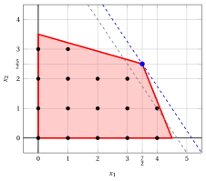
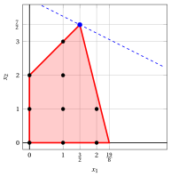
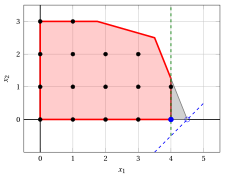
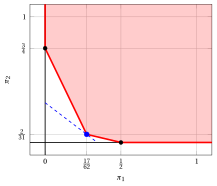

# LP relaxation and dual bounds

**Part 1 · Models and bounds · Chapter 2** · [:material-file-pdf-box: Lecture notes, volume 1 (PDF)](../pdf/lecture-notes-1-models-bounds-formulations.pdf)

!!! nota "Prerequisites"

    - From this module, the chapter «Integer linear programming»: ILP problems, feasible and optimal solutions, lower bounds, and the car example.

    - From the module <em>Linear Programming</em>, Chapter 9 «Duality theory»: the dual problem, weak duality and strong duality.

    - From the same module, Chapter 6 «Simplex algorithm»: an LP problem that has an optimal solution has an optimal vertex.

!!! chiave "Objectives"

    At the end of this chapter you will be able to:

    - build the LP relaxation of an ILP problem and use its optimal value as an upper bound, rounded down when it is valid;

    - compute the optimality gap from a lower bound and an upper bound;

    - explain why rounding an optimal LP solution gives a feasible solution at best;

    - derive upper bounds on the variables from the constraints, and say when they help;

    - obtain an upper bound from non-negative multipliers of the constraints, and recognize the dual problem as the problem of the best multipliers.

!!! nota "Where we were"

    In the previous chapter we found the feasible solution $(4,1)$ of the car example, with $\LB = 14$, but we could not tell whether a plan with a larger profit exists. We now look for the other side of the sandwich, an <strong>upper bound</strong>.

## 2.1 Why a relaxation?

- To prove that no production plan earns more than $14$ thousand euros we cannot look at the solutions one by one. We need a statement that holds for <u>all</u> the feasible solutions at once.

- The idea is to <strong>relax</strong> the problem: we replace it with an easier problem whose feasible region contains the original one. A maximization over a larger region cannot give a smaller value, so the optimal value of the relaxed problem is an upper bound.

- The easier problem we choose is the one we know how to solve: a linear programming problem.

## 2.2 The LP relaxation

- The <strong>linear programming (LP) relaxation</strong> of an ILP problem consists in replacing the integrality constraints with the non-negativity constraints $x_j \ge 0$, for all $j \in \{1,2,\dots,n\}$. In other words, we transform the integer variables into continuous variables, and we get the following problem:

!!! chiave ""

    

    \begin{align*}
    &&   \max \;\;{\sum_{j =1}^n c_j \, x_j}                               \label{ObjFunc_LP}  \tag{2.1a}\\[2ex]
    && \text{subject to} \quad  {\sum_{j =1}^n a_{ij} \, x_j}  &\leq b_i,   & \forall i \in \{1,2,\dots,m\},                    \label{Cons_LP}  \tag{2.1b}\\[2ex]
    &&x_j                        &\ge  0, & \forall j \in \{1,2,\dots,n\}. \label{non_negativity_LP} \tag{2.1c}
    \end{align*}

- We denote by $z(\LP)$ the optimal value of the LP relaxation, and by $\tilde{\vet x}(\LP)$ an optimal solution. We always write the argument, because in the same example $\tilde{\vet x}(\ILP)$ and $\tilde{\vet x}(\LP)$ are different points.

!!! teorema "Proposition 2.1: upper bound from the LP relaxation"

    Every feasible solution of the ILP problem is feasible for its LP relaxation, hence

    \begin{equation*}
    z(\ILP) \le z(\LP). \label{LP_BOUND} \tag{2.2}
    \end{equation*}

    Moreover, if an optimal solution of the LP relaxation is integer, then it is an optimal solution of the ILP problem.

??? dimostrazione "Proof"

    The feasible region $F$ of the ILP problem is contained in the polyhedron of the LP relaxation, and the objective function is the same. The maximum over a larger set is not smaller than the maximum over a subset. If $\tilde{\vet x}(\LP)$ is integer, it belongs to $F$ and has value $z(\LP) \ge z(\ILP)$: it is optimal for the ILP problem. □

!!! definizione "Definition 2.2: of integer part of a number"

    Given $y \in \R$, the <strong>integer part</strong> of $y$ is $\lfloor y \rfloor = \max \{ q \in \Z : q \le y \}$.

- The value of every feasible solution of an ILP problem with integer costs $c_j$ is an integer. Since it is at most $z(\LP)$, it is at most the largest integer not exceeding $z(\LP)$.

!!! teorema "Observation 2.3: rounding the upper bound"

    If all the variables are integer and all the costs $c_j$ are integer, then

    \begin{equation*}
    z(\ILP) \le \lfloor z(\LP) \rfloor. \label{LP_BOUND_2} \tag{2.3}
    \end{equation*}

    In all the other cases the bound $\lfloor z(\LP) \rfloor$ is <u>not</u> valid.

- In this module all the ILP problems have integer data, so the bound $\eqref{LP_BOUND_2}$ always holds. The case of a MIP problem is different: if a variable is continuous, the value of a feasible solution is not necessarily an integer, and the bound cannot be rounded.

### 2.2.1 The LP relaxation of the car example

- The LP relaxation of the car example has the optimal solution

    $$
    \tilde{x}_1 = \frac{7}{2}, \quad \tilde{x}_2 = \frac{5}{2}, \qquad z(\LP) = \frac{31}{2},
    $$

    and it is fractional: it is not a production plan.

- Since the costs are integer, we have the upper bound $\lfloor z(\LP) \rfloor = 15$. Together with the lower bound of the previous chapter:

    $$
    14 ~\le~ z(\ILP) ~\le~ 15.
    $$

{ .fig .ovale loading=lazy  }

<em>The LP relaxation of the car example: the feasible region (red), its $16$ integer points (black) and the optimal solution $(\frac{7}{2},\frac{5}{2})$ of the LP relaxation (blue), with the objective line $3\,x_1 + 2\,x_2 = \frac{31}{2}$ through it (dashed). The dotted line is the objective line of the optimal ILP solution.</em>

- We know that the optimal value is $14$ or $15$. The <strong>optimality gap</strong> measures how far the two bounds are:

    \begin{equation*}
    \label{gap}
    \text{optimality gap} = \frac{\UB - \LB}{|\LB|}, \qquad \text{for } \LB \ne 0 . \tag{2.4}
    \end{equation*}

    Here $\UB = 15$ and $\LB = 14$, so the gap is $\frac{1}{14} \approx 7.1\%$. The solution $(4,1)$ is certified optimal only when the gap is zero.

## 2.3 Rounding the solution of the LP relaxation

!!! chiave ""

    Feasible ILP solutions can typically be obtained by rounding an optimal solution of the LP relaxation. But no rounding technique guarantees to find an optimal ILP solution.

!!! esempio "Example 2.1: rounding works, but the bound is not tight"

    Consider the following ILP problem; its LP relaxation has $x_1, x_2 \ge 0$ instead of the integrality constraints:

    $$
    \begin{array}{rrrrrrr}
    {\max} & {2}\, {x_1} & {+} & {4}\, {x_2} \\[1ex]
    \text{subject to} & {-}\, {x_1} & {+} & \, {x_2} & {\le} & {2} \\[1ex]
    & {8}\, {x_1} & {+} & {2}\, {x_2} & {\le} & {19} \\[1ex]
    & {x_1,} &  & {x_2} & {\in} & {\Z_{\ge 0}}
    \end{array}
    $$

    - The optimal solution of the LP relaxation is $\tilde{\vet x}(\LP) = (\frac{3}{2},\frac{7}{2})$, with $z(\LP) = 17$ and $\lfloor z(\LP) \rfloor = 17$, so $z(\ILP) \le 17$.

    - Rounding down both components we get the feasible solution $\bar{\vet x} = (\lfloor \frac{3}{2} \rfloor, \lfloor \frac{7}{2} \rfloor) = (1,3)$, with $\LB = 2 \cdot 1 + 4 \cdot 3 = 14$.

    - The optimal ILP solution is $\tilde{\vet x}(\ILP) = (1,3)$, with $z(\ILP) = 14$: the rounded solution is optimal. But the bounds $14 \le z(\ILP) \le 17$ do not prove it.

    { .fig .ovale loading=lazy  }

    <em>The second example: the feasible region of the LP relaxation (red), the integer points (black) and the optimal solution of the LP relaxation (blue), with the objective line $2\,x_1 + 4\,x_2 = 17$ (dashed).</em>

!!! esempio "Example 2.2: rounding fails"

    Consider the following ILP problem:

    $$
    \begin{array}{rrrrrrr}
    {\max} & {25}\, {x_1} & {+} & {16}\, {x_2} \\[1ex]
    \text{subject to} & {50}\, {x_1} & {+} & {31}\, {x_2} & {\le} & {250} \\[1ex]
    & {-3}\, {x_1} & {+} & {2}\, {x_2} & {\le} & {4} \\[1ex]
    & {x_1,} &  & {x_2} & {\in} & {\Z_{\ge 0}}
    \end{array}
    $$

    - The optimal solution of the LP relaxation is $\tilde{\vet x}(\LP) = (\frac{376}{193}, \frac{950}{193}) \approx (1.94, 4.92)$, with $z(\LP) = \frac{24600}{193} \approx 127.46$. Hence $z(\ILP) \le \lfloor z(\LP) \rfloor = 127$.

    - Rounding to the nearest integer gives $(2,5)$, which is infeasible: $50 \cdot 2 + 31 \cdot 5 = 255 > 250$. Rounding $\tilde{x}_1$ up and $\tilde{x}_2$ down gives the feasible solution $\bar{\vet x} = (2,4)$, with $\LB = 25 \cdot 2 + 16 \cdot 4 = 114$.

    - The optimal ILP solution is $\tilde{\vet x}(\ILP) = (5,0)$, with $z(\ILP) = 125$. It is far from $\tilde{\vet x}(\LP)$, and no rounding of $\tilde{\vet x}(\LP)$ finds it.

    { .fig .ovale loading=lazy  }

    <em>The third example: the integer points (black) are far from the optimal solution $(\frac{376}{193},\frac{950}{193})$ of the LP relaxation (blue). The optimal ILP solution is $(5,0)$ (blue circle). The dashed line is the objective line $25\,x_1 + 16\,x_2 = \frac{24600}{193}$.</em>

!!! chiave ""

    Optimal ILP solutions can be quite far from optimal solutions of the LP relaxation. The value of the LP relaxation, instead, is often a good bound: here $125 \le z(\LP) \approx 127.46$.

## 2.4 Upper bounds on the variables

- Some constraints give a bound on a single variable. If a constraint has all the coefficients non-negative, then each term is non-negative, so no term can exceed the right-hand side.

!!! teorema "Proposition 2.4: upper bounds on the variables"

    Let $\sum_{j=1}^n a_{ij} \, x_j \le b_i$ be a constraint with $a_{ij} \ge 0$ for all $j$. Then every feasible solution of the ILP problem satisfies

    \begin{equation*}
    \label{vub}
    x_j \le \left\lfloor \frac{b_i}{a_{ij}} \right\rfloor, \qquad \forall j \text{ such that } a_{ij} > 0. \tag{2.5}
    \end{equation*}

??? dimostrazione "Proof"

    Since all the variables are non-negative and all the coefficients are non-negative, $a_{ij} \, x_j \le \sum_{k=1}^n a_{ik} \, x_k \le b_i$, so $x_j \le \frac{b_i}{a_{ij}}$. The variable is integer, so it does not exceed the integer part of $\frac{b_i}{a_{ij}}$. □

- If several constraints give a bound on $x_j$, we keep the smallest. In the car example both constraints have non-negative coefficients:

    \begin{align*}
    x_1 &\le \min \left\{ \left\lfloor \tfrac{45}{10} \right\rfloor, \left\lfloor \tfrac{49}{4} \right\rfloor \right\}
    = \min\{4, 12\} = 4,\\
    x_2 &\le \min \left\{ \left\lfloor \tfrac{45}{4} \right\rfloor, \left\lfloor \tfrac{49}{14} \right\rfloor \right\}
    = \min\{11, 3\} = 3.
    \end{align*}

- The inequalities $x_1 \le 4$ and $x_2 \le 3$ are satisfied by all the integer points of the car example, and they can be added to the model. They cut off two regions of the polyhedron, and no integer point.

{ .fig .ovale loading=lazy  }

<em>The variable upper bounds $x_1 \le 4$ and $x_2 \le 3$ (green) cut off the two gray regions of the LP relaxation (red) and no integer point. The optimal solution of the LP relaxation (blue) is not cut off.</em>

- The optimal solution of the LP relaxation, $(\frac{7}{2},\frac{5}{2})$, satisfies both inequalities. It is not cut off, so the optimal value of the LP relaxation does not change, and the upper bound is still $15$.

- The bounds help when the optimal LP solution lies in a cut-off region. Consider the objective function $x_1 - x_2$ on the same constraints, whose optimal ILP solution is $(4,0)$ with $z(\ILP) = 4$. Before the bounds, the optimal solution of the LP relaxation is $(\frac{9}{2},0)$ with $z(\LP) = \frac{9}{2}$; after $x_1 \le 4$ it is $(4,0)$ with $z(\LP) = 4$, which is integer and therefore optimal.

{ .fig .ovale loading=lazy  }

<em>The objective $x_1 - x_2$: the variable upper bound $x_1 \le 4$ (green) cuts off the gray triangle and the optimal solution $(\frac{9}{2},0)$ of the LP relaxation (blue circle). The new optimal solution $(4,0)$ (blue) is integer. The dashed line is $x_1 - x_2 = \frac{9}{2}$.</em>

- In this case the value of the LP relaxation improves from $\frac{9}{2}$ to $4$. The rounded bound $\lfloor \frac{9}{2} \rfloor = 4$ was already $4$: a better formulation does not always improve the rounded bound.

## 2.5 Dual bounds

- The LP relaxation gives a bound only after it has been solved. Can we obtain an upper bound <u>without</u> solving it? A feasible solution of the LP relaxation does not help: its value is neither a lower bound nor an upper bound on $z(\ILP)$.

<table>
<tr>
<th>\((x_1, x_2)\)</th>
<th>feasible for the LP relaxation</th>
<th>integer</th>
<th>\(3\,x_1 + 2\,x_2\)</th>
</tr>
<tr>
<td>\((4, \frac{5}{4})\)</td>
<td>yes</td>
<td>no</td>
<td>\(\frac{29}{2} > 14\)</td>
</tr>
<tr>
<td>\((2, \frac{5}{2})\)</td>
<td>yes</td>
<td>no</td>
<td>\(11 < 14\)</td>
</tr>
</table>

- The right tool is to <strong>combine the constraints</strong>. Multiplying the first constraint of the car example by $\frac{3}{4}$ we get

    $$
    \frac{15}{2}\,x_1 + 3\,x_2 \le \frac{135}{4}.
    $$

    Since $x_1, x_2 \ge 0$ and the coefficients $\frac{15}{2}$ and $3$ are at least the costs $3$ and $2$, we have $3\,x_1 + 2\,x_2 \le \frac{15}{2}\,x_1 + 3\,x_2 \le \frac{135}{4}$: an upper bound of $\frac{135}{4}$.

- The same works with any <strong>non-negative</strong> multipliers $\pi_1$ and $\pi_2$ of the two constraints, provided that the coefficients of the sum are at least the costs:

    \begin{align*}
    (10\,\pi_1 + 4\,\pi_2)\,x_1 + (4\,\pi_1 + 14\,\pi_2)\,x_2 &\le 45\,\pi_1 + 49\,\pi_2,\\
    10\,\pi_1 + 4\,\pi_2 \ge 3, \qquad 4\,\pi_1 + 14\,\pi_2 &\ge 2.
    \end{align*}

    The multipliers must be non-negative: a negative multiplier would reverse the inequality.

<table>
<tr>
<th>\((\pi_1, \pi_2)\)</th>
<th>valid multipliers</th>
<th>upper bound \(45\,\pi_1 + 49\,\pi_2\)</th>
</tr>
<tr>
<td>\((\frac{3}{4}, 0)\)</td>
<td>yes</td>
<td>\(\frac{135}{4}\)</td>
</tr>
<tr>
<td>\((0, \frac{3}{4})\)</td>
<td>yes</td>
<td>\(\frac{147}{4}\)</td>
</tr>
<tr>
<td>\((\frac{1}{5}, \frac{1}{4})\)</td>
<td>yes</td>
<td>\(\frac{85}{4}\)</td>
</tr>
<tr>
<td>\((\frac{1}{2}, 0)\)</td>
<td>yes</td>
<td>\(\frac{45}{2}\)</td>
</tr>
<tr>
<td>\((\frac{1}{5}, 0)\)</td>
<td>no: \(10 \cdot \frac{1}{5} = 2 < 3\)</td>
<td>–</td>
</tr>
</table>

- To get the <strong>best</strong> bound we look for the multipliers with the smallest value $45\,\pi_1 + 49\,\pi_2$: this is itself an LP problem.

!!! chiave ""

    $$
    \begin{array}{rrrrrrr}
    {\min} & {45}\, {\pi_1} & {+} & {49}\, {\pi_2} \\[1ex]
    \text{subject to} & {10}\, {\pi_1} & {+} & {4}\, {\pi_2} & {\ge} & {3} \\[1ex]
    & {4}\, {\pi_1} & {+} & {14}\, {\pi_2} & {\ge} & {2} \\[1ex]
    & {\pi_1,} &  & {\pi_2} & {\ge} & {0}
    \end{array}
    $$

- This is the <strong>dual problem</strong> of the LP relaxation, called D(LP), and its optimal value is $z(\mathrm{D(LP)})$. For a general ILP problem in canonical form, with one multiplier $\pi_i \ge 0$ for each constraint, it reads:

!!! chiave ""

    

    \begin{align*}
    &&   \min \;\;{\sum_{i =1}^m b_i \, \pi_i}                               \label{ObjFunc_D}  \tag{2.6a}\\[2ex]
    && \text{subject to} \quad  {\sum_{i =1}^m a_{ij} \, \pi_i}  &\geq c_j,   & \forall j \in \{1,2,\dots,n\},                    \label{Cons_D}  \tag{2.6b}\\[2ex]
    &&\pi_i                        &\ge  0, & \forall i \in \{1,2,\dots,m\}. \label{non_negativity_D} \tag{2.6c}
    \end{align*}

!!! teorema "Proposition 2.5: dual bounds"

    For every feasible solution $\bar{\vet \pi}$ of the dual problem [(2.6)](#eq-DLP),

    $$
    z(\ILP) ~\le~ z(\LP) ~\le~ \sum_{i=1}^m b_i \, \bar{\pi}_i .
    $$

    By strong duality, $z(\mathrm{D(LP)}) = z(\LP)$: the best multipliers give exactly the value of the LP relaxation.

??? dimostrazione "Proof"

    Let $\vet x$ be feasible for the LP relaxation. Multiplying the constraint $i$ by $\bar{\pi}_i \ge 0$ and summing, $\sum_{j=1}^n \big( \sum_{i=1}^m a_{ij} \, \bar{\pi}_i \big) x_j \le \sum_{i=1}^m b_i \, \bar{\pi}_i$. By $\eqref{Cons_D}$ and $x_j \ge 0$, the left-hand side is at least $\sum_{j=1}^n c_j \, x_j$. Hence $\sum_{j=1}^n c_j \, x_j \le \sum_{i=1}^m b_i \, \bar{\pi}_i$ for every feasible $\vet x$. □

- In the car example the optimal solution of D(LP) is $\tilde{\vet \pi}(\mathrm{D(LP)}) = (\frac{17}{62},\frac{2}{31})$, and

    $$
    z(\mathrm{D(LP)}) = 45 \cdot \frac{17}{62} + 49 \cdot \frac{2}{31} = \frac{765}{62} +
    \frac{98}{31} = \frac{31}{2} = z(\LP).
    $$

    The other two vertices of the dual feasible region give the bounds $\frac{45}{2}$ and $\frac{147}{4}$.

{ .fig .ovale loading=lazy  }

<em>The feasible region of the dual LP problem (red, unbounded) and its optimal solution $(\frac{17}{62},\frac{2}{31})$ (blue), with the objective line $45\,\pi_1 + 49\,\pi_2 = \frac{31}{2}$ (dashed). The other vertices (black) give the bounds $\frac{45}{2}$ and $\frac{147}{4}$.</em>

!!! chiave ""

    Every feasible solution of the dual problem is a certificate of an upper bound, found without solving the LP relaxation. The best certificate is an optimal dual solution, and it has the same value as the LP relaxation.

### 2.5.1 Summary of the notation

- <strong>ILP problem</strong>: optimal solution $\tilde{\vet x}(\ILP)$, optimal value $z(\ILP)$, feasible solution $\bar{\vet x}$ with $\LB(\bar{\vet x}) = \sum_{j} c_j \, \bar{x}_j \le z(\ILP)$.

- <strong>LP relaxation</strong>: optimal solution $\tilde{\vet x}(\LP)$, optimal value $z(\LP)$, upper bound $z(\ILP) \le z(\LP)$.

- <strong>Dual problem</strong>: optimal solution $\tilde{\vet \pi}(\mathrm{D(LP)})$, optimal value $z(\mathrm{D(LP)}) = z(\LP)$, and $z(\ILP) \le \sum_i b_i \, \bar{\pi}_i$ for every dual feasible $\bar{\vet \pi}$.

## 2.6 Typical mistakes

!!! attenzione "Warning"

    - <strong>Rounding the bound when it is not valid.</strong> The bound $\lfloor z(\LP) \rfloor$ requires all the variables and all the costs to be integer. In a MIP problem the bound is $z(\LP)$.

    - <strong>Rounding the solution and calling it optimal.</strong> A rounded solution is feasible at best, and in general not optimal. It may even be infeasible, as the nearest integer point $(2,5)$ of [Example 2.2](#box-5-ex-round-bad).

    - <strong>Using the value of a feasible LP solution as a bound.</strong> Only the optimal value of the LP relaxation, or the value of a dual feasible solution, is an upper bound.

    - <strong>Multipliers with a negative sign.</strong> The multipliers of constraints $\le$ must be non-negative, and the combined coefficients must be at least the costs.

    - <strong>Deriving a bound on a variable from a constraint with negative coefficients.</strong> The proof of $\eqref{vub}$ needs all the coefficients to be non-negative.

    - <strong>Believing that a stronger formulation always improves the bound.</strong> The bounds $x_1 \le 4$ and $x_2 \le 3$ leave the bound $15$ of the car example unchanged.

## 2.7 In summary

!!! chiave "In summary"

    - The LP relaxation drops integrality, so $z(\ILP) \le z(\LP)$; with integer variables and integer costs the bound can be rounded down to $\lfloor z(\LP) \rfloor$.

    - Lower and upper bound define the optimality gap; optimality is certified when the gap is zero.

    - Rounding an optimal LP solution gives a feasible solution at best, never a certificate.

    - The upper bounds on the variables $x_j \le \lfloor b_i / a_{ij} \rfloor$ come from constraints with non-negative coefficients, and they help only if they cut off the LP optimum.

    - Non-negative multipliers of the constraints give upper bounds; the best ones solve the dual problem, whose optimal value is $z(\LP)$.

    <strong>Dashboard of the car example.</strong> The bounds on $z(\ILP)$ found so far in this module:

    
<table>
    <tr>
    <th>Chapter</th>
    <th>Lower bound</th>
    <th>Upper bound</th>
    <th>From</th>
    </tr>
    <tr>
    <td>Integer linear programming</td>
    <td>\(12\), \(14\)</td>
    <td>–</td>
    <td>heuristic solutions \((4, 0)\) and \((4, 1)\)</td>
    </tr>
    <tr>
    <td>LP relaxation and dual bounds</td>
    <td>\(14\)</td>
    <td>\(15\)</td>
    <td>\(\lfloor z(\LP) \rfloor\), with \(z(\LP) = \tfrac{31}{2}\)</td>
    </tr>
    </table>

