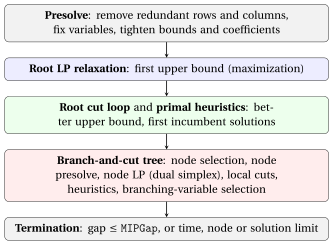

# MIP solvers: what they do

<div class="info-capitolo" markdown>

**Part 4 · MIP solvers · Chapter 9** · [:material-file-pdf-box: Lecture notes, volume 3 (PDF)](../pdf/lecture-notes-3-mip-solvers.pdf) · [:material-presentation: Slides](../pdf/slides-09-mip-solvers.pdf) · [:material-pencil: Exercises: MIP solvers](../exercises/mip-solvers.md)

</div>

!!! nota "Prerequisites"

    - From this module, the chapters «LP-based branch-and-bound» and «Branch-and-cut algorithms»: the branching, bounding and pruning operations, the cuts, and the incumbent solution.

    - From this module, the chapter «Primal and dual bounds»: the lower and upper bounds and the optimality gap.

    - To learn how to use Gurobi in practice, see the module «MIP Modelling» ([<u>fabiofurini.github.io/mip-modelling</u>](https://fabiofurini.github.io/mip-modelling/)), [chapter 3 «From the model to Python/Gurobi»](https://fabiofurini.github.io/mip-modelling/modelling-3/).

!!! chiave "Objectives"

    At the end of this chapter you will be able to:

    - name the components of a MIP solver and say on which side of the bounds each of them acts;

    - explain presolve, cuts, primal heuristics, branching rules, tolerances and the gap;

    - read the log of Gurobi and follow the two bounds, the incumbent solution and the tree;

    - explain why a solver can stop with a solution that is not optimal.

## 9.1 From the branch-and-cut algorithm to a MIP solver

<a id="box-1-def-solver"></a>

!!! definizione "Definition 9.1: MIP solver"

    A <strong>MIP solver</strong> (Gurobi, CPLEX, Xpress, HiGHS, SCIP) is a computer program that computes optimal solutions of MIP problems. Its core is the branch-and-cut algorithm of the previous chapter.

- Around the core, the solver adds several components. Each of them acts on one side of the bounds on $z(\ILP)$, here for a maximization problem:

    $$
    \underbrace{\LB}_{\text{primal side}} ~~\le~~ z(\ILP) ~~\le~~ \underbrace{\UB}_{\text{dual side}}
    $$

- The components are the same in all the solvers. The details (which cuts, which heuristics, which rules) differ from solver to solver and from version to version, and are only partially documented.

!!! chiave ""

    A MIP solver executes presolve, then the root node (LP relaxation, cuts, primal heuristics), then the branch-and-cut tree, and it stops when the gap between the bounds is below a tolerance or a limit is reached.

{ .fig loading=lazy  }

### 9.1.1 Dictionary between the notes and the solver

<div class="tabella" markdown="0"><table>
<tr>
<th>In the notes (B&amp;B, B&amp;C)</th>
<th>In the Gurobi log</th>
</tr>
<tr>
<td>lower bound <span class="arithmatex">\(\LB\)</span> (max), incumbent solution <span class="arithmatex">\(\bar{\vet x}\)</span></td>
<td><code>Incumbent</code></td>
</tr>
<tr>
<td>upper bound <span class="arithmatex">\(\UB\)</span> (max)</td>
<td><code>BestBd</code> (best bound)</td>
</tr>
<tr>
<td>optimality gap</td>
<td><code>Gap</code></td>
</tr>
<tr>
<td>list <span class="arithmatex">\(L\)</span> of LP problems for branching</td>
<td><code>Unexpl</code> (unexplored nodes)</td>
</tr>
<tr>
<td>LP problems already processed</td>
<td><code>Expl</code> (explored nodes)</td>
</tr>
<tr>
<td><span class="arithmatex">\(z(\LP_k)\)</span> of the current branching node</td>
<td><code>Obj</code></td>
</tr>
<tr>
<td>level of the node in the tree</td>
<td><code>Depth</code></td>
</tr>
<tr>
<td>fractional integer variables in <span class="arithmatex">\(\tilde{\vet x}(\LP_k)\)</span></td>
<td><code>IntInf</code></td>
</tr>
</table></div>

- In a <u>minimization</u> problem the roles are exchanged: <code>Incumbent</code> is an upper bound and <code>BestBd</code> is a lower bound.

## 9.2 The components of a MIP solver

### 9.2.1 Presolve

<a id="box-2-def-presolve"></a>

!!! definizione "Definition 9.2: presolve"

    The <strong>presolve</strong> transforms a MIP problem into an equivalent one: same optimal value, and an optimal solution of the original problem can be recovered from one of the new problem.

- The new problem is smaller and, possibly, has a stronger LP relaxation. The typical operations are three:

    1. removing <strong>redundant constraints</strong> and <strong>fixing variables</strong> whose value is implied;

    2. <strong>bound tightening</strong>: deriving smaller upper bounds and larger lower bounds on the variables;

    3. <strong>coefficient tightening</strong>: changing the coefficients of a constraint so that the integer solutions stay the same, while the LP relaxation becomes smaller.

<a id="box-3-ex-solver-presolve"></a>

!!! esempio "Example 9.1: coefficient tightening"

    Consider the problem with three binary variables

    $$
    \max~ x_1 + x_2 + x_3 \qquad \text{subject to} \qquad 6\,x_1 + 6\,x_2 + 3\,x_3 \le 10, \qquad
    x_1, x_2, x_3 \in \{0,1\}.
    $$

    - The constraint is satisfied by the same six binary points as the constraint

        $$
        7\,x_1 + 7\,x_2 + 3\,x_3 \le 10 .
        $$

        Indeed, $x_1 = x_2 = 1$ violates both ($12 > 10$ and $14 > 10$), while every other point satisfies both (the largest left-hand sides are $9$ and $10$).

    - The LP relaxation of the first constraint has optimal value $z(\LP) = \frac{13}{6}$, attained for example at $\tilde{\vet x} = (1,\frac{1}{6},1)$: it is fractional, and $x_1 + x_2 = \frac{7}{6}$.

    - The LP relaxation of the second constraint has optimal value $2 = z(\ILP)$: the upper bound decreases from $\frac{13}{6}$ to $2$ without changing the integer solutions and the size of the model.

- The same reasoning can be applied at every branching node (<strong>node presolve</strong>, or <strong>domain propagation</strong>): a branching constraint $x_j \le 0$ may imply that other variables can be fixed.

### 9.2.2 Cutting planes

- At the root node the solver executes several <strong>rounds of cuts</strong>. At the end, the log reports how many cuts of each family have been added.

- The families that appear in our logs are <code>Gomory</code> (Gomory cuts), <code>MIR</code> (mixed-integer rounding cuts, which generalize Gomory cuts to MIP problems), <code>StrongCG</code> (Chvátal–Gomory cuts) and <code>Lift-and-project</code>.

- Cuts are generated also in the tree, less often than at the root (branch-and-cut).

### 9.2.3 Primal heuristics { #sez-sec-solver-heuristics }

- <strong>Primal heuristics</strong> search for good integer feasible solutions: they give the incumbent solution and the bound $\LB$ (maximization). Examples are rounding the LP solution, <strong>diving</strong>, and local search around the incumbent solution (chapter «MIP heuristics»).

- In the log, a line starting with <code>H</code> reports a new incumbent solution found by a heuristic. A line starting with <code>\*</code> reports one found as the integer optimal solution of a node LP problem (pruning by integrality).

- The line <code>Found heuristic solution</code> reports a solution found before the root LP.

### 9.2.4 Branching-variable and branching-node selection

- The branching-variable strategies of the B&amp;B chapter (maximum infeasibility, strong branching, pseudocosts) are all available in a solver. Strong branching gives small trees but is expensive; pseudocosts are cheap but unreliable at the beginning.

- Solvers combine them in <strong>reliability branching</strong>: strong branching on a variable until its pseudocosts have been observed enough times.

- In Gurobi the parameter <code>VarBranch</code> selects the strategy: $-1$ automatic (default), $0$ pseudo reduced-cost, $1$ pseudo shadow-price, $2$ maximum infeasibility, $3$ strong branching.

- The node selection combines <strong>best bound</strong> (select the node with the largest $z(\LP_k)$, which decreases $\UB$) and <strong>depth first</strong> (which finds integer solutions quickly).

### 9.2.5 Tolerances and gap

- A MIP solver works with <strong>floating-point arithmetic</strong>: a value is integer, a constraint is satisfied, a reduced cost is non-positive, up to a <strong>tolerance</strong>. The default values in Gurobi 13 are:

<div class="tabella" markdown="0"><table>
<tr>
<th>Parameter</th>
<th>Default</th>
<th>Meaning</th>
</tr>
<tr>
<td><code>IntFeasTol</code></td>
<td><span class="arithmatex">\(10^{-5}\)</span></td>
<td>a variable is integer if it is within <span class="arithmatex">\(10^{-5}\)</span> of an integer</td>
</tr>
<tr>
<td><code>FeasibilityTol</code></td>
<td><span class="arithmatex">\(10^{-6}\)</span></td>
<td>maximum violation of a constraint</td>
</tr>
<tr>
<td><code>OptimalityTol</code></td>
<td><span class="arithmatex">\(10^{-6}\)</span></td>
<td>tolerance on the reduced costs (LP optimality)</td>
</tr>
<tr>
<td><code>MIPGap</code></td>
<td><span class="arithmatex">\(10^{-4}\)</span></td>
<td>relative gap at which the solver stops</td>
</tr>
<tr>
<td><code>MIPGapAbs</code></td>
<td><span class="arithmatex">\(10^{-10}\)</span></td>
<td>absolute gap at which the solver stops</td>
</tr>
</table></div>

!!! chiave ""

    “<code>Optimal solution found (tolerance 1.00e-04)</code>” means that the incumbent solution is optimal <strong>up to a relative gap of $10^{-4}$</strong>. With a larger <code>MIPGap</code> the solver stops with a solution that may <strong>not</strong> be optimal, and it writes the same sentence.

## 9.3 How to read the log of Gurobi

- All the logs are produced by Gurobi 13.0.3 (<code>gurobipy</code>) with <code>Threads</code> $=1$ and <code>Seed</code> $=0$, so that the execution is deterministic. With other versions or computers the numbers of nodes and iterations can differ.

- The numbers on the left are line numbers added for the comments; the lines <code>Set parameter ...</code> are omitted.

### 9.3.1 A catalogue problem solved at the root

- We start from the problem $P41$ of the catalogue of MIP problems: three non-negative integer variables and four constraints,

    $$
    \begin{array}{rrcrcrcl}
    \max & 2x_1 & + & x_2 & + & 3x_3 & & \\[1ex]
    \text{subject to} & x_1 & + & x_2 & + & x_3 & \le & 4 \\
    & & & x_2 & & & \le & 2 \\
    & & & & & x_3 & \le & 3 \\
    & 3x_1 & & & + & x_3 & \le & 6 \\[1ex]
    & x_1, & & x_2, & & x_3 & \in & \Z_{\ge 0}
    \end{array}
    $$

??? codice "Gurobi log: problem $P41$, default parameters"

    ```python
    01| Gurobi Optimizer version 13.0.3 build v13.0.3rc0 (linux64 - "Ubuntu 26.04 LTS")
    02| 
    03| CPU model: Intel(R) Core(TM) i5-14500T, instruction set [SSE2|AVX|AVX2]
    04| Thread count: 20 physical cores, 20 logical processors, using up to 1 threads
    05| 
    06| Non-default parameters:
    07| LogToConsole  0
    08| Threads  1
    09| 
    10| Optimize a model with 4 rows, 3 columns and 7 nonzeros (Max)
    11| Model fingerprint: 0xedc792ce
    12| Model has 3 linear objective coefficients
    13| Variable types: 0 continuous, 3 integer (0 binary)
    14| Coefficient statistics:
    15|   Matrix range     [1e+00, 3e+00]
    16|   Objective range  [1e+00, 3e+00]
    17|   Bounds range     [0e+00, 0e+00]
    18|   RHS range        [2e+00, 6e+00]
    19| 
    20| Found heuristic solution: objective 6.0000000
    21| Presolve removed 2 rows and 0 columns
    22| Presolve time: 0.00s
    23| Presolved: 2 rows, 3 columns, 5 nonzeros
    24| Variable types: 0 continuous, 3 integer (0 binary)
    25| 
    26| Root relaxation: objective 1.100000e+01, 1 iterations, 0.00 seconds (0.00 work units)
    27| 
    28|     Nodes    |    Current Node    |     Objective Bounds      |     Work
    29|  Expl Unexpl |  Obj  Depth IntInf | Incumbent    BestBd   Gap | It/Node Time
    30| 
    31| *    0     0               0      11.0000000   11.00000  0.00%     -    0s
    32| 
    33| Explored 1 nodes (1 simplex iterations) in 0.00 seconds (0.00 work units)
    34| Thread count was 1 (of 20 available processors)
    35| 
    36| Solution count 2: 11 6
    37| 
    38| Optimal solution found (tolerance 1.00e-04)
    39| Best objective 1.100000000000e+01, best bound 1.100000000000e+01, gap 0.0000%
    ```

- **01–08** Version of Gurobi, computer, threads used ($1$, since <code>Threads</code> $=1$); parameters with non-default values (<code>Seed</code> $=0$ is not listed, since $0$ is its default).

- **10–13** Size of the model: $4$ rows, $3$ columns, $7$ non-zeros, <code>(Max)</code>; the variable types ($3$ integer, none binary).

- **14–18** <strong>Coefficient statistics</strong>: the smallest and the largest absolute values of the coefficients. Ranges spanning many orders of magnitude signal numerical difficulties; here the coefficients are between $1$ and $6$, and the variables have no explicit bounds (<code>Bounds range</code> $[0,0]$).

- **20** A heuristic finds a solution of value $6$ before the presolve, so $\LB = 6$.

- **21–23** The presolve removes $2$ rows: the model has $2$ rows and $3$ columns left.

- **26** <strong>Root relaxation</strong>: the value is $11$ and $1$ simplex iteration suffices.

- **31** The root LP solution is integer, so the node is solved at once (a line starting with <code>\*</code>, see Section [9.2.3](#sez-sec-solver-heuristics)); $\LB = \UB = 11$, and the solution is optimal.

### 9.3.2 A generic MIP

- From now on we use a <strong>generic MIP with $30$ integer variables</strong> that we call $G_1$. It is a pure ILP problem in the form

    $$
    \max~ \vet c\T\vet x \quad \text{subject to} \quad A\,\vet x \le \vet b,
    $$

    with $x_j \in \{0,1,2,3\}$ for $j = 1,\dots,30$ and $10$ constraints. All the data are integer and pseudo-random (Python <code>random.Random(1)</code>): $a_{ij}$ uniform in $\{1,\dots,20\}$, $c_j$ uniform in $\{5,\dots,25\}$, and $b_i = \sum_j a_{ij}$.

- The script <code>script/genera\_log.py</code> of this chapter builds the instance and produces all the logs.

??? codice "Gurobi log: generic MIP $G_1$, default parameters"

    ```python
    01| Gurobi Optimizer version 13.0.3 build v13.0.3rc0 (linux64 - "Ubuntu 26.04 LTS")
    02| 
    03| CPU model: Intel(R) Core(TM) i5-14500T, instruction set [SSE2|AVX|AVX2]
    04| Thread count: 20 physical cores, 20 logical processors, using up to 1 threads
    05| 
    06| Non-default parameters:
    07| LogToConsole  0
    08| Threads  1
    09| 
    10| Optimize a model with 10 rows, 30 columns and 300 nonzeros (Max)
    11| Model fingerprint: 0xb023d504
    12| Model has 30 linear objective coefficients
    13| Variable types: 0 continuous, 30 integer (0 binary)
    14| Coefficient statistics:
    15|   Matrix range     [1e+00, 2e+01]
    16|   Objective range  [5e+00, 2e+01]
    17|   Bounds range     [3e+00, 3e+00]
    18|   RHS range        [3e+02, 4e+02]
    19| 
    20| Found heuristic solution: objective 429.0000000
    21| Presolve time: 0.00s
    22| Presolved: 10 rows, 30 columns, 300 nonzeros
    23| Variable types: 0 continuous, 30 integer (0 binary)
    24| 
    25| Root relaxation: objective 5.991749e+02, 13 iterations, 0.00 seconds (0.00 work units)
    26| 
    27|     Nodes    |    Current Node    |     Objective Bounds      |     Work
    28|  Expl Unexpl |  Obj  Depth IntInf | Incumbent    BestBd   Gap | It/Node Time
    29| 
    30|      0     0  599.17487    0    6  429.00000  599.17487  39.7%     -    0s
    31| H    0     0                     563.0000000  599.17487  6.43%     -    0s
    32| H    0     0                     576.0000000  599.17487  4.02%     -    0s
    33| H    0     0                     584.0000000  599.17487  2.60%     -    0s
    34| H    0     0                     587.0000000  599.17487  2.07%     -    0s
    35| H    0     0                     588.0000000  599.17487  1.90%     -    0s
    36|      0     0  597.88443    0    5  588.00000  597.88443  1.68%     -    0s
    37| H    0     0                     589.0000000  597.88443  1.51%     -    0s
    38| H    0     0                     592.0000000  597.88443  0.99%     -    0s
    39|      0     0  597.70993    0    5  592.00000  597.70993  0.96%     -    0s
    40|      0     0  597.67133    0    5  592.00000  597.67133  0.96%     -    0s
    41|      0     0  597.65097    0    4  592.00000  597.65097  0.95%     -    0s
    42|      0     0  597.64318    0    5  592.00000  597.64318  0.95%     -    0s
    43|      0     0  597.64271    0    5  592.00000  597.64271  0.95%     -    0s
    44|      0     0  597.56576    0    5  592.00000  597.56576  0.94%     -    0s
    45| H    0     0                     593.0000000  597.56576  0.77%     -    0s
    46|      0     0  597.55314    0    6  593.00000  597.55314  0.77%     -    0s
    47|      0     0  597.52752    0    6  593.00000  597.52752  0.76%     -    0s
    48|      0     0  597.51828    0    6  593.00000  597.51828  0.76%     -    0s
    49|      0     0  597.47194    0    7  593.00000  597.47194  0.75%     -    0s
    50|      0     0  597.21692    0    6  593.00000  597.21692  0.71%     -    0s
    51|      0     0  597.20185    0    6  593.00000  597.20185  0.71%     -    0s
    52|      0     0  597.19580    0    6  593.00000  597.19580  0.71%     -    0s
    53|      0     0  597.07620    0    6  593.00000  597.07620  0.69%     -    0s
    54|      0     0  597.07620    0    6  593.00000  597.07620  0.69%     -    0s
    55|      0     0  597.07620    0    6  593.00000  597.07620  0.69%     -    0s
    56|      0     0  597.07620    0    6  593.00000  597.07620  0.69%     -    0s
    57|      0     0  597.07620    0    6  593.00000  597.07620  0.69%     -    0s
    58|      0     0  597.07620    0    7  593.00000  597.07620  0.69%     -    0s
    59|      0     0  597.07620    0    7  593.00000  597.07620  0.69%     -    0s
    60|      0     0  597.07620    0    6  593.00000  597.07620  0.69%     -    0s
    61|      0     0  597.07620    0    7  593.00000  597.07620  0.69%     -    0s
    62|      0     0  597.07620    0    8  593.00000  597.07620  0.69%     -    0s
    63|      0     0  597.07074    0    7  593.00000  597.07074  0.69%     -    0s
    64|      0     0  597.02014    0    9  593.00000  597.02014  0.68%     -    0s
    65|      0     0  597.01888    0    9  593.00000  597.01888  0.68%     -    0s
    66|      0     0  597.01587    0    9  593.00000  597.01587  0.68%     -    0s
    67|      0     0  596.92506    0    8  593.00000  596.92506  0.66%     -    0s
    68|      0     0  596.85717    0    8  593.00000  596.85717  0.65%     -    0s
    69|      0     0  596.85610    0    8  593.00000  596.85610  0.65%     -    0s
    70|      0     0  596.85474    0    8  593.00000  596.85474  0.65%     -    0s
    71|      0     0  596.85333    0    8  593.00000  596.85333  0.65%     -    0s
    72|      0     0  596.76534    0    8  593.00000  596.76534  0.63%     -    0s
    73|      0     0  596.76242    0    8  593.00000  596.76242  0.63%     -    0s
    74|      0     0  596.75427    0    9  593.00000  596.75427  0.63%     -    0s
    75|      0     0  596.74106    0    8  593.00000  596.74106  0.63%     -    0s
    76|      0     0  596.73942    0    9  593.00000  596.73942  0.63%     -    0s
    77|      0     0  596.73942    0    9  593.00000  596.73942  0.63%     -    0s
    78|      0     2  596.64707    0    9  593.00000  596.64707  0.62%     -    0s
    79| 
    80| Cutting planes:
    81|   Gomory: 1
    82|   Lift-and-project: 1
    83|   MIR: 5
    84|   StrongCG: 3
    85| 
    86| Explored 47 nodes (259 simplex iterations) in 0.06 seconds (0.04 work units)
    87| Thread count was 1 (of 20 available processors)
    88| 
    89| Solution count 9: 593 592 589 ... 429
    90| 
    91| Optimal solution found (tolerance 1.00e-04)
    92| Best objective 5.930000000000e+02, best bound 5.930000000000e+02, gap 0.0000%
    ```

- **10–13** $10$ rows, $30$ columns, $300$ non-zeros; <code>(Max)</code>: maximization; the variables are integer but not binary.

- **20** A heuristic finds a solution of value $429$: $\LB = 429$.

- **21–23** The presolve does not change the size of the model.

- **25** <strong>Root relaxation</strong>: the value is $599.17487$ (upper bound), after $13$ simplex iterations.

- **27–28** Header of the <strong>node log</strong>: <code>Expl</code> and <code>Unexpl</code> are the explored and unexplored nodes; <code>Obj</code>, <code>Depth</code>, <code>IntInf</code> describe the current node; <code>Incumbent</code>, <code>BestBd</code>, <code>Gap</code> are the two bounds and the gap.

- **30** Root node: $6$ integer variables are fractional, and the gap is $39.7\%$.

- **31–35** Lines starting with <code>H</code>: primal heuristics find better incumbent solutions, from $563$ to $588$, while the best bound stays at $599.17487$.

- **36–77** The <strong>cut loop</strong>: each line with $0$ explored nodes is a new round of cuts, and the best bound decreases from $599.17487$ to $596.73942$. More incumbent solutions are found, up to $593$ (line $45$).

- **78** The root is branched: $2$ nodes wait in the list, the gap is $0.62\%$.

- **81–84** Cuts added: $1$ Gomory, $1$ lift-and-project, $5$ MIR, $3$ StrongCG.

- **86–92** $47$ explored nodes, $259$ simplex iterations; $9$ solutions found, the best is $593$, optimal.

!!! chiave ""

    Here most of the work is done at the root: heuristics raise the lower bound from $429$ to $593$ and cuts lower the upper bound from $599.17$ to $596.65$. The tree is then used to <strong>prove</strong> that $593$ is optimal.

### 9.3.3 The same instance without presolve, cuts and heuristics

- With <code>Presolve</code> $=0$, <code>Cuts</code> $=0$ and <code>Heuristics</code> $=0$ the solver is close to the LP-based B&amp;B algorithm of the notes, and we see the tree.

??? codice "Gurobi log: $G_1$, <code>Presolve=0</code>, <code>Cuts=0</code>, <code>Heuristics=0</code>"

    ```python
    01| Gurobi Optimizer version 13.0.3 build v13.0.3rc0 (linux64 - "Ubuntu 26.04 LTS")
    02| 
    03| CPU model: Intel(R) Core(TM) i5-14500T, instruction set [SSE2|AVX|AVX2]
    04| Thread count: 20 physical cores, 20 logical processors, using up to 1 threads
    05| 
    06| Non-default parameters:
    07| Heuristics  0
    08| Cuts  0
    09| LogToConsole  0
    10| Presolve  0
    11| Threads  1
    12| 
    13| Optimize a model with 10 rows, 30 columns and 300 nonzeros (Max)
    14| Model fingerprint: 0xb023d504
    15| Model has 30 linear objective coefficients
    16| Variable types: 0 continuous, 30 integer (0 binary)
    17| Coefficient statistics:
    18|   Matrix range     [1e+00, 2e+01]
    19|   Objective range  [5e+00, 2e+01]
    20|   Bounds range     [3e+00, 3e+00]
    21|   RHS range        [3e+02, 4e+02]
    22| 
    23| Variable types: 0 continuous, 30 integer (0 binary)
    24| 
    25| Root relaxation: objective 5.991749e+02, 13 iterations, 0.00 seconds (0.00 work units)
    26| 
    27|     Nodes    |    Current Node    |     Objective Bounds      |     Work
    28|  Expl Unexpl |  Obj  Depth IntInf | Incumbent    BestBd   Gap | It/Node Time
    29| 
    30|      0     0  599.17487    0    6          -  599.17487      -     -    0s
    31|      0     0  598.42295    0    6          -  598.42295      -     -    0s
    32|      0     2  598.42295    0    6          -  598.42295      -     -    0s
    33| *   33    22              31     584.0000000  597.70712  2.35%   1.6    0s
    34| *   73    18              12     593.0000000  597.40703  0.74%   1.7    0s
    35| 
    36| Explored 119 nodes (228 simplex iterations) in 0.00 seconds (0.00 work units)
    37| Thread count was 1 (of 20 available processors)
    38| 
    39| Solution count 2: 593 584
    40| 
    41| Optimal solution found (tolerance 1.00e-04)
    42| Best objective 5.930000000000e+02, best bound 5.930000000000e+02, gap 0.0000%
    ```

- **22–23** No heuristic line and no presolve line: there is no incumbent solution yet.

- **30–32** The root bound is $599.17487$ and it decreases to $598.42295$ before the root is branched; the column <code>Incumbent</code> contains a dash (<code>-</code>) since no solution is known.

- **33–34** Two incumbent solutions are found as integer optimal solutions of node LP problems (<code>\*</code>), at nodes $33$ and $73$: values $584$ and $593$.

- **36** To prove that $593$ is optimal the solver explores $119$ nodes ($228$ iterations), against $47$ nodes with the default parameters.

### 9.3.4 The gap as a stopping criterion

- We repeat the previous run with <code>MIPGap</code> $= 0.01$:

??? codice "Gurobi log: $G_1$, <code>Presolve=0</code>, <code>Cuts=0</code>, <code>Heuristics=0</code>, <code>MIPGap=0.01</code>"

    ```python
    01| Gurobi Optimizer version 13.0.3 build v13.0.3rc0 (linux64 - "Ubuntu 26.04 LTS")
    02| 
    03| CPU model: Intel(R) Core(TM) i5-14500T, instruction set [SSE2|AVX|AVX2]
    04| Thread count: 20 physical cores, 20 logical processors, using up to 1 threads
    05| 
    06| Non-default parameters:
    07| MIPGap  0.01
    08| Heuristics  0
    09| Cuts  0
    10| LogToConsole  0
    11| Presolve  0
    12| Threads  1
    13| 
    14| Optimize a model with 10 rows, 30 columns and 300 nonzeros (Max)
    15| Model fingerprint: 0xb023d504
    16| Model has 30 linear objective coefficients
    17| Variable types: 0 continuous, 30 integer (0 binary)
    18| Coefficient statistics:
    19|   Matrix range     [1e+00, 2e+01]
    20|   Objective range  [5e+00, 2e+01]
    21|   Bounds range     [3e+00, 3e+00]
    22|   RHS range        [3e+02, 4e+02]
    23| 
    24| Variable types: 0 continuous, 30 integer (0 binary)
    25| 
    26| Root relaxation: objective 5.991749e+02, 13 iterations, 0.00 seconds (0.00 work units)
    27| 
    28|     Nodes    |    Current Node    |     Objective Bounds      |     Work
    29|  Expl Unexpl |  Obj  Depth IntInf | Incumbent    BestBd   Gap | It/Node Time
    30| 
    31|      0     0  599.17487    0    6          -  599.17487      -     -    0s
    32|      0     0  598.42295    0    6          -  598.42295      -     -    0s
    33|      0     2  598.42295    0    6          -  598.42295      -     -    0s
    34| *   33    22              31     584.0000000  597.70712  2.35%   1.6    0s
    35| *   73    18              12     593.0000000  597.40703  0.74%   1.7    0s
    36| 
    37| Explored 74 nodes (138 simplex iterations) in 0.00 seconds (0.00 work units)
    38| Thread count was 1 (of 20 available processors)
    39| 
    40| Solution count 2: 593 584
    41| 
    42| Optimal solution found (tolerance 1.00e-02)
    43| Best objective 5.930000000000e+02, best bound 5.970000000000e+02, gap 0.6745%
    ```

- **34–35** The same two incumbent solutions as before, $584$ and $593$.

- **37** The solver stops after $74$ nodes instead of $119$: with $\LB = 593$ the best bound is $597$ (the value $597.40703$ of the last node line is rounded down by the solver, since all the data are integer) and the gap is $\frac{597 - 593}{593} \approx 0.67\% < 1\%$.

- **42–43** The solver writes “<code>Optimal solution found (tolerance 1.00e-02)</code>” for the value $593$.

- The bound $597$ certifies only that $593$ is within $0.67\%$ of the optimum. Here the solution is in fact optimal, but the solver cannot know it without exploring the remaining $45$ nodes.

### 9.3.5 Branching-variable selection

- With presolve, cuts and heuristics off, we change only <code>VarBranch</code>, on $G_1$ and on a second generic MIP $G_2$ (same construction, with $30$ integer variables in $\{0,\dots,5\}$ and $8$ constraints, $b_i = \lfloor 5 \sum_j a_{ij}/3 \rfloor$). The table gives the explored nodes (simplex iterations in parentheses).

<div class="tabella" markdown="0"><table>
<tr>
<th><code>VarBranch</code></th>
<th><span class="arithmatex">\(G_1\)</span></th>
<th><span class="arithmatex">\(G_2\)</span></th>
</tr>
<tr>
<td><span class="arithmatex">\(-1\)</span> automatic</td>
<td><span class="arithmatex">\(119\)</span> (<span class="arithmatex">\(228\)</span>)</td>
<td><span class="arithmatex">\(566\)</span> (<span class="arithmatex">\(1144\)</span>)</td>
</tr>
<tr>
<td><span class="arithmatex">\(0\)</span> pseudo reduced cost</td>
<td><span class="arithmatex">\(119\)</span> (<span class="arithmatex">\(228\)</span>)</td>
<td><span class="arithmatex">\(566\)</span> (<span class="arithmatex">\(1144\)</span>)</td>
</tr>
<tr>
<td><span class="arithmatex">\(1\)</span> pseudo shadow price</td>
<td><span class="arithmatex">\(176\)</span> (<span class="arithmatex">\(313\)</span>)</td>
<td><span class="arithmatex">\(645\)</span> (<span class="arithmatex">\(1270\)</span>)</td>
</tr>
<tr>
<td><span class="arithmatex">\(2\)</span> maximum infeasibility</td>
<td><span class="arithmatex">\(223\)</span> (<span class="arithmatex">\(392\)</span>)</td>
<td><span class="arithmatex">\(527\)</span> (<span class="arithmatex">\(1097\)</span>)</td>
</tr>
<tr>
<td><span class="arithmatex">\(3\)</span> strong branching</td>
<td><span class="arithmatex">\(99\)</span> (<span class="arithmatex">\(184\)</span>)</td>
<td><span class="arithmatex">\(497\)</span> (<span class="arithmatex">\(934\)</span>)</td>
</tr>
</table></div>

- The differences are moderate on these two instances: strong branching gives the smallest trees, and the maximum infeasibility rule gives the largest on $G_1$ and the second smallest on $G_2$.

- The ranking of the rules changes with the instance, so the behaviour of a rule is hard to predict; the automatic choice is never far from the best.

- Strong branching needs fewer nodes but each node is more expensive: the number of nodes alone does not measure the running time.

!!! chiave ""

    Reading a log means following the two bounds: the <code>Incumbent</code> column is the primal side (heuristics and integer nodes), the <code>BestBd</code> column the dual side (relaxation, presolve, cuts, branching).

## 9.4 Typical mistakes

!!! attenzione "Warning"

    - <strong>Reading “Optimal solution found” as a proof of optimality.</strong> The sentence reports the tolerance in use: with <code>MIPGap</code> $= 0.01$ the solution can be $1\%$ away from the optimum.

    - <strong>Swapping the bounds in a minimization problem.</strong> In a minimization problem <code>Incumbent</code> is the upper bound and <code>BestBd</code> the lower bound.

    - <strong>Believing that the tree explains everything.</strong> With the default parameters, most of the work of the solver is outside the tree: in our logs the root node alone solves $P41$ and, on $G_1$, the heuristics and the cuts of the root give the optimal solution and most of the bound.

    - <strong>Comparing node counts across runs.</strong> The numbers depend on the version of the solver, on the computer and on the seed; with other parameters the same instance can need $47$ or $223$ nodes.

    - <strong>Expecting the solver to follow the rules of the notes.</strong> The choices of the solver (cuts, heuristics, node selection) are not documented in detail, and they change with the version.

## 9.5 In summary

!!! chiave "In summary"

    - A MIP solver is a branch-and-cut algorithm with presolve, cuts, primal heuristics, branching and node-selection rules around it.

    - Presolve and cuts raise the lower bound (minimization), heuristics find the incumbent solution, branching closes the gap.

    - The log shows the bounds: <code>Incumbent</code> is the primal side, <code>BestBd</code> the dual side, <code>Gap</code> their relative distance.

    - The solver stops when the gap is below <code>MIPGap</code>: the solution is optimal only up to that tolerance.

    - Switching off the components shows how much each of them saves on a given instance.

    <strong>Dashboard of the generic MIP $G_1$.</strong> Lower and upper bounds on $z(\ILP) = 593$ in the default log of this chapter:

    <div class="tabella" markdown="0"><table>
    <tr>
    <th>Stage</th>
    <th>Lower bound</th>
    <th>Upper bound</th>
    </tr>
    <tr>
    <td>Heuristic solution before the root</td>
    <td><span class="arithmatex">\(429\)</span></td>
    <td>—</td>
    </tr>
    <tr>
    <td>Root LP relaxation</td>
    <td><span class="arithmatex">\(429\)</span></td>
    <td><span class="arithmatex">\(599\)</span></td>
    </tr>
    <tr>
    <td>Root node, heuristics and cuts</td>
    <td><span class="arithmatex">\(593\)</span></td>
    <td><span class="arithmatex">\(596\)</span></td>
    </tr>
    <tr>
    <td>End of the tree</td>
    <td><span class="arithmatex">\(593\)</span></td>
    <td><span class="arithmatex">\(593\)</span></td>
    </tr>
    </table></div>

---

**Exercises on this chapter:** [:material-pencil: MIP solvers](../exercises/mip-solvers.md)
